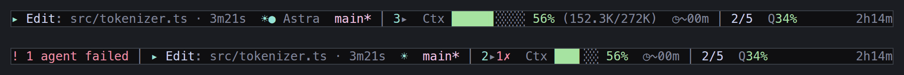
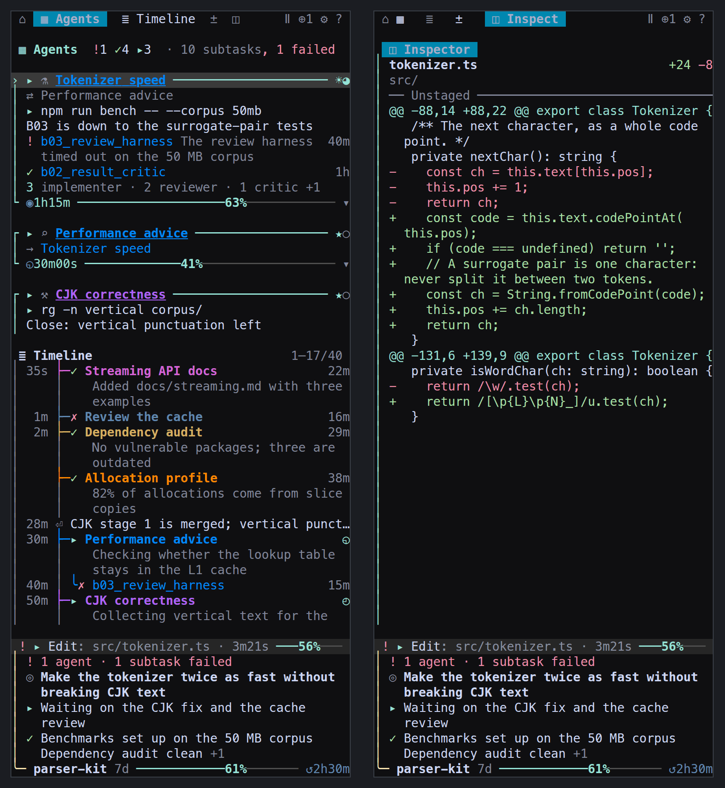
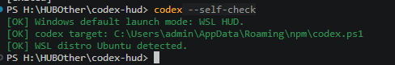
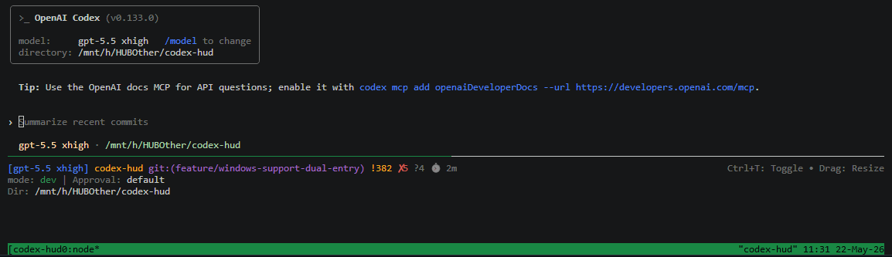

> この日本語版は[現在のソース候補 `e862d759`](https://github.com/CartmanFatass/codex-hud/commit/e862d75914b6ab36f36161fe19b346dac34681e4)の概要です。詳細リンクの参照先は英語です。開発候補であり、リリースや全機能・全環境の検証完了を意味しません。[既存の hosted CI](https://github.com/CartmanFatass/codex-hud/actions/runs/42259248264) が成功していても、新しい `statusline-native-details` 専用テストはコンパイルのみで **NOT_RUN**、新モードのローカル実行・live-client・表示・性能検証も **NOT_RUN** です。

<p align="center">
  <a href="./README.md"></a>
  <a href="./README.zh.md"></a>
  <a href="./README.ja.md"></a>
  <a href="./README.ko.md"></a>
</p>

# Codex HUD

[OpenAI Codex CLI](https://github.com/openai/codex) 用のリアルタイムステータスバー HUD。軽量・設定不要・tmux 内で動作。

> Claude Code の [claude-hud](https://github.com/jarrodwatts/claude-hud) にインスパイアされています。



## なぜ Codex HUD が必要？

**Q: Codex CLI だけで十分では？**

計器なしのフライトと同じです。Codex HUD はターミナル下部に常駐ダッシュボードを表示します：

- **ブランチ・モデル・権限** —— 一目で把握、推測不要
- **Token 使用量（cache 含む）** —— コンテキストの消費量を正確に把握
- **Context ウィンドウ充填バー** —— 上限に近づいたら即座にわかる
- **MCP サーバー状況 & ツール呼び出し** —— Codex が実際に何をしているか監視
- **Reasoning effort レベル** —— 現在の思考深度を表示

**Q: セッションがサブエージェントを起動します。その様子を見られますか？**

はい。`F12` は Codex にフォーカスを残して右のサブエージェントパネルを開閉し、`Shift+F12` は開いてパネルにフォーカスします。バーとパネルは交互に表示され、パネル表示中はバーの情報が footer/status card に移ります。観測できたエージェントのモデル・推論強度・状態・親子関係を確認できます。

`Ctrl+T` は意図的に空けてあります。Codex 自身のトランスクリプト表示のためです。



**Q: tmux を手動で設定する必要がありますか？**

tmux の手動設定は不要で、Codex HUD が起動します。既存の Codex セットアップでは `codex` で HUD を開けます。Bash インストーラーが tmux の自動インストールを提案するのは対話型ターミナルだけです。前提条件が不足する場合や非対話実行で失敗する場合は、表示される手動手順に従ってください。

## クイックスタート

以下は従来の Codex セットアップです。後述のすべての CLI 機能をインストールする手順ではありません。

```bash
git clone https://github.com/CartmanFatass/codex-hud.git
cd codex-hud
./bin/codex-hud-install

# シェルをリフレッシュして、以下を入力：
codex
```

<details>
<summary><b>Windows（WSL デフォルト）</b>：インストール、self-check、PowerShell / cmd コマンド</summary>

Windows の HUD runtime は WSL です。PowerShell と cmd はランチャーとして使い、HUD 本体は Ubuntu WSL の Bash + tmux で動作します。**この Windows インストール手順はネイティブ Windows ホストで未検証です。既存の Codex 設定をバックアップしてから使ってください。** 以下の既存スクリーンショットは、この候補の新しい検証結果ではありません。

1. 従来の Codex セットアップを取得し、インストーラーを起動します：

```powershell
git clone https://github.com/CartmanFatass/codex-hud.git
cd codex-hud
.\bin\codex-hud-install.ps1
```

2. 新しい PowerShell または cmd ウィンドウを開き、WSL runtime を確認します：

```powershell
codex --self-check
```



3. Codex HUD を起動します：

```powershell
codex
```



Notes:

- `codex` は Windows ではデフォルトで WSL HUD を起動します。
- `codex --wsl ...` は同じ WSL HUD パスを明示的に選択し、Codex CLI に渡す前に wrapper 引数を取り除きます。
- native PowerShell HUD は現在、ユーザー向け起動モードとしては未サポートです。legacy native-mode request は fail fast し、WSL HUD の使用を案内します。
- `codex-hud-wsl` は Ubuntu WSL で完全な HUD を起動する明示コマンドです。
- `cmd.exe` ユーザーには、同じ PowerShell entrypoint を呼び出す管理済み `.cmd` shim が提供されます。

**管理コマンド**

初回インストール後、以下のコマンドがシェルに追加されます：

| コマンド | 説明 |
|----------|------|
| `codex-hud-sync` | 現在のチェックアウトを再ビルドしエイリアスを更新 |
| `codex-hud-upgrade` | 最新の変更をプルして再ビルド |
| `codex-hud-uninstall` | エイリアスを削除し HUD セッションを停止 |

</details>

## HUD に何が表示される？

以下は従来の **Codex バー**の合成・説明用 1 行例です。Claude の `hud statusline` の出力例ではありません。

```text
gpt-5.6-astra xhigh │ 152.3K/272K │ synthetic-project main │ ✓ idle
```

モデル・reasoning effort、Codex が報告した最終リクエストの context 使用量/容量、リポジトリ・ブランチ、状態を示します。幅や density、観測できたデータに応じて quota、速度、agents、plan、通知などが加わります。観測がなければ項目を省略するか `unknown`（不明）とし、ゼロや推測値で埋めません。現在のカード・compact 表示は[workbench（英語）](./README.md#development-workbench)、操作は[キー一覧（英語）](./docs/reference.md#keys)を参照してください。

## 使い方

```bash
codex                        # HUD 付きで起動
codex --model gpt-5          # Codex CLI 引数を渡す
codex "help me debug this"   # プロンプト付き
codex-resume                 # 前回のセッションを再開
```

<details>
<summary>その他のコマンド</summary>

```bash
codex-hud --kill             # 現在のディレクトリのセッションを終了
codex-hud --list             # すべての HUD セッションを一覧表示
codex-hud --attach           # 既存セッションにアタッチ
codex-hud --new-session      # 新規セッションを強制作成
codex-hud --self-check       # 環境診断を実行
```

</details>

## 現在の明示的な CLI 入口

以下は上記の Codex/tmux セットアップとは別の入口です。この開発候補を含む、レビュー対象のテストブランチの完全なチェックアウトが必要です。デフォルトブランチを clone しただけでは、これらの機能が含まれるとは限りません。開発には Node 22.x >=22.13 または Node 24 を使います。実際の universal wrapper は Node 22.x >=22.13 または >=24 を受け付け、23 を拒否します。`package.json` の古い `>=18` 指定や Codex 互換経路は、ledger コマンドの Node 18/20 対応を示しません。

リポジトリ内では `node bin/hud ...` を使います。`npm run build` はコマンドをインストールしません。インストール済みなら `hud` が同等の入口、`hud-statusline` が statusline 専用の入口です。`hud-statusline-preview` は別の compact 表示専用プレビューです。以下の ID と絶対パスは説明用のプレースホルダーで、実行成功の記録ではありません。

| コマンド | 用途と制限 |
| --- | --- |
| `node bin/hud --help` | 現在のルーティングを確認。ビルドやインストールは行いません。 |
| `node bin/hud codex [ARG ...]` | 既存の Codex 互換ランチャー。上記の `codex` コマンドも引き続き使えます。 |
| `node bin/hud panel` / `node bin/hud panel --help` | 現在のターミナルに委任パネルを開きます。利用可能なら範囲を限定した観測 worker を使い、利用できなければ読み取り専用の観測を表示します。source/profile 選択引数はありません。 |
| `node bin/hud statusline --details --lang en --width 80` | stdin の Claude ネイティブ情報を詳細表示。下記の合成例を参照。 |
| `node bin/hud pi inspect --source /synthetic/pi --session /synthetic/pi/session.jsonl --json` | 既存ファイルの観測のみ。起動、全文の transcript 出力、identity/control 権限の付与は行いません。 |
| `node bin/hud pi launch --executable /absolute/path/to/pi -- -e /absolute/path/to/codex-hud/extensions/pi/hud-footer.ts` | Pi を明示的にローカルの foreground で起動し、任意の footer を読み込みます。管理された委任ではありません。 |
| `node bin/hud claude --help` | profile を使う起動構文を確認。この候補に同梱されたレビュー済み launch/resume capability cells は空で、起動成功を保証しません。 |
| `node bin/hud run --help` | `status` / `cancel` / `reconcile` / `resume` / `wait`。読み取り例は `node bin/hud run status synthetic-run --json`。他の引数は help で確認してください。 |
| `node bin/hud cache show --json` | cache v2 設定のスナップショットと助言を読み取ります。セッションデータや digest キャッシュではありません。 |
| `node bin/hud link export --json --schema-version 1` | メタデータの読み取り専用出力。ローカルパスは明示的な `--paths local` の場合のみ。`--link ID` は繰り返せます。出力ファイルは自動保存しません。 |
| `node bin/hud migrate --help` | Linux 限定の明示的な表示設定移行。`codex-display-v1` で既存の private な source/target を選び、preview 後、その入力 digest に結び付いた apply を行います。認証情報、material/outbound grants、キャッシュはコピーしません。 |
| `node bin/hud digest --help` | 完了済みレポート 1 件を手動で要約。下記の許可境界を参照。 |

ledger を使う操作には、絶対・canonical・private・同一 uid 所有の既存 `HUD_HOME` と互換 store が必要です。これらの例は初期化を行いません。stdin のネイティブ表示や `pi inspect --source` には通常 ledger は不要です。`cancel` の受付は終了の証拠ではなく、visible run の cancel は signal を送れません。`resume` には検証済み capability の証拠が必要です。`wait` の期限到達は cancel ではありません。移行は[正確な手順（英語）](./docs/cloud-development/reversible-migration.md#preview-review-apply-select-restore)を確認してください。

### Claude statusline: compact と明示的な details

合成入力の例です。実行結果を採取したものではありません。

```sh
printf '%s' '{"model":{"display_name":"Claude"},"context_window":{"used_percentage":42},"cost":{"total_cost_usd":0.12}}' | node bin/hud statusline --details --lang en --width 80
```

期待される説明用の 1 行目は `model Claude · ctx [####------] 42% · cost $0.12` です。`--details` と `--lang` を両方省くと、従来の compact 表示 `Claude · ctx 42% · $0.12` になります。`--lang` は `--details` が必須で、`en`（既定）または `zh` のみです。`--lang zh` も選べますが、`--lang ja` / `--lang ko`、自動言語選択、`=` 形式、言語設定の永続化はありません。重複や不正な構文は拒否します。`hud-statusline-preview` は新しいスイッチを受け付けません。この翻訳は runtime の日本語対応を追加するものではありません。

- 入力は UTF-8 JSON オブジェクト 1 個、最大 64 KiB。1 秒の入力ガードは応答時間の保証ではありません。幅は 1–500 で、`--width`、有効な `COLUMNS`、有効な TTY 幅、80 の順に選びます。狭い幅では任意の情報を先に省き、最後にモデル名を切り詰めます。汎用の入力・引数エラーは生の入力を表示しません。
- 与えられたモデル、使用率・残量率、推定セッション USD、ディレクトリ、入出力・window・cache の件数、ミリ秒の時間、追加・削除行数を表示できます。欠損・不正な値の区画は省略し、有効なゼロは保持します。残量は独立した値で、`100-used` から計算しません。ディレクトリは表示文字列であり source の権限ではありません。費用は請求額・残高・quota ではありません。[各フィールドの意味（英語）](./docs/statusline/native-details.md#admitted-facts-and-absence)を参照してください。
- ネイティブの Git/PR 検索、effort/quota、tools/Todos、速度、toktrack tee、推測による合計、別系統の upstream `subagentStatusLine` は対象外です。renderer が純粋関数でも、製品コマンド全体がファイルシステムに触れないとは限りません。
- 明示的な `--source ABSOLUTE_CLAUDE_ROOT` または `CLAUDE_CONFIG_DIR` と互換 ledger があれば、既存の範囲限定・読み取り専用の共有 summary/fallback を使えます。任意の 2 行目は常に直接の子に関する `partial`（部分的な証拠）で、ツリー全体の合計ではありません。transcript は収集せず、`cwd` / `transcript_path` から source を推測しません。証拠がなければ 1 行目を保ちます。言語選択の対象はネイティブの 1 行目だけです。[summary の意味と予算・検証境界（英語）](./docs/statusline/delegation-summary.md)を参照してください。

settings は**別の明示的な Linux 限定操作**です。次のパスも架空のプレースホルダーです。

```sh
node bin/hud statusline settings preview > /absolute/private/statusline-plan.json
node bin/hud statusline settings apply --plan /absolute/private/statusline-plan.json
node bin/hud statusline settings restore --backup /absolute/path/returned-by-apply.json
```

preview を確認し、apply が返す backup パスを使ってください。stdout の保存先は backup ではありません。backup を保管し、競合する書き込みを止めてから操作します。通常の render/build/help はインストールを行わず、`--details` も自動でインストールしません。macOS/Windows の settings インストールは未対応です。協調しない writer やクラッシュ後の不確かな結果は調査が必要で、盲目的に再試行しないでください。[安全性と復旧手順（英語）](./docs/statusline/product-settings.md#optional-installation-workflow)を参照してください。

### Pi の観測と footer

`pi inspect` は絶対 source または正確な profile のどちらか 1 つと、その中に含まれる絶対 session ファイル 1 つを選びます。モデル名から context window は推測しません。範囲を限定した header 確認に加え、4 MiB・2,000 records・soft 20 ms が上限です。`partial` と継続位置を明示し、再実行は新しい観測を始めます。終了コード 0 は完全な観測、6 は不完全な観測です。`pi launch` はネイティブの設定・認証情報で foreground 起動し、`--` 以降をそのまま渡し、継承された managed claims を除きます。検証済み binding、MCP セットアップ、管理された委任にはなりません。

footer は文書に固定された Pi 1.4.0 API に対する、明示的な TUI 専用読み込みです。全バージョンや live-provider の互換性を意味しません。`/hud-footer off` はそのセッションでネイティブ footer に戻し、選択は保存しません。共有 HUD 情報にはさらに明示的な `HUD_HOME` と `HUD_PI_SOURCE_ROOT`、一致するネイティブ identity/location、公開済み cache が必要です。footer は source の scan/collector を開始しません。共有の証拠がなくてもネイティブ情報は残ります。[読み込み方法（英語）](./docs/cloud/pi-footer.md#try-it-explicitly)を参照してください。

### 手動の完了レポート digest と操作の境界

```text
node bin/hud digest plan --run RUN --report REPORT --json
node bin/hud digest run --run RUN --report REPORT --expected-ledger LEDGER_ID --expected-recipient RECIPIENT_ID --json
```

`RUN` / `REPORT` / `LEDGER_ID` は明示的な安全な token（ASCII 英数字・`_`・`-`、1–128 文字）に置き換えます。`RECIPIENT_ID` は plan と現在の解決結果が示す正確な小文字 64 桁の hex ID で、推測したアカウント名ではありません。plan はメタデータだけを読み、summary を送信せず、再利用できる許可証でもありません。run は現在の選択を再解決し、両方の許可がある場合だけ、認証済みの完了レポート **1 件の公開 summary**（最大 32 KiB UTF-8・8,000 Unicode code points）を送信できます。完了レポートやモデルが書いた digest は、プロセス終了や作業の正しさを証明しません。

private な `HUD_HOME/sources/<actual sourceId>/model.json` で、手動 API digest、正確な full-ref の delegated/result/digest material scope、有限の hourly cap を明示的に有効にする必要があります。独立した `outbound.json` が具体的な recipient を許可します。設定の欠損・不正は拒否し、既存の Codex/native/resultDigest 許可は引き継ぎません。CLI はこれらの設定を書かず、ledger を作らず、`reportPath` / transcripts / stdout / parent・task text を読まず、プロセス操作権限も与えません。`language` は `en` / `zh` のみです。この候補には日本語・韓国語、CLI/agy backend、`latest`、batch/watch、background/panel 生成、notes の save/show、`digest config`、`digest policy`、自動 scheduler はありません。[コマンド（英語）](./docs/cloud/f4-digest-cli.md#commands)と[独立した source 設定・許可（英語）](./docs/cloud/f4-digest-cli.md#explicit-private-source-configuration)を確認してください。

認証済み parent の MCP `delegate_close({linkId, expectedRun, request_key, grace?})` は、confirmed/current-owned の headless 関係だけを、独立した終了確認後に閉じられます。受付後も pending の場合があります。cancel と close は別で、close は履歴を削除しません。`hud run close`、汎用 local-manager close、visible-pane close ではありません。visible close、再オープン、live send/ask、休止中の HUD chat UI は利用できません。[headless 委任を閉じる境界（英語）](./packages/hud-mcp/README.md#end-a-headless-delegation)を参照してください。

## 設定

### 環境変数

| 変数 | デフォルト | 説明 |
|------|------------|------|
| `CODEX_HUD_DENSITY` | `balanced` | ステータスバーの情報量（`focus` / `balanced` / `full`） |
| `CODEX_HUD_THEME` | `terminal` | 配色（`terminal` / `mocha` / `latte` / `titanium` / `none`） |
| `CODEX_HUD_GLYPHS` | `both` | モデル表記（`glyph` / `text` / `both`） |
| `CODEX_HUD_POSITION` | `bottom` | HUD ペインの位置（`top` / `bottom`） |
| `CODEX_HUD_HEIGHT` | 1 行 | HUD の高さ（行数） |
| `CODEX_HUD_MOUSE` | `1` | マウス/トラックパッドスクロールを有効化 |

<details>
<summary>その他の従来の環境変数</summary>

| 変数 | デフォルト | 説明 |
|------|------------|------|
| `CODEX_HUD_NOTIFY` | `0` | 失敗とエージェント終了を tmux で通知 |
| `CODEX_HUD_NOTIFY_COOLDOWN` | `300` | 同種の通知のクールダウン秒数 |
| `CODEX_HUD_REDUCED_MOTION` | `0` | 通信マーカーのアニメーションを止める |
| `NO_COLOR` | (未設定) | 値があれば `none` 配色を強制 |
| `CODEX_HUD_HEIGHT_AUTO` | `0` | 幅に基づいて高さを自動調整 |
| `CODEX_HUD_HEIGHT_MIN` | `CODEX_HUD_HEIGHT` | 自動モードの最小高さ |
| `CODEX_HUD_HEIGHT_MAX` | `12` | 自動モードの最大高さ |
| `CODEX_HUD_AUTO_ATTACH` | `0` | 同ディレクトリの最新セッションに自動アタッチ |
| `CODEX_HUD_ALTERNATE_SCREEN` | `0` | codex ペインの tmux alternate-screen |
| `CODEX_HUD_CLEAR_SCROLLBACK` | `0` | 初回レンダリング時にスクロールバックをクリア |
| `CODEX_HUD_CWD` | （未設定） | 作業ディレクトリを上書き |
| `CODEX_HOME` | `~/.codex` | Codex ホームディレクトリ |
| `CODEX_SESSIONS_PATH` | （未設定） | sessions ディレクトリを上書き |

</details>

### 10 個の表示・設定エイリアス

接頭辞全体の置き換えではなく、対応は次の 10 個だけです。

| 中立名 | 従来名 |
| --- | --- |
| `HUD_SETTINGS_PATH` | `CODEX_HUD_SETTINGS_PATH` |
| `HUD_THEME` | `CODEX_HUD_THEME` |
| `HUD_DENSITY` | `CODEX_HUD_DENSITY` |
| `HUD_GLYPHS` | `CODEX_HUD_GLYPHS` |
| `HUD_ICONS` | `CODEX_HUD_ICONS` |
| `HUD_LOOK` | `CODEX_HUD_LOOK` |
| `HUD_REDUCED_MOTION` | `CODEX_HUD_REDUCED_MOTION` |
| `HUD_CONTEXT` | `CODEX_HUD_CONTEXT` |
| `HUD_TREE_WIDTH` | `CODEX_HUD_TREE_WIDTH` |
| `HUD_CLEAR_SCROLLBACK` | `CODEX_HUD_CLEAR_SCROLLBACK` |

```sh
HUD_THEME=latte HUD_DENSITY=focus node bin/hud panel
```

中立名が存在すれば、空または不正な値でも従来名より優先します。値の選択が検証より先なので、不正な中立値から従来値へは戻りません。保存済み表示設定が引き続き優先し、空でない `NO_COLOR` が最後に色を無効化します。選択された settings override が空なら既存の `CODEX_HOME/hud-settings.json` を使い、隠された従来側のパスには戻りません。

選択する既存 settings ファイルは source ごとの汎用モデル設定ではなく、移行や material/outbound 許可も行いません。`HUD_HOME` は引き続き ledger の場所を指定し、Codex の cache/既定 settings の場所は変わりません。shell/Windows の起動制御は従来名のままです。`HUD_PI_SOURCE_ROOT` は別途定義された Pi source selector で、汎用 alias 規則ではありません。[優先順位（英語）](./docs/cloud/e2-hud-env.md#supported-names-and-precedence)と[完全な設定リファレンス（英語）](./docs/reference.md#configuration)を参照してください。

### config.toml

HUD は `CODEX_HOME/config.toml` から設定を読み取ります：

```toml
model = "gpt-5.2-codex"
approval_policy = "on-request"
sandbox_mode = "workspace-write"

[mcp_servers.my-server]
command = ["node", "server.js"]
enabled = true
```

## 対応システム

この表は従来の Codex セットアップの対応表をそのまま残したものです。新しい CLI、provider、インストール、各プラットフォームの検証完了を示しません。各機能の Linux 限定などの制約は上記を参照してください。

| プラットフォーム | 状態 |
|------------------|------|
| Linux | 対応済み |
| macOS (Apple Silicon) | 対応済み |
| macOS (Intel) | テスト待ち |
| Windows PowerShell | ランチャー shell として対応、native PowerShell HUD は未サポート |
| Windows cmd | 管理済み `.cmd` shim で対応 |
| Windows WSL Ubuntu | Windows のデフォルト HUD パスとして対応 |

## 詳細リファレンス（英語）

- [既存 workbench](./README.md#development-workbench)
- [パネル](./docs/reference.md#the-panel)
- [キー](./docs/reference.md#keys)
- [設定](./docs/reference.md#configuration)
- [従来状態の機械可読出力](./docs/reference.md#machine-readable-state)
- [明示的な CLI 入口](./docs/cloud/product-cli.md)
- [ネイティブ details のコマンド](./docs/statusline/native-details.md#commands-and-api)
- [ネイティブ情報の意味](./docs/statusline/native-details.md#admitted-facts-and-absence)
- [部分的な委任 summary](./docs/statusline/delegation-summary.md)
- [明示的な statusline 設定](./docs/statusline/product-settings.md#optional-installation-workflow)
- [10 個の中立エイリアス](./docs/cloud/e2-hud-env.md#supported-names-and-precedence)
- [Pi footer の明示的な読み込み](./docs/cloud/pi-footer.md#try-it-explicitly)
- [手動 digest コマンド](./docs/cloud/f4-digest-cli.md#commands)
- [独立した source 設定・許可](./docs/cloud/f4-digest-cli.md#explicit-private-source-configuration)
- [認証済み parent の headless close](./packages/hud-mcp/README.md#end-a-headless-delegation)
- [表示設定の移行](./docs/cloud-development/reversible-migration.md#preview-review-apply-select-restore)
- [現在のクラウド開発ガイド](./docs/cloud-development/README.md)
- [プレビューの正確な範囲（インストーラーではありません）](./docs/cloud-development/checks-and-preview.md#exact-preview-selection)

## 開発

以下はユーザーが完全なソースチェックアウトで実行する既存の開発コマンドです。ledger 機能には必要に応じて `npm run build:hud-mcp` も行います。ビルド成功だけで機能検証が完了するわけではありません。現在の手順と証拠の範囲は上記のクラウド開発ガイドを確認してください。

```bash
npm install && npm run build   # ビルド
npm run dev                    # ウォッチモード
node dist/index.js             # HUD を直接実行
```

## 変更履歴

| 日付 | 変更内容 |
|------|----------|
| 2026-05-22 | Windows current branch の WSL download/self-check/run 手順とスクリーンショットを追加 |
| 2026-04-09 | クイックインストール/同期/アップグレード/アンインストールコマンドを追加 |
| 2026-04-09 | HUD セッションを tmux ペインにバインド、reasoning effort を表示 |
| 2026-02-09 | リサイズ後のメインペインフォーカス修正、マウススクロールのデフォルト改善 |
| 2026-02-09 | セッションアタッチのデフォルトとスクロールバック設定を更新 |

ドキュメント更新履歴：

| Date       | Summary of Changes |
|------------|--------------------|
| 2026-05-22 | Windows ユーザー向けに current branch のダウンロード、self-check、WSL 起動手順とスクリーンショットを追加。 |

## ライセンス

MIT

## クレジット

Jarrod Watts の [claude-hud](https://github.com/jarrodwatts/claude-hud) にインスパイアされています。[OpenAI Codex CLI](https://github.com/openai/codex) 用に構築。
