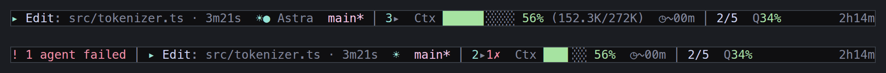
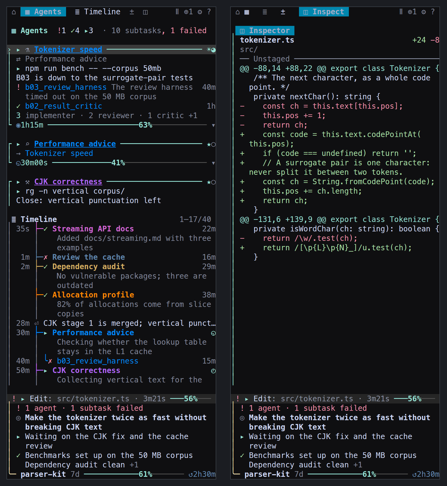

> **참고:** 이 한국어 번역은 요약본이며 최신 내용이 반영되지 않았을 수 있습니다. 전체 문서는 [README.md](./README.md)(영어)를 참조하세요.

<p align="center">
  <a href="./README.md"></a>
  <a href="./README.zh.md"></a>
  <a href="./README.ja.md"></a>
  <a href="./README.ko.md"></a>
</p>

# Codex HUD

[OpenAI Codex CLI](https://github.com/openai/codex)를 위한 실시간 상태 표시줄 HUD. 경량, 무설정, tmux 내 동작.

> Claude Code의 [claude-hud](https://github.com/jarrodwatts/claude-hud)에서 영감을 받았습니다.



## 왜 Codex HUD가 필요한가요?

**Q: Codex CLI만으로 충분하지 않나요?**

계기판 없이 비행하는 것과 같습니다. Codex HUD는 터미널 하단에 상시 대시보드를 제공합니다:

- **브랜치, 모델, 권한** — 한눈에 파악, 추측 불필요
- **Token 사용량 (cache 포함)** — 컨텍스트 소비량을 정확히 파악
- **Context 윈도우 채움 바** — 한계에 가까워지면 즉시 인지
- **MCP 서버 상태 & 도구 호출** — Codex가 실제로 무엇을 하는지 모니터링
- **Reasoning effort 레벨** — 현재 사고 깊이 표시

**Q: 세션이 서브에이전트를 생성합니다. 무엇을 하는지 볼 수 있나요?**

네. `F12`를 누르면 오른쪽에 **서브에이전트 트리**가 열립니다. 세션이 생성한 각 에이전트, 모델과 추론 강도, 실행 중인지 종료됐는지 실패했는지, 그리고 어느 에이전트가 생성했는지를 보여줍니다. `F12`를 다시 누르면 닫힙니다. 그동안 상태 표시줄은 계속 유지됩니다.

`Ctrl+T`는 의도적으로 비워 두었습니다. Codex 자체의 트랜스크립트 오버레이용입니다.



**Q: tmux를 수동으로 설정해야 하나요?**

아닙니다. Codex HUD가 tmux를 자동으로 활성화합니다. `codex`만 입력하면 HUD가 나타납니다. tmux가 설치되지 않은 경우에도 설치 프로그램이 처리합니다.

## 빠른 시작

```bash
git clone https://github.com/CartmanFatass/codex-hud.git
cd codex-hud
./install --with claude,pi,codex

# 셸을 새로고침하고 출력된 Codex 함수를 추가한 후 실행:
codexH() { hud codex "$@"; }
codexH
```

## HUD에 무엇이 표시되나요?

```
[gpt-5.4 xhigh] █████░░░░ 45% │ my-project git:(main ●) │ 12m
mode: dev | 3 extensions | 2 AGENTS.md | Approval: on-req | Sandbox: ws-write
Tokens: 50.2K (in: 35.0K, cache: 5.0K, out: 15.2K) | Ctx: ████░░░░ 45% (50.2K/128K) ↻2
Dir: ~/my-project | Session: abc12345 | CLI: 0.4.2
◐ Edit: file.ts | ✓ Read ×3
```

| 행 | 내용 |
|----|------|
| **헤더** | 모델 + effort, context 바, 프로젝트명, git 브랜치, 세션 타이머 |
| **환경** | 설정 수, 작업 모드, MCP 서버, 명령 파일, 승인/샌드박스 |
| **Tokens** | 총 token (입력/cache/출력 내역), context 채움률, compact 횟수 |
| **Session** | 작업 디렉토리, Session ID, CLI 버전 |
| **활동** | 실행 중인 도구 호출, 최근 도구 이력 |

## 사용법

```bash
codex                        # HUD와 함께 실행
codex --model gpt-5          # Codex CLI 인수 전달
codex "help me debug this"   # 프롬프트 포함
codex-resume                 # 이전 세션 재개
```

<details>
<summary>추가 명령어</summary>

```bash
codex-hud --kill             # 현재 디렉토리의 세션 종료
codex-hud --list             # 모든 HUD 세션 목록
codex-hud --attach           # 기존 세션에 연결
codex-hud --new-session      # 새 세션 강제 생성
codex-hud --self-check       # 환경 진단 실행
```

</details>

## 설정

### 환경 변수

| 변수 | 기본값 | 설명 |
|------|--------|------|
| `CODEX_HUD_DENSITY` | `balanced` | 상태 표시줄 정보량 (`focus` / `balanced` / `full`) |
| `CODEX_HUD_THEME` | `terminal` | 팔레트 (`terminal` / `mocha` / `latte` / `none`) |
| `CODEX_HUD_GLYPHS` | `both` | 모델 배지 표기 (`glyph` / `text` / `both`) |
| `CODEX_HUD_POSITION` | `bottom` | HUD 패인 위치 (`top` / `bottom`) |
| `CODEX_HUD_HEIGHT` | 터미널의 1/6 | HUD 높이 (행 수) |
| `CODEX_HUD_MOUSE` | `1` | 마우스/트랙패드 스크롤 활성화 |

<details>
<summary>모든 환경 변수</summary>

| 변수 | 기본값 | 설명 |
|------|--------|------|
| `CODEX_HUD_NOTIFY` | `0` | 실패와 에이전트 종료를 tmux로 알림 |
| `CODEX_HUD_NOTIFY_COOLDOWN` | `300` | 같은 종류 알림의 쿨다운 초 |
| `CODEX_HUD_REDUCED_MOTION` | `0` | 통신 마커 애니메이션 중지 |
| `NO_COLOR` | (미설정) | 값이 있으면 `none` 팔레트 강제 |
| `CODEX_HUD_HEIGHT_AUTO` | `0` | 너비에 따라 높이 자동 조정 |
| `CODEX_HUD_HEIGHT_MIN` | `CODEX_HUD_HEIGHT` | 자동 모드 최소 높이 |
| `CODEX_HUD_HEIGHT_MAX` | `12` | 자동 모드 최대 높이 |
| `CODEX_HUD_AUTO_ATTACH` | `0` | 같은 디렉토리의 최신 세션에 자동 연결 |
| `CODEX_HUD_ALTERNATE_SCREEN` | `0` | codex 패인의 tmux alternate-screen |
| `CODEX_HUD_CLEAR_SCROLLBACK` | `0` | 첫 렌더링 시 스크롤백 초기화 |
| `CODEX_HUD_CWD` | (미설정) | 작업 디렉토리 재정의 |
| `CODEX_HOME` | `~/.codex` | Codex 홈 디렉토리 |
| `CODEX_SESSIONS_PATH` | (미설정) | sessions 디렉토리 재정의 |

</details>

### config.toml

HUD는 `CODEX_HOME/config.toml`에서 설정을 읽습니다:

```toml
model = "gpt-5.2-codex"
approval_policy = "on-request"
sandbox_mode = "workspace-write"

[mcp_servers.my-server]
command = ["node", "server.js"]
enabled = true
```

## 지원 시스템

| 플랫폼 | 상태 |
|--------|------|
| Linux | 지원됨 |
| macOS (Apple Silicon) | 지원됨 |
| macOS (Intel) | 테스트 대기 |
| Windows WSL Ubuntu | 지원됨 (HUD는 WSL에서 실행) |
| 네이티브 Windows (PowerShell / cmd) | 미지원 |

## 개발

```bash
npm install && npm run build   # 빌드
npm run dev                    # 감시 모드
node dist/index.js             # HUD 직접 실행
```

## 변경 이력

| 날짜 | 변경 사항 |
|------|-----------|
| 2026-05-22 | Windows current branch의 WSL download/self-check/run 절차와 스크린샷 추가 |
| 2026-04-09 | 빠른 설치/동기화/업그레이드/제거 명령어 추가 |
| 2026-04-09 | HUD 세션을 tmux 패인에 바인딩; reasoning effort 표시 |
| 2026-02-09 | 리사이즈 후 메인 패인 포커스 수정; 마우스 스크롤 기본값 개선 |
| 2026-02-09 | 세션 연결 기본값 및 스크롤백 설정 업데이트 |

문서 변경 이력:

| Date       | Summary of Changes |
|------------|--------------------|
| 2026-05-22 | Windows 사용자를 위한 current branch 다운로드, self-check, WSL 실행 절차와 스크린샷을 추가. |

## 라이선스

MIT

## 크레딧

Jarrod Watts의 [claude-hud](https://github.com/jarrodwatts/claude-hud)에서 영감을 받았습니다. [OpenAI Codex CLI](https://github.com/openai/codex)를 위해 제작되었습니다.
