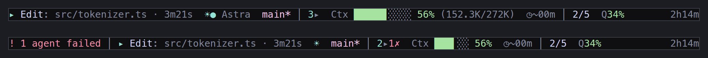
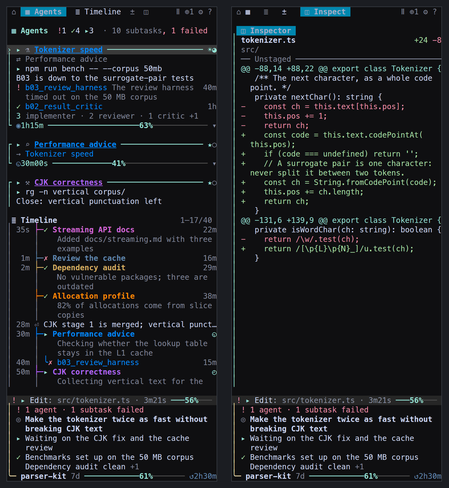
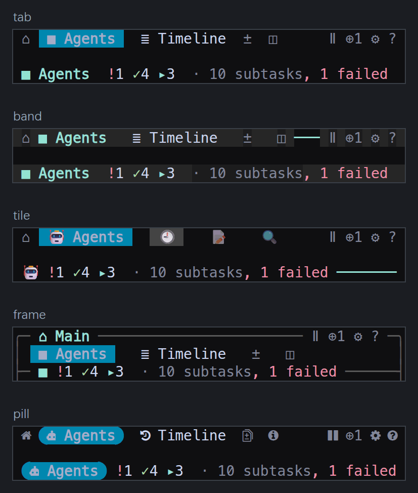

<p align="center">
  <a href="./README.md"></a>
  <a href="./README.zh.md"></a>
  <a href="./README.ja.md"></a>
  <a href="./README.ko.md"></a>
</p>

# Codex HUD

Real-time statusline HUD for [OpenAI Codex CLI](https://github.com/openai/codex). Lightweight, zero-config, works inside tmux.

> Inspired by [claude-hud](https://github.com/jarrodwatts/claude-hud) for Claude Code.



## Why Codex HUD?

**Q: Codex CLI already works. Why do I need a HUD?**

Because you're flying blind without one. Codex HUD gives you a persistent dashboard at the bottom of your terminal:

- **Branch, model, permissions** — at a glance, no guessing
- **Token usage (including cache)** — know exactly how much context you've burned
- **Context window fill bar** — see when you're about to hit the wall
- **MCP server status & tool calls** — watch what Codex is actually doing
- **Reasoning effort level** — see the current thinking depth

**Q: My session spawns subagents. Can I see what they are doing?**

Yes. Press `F12` to open the **subagent tree** in a side panel: every agent the session spawned, its model and reasoning effort, whether it is running, finished, or failed, and which agent spawned it. Press `F12` again to close it. The panel takes the status bar's place while it is open: the bar's fields move to the panel's foot, so Codex keeps the whole height and nothing is shown twice.

`Ctrl+T` is left alone on purpose — that is Codex's own transcript overlay.



**Q: Do I need to set up tmux manually?**

No. `codexH` (the shell function printed by the installer) starts Codex with the HUD's tmux bar. tmux must be available.

## Quick Start

```bash
git clone https://github.com/CartmanFatass/codex-hud.git
cd codex-hud
./install --with claude,pi,codex

# Add the printed Codex function to your shell, then launch:
codexH() { hud codex "$@"; }
codexH
```

The bottom status lines are always on: ordinary `claude` uses Claude's statusline,
ordinary `pi` loads the HUD footer, and `codexH` brings Codex's tmux bar. An existing
owner-defined non-HUD Claude statusline is preserved. Only the side panel is opt-in:
open it with `/hud` in Claude or pi, or F12 in Codex; it never opens at launch.

### Font

The panel's icons, the pills' rounded ends and the frame are glyphs that **MesloLGS NF**, the Nerd Font powerlevel10k uses, draws one column wide; another font draws some of them from a fallback at another size, or not at all. Nothing installs it for you: `bin/codex-hud-fonts` is a standalone, optional script you run yourself.

- On Linux and macOS it installs its four faces for your user, into `~/.local/share/fonts` on Linux (then runs `fc-cache`) or `~/Library/Fonts` on macOS.
- In WSL the terminal that draws the panel is a Windows program, so the font belongs on Windows: `bin/codex-hud-fonts` run in WSL only says whether Windows has it and how to add it, and writes nothing.

The files come from one pinned commit of [romkatv/powerlevel10k-media](https://github.com/romkatv/powerlevel10k-media), from GitHub or else jsDelivr's copy of it, and each must match its SHA-256. Then set the terminal's font to `MesloLGS NF` (Windows Terminal: Settings → Profiles → Defaults → Appearance → Font face). `bin/codex-hud-fonts --check` says whether it is installed. The HUD runs without it, some icons then drawn by another font.

## What's on the HUD?

One line, pinned to the bottom of the terminal, read left to right without
gaps: what the session runs on, then the main session now, then the notice
zone, which takes the columns left. What Codex loaded sits at the right edge.
A dimmed `│` divides the fields:

```
gpt-5.6-astra xhigh │ ━━━━━╸──── 152.3K/272K │ parser-kit main*↑2 │ 7d 61% │ ▸  3:21 │  42 tok/s │ Agents 4▸ 4✓ │ Tasks 2/5 │ Edit src/tokenizer.ts                             MCP 2  skills 9  hooks 1
```

When something needs you, it leads the notice zone; what just happened
follows it:

```
gpt-5.6-astra xhigh │ ━━━━━╸──── 152.3K/272K │ parser-kit main*↑2 │ 7d 61% │ ▸  3:21 │  42 tok/s │ Agents 3▸ 4✓ 1✗ │ Tasks 2/5 │  ✗ 1 agent · 1 subtask failed   ✓ streaming_docs finished · 12s ago
```

| Field | Means |
|-------|-------|
| `gpt-5.6-astra xhigh` | The model by its name, and its reasoning effort, dim |
| `━━━━━╸──── 152.3K/272K` | The context the last request held, against the model's whole window, as Codex reported them. The meter and the numbers stay plain below 70%, turn yellow past 70% and red past 85% |
| `parser-kit main*↑2` | The repository the session works in, its branch, uncommitted changes, ahead/behind |
| `7d 61%` | The account's usage, one reading: the tightest window. Once that window is spent and credits carry the account on, the balance stands in its place, `credits 6.8K`; spent with no credits, it reads `7d 100%` in red |
| `▸  3:21` | The session's state: while it works, the turn's clock; idle, `✓ idle` |
| `42 tok/s` | The main session's output rate, a whole number. A turn that has not been sampled yet, and an idle session, keep the last rate, dim |
| `Agents 4▸ 4✓` | The agents the main session started: running, finished, failed (`1✗`), as the panel's title counts them |
| `Tasks 2/5` | Steps completed in the plan Codex wrote, when it wrote one |
| `✗ 1 agent · 1 subtask failed` | Something that needs you: an approval waiting (`! approval needed 2m`, with how long it has waited), or a tool, agent, subtask or guardian review that failed, said as one phrase |
| `✓ streaming_docs finished · 12s ago` | The notice zone. For a minute, in colour, what just happened: an agent finished or failed, a turn ended (`✓ turn done in 12:48`), the account went on to its credits. Then, while Codex works, the tool at work and what it works on (`Edit src/tokenizer.ts`, or the command a script runs); idle, the last notice, dim, with how long ago |
| `MCP 2  skills 9  hooks 1` | MCP servers in `config.toml`, the skills Codex can load here (its home's, the bundled ones, `~/.agents/skills` and the repository's), and the handlers in `hooks.json` |

A field appears only when there is real data behind it. A missing quota
snapshot means no quota field, not a reading of zero.

The bar holds still while the session runs: the clock and the rate keep their
columns whatever their length, and the notice zone keeps the same share of
the line whatever it says, so nothing before it moves.

Clicking the bar acts on the field under the cursor: the alert and the agent
counts open the panel and hand it the keyboard, the context, quota and plan
open it and leave the cursor in Codex, and anywhere else toggles the panel as
the whole bar used to.

### When the pane is narrow

The right cluster leaves first, then the effort and the context meter; then
the notice zone gives up its share and takes only what is left, and the
agents' label, the branch and the clock go; then fields go, the least
important first. An alert is never dropped. At 40 columns, with a failure on
screen:

```
gpt-5.6-astra │ 152.3K/272K │ ▸ │  ✗
```

### Density presets

| Preset | Shows |
|--------|-------|
| `focus` | Alerts, the notice zone, state, model, context, repository |
| `balanced` (default) | Focus, plus usage, output rate, agents, plan progress, and MCP, skills and hooks |
| `full` | Everything, plus approval/sandbox, the session's tokens and its id |

```bash
CODEX_HUD_DENSITY=focus codex
```

## Development workbench

New `codexH` launches use the compact bottom bar. `F12` opens the right panel without taking focus from Codex; `Shift+F12` opens and focuses it. Claude and pi open their panel with `/hud`; no panel opens at launch.

**Outside modal pages, the panel forwards ordinary input to Codex.** Every panel command is the **prefix key, `Ctrl+\`, then one key**: `Ctrl+\` `,` opens settings, `Ctrl+\` `?` the help, `Ctrl+\` `b` pauses the brief (the full list is in [the reference](./docs/reference.md#keys), and the help's Shortcuts section). The prefix works wherever the cursor is, in Codex's pane or in the panel; `Ctrl+\` `j` `j` `j` moves three rows, since the moves repeat for half a second without the prefix. A command that needs the panel opens it first. Anything typed without the prefix goes to Codex: with the cursor in the panel (after `Shift+F12`, or a click), keys and pastes are passed to Codex's pane exactly as typed, a paste stays one bracketed paste, and the cursor moves back to Codex with them. Settings and Help capture their own navigation keys. Close the page with `Esc` or its Back button to resume normal forwarding. The mouse works as before.

`Ctrl+\` twice sends `Ctrl+\` itself to the pane with the cursor. `Ctrl+\` is the prefix on a fresh install because Codex 0.160 binds `Ctrl+]` to *Skip Question* (no Codex 0.160 binding uses `Ctrl+\`). A settings file saved before this change, with no prefix of its own, keeps `Ctrl+]`; Settings → Input → Prefix key switches between the two (`Ctrl+G`, Codex's external editor, and `Alt+]`, which a terminal sends as the start of an escape sequence, are not offered). With `Ctrl+]` as the prefix, Codex's Skip Question is `Ctrl+]` `Ctrl+]`. The prefix is a key table in the HUD's own tmux session: the server's root and `Ctrl+B` tables are untouched. A changed prefix is installed at once for the panel that saved it; a session started before this version keeps its old keys until it is launched again.

Home is the only page: questions, compact job cards and current decisions. `1` returns Home; `3` / `Ctrl+\ 3` opens Changes, now only branch/HEAD, ahead/behind and staged/unstaged/untracked counts, plus one path/branch/dirty-or-clean row per worktree. There are no file lists, previews or diffs. `v` / `4` opens the agent/job Inspector. Settings and Help remain; the old Agents pane stays until NATIVE-TREE. Timeline, the activity hub, Summary, diagnostics pages and the stacked-versus-tabs preference are removed.

**Two layouts** (Settings → Panel → Layout): **rich**, the default, gives every visible agent the main session started the same configurable card, active or idle. There is no expand/collapse: Settings → Cards controls each field independently, including the latest AI summary and child-agent one-sentence summaries. Child scope defaults to live and important tasks; names and status always remain. Child role counts independently hides the footer counts without hiding child rows or summaries. Click selects, Enter or Space opens the Inspector. **compact** is the tree, one row per agent and subtask, with the brief, the recap and the agent log under it. Both count alike, as the status card, the bar and `codex-hud --json` do: the agents the main session started, their subtasks and the guardian reviews, each apart.

**Card presets** (Settings → Cards) offer `minimal` (task label and summary), `progress` (adds the current action, child agents and their sentences), and `monitor` (adds relations, role/review counts, model, clock, rate and context). Individual switches stay editable; a non-matching combination reads `custom`. The preset is derived, not saved as a separate `cardPreset` field, and changes only thirteen content booleans—not child scope, corners, model permissions or backend/API/call-cap settings. Name and status always remain. See [Card settings](./docs/reference.md#card-settings).

Cards keep progress status brief (queued, writing, failed or capped). The Inspector shows the newest model note and the reason generation is unavailable or waiting, with explicit Coverage/Generated timestamps only when known; old notes say Recorded instead. Stored model notes remain visible when models are off or paused; observed logs keep their own switch.

**Look** (Settings → Display → Look, or `CODEX_HUD_LOOK`) draws the bar and the panes' titles in one of five ways: tab (the default), band, tile, frame and pill.



**The status card** at the foot carries the bar's fields while the panel is open and, at its full level, the main session's brief; `Ctrl+\` `r` steps through its three levels.

Settings → LLM shows calls this hour against the shared hourly cap, including zero and with model text off. Test API (`t`) uses fixed synthetic messages within that same cap. Full agent evidence and progress reasons stay in the Inspector.

The rest is in **[the reference](./docs/reference.md)**: the panes and both layouts in full, the control bar, the looks and icon sets, the status card, every key and mouse action, switching sessions, the agent log, the Inspector, Settings, the LLM features, the picture and the output rate.

## Usage

```bash
codex                        # Launch with HUD
codex --model gpt-5          # Pass any Codex CLI args
codex "help me debug this"   # With prompt
codex-resume                 # Resume last session
```

<details>
<summary>More commands</summary>

```bash
codex-hud --kill             # Kill session for current directory
codex-hud --list             # List all HUD sessions
codex-hud --json             # Print this directory's HUD state as JSON
codex-hud --attach           # Attach to existing session
codex-hud --new-session      # Force a new session
codex-hud --self-check       # Run diagnostics
codex-hud brief --dry-run    # Print what the brief would send now
```
</details>

What `codex-hud --json` prints is described under [Machine-readable state](./docs/reference.md#machine-readable-state).

## Configuration

Most preferences are on the main Settings navigation tab (also `Ctrl+\` `,`) and are saved to `$CODEX_HOME/hud-settings.json`; environment variables such as `CODEX_HUD_DENSITY`, `CODEX_HUD_THEME` and `CODEX_HUD_LOOK` set the defaults that saved preferences then override. Every variable, the notifications and what the HUD reads from `config.toml` are in [the reference](./docs/reference.md#configuration).

Leaving a changed settings draft via Back/Esc, navigation or a leaving prefix command asks **Save and leave / Discard changes / Continue editing** (the default). Clicking the active Settings tab keeps the draft; a failed save keeps the draft and confirmation for retry, while a clean draft leaves immediately. This does not intercept F12 pane replacement or process termination. **Reset group** (`r` in settings) resets only the current section; **Reset all** resets known page preferences, not connection secrets or the whole file. LLM/all resets disable generation and pause it, preserving the backend, API credentials/base, model tiers/override/reasoning, hourly cap and picture assets. Resets prepare a draft for Save; see [Settings](./docs/reference.md#settings).

## System Support

| Platform | Status |
|----------|--------|
| Linux | Supported |
| macOS (Apple Silicon) | Supported |
| macOS (Intel) | Testing pending |
| Windows WSL Ubuntu | Supported (the HUD runs in WSL) |
| Native Windows (PowerShell / cmd) | Unsupported |

## Development

```bash
npm install && npm run build   # Build
npm run dev                    # Watch mode
node dist/index.js             # Run HUD directly
npm test                       # Unit tests: parser replay, width safety, render cost
npm run test:visual            # Verify reviewed terminal-cell baselines
npm run test:visual:update     # Explicit local update after review (refused in CI)
```

How the code fits together (processes, collection, rendering, the rules a change keeps) is in
**[docs/ARCHITECTURE.md](./docs/ARCHITECTURE.md)**.

`npm test` compiles with `tsconfig.test.json` and runs `tests/unit` against the
recorded rollouts in `tests/fixtures/rollouts`. `docs/BASELINE.md` records the
layout and render-cost baseline those tests defend.

Visual tests use fixed-time, synthetic **terminal-cell text**, not pixel/font screenshots or live session data. They cover EN/ZH, all five looks, widths 32/40/48/56/80 and the three card presets, plus active Settings, saved-width reflow, leave confirmations/save errors and Inspector summary status/timestamps. Baselines retain trailing cells and check exact display widths. Verify with `npm run test:visual`; regenerate only intentionally with `npm run test:visual:update`, inspect the baseline diff, and commit the reviewed change. Updates are refused whenever `CI` is set (even `CI=false`); normal tests verify rather than rewrite baselines.

On Windows PowerShell, use `npm.cmd run build` if `npm.ps1` is blocked by ExecutionPolicy.

To see where a tick's time goes, start a session with `CODEX_HUD_PROFILE=1`.
Both processes time their stages (`session.find`, `rollout.parse`,
`tree.build`, `status.build`, `git`, `render`, `write`, and the whole `tick` or
`collect`) and every 10 s append one line per stage that ran to
`$CODEX_HOME/hud/profile.log`:

```
2026-10-04T15:27:35.725Z bar pid=144913 tick n=10 avg=2.79ms p95=5.35ms max=5.35ms
```

Nothing goes to the terminal, and with the variable unset the timers cost a
null check. The log starts over past 4 MiB, keeping one `.old` copy.

## Changelog

| Date | Change |
|------|--------|
| 2026-05-22 | Switch Windows default launch policy to WSL HUD only; reject legacy native PowerShell HUD requests as unsupported |
| 2026-05-22 | Add Windows launch-mode parsing experiments, a clear native-to-WSL fallback banner, and precise Bash installer dependency guidance |
| 2026-05-21 | Complete Windows dual-entry hardening: WSL temp wrappers, sudo-based WSL provisioning, cmd shims, first-run session handling, and runtime state precedence |
| 2026-04-20 | Make Windows PowerShell the default entry, add automatic WSL fallback, auto-install native tmux on install, and document Windows dual-mode usage |
| 2026-04-19 | Add Windows dual-entry support (`codex` native fallback + `codex-hud-wsl` full HUD), plus PowerShell installer/sync/upgrade/uninstall |
| 2026-04-09 | Add quick install/sync/upgrade/uninstall commands |
| 2026-04-09 | Bind HUD session to current tmux pane; display reasoning effort |
| 2026-02-09 | Keep Codex pane focused after resize; refine mouse-scroll defaults |
| 2026-02-09 | Update session attach defaults and scrollback config |

Documentation history:

| Date       | Summary of Changes |
|------------|--------------------|
| 2026-05-22 | Documented Windows current-branch download, self-check, and WSL launch flow with screenshots. |
| 2026-05-22 | Switched Windows default launch policy to WSL-only and marked native PowerShell HUD as unsupported. |
| 2026-05-22 | Documented explicit Windows launch-mode flags and Bash installer dependency guidance. |
| 2026-05-21 | Documented completed Windows PowerShell, cmd, and WSL dual-entry behavior. |

## License

MIT

## Credits

Inspired by [claude-hud](https://github.com/jarrodwatts/claude-hud) by Jarrod Watts. Built for [OpenAI Codex CLI](https://github.com/openai/codex).
