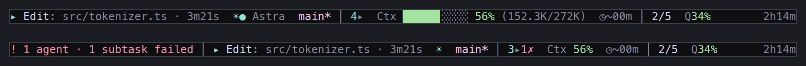
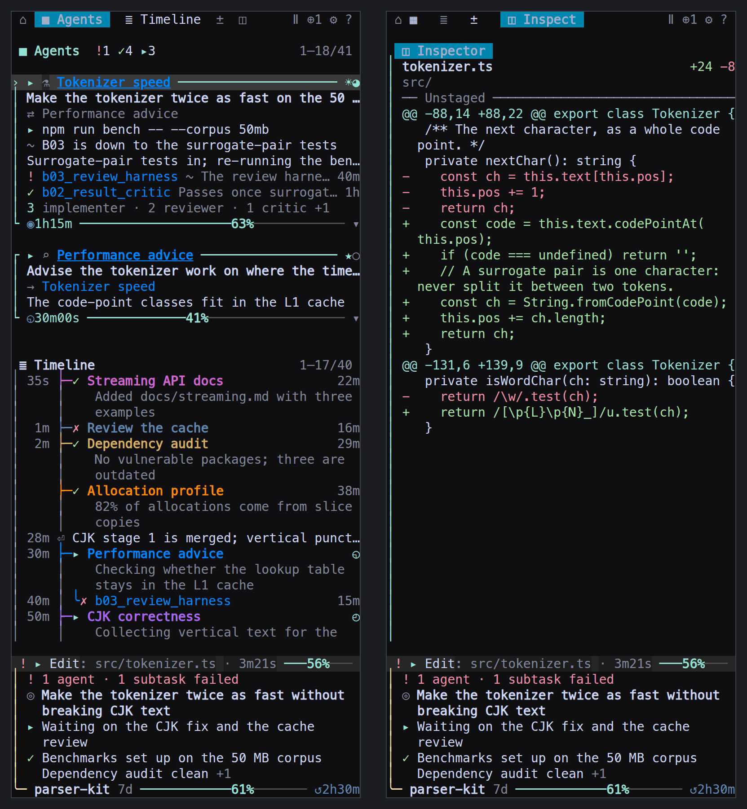
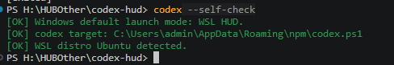
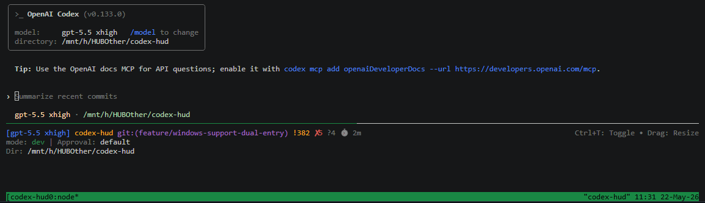
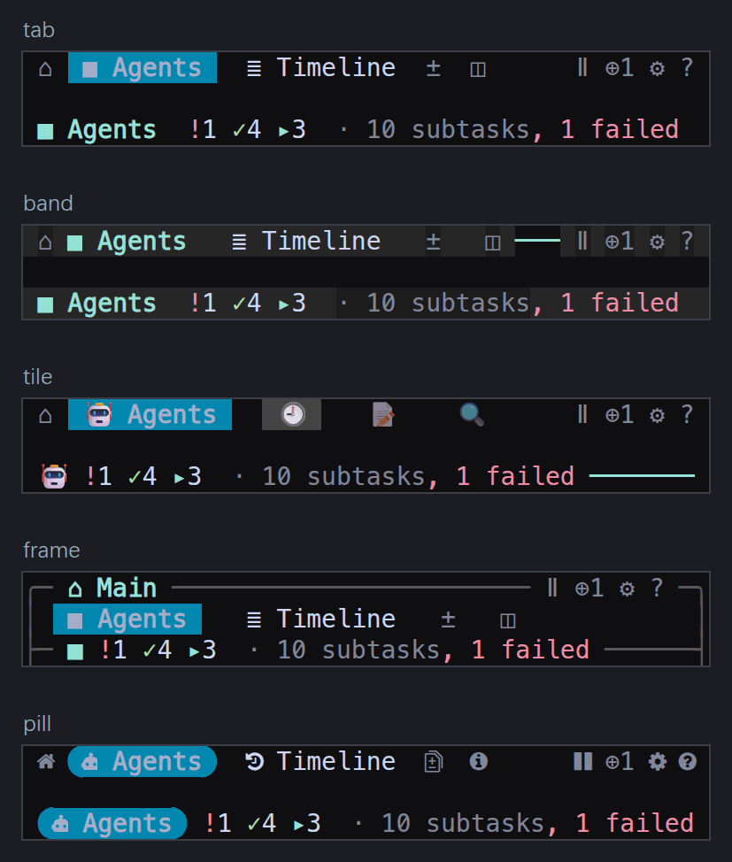

## Modification History

| Date       | Summary of Changes |
|------------|--------------------|
| 2026-05-22 | Documented Windows current-branch download, self-check, and WSL launch flow with screenshots. |
| 2026-05-22 | Switched Windows default launch policy to WSL-only and marked native PowerShell HUD as unsupported. |
| 2026-05-22 | Documented explicit Windows launch-mode flags and Bash installer dependency guidance. |
| 2026-05-21 | Documented completed Windows PowerShell, cmd, and WSL dual-entry behavior. |

<p align="center">
  <a href="./README.md"></a>
  <a href="./README.zh.md"></a>
  <a href="./README.ja.md"></a>
  <a href="./README.ko.md"></a>
</p>

# Codex HUD

Real-time statusline HUD for [OpenAI Codex CLI](https://github.com/openai/codex). Lightweight, zero-config, works inside tmux.

> This branch documents the Windows WSL-first build: Windows `codex` launches the WSL HUD by default, native PowerShell HUD is not a supported user launch mode, and Linux/macOS keep the existing Bash flow.

> Inspired by [claude-hud](https://github.com/jarrodwatts/claude-hud) for Claude Code.



## Why Codex HUD?

**Q: Codex CLI already works. Why do I need a HUD?**

Because you're flying blind without one. Codex HUD gives you a persistent dashboard at the bottom of your terminal:

- **Branch, model, permissions** — at a glance, no guessing
- **Token usage (including cache)** — know exactly how much context you've burned
- **Context window fill bar** — see when you're about to hit the wall
- **MCP server status & tool calls** — watch what Codex is actually doing
- **Reasoning effort level** — see the current thinking depth

**Q: My session spawns subagents. Can I see what they are doing?**

Yes. Press `F12` to open the **subagent tree** in a side panel: every agent the session spawned, its model and reasoning effort, whether it is running, finished, or failed, and which agent spawned it. Press `F12` again to close it. The panel takes the status bar's place while it is open: the bar's fields move to the panel's foot, so Codex keeps the whole height and nothing is shown twice.

`Ctrl+T` is left alone on purpose — that is Codex's own transcript overlay.



**Q: Do I need to set up tmux manually?**

No. Codex HUD auto-activates tmux for you. Just type `codex` and the HUD appears. If tmux isn't installed, the installer handles that too.

## Quick Start

```bash
git clone https://github.com/CartmanFatass/codex-hud.git
cd codex-hud
./bin/codex-hud-install

# Refresh your shell, then just type:
codex
```

### Windows Current Branch (WSL Default)

This branch uses WSL as the supported Windows HUD runtime. PowerShell and cmd are launcher shells; the HUD itself runs in Ubuntu WSL with Bash and tmux.

> **Warning:** Windows installation has not been validated on a native Windows host; back up your existing Codex installation before running it.

1. Download and switch to this branch:

```powershell
git clone https://github.com/CartmanFatass/codex-hud.git
cd codex-hud
git switch feature/windows-support-dual-entry
.\bin\codex-hud-install.ps1
```

2. Open a new PowerShell or cmd window, then check the WSL runtime:

```powershell
codex --self-check
```



3. Run Codex HUD:

```powershell
codex
```



Notes:

- `codex` launches the WSL HUD by default on Windows.
- `codex --wsl ...` explicitly requests the same WSL HUD path and strips the wrapper flag before forwarding Codex CLI args.
- Native PowerShell HUD is currently unsupported as a user launch mode; legacy native-mode requests fail fast with an unsupported-mode error.
- `codex-hud-wsl` is the explicit full-HUD command for WSL Ubuntu.
- `cmd.exe` users get managed `.cmd` shims that invoke the same PowerShell entrypoints with `ExecutionPolicy Bypass`.

`codex-hud-install.ps1` automatically:

- install Node.js LTS on Windows if needed
- preserve an existing Windows Codex CLI and install `@openai/codex` only when missing
- ensure Ubuntu WSL is available when possible
- provision WSL with `tmux`, Node.js LTS, `npm`, and `@openai/codex` only when missing
- fail fast with exact manual WSL commands if root or passwordless `sudo` is unavailable

For Linux/macOS/Git Bash installs, `install.sh` now fails fast with exact checks and install guidance when required tools are missing. The main required checks are `command -v node`, `node --version`, `command -v npm`, `npm --version`, `command -v tmux`, and `tmux -V`.

#### Windows Default Path

```powershell
. $PROFILE.CurrentUserAllHosts
codex
codex --wsl
codex --self-check
codex-resume
```

Use `codex` when you want the normal Windows entry. It uses WSL HUD by default. Use `codex --wsl` when you want to be explicit about the WSL path. Legacy native-mode requests are intentionally rejected because native PowerShell HUD is not supported yet.

#### WSL Full HUD Path

```powershell
. $PROFILE.CurrentUserAllHosts
codex-hud-wsl
codex-hud-wsl "help me debug this"
```

Use this when you want the full Bash + tmux HUD inside WSL Ubuntu.

### Management Commands

After the first install, these are available in PowerShell and cmd:

| Command | Description |
|---------|-------------|
| `codex` | Default Windows entry: WSL HUD, then plain Windows codex fallback |
| `codex-resume` | Resume through the same Windows WSL entry |
| `codex-hud-wsl` | Launch full HUD mode via WSL |
| `codex-hud-sync` | Rebuild and refresh aliases for the current checkout |
| `codex-hud-upgrade` | Pull latest changes, then rebuild |
| `codex-hud-uninstall` | Remove aliases and stop HUD sessions |

### Font

The panel's icons, the pills' rounded ends and the frame are glyphs that **MesloLGS NF**, the Nerd Font powerlevel10k uses, draws one column wide; another font draws some of them from a fallback at another size, or not at all. The installers put it in place for your user:

- `./bin/codex-hud-install` (and so `codex-hud-sync` and `codex-hud-upgrade`) runs `bin/codex-hud-fonts`, which installs its four faces into `~/.local/share/fonts` on Linux (then runs `fc-cache`) or `~/Library/Fonts` on macOS.
- On Windows, `codex-hud-install.ps1` installs them for your Windows user, as Explorer's *Install* does. In WSL the terminal that draws the panel is a Windows program, so the font belongs there: `bin/codex-hud-fonts` run in WSL only says whether Windows has it and how to add it, and writes nothing.

The files come from one pinned commit of [romkatv/powerlevel10k-media](https://github.com/romkatv/powerlevel10k-media), from GitHub or else jsDelivr's copy of it, and each must match its SHA-256. Then set the terminal's font to `MesloLGS NF` (Windows Terminal: Settings → Profiles → Defaults → Appearance → Font face). `bin/codex-hud-fonts --check` says whether it is installed; `CODEX_HUD_SKIP_FONTS=1` leaves the font out of the install. The HUD runs without it, some icons then drawn by another font.

## What's on the HUD?

One line, pinned to the bottom of the terminal. Related fields sit two
spaces apart, a dimmed `│` divides one group from the next, and the session
timer and the key hint are held against the right edge:

```
▸ Edit: src/types.ts · 1m20s  ☀● Astra  codex-hud git:(main * ↑2) │ Agents 1 run · 1 ok  Ctx ████▎░░░░░ 42% (114.2K/272K)  ◷~00m │ 2/5  Q61%            30m
```

When something needs you, it takes the front of the line:

```
! 1 tool · 1 agent failed │ ▸ Edit: src/types.ts · 1m20s  ☀  main* │ 1▸1✗  Ctx 42%  ◷~00m │ 2/5  Q61%           30m
```

| Field | Means |
|-------|-------|
| `!` | Something the HUD actually observed went wrong: a tool that reported failure, an agent, subtask or guardian review that ended in error (the failures as one phrase, `1 tool · 1 agent failed`), a usage window that reported itself full |
| `▸ Edit: src/types.ts · 1m20s` | What this turn is doing: the running tool, what it is working on, and how long the turn has taken. A narrow pane keeps the mark and the elapsed time, then the mark alone |
| `☀● Astra` | Model family and reasoning effort: `○` low, `◐` medium, `◕` high, `●` xhigh, `◆` max, `✦` ultra |
| `codex-hud git:(main * ↑2)` | Project, branch, uncommitted changes, ahead/behind. Started in a folder that holds the repository rather than inside it, the bar names the repository the session works in: `shenlun › Learn-to-Write git:(main *)` |
| `Agents 1 run · 1 ok · 1 fail` | The agents the main session started, by outcome, as the panel's title counts them (one runs while a subtask of it does); a failed subtask or review is an alert. Finished and failed are separate numbers, and an agent with no observed state is counted as `?`, never as running |
| `Ctx 42% (114.2K/272K)` | How full the context window is, to an eighth of a column. `↻2` counts compactions |
| `◷~00m` | Minutes since the last model usage, as a prompt-cache reminder. It warns at 25 minutes and stops counting at `30m+` |
| `2/5` | Steps completed in the current plan |
| `Q61%` | Share of the account's usage window spent. This is quota, not task progress; `↺1h23m` is the wait for the next reset. At its widest the field adds `out in ~40m`: a straight-line projection of when the window runs out at its recent rate, shown only when readings span five minutes or more, use is rising, and the projection falls before the reset |
| `84K` | Tokens spent this session |

A field appears only when there is real data behind it. A missing quota
snapshot means no quota field, not a bar reading zero.

Clicking the bar acts on the field under the cursor: the alert and the agent
counts open the panel and hand it the keyboard, the meters
open it and leave the cursor in Codex, and anywhere else toggles the panel as
the whole bar used to.

### When the pane is narrow

Fields shorten before any of them disappears, the least important one
disappears first, and an alert is never dropped. At 40 columns, with a failure
on screen:

```
!2 │ ▸  ☀  main* │ 1▸1✗  Ctx 42%  ◷~00m
```

### Density presets

| Preset | Shows |
|--------|-------|
| `focus` | Alerts, model, project, agents, context |
| `balanced` (default) | Focus, plus plan progress, quota, output speed and the session timer |
| `full` | Everything, including tokens, approval/sandbox and the session id |

```bash
CODEX_HUD_DENSITY=focus codex
```

## Development workbench

`F12` opens the right panel without taking focus from Codex. `Shift+F12` opens and focuses it.

**The panel takes no keys of its own.** Every panel command is the **prefix key, `Ctrl+]`, then one key**: `Ctrl+]` `,` opens settings, `Ctrl+]` `?` the help, `Ctrl+]` `b` pauses the brief (the full list is in [the reference](./docs/reference.md#keys), and the help's Shortcuts section). The prefix works wherever the cursor is, in Codex's pane or in the panel; `Ctrl+]` `j` `j` `j` moves three rows, since the moves repeat for half a second without the prefix. A command that needs the panel opens it first. Anything typed without the prefix goes to Codex: with the cursor in the panel (after `Shift+F12`, or a click), keys and pastes are passed to Codex's pane exactly as typed, a paste stays one bracketed paste, and the cursor moves back to Codex with them. The settings page and the help are the exception: while one is open it takes the keys it needs (arrows, Enter, `Esc`), until `Esc` or its `[Back]` button closes it. The mouse works as before.

`Ctrl+]` twice sends `Ctrl+]` itself to the pane with the cursor. Codex 0.160 binds `Ctrl+]` to *Skip Question*; that is `Ctrl+]` `Ctrl+]` now. To keep `Ctrl+]` for Codex, choose `Ctrl+\` in Settings → Panel → Prefix key (no Codex 0.160 binding uses it; `Ctrl+G`, its external editor, and `Alt+]`, which a terminal sends as the start of an escape sequence, are not offered). The prefix is a key table in the HUD's own tmux session: the server's root and `Ctrl+B` tables are untouched. A changed prefix is installed at once for the panel that saved it; a session started before this version keeps its old keys until it is launched again.

Agents opens by default; the Timeline, Changes and the Inspector open on demand. The focused heading and selected row are highlighted; status colors are concentrated on the icons:

| Pane | Content |
|------|---------|
| **1 Agents** | A card for each agent the main session started: what it is for, who it works with, what it is doing now, the subtasks that matter and the rest counted by role, its name in its direction's colour; compact, the tree of every agent |
| **2 Timeline** | The session on the main session's axis: its turns, approvals and failures, each agent's stages a level in with what they returned, and only the subtasks that matter, in each direction's colour, as a rail, indents or lanes |
| **3 Changes** | The worktrees on top, where there are several, each by name (its branch; detached, the nearest directory that is not an id, such as `bench-sources`) with its changed/conflicted state and `locked` in words, and no hash, here or in the Inspector; then the files of the selected one, each with a coloured letter for what happened to it (`M`, `A`, `D`, `R`, `!` for a conflict) and its `+12 −3` where it fits, under their counts in words (`2 staged · 5 unstaged`, zeros left out); untracked files fold into one last row (`▸ 12 untracked`) that Enter or a click opens, and an untracked directory is one row there (`bench/corpus/`), as `git status` lists it; a path too long to fit shows the shortest ending that tells it apart (`.agents/…/SKILL.md`); selectable even at narrow widths |
| **4 Inspector** | Agent status and activity times, worktree details, or colored file diffs |

**Panes** (Settings → Panel → Panes) sets how the panes share the panel:

- **stacked** (the default): every open pane at once, as above.
- **tabs**: one pane at a time, as a browser shows one page, with all the height between the bar and the status card. Every pane has a tab on the bar; a click on one shows that pane, as `Ctrl+]` `1`–`4` does, and `Ctrl+]` `Tab` shows the next. The tab names the pane, so its title keeps only its counts and where its rows are. Nothing is zoomed or closed in this layout, and the stacked layout's open and closed panes are as they were when it comes back.

**Two layouts** (Settings → Panel → Layout): **rich**, the default, gives each agent the main session started a card while it is running, has failed, has just finished or needs a look, and two lines once it is done, the agents it started in turn on its card; **compact** is the tree, one row per agent and subtask, with the brief, the recap and the agent log under it. Both count alike, as the status card, the bar and `codex-hud --json` do: the agents the main session started, their subtasks and the guardian reviews, each apart.

**Look** (Settings → Panel → Look, or `CODEX_HUD_LOOK`) draws the bar and the panes' titles in one of five ways: tab (the default), band, tile, frame and pill.



**The status card** at the foot carries the bar's fields while the panel is open and, at its full level, the main session's brief; `Ctrl+]` `r` steps through its three levels.

The rest is in **[the reference](./docs/reference.md)**: the panes and both layouts in full, the control bar, the looks and icon sets, the status card, every key and mouse action, switching sessions, the Timeline, the agent log, the Inspector, Settings, the LLM features, the picture and the output rate.

## Usage

```bash
codex                        # Launch with HUD
codex --model gpt-5          # Pass any Codex CLI args
codex --wsl --model gpt-5    # Explicit WSL HUD mode on Windows
codex "help me debug this"   # With prompt
codex-resume                 # Resume last session
codex-hud-wsl                # Explicit full HUD in WSL (Windows only)
```

<details>
<summary>More commands</summary>

```bash
codex-hud --kill             # Kill session for current directory
codex-hud --list             # List all HUD sessions
codex-hud --json             # Print this directory's HUD state as JSON
codex-hud --attach           # Attach to existing session
codex-hud --new-session      # Force a new session
codex-hud --self-check       # Run diagnostics
codex-hud brief --dry-run    # Print what the brief would send now
```
</details>

What `codex-hud --json` prints is described under [Machine-readable state](./docs/reference.md#machine-readable-state).

## Configuration

Most preferences are on the panel's settings page (`Ctrl+]` `,`) and are saved to `$CODEX_HOME/hud-settings.json`; environment variables such as `CODEX_HUD_DENSITY`, `CODEX_HUD_THEME` and `CODEX_HUD_LOOK` set the defaults that saved preferences then override. Every variable, the notifications and what the HUD reads from `config.toml` are in [the reference](./docs/reference.md#configuration).

## System Support

| Platform | Status |
|----------|--------|
| Linux | Supported |
| macOS (Apple Silicon) | Supported |
| macOS (Intel) | Testing pending |
| Windows PowerShell | Supported as launcher shell; native PowerShell HUD is unsupported |
| Windows cmd | Supported (managed `.cmd` shims) |
| Windows WSL Ubuntu | Supported (default Windows HUD path and `codex-hud-wsl` full HUD entry) |

## Development

```bash
npm install && npm run build   # Build
npm run dev                    # Watch mode
node dist/index.js             # Run HUD directly
npm test                       # Unit tests: parser replay, width safety, render cost
npm run test:integration       # Shell suites: wrapper, tmux toggling, installer
```

`npm test` compiles with `tsconfig.test.json` and runs `tests/unit` against the
recorded rollouts in `tests/fixtures/rollouts`. `docs/BASELINE.md` records the
layout and render-cost baseline those tests defend.

On Windows PowerShell, use `npm.cmd run build` if `npm.ps1` is blocked by ExecutionPolicy.

To see where a tick's time goes, start a session with `CODEX_HUD_PROFILE=1`.
Both processes time their stages (`session.find`, `rollout.parse`,
`tree.build`, `status.build`, `git`, `render`, `write`, and the whole `tick` or
`collect`) and every 10 s append one line per stage that ran to
`$CODEX_HOME/hud/profile.log`:

```
2026-10-04T15:27:35.725Z bar pid=144913 tick n=10 avg=2.79ms p95=5.35ms max=5.35ms
```

Nothing goes to the terminal, and with the variable unset the timers cost a
null check. The log starts over past 4 MiB, keeping one `.old` copy.

## Changelog

| Date | Change |
|------|--------|
| 2026-05-22 | Switch Windows default launch policy to WSL HUD only; reject legacy native PowerShell HUD requests as unsupported |
| 2026-05-22 | Add Windows launch-mode parsing experiments, a clear native-to-WSL fallback banner, and precise Bash installer dependency guidance |
| 2026-05-21 | Complete Windows dual-entry hardening: WSL temp wrappers, sudo-based WSL provisioning, cmd shims, first-run session handling, and runtime state precedence |
| 2026-04-20 | Make Windows PowerShell the default entry, add automatic WSL fallback, auto-install native tmux on install, and document Windows dual-mode usage |
| 2026-04-19 | Add Windows dual-entry support (`codex` native fallback + `codex-hud-wsl` full HUD), plus PowerShell installer/sync/upgrade/uninstall |
| 2026-04-09 | Add quick install/sync/upgrade/uninstall commands |
| 2026-04-09 | Bind HUD session to current tmux pane; display reasoning effort |
| 2026-02-09 | Keep Codex pane focused after resize; refine mouse-scroll defaults |
| 2026-02-09 | Update session attach defaults and scrollback config |

## License

MIT

## Credits

Inspired by [claude-hud](https://github.com/jarrodwatts/claude-hud) by Jarrod Watts. Built for [OpenAI Codex CLI](https://github.com/openai/codex).
