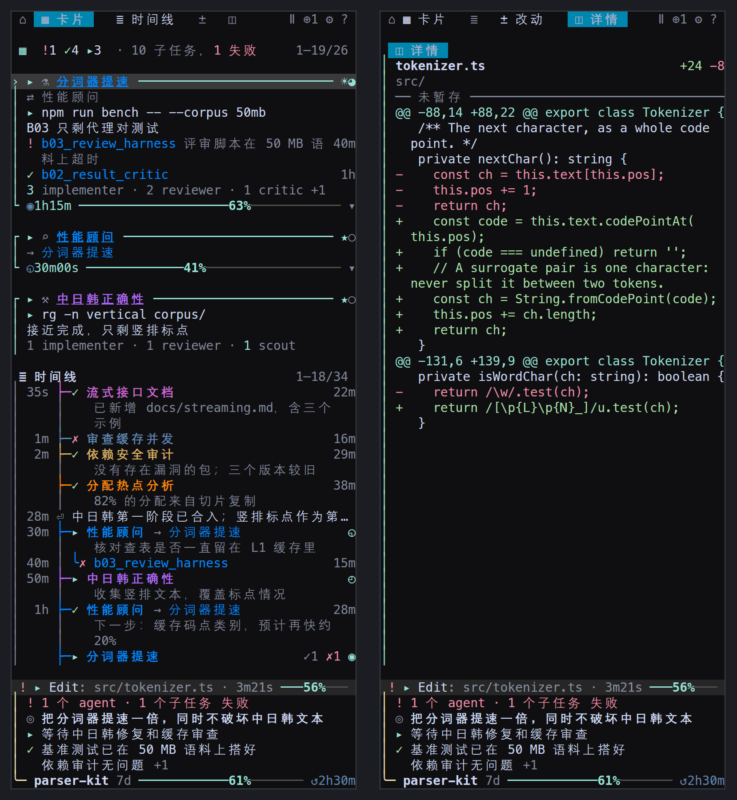
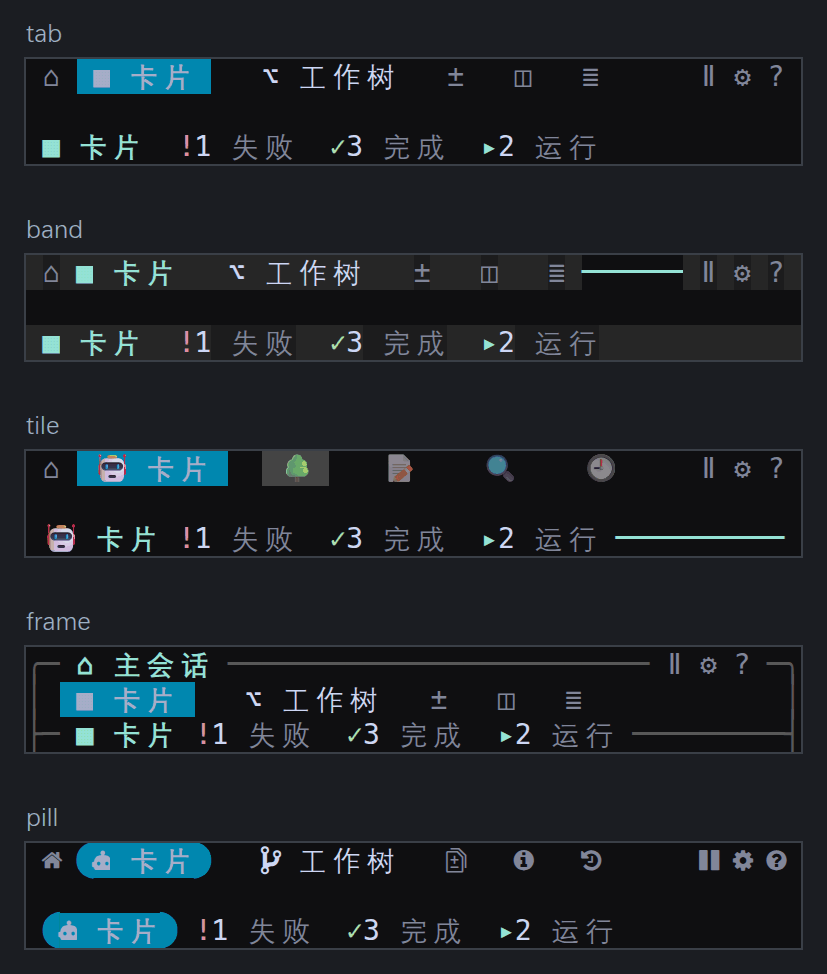

## Modification History

| Date       | Summary of Changes |
|------------|--------------------|
| 2026-05-22 | 补充 Windows 用户当前 branch 下载、self-check、运行流程，并加入 WSL 截图。 |
| 2026-05-22 | 将 Windows 默认启动策略切换为 WSL-only，并标注 native PowerShell HUD 暂未支持。 |
| 2026-05-22 | 记录 Windows 显式启动模式参数与 Bash installer 依赖诊断提示。 |
| 2026-05-21 | 更新 Windows PowerShell、cmd 与 WSL 双入口行为说明。 |

<p align="center">
  <a href="./README.md"></a>
  <a href="./README.zh.md"></a>
  <a href="./README.ja.md"></a>
  <a href="./README.ko.md"></a>
</p>

# Codex HUD

[OpenAI Codex CLI](https://github.com/openai/codex) 的实时状态栏 HUD。轻量、零配置、在 tmux 中运行。

> 灵感来源于 Claude Code 的 [claude-hud](https://github.com/jarrodwatts/claude-hud)。


## 为什么需要 Codex HUD？

**Q: Codex CLI 本身就能用，为什么还需要 HUD？**

因为没有它你就是在盲飞。Codex HUD 在终端底部提供一个持久的仪表盘：

- **分支、模型、权限** —— 一目了然，不用猜
- **Token 用量（含 cache）** —— 精确知道烧了多少上下文
- **Context 窗口填充条** —— 快撞墙时提前知道
- **MCP 服务器状态 & 工具调用** —— 看 Codex 实际在干什么
- **Reasoning effort 级别** —— 当前思考深度一目了然

**Q: session 会派生子代理，我能看到它们在做什么吗？**

可以。按 `F12` 打开右侧的**子代理树**：当前 session 派生的每个代理、它的模型与推理强度、正在运行还是已结束或失败、以及是谁派生的它。再按一次 `F12` 关闭。侧栏打开时会取代状态栏：状态栏的字段移到侧栏底部，Codex 保留完整高度，同样的信息不显示两遍。

`Ctrl+T` 被刻意留空 —— 那是 Codex 自己的转写面板。



**Q: 需要手动配置 tmux 吗？**

不需要。Codex HUD 自动激活 tmux。只需输入 `codex`，HUD 就会出现。如果没装 tmux，安装程序也会搞定。

## 快速开始

```bash
git clone https://github.com/CartmanFatass/codex-hud.git
cd codex-hud
./bin/codex-hud-install

# 刷新 shell，然后直接输入：
codex
```

### Windows 当前 branch（默认 WSL）

当前 branch 在 Windows 上只把 WSL HUD 作为受支持的 HUD 运行时。PowerShell 和 cmd 只是启动 shell；HUD 本身会在 Ubuntu WSL 的 Bash + tmux 中运行。

1. 下载并切换到当前 branch：

```powershell
git clone https://github.com/CartmanFatass/codex-hud.git
cd codex-hud
git switch feature/windows-support-dual-entry
.\bin\codex-hud-install.ps1
```

2. 打开新的 PowerShell 或 cmd 窗口，然后检查 WSL runtime：

```powershell
codex --self-check
```


3. 启动 Codex HUD：

```powershell
codex
```


说明：

- `codex` 在 Windows 上默认启动 WSL HUD。
- `codex --wsl ...` 显式使用同一条 WSL HUD 路径，并在转发给 Codex CLI 前移除 wrapper 参数。
- native PowerShell HUD 暂未作为用户启动模式支持；legacy native-mode 请求会 fail fast 并提示使用 WSL HUD。
- `codex-hud-wsl` 是显式 WSL 完整 HUD 命令。
- `cmd.exe` 用户会获得托管 `.cmd` shim，并通过同一套 PowerShell entrypoint 启动。

### 管理命令

首次安装后，以下命令自动加入 shell：

| 命令 | 说明 |
|------|------|
| `codex-hud-sync` | 重新构建并刷新当前 checkout 的别名 |
| `codex-hud-upgrade` | 拉取最新代码后重新构建 |
| `codex-hud-uninstall` | 移除别名并停止 HUD 会话 |

### 字体

面板的图标、胶囊的圆角和圆角框，都是 **MesloLGS NF**（powerlevel10k 使用的 Nerd Font）画成一列宽的字符；换成别的字体时，其中一些会由后备字体以另一种大小画出，或者画不出来。安装程序会为当前用户装好它：

- `./bin/codex-hud-install`（以及 `codex-hud-sync`、`codex-hud-upgrade`）会运行 `bin/codex-hud-fonts`，把四个字形装进 Linux 的 `~/.local/share/fonts`（随后运行 `fc-cache`）或 macOS 的 `~/Library/Fonts`。
- Windows 上，`codex-hud-install.ps1` 像资源管理器的“安装”一样，为当前 Windows 用户安装。WSL 里画面板的终端是 Windows 程序，字体应装在 Windows 上：在 WSL 里运行 `bin/codex-hud-fonts` 只会说明 Windows 是否已有这个字体、怎样安装，不写入任何文件。

字体文件取自 [romkatv/powerlevel10k-media](https://github.com/romkatv/powerlevel10k-media) 的一个固定提交，先从 GitHub 下载，失败时改用 jsDelivr 上的同一份，每个文件都必须与记录的 SHA-256 一致。装好后把终端字体设为 `MesloLGS NF`（Windows Terminal：设置 → 配置文件 → 默认值 → 外观 → 字体）。`bin/codex-hud-fonts --check` 查看是否已安装；`CODEX_HUD_SKIP_FONTS=1` 让安装跳过字体。没有这个字体 HUD 也能运行，只是部分图标由别的字体画出。

## HUD 显示了什么？

终端底部常驻一行。相关的字段用两个空格相邻，组与组之间用淡化的 `│` 分隔；会话计时与按键提示靠右对齐：

```
▸ Edit: src/types.ts · 1m20s  ☀● Astra  codex-hud git:(main * ↑2) │ Agents 1 run · 1 ok  Ctx ████▎░░░░░ 42% (114.2K/272K)  ◷~00m │ 2/5  Q61%            30m
```

有事需要你处理时，它会排到最前面：

```
! 1 tool · 1 agent failed │ ▸ Edit: src/types.ts · 1m20s  ☀  main* │ 1▸1✗  Ctx 42%  ◷~00m │ 2/5  Q61%           30m
```

| 字段 | 含义 |
|------|------|
| `!` | HUD 实际观测到的异常：工具返回失败，agent、子任务或守护评审以错误结束（各种失败合成一句，如 `1 tool · 1 agent failed`），额度窗口报告已满且没有积分 |
| `▸ Edit: src/types.ts · 1m20s` | 本轮正在做的事：运行中的工具、它的目标、以及本轮已经进行的时间。窗口变窄时只保留标记和用时，再窄只剩标记 |
| `☀● 5.6astra` | 模型版本、家族与推理强度。文字模式写作 `5.6astra·high`；图形仍是 `☀●`。`?` 的图例保留家族名（`☀ Astra`）。强度：`○` low、`◐` medium、`◕` high、`●` xhigh、`◆` max、`✦` ultra |
| `codex-hud git:(main * ↑2)` | 项目、分支、未提交改动、领先/落后。如果 Codex 是在仓库的上级目录启动的，状态栏会显示会话实际工作的仓库：`shenlun › Learn-to-Write git:(main *)` |
| `Agents 1 run · 1 ok · 1 fail` | 主会话启动的 agent 按结果计数，与面板标题行一致（子任务还在运行的算运行中）；子任务或评审失败显示为警报。成功与失败分开统计；没有观测到状态的代理记为 `?`，不会算作运行中 |
| `Ctx 42% (114.2K/272K)` | 上下文窗口占用，精度细到八分之一列；`↻2` 是压缩次数 |
| `◷~00m` | 距上一次模型用量的分钟数，用作提示缓存提醒；25 分钟时转为警告，封顶于 `30m+` |
| `2/5` | 当前计划已完成的步骤数 |
| `Q61%` | 账户额度窗口的消耗比例。这是额度，不是任务进度；`↺1h23m` 是距下次重置的时间。窗口已满但还有积分时加上余额 `credits 31.8K`。最宽的形式还会加上 `out in ~40m`：按最近的速度直线推算窗口何时用完，只有读数跨度至少五分钟、用量在上升、并且推算结果早于重置时间时才显示 |
| `84K` | 本次会话消耗的 token |

只有拿到真实数据的字段才会出现。没有额度快照就不显示额度，而不是显示一条为 0 的进度条。

点击状态栏时，落在哪个字段上就是什么动作：告警与代理计数会打开侧栏并把键盘交给它；
各类仪表只打开侧栏，光标留在 Codex；点在其他位置则与过去一样整条切换。

### 窗口变窄时

先缩短，再隐藏；隐藏从最不重要的开始；告警永远不会被丢掉。40 列、且有失败时：

```
!2 │ ▸  ☀  main* │ 1▸1✗  Ctx 42%  ◷~00m
```

### 密度预设

| 预设 | 显示内容 |
|------|----------|
| `focus` | 告警、模型、项目、代理、上下文 |
| `balanced`（默认） | 在 focus 基础上加计划进度、额度、输出速度、会话计时 |
| `full` | 全部，包括 token、审批/沙箱、Session ID |

```bash
CODEX_HUD_DENSITY=focus codex
```

## 开发面板

`F12` 在右侧打开面板，光标仍留在 Codex。`Shift+F12` 打开并把光标移进面板。

**面板自己不占任何按键。** 每条面板命令都是**前缀键 `Ctrl+]`，再按一个键**：`Ctrl+]` `,` 打开设置，`Ctrl+]` `?` 打开帮助，`Ctrl+]` `b` 暂停简报（完整列表见[参考文档](./docs/reference.zh.md#按键)和帮助里的“快捷键”一节）。光标在 Codex 窗格还是在面板里，前缀都有效；`Ctrl+]` `j` `j` `j` 下移三行，因为移动类按键在半秒内可以不再按前缀连按。需要面板的命令会先把面板打开。不带前缀输入的一切都交给 Codex：光标在面板里时（`Shift+F12` 或点击之后），按键和粘贴原样转给 Codex 窗格，粘贴仍是一次括号粘贴，光标随之回到 Codex。设置页和帮助是例外：打开期间它们接收自己需要的按键（方向键、Enter、`Esc`），直到 `Esc` 或它的 `[返回]` 按钮关闭它。鼠标用法不变。

连按两次 `Ctrl+]` 会把 `Ctrl+]` 本身发给光标所在的窗格。Codex 0.160 把 `Ctrl+]` 绑定为 *Skip Question*（跳过提问），现在要按 `Ctrl+]` `Ctrl+]`。想把 `Ctrl+]` 留给 Codex，可在 设置 → 输入 →「前缀键」 选择 `Ctrl+\`（Codex 0.160 没有任何绑定用它；`Ctrl+G` 是它的外部编辑器，`Alt+]` 在终端里是转义序列的开头，所以都不提供）。前缀是 HUD 自己 tmux 会话里的一张按键表：服务器的 root 表和 `Ctrl+B` 前缀表都不会被改动。改了前缀，保存它的面板会立刻重新安装；本版本之前启动的会话要重新启动后才换成新按键。

面板默认显示卡片；时间线、改动和详情按需打开。焦点标题和选中行高亮，状态颜色集中在图标上：

| 区域 | 内容 |
|------|------|
| **1 卡片** | 主会话启动的每个 agent 一张卡片：和谁协作、此刻在做什么、模型对它写的最新说明、要紧的子任务，其余子任务按角色计数，名字用它所在方向的颜色；agent 的原话和任务在详情里完整显示；紧凑布局中是所有 agent 的树 |
| **2 时间线** | 以主会话为主轴的整个会话：主会话的每一轮、批准和失败，各 agent 的阶段缩进一级并写出返回的内容，子任务只留要紧的，按方向着色，可画成主轴、缩进或分道 |
| **3 改动** | 有多个 worktree 时先列出它们，每个写名字（有分支用分支；分离 HEAD 时用最近的不是 id 的目录名，如 `bench-sources`）、修改/冲突状态和文字 `锁定`，这里和详情里都不显示哈希；然后是所选 worktree 的文件列表，每个文件前是表示改动类型的彩色字母（`M`、`A`、`D`、`R`，冲突为 `!`），放得下时写增删行数 `+12 −3`，上方是文字计数（`2 已暂存 · 5 未暂存`，为零的不写）；未跟踪的文件收成最后一行（`▸ 12 未跟踪`），按 Enter 或点击展开，其中未跟踪的目录和 `git status` 一样只占一行（`bench/corpus/`）；放不下的路径显示能区分它的最短结尾（`.agents/…/SKILL.md`）；窄屏也可选择文件 |
| **4 详情** | 代理状态与活动时间、worktree 详情，或带增删配色的文件 diff |

**面板排布**（设置 → 面板 →「面板排布」）决定各区域怎样分用面板：

- **叠放**（默认）：所有打开的区域同时显示，如上。
- **标签页**：像浏览器一次显示一个网页那样，一次只显示一个区域，占满控制栏和状态卡之间的全部高度。每个区域在控制栏上都有标签，点一下就切换到那个区域，和 `Ctrl+]` `1`–`4` 一样；`Ctrl+]` `Tab` 切到下一个。标签已经写了区域的名字，区域标题就只写计数和行范围。这种排布下不放大也不关闭区域；切回叠放时，各区域原来的打开、关闭状态不变。

**两种布局**（设置 → 面板 →「布局」）：**卡片**（rich，默认）给每个可见的主会话 agent 同样的可组合卡片，活跃和空闲都使用同一规则，不再展开/收起。设置 →「卡片」独立控制每项内容，包括最新 AI 总结及子 agent 的一句话总结；子 agent 默认显示活跃及重要任务，名称和状态始终保留。「子 agent 数量统计」可单独隐藏卡片底部的角色计数，不影响子任务行和总结。点击只选中，Enter 或空格打开详情。**紧凑**（compact）是一棵树，每个 agent 和子任务一行，下面是简报、回顾和 agent 日志。两种布局的计数口径相同，状态卡、状态栏和 `codex-hud --json` 也一样：主会话启动的 agent、它们的子任务和守护评审分开计数。

**卡片预设**（设置 → 卡片）提供极简（`minimal`：任务标签和总结）、进度（`progress`：增加当前操作、子 agent 及其一句话总结）、监控（`monitor`：再增加关系、角色/评审计数、模型、时钟、速率和上下文）。各开关仍可独立修改，不匹配任何预设时显示自定义（`custom`）。预设按十三个内容布尔值推导，不单独保存 `cardPreset`；它不修改子 agent 范围、边角、模型权限或后端/API/调用上限，名字与状态始终保留。见[卡片设置](./docs/reference.zh.md#卡片设置)。

卡片上的进度状态保持简短（排队、生成中、失败或达到上限）；详情显示最新模型说明及生成不可用或等待的原因，只有明确已知时才写证据快照/生成时间，旧说明只写记录时间。关闭后端或暂停模型后仍保留已存模型说明，观察日志另有自己的开关。

**外观**（设置 → 显示 →「外观」，或 `CODEX_HUD_LOOK`）有五种画控制栏和区域标题的方式：tab（默认）、band、tile、frame 和 pill。



底部的**状态卡**在面板打开时承载状态栏的字段，「完整」档还显示主会话的简报；`Ctrl+]` `r` 在三档之间切换。

其余内容见 **[参考文档](./docs/reference.zh.md)**：各区域和两种布局的完整说明、控制栏、外观与图标集、状态卡、全部按键和鼠标操作、会话切换、时间线、agent 日志、详情区域、设置、模型增强、背景图和输出速度。

## 使用方法

```bash
codex                        # 启动并自动显示 HUD
codex --model gpt-5          # 传递 Codex CLI 参数
codex --wsl --model gpt-5    # Windows 下显式使用 WSL HUD
codex "help me debug this"   # 带初始提示
codex-resume                 # 恢复上次会话
```

<details>
<summary>更多命令</summary>

```bash
codex-hud --kill             # 终止当前目录的会话
codex-hud --list             # 列出所有 HUD 会话
codex-hud --json             # 以 JSON 输出当前目录会话的 HUD 状态
codex-hud --attach           # 复用已有会话
codex-hud --new-session      # 强制新建会话
codex-hud --self-check       # 运行环境诊断
codex-hud brief --dry-run    # 打印简报此刻会发送的内容
```

</details>

`codex-hud --json` 输出的内容见[机器可读的状态](./docs/reference.zh.md#机器可读的状态)。

## 配置

大部分偏好在上方主导航的「设置」Tab（也可按 `Ctrl+]` `,`）里修改，保存到 `$CODEX_HOME/hud-settings.json`；`CODEX_HUD_DENSITY`、`CODEX_HUD_THEME`、`CODEX_HUD_LOOK` 等环境变量设定默认值，已保存的偏好优先于它们。全部环境变量、提醒，以及 HUD 从 `config.toml` 读取的内容，见[参考文档](./docs/reference.zh.md#配置)。

有修改的设置草稿经返回/Esc、导航或会离开设置的前缀命令退出时，会询问**保存并离开 / 放弃修改 / 继续编辑**（默认）。点击当前设置 Tab 保留草稿；保存失败保留草稿和确认页供重试，没有修改则立即离开。不拦截 F12 替换窗格或进程终止。**重置本组**（设置页内 `r`）只重置当前组；**重置偏好**（Reset all）只处理设置页明确管理的已知偏好，不清空连接密钥或整个文件。模型增强/全部重置会关闭生成并暂停模型，保留后端、API 密钥/地址、模型档位/统一覆盖/推理选项、每小时调用上限和背景图资源。重置只准备草稿，仍需保存，见[设置](./docs/reference.zh.md#设置)。

## 系统支持

| 平台 | 状态 |
|------|------|
| Linux | 已支持 |
| macOS (Apple Silicon) | 已支持 |
| macOS (Intel) | 待测试 |
| Windows PowerShell | 已支持为启动 shell；native PowerShell HUD 暂未支持 |
| Windows cmd | 已支持（托管 `.cmd` shim） |
| Windows WSL Ubuntu | 已支持（Windows 默认 HUD 路径与 `codex-hud-wsl` 完整 HUD 入口） |

## 开发

```bash
npm install && npm run build   # 构建
npm run dev                    # 监听模式
node dist/index.js             # 直接运行 HUD
npm test                       # 单元测试：解析回放、宽度安全、渲染开销
npm run test:visual            # 校验已审阅的终端单元格文本基线
npm run test:visual:update     # 审阅后显式本地更新（CI 中拒绝）
npm run test:integration       # Shell 测试：包装脚本、tmux 开关、安装器
```

代码结构（进程、采集、渲染及修改规则）见 **[docs/ARCHITECTURE.md](./docs/ARCHITECTURE.md)**。视觉测试只用固定时间与合成数据的**终端单元格文本**，不是字体/像素截图，也不读取真实会话。覆盖中英双语、五种外观、32/40/48/56/80 列和三种卡片预设，另含当前设置 Tab、保存宽度后的重排、离开确认/保存失败、详情的模型总结状态与时间。基线保留行尾空格并校验精确显示列宽。用 `npm run test:visual` 校验；只有有意更新时才运行 `npm run test:visual:update`，检查并提交审阅后的基线差异。只要设置了 `CI`（即使为 `CI=false`）就拒绝更新，常规测试只校验不改写基线。

在 Windows PowerShell 中，如果 `npm.ps1` 被 ExecutionPolicy 阻止，请使用 `npm.cmd run build`。

想知道每次刷新的时间花在哪里，用 `CODEX_HUD_PROFILE=1` 启动会话。两个进程都会为各阶段计时
（`session.find`、`rollout.parse`、`tree.build`、`status.build`、`git`、`render`、`write`，
以及整个 `tick` 或 `collect`），每 10 秒为运行过的每个阶段向 `$CODEX_HOME/hud/profile.log` 追加一行：

```
2026-10-04T15:27:35.725Z bar pid=144913 tick n=10 avg=2.79ms p95=5.35ms max=5.35ms
```

不会输出到终端；未设置该变量时，计时只是一次空值检查。日志超过 4 MiB 后重新开始，保留一份 `.old`。

## 更新日志

| 日期 | 变更 |
|------|------|
| 2026-05-22 | 将 Windows 默认启动策略切换为仅使用 WSL HUD；显式 native PowerShell HUD 参数会 fail fast 并提示暂未支持 |
| 2026-05-22 | 新增 Windows 启动模式解析实验、native 到 WSL 的醒目 fallback 提示，以及 Bash installer 的精确依赖安装指导 |
| 2026-05-21 | 完善 Windows 双入口：WSL 临时 wrapper、sudo/root provisioning、cmd shim、首次启动 session 目录处理与 runtime state 优先级 |
| 2026-04-09 | 新增快速安装/同步/升级/卸载命令 |
| 2026-04-09 | HUD 按 tmux pane 绑定会话；显示 reasoning effort |
| 2026-02-09 | 修复 resize 后主 pane 焦点漂移；优化鼠标滚动默认行为 |
| 2026-02-09 | 更新会话复用默认策略与滚动配置 |

## 许可证

MIT

## 致谢

灵感来源于 Jarrod Watts 的 [claude-hud](https://github.com/jarrodwatts/claude-hud)。为 [OpenAI Codex CLI](https://github.com/openai/codex) 构建。

## Windows WSL 默认入口说明（2026-05-22）

Windows 当前默认只使用 WSL HUD 启动路径：

- `codex`：默认 Windows 入口；直接启动 WSL HUD，WSL HUD 不可用时才降级为普通 Windows `codex` CLI。
- `codex --wsl ...`：显式使用 WSL HUD，并在转发给 Codex CLI 前移除 wrapper 参数。
- legacy native-mode 请求：native PowerShell HUD 暂未支持，会 fail fast 并提示使用 WSL HUD。
- `codex-hud-wsl`：显式 WSL 完整 HUD 模式（Ubuntu + Bash + tmux）。
- `cmd.exe`：安装后会获得托管 `.cmd` shim，实际调用同一套 PowerShell entrypoint，并使用 `ExecutionPolicy Bypass`。

PowerShell 安装方式：

```powershell
git clone https://github.com/CartmanFatass/codex-hud.git
cd codex-hud
.\bin\codex-hud-install.ps1
```

说明：`codex-hud-install.ps1` 会写入 PowerShell profile 管理块，生成 cmd shim，并提供以下命令映射：

- `codex`
- `codex-resume`
- `codex-hud-wsl`
- `codex-hud-sync`
- `codex-hud-upgrade`
- `codex-hud-uninstall`

安装脚本会在 Windows 上准备 Node.js 与 Codex CLI；Windows 默认 HUD 路径只使用 WSL，因此默认不再安装 native tmux。在 WSL 中会通过 root 或 passwordless `sudo` 准备 `tmux`、Node.js LTS、`npm` 和 `@openai/codex`。如果 WSL 权限不足，会 fail fast 并输出可在 WSL 内手动执行的命令。

Linux/macOS/Git Bash 的 `install.sh` 也会对缺失依赖 fail fast，并输出精确检查项与安装指导。关键检查包括 `command -v node`、`node --version`、`command -v npm`、`npm --version`、`command -v tmux` 与 `tmux -V`。
