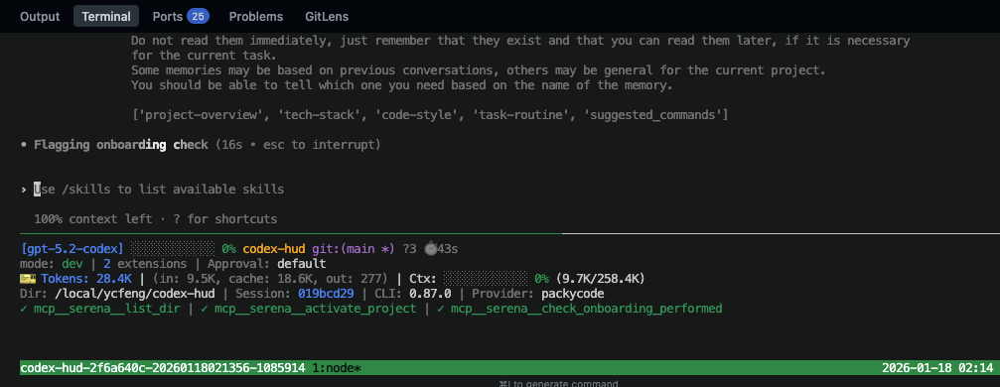
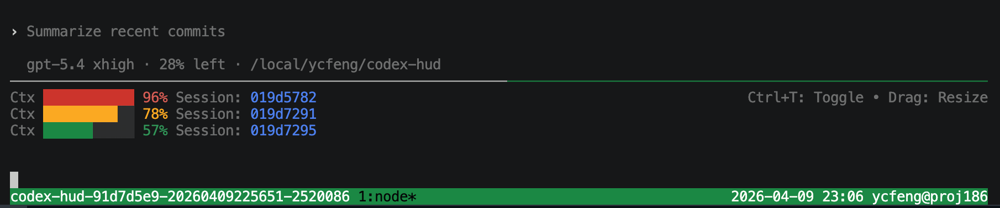

## Modification History

| Date       | Summary of Changes |
|------------|--------------------|
| 2026-05-22 | 补充 Windows 用户当前 branch 下载、self-check、运行流程，并加入 WSL 截图。 |
| 2026-05-22 | 将 Windows 默认启动策略切换为 WSL-only，并标注 native PowerShell HUD 暂未支持。 |
| 2026-05-22 | 记录 Windows 显式启动模式参数与 Bash installer 依赖诊断提示。 |
| 2026-05-21 | 更新 Windows PowerShell、cmd 与 WSL 双入口行为说明。 |

<p align="center">
  <a href="./README.md"></a>
  <a href="./README.zh.md"></a>
  <a href="./README.ja.md"></a>
  <a href="./README.ko.md"></a>
</p>

# Codex HUD

[OpenAI Codex CLI](https://github.com/openai/codex) 的实时状态栏 HUD。轻量、零配置、在 tmux 中运行。

> 灵感来源于 Claude Code 的 [claude-hud](https://github.com/jarrodwatts/claude-hud)。



## 为什么需要 Codex HUD？

**Q: Codex CLI 本身就能用，为什么还需要 HUD？**

因为没有它你就是在盲飞。Codex HUD 在终端底部提供一个持久的仪表盘：

- **分支、模型、权限** —— 一目了然，不用猜
- **Token 用量（含 cache）** —— 精确知道烧了多少上下文
- **Context 窗口填充条** —— 快撞墙时提前知道
- **MCP 服务器状态 & 工具调用** —— 看 Codex 实际在干什么
- **Reasoning effort 级别** —— 当前思考深度一目了然

**Q: session 会派生子代理，我能看到它们在做什么吗？**

可以。按 `F12` 打开右侧的**子代理树**：当前 session 派生的每个代理、它的模型与推理强度、正在运行还是已结束或失败、以及是谁派生的它。再按一次 `F12` 关闭。侧栏打开时会取代状态栏：状态栏的字段移到侧栏底部，Codex 保留完整高度，同样的信息不显示两遍。

`Ctrl+T` 被刻意留空 —— 那是 Codex 自己的转写面板。



**Q: 需要手动配置 tmux 吗？**

不需要。Codex HUD 自动激活 tmux。只需输入 `codex`，HUD 就会出现。如果没装 tmux，安装程序也会搞定。

## 快速开始

```bash
git clone https://github.com/CartmanFatass/codex-hud.git
cd codex-hud
./bin/codex-hud-install

# 刷新 shell，然后直接输入：
codex
```

### Windows 当前 branch（默认 WSL）

当前 branch 在 Windows 上只把 WSL HUD 作为受支持的 HUD 运行时。PowerShell 和 cmd 只是启动 shell；HUD 本身会在 Ubuntu WSL 的 Bash + tmux 中运行。

1. 下载并切换到当前 branch：

```powershell
git clone https://github.com/CartmanFatass/codex-hud.git
cd codex-hud
git switch feature/windows-support-dual-entry
.\bin\codex-hud-install.ps1
```

2. 打开新的 PowerShell 或 cmd 窗口，然后检查 WSL runtime：

```powershell
codex --self-check
```


3. 启动 Codex HUD：

```powershell
codex
```


说明：

- `codex` 在 Windows 上默认启动 WSL HUD。
- `codex --wsl ...` 显式使用同一条 WSL HUD 路径，并在转发给 Codex CLI 前移除 wrapper 参数。
- native PowerShell HUD 暂未作为用户启动模式支持；legacy native-mode 请求会 fail fast 并提示使用 WSL HUD。
- `codex-hud-wsl` 是显式 WSL 完整 HUD 命令。
- `cmd.exe` 用户会获得托管 `.cmd` shim，并通过同一套 PowerShell entrypoint 启动。

### 管理命令

首次安装后，以下命令自动加入 shell：

| 命令 | 说明 |
|------|------|
| `codex-hud-sync` | 重新构建并刷新当前 checkout 的别名 |
| `codex-hud-upgrade` | 拉取最新代码后重新构建 |
| `codex-hud-uninstall` | 移除别名并停止 HUD 会话 |

## HUD 显示了什么？

终端底部常驻一行。相关的字段用两个空格相邻，组与组之间用淡化的 `│` 分隔；会话计时与按键提示靠右对齐：

```
▸ Edit: src/types.ts · 1m20s  ☀● Astra  codex-hud git:(main * ↑2) │ Agents 1 run · 1 ok  Ctx ████▎░░░░░ 42% (114.2K/272K)  ◷~00m │ 2/5  Q61%            30m
```

有事需要你处理时，它会排到最前面：

```
! 1 tool failed · 1 agent failed │ ▸ Edit: src/types.ts · 1m20s  ☀  main* │ 1▸1✗  Ctx 42%  ◷~00m │ 2/5  Q61%    30m
```

| 字段 | 含义 |
|------|------|
| `!` | HUD 实际观测到的异常：工具返回失败、代理以错误结束、额度窗口报告已满 |
| `▸ Edit: src/types.ts · 1m20s` | 本轮正在做的事：运行中的工具、它的目标、以及本轮已经进行的时间。窗口变窄时只保留标记和用时，再窄只剩标记 |
| `☀● Astra` | 模型家族与推理强度：`○` low、`◐` medium、`◕` high、`●` xhigh、`◆` max、`✦` ultra |
| `codex-hud git:(main * ↑2)` | 项目、分支、未提交改动、领先/落后。如果 Codex 是在仓库的上级目录启动的，状态栏会显示会话实际工作的仓库：`shenlun › Learn-to-Write git:(main *)` |
| `Agents 1 run · 1 ok · 1 fail` | 子代理按结果计数。成功与失败分开统计；没有观测到状态的代理记为 `?`，不会算作运行中 |
| `Ctx 42% (114.2K/272K)` | 上下文窗口占用，精度细到八分之一列；`↻2` 是压缩次数 |
| `◷~00m` | 距上一次模型用量的分钟数，用作提示缓存提醒；25 分钟时转为警告，封顶于 `30m+` |
| `2/5` | 当前计划已完成的步骤数 |
| `Q61%` | 账户额度窗口的消耗比例。这是额度，不是任务进度；`↺1h23m` 是距下次重置的时间。最宽的形式还会加上 `out in ~40m`：按最近的速度直线推算窗口何时用完，只有读数跨度至少五分钟、用量在上升、并且推算结果早于重置时间时才显示 |
| `84K` | 本次会话消耗的 token |

只有拿到真实数据的字段才会出现。没有额度快照就不显示额度，而不是显示一条为 0 的进度条。

点击状态栏时，落在哪个字段上就是什么动作：告警与代理计数会打开侧栏并把键盘交给它；
各类仪表只打开侧栏，光标留在 Codex；点在其他位置则与过去一样整条切换。

### 窗口变窄时

先缩短，再隐藏；隐藏从最不重要的开始；告警永远不会被丢掉。40 列、且有失败时：

```
!2 │ ▸  ☀  main* │ 1▸1✗  Ctx 42%  ◷~00m
```

### 密度预设

| 预设 | 显示内容 |
|------|----------|
| `focus` | 告警、模型、项目、代理、上下文 |
| `balanced`（默认） | 在 focus 基础上加计划进度、额度、输出速度、会话计时 |
| `full` | 全部，包括 token、审批/沙箱、Session ID |

```bash
CODEX_HUD_DENSITY=focus codex
```

## 开发面板

`F12` 在右侧打开面板，光标仍留在 Codex。`Shift+F12` 打开并把光标移进面板。

面板默认显示 Agents 和 Worktrees；Changes、Inspector 按需打开。焦点标题和选中行高亮，状态颜色集中在图标上：

| 区域 | 内容 |
|------|------|
| **1 Agents** | 子代理树、状态、模型/推理图形，长名字缩短时优先保留图形 |
| **2 Worktrees** | 各 worktree 的分支、目录和修改/冲突状态 |
| **3 Changes** | 所选 worktree 的文件列表、暂存/未暂存状态和冲突；窄屏也可选择文件 |
| **4 Inspector** | 代理状态与活动时间、worktree 详情，或带增删配色的文件 diff |

各区域纵向排列；Worktrees 按内容收缩，剩余空间优先给 Agents 或当前 Inspector。16–20 列减少边距，`z` 可放大当前区域。
每个区域保留自己的滚动位置。选中代理按 ID 保持，选中文件按路径保持。

**两种布局**（设置 → Panel →「布局」，保存后立即生效）：

- **卡片**（rich，默认）：不画 Agents 区域。顶部一行统计失败、运行、完成的数量，并带有 `+12 已收起` 开关；其下是一个可滚动的视图：每个 subagent 一张卡片，顺序、筛选和收起规则与树完全相同。卡片右侧不封口，与底部封闭的圆角状态卡区分开。边框标识 agent：顶边是状态图标、任务类型图形（“短标签和标题”给出时）、Codex 的原名（即 `/subagents` 显示的名字，过长时从中间截断；带下划线，点击它即切换到该 agent）和模型/推理徽标；底边是运行中的本轮时钟（`◷ 4m07s`，按秒走，静默时为警告色）或完成/失败多久了、折叠父级的数量（`+3 已收起`）、已知时的上下文用量，以及 `▾`。卡片里面写它在做什么：模型起的短名（加粗），没有时是任务文本（最多两行）；然后是最新的模型说明（`~`）和最新的说明，各带时间。边框和左侧竖线按状态着色（完成超过 1 分钟后变暗）；选中的卡片为强调色，左上角显示 `›`。子 agent 的卡片每层缩进一列，最多两层。展开卡片（`e`、空格，或点击顶边或 `▾`）会列出该 agent 的完整日志（新的在前，约 20 行，其余见详情区域），最后是完整的任务文本。主会话的简报不在这个视图里，而在底部的状态卡中（见下）。
- **紧凑**（compact）：Agents 区域（树，每个 agent 一行，用 Codex 的原名），下面是简报、回顾和 agent 日志，与之前相同。

**状态卡**位于底部（封闭的圆角框），有三档（设置 → Panel → 状态卡，与其它面板偏好一样保存）；按 `r` 或点击它的顶边依次切换：

- **一行**（min）：只有顶边：主会话的状态和时钟（`▸ 工作中 33m51s`、`✓ 空闲`、`! 等待批准 2m`）；有工具或 agent 失败、或回顾说需要你时带 `!` 标记。`, ?` 提示放得下才显示；再窄时先去掉卡片名，再用状态的简短形式。
- **状态**（status）：状态栏的各项，与之前相同。
- **完整**（full，默认）：上述各行，一条内分隔线，然后是主会话的简报：先是模型对待批准请求的说明，再是带标签的回顾、全局一句话，以及调用失败或格式不符的回复。内分隔线上写着简报的状态（`回顾 3m前`、`生成中…`、`失败`、`已暂停`）和 `b 暂停` / `b 继续` 开关，二者只在启用了模型后端时出现。没有可显示的内容时与「状态」一样。它最多占面板大约一半的高度，并始终给 agent 留出几行；简报更长时在固定的状态行下方单独滚动（在状态卡上滚动鼠标滚轮），并有一行说明还有多少不在视野里。

紧凑布局不变：简报和回顾仍在树下方的区域里，所以它的状态卡只有「一行」和「状态」两档（「完整」即「状态」），`r` 在两者之间切换。

回顾的各项都带文字标签（目标、已完成、现在、需要你；“需要你”为警告色，为空时不显示），各项之间、回顾之后、agent 之间都有空行。摘要行以下的视图放不下时可以滚动：鼠标滚轮、`PgUp`/`PgDn`，以及移动选中项（视图会跟着把选中的 agent 滚进来）。视图最后一行说明还有多少不在视野里（`↑ 5  ↓ 还有 12 行`，点击它继续滚动）。滚动位置在重绘和新内容到来时保持不变，内容变少时自动收回。视图不足 12 行时先去掉空行，而不是藏起内容。底部状态卡和打开的 2–5 号区域位置不动。

| 按键 | 作用 |
|------|------|
| `Tab` / `Shift+Tab` | 切换区域 |
| `1` / `2` / `3` / `4` | 直接聚焦对应区域（卡片布局中 `1` 聚焦卡片） |
| `j` / `k`、`↑` / `↓` | 移动选中项或滚动详情 |
| `PgUp` / `PgDn`、`g` / `G` | 翻页（agents 视图滚动一页）、跳到开头/末尾 |
| 鼠标点击 / 滚轮 | 选择或滚动；点击区域标题折叠/展开；滚轮滚动 agents 视图，不移动选中项 |
| `e` 或空格（卡片布局） | 展开或收起选中卡片的时间线；Enter 仍打开详情 |
| 点击卡片（卡片布局） | 内容或底边：选中；顶边或 `▾`：选中并展开/收起；带下划线的名字：切换到该 agent，同 `o` |
| `,` 或 **Settings** | 打开设置；方向键或点击修改，`s` 或 Save 保存 |
| `h` / `l`、`←` / `→` | 在树中折叠、展开或移动到父/子节点 |
| `s` | 切换活跃优先 / 创建顺序 |
| `a` 或点击摘要行 | 显示 / 隐藏已被收起的已完成代理 |
| `f` 或 `/` | 筛选全部、运行中、失败、未知 |
| `Enter` / `v` | 打开 Inspector；在 Inspector 内展开/收起完整时间、ID 和路径 |
| 点击 agent（紧凑）/ 卡片上的名字（卡片）/ `o` | 将实际 Codex 对话切换到该 agent |
| **Main** / `m` | 将 Codex 对话切回主会话 |
| `x` / `-` | 关闭 / 折叠当前区域；`1`–`5` 可重新打开 |
| `5` | 打开时间线区域 |
| `z` | 放大/还原当前区域 |
| `?` | 可换行、滚动的快捷键帮助；支持方向键、滚轮、PgUp/PgDn、g/G |
| `Esc` | 关闭帮助、还原放大、返回列表；在 Agents 下关闭面板 |
| `b` | 暂停 / 继续简报和回顾的模型调用 |
| `r` 或点击状态卡顶边 | 切换状态卡档位：一行 → 状态 → 完整（紧凑：一行 ↔ 状态） |
| 在状态卡上滚动滚轮（卡片布局，完整档） | 简报超出空间时滚动简报 |
| `q`、`Ctrl+C` | 关闭面板 |

会话切换借助 Codex 自带的 `/subagents` 选择器（已对照 Codex 0.154 和 0.157 验证），选中显示该代理完整 UUID 的那一行，不会提交猜测的 `/agent <id>` 命令。需要空输入框（包括查看子代理时的只读输入框）或已识别的选择器；有草稿、处于复制模式或无法识别界面时，会提示原因。键盘移动选中项只预览，按 `o` 才切换。目标已在可见范围内时合并移动操作，长列表按页翻找，Enter 前再次核对该行。切换后不再重复打开选择器，避免二次弹窗和对话重绘；请求已发送不等于独立确认了最终显示的会话。

Codex 窗格窄于约 63 列时，选择器不再显示 UUID。此时按选择器显示的名字（任务路径，或 `Main [default]`）匹配，且仅当本会话没有其他代理显示同一名字时才切换；否则拒绝切换并提示加宽 Codex 窗格。有代理正在运行时，Codex 每次打开选择器都会在对话里插入一条 “Sub-agents running” 提示，这是 Codex 自身的行为。

活跃排序只调整同级节点：有运行中子孙的分支优先，按最新一轮启动时间排序，普通 token 或日志更新不会改变顺序。
父子关系支持两种日志元数据格式。没有状态证据的代理显示为未知，不会凭最近写入时间判定为运行或完成。

代理以任务路径的最后一段命名，与 Codex `/subagents` 选择器显示的名字一致：`/root/essays_2020_2021` 显示为 `essays_2020_2021`。这个名字是树的行、卡片和日志块的标题；模型起的短名（如果有）写在它下面一行，从不替换它。Codex 随机分配的昵称（Copernicus、Meitner 等）和角色移到 Inspector 中。Guardian 审查线程显示为 `guardian`。

已完成的代理在完成 3 分钟后从列表中收起（Settings → Hide finished：1m、3m、10m、30m 或 never）。运行中和失败的代理不会被收起；子代理仍在显示的已完成父代理保留为淡化行。每个已完成的行都显示完成了多久；摘要行统计被收起的数量（`+12 older`），点击摘要行或按 `a` 即可全部显示。

Inspector 默认显示名字、模型/effort、状态、本轮经过时间和最近活动。按 `v` 展开完整时间与会话 ID。会话切换提示显示在底部；点击 Agents 摘要或空白行不会切换会话，只有具体条目会触发切换。

Changes 属于选中的 worktree，不推断某个文件由哪个 agent 修改。状态的第一列是暂存区，第二列是工作区；窄屏摘要中 `Δ` 是修改文件数，`S` 是暂存、`U` 是未暂存数量。
选中文件后按 Enter 打开暂存和未暂存 diff，自动放大 Inspector；Esc 还原。新增行绿色、删除行红色、hunk 标记青色，保留 `+` / `-` 符号；长行会折行，未跟踪文件提供有大小限制的内容预览。
这些操作只读取 Git 数据；禁用外部 diff、内容过滤器和部分克隆的自动下载，不提供暂存、提交或切换分支操作。

Settings 提供四档宽度：窄（16 列）、auto（沿用原来的 20–30 列策略）、宽（45 列）、更宽（70 列）。保存后立即调整，并为主对话区保留空间。tmux 窗口尺寸变化时（例如在后台创建的会话从更宽的终端接入）会重新套用宽度；手动拖动边框则保持不变。没有保存过设置时，仍支持 `CODEX_HUD_TREE_WIDTH` 指定初始宽度。

独立设置页分为 Status bar（密度、主题、模型标签、动画、上下文口径、启动时的底栏）、Agents（排序、收起已完成代理）、LLM（模型增强：所有会把内容发给模型的功能，见下文）和 Panel（布局、状态卡、语言、四个区域、宽度、鼠标、刷新间隔）四组。取值在右侧对齐；选中项显示为 `‹ 取值 ›`，←/→、Enter 或点击即可修改（点击 `‹` 向回切换）。列表下方一行说明选中设置的作用。未保存字段带 `*`，Save 按钮随之高亮；Bar on launch 在下次启动时生效。Save 写入 `$CODEX_HOME/hud-settings.json`（可用 `CODEX_HUD_SETTINGS_PATH` 改路径），紧凑 HUD 下次刷新时同步显示偏好。已保存设置优先于环境默认值，`NO_COLOR` 始终优先。Back 放弃未保存修改；Reset 或 `r` 恢复默认草稿，需 Save 才应用。窄屏保留完整 Back/Save 按钮，使用短标签。说明行上方有一行显示侧栏上次读取会话的时间（`上次读取 2s前`）；如果读取失败过，还会写出失败的环节、时间和原因，失败比上次成功读取更新时以警告色显示。读取失败时屏幕上保留的是上次的好数据，有了这一行，“会话很安静”和“HUD 读不到”才不会看起来一样。

**时间线。** 第 5 个区域默认关闭，按时间倒序列出会话事件及其距今时间：请求批准与答复、上下文压缩、额度窗口越过 80 % 和 95 %、一轮完成 / 中断 / 失败、工具调用失败，以及每个 subagent 的开始、完成和失败。这些都是 rollout 记录下的事实；一段安静不算事件。待批准的请求还会显示已经等了多久，在状态栏警示（最宽形式）和侧栏的状态卡片里都有。

**Agent 日志。** tree 下方（卡片布局中在各自的卡片里）每个 subagent 都有一份日志，按时间倒序：观察到的开始、完成、失败和最新说明（与刷新 tree 的同一次读取写入），以及简报对它的说明（以 `~` 标出，表示由模型撰写）。日志只增不减；新的简报会追加，而不会替换上一份。日志跟随 tree：tree 隐藏的 agent（已收起、被筛掉或在折叠的父级下）不显示，折叠的父级会显示一行说明下面收起了几份日志；让 agent 重新显示，它的完整日志也随之出现。紧凑布局中每块以 agent 的状态、类型图形和 Codex 原名开头，下一行是模型起的短名或任务；每个 agent 显示最近两条，选中的显示六条并排在最前，详情区域显示全部。点击日志行会选中对应 agent。日志按会话保存在 `$CODEX_HOME/hud/agent-log/`（权限 0600，30 天后删除）。选了模型后端时显示；后端关闭时，打开 Agents →「无模型时的日志」也会显示（只有观察到的条目）。

**模型增强。** 面板请模型写的所有内容都在设置的「模型增强」（LLM）组里，每一项都有自己的开关；内容使用面板语言，显示在简报标题下方，标明是模型写的，而不是观察到的事实。「后端」选择由谁来写：`omp`、`agy` 或任意 OpenAI 兼容的 chat completions 接口（`api`）；选关闭则所有项都停用。所有项共用一个队列（同一时间只有一个调用）、一个缓存和一个每小时上限（「调用上限」，默认每小时 60 次，同一 `CODEX_HOME` 下的多个侧栏合计）；超过上限的请求会被拒绝，原因显示在本该出现文字的位置。设置页列表下方显示今天已调用的次数。缓存和调用记录（只有时间戳）保存在 `$CODEX_HOME/hud/model-cache/`，权限 0600。各项发送的内容：

- **Agent 简报**（选了后端后默认开启）：区域顶部一句话概括所有 subagent，并为每个 agent 写一条说明，记入它的日志。发送每个列出的 agent 的名称、状态、任务文本（300 字符）和最新公开说明（600 字符）。整体概况最多每个「简报间隔」一次，并且只在某个 agent 的状态或最新说明变化时才调用；两次简报之间，自上一条说明以来有新情况的 agent 会得到新的说明，全部放在一个请求里，最多每分钟一次。
- **主会话回顾**（默认关闭）：主会话的滚动回顾，显示在状态卡（卡片布局）或简报区域顶部（紧凑布局）：目标、已完成的事（最多四条）、当前进展，以及以警告色标出的需要你做的事。它会发送你的提问和助手的公开回复与说明（每条约 600 字符，总共约 4000 字符，绝不包含推理内容）、计划步骤、待批准请求的摘要、压缩次数，以及每个 subagent 的名称、状态和本轮时长；subagent 的任务和说明只有在同时开启 Agent 简报时才发送。每次只带上一次的回顾和之后的新内容，所以开销稳定，Codex 压缩对话后也不会丢。你发出提问、出现最终回复、一轮结束、计划步骤完成或出现待批准请求时，在「简报间隔」允许的范围内立即更新；一轮运行很久时（例如在等 subagent），只要有任何变化（包括说明或 subagent 的进展），最多每个「回顾保底间隔」（默认 15 分钟，且不短于简报间隔）更新一次。什么都没变就不发送。回顾按会话保存在 `$CODEX_HOME/hud/recaps/`（权限 0600，30 天后删除），重新打开侧栏或 `codex resume` 时会立即显示上一次的回顾和它的时间；语言不同的回顾会重新生成。卡片布局中显示在「完整」档的状态卡里；紧凑布局中显示在简报区域顶部。
- **结果摘要**（默认关闭）：subagent 完成时，从它的 rollout 读取完整的最终答复（仅公开的最终回复；超过约 8000 字符时取开头和结尾）并只发送一次，返回三行：结论、依据，以及 agent 自己说明的存疑之处。摘要写入该 agent 的日志，在检查器的「~ 结果摘要」下显示，并在 Agent 简报的材料中代替 600 字符的节选。侧栏看到之前一小时以上就已完成的 agent，只有在你检查它时才生成摘要。
- **短标签和标题**（默认关闭）：每个 subagent 的任务文本（400 字符）只发送一次，多个合并为一次请求，不发送别的内容；回复为每个任务给出一种工作类型（research、experiment、fix、review、writing、summary 或 other）和一个约 10 个汉字或 4 个英文单词的短名。类型由 HUD 画成固定的图形，暗色显示在 agent 名字旁：⌕ 调研、⚗ 实验、⚒ 修复、◈ 评审、✎ 撰写、∑ 总结，other 不画（图例见 `?`）。短名写在卡片和日志块中 agent 原名的下一行；树的行和所有标题仍用 Codex 的原名，即 `/subagents` 显示的名字。回复到达之前、功能关闭或请求失败时，卡片显示任务文本，不画图形。标签按任务文本的哈希保存在 `$CODEX_HOME/hud/model-cache/labels.json`（0600），每个 agent 只生成一次；还没有类型时写下的旧条目照样可读，类型按 other 处理。会话也会得到一个标题：主会话回顾写过时取回顾的目标（不调用模型），否则用你的**第一条提问**（1500 字符）调用一次。标题保存为回顾旁的 `<session>.title.json`，在状态栏会话字段最宽的显示中出现，会话 id 仍在旁边。
- **失败原因**（默认关闭）：主会话的工具调用失败时，发送命令和输出的最后 2000 字符；subagent 以错误结束时，发送它 rollout 末尾的错误事件（或最后一个失败命令的输出）。返回一行原因，显示在时间线的事件下方；对 agent 还写入它的日志并在检查器中显示。rollout 没有记录错误输出的失败不发送任何内容。
- **改动摘要**（默认关闭）：改动面板打开时，当 diff 的文件或行数变化，最多每个「回顾保底间隔」一次，发送按文件的统计（最多 40 个文件）和最多 6000 字符的已暂存与未暂存内容；未跟踪的文件只发送文件名。返回一到两行，说明这次改动做了什么，以 `~` 标记显示在面板顶部；diff 之后又变了，旧摘要会注明，直到下一次更新。
- **批准说明**（默认关闭）：有命令等待批准时，发送完整命令（最多 2000 字符），并在简报区域顶部以「~ 待批准（模型描述）：」显示一句话，说明它会做什么。只做描述：判断命令是否安全的回复会被丢弃而不显示。它不能代替阅读命令本身；仍然在 Codex 的批准提示中作答。

每一项的结果都按输入缓存，同样的答复、摘要或 diff 不会发送第二次，跨侧栏也一样。失败的请求 10 分钟内不再重试。

按 `b` 或点击简报标题右端的开关（紧凑）或状态卡内分隔线上的开关（卡片布局，完整档）可以暂停和继续以上所有项（Agent 简报或主会话回顾开启时可用）。使用 `api` 时在 `hud-settings.json` 里设置：

```json
{ "briefing": "api",
  "briefingApiBase": "http://localhost:11434/v1",
  "briefingApiModel": "qwen3:8b",
  "briefingApiKey": "" }
```

base 留空即 OpenAI。key 留空时依次读取 `CODEX_HUD_BRIEF_API_KEY`、`OPENAI_API_KEY`；都没有就不带 key，适合本地服务。设置文件以 0600 权限写入。`CODEX_HUD_BRIEF_MODEL` 对所有简报方式覆盖模型名。请求使用较低的思考强度：`omp --thinking low`，以及 `agy` 的默认模型 `gemini-3.8-flash-low`。发给 `api` 接口的只有所有兼容服务都接受的字段；如果你的接口接受 `reasoning_effort`，设置 `"briefingApiReasoning": true` 后也会发送它。

**装饰。** 面板 → 装饰会在侧栏空白处画一张字符画：盲文点阵、按原图上色的点阵，或 ASCII。它只占用没有内容的行，agent 和简报需要空间时会自动让出。`bin/codex-hud-art <图片> [dots|color|ascii]` 会把图片复制到设置旁边并打开装饰；`bin/codex-hud-art off` 关闭。图片由 ffmpeg 读取，它支持的格式都可以。

### 输出速度

默认状态栏新增 `Out ~42.1 tok/s`，选中代理的详情也会展示其可用读数。
它用日志里的**累计输出 token 增量 / 日志时间差**估算最近约 30 秒的吞吐，展开详情后注明实际采样窗口。
这不是纯模型解码测速，窗口可能包含工具或服务等待时间；新一轮开始时排除跨轮空闲时间。
没有足够样本时不显示；10 秒没有新样本后显示 `last ~42.1 tok/s`，保留上次读数。
Ctx 仍保留当前占用与压缩次数，开发面板不绘制 Ctx 趋势。

## 使用方法

```bash
codex                        # 启动并自动显示 HUD
codex --model gpt-5          # 传递 Codex CLI 参数
codex --wsl --model gpt-5    # Windows 下显式使用 WSL HUD
codex "help me debug this"   # 带初始提示
codex-resume                 # 恢复上次会话
```

<details>
<summary>更多命令</summary>

```bash
codex-hud --kill             # 终止当前目录的会话
codex-hud --list             # 列出所有 HUD 会话
codex-hud --json             # 以 JSON 输出当前目录会话的 HUD 状态
codex-hud --attach           # 复用已有会话
codex-hud --new-session      # 强制新建会话
codex-hud --self-check       # 运行环境诊断
```

</details>

### 机器可读的状态

状态栏会按窗格宽度自我裁剪：能缩就缩，放不下就藏。这对读者是对的，对脚本是错的。
所以每一次采集也会把已知状态写到 `$CODEX_HOME/hud/state/<tmux 会话名>.json`，
`codex-hud --json` 则打印当前目录会话对应的那一份。

```bash
codex-hud --json | jq '.context.percent, .agents.active, .attention[].label'
```

其中包含会话、项目、活动、上下文、额度、token、代理与需要关注的事项，
有待批准请求时的 `approvalSince`，推算成立时的 `quotaForecast`（是估计，不是读数），
另有 `bar.segments`：真正画出的那一行里，每个字段落在哪几列。
点击某一列能对应到某个字段，靠的就是它。

规则与显示一致：每个值都是观测到的事实，没有数据的字段整个缺席而不是写 0，
这样“没有额度快照”和“额度为 0%”不会长得一样。文件以 `0600` 权限原子写入，
只在时钟之外确有变化时才写，且每秒至多一次；HUD 退出时删除——
一个已经停止的 HUD 留下的状态文件，看起来会像还活着。

`health` 说明状态栏自己的读取是否顺利：`lastReadAt` 是会话查找和 rollout 读取上次成功的时间，
`lastError`（`source`、`message`、`at`）是最近一次失败的采集。两者在发生之前都不出现。
单纯又一次成功读取不会触发重写，所以 `lastReadAt` 和 `updatedAt` 一样，是“截至上次写入”的值。

## 配置

### 环境变量

| 变量 | 默认值 | 说明 |
|------|--------|------|
| `CODEX_HUD_DENSITY` | `balanced` | 状态栏显示密度（`focus` / `balanced` / `full`） |
| `CODEX_HUD_THEME` | `terminal` | 配色（`terminal` / `mocha` / `latte` / `none`） |
| `CODEX_HUD_GLYPHS` | `both` | 模型标记样式（`glyph` / `text` / `both`） |
| `CODEX_HUD_STATUSLINE` | `1` | 默认开启底部状态栏，设为 `0` 关闭；覆盖 Settings 的 Bar on launch，下次新建会话生效 |
| `CODEX_HUD_CONTEXT` | `used` | 上下文百分比：`used` 已用 / `remaining` 剩余；也可在 Settings 保存 |
| `CODEX_HUD_POSITION` | `bottom` | HUD 面板位置（`top` / `bottom`） |
| `CODEX_HUD_HEIGHT` | `1` | HUD 高度（行数） |
| `CODEX_HUD_MOUSE` | `1` | 启用鼠标/触控板滚动 |

状态图形使用语义配色：青色 `▸` 工作中、绿色 `✓` 本轮结束、黄色 `■` 已中断、红色 `✗` 失败。读取暂时失败时显示黄色 `?`；`Ctx~` 表示当前仍是上一份上下文采样，等待新一轮或压缩后的 token 报告。安静的日志不会自行把工作中改成空闲。

缓存提醒也在同一行：`◷~08m` 表示距最近一次模型用量报告约 8 分钟，每满一分钟更新；25 分钟变黄，30 分钟后显示红色 `◷~30m+`，新用量报告到达时重新计时。采用 30 分钟提醒窗口，`~` 表示估算，不代表服务端确认缓存仍有效或已经过期。读取异常时改用 `?`；没有采样时不显示。提醒在所有密度中启用，25 分钟后优先保留在窄窗口中；纯文字模式显示 `Cache ~25m`。

上下文比例已对齐 [Codex 0.154 的计算](https://github.com/openai/codex/blob/rust-v0.154.0/codex-rs/protocol/src/protocol.rs#L2258)：使用最近一次 token 报告，从已用量和窗口大小两侧扣除 12K 固定基线。`Ctx 20%` 对应原生的 `80% context left`；括号中显示扣除基线后的已用量/可用窗口。自定义窗口不超过 12K 时按原始窗口计算。总会话 token 不用于计算上下文占用。

```bash
CODEX_HUD_STATUSLINE=0 codex               # 关闭底部状态栏，仍可使用侧栏
CODEX_HUD_CONTEXT=remaining codex         # 与原生状态栏同方向显示剩余比例
CODEX_HUD_GLYPHS=glyph CODEX_HUD_THEME=mocha codex
```

已有保存的显示设置优先于环境默认值，可在侧栏 Settings 的 Context、Theme、Model label 中修改。主区域滚轮在应用接收鼠标时转发给应用，否则保留 tmux 历史滚动；HUD 使用独立按键表，侧栏右键不再粘贴或夺走键盘焦点。

底部状态栏也可在 Settings 的 **Bar on launch** 中保存开关，下一次新建 HUD 会话生效；显式 `CODEX_HUD_STATUSLINE` 优先于保存值。

<details>
<summary>全部环境变量</summary>

| 变量 | 默认值 | 说明 |
|------|--------|------|
| `CODEX_HUD_NOTIFY` | `0` | 通过 tmux 提示失败与代理结束 |
| `CODEX_HUD_NOTIFY_COOLDOWN` | `300` | 同类提醒之间的冷却秒数 |
| `CODEX_HUD_NOTIFY_DESKTOP` | `0` | 额外发送桌面通知（需同时 `CODEX_HUD_NOTIFY=1`） |
| `CODEX_HUD_REDUCED_MOTION` | `0` | 关闭通信标记的动画 |
| `NO_COLOR` | （未设置） | 任意取值都强制使用 `none` 配色 |
| `CODEX_HUD_HEIGHT_AUTO` | `0` | 根据宽度自动调整高度 |
| `CODEX_HUD_HEIGHT_MIN` | `CODEX_HUD_HEIGHT` | 自动模式最小高度 |
| `CODEX_HUD_HEIGHT_MAX` | `12` | 自动模式最大高度 |
| `CODEX_HUD_AUTO_ATTACH` | `0` | 自动复用同目录最新会话 |
| `CODEX_HUD_ALTERNATE_SCREEN` | `0` | codex pane 的 tmux alternate-screen |
| `CODEX_HUD_CLEAR_SCROLLBACK` | `0` | 首次渲染时清理 scrollback |
| `CODEX_HUD_CWD` | （未设置） | 覆盖工作目录 |
| `CODEX_HUD_PROFILE` | `0` | 设为 `1` 时为状态栏和侧栏每次刷新的各阶段计时，每 10 秒按阶段追加一行汇总到 `$CODEX_HOME/hud/profile.log` |
| `CODEX_HOME` | `~/.codex` | Codex home 目录 |
| `CODEX_SESSIONS_PATH` | （未设置） | 覆盖 sessions 目录 |

</details>

### 提醒

默认关闭：Codex 自己有通知机制，同一件事弹两次比不弹更糟。在设置 → Status bar →「通知」打开，或用 `CODEX_HUD_NOTIFY=1` 开启；「桌面通知」是 `CODEX_HUD_NOTIFY_DESKTOP` 对应的第二道开关。设置了的环境变量优先于设置。

```bash
CODEX_HUD_NOTIFY=1 codex
```

它只提醒观测到的失败、Codex 正在等待的审批，以及已结束的代理，每次发生只发一条，并带冷却时间，避免状态反复时刷屏。
它不会对会话做任何操作：不自动确认、不发送按键、不自动重试。

`CODEX_HUD_NOTIFY_DESKTOP=1` 会额外发出终端之外的桌面通知。这是第二道开关：走出终端比发一条 tmux 消息要冒昧得多。

```bash
CODEX_HUD_NOTIFY=1 CODEX_HUD_NOTIFY_DESKTOP=1 codex
```

两条通道都是尽力而为，不支持时静默：一条是终端自己可能响应的 OSC 9 与 OSC 777 序列（包在 tmux passthrough 里，由启动脚本负责开启），另一条是 Linux 的 `notify-send` 或 macOS 的 `osascript`。
通知文本来自 rollout，写出前会剥掉全部控制字符：消息无法提前结束序列、把剩下的内容当成终端命令执行。

### config.toml

HUD 从 `CODEX_HOME/config.toml` 读取配置：

```toml
model = "gpt-5.2-codex"
approval_policy = "on-request"
sandbox_mode = "workspace-write"

[mcp_servers.my-server]
command = ["node", "server.js"]
enabled = true
```

## 系统支持

| 平台 | 状态 |
|------|------|
| Linux | 已支持 |
| macOS (Apple Silicon) | 已支持 |
| macOS (Intel) | 待测试 |
| Windows PowerShell | 已支持为启动 shell；native PowerShell HUD 暂未支持 |
| Windows cmd | 已支持（托管 `.cmd` shim） |
| Windows WSL Ubuntu | 已支持（Windows 默认 HUD 路径与 `codex-hud-wsl` 完整 HUD 入口） |

## 开发

```bash
npm install && npm run build   # 构建
npm run dev                    # 监听模式
node dist/index.js             # 直接运行 HUD
```

在 Windows PowerShell 中，如果 `npm.ps1` 被 ExecutionPolicy 阻止，请使用 `npm.cmd run build`。

想知道每次刷新的时间花在哪里，用 `CODEX_HUD_PROFILE=1` 启动会话。两个进程都会为各阶段计时
（`session.find`、`rollout.parse`、`tree.build`、`status.build`、`git`、`render`、`write`，
以及整个 `tick` 或 `collect`），每 10 秒为运行过的每个阶段向 `$CODEX_HOME/hud/profile.log` 追加一行：

```
2026-10-04T15:27:35.725Z bar pid=144913 tick n=10 avg=2.79ms p95=5.35ms max=5.35ms
```

不会输出到终端；未设置该变量时，计时只是一次空值检查。日志超过 4 MiB 后重新开始，保留一份 `.old`。

## 更新日志

| 日期 | 变更 |
|------|------|
| 2026-05-22 | 将 Windows 默认启动策略切换为仅使用 WSL HUD；显式 native PowerShell HUD 参数会 fail fast 并提示暂未支持 |
| 2026-05-22 | 新增 Windows 启动模式解析实验、native 到 WSL 的醒目 fallback 提示，以及 Bash installer 的精确依赖安装指导 |
| 2026-05-21 | 完善 Windows 双入口：WSL 临时 wrapper、sudo/root provisioning、cmd shim、首次启动 session 目录处理与 runtime state 优先级 |
| 2026-04-09 | 新增快速安装/同步/升级/卸载命令 |
| 2026-04-09 | HUD 按 tmux pane 绑定会话；显示 reasoning effort |
| 2026-02-09 | 修复 resize 后主 pane 焦点漂移；优化鼠标滚动默认行为 |
| 2026-02-09 | 更新会话复用默认策略与滚动配置 |

## 许可证

MIT

## 致谢

灵感来源于 Jarrod Watts 的 [claude-hud](https://github.com/jarrodwatts/claude-hud)。为 [OpenAI Codex CLI](https://github.com/openai/codex) 构建。

## Windows WSL 默认入口说明（2026-05-22）

Windows 当前默认只使用 WSL HUD 启动路径：

- `codex`：默认 Windows 入口；直接启动 WSL HUD，WSL HUD 不可用时才降级为普通 Windows `codex` CLI。
- `codex --wsl ...`：显式使用 WSL HUD，并在转发给 Codex CLI 前移除 wrapper 参数。
- legacy native-mode 请求：native PowerShell HUD 暂未支持，会 fail fast 并提示使用 WSL HUD。
- `codex-hud-wsl`：显式 WSL 完整 HUD 模式（Ubuntu + Bash + tmux）。
- `cmd.exe`：安装后会获得托管 `.cmd` shim，实际调用同一套 PowerShell entrypoint，并使用 `ExecutionPolicy Bypass`。

PowerShell 安装方式：

```powershell
git clone https://github.com/CartmanFatass/codex-hud.git
cd codex-hud
.\bin\codex-hud-install.ps1
```

说明：`codex-hud-install.ps1` 会写入 PowerShell profile 管理块，生成 cmd shim，并提供以下命令映射：

- `codex`
- `codex-resume`
- `codex-hud-wsl`
- `codex-hud-sync`
- `codex-hud-upgrade`
- `codex-hud-uninstall`

安装脚本会在 Windows 上准备 Node.js 与 Codex CLI；Windows 默认 HUD 路径只使用 WSL，因此默认不再安装 native tmux。在 WSL 中会通过 root 或 passwordless `sudo` 准备 `tmux`、Node.js LTS、`npm` 和 `@openai/codex`。如果 WSL 权限不足，会 fail fast 并输出可在 WSL 内手动执行的命令。

Linux/macOS/Git Bash 的 `install.sh` 也会对缺失依赖 fail fast，并输出精确检查项与安装指导。关键检查包括 `command -v node`、`node --version`、`command -v npm`、`npm --version`、`command -v tmux` 与 `tmux -V`。
