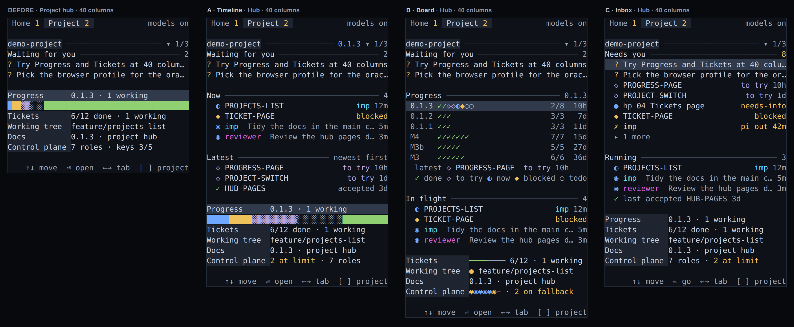
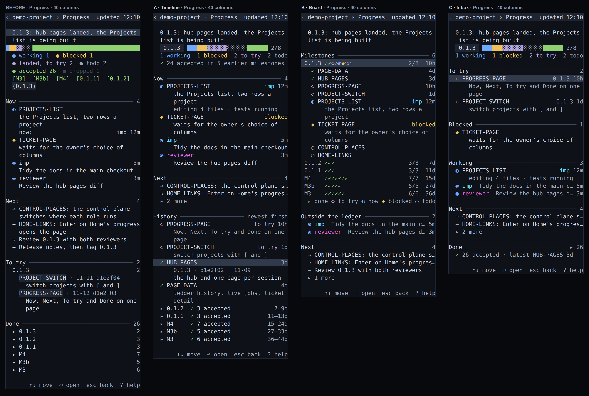

# PROJECT-UX phase 1: mockups for the Project section

Design only. No file under `src/`, `bin/`, `packages/` or `tests/` changed. Every image is terminal-faithful: one box per cell,
monospace, the HUD's own `terminal` theme inks (`theme.board`, from `dist/render/palette.js`), real glyph widths (CJK 2 cells), and every
row is checked to be exactly 40 (or 80) columns when the page is built. The data is one invented project (`demo-project`: a 30-slice
ledger over six milestones, 12 tickets in two features, 7 roles with two at their limit, two helper jobs, six projects); nothing real.

- `before-*.png`: the shipped renderer on that data (real `renderMonitor` output), the baseline.
- `a-*.png`, `b-*.png`, `c-*.png`: three directions. Each has hub (40 and 80), Progress (40 and 80), Tickets (list and one open ticket),
  Control plane (roles with fallbacks, `imp` and `oracle` exhausted), Projects list, and the hub in Chinese. `a-hub-40-latte.png` and
  `a-hub-40-none.png` show direction A in a light theme and with no colour at all.
- `compare-*.png`: before, A, B, C side by side at 40 columns for hub, Progress, Tickets (one open), Control plane and Projects list.
  Start there.
- `tools/`: how they were made. `npm run build`, then from the repo root
  `tmp/env.sh node docs/design/project-ux/tools/build.mjs [before|a|b|c|compare]`. Needs headless Chrome (`--password-store=basic`, a fresh
  temp profile per shot). The directions are small renderers over the real snapshot shape, so their size is a fair first estimate of the
  real work (below).

## What is wrong today (the baseline at 40 columns)

- The hub names counts, never work: `Progress  0.1.3 · 1 working` cannot say which slice, who is on it, or what landed last. The bar is the
  whole ledger, so 26 accepted slices out of 34 turn it into a green wall with the live work as a sliver.
- Progress is 49 rows. What is happening now is there, but past work is only counts: `Done` is six folded milestone rows, `To try` shows only the
  newest milestone, and nothing says how long ago anything happened except inside a fold. The legend and chips take 8 rows before content.
- Tickets are in file order and every state is spelled out: 5 of 12 rows spill their status (`done`, `ready`, `dropped`, `blocked by 06`) onto a second row at 40
  columns, and nothing says who is on a ticket.
- Control plane is 41 rows: the one thing that needs you (two roles at their limit) is a glyph among 12 role rows, and the page spends its second half
  on files and keys.
- Projects list: two rows per project, bar plus counts, but not what the project is doing.

## What all three keep

One terminal line per row (an entry may have a head row and up to two detail rows, as the shipped Progress page already does); 40 columns fully
usable, 80 gets more text not new structure; EN and ZH; nothing from a model, the network or a new collector (the dates are the ledger's own
commit dates, which the collector already resolves for every row in one `git log --no-walk`); no write to STATE or tickets; no page added or
removed; no new key (the footers only drop or reword hints); `Esc`, `[` `]`, Enter on the name row behave as today. Marks keep the shipped
vocabulary (`◐ ◆ ◇ ✓ ○ ◉ ✗ − ▸ →`; `◇` for "landed, to try" is the only new one: it is the violet of the bar's `▓`), each next to its word somewhere on
the page.

## Direction A, Timeline: time is the axis

**Idea.** The hub briefs you on what is happening now and what landed last. Progress is a dated feed, newest first: the last week in full,
older work folded into one row per milestone with the days it covers. Tickets say who is on them and what was last said.
**What the owner sees that they could not:** which slice and which worker are active and for how long (`PROJECTS-LIST  imp 12m`) and why one
waits, without opening a page; the last three things that landed with how long ago and whether they still need a try; one row per past
milestone (`0.1.2 ✓ 3 accepted 7–9d`) instead of a count; a milestone bar that means something (`0.1.3` 2/8) next to "24 accepted in 5
earlier milestones"; roles at their limit named on the hub and the control page with the place the next job will use (`imp: pi out 42m → agy`).
**Changes vs before.** Hub: Now and Latest blocks above the page rows, name row carries the milestone, bar is the current milestone's.
Progress: summary, milestone bar, one counts row; Now with job activity; Next folded to two; History (feed + milestone folds) replaces To try /
Done. Tickets: working first, status words only when they say something (`needs-info` amber, `by 06`), a note row for a ticket with a worker or a
comment, done and dropped folded. Control plane: alert rows on top, aligned columns, harness block in 3 rows, files folded to one. Projects list:
second row is the last event (`◇ B-TWO to try`), not the bar (80 columns keeps both).
**Cost.** Prototype `tools/dir-a.mjs` is 183 lines for all pages. Real change about 300-380 lines: `project-view.ts` (hub +60, Progress +120, tickets
+40, list +25), `control-view.ts` (+40), `ProjectOverview.latest` in `project-visits.ts` (+15; the ledger is already parsed, no Git), about 25
EN/ZH strings, regenerated test frames. No new data source.
**Spec text it changes:** the hub is no longer "one summary row per page"; Progress "accepted ones grouped by milestone (older folded)" becomes the
feed with milestone folds; the stacked bar is the current milestone's.

## Direction B, Board: state is the axis, drawn

**Idea.** The ledger becomes a map: one row per milestone, one cell per slice in ledger order (`0.1.3 ✓✓◇◇◐◆○○ 2/8 10h`), so the shape of the
project's history and where it stands is one look. Tickets sit in lanes by state with the state of their blocker beside them (`← 06 ◐`).
Each role is a chain of places (`✗pi › ◉agy › ○claude`). Projects are a table.
**What the owner sees that they could not:** the whole project at once (six milestones in six rows: what is finished, what is current, how long
each has been still); which ticket unblocks which and whether the blocker is moving; every role's fallback order and which place is live in one
row each (7 roles in 7 rows, 10 with one role open, instead of 12); which of six projects needs what in a one-row-per-project table with a column each for waiting and running.
**Changes vs before.** Hub: Progress block is the milestone map plus one `latest` line and a one-row legend; page rows become gauges (ticket
meter, a dirty dot on the branch, one cell per role showing live / on fallback / off). Progress: the current milestone opens into its slices in
cell order, older ones stay as map rows, jobs no slice shows get their own block. Tickets: Working / Ready / Blocked / Done across features, rows
carry a two-letter feature code (`hp 06`) with a legend row. Control plane: chain rows; the role under the cursor opens its place rows (the rows the
`p m e + - K J x` keys act on). Projects list: aligned table with `?` and `◉` columns.
**Cost.** `tools/dir-b.mjs` is 172 lines. Real change about 380-450 lines (the top of the range): a strip helper (+40), hub (+50), Progress rewrite
(+110), ticket lanes (+90), chain and open role (+80), table (+40), strings and frames. Decision inside it: a role opens its place rows by cursor
(the renderer needs the cursor row, which is today UI state) or by a fold key (Enter already opens the file); choose one before building.
**Spec text it changes:** Tickets "one row per feature" becomes lanes; the control plane shows model and thinking only for the open role; the
hub's Progress block is no longer a bar.

## Direction C, Inbox: what needs the owner is the axis

**Idea.** The hub opens with one ranked list of what is waiting on you: a question, a slice landed to try (newest first), a ticket asking for an
answer, a blocked slice, a role at its limit. Below it only what is running. Every page is ordered the same way: what you owe, then what moves,
then history folded.
**What the owner sees that they could not:** all the things that need them in one place, with the reason as a word on the right (`to try 10h`,
`needs-info`, `blocked`, `pi out 42m`); the Control plane as "needs attention" with the place the next job will use (`next job → agy`) and healthy
roles folded to one line; the Projects list grouped Needs you / Running / Quiet, so a quiet project costs one row. It does the least for
"what was done in the past": history is one `Done ▸ 26` row and one `last accepted` line.
**Changes vs before.** Hub: Needs you + Running replace Waiting; page rows stay. Progress: To try (every milestone, newest first, two-row entries),
Blocked, Working, Next, Done folded. Tickets: For you / Agents can start (ranked by what they unblock) / In progress / Waiting on a ticket / Done.
Control plane: exceptions, then Healthy folded (Enter opens it for editing), harnesses, files folded. Projects list: three groups.
**Cost.** `tools/dir-c.mjs` is 158 lines. Real change about 300-380 lines: the inbox builder (+70, five sources already in the snapshot), hub
(+40), Progress reorder (+60), ticket lanes (+70), control exceptions (+60), list groups (+50). No new data. "Unblocks N" is computed from the
tickets' own blockers.
**Spec text it changes:** `Waiting for you` is STATE's list today (and drives the Project tab's count); the inbox adds slices, tickets and roles to
it, so the tab count either stays STATE-only or follows the inbox; To try no longer folds older milestones.

## Side by side

| | before | A Timeline | B Board | C Inbox |
|---|---|---|---|---|
| Hub names who is working and what landed | no | yes | in-flight rows, one `latest` line | running rows, one `last accepted` line |
| Past work visible without a fold | counts | last week in full, one row per older milestone with days | every milestone as a row of cells, age each | one line |
| What needs you in one place | Waiting only | Waiting only | Waiting only | yes (ranked, with reason) |
| Exhausted role visible from the hub | no | yes (`2 at limit`) | yes (amber cell, `2 on fallback`) | yes (inbox rows) |
| Rows at 40 cols: hub / Progress / Tickets / Control / List | 15 / 49 / 23 / 41 / 16 | 26 / 45 / 16 / 32 / 16 | 29 / 37 / 19 / 27 / 13 | 26 / 34 / 22 / 21 / 18 |
| Real code change | | 300-380 lines | 380-450 | 300-380 |
| New data | | `ProjectOverview.latest` | none | none |

(The hub grows in every direction: it now says things. On a panel shorter than the hub, sections drop from the bottom in this order: the Latest or
legend block, then Running or Now to two rows, then page rows keep their one-line form; the page rows never drop.)

## Recommendation

**Build A as the spine** (hub, Progress, Projects list), because it answers the complaint directly with the smallest change: the same pages and
page set, existing data only, 300-380 lines, and it is the only direction where the owner reads both "now" and "done in the past" at 40 columns
without opening anything. Then take two transplants, in this order of value over cost:

1. **C's Control plane** ("Needs attention", `next job →`, Healthy folded): the page is 41 rows today and its one urgent fact is a glyph. About 60 lines.
2. **B's ticket lanes** with C's "For you" lane: scanning tickets across features by state is what 40 columns want. About 90 lines.

B's milestone map is the most striking thing here and worth a second step on the hub's Progress block if the owner likes visual density, but it costs
the most and its glyph rows need the legend row; C's whole-hub inbox is worth it only if "what needs me" matters more to the owner than "what happened",
which is not what they reported.

## Open questions for the owner

1. The hub grows from 15 rows to about 26 (A, C) or 29 (B). Is the panel usually that tall? If not, which block goes first?
2. The hub's bar: the whole ledger (today) or the current milestone's (A, C)? Whole-ledger is mostly accepted work and hides the live slices.
3. A's History window: last 7 days in full (as drawn) or the last N landed rows? Days is steadier; N never shows an empty feed.
4. Tickets: lanes by state (B, C) or by feature (A, today)? Lanes need a feature code on every row; two-letter initials can collide, a full slug fits
   only at 56 columns.
5. Should "landed, to try" slices, tickets that ask for an answer and exhausted roles count as "waiting for you" (C), including the Project tab's count?
6. Control plane: is hiding model and thinking behind the cursor (B) acceptable, or must every row show them (A, C)?
7. Dates: rows without a commit hash have no age and sink to the bottom of the feed. Fine, or should a missing hash be called out?
8. The images are 9.7 MB for 44 files (2x). Commit all, or only `compare-*`, the hubs and Progress?
