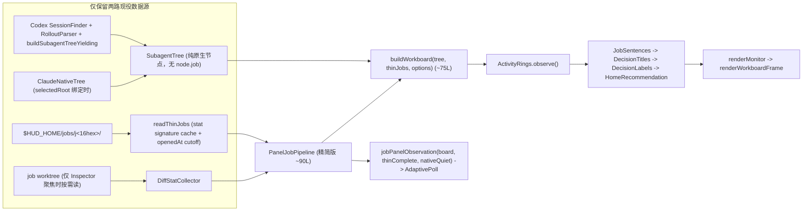
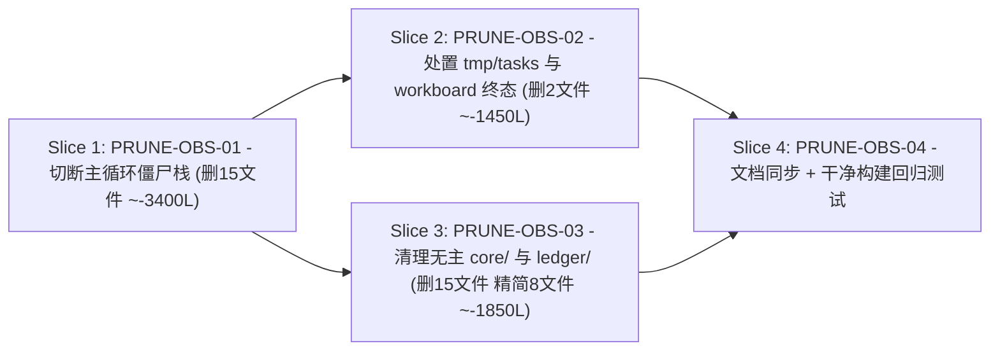

# 01. 清理面板主循环中仍在空转的僵尸旧观察栈

> **优先级**：P0（架构清债 / 主循环热路径降噪）
> **类别**：架构重构与死代码清理（Architecture Cleanup）
> **预估规模**：XL（净删 ~5,500–6,500 行源码，移除 31–32 个死文件，精简 19 个活文件；拆为 4 个独立垂直切片）
> **前置依赖**：无（可直接基于当前 `universal-hud` 分支展开；与正在进行中的 `MCP-ORCH` 收尾切片无文件冲突）
> **`docs/spec.md` 边界影响**：**不突破边界**。主清理项直接落实 `docs/spec.md` §3（无自有执行平台、无 ledger、无 native host/bridge）与 §5 M2 清理目标；唯一需 Owner 拍板的分叉为历史 `<workspace>/tmp/tasks/` 扫描兼容性（见 §3.3 与 §6）。

---

## 1. 背景与现状证据

MyHUD 在 M2（`a533c5d5` `M2-DELETE`）与 M4（`0871f74d` `M4-PRUNE2`）已经彻底删除了旧执行平台、旧角色 Facade、旧 ledger 数据库、Native Host 进程与自有 Jev 运行时；当前生产架构中，所有 HUD 委派任务均由 `packages/hud-mcp/src/thin-main.ts`、`hud-cli.mjs`、`hud-jev.mjs` 及外部 `pi-roles` 以纯 JSON 形式写入 `$HUD_HOME/jobs/j<16hex>/`，由 `src/collectors/thin-jobs.ts`（`readThinJobs`）统一读取。

然而，通过实读 `src/tree-page.ts` 及其下游依赖图可以确认：**整个旧时代的三套观察栈仍完整挂载在面板主循环 `collectNowBody()` 的热路径中，每次轮询都在空转 I/O、拉起无用子进程、维护复杂状态机，并把 ~5,000 行彻底无写入方的死代码钉在构建树中。**

### 1.1 面板主循环正在空转的实证清单

1. **每 5 秒无条件 `spawn('herdr', ['agent', 'list', '--json'])`（零消费者）**
   - `src/tree-page.ts:488` 以默认空选项 `{}` 构造 `new PanelJobPipeline(nativeCalls.home, selectedRoot, {}, ...)`，进而构造 `new JobObservationCollector(home, { ...options, root })`（`tree-page.ts:149`）。
   - 每次 `collectNowBody()` 调用 `jobPipeline.refresh()`（`tree-page.ts:956`）→ `this.observer.refresh(...)`（`tree-page.ts:225`）→ `JobObservationCollector.collect()`（`src/collectors/job-observations.ts:999`）：`if (this.options.live !== false) this.live.tick(this.nowMs)`。
   - `HerdrListSampler.tick()`（`src/collectors/job-live-observation.ts:46-72`）按 `LIVE_CADENCE_MS = 5000` 周期拉起 `herdr agent list --json` 子进程（`job-live-observation.ts:15`），解析结果并缓存；但 `$HUD_HOME/assoc/` 彻底无写入方，没有任何 `JobDisplay` 会消费 `this.live.match(...)`。
2. **每 tick 空扫 `$HUD_HOME/assoc/`、`native-relations/`、`jev-relations`、`delegate.json` 并构造空组合树**
   - `JobObservationCollector.discover()`（`job-observations.ts:264-275`）每 tick 对 `$HUD_HOME/assoc` 执行祖先 `lstat` pin 与 `realpath` 探测（恒得 `ENOENT`/`unreadable`）。
   - `NativeCallCollector`（`tree-page.ts:487,959-961,986-989`）每 tick 调用 `nativeCalls.collect()` / `collectCodex()`，同步调用 `readRelations`（`src/managed/relations.ts:32`）与 `readJevRelations`（`src/managed/jev-host.ts:20`）扫描 `$HUD_HOME/native-relations`，且在自适应轮询判定 `collect()`（`tree-page.ts:912`）通过 `nativeCalls.emptyAndComplete`（`native-calls.ts:68-75`）再同步执行一次 `fs.readdirSync($HUD_HOME/native-relations)`。
   - 事实上，整个 `tree-page.ts` 仅借用了 `nativeCalls.home` 来替代 `getHudHome()`（`tree-page.ts:488`）；`legacyDelegation` 已被硬编码为 `const legacyDelegation = null`（`tree-page.ts:962`）。
   - `applyJobComposition()`（`tree-page.ts:497-506,1034`）每 tick 调用 `jobPipeline.compose()` → `composeJobTree()`（`src/collectors/job-tree.ts`，268 行）深度克隆整棵 `SubagentTree`，但 `snapshot.jobs` 恒为空数组。
   - `panelJobRenderState()`（`tree-page.ts:407-418,725,745-746`）生成的 `notice` 与 `loading` 传给 `renderMonitor()` 后，在 `renderWorkboardFrame()`（`src/render/work-view.ts`）中根本未被读取。
3. **`TaskObservationCollector`（965 行）在 Claude 绑定面板下空扫 `<repo>/tmp/tasks/`，且会毒化自适应退避**
   - `src/tree-page.ts:486-488`：`const allDelegations = !selectedRoot && process.env.CODEX_HUD_PANEL_ALL_DELEGATIONS === '1'`，向 `PanelJobPipeline` 传入 `workspace = allDelegations ? null : HUD_CWD_REAL`。
   - 这导致行为分裂：Codex/pi 无 `--root` 打开面板时 `workspace === null`（`TaskObservationCollector` 根本不扫 `tmp/tasks/`）；而 Claude Code 打开面板时（`claudeCallerSession` 自动注入 `--harness claude --session ... --source ...`，`selectedRoot !== null`），`workspace` 被设为 `HUD_CWD_REAL`，每 tick 都会运行 965 行的增量生成器状态机扫描 `<workspace>/tmp/tasks/`！
   - `bca6e312`（2026-11-21）为了修复 `tmp/tasks/` 目录数超 200 时按字母序截断的问题，在 `TaskObservationCollector.members()`（`task-observations.ts:222-233`）加入了对最多 2,048 个子目录的 `fs.lstatSync` 按 mtime 倒排逻辑。当历史 scratch 目录超过 200 个时，它仍会触发 `this.fail('lane_capacity')`（`task-observations.ts:798`）→ `tasks.coverage.incomplete = true` → `workboard.coverage.incomplete = true`（`workboard.ts:248`），进而阻止 `jobPanelObservation()`（`src/utils/collection-observation.ts:8`）进入 quiet 退避。
   - 同时，`home-view.ts:97` 与 `work-visibility.ts:41` 会直接丢弃 `workers.length === 0` 的 lane——没有旧版 v1 `STATUS.json` 的普通 `tmp/tasks/<slice>/` 目录根本不会在 Home 渲染任何卡片。
4. **单靠 `tree-page.ts` 与 `workboard.ts` 的死边，拽活了 32 个文件（4,961 行）与 19 个活文件中的 ~1,500 行冗余代码**
   - 例如 `src/render/job-details.ts`（373 行）仅被 `src/render/monitor-labels.ts:7` 引用两个 1 行工具函数（`effectiveStatus`、`jobSettledAt`），而其依赖的 `SubagentTreeNode.job` 仅由已空转的 `composeJobTree()` 赋值（`job-tree.ts:190`）。
   - `src/managed/` 全部 5 文件（323 行）、`src/core/link/*` + `core/wake/*` + `core/ledger-read.ts` + `core/link-ledger-read.ts` + `src/ledger/notify-events.ts`（416 行）以及 `src/core/types/{close,lifecycle,execution}.ts`、`src/core/interfaces/{registry-provider,session-binding}.ts`、`src/core/execution.ts`（482 行）全部仅被旧观察栈或彼此循环引用。

### 1.2 精确死代码盘点表

下表基于对 `src/`、`packages/hud-mcp/`、`bin/`、`integrations/`、`scripts/` 与 `tests/` 的全量静态引用分析（行数均以实际文件 `wc -l` 核验）。

#### A. 面板旧观察器模块（`src/collectors/`）

| 文件路径 | 行数 | 当前引用者（生产 / 测试） | 磁盘读取路径 | 是否存在写入方 | 处置 |
| --- | ---: | --- | --- | --- | --- |
| `src/collectors/job-observations.ts` | 1,160 | `tree-page.ts`, `job-tree.ts` / 无 | `$HUD_HOME/assoc/*.json`, `jobs/*/receipt.json`, `jev-runtime/**`, `.dispatch/*/STATUS.json` | **无（零写入方）** | **整文件删除** |
| `src/collectors/job-live-observation.ts` | 144 | `job-observations.ts` / 无 | `spawn('herdr agent list --json')`, `/proc/<pid>/cmdline` | **无**（旧 Jev 进程与 assoc 已删） | **整文件删除** |
| `src/collectors/job-tree.ts` | 268 | `tree-page.ts` / 无 | 纯内存组合 | **无**（输入 `JobSnapshot` 恒空） | **整文件删除** |
| `src/collectors/job-display-types.ts` | 87 | `job-observations.ts`, `job-tree.ts`, `task-observations.ts`, `workboard.ts`, `render/job-details.ts`, `tree-page.ts`, `types.ts` / 无 | 纯类型 | **无** | **整文件删除** |
| `src/collectors/native-calls.ts` | 335 | `tree-page.ts` / `tests/unit/panel-backoff.test.mjs` | `$HUD_HOME/native-relations/`, `native-hosts/*.sock`, `delegate.json` | **无（零写入方）** | **整文件删除** |
| `src/collectors/task-observations.ts` | 965 | `tree-page.ts` / `tests/unit/thin-panel-jobs.test.mjs`（仅 `bca6e312` 测例） | `<workspace>/tmp/tasks/*` + 旧 `invocations` | **MyHUD 无写入方**（外部/手工 scratch 见 §3.3） | **方案 A：整文件删除**；方案 B：以 <150L 轻量适配器替代 |
| **小计（A 组）** | **2,959** | — | — | — | 删除 6 文件（方案 B 净删 ~2,810L） |

#### B. 旧 Managed 宿主协议（`src/managed/` 全目录）

| 文件路径 | 行数 | 当前引用者（生产 / 测试） | 磁盘/IPC 路径 | 是否存在写入方 | 处置 |
| --- | ---: | --- | --- | --- | --- |
| `src/managed/host-ipc.ts` | 83 | `native-calls.ts` / 无 | `$HUD_HOME/native-hosts/*.sock` | **无**（Native Host 已在 `M4-PRUNE2` 删除） | **整文件删除** |
| `src/managed/host.ts` | 9 | `native-calls.ts`, `core/link/view-model.ts` / 无 | 纯类型 | **无** | **整文件删除** |
| `src/managed/jev-host.ts` | 62 | `native-calls.ts`, `core/link/view-model.ts` / 无 | `$HUD_HOME/native-relations/jev-*.json` | **无** | **整文件删除** |
| `src/managed/relations.ts` | 109 | `native-calls.ts`, `core/link/view-model.ts`, `managed/host-ipc.ts`, `managed/jev-host.ts` / 无 | `$HUD_HOME/native-relations/<sha256>.json` | **无** | **整文件删除** |
| `src/managed/types.ts` | 60 | `managed/host.ts`, `managed/relations.ts` / 无 | 纯类型 | **无** | **整文件删除** |
| **小计（B 组，整目录清空）** | **323** | — | — | — | **删除整个 `src/managed/` 目录** |

#### C. 旧 `src/core/` 与 `src/ledger/`（移除旧观察栈后归零的文件）

| 文件路径 | 行数 | 当前引用者（去旧观察栈后） | 是否存在写入方 | 处置 |
| --- | ---: | --- | --- | --- |
| `src/ledger/notify-events.ts` | 20 | 仅 `core/wake/projection.ts` → **归零** | **无** | **整文件删除**（清空 `src/ledger/`） |
| `src/core/capacity.ts` | 11 | 仅 `core/link/limits.ts` → **归零** | **无** | **整文件删除** |
| `src/core/ledger-read.ts` | 19 | 仅 `core/link-ledger-read.ts`, `core/link/types.ts` → **归零** | **无** | **整文件删除** |
| `src/core/link-ledger-read.ts` | 24 | 仅 `core/link/types.ts` → **归零** | **无** | **整文件删除** |
| `src/core/link/job-display.ts` | 36 | 仅 `core/link/types.ts` → **归零** | **无** | **整文件删除** |
| `src/core/link/limits.ts` | 37 | 仅 `native-calls.ts`, `core/link/view-model.ts` → **归零** | **无**（读 `delegate.json`） | **整文件删除** |
| `src/core/link/types.ts` | 177 | 仅 `job-tree.ts`, `native-calls.ts`, `core/link/view-model.ts` → **归零** | **无** | **整文件删除** |
| `src/core/link/view-model.ts` | 50 | `job-tree.ts`, `native-calls.ts`, `workboard.ts`, `render/header.ts`, `render/monitor.ts`, `tree-page.ts` → **全部断链归零** | **无** | **整文件删除**（清空 `src/core/link/`） |
| `src/core/wake/projection.ts` | 42 | 仅 `core/link-ledger-read.ts`, `core/link/view-model.ts` → **归零** | **无** | **整文件删除**（清空 `src/core/wake/`） |
| `src/core/execution.ts` | 5 | 仅 `core/observation.ts` 的死函数 `runExecutionProjection` → **归零** | **无** | **整文件删除** |
| `src/core/types/close.ts` | 54 | 仅 `core/types/lifecycle.ts` → **归零** | **无** | **整文件删除** |
| `src/core/types/lifecycle.ts` | 161 | 仅 `core/ledger-read.ts`, `core/link/*`, `core/wake/*`, `core/types/observation.ts` 死类型 → **归零** | **无** | **整文件删除** |
| `src/core/types/execution.ts` | 215 | 仅 `core/execution.ts`, `core/ledger-read.ts`, `core/types/{capabilities,close,lifecycle,observation,supervision}.ts` 死类型 → **归零** | **无** | **整文件删除** |
| `src/core/interfaces/registry-provider.ts` | 25 | 仅 `core/interfaces/harness-adapter.ts` 的死接口 `BindContext` → **归零** | **无** | **整文件删除** |
| `src/core/interfaces/session-binding.ts` | 22 | 仅 `harness-adapter.ts`, `registry-provider.ts` 死接口 → **归零** | **无** | **整文件删除** |
| **小计（C 组）** | **898** | — | — | **删除 15 文件** |

#### D. 旧角色协议、旧渲染器与孤立类型（`src/roles/`, `src/render/`, `src/jev/`）

| 文件路径 | 行数 | 当前引用者（生产 / 测试） | 是否存在写入方 | 处置 |
| --- | ---: | --- | --- | --- |
| `src/roles/association.ts` | 173 | `job-display-types.ts`, `job-observations.ts`, `job-tree.ts` / 无 | **无**（读 `$HUD_HOME/assoc/<job>.json`） | **整文件删除** |
| `src/roles/pi-dispatch.ts` | 95 | `job-observations.ts` / 无 | **无**（校验旧 `receipt.json.pi_dispatch`） | **整文件删除** |
| `src/roles/pi-dispatch-status.ts` | 114 | `job-observations.ts`, `task-observations.ts`, `work-card.ts` / 无 | **无**（`thin-jobs.ts` 有独立轻量状态读取；注：外部命令行 `pi-dispatch` 不依赖此 TS 文件） | **方案 A：整文件删除**；方案 B：精简至 ~35L 或内联 |
| `src/roles/external-association.ts` | 5 | `tree-page.ts:23,370` / 无 | **无** | **整文件删除** |
| `src/render/job-details.ts` | 373 | `render/monitor-labels.ts:7`（仅用 `effectiveStatus`/`jobSettledAt` 两个 1 行包装）/ 无 | **无**（`SubagentTreeNode.job` 仅 `job-tree.ts` 写入） | **整文件删除** |
| `src/jev/runtime/types.ts` | 21 | **0 引用者**（当前已彻底孤立） | **无** | **整文件删除**（清空 `src/jev/runtime/`） |
| **小计（D 组）** | **781** | — | — | **删除 6 文件** |

> **整文件删除合计（A + B + C + D）**：**32 个文件，4,961 行**（方案 A）；若采用方案 B 保留轻量 `tmp/tasks/` 适配，仍净删 **~4,810 行**。

#### E. 需保留但可大幅精简的活文件

| 文件路径 | 现行数 | 需移除的旧代码/符号 | 仍需保留的活职责 | 预计净减 |
| --- | ---: | --- | --- | ---: |
| `src/tree-page.ts` | 1,555 | `observer`/`artifacts`/`compose`/`afterPaint`/`setRoot`/`live`/`artifactCost`、`panelJobRenderState`、`nativeCalls`、`applyJobComposition`、`delegation`/`panelDelegation` | `PanelJobPipeline`（仅 `readThinJobs` + `ActivityRings` + `DiffStatCollector` + `buildWorkboard`）、`getHudHome()`、Codex/Claude 原生树、`ProjectVisits`、Control/EXP/Settings、自重载 `PanelReload` | **-260L** |
| `src/collectors/workboard.ts` | 274 | `invocationLaneId`、`homeCalls`、`isLocalDay`、`jobs: JobSnapshot` 循环、`legacy: DelegationViewModel` 循环、`tasks` 参数（方案 A） | `buildWorkboard`：合并 `thinJobs` + 原生 `SubagentTree` lanes、200 槽与 1000 decision 截断、覆盖度汇总 | **-190L** |
| `src/collectors/work-card.ts` | 298 | 方案 A：删 `dispatchWorkFacts`、`ReviewFact` 及 `projectWorkCard` 的非 thin/native 旧分支（L86–132） | `projectWorkCard`（thin-job + native 统一路径）、`nativeWorker`、`workMinute` | **-165L** |
| `src/collectors/work-artifacts.ts` | 205 | 方案 A：删 `revisionOf`、`reportedWorkFacts`、`reviewRecord`、`designRecords`（仅 `task-observations.ts` 调用） | `questionFields`、`answerRecord`、`reviewVerdict`（`thin-jobs.ts`、`cli/watch.ts`、`thin-main.ts` 活跃使用） | **-95L** |
| `src/collectors/workboard-types.ts` | 157 | 方案 A：删 `TaskSnapshot`、`ObservationCost`、`LaneIdentity` 中的 `task-directory` 变体 | `WorkboardSnapshot`、`WorkLane`（`invocation` + `native`）、`OwnerWorker`、`DecisionRecord`、`WorkTarget`、`targetKey` | **-20L** |
| `src/collectors/model-jobs.ts` | 126 | 删 `jobOnlyNode`、`displayOnlyRoot`、`displayOnlySummaryRoot`（L120–126 及 L112 判断） | `headTail`、`tail`、`finalAnswer`、`errorMaterial`、`labelSource`（`claude-native-tree.ts`、`job-sentences.ts` 使用） | **-10L** |
| `src/render/monitor-labels.ts` | 219 | 移除 `import { effectiveStatus, jobSettledAt } from './job-details.js'`，直接读 `node.status` 与 `node.statusAt ?? node.lastEventAt` | 全部现有时间/状态/时钟渲染函数 | **-4L** |
| `src/render/monitor.ts` | 329 | 移除 `DelegationViewModel` / `HudDelegationData` import，`MonitorData.hud` 改为 `HudData`，`reconcileMonitor` 去掉 `_delegation`，`renderMonitor` 回退调用简化后的 `buildWorkboard(input.tree)` | 全部面板状态与 `renderMonitor` 入口 | **-20L** |
| `src/render/header.ts` | 149 | 移除 `HudDelegationData` import，函数签名恢复为 `data: HudData` | Codex bar 渲染 | **-2L** |
| `src/types.ts` | 693 | 移除 `SubagentTreeNode.job?: JobDisplay`（L450–451） | 其余全部类型（含 `SubagentTreeNode.ref?: SessionRef`） | **-2L** |
| `src/roles/selection.ts` | 31 | 移除 `rosterSelectionKey` 与 `createHash` import（仅 `external-association.ts` 用） | `RosterRoot`、`formatRosterRoot`、`parseRosterRoot`（`cli/panel.ts`、`tree-page.ts`、`receipt.ts` 活跃使用） | **-7L** |
| `src/core/observation.ts` | 46 | 删 `displayNodeKey`、`runExecutionProjection`（及对 `identity.ts`/`execution.ts` 的引用） | 仅保留 `initialParserState()`（`rollout.ts:23` 活跃使用） | **-30L** |
| `src/core/identity.ts` | 25 | 删 `validateSessionRef`、`sessionRefKey` | 仅保留 `makeSourceId()`（`claude-native-tree.ts`、`receipt.ts`、`tree-page.ts`、`panel-reload.test.mjs` 使用） | **-14L** |
| `src/core/interfaces/harness-adapter.ts` | 79 | 删 `BindContext`、`ReaderResult`、`SessionReader`、`NativeTopologyResult`、`HarnessAdapter` | 仅保留 `ReaderBudget`（`rollout.ts:24` 使用；`rollout.ts:429` 直接引用 `ReaderContinuation`） | **-70L** |
| `src/core/interfaces/session-evidence.ts` | 77 | 删 `LaunchMessageLinkEvidence`、`LinkEvidence`、`NativeReport`、`NativeAction`、`CodexExtras`、`SessionEvidence` | 仅保留 `ToolResultLinkEvidence`（`harness/codex/link-evidence.ts:1` 使用） | **-60L** |
| `src/core/types/capabilities.ts` | 145 | 删 `Capability*`、`LaunchProfile`、`DelegateConfig`、`HostLocator`、`LocatorCheck` 等死类型 | 仅保留 `LaunchCommand`（`cli/compat.ts:5` 使用） | **-138L** |
| `src/core/types/identity.ts` | 168 | 删 `Caller*`、`Claim*`、`ChildBinding`、`RunBinding`、`ProcessDomainView`、`ControlInitiator` 等死类型 | 仅保留 `Harness`、`SourceId`、`SessionRef`（`panel.ts`、`claude-caller-session.ts`、`receipt.ts`、`types.ts`、`core/identity.ts` 使用） | **-155L** |
| `src/core/types/supervision.ts` | 197 | 删 `RunMeta`、`FinalExitReceipt`、`ScopeCheck`、`GroupExit`、`RunHandle` 等死类型 | 仅保留 `ProcessStamp`（`integrations/panel/receipt.ts:8` 使用） | **-188L** |
| `src/core/types/observation.ts` | 356 | 删 `ObservationView`、`StatusProjection`、`DisplayNodeIdentity`、`ObservationCommit`、`RunExecutionProjection`、`TreePlan` 等死类型 | 保留 `Coverage`、`ReaderContinuation`、`ReaderParserState`、`ReaderCheckpoint`（`rollout.ts`、`core/observation.ts`、`core/collect-lease.ts`、`core/types/checkpoint.ts` 使用） | **-295L** |
| **小计（E 组精简）** | **5,129** | — | — | **~-1,725L** |

---

## 2. 目标与非目标（Scope / Out of Scope）

### 2.1 目标（In Scope）

1. **彻底消除面板主循环的僵尸轮询与子进程开销**：面板不再拉起 `herdr agent list --json`，不再探测 `$HUD_HOME/assoc`、`native-relations`、`native-hosts`、`jev-runtime`、`delegate.json`，不再每 tick 深拷贝整棵 `SubagentTree` 做空合并。
2. **精简 `PanelJobPipeline` 与 `buildWorkboard` 为清晰的二元管道**：仅合并两类真实数据源——`$HUD_HOME/jobs/`（`readThinJobs`）与客户端原生 subagent 树（Codex `RolloutParser` + `buildSubagentTreeYielding` / Claude `ClaudeNativeTree`）。
3. **一次性清理失去全部调用者的传递死代码**：清空 `src/managed/`、`src/ledger/`、`src/core/link/`、`src/core/wake/`、`src/jev/runtime/`，删除 `src/render/job-details.ts` 与已失效的 `src/roles/`、`src/core/types/`、`src/core/interfaces/` 文件及死符号。
4. **明确处置 `tmp/tasks/` 兼容性**：向 Owner 提供量化对比并执行裁决后的路径（彻底下线或 `<150` 行轻量适配），解决 `bca6e312` 所遗留的架构分裂与退避毒化风险。
5. **保持全部现役能力零回退**：thin jobs 卡片/提问/微操作（`g`/`1-4`/`d`/`X`/`o`/`v`）、原生 Claude/Codex subagents 树与回复重放、自适应 5s 退避、Panel 自重载（`PanelReload`）、所有 4 个主标签（Home/Project/Control/EXP）及 Classic/Split 双布局保持完全兼容。

### 2.2 非目标（Out of Scope）

1. **不动 Codex Rollout 恢复索引与 `subagent-tree.ts` 的链接证据缓存**：
   - `src/core/checkpoint.ts`（`RecoveryIndexOverlay`）、`src/core/collect-lease.ts`、`src/core/types/checkpoint.ts`、`src/harness/codex/recovery*.ts`（815 行）与 `src/harness/codex/link-evidence.ts`（128 行）虽包含历史架构残留，但与 `RolloutParser` 和 `TreeScanStore`（`$HUD_HOME/display/scan/`，`SCAN_VERSION`）深度耦合。为避免在本方案中触碰 `SCAN_VERSION` 与 rollout 解析器风险，明确列为后续独立方案，本方案只保留其最小类型依赖。
2. **不动 `src/roles/herdr-run.ts` 中的 `listedAgents`**：虽删除 `job-live-observation.ts` 后 `listedAgents` 在生产代码中无调用，但 `tests/unit/herdr-binding.test.mjs:16` 仍在测试它，且 `herdr-run.ts` 本身是核心活模块，避免无谓耦合修改。
3. **不动 `src/brief-dry-run.ts`、`src/collectors/bridge-health.ts`、`src/collectors/pane-runtime-state.ts`**：三者属于 Codex tmux bar（`bin/codex-hud`、`src/index.ts`、`src/collectors/hud-status.ts`）路径，不在面板旧观察栈范围内。
4. **不改变 `hud panel` 命令行接口与环境变量契约**：`--root`、`--harness/--session/--source`、`CODEX_HUD_PANEL_ROOT/HARNESS/SOURCE` 继续用于原生 Claude/Codex 会话绑定与隔离；忽略已无意义的 `CODEX_HUD_PANEL_ALL_DELEGATIONS` 而不报错。
5. **不修改任何现有外发模型输入字段、渲染样式、主题配色或快照视觉输出**（`npm run check:fixtures` 零视觉变化）。

---

## 3. 核心设计方案

### 3.1 清理前后的数据流对比

#### 清理前（现状：4 路数据源 + 3 层冗余组合）

```mermaid
flowchart LR
  subgraph ZOMBIE["僵尸旧观察栈（每 tick 空转）"]
    A1["$HUD_HOME/assoc + receipt + jev-runtime"] --> JOC["JobObservationCollector (1160L)"]
    H1["spawn: herdr agent list --json (每5s)"] --> HLS["HerdrListSampler (144L)"] --> JOC
    A2["<repo>/tmp/tasks/ (最多2048 lstat)"] --> TOC["TaskObservationCollector (965L)"]
    A3["native-relations + native-hosts/*.sock + delegate.json"] --> NCC["NativeCallCollector (335L)"]
    JOC --> CJT["composeJobTree (268L)"]
    NCC --> CJT
  end

  subgraph LIVE["现役真实数据源"]
    TJ["$HUD_HOME/jobs/ -> readThinJobs"]
    NT["Codex Rollout / ClaudeNativeTree -> SubagentTree"]
  end

  NT --> CJT
  CJT --> BW["buildWorkboard (274L)"]
  JOC --> BW
  TOC --> BW
  NCC --> BW
  TJ --> PIPE["PanelJobPipeline.workboard()"]
  BW --> PIPE
  PIPE --> OV["ActivityRings -> JobSentences / DecisionTitles / DecisionLabels / HomeRecommendation"]
  OV --> RM["renderMonitor -> renderWorkboardFrame"]
```



#### 清理后（目标：2 路真实数据源 + 单层纯投影）



### 3.2 目标接口契约与模块职责

#### 1. `PanelJobPipeline`（`src/tree-page.ts`，从 ~285 行精简至 ~95 行）

保留导出类名与 `refresh()` / `workboard()` / `observation()` / `dispose()` 四个方法（兼容 `tests/unit/panel-backoff.test.mjs:147-148` 对 `PanelJobPipeline.prototype.refresh` 的延迟拦截钩子），移除全部旧字段（`observer`、`artifacts`、`snapshot`、`taskSnapshot`、`live`、`artifactCost`、`setRoot`、`compose`、`afterPaint`）：

```ts
export class PanelJobPipeline {
  private thinJobs: WorkLane[] = [];
  private thinObservation = { complete: false };
  private revision = 0;
  private closed = false;
  private rings = new ActivityRings();
  private jobDiffs = new DiffStatCollector();
  private boardCache?: { tree: SubagentTree; revision: number; board: WorkboardSnapshot };

  constructor(
    readonly home: string,
    private readonly thinScope: ThinJobScope,
    readonly openedAt = Date.now()
  ) {}

  dispose(): void {
    this.closed = true;
    this.boardCache = undefined;
  }

  async refresh(inspecting?: string): Promise<boolean> {
    if (this.closed) return false;
    const rev = ++this.revision;
    let lanes = readThinJobs(this.home, this.thinScope, JSON.parse, { openedAt: this.openedAt }, this.thinObservation);
    const id = /^thin-job:(j[0-9a-f]{16})$/.exec(inspecting ?? '')?.[1];
    const lane = id && lanes.find((l) => l.workers.some((w) => w.id === inspecting));
    if (id && lane) {
      const worker = lane.workers.find((w) => w.id === inspecting)!;
      const diffStat = await this.jobDiffs.job(path.resolve(this.home, 'jobs', id), worker.settledAt, Date.now());
      if (this.closed || rev !== this.revision) return false;
      if (diffStat) {
        lanes = lanes.map((l) =>
          l !== lane ? l : { ...l, workers: l.workers.map((w) => (w === worker ? { ...w, diffStat } : w)) }
        );
      }
    }
    this.thinJobs = lanes;
    this.boardCache = undefined;
    return true;
  }

  workboard(tree: SubagentTree): WorkboardSnapshot {
    if (this.boardCache && this.boardCache.tree === tree && this.boardCache.revision === this.revision) {
      return this.boardCache.board;
    }
    let board = buildWorkboard(tree, this.thinJobs, {
      revision: String(this.revision),
      incomplete: !this.thinObservation.complete,
    });
    const activity = this.rings.observe(board.workers, Date.now());
    if (activity.size) {
      const add = new Map(
        board.workers.filter((w) => activity.has(w.id)).map((w) => [w, { ...w, activity: activity.get(w.id) }])
      );
      const swap = (w: OwnerWorker) => add.get(w) ?? w;
      board = {
        ...board,
        workers: board.workers.map(swap),
        lanes: board.lanes.map((l) => ({ ...l, workers: l.workers.map(swap) })),
      };
    }
    this.boardCache = { tree, revision: this.revision, board };
    return board;
  }

  observation(tree: SubagentTree, nativeQuiet: boolean) {
    return jobPanelObservation(this.workboard(tree), this.thinObservation.complete, nativeQuiet);
  }
}
```

> **关键设计细节**：
> - `home` 在 `runLivePage()` 中直接改为 `getHudHome()`（来自 `src/hud-home.ts`，零依赖、完全等价于原 `NativeCallCollector.fromEnv().home`），不再通过 `NativeCallCollector` 绕路。
> - `refresh()` 内用 `rev` 竞态防线替代原 `generation`，防止 `await this.jobDiffs.job(...)` 期间 `dispose()` 或并发刷新覆盖较新结果。
> - `board.coverage.incomplete` 改为直接反映 `!!tree.incomplete || Boolean(options?.incomplete)`（加上 200 lane / 1000 decision 截断），消除旧逻辑中「`buildWorkboard` 不知晓 `thinObservation.complete`、只由 `jobPanelObservation` 旁路检查」的不一致。

#### 2. `buildWorkboard`（`src/collectors/workboard.ts`，从 274 行精简至 ~75 行）

职责收敛为**纯函数投影**：把 `thinJobs`（来自 `readThinJobs`，如选方案 B 另含轻量 legacy lanes）与原生 `SubagentTree` 合并为受界（≤200 lanes、≤200 workers、≤1000 decisions）的 `WorkboardSnapshot`：

```ts
export interface WorkboardBuildOptions {
  revision?: string;
  incomplete?: boolean;
  workspace?: string | null;
}

export function buildWorkboard(
  tree: SubagentTree,
  thinJobs: readonly WorkLane[] = [],
  options: WorkboardBuildOptions = {}
): WorkboardSnapshot
```

- **顺序保持不变**：`thinJobs` 在前，原生 `SubagentTree` 按 `native:${harness}:${root}` 分组在后（与清理前 `tree-page.ts:201` `[...this.thinJobs, ...base.lanes]` 及 `tests/fixtures/native-tree.mjs` 输出完全一致，**确保全部帧快照零 diff**）。
- 注意：原生 `nativeLanes` 继续按 `(a.startedAt ?? Infinity) - (b.startedAt ?? Infinity) || a.id.localeCompare(b.id)` 排序，而 `thinJobs` 保持 `readThinJobs` 的创建倒序（`thin-jobs.ts:475`）——这与清理前 `tree-page.ts:201` 的精确排序语义完全一致（**避免误把 `thinJobs` 也按 `startedAt` 升序重排导致 Home lane 顺序回归！**）。
- `renderMonitor()`（`src/render/monitor.ts:310-327`）在 `input.workboard` 缺省时简化为一行 `input.workboard ?? buildWorkboard(input.tree)`。

#### 3. `tree-page.ts` 主循环精简要点

1. **移除死状态与死调用**：删除 `nativeCalls`、`jobComposition`、`delegation`、`panelDelegation`、`syncPanelView`、`applyJobComposition`、`panelJobRenderState`、`const legacyDelegation = null`、`hud: { ...hud, delegation: panelDelegation }`、`reconcileMonitor(..., delegation)`。
2. **保留原生会话绑定与隔离（严禁破坏）**：
   - 保留 `selectedHarness`、`selectedSource`、`selectedRoot`（`parseRosterRoot` / `formatRosterRoot`）与 `boundJobRoot`（`makeSourceId('codex', ...)`）。
   - Codex 显式绑定（`selectedHarness === 'codex'`）、Codex 自动发现（`finder.check()`）、Claude 原生树（`selectedRoot && selectedHarness === 'claude' && selectedSource` → `claudeNative.refresh(...)`）以及跨 harness 隔离条件 `if (selectedRoot && selectedRoot !== boundJobRoot) session = null` 与 `currentHud()` 的同条件守卫**全部原样保留**。
   - 不再有 `nativeTree` 与 `tree` 的双份变量：直接更新 `tree`，省去每 tick 的整树克隆。
3. **自适应轮询退避（`tree-page.ts:906-925`）精确等价迁移**：
   - 清理前：
     ```ts
     const jobOnly = !boundJobRoot;
     const jobQuiet = jobOnly && !selectedRoot && !nativeTree.nodes.length && native.activity !== 'active';
     const observation = jobOnly
       ? jobPipeline.observation(tree, panelDelegation, jobQuiet && nativeCalls.emptyAndComplete)
       : { ...native, succeeded: data?.health?.sessionBound === true };
     ```
   - 清理后：
     ```ts
     const jobOnly = !boundJobRoot;
     const jobQuiet = jobOnly && !selectedRoot && !tree.nodes.length && native.activity !== 'active';
     const observation = jobOnly
       ? jobPipeline.observation(tree, jobQuiet)
       : { ...native, succeeded: data?.health?.sessionBound === true };
     ```
   - 语义验证：
     - 当无 Codex/Claude 原生会话绑定且无活动/未完成 thin jobs 时，`jobQuiet === true` 且 `thinObservation.complete === true`，正常退避到 5s；
     - 当 thin jobs 存在工作态、未答问题、读取失败、缺 `STATUS.json`、超 200 上限时，`jobPanelObservation` 返回 `active`/`uncertain`，保持基础轮询间隔；
     - 当绑定了 Claude 会话（`selectedRoot !== null`）时，`jobQuiet === false`，保持原有不错误退避的行为；
     - 当绑定了 Codex 会话（`boundJobRoot !== ''`）时，走原 `native` 分支不变。
4. **`render/monitor-labels.ts` 解耦 `render/job-details.ts`**：
   - `nodeStatus()`（`monitor-labels.ts:56`）：`switch (node.status)` 替代 `switch (effectiveStatus(node))`；
   - `isLive()`（`monitor-labels.ts:92`）：`node.status === 'running' || node.status === 'starting'`；
   - `finishedAt()`（`monitor-labels.ts:199`）：`return node.statusAt ?? node.lastEventAt;`。
   - 解耦后 `src/render/job-details.ts`（373 行）零引用，整文件安全删除。

### 3.3 `tmp/tasks/` 兼容性方案对比（核心分叉）

`TaskObservationCollector`（965 行）服务于两类输入：
1. `invocations: JobDisplay[]`（`task-observations.ts:836-847`）——来自 `JobObservationCollector`，**彻底无写入方，100% 必删**。
2. `<workspace>/tmp/tasks/<name>/`（`task-observations.ts:789-835`）——`docs/delegation.md:87` 将其定义为 git-ignored 任务草稿目录；最近 `bca6e312`（2026-11-21）刚修复了其中超 200 目录按 mtime 倒排接纳的缺陷。

客观审视现实代码可发现三个事实：
- **事实 1（零 MyHUD 写入方）**：当前 `hud_create` / `hud-cli.mjs` / `hud-jev.mjs` / `pi-roles` 全部写 `$HUD_HOME/jobs/j<16hex>/`，没有任何 MyHUD 代码向 `tmp/tasks/` 写 `STATUS.json`。
- **事实 2（仅在特定启动方式下生效）**：仅当 `selectedRoot !== null`（例如 Claude Code 启动面板）时 `workspace` 非空，`tmp/tasks/` 才被扫描；Codex/pi 直接开面板时 `allDelegations === true` → `workspace === null`，早就看不到 `tmp/tasks/`。
- **事实 3（普通草稿本就不渲染）**：`home-view.ts:97` 与 `work-visibility.ts:41` 过滤掉 `workers.length === 0` 的 lane，只有包含旧式 v1 `STATUS.json`（含严格 `version: 1`、`task_dir`、`slot: 'primary'`、`role ∈ {implementer,sonic,reviewer,architect}`、`output_path`）的目录才会在 Home 出卡片；纯 `brief.md`/`report.md` 草稿目录只消耗 `lstatSync` + 读盘预算却零显示。

基于以上事实，给出两个方案对比：

| 对比维度 | 方案 A：彻底下线 `tmp/tasks/` 面板扫描（**推荐**） | 方案 B：`<150` 行轻量只读适配器（并入 `thin-jobs.ts` 或独立 `legacy-tasks.ts`） |
| --- | --- | --- |
| **代码净减量** | 删除全部 965L + `pi-dispatch-status.ts` (114L) + `work-card.ts` 旧路径 (-165L) + `work-artifacts.ts` 旧解析 (-95L) + `workboard-types.ts` (-20L) ≈ **-1,360L** | 删除 965L，新增 ~120L 轻量读取器；仍需保留 `task-directory` 类型与简化版 `STATUS.json` 映射 ≈ **-900L** |
| **热路径 I/O 开销** | **零**（不再对 `<workspace>/tmp/tasks/` 做目录枚举与 `lstatSync`） | 仍需每 tick 枚举 `<workspace>/tmp/tasks/` + `lstatSync` 排序取最新 200；借助 `mtime/size/ino` stat-signature 缓存与 `openedAt` 截断，热缓存后几乎零 body read |
| **跨客户端一致性** | Claude / Codex / pi 三端完全一致，均以 `$HUD_HOME/jobs/` 为唯一任务真相源 | 若决定保留，需决定是否三端统一开放或继续仅 `workspace` 绑定时扫描（后者仍不对称） |
| **退避稳定性** | `tmp/tasks/` 积压几百个历史草稿目录绝不再干扰 `coverage.incomplete` 或 5s 退避 | 需将超 200 历史目录视为“有界最新窗口”而非 `incomplete`，或只对含 `STATUS.json` 的目录计入 |
| **与 `docs/spec.md` 一致性** | 100% 贴合 `docs/spec.md` §2.1（`jobs are plain JSON under $HUD_HOME/jobs`） | 属于 `docs/spec.md` 未要求的向后兼容层 |
| **唯一风险与缓解** | 若 Owner 仍在面板中观察通过独立旧脚本（非 `hud_create`）跑在 `tmp/tasks/<name>/` 的 `pi-dispatch` 任务，它们将不再出现于 Home 卡片 | 保留历史目录卡片显示（仅限含有效 `STATUS.json` 的目录），且复用 `readThinJobs` 的 `openedAt` 窗口与 `work-artifacts.ts` 的 `questionFields`/`answerRecord`/`reviewVerdict`，无需保留 `.dispatch/` 复杂状态机或 `designRecords` |

**明确推荐：方案 A（彻底下线）**。
理由：`docs/spec.md` 已明确任务唯一归口为 `$HUD_HOME/jobs/`，且 Codex/pi 面板早已不读 `tmp/tasks/`，实际生产中 `TaskObservationCollector` 的主要“产出”只是在 Claude 面板打开时扫爆历史 scratch 目录、引发 `bca6e312` 那样的修补成本。仅当 Owner 明确确认「日常仍需面板监视手工运行在 `tmp/tasks/` 的独立旧 `pi-dispatch`」时，才在 Slice 2 切换至方案 B。

> 若 Owner 选择 **方案 B**，轻量适配器约束为：
> - 文件：`src/collectors/legacy-tasks.ts`（≤130 行），由 `PanelJobPipeline.refresh()` 在 `workspace !== null` 时调用，复用 `thin-jobs.ts` 同款 `lstat` 签名缓存（`mtimeMs:size:ino`）与 `openedAt` 过滤；
> - 仅对 `tmp/tasks/` 按 mtime 倒排取前 200 个真实子目录（`!st.isSymbolicLink() && st.isDirectory()`，遵循 `docs/ARCHITECTURE.md` §8 隐私/安全规则），跳过无 `STATUS.json` 的纯草稿目录（零额外读盘）；
> - 直接产出符合 `thin-job` 统一口径的 `OwnerWorker`（无需 `dispatchWorkFacts`、无需 `.dispatch/` helper 状态机、无需 `designRecords` 章节解析），因此仍可完整删除 `src/roles/pi-dispatch-status.ts` 与 `work-card.ts` 旧分支。

### 3.4 关键边界条件、并发/故障恢复与 §8 合规性核对

对照 `docs/ARCHITECTURE.md` §8 逐项核对：

1. **纯渲染（Pure Rendering）**：`buildWorkboard()` 严格纯函数、无文件系统 I/O、无时钟副作用；`ActivityRings.observe()` 留在 `PanelJobPipeline.workboard()`（或迁入 `refresh()` 仅在采集完成时采样一次，彻底杜绝 paint 期间读 `Date.now()`，进一步收敛至 §8 纯渲染规范）。
2. **采集有界与未知不伪造（Bounded Collection & Honest Unknown）**：
   - `readThinJobs` 已自带 200 目录上限、64 KiB 读上限、`O_NOFOLLOW | O_NONBLOCK` 安全读、`thinObservation.complete` 完整性标志；删去僵尸栈后，`complete === false`（如超 200 jobs 或读取异常）会真实传导到 `board.coverage.incomplete` 与 `jobPanelObservation()`，不会伪造 quiet。
3. **竞态与生命周期安全**：
   - `PanelJobPipeline.refresh()` 中唯一异步点是聚焦 Inspector 时的 `await this.jobDiffs.job(...)`；通过递增 `this.revision` + `this.closed` 守卫防止旧异步 diff 覆盖新快照或已销毁实例。
   - `PanelJobPipeline.dispose()` 清除缓存并置 `closed = true`，不再有 `fs.Dir` 句柄或 `HerdrListSampler` `AbortController`/子进程泄漏风险。
4. **私有文件与零多余依赖**：不新增任何磁盘写入、不引入任何新依赖、不改动 `$HUD_HOME/display/thin-jobs.json` 0600 原子写路径。
5. **构建产物残留风险（关键 Gotcha）**：
   - `tsconfig.json` / `tsconfig.test.json` / `packages/hud-mcp/tsconfig.json` 的 `tsc` 编译**不会**清理已删除源文件的旧 `.js`/`.d.ts` 输出（调研中已观察到历史删除的 `packages/hud-mcp/dist/src/roles/job-receipt.js` 仍残留在构建目录中）。
   - 若旧 `.js` 残留，测试中误指向 `dist/` 的遗留引用可能出现「本地侥幸通过、干净 checkout 失败」的假绿！因此每个切片验证与最终验收必须先清理 `dist/`、`dist-test/`、`packages/hud-mcp/dist/` 再全量重建。
6. **Panel 自重载（`PanelReload`）安全**：
   - `PanelReload` 轮询入口签名并做子进程动态 `import` 校验；减少 `tree-page.ts` 的静态依赖模块数（删除 30+ 模块）将同时缩短冷启动与自重载验证耗时。
   - `readPanelPlace()` 持久化的 JSON（`state`, `openedAt`, `widthOverride`, `settings`）均不含任何被删类型，完全向后兼容。

---

## 4. 垂直切片与实施路线（对齐 `docs/delegation.md`）

按 `docs/delegation.md`「每片端到端可独立验证、适合单个 `imp` 会话、不拆过细、风险隔离」原则，拆分为 **4 个串行/半并行垂直切片**：



> 注：Slice 2 与 Slice 3 修改的文件集**零交集**（Slice 2 改 `collectors/` + `roles/pi-dispatch-status.ts` + `tree-page.ts`；Slice 3 仅改 `core/` + `ledger/` + `rollout.ts:429` 一行类型引用），在 Slice 1 合并后可**并行派发**两个独立 worktree 的 `imp` 执行！

### Slice 1 (`PRUNE-OBS-01`)：切断面板主循环僵尸栈并删除零写入方观察模块

- **目标**：第一时间停掉每 5 秒 `herdr agent list --json` 空转与 `assoc/`/`native-relations/`/`jev-runtime/`/`delegate.json` 读取，移除 `composeJobTree` 与 `render/job-details.ts`。
- **依赖**：无。
- **删除文件（15 个，2,984 行）**：
  - `src/collectors/job-observations.ts` (1,160L)
  - `src/collectors/job-live-observation.ts` (144L)
  - `src/collectors/job-tree.ts` (268L)
  - `src/collectors/job-display-types.ts` (87L)
  - `src/collectors/native-calls.ts` (335L)
  - `src/managed/host-ipc.ts` (83L), `host.ts` (9L), `jev-host.ts` (62L), `relations.ts` (109L), `types.ts` (60L)
  - `src/roles/association.ts` (173L), `pi-dispatch.ts` (95L), `external-association.ts` (5L)
  - `src/render/job-details.ts` (373L)
  - `src/jev/runtime/types.ts` (21L)
- **修改文件（11 个）**：
  - `src/tree-page.ts`（删除 `observer`、`nativeCalls`、`compose`、`afterPaint`、`panelJobRenderState`、`delegation`、`panelDelegation`、`applyJobComposition`；改用 `getHudHome()`；`PanelJobPipeline` 暂保留 `artifacts` 待 Slice 2 处置）
  - `src/collectors/workboard.ts`（删 `jobs: JobSnapshot` 与 `legacy: DelegationViewModel` 分支、`invocationLaneId`、`homeCalls`）
  - `src/collectors/task-observations.ts`（仅移除 `invocations: readonly JobDisplay[]` 参数与 L836–847 旧 invocation 块，断开对 `job-display-types.ts` 的唯一残留依赖）
  - `src/collectors/model-jobs.ts`（删 `jobOnlyNode`、`displayOnlySummaryRoot`）
  - `src/render/monitor-labels.ts`（移除 `job-details.js` 引用，直读 `node.status` 与 `node.statusAt ?? node.lastEventAt`）
  - `src/render/monitor.ts`、`src/render/header.ts`、`src/types.ts`（移除 `DelegationViewModel`、`HudDelegationData`、`SubagentTreeNode.job`）
  - `src/roles/selection.ts`（移除无调用者的 `rosterSelectionKey`）
  - `tests/unit/panel-backoff.test.mjs`（移除 `NativeCallCollector` 引用及 `native`/`native-content` 两个死变体，保留全部 thin-job 与 live 退避测例）
  - `tests/fixtures/native-tree.mjs`、`tests/unit/panel-scope.test.mjs`、`tests/unit/thin-panel-jobs.test.mjs`、`tests/unit/diff-stat.test.mjs`（适配精简后的 `PanelJobPipeline` / `buildWorkboard` 签名）
- **估行预算**：删除 ~3,500 行，修改 ~180 行（净 **-3,320L**）。
- **验证命令**：清构建产物后执行 `npm run build && npm run build:test` + 跑 `panel-backoff`、`panel-scope`、`thin-panel-jobs`、`diff-stat`、`native-tree`、`panel-caller`、`panel-reload`、`check:fixtures`。

### Slice 2 (`PRUNE-OBS-02`)：处置 `TaskObservationCollector`（`tmp/tasks/`）并定型 `PanelJobPipeline` / `buildWorkboard`

- **目标**：根据 Owner 对 `tmp/tasks/` 的裁决，彻底移除 965 行的 `TaskObservationCollector` 状态机，完成 `PanelJobPipeline` 与 `buildWorkboard` 的最终精简。
- **依赖**：Slice 1 + Owner 拍板（方案 A vs 方案 B）。
- **若采用方案 A（推荐）**：
  - **删除文件（2 个，1,079 行）**：`src/collectors/task-observations.ts` (965L)、`src/roles/pi-dispatch-status.ts` (114L)。
  - **修改文件（6 个）**：
    - `src/tree-page.ts`（从 `PanelJobPipeline` 移除 `artifacts`/`taskSnapshot`/`artifactCost`/`workspace` 参数，构造函数收敛为 `(home, thinScope, openedAt)`；`buildWorkboard` 接管 `thinJobs` 与 `tree` 合并）
    - `src/collectors/workboard.ts`（签名收敛为 `buildWorkboard(tree, thinJobs?, options?)`，总长 ~75L）
    - `src/collectors/work-card.ts`（删除 `ReviewFact`、`dispatchWorkFacts` 及 `projectWorkCard` 的 L86–132 旧分支，收敛为统一路径）
    - `src/collectors/work-artifacts.ts`（删除 `revisionOf`、`reportedWorkFacts`、`reviewRecord`、`designRecords`）
    - `src/collectors/workboard-types.ts`（删除 `TaskSnapshot`、`ObservationCost`、`LaneIdentity` 中的 `task-directory`）
    - `tests/unit/thin-panel-jobs.test.mjs`（删除 L16 import 及 L117–145 `legacy task admission` 测例，适配 `PanelJobPipeline` 3 参构造）+ `panel-backoff.test.mjs`、`panel-scope.test.mjs`、`diff-stat.test.mjs`、`tests/fixtures/native-tree.mjs` 签名对齐。
  - **估行预算**：净 **-1,450L**。
- **若采用方案 B（备选）**：
  - **删除文件（2 个，1,079 行）**：`src/collectors/task-observations.ts` (965L)、`src/roles/pi-dispatch-status.ts` (114L)。
  - **新增文件（1 个，≤130 行）**：`src/collectors/legacy-tasks.ts`（`readLegacyTasks(workspace, openedAt)`，stat-signature 缓存 + mtime 倒排最新 200 + 仅接纳含有效 `STATUS.json` 目录）。
  - **修改文件**：同上（保留 `LaneIdentity` 的 `task-directory`），`thin-panel-jobs.test.mjs` L117–145 迁移为测试 `readLegacyTasks`。
  - **估行预算**：净 **-1,250L**。

### Slice 3 (`PRUNE-OBS-03`)：清理无主 `src/core/` 与 `src/ledger/` 遗留骨架

- **目标**：删除因 Slice 1 断开引用而彻底归零的 15 个 `core/` + `ledger/` 文件，并将剩余 8 个活 `core/` 文件裁剪到仅含真实被外部引用的最小导出集。
- **依赖**：Slice 1（可与 Slice 2 并行）。
- **删除文件（15 个，898 行）**：
  - `src/ledger/notify-events.ts` (20L)
  - `src/core/capacity.ts` (11L), `ledger-read.ts` (19L), `link-ledger-read.ts` (24L), `execution.ts` (5L)
  - `src/core/link/job-display.ts` (36L), `limits.ts` (37L), `types.ts` (177L), `view-model.ts` (50L)
  - `src/core/wake/projection.ts` (42L)
  - `src/core/types/close.ts` (54L), `lifecycle.ts` (161L), `execution.ts` (215L)
  - `src/core/interfaces/registry-provider.ts` (25L), `session-binding.ts` (22L)
- **修改/精简文件（9 个）**：
  - `src/core/observation.ts`（仅留 `initialParserState`）
  - `src/core/identity.ts`（仅留 `makeSourceId`）
  - `src/core/interfaces/harness-adapter.ts`（仅留 `ReaderBudget`）
  - `src/core/interfaces/session-evidence.ts`（仅留 `ToolResultLinkEvidence`）
  - `src/core/types/capabilities.ts`（仅留 `LaunchCommand`）
  - `src/core/types/identity.ts`（仅留 `Harness`、`SourceId`、`SessionRef`）
  - `src/core/types/supervision.ts`（仅留 `ProcessStamp`）
  - `src/core/types/observation.ts`（仅留 `Coverage`、`ReaderContinuation`、`ReaderParserState`、`ReaderCheckpoint`）
  - `src/collectors/rollout.ts:429`（类型注解 `import('../core/interfaces/harness-adapter.js').ReaderResult['continuation']` 改为 `ReaderContinuation`）
- **估行预算**：删除 ~1,850 行，修改 ~20 行（净 **-1,830L**）。
- **验证命令**：干净构建 `npm run build && npm run build:test && npm run build:hud-mcp` + 全量 `npm test`（纯类型与静态依赖收敛，若有任何遗漏 `tsc --strict` 立即报错）。

### Slice 4 (`PRUNE-OBS-04`)：文档对齐、回归防线与干净构建验证

- **目标**：同步文档描述、补充防僵尸回归测试、执行干净构建下的全套验证。
- **依赖**：Slice 2 + Slice 3。
- **修改文件（3–4 个）**：
  - `docs/ARCHITECTURE.md`（更新 §4.5，删去过时的 `passive task/job observations` / `facade job` / `workspace` 绑定表述，如实描述 `PanelJobPipeline` = `readThinJobs` + 原生 `SubagentTree` + `DiffStatCollector` + `ActivityRings`）
  - `tests/unit/panel-caller.test.mjs` 或新增独立用例（断言运行中的 `dist/tree-page.js` 在 6s 观察窗内**绝不**调用 `herdr agent list`，且不访问 `$HUD_HOME/assoc` / `native-relations` / `jev-runtime`）
  - `tests/fakes/pi.mjs:191`（保留对 `/managed/|/host-ipc\.js$` 的 import 守卫，可追加 `/job-observations\.js$|/native-calls\.js$` 防回归）
  - 可选：`package.json` 的 `build` / `build:hud-mcp` 不必强制 `rm -rf`（避免影响运行中面板的热替换窗口），但在 `docs/ARCHITECTURE.md` §9 或本方案验收命令中明确要求清理旧 `dist*` 做全量回归验证。
- **估行预算**：净变化 ±80L。

### 迁移、兼容与回滚策略

- **老数据/磁盘配置兼容**：
  - 用户真实 `$HUD_HOME` 下若历史残留 `assoc/`、`native-relations/`、`native-hosts/`、`jev-runtime/`、`delegate.json` 或 `<repo>/tmp/tasks/`，本方案**绝不删除用户任何磁盘文件**（遵守 `docs/spec.md` §4「绝不造成用户数据不可逆丢失」与 `docs/ARCHITECTURE.md` §8），仅停止读取它们。
  - `$HUD_HOME/hud-settings.json`、`display/thin-jobs.json`、`display/scan/`、`display/model-cache/` 均无 schema 变更，无需迁移。
  - 外部脚本或测试若仍传入 `CODEX_HUD_PANEL_ALL_DELEGATIONS=1` 或 `hud panel --root <ns/sid>`，面板静默兼容不报错。
- **回滚策略**：
  - 每个切片独立提交在 `wt/<slice>` worktree 并逐片集成至 `universal-hud`，粒度清晰；任何切片若在实机试用中发现意外依赖，均可通过单次 `git revert` 完整恢复，零数据格式不可逆变更。

---

## 5. 验证与验收方案

### 5.1 自动化测试设计（全部使用临时 `HOME`/`HUD_HOME` 与合成数据）

执行前必须先清理过期构建产物，杜绝旧 `.js` 掩盖断链：
```sh
rm -rf dist dist-test packages/hud-mcp/dist
npm test
npm run check:fixtures
npm run format:check
```

核心测试场景矩阵：

| 场景类别 | 覆盖测试文件 | 验证重点 |
| --- | --- | --- |
| **零僵尸子进程回归（新增）** | `tests/unit/panel-caller.test.mjs`（或新用例） | 用 fake `herdr` 运行 `dist/tree-page.js` 超过 6 秒（跨过原 `LIVE_CADENCE_MS=5000`），断言 `herdr` 日志中**零次** `['agent', 'list', ...]` 调用；同时用只读临时 `HUD_HOME` 确认不依赖也不探测 `assoc/`、`native-relations/`、`jev-runtime/` |
| **Thin Jobs 全链路** | `tests/unit/thin-panel-jobs.test.mjs`, `thin-job-scan.test.mjs`, `panel-scope.test.mjs`, `panel-micro-actions.test.mjs`, `diff-stat.test.mjs`, `sonic-activity.test.mjs` | 卡片渲染、提问展开与作答、sonic 子树缩进、`openedAt` 窗口拦截、Inspector `git --numstat` diff、5m 折叠 / 15m 隐藏 / `a` 展示、通知基线 |
| **原生 Claude / Codex Subagents** | `tests/unit/native-tree.test.mjs`, `claude-nested-replay.test.mjs` | Claude `meta.json` + JSONL 嵌套/恢复重放、Codex 三级 rollout 子树、`hud panel` 自动绑定 Claude/Codex 会话、`--root` 隔离不误绑 Codex、模型句叠层与帧快照 `native-tree-frames.json` 字节级一致 |
| **自适应退避与输入唤醒** | `tests/unit/panel-backoff.test.mjs` | 空/已结算作用域正确退避到 5s；working / question / failed-read / missing-status / 201-cap 保持基础间隔；按键立即唤醒；`PanelJobPipeline.prototype.refresh` await 期间二次强制刷新不丢失 |
| **Panel 自重载与多标签** | `tests/unit/panel-reload.test.mjs`, `control-tab.test.mjs`, `project-page.test.mjs`, `project-list.test.mjs`, `project-progress.test.mjs`, `split-layout.test.mjs`, `kept-pages.test.mjs` | 构建替换后 2s 静默自重载保留 `openedAt`/视图/选区/宽度；Classic & Split 双布局；所有帧快照 `npm run check:fixtures` 100% 绿灯 |
| **MCP 与外部集成无回退** | `tests/unit/thin-mcp.test.mjs`, `hud-watch.test.mjs`, `pi-package.test.mjs`, `install-extensions.test.mjs` | `packages/hud-mcp` 干净构建通过，pi 扩展加载守卫通过，安装检查通过 |

### 5.2 Owner 实机试用验收清单（Done 标准，对齐 `docs/spec.md` §4）

1. **干净重构建并启动面板**：在主 checkout 清理 `dist*` 后执行 `npm run build && npm run build:hud-mcp`，从 Claude Code、Codex、pi 三个客户端分别执行 `/hud` 打开侧边栏面板。
2. **确认面板自重载平滑过渡**：已打开的旧面板检测到新 `dist/tree-page.js` 后自动重载，不报 `new build failed to load`，当前标签、光标、过滤与 `openedAt` 保持不变。
3. **验证无后台空转 `herdr agent list`**：在空载状态下观察 15 秒以上（可开启 `CODEX_HUD_PROFILE=1` 查看 `$HUD_HOME/display/profile.log` 的 `collect` 阶段耗时），确认静默期正常退避至 ~5s，且 `collect` 耗时显著下降、无周期性 `herdr agent list` 进程抖动。
4. **端到端工作流冒烟**：
   - 通过 `hud_create` 派发一个 `sonic` 或 `imp` 任务，确认 Home 卡片实时出现、工作态脉动、提问卡片可展开并用 `1-4`/`d` 作答、`g` 跳转 tab、`v` 打开 Inspector 查看 Files 与 Changes diff、`X` 可确认停止。
   - 在 Claude Code / Codex 主会话中触发原生 subagent，确认原生 lane 与嵌套缩进正常显示。
   - 切换 Project / Control / EXP / Settings / Help 及 Classic ↔ Split 布局，确认零渲染错位或异常提示。

---

## 6. 需要 Owner 拍板的开放问题

### 决策 1：`tmp/tasks/` 历史任务目录兼容性的去留（阻塞 Slice 2）

- **背景**：`TaskObservationCollector`（965 行）当前仅在绑定了 `selectedRoot`（如 Claude Code 面板）时扫描 `<workspace>/tmp/tasks/`；Codex/pi 面板默认不扫描，且 MyHUD 自身早已不再向 `tmp/tasks/` 写入 `STATUS.json`。但 `bca6e312`（2026-11-21）近期刚为它补了“按 mtime 倒排接纳最新 200 目录”的逻辑（现处于 `STATE.md` 的 `try` 状态）。
- **选项 A（推荐默认）**：**彻底下线 `tmp/tasks/` 面板扫描**。整删 `task-observations.ts` 与 `pi-dispatch-status.ts`，面板 Home 统一只认 `$HUD_HOME/jobs/` 与原生 subagents。多净删 ~1,450 行，彻底消除 Claude 面板扫描 `tmp/tasks/` 的目录 `lstat` 开销与退避毒化风险。
- **选项 B**：**以 `<150` 行轻量只读适配器 `readLegacyTasks()` 替换**。按 mtime 倒排取前 200 目录、跳过无 `STATUS.json` 的普通草稿、复用 `openedAt` 截断与 stat 签名缓存，保留手工运行旧 `pi-dispatch` 到 `tmp/tasks/` 的可见性。

> 除决策 1 之外，**其余切片（Slice 1、Slice 3、Slice 4）无任何阻塞决策**——所有拟删除模块均已证实为零写入方僵尸代码，可立即按 Slice 1 推进落地。
