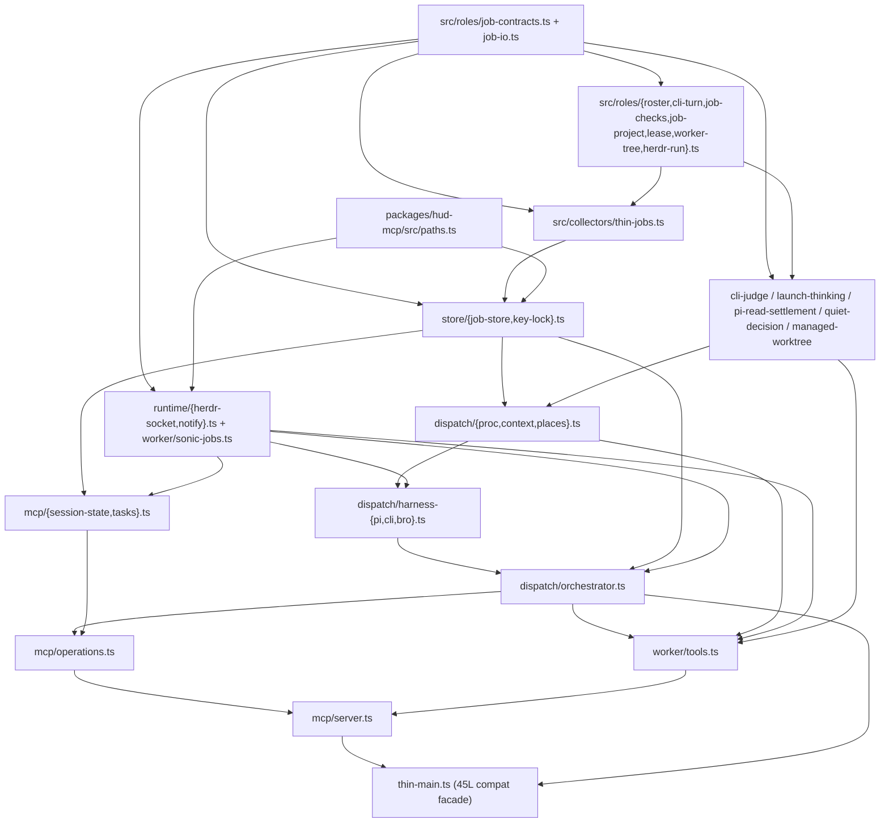
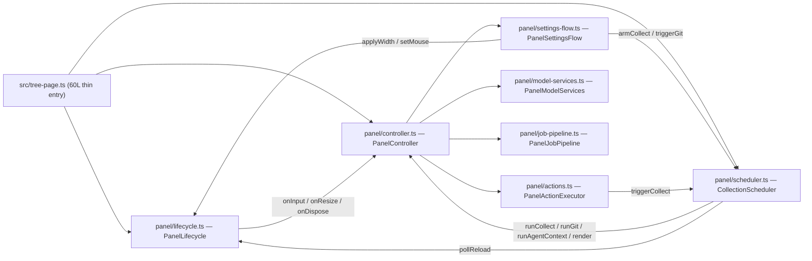
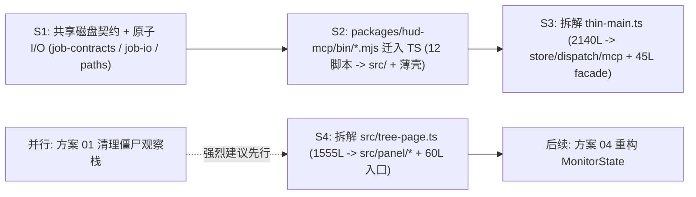

# 02. 拆解核心巨石文件（`thin-main.ts`、`tree-page.ts`）并将 `packages/hud-mcp/bin/*.mjs` 迁入 TypeScript

> **优先级**：P0（架构减债与后续特性并行开发的核心解阻项）
> **类别**：纯内部重构 / 类型契约统一 / 模块边界拆解（Zero Behavior Change）
> **预估规模**：4 个独立垂直切片（每片 1 个 `imp` 会话内可独立落地与验证；约 3,600 行迁移与模块化重排，净删除 ~1,410 行无类型 `.mjs` 实现体与 12 处重复原子写/状态拼装代码）
> **前置依赖**：切片 S1–S3（`packages/hud-mcp` 与共享契约）零前置依赖，可与 **方案 01（清理僵尸观察栈）** 并行；切片 S4（拆解 `src/tree-page.ts`）强烈建议排在 **方案 01** 之后、**方案 04（重构 `MonitorState`）** 之前（具体衔接见 §3.4）
> **`docs/spec.md` 边界影响**：**无产品规格变更**（纯内部重构；不改动任何 MCP 工具名、参数、返回结构、CLI 路径、磁盘 JSON schema、快捷键、渲染帧或安装布局，无需修改 `docs/spec.md`）

---

## 1. 背景与现状证据

### 1.1 巨石体量与无类型边界量化

基于当前 `universal-hud` 分支实际代码盘点，MyHUD 的核心调度、运行期守护与面板控制高度集中在两个巨石 TypeScript 文件和一组游离于 `tsc` 之外的 `.mjs` 脚本中：

| 目标范围 | 当前行数 | 现状问题与职责混杂证据 |
|---|---:|---|
| `packages/hud-mcp/src/thin-main.ts` | **2,140L** | 单文件承担 9 类职责：模块顶层 env 初始化与 top-level `await`（`:45–52`）、磁盘 `job.json` 读写与并发合并保存（`:119–188`）、三类 harness 派发 `dispatchPi`/`dispatchBro`/`dispatchCli`（`:361–753`）、观测与等待 `readRow`/`peekJob`/`listJobs`/`waitJobs`/`observation`（`:754–989`）、上下文组装与 `writeBrief`（`:990–1097, 1377–1394`）、place 校验/重试/repair/fan-out `placeOptions`/`dispatchJob`/`sendJob`/`sendJobs`（`:1107–1611`）、按 key 并发锁 `keyLock`（`:1830–1850`）、MCP 2026 Tasks 状态机 `beginTask`/`sampleTask`/`taskRequest`（`:1851–1990`）、stdio JSON-RPC 路由 `receive`/`serveMcp`（`:1991–2140`）。 |
| `packages/hud-mcp/bin/*.mjs`（14 文件） | **1,488L** | `packages/hud-mcp/tsconfig.json` 仅包含 `src/**/*.ts`，以下全部脚本完全脱离 `tsc --strict` 校验：`hud-watch.mjs`（405L）、`worker-tools.mjs`（285L）、`hud-cli.mjs`（282L）、`hud-notify.mjs`（128L）、`hud-jev.mjs`（124L）、`hud-check.mjs`（63L）、`hud-sonic.mjs`（41L）、`sonic-jobs.mjs`（40L）、`hud-ask.mjs`（32L）、`hud-mcp.mjs`（23L）、`hud-progress.mjs`（22L）、`herdr-request.mjs`（19L）、`hud-lease.mjs`（17L）、`surface.mjs`（9L）。 |
| `src/tree-page.ts` | **1,555L** | 含 286 行 `PanelJobPipeline`（`:119–404`，夹杂旧观察栈 `JobObservationCollector`/`TaskObservationCollector`/`composeJobTree`）与 **1,068 行巨型闭包 `runLivePage()`**（`:467–1534`），内部平铺 ~60 个闭包局部变量，将模型服务装配、自适应轮询、时钟重绘、Git 单飞刷新、Settings/确认弹窗、20+ 种输入动作 I/O、自重载、终端宽度守护与信号清理全部绑死在一个函数体内。 |
| 后续评估候选（见 §3.5） | **2,766L** | `src/collectors/rollout.ts`（1,748L）与 `src/roles/roster.ts`（1,018L），均为纯 TypeScript，已受严格类型检查，变更频次显著低于上述三处。 |

### 1.2 无类型循环依赖与 Top-Level `await` 隐患

实测代码中存在清晰的 TS ↔ MJS 反向循环依赖与模块加载期副作用：

1. **环状动态导入**：`packages/hud-mcp/src/thin-main.ts:50, 52` 使用写死的 4 层相对路径执行 top-level `await import(new URL('../../../../bin/hud-notify.mjs' | 'worker-tools.mjs', import.meta.url).href)`；而 `packages/hud-mcp/bin/worker-tools.mjs:13` 又反向执行 `import('../dist/packages/hud-mcp/src/thin-main.js')` 以调用 `dispatchJob` 与 `sonicThinking`。
2. **模块加载副作用泄漏**：`thin-main.ts:45–52, 1777–1828` 在模块顶层立即解析 `process.env.HUD_JOB_DIR`/`HUD_HOME`、写回 `process.env.HUD_HOME`、实例化 `TryLog`/`PanelActionLog` 并维护全局可变 `locks`/`tasks`/`activeTasks`/`cursor`。一旦 fallback CLI（如 `hud-sonic.mjs`）通过 `worker-tools.mjs` 动态导入 `thin-main.js`，就会触发整套 MCP 模块初始化与 top-level `await`（历史日志已多次出现 Node `Warning: Detected unsettled top-level await`）。
3. **跨包无类型动态桥接**：`src/cli/watch.ts:214` 与 `src/harness/pi/package-entry.ts:140` 均以无类型 `await import(.../packages/hud-mcp/bin/hud-notify.mjs)` 跨包消费通知函数。

### 1.3 `docs/reviews/2026-11-21-mcp-orch-milestone.md` 暴露的跨边界耦合 Bug 复盘

近期 MCP-ORCH 里程碑评审中发现的多项阻塞级缺陷，本质上都是“巨石文件内部职责混叠 + TS 与 `.mjs` 之间无强类型磁盘契约”的直接产物：

1. **CLI 内部跟进 prompt 击毁 Claude Task（Simplicity #1）**：`packages/hud-mcp/bin/hud-cli.mjs:210–215, 234–245`（无类型 `.mjs`）发送 `collect-sonic` / `prompt-report` 时调用 `writeTurn(dir)` 推进 `turn.json`，而 `thin-main.ts:1894–1900`（`taskFence`）用 `turnToken(turn)` 作为 MCP Task 护栏。由于 `hud-cli.mjs` 与 `thin-main.ts` 隔着 JS/TS 墙且 Task 引擎深埋在 2140 行巨石尾部，二者对 `turn.json` 的隐式耦合直到人工跨文件走查才暴露（修复后引入了 `Turn.caller_token` 与 `writeTurn(dir, { by: 'hud' })`）。
2. **Pi check hold 阻断读后修复（Simplicity #3）**：`thin-main.ts:1525–1530`（`sendJob`）判断修复分支时依赖 `STATUS.json` 已被写入 `closed after report read`，而 `packages/hud-mcp/bin/hud-watch.mjs:268–280` 在 `checksOpen()` 期间拦截了 Pi 的 read-close 落盘。两侧跨 TS/`.mjs` 分别手工解构 `job.json` + `STATUS.json` 导致语义分叉；最终修复不得不单独抽出 `packages/hud-mcp/src/pi-read-settlement.ts`（28L）作为共享强类型函数——这正是本方案全面推广的范式。
3. **Task 分支静默丢弃 launch 事实 & 未注册项目 standing brief 泄漏（Spec #2 / #3）**：`thin-main.ts` 将上下文校验（`:1017–1097`）、place 回退循环（`:1314–1371`）、Task 包装（`:1914–1924`）与 JSON-RPC 封包（`:2095–2112`）混在一个文件里，缺乏清晰的 `DispatchOutcome` / `TaskReply` 模块边界，导致普通回复与任务回复曾出现结果字段漂移。
4. **五处手工拼装 `STATUS.json` 与十二处重复原子写**：
   - `STATUS.json` 在 `thin-main.ts:619–641`（`failCli`）、`thin-main.ts:1459–1466`（`finishLaunch`）、`hud-cli.mjs:37–47, 175–179`、`hud-jev.mjs:25–44`、`hud-watch.mjs:250–256, 352` 共 5 处手工拼装为无类型对象字面量，字段集彼此不对齐（例如 `hud-watch.mjs:256` 在 `tabClosed` 分支未检查 `STATUS.json.stop-requested`，且省略了 `version`/`task_dir`/`slot`）。
   - 全仓至少 12 处重复手写 `temp + 0o600 + rename`（`thin-main.ts:169, 769, 1458, 1865`、`cli-judge.ts:35`、`hud-watch.mjs:195, 259, 293, 353`、`hud-cli.mjs:187`、`hud-jev.mjs:46`、`hud-check.mjs:41`、`worker-tools.mjs:32`、`job-project.ts:52`），其中多处仅用 `${file}.${process.pid}.tmp` 而未附加 `randomUUID()`，且缺少 `finally` 清理，在同进程异步并发写时存在临时文件碰撞与泄漏隐患。
5. **并行切片合并冲突**：每次新增 MCP 工具选项或面板微动作都必然修改 `thin-main.ts` 或 `tree-page.ts`，导致 worktree 串行排队与 cherry-pick 冲突频发。

---

## 2. 目标与非目标（Scope / Out of Scope）

### 目标（Scope）

1. **建立单一真相源的强类型磁盘契约**：在 `src/roles/job-contracts.ts` 与 `src/roles/job-io.ts` 统一 `Job`、`JobStatus`、`Turn`、`DoneReceipt`、`CheckReceipt`、`SessionReceipt`、`McpTaskMarker`、`ProgressEntry`、`ManagedWorktree`、`SendOutcome` 与 `writeJsonAtomicPrivate`，消除跨进程与跨模块的无类型 JSON 猜测。
2. **拆解 `packages/hud-mcp/src/thin-main.ts`（2,140L → ~45L 薄入口）**：拆分为无环、可独立单测的 `paths` / `store/*` / `dispatch/*` / `mcp/*` 模块树，彻底移除 top-level `await` 与模块级可变单例，保留 `thin-main.ts` 的 `serveMcp`/`dispatchJob`/`sonicThinking` 导出向后兼容。
3. **将 `packages/hud-mcp/bin/*.mjs` 业务代码迁入 TypeScript**：12 个核心运行/worker 脚本迁入 `packages/hud-mcp/src/{worker,runtime}/`，原 `packages/hud-mcp/bin/*.mjs` 全部收敛为 1–6 行薄 wrapper（`hud-mcp.mjs` 与 `surface.mjs` 保留零依赖 Node ≥24 前置检查），100% 保持外部调用路径与行为兼容。
4. **拆解 `src/tree-page.ts`（1,555L → ~60L 薄入口）**：拆分为 `src/panel/` 下的 `PanelController`、`CollectionScheduler`、`PanelLifecycle`、`PanelModelServices`、`PanelActionExecutor`、`PanelSettingsFlow` 与 `PanelJobPipeline`，明确与方案 01、方案 04 的衔接边界。
5. **给出 `src/collectors/rollout.ts` 与 `src/roles/roster.ts` 的后续拆分评估结论**，避免过度重构或遗漏技术债。

### 非目标（Out of Scope）

1. **零产品行为变更**：不改动任何 MCP 工具名/schema/错误码、磁盘 JSON 字段名、watcher 退出与重试时序、CLI 退出码、面板渲染帧、快捷键或安装器行为。
2. **不清理僵尸观察栈**：`JobObservationCollector` / `TaskObservationCollector` / `NativeCallCollector` / `composeJobTree` 的删除归属 **方案 01**；若本方案切片 S4 先于方案 01 落地，仅将 `PanelJobPipeline` 原样迁至 `src/panel/job-pipeline.ts` 以便方案 01 整文件精简。
3. **不重构 `MonitorState` 数据结构**：平铺字段归组归属 **方案 04**；本方案仅把 `tree-page.ts` 对 `MonitorState` 的散落访问收敛到清晰的 helper 边界。
4. **不新增第三方依赖**：严格维持 Node ≥24.0.0 标准库 + 现有锁定依赖，不引入 bundler、schema 校验库或新构建工具。
5. **不修改 `install` / `install.d/*.sh` / `integrations/pi/package/*` 的对外文件路径契约**。
6. **本轮不拆分 `src/collectors/rollout.ts` 与 `src/roles/roster.ts`**（详见 §3.5）。

---

## 3. 核心设计方案

### 3.1 共享强类型磁盘契约层（`src/roles/job-contracts.ts` + `src/roles/job-io.ts`）

#### 放置位置与编译拓扑

`packages/hud-mcp/tsconfig.json` 已设置 `"rootDir": "../.."`，会连同引用的 `src/**/*.ts` 一并编译输出至 `packages/hud-mcp/dist/`；而根包 `src/`（含 `src/collectors/thin-jobs.ts`、`src/roles/job-checks.ts`、`src/roles/job-project.ts`、`src/roles/worker-tree.ts`）不应反向依赖 `packages/hud-mcp/src/`。因此，将跨进程磁盘契约放在 **`src/roles/job-contracts.ts`** 与 **`src/roles/job-io.ts`**，可被根 `tsc`（`dist/`）、测试 `tsc`（`dist-test/`）与 `build:hud-mcp`（`packages/hud-mcp/dist/`）同时强类型消费，无需新建 workspace 子包。

#### 核心契约定义（`src/roles/job-contracts.ts`，~180L，纯类型 + 无 I/O 解析器）

```ts
import type { CliAgent } from './cli-kinds.js';
import type { Role, RolePlace, piSwitches } from './roster.js';
export { DONE_FILE, type DoneReceipt, type Turn } from './cli-turn.js';
export { CHECKS_FILE, type CheckBinding, type CheckReceipt, type CheckResult, type CheckSummary } from './job-checks.js';

export const JOB_ID_RE = /^j[0-9a-f]{16}$/;
export type JobId = `j${string}`;
export const isJobId = (value: unknown): value is JobId => typeof value === 'string' && JOB_ID_RE.test(value);

export type JobHarness = 'pi' | 'cli' | 'bro';
export type JobState =
  | 'working'
  | 'waiting_helper'
  | 'waiting_orchestrator'
  | 'idle_grace'
  | 'closed'
  | 'done'
  | 'failed'
  | 'stopped';
export type TerminalJobState = 'closed' | 'failed' | 'stopped';
export type SettledJobState = 'idle_grace' | 'closed' | 'done' | 'failed' | 'stopped';

export const isTerminalJobState = (state: string | null | undefined): state is TerminalJobState =>
  state === 'closed' || state === 'failed' || state === 'stopped';
export const isSettledJobState = (state: string | null | undefined): state is SettledJobState =>
  state === 'idle_grace' || state === 'done' || isTerminalJobState(state);

/** 统一自 packages/hud-mcp/src/managed-worktree.ts（原处 re-export 保持兼容） */
export interface ManagedWorktree {
  main_root: string;
  root: string;
  branch: string;
  base_head: string;
}

/** 统一自 packages/hud-mcp/src/pi-read-settlement.ts（原处 re-export 保持兼容） */
export interface SendOutcome {
  key: string;
  derived_key?: string;
  recorded_at?: string;
  exit_code: number | null;
  stderr_tail: string;
}

export type PiOptions = Partial<Record<(typeof piSwitches)[number], boolean>> & { pi_args?: string[] };
export type LaunchAttempt = { index: number; place: string; reason?: string };
export type DispatchFailureCode = 'untrusted_cwd' | 'unsupported_harness' | 'invalid_arguments';
export interface CliJobConfig {
  agent: CliAgent;
  can_continue: boolean;
  idle_grace_s: number;
  state_trust?: 'turn' | 'advisory';
}

/** 磁盘 `$HUD_HOME/jobs/<id>/job.json` 唯一契约（保留全部历史兼容字段） */
export interface Job extends PiOptions {
  job: string;
  role: string;
  request_key: string;
  cwd: string;
  project_root?: string;
  herdr_pane: string;
  created_at: string;
  package?: string;
  title?: string; // 历史收据兼容
  preset?: string;
  context_files?: string[];
  from_jobs?: string[];
  checks?: string[];
  repair_of?: string;
  task_length?: number;
  create_options?: Record<string, unknown>;
  model?: string | null;
  thinking?: string | null;
  model_source?: string | null;
  read_at?: string;
  parent_job?: string;
  pi_sent_at?: string;
  observed_at?: string;
  reaped_at?: string;
  worktree?: ManagedWorktree;
  worktree_removed_at?: string;
  worktree_kept_reason?: string;
  place?: RolePlace;
  place_key?: string;
  exhaustion_marked?: boolean;
  bro?: RolePlace;
  jev?: Role; // 历史收据兼容
  cli?: CliJobConfig;
  attempts?: LaunchAttempt[];
  used_place?: string;
  dispatch_exit_code: number | null;
  dispatch_code?: DispatchFailureCode;
  dispatch_path?: string;
  stderr_tail: string;
  message_keys?: string[]; // 历史收据只读兼容
  send_outcomes?: SendOutcome[];
  role_skills?: { name: string; path: string }[];
  skipped_skills?: { name: string; reason: string }[];
  worker_prompt?: string | null;
}

export interface QuietDecisionReceipt {
  choice: 'still-working' | 'finished-no-report' | 'failed' | 'needs-human' | null;
  probability: number | null;
  action: 'wait' | 'prompt-report' | 'fail' | 'needs-human';
  reason?: string;
  at: string;
}

/** 磁盘 `$HUD_HOME/jobs/<id>/STATUS.json` 唯一契约（对齐 pi / cli / bro / watcher / launch-fail 五方） */
export interface JobStatus {
  version?: 1;
  task_dir?: string;
  slot?: string;
  harness?: JobHarness;
  agent?: string;
  provider?: string;
  role?: string;
  model?: string | null;
  thinking?: string | null;
  state: JobState;
  output_path?: string;
  output_written?: boolean;
  pid?: number | null;
  pid_start_time?: string | null;
  agent_session_id?: string | null;
  supervisor_pid?: number | null;
  started_at?: string;
  settled_at?: string | null;
  idle_deadline_at?: string | null;
  ended_at?: string | null;
  updated_at?: string;
  blocked?: boolean;
  reason?: string | null;
  exit_reason?: string | null;
  error?: string | null;
  declared_report_sig?: string | null;
  quiet_decision?: QuietDecisionReceipt;
}

/** 磁盘 `SESSION.txt` 结构化解析与序列化（防换行注入，取代 7 处正则手切） */
export interface SessionReceipt {
  TASK?: string;
  TAB?: string;
  TAB_NAME?: string;
  LEFT?: string;
  RIGHT?: string;
  ORCH?: string;
  BASE?: string;
  PRIMARY?: string;
}
export function parseSessionTxt(text: string): SessionReceipt;
export function formatSessionTxt(fields: Record<string, string>): string;

/** 磁盘 `mcp-task.json` 与 `progress.jsonl` 契约 */
export interface McpTaskMarker {
  id: string;
  pane: string;
  pid: number;
  start?: string;
  expires: number;
}
export interface ProgressEntry {
  at: string;
  text: string;
}
```

同步修改现有模块的类型签名以闭合边界：
- `src/roles/job-checks.ts:9`：将 `type Receipt` 重命名并导出为 `export interface CheckReceipt`（以及 `CheckResult`），将 `checkBinding` / `jobChecks` 入参从 `Record<string, unknown>` 收窄为 `Pick<Job, ...>` 与 `Partial<JobStatus> | null`。
- `src/roles/job-project.ts:8–9, 26`：`JobProject` / `JobOwner` 对齐 `Partial<Job>`。
- `src/collectors/thin-jobs.ts:197–201, 273`：`jobRow()` 接受 `Partial<Job>` 与 `Partial<JobStatus> | null | undefined`（保持对合成测试与局部 JSON 的宽容兼容）。

#### 统一原子私有 I/O（`src/roles/job-io.ts`，~85L）

消除全仓 12 处散落手写的 `.tmp` + `renameSync`：

```ts
export function writeFileAtomicPrivate(file: string, content: string): void;
// 内部实现：`${file}.${process.pid}.${randomUUID()}.tmp` -> openSync('wx', 0o600) -> writeFileSync -> closeSync -> renameSync -> finally rmSync({ force: true })

export function writeJsonAtomicPrivate(file: string, value: unknown, pretty = false): void;
export function readJsonFile<T>(file: string, options?: { maxBytes?: number; tolerateSyntaxError?: boolean }): T | null;
export function readBoundedSlice(file: string, limit: number): { text: string; truncated: boolean } | null;
```

> **安全性提升**：相比旧版 `${file}.${process.pid}.tmp`（`thin-main.ts:169, 769, 1458, 1865`、`hud-watch.mjs:195` 等），加入 `randomUUID()` + `wx` + `finally rmSync` 后彻底消除了同进程异步并发写同一文件时的 `.tmp` 竞态覆盖与失败残留，且严格保持 `0o600` 权限（`docs/ARCHITECTURE.md` §8）。

---

### 3.2 `packages/hud-mcp/src/thin-main.ts` 拆分后的模块树与依赖 DAG

#### 精确模块树

```text
packages/hud-mcp/src/
├── thin-main.ts                 # (~45L) 薄向后兼容入口 facade：导出 serveMcp / dispatchJob / sonicThinking（零 top-level await）
├── paths.ts                     # (~45L) 唯一路径锚点：REPO_ROOT / BUNDLED_ROOT / binScript(name) / resolveHudHome() / jobDir()
├── cli-judge.ts                 # (现有 294L) 纯 CLI 判定机与子进程树采样
├── launch-thinking.ts           # (现有 85L) Pi/CLI thinking 能力表与离线探针
├── pi-read-settlement.ts        # (现有 28L) Pi 读后结算凭证
├── quiet-decision.ts            # (现有 171L) 安静 CLI 作业 Decision API 升级判断
├── managed-worktree.ts          # (现有 128L) 隔离 worktree 生命周期与安全 Git 清理
├── local-tickets.ts             # (现有 118L) hud_tickets 本地工单读写
├── codex-statusline.ts          # (现有 185L) Codex 原生 statusline resource
├── store/
│   ├── key-lock.ts              # (~30L) KeyLock 类：按 key 串行化异步临界区
│   └── job-store.ts             # (~145L) JobStore 类：磁盘 job.json / STATUS.json / SESSION.txt / qa 读写与并发合并保存
├── dispatch/
│   ├── proc.ts                  # (~85L) 子进程执行、herdr 错误判定、pane 屏幕提取、phantom-working 消抖
│   ├── context.ts               # (~125L) 上下文文件校验、standing brief 装配、writeBrief、originalTask、tabLabel
│   ├── places.ts                # (~105L) placeOptions、jobOptions、piSkillArgs、sonicThinking、compactAssignment
│   ├── harness-pi.ts            # (~145L) dispatchPi
│   ├── harness-cli.ts           # (~155L) dispatchCli、failCli、supervisor 存活与拉起
│   ├── harness-bro.ts           # (~55L) dispatchBro
│   └── orchestrator.ts          # (~220L) JobDispatcher 类：dispatchJob / retry / fallback 循环 / finishLaunch / closeJob / ensureWatcher
├── mcp/
│   ├── session-state.ts         # (~135L) McpSessionState 类：callerPane、cursor、adoptSessionJobs、withChanges、deliveryHint
│   ├── tasks.ts                 # (~185L) McpTaskManager 类：MCP 2026 Tasks 生命周期、mcp-task.json、taskFence、sampleTask、cancel
│   ├── operations.ts            # (~290L) MCP 主会话工具实现：hud_roster / hud_create / hud_send / hud_wait / hud_read / hud_peek / hud_respond / hud_close / hud_tickets / hud_lease
│   └── server.ts                # (~160L) McpServer 类：stdio JSON-RPC 2.0 协议层、worker/main 双表面分派
├── worker/                      # 由 bin/*.mjs 迁入（见 §3.3）
│   ├── sonic-jobs.ts            # (~45L) sonic 子作业状态机与收集提示
│   ├── tools.ts                 # (~275L) worker 工具核心实现（静态导入 dispatch/orchestrator + dispatch/places）
│   ├── cli-ask.ts               # (~45L) hud-ask CLI 参数解析与执行
│   ├── cli-sonic.ts             # (~50L) hud-sonic CLI
│   ├── cli-progress.ts          # (~30L) hud-progress CLI
│   └── cli-lease.ts             # (~25L) hud-lease CLI
└── runtime/                     # 由 bin/*.mjs 迁入（见 §3.3）
    ├── herdr-socket.ts          # (~35L) herdr UNIX socket 单次请求客户端
    ├── notify.ts                # (~140L) 或仅 CLI 封装（若库函数下沉至 src/roles/notify.ts，见 §6 问题 2）
    ├── watch.ts                 # (~360L) JobWatcher 类与 runWatcher()
    ├── cli-supervisor.ts        # (~270L) CliJobSupervisor 类与 runCliSupervisor()
    ├── browser-runner.ts        # (~125L) runBrowserJob()
    └── check-runner.ts          # (~75L) runCheckHelper()
```

#### 依赖关系 DAG（彻底消除 TS ↔ MJS 环状导入）



#### 各模块职责边界与核心导出符号

| 模块 | 职责边界 | 核心导出符号 |
|---|---|---|
| `paths.ts` | 唯一根路径定位器。复用 `src/cli/compat.ts:8–14` 同款向上锚定算法（查找 `bin/hud` + `package.json`），免疫任何子目录层级及 `dist/` / `packages/hud-mcp/dist/` 输出路径差异。 | `REPO_ROOT`, `BUNDLED_ROOT`, `binScript(name)`, `resolveHudHome(env?)`, `resolveRuntimeEnv(env?)` |
| `store/key-lock.ts` | 替代 `thin-main.ts:1831–1841` 的全局 `locks` Map，支持独立实例化与单测。 | `KeyLock` (`run<T>(key, fn)`) |
| `store/job-store.ts` | 封装 `$HUD_HOME/jobs/` 的一切读写与并发合并规则。`save(job, newAttempt)` 严格保留 `thin-main.ts:154–172` 的并发字段合并语义（永不覆盖已领养的 `herdr_pane`；`read_at`/`observed_at`/`pi_sent_at` 单调取最大；保留 `reaped_at`/`worktree_*`/`exhaustion_marked`）。 | `JobStore` (`dir`, `find`, `listAll`, `save`, `readRow`, `readPrimary`, `openQuestions`, `readStatus`, `writeStatus`, `registry`) |
| `dispatch/proc.ts` | 外部命令与 herdr 交互原语，无业务状态。 | `runProcess`, `refusedBeforeInput`, `workspaceArgs`, `dispatchBase`, `paneText`, `startupFailure`, `settlePhantomWorking`, `quoteShell`, `DispatchResult`, `launchError`, `rejectLaunch` |
| `dispatch/context.ts` | 上下文文件安全校验（`O_NOFOLLOW`/`O_NONBLOCK`/UTF-8/非二进制/字节上限）、已注册项目 `.hud/brief.md` 装配、`writeBrief`（含无 MCP CLI fallback 命令生成）、`originalTask` 剥离、`tabLabel`。 | `readContextFile`, `assembleContext`, `writeBrief`, `originalTask`, `tabLabel`, `cutColumns` |
| `dispatch/places.ts` | Role/Place 选项校验、重试兼容选项过滤、Pi 技能与系统提示参数拼装、sonic 思考等级查询与精简分配输出。 | `placeOptions`, `jobOptions`, `argsForPlace`, `piSkillArgs`, `sonicThinking`, `compactAssignment`, `plainSkillName` |
| `dispatch/harness-{pi,cli,bro}.ts` | 三种执行后端各自独立，单文件 ≤155L；不再相互干扰或共享隐式闭包变量。 | `dispatchPi` / `dispatchCli`, `failCli`, `supervisorPid`, `supervisorAlive`, `spawnCliSupervisor` / `dispatchBro` |
| `dispatch/orchestrator.ts` | 编排 `hud_create`（幂等 derivedKey、retry_of 继承、place 失败回退循环、worktree 创建、finishLaunch 落盘）、`ensureWatcher()` 与 `closeJob()`。不耦合 JSON-RPC 协议。 | `JobDispatcher` (`dispatchJob`, `closeJob`, `ensureWatcher`, `launchSummary`) |
| `mcp/session-state.ts` | 持有单次 MCP 会话的可变状态（`callerPane`, `callerHarness`, `cursor`, `createdJobs`, `sentConventionVersion`, `sentCreateHint`, `taskClient`, `discovered`），负责 `adoptSessionJobs`、`sessionRows`、`withChanges` 与 `deliveryHint`。 | `McpSessionState` |
| `mcp/tasks.ts` | 完整封装 MCP `io.modelcontextprotocol/tasks` 扩展状态机、`mcp-task.json` 认领/释放、`taskFence`（遵循 `Turn.caller_token`）、`sampleTask`、`taskRequest`（get/cancel）。 | `McpTaskManager`, `TASK_EXTENSION`, `TASK_TTL`, `TaskReply`, `isTaskReply` |
| `mcp/operations.ts` | 主会话工具业务实现（`hud_roster`/`hud_create`/`hud_send`/`hud_wait`/`hud_read`/`hud_peek`/`hud_respond`/`hud_close`/`hud_tickets`/`hud_lease`）与 `mutationKey`。 | `McpOperations` (`call`, `mutationKey`, `sendJob`, `sendJobs`, `waitJobs`, `peekJob`, `listJobs`, `observation`) |
| `mcp/server.ts` | stdio readline 循环、JSON-RPC 2.0 校验、method 路由、`worker` vs `main` 双表面隔离、结果包装（支持在测试中注入自定义 `stdin`/`stdout` 流）。 | `McpServer` (`receive`, `serve`) |
| `thin-main.ts` | **向后兼容薄门面（~45L）**。按需惰性创建默认运行时实例，**零 top-level `await`**，继续导出 `serveMcp`, `dispatchJob`, `sonicThinking` 以兼容 `surface.mjs` 与既有调用方。 | `serveMcp`, `dispatchJob`, `sonicThinking` |

> **关键设计收益（直接解决 2026-11-21 评审遗留）**：
> - `McpOperations` 调用 `JobDispatcher.dispatchJob()` 返回强类型结果，`McpTaskManager` 接收显式 `launchSummary` 包装为 `TaskReply`，不可能再次出现“成功任务分支丢弃 `attempts`/`used_place`”的静默漂移。
> - `worker/tools.ts` 直接静态导入 `JobDispatcher` 与 `sonicThinking`，并在派发 sonic 子任务时显式传入父作业解析出的 `hudHome = dirname(context.root)`，既消除循环导入，也修复了 fallback CLI 未设 `HUD_JOB_DIR` 时依赖进程全局 `HUD_HOME` 的隐患。

---

### 3.3 `packages/hud-mcp/bin/*.mjs` 迁入 TypeScript 与薄 Wrapper 设计

#### 全量 14 个 `.mjs` 文件兼容性矩阵

必须 100% 保持以下外部路径契约不动：
- `./install:85` 软链：`~/.local/bin/hud-mcp` → `<repo>/packages/hud-mcp/bin/hud-mcp.mjs`
- `packages/hud-mcp/package.json:10`：`bin.hud-mcp = "bin/hud-mcp.mjs"`
- `integrations/pi/package/binding.mjs:15` 与 `src/harness/pi/role-client.ts:22`：`packages/hud-mcp/bin/hud-mcp.mjs`
- `integrations/pi/package/extensions/hud.mjs:9–12` 与 `tests/unit/pi-package.test.mjs:36`：`packages/hud-mcp/bin/worker-tools.mjs`（以及相对它解析 `../dist/packages/hud-mcp/src/launch-thinking.js`）
- 外部 `pi-roles` 参数传递：`--hud-sonic-jobs <bundled>/bin/sonic-jobs.mjs`（`thin-main.ts:398`）与 `--notify "... <bundled>/bin/hud-notify.mjs ..."`（`thin-main.ts:390`）
- `writeBrief`（`thin-main.ts:1382–1390`）与 `withDonePrompt`（`cli-judge.ts:14`）生成的 fallback CLI 命令：`hud-ask.mjs`、`hud-sonic.mjs`、`hud-progress.mjs`，以及 `hud-lease.mjs`
- `ensureWatcher()`（`thin-main.ts:257–261`）对 `/proc/<pid>/cmdline` 包含 `packages/hud-mcp/bin/hud-watch.mjs` 的存活检测
- `tests/release-archive.test.mjs:139–140, 187` 对归档清单的显式断言

| `bin/*.mjs` 文件 | 分类 | 迁入的 TS 目标模块 | 迁移后的 `bin/*.mjs` 薄壳形态 | 关键兼容点 |
|---|---|---|---|---|
| `hud-mcp.mjs` | Node≥24 预检启动器 | 入口保持在 `bin/`，逻辑委托 `thin-main.js` | **保持原 23L 不动**（先校验 `major < 24` 再 `import(entry)`） | `tests/unit/install-script.test.mjs:79` 用伪造 Node 18/22/23 校验必须在加载 ESM 业务代码前输出精确错误并退出码 1 |
| `surface.mjs` | 零依赖表面路由 | 保持在 `bin/` | **保持原 9L 不动**（返回 `'../dist/packages/hud-mcp/src/thin-main.js'`） | 被 `hud-mcp.mjs:9` 静态 import（ESM 会提升到版本检查之前执行，因此必须零 Node 24 专属语法/导入） |
| `worker-tools.mjs` | 纯库 re-export | `src/worker/tools.ts` | 1L：`export * from '../dist/packages/hud-mcp/src/worker/tools.js';` | `pi-package.test.mjs:36` 仅软链此文件 + `packages/hud-mcp/dist/`；所有内部依赖进入 `dist/` 后反而更健壮 |
| `sonic-jobs.mjs` | 纯库 re-export | `src/worker/sonic-jobs.ts` | 1L：`export * from '../dist/packages/hud-mcp/src/worker/sonic-jobs.js';` | 供外部 `pi-roles` 通过 `--hud-sonic-jobs` 动态导入 |
| `herdr-request.mjs` | 纯库 re-export | `src/runtime/herdr-socket.ts` | 1L：`export { request } from '../dist/packages/hud-mcp/src/runtime/herdr-socket.js';` | 保留 1 行兼容壳，避免外部脚本意外中断 |
| `hud-notify.mjs` | **双模（库 + CLI）** | `src/runtime/notify.ts`（或库下沉 `src/roles/notify.ts`） | 6L：re-export 6 个库函数；`argv[1] === fileURLToPath(import.meta.url)` 时调用 `runNotifyCli(process.argv.slice(2))` | **关键陷阱**：主模块判断必须留在 `bin/hud-notify.mjs` 内（否则 `import.meta.url` 会指向 `dist/.../notify.js` 导致永不命中！） |
| `hud-watch.mjs` | 可执行守护进程 | `src/runtime/watch.ts` | 3L：`#!/usr/bin/env node` + `runWatcher()` | 保持 `/proc/<pid>/cmdline` 含 `bin/hud-watch.mjs` 与 `watch.pid` 存活识别 |
| `hud-cli.mjs` | 可执行监督进程 | `src/runtime/cli-supervisor.ts` | 3L：`#!/usr/bin/env node` + `runCliSupervisor(process.argv[2])` | `spawnCliSupervisor` 与 `supervisor.pid` 零变动 |
| `hud-jev.mjs` | 可执行浏览器运行器 | `src/runtime/browser-runner.ts` | 3L：`#!/usr/bin/env node` + `await runBrowserJob(process.argv[2], process.argv[3])` | 保留 `herdr pane run` 调用与 SIGTERM 传播 |
| `hud-check.mjs`（`0755`） | 可执行检查助手 | `src/runtime/check-runner.ts` | 3L：`#!/usr/bin/env node` + `await runCheckHelper(process.argv[2], process.argv[3])` | 保留抽象 UNIX socket 单实例锁与 `process.kill(-pid)` 进程组清理 |
| `hud-ask.mjs` | Fallback CLI | `src/worker/cli-ask.ts` | 3L：`#!/usr/bin/env node` + `await runAskCli(process.argv.slice(2))` | 保留退出码 2（usage）与 `--dir`/`--job-dir`/位置参数兼容 |
| `hud-sonic.mjs` | Fallback CLI | `src/worker/cli-sonic.ts` | 3L：`#!/usr/bin/env node` + `await runSonicCli(process.argv.slice(2))` | 保留退出码 3（still working）与 stdout 仅输出 job id 契约 |
| `hud-progress.mjs` | Fallback CLI | `src/worker/cli-progress.ts` | 3L：`#!/usr/bin/env node` + `await runProgressCli(process.argv.slice(2))` | 保留 `--done --dir --turn` 契约 |
| `hud-lease.mjs` | Fallback CLI | `src/worker/cli-lease.ts` | 3L：`#!/usr/bin/env node` + `await runLeaseCli(process.argv.slice(2))` | 保留 `--dir`/`--release`/`--wait-s` 与 JSON stdout 输出 |

#### 薄 Wrapper 示例（双模 `bin/hud-notify.mjs` 与可执行 `bin/hud-watch.mjs`）

```js
// packages/hud-mcp/bin/hud-notify.mjs (6 lines)
import { resolve } from 'node:path';
import { fileURLToPath } from 'node:url';
import { runNotifyCli } from '../dist/packages/hud-mcp/src/runtime/notify.js';
export { ensureQueueWatcher, notify, paneInfo, registerPiWatcher, taskDelivery, watching } from '../dist/packages/hud-mcp/src/runtime/notify.js';
if (process.argv[1] && resolve(process.argv[1]) === fileURLToPath(import.meta.url)) runNotifyCli(process.argv.slice(2));
```

```js
#!/usr/bin/env node
// packages/hud-mcp/bin/hud-watch.mjs（实际落盘 3 行，shebang 必须在第 1 行）
import { runWatcher } from '../dist/packages/hud-mcp/src/runtime/watch.js';
runWatcher();
```

#### 迁移中必须规避的 3 个路径陷阱

1. **`hud-notify.mjs:98` 中的 `bin/hud` 定位**：原代码写 `new URL('../../../bin/hud', import.meta.url)`（从 `packages/hud-mcp/bin/` 上跳 3 层到仓库根）。迁入 `packages/hud-mcp/src/runtime/notify.ts`（编译产物深 6 层）后，**必须改用 `join(REPO_ROOT, 'bin', 'hud')`**（来自 `paths.ts` / `installationRoot()`）。
2. **`hud-watch.mjs:18`、`hud-cli.mjs:18`、`hud-jev.mjs:10` 中的 `bundled` 定位**：原代码写 `fileURLToPath(new URL('..', import.meta.url))`。迁入 TS 后统一改用 `BUNDLED_ROOT`。
3. **测试目录的离线构建假设**：`tests/release-archive.test.mjs:148–149` 断言 release tar 包内不含 `dist/` 与 `packages/hud-mcp/dist/`，而是由 `./install` 执行 `npm run build && npm run build:hud-mcp` 现地编译。薄 wrapper 方案完全契合这一发布模型（`bin/*.mjs` 留在 git 源码中，构建后指向 `../dist/packages/hud-mcp/src/...`）。

---

### 3.4 `src/tree-page.ts` 拆分蓝图（与方案 01、方案 04 的精准衔接）

#### 目标模块树

```text
src/
├── tree-page.ts                 # (~60L) 薄入口：导出 runLivePage / PanelJobPipeline / panelJobRenderState + 直接运行崩溃恢复
└── panel/
    ├── job-pipeline.ts          # (~290L；方案 01 落地后缩减至 ~90L) PanelJobPipeline + panelJobRenderState
    ├── lifecycle.ts             # (~175L) PanelLifecycle：终端 raw mode/ESC、信号、stdin/decoder、resize+TreeWidthKeeper、PanelReload、watchPanelCaller
    ├── scheduler.ts             # (~270L) CollectionScheduler：自适应退避轮询、时钟重绘、Git 单飞刷新、Agent 上下文尾读
    ├── model-services.ts        # (~115L) PanelModelServices：集中管理 7 个模型服务配置、叠加与取消
    ├── settings-flow.ts         # (~145L) PanelSettingsFlow：Settings 页面草稿、确认弹窗、覆盖 Help、保存与探针
    ├── actions.ts               # (~185L) PanelActionExecutor：处理 MonitorInput 产出的全部副作用动作
    └── controller.ts            # (~260L) PanelController：核心状态协调、单次采集步骤、纯 render() + frameDiff 输出、输入分派
```

#### 核心协作接口与分层图



#### 三大核心组件接口契约

```ts
// src/panel/lifecycle.ts
export interface PanelLifecycleCallbacks {
  onInputs: (inputs: WorkbenchInput[]) => void;
  onResize: () => void;
  onShutdown: () => void;
}
export class PanelLifecycle {
  readonly reload: PanelReload; // 保持直接实例化，兼容 tests/unit/panel-reload.test.mjs:208 对 PanelReload.prototype.restart 的拦截
  readonly openedAt: number;
  widthOverride: number | undefined;
  closed = false;
  get reloadFailed(): boolean;
  start(initialMouse: boolean, callbacks: PanelLifecycleCallbacks, installCleanup?: (end: () => void) => () => void): Promise<void>;
  pollReload(isDirty: () => boolean): Promise<boolean>;
  restart(place: PanelReloadPlace): Promise<void>;
  applyWidth(): Promise<void>;
  setMouseTracking(enabled: boolean): void;
  finish(user?: boolean, callerGone?: boolean): void;
}

// src/panel/scheduler.ts
export interface CollectionHost {
  isClosed(): boolean;
  getRefreshMs(): number;
  pollAndRestartIfReady(): Promise<boolean>;
  runCollectStep(): Promise<void>;
  buildPollObservation(): { scopeKey: string; activity: 'active' | 'quiet'; fingerprint: string; succeeded: boolean };
  computeRepaintDelay(): number;
  render(): void;
  isChangesFocused(): boolean;
  getWorktreeSources(): readonly string[];
  refreshWorktrees(candidates: readonly string[]): Promise<void>;
  refreshAgentContext(): Promise<void>;
}
export class CollectionScheduler {
  start(): void;
  armCollect(refreshMs: number): void;
  triggerCollect(force?: boolean): void;
  triggerGit(): void;
  triggerAgentContext(): void;
  stop(): void;
}

// src/panel/controller.ts
export class PanelController {
  // 持有 MonitorState / SubagentTree / WorktreesSnapshot / ExpData / ProjectVisits / ProjectOverviews / notices
  isDirtyForReload(): boolean;
  buildReloadPlace(): PanelReloadPlace;
  render(): void;            // 严格纯渲染：仅读缓存快照与存储的模型 overlay，传 nowMs，经 frameDiff 写 stdout
  handleInputs(inputs: WorkbenchInput[]): void;
  runCollectStep(): Promise<void>;
  dispose(): void;
}
```

#### 与方案 01（清理僵尸观察栈）和方案 04（重构 `MonitorState`）的衔接设计

1. **与方案 01 的衔接**：
   - 当前 `tree-page.ts` 中所有僵尸观察栈耦合都集中在两处：`PanelJobPipeline`（`:119–404`）和 `runLivePage` 中的 `nativeCalls` / `jobComposition` / `legacyDelegation = null` / `applyJobComposition`（`:487–507, 953–990`）。
   - **最佳顺序（方案 01 → S4）**：方案 01 先删除 `JobObservationCollector`/`TaskObservationCollector`/`NativeCallCollector`/`composeJobTree` 后，`PanelJobPipeline` 直接瘦身为 ~90 行（只留 `readThinJobs` + `ActivityRings` + `DiffStatCollector` + `workboard` 缓存），`PanelController` 不必搬运任何僵尸字段。
   - **反向兼容（若 S4 先行）**：将现有 `PanelJobPipeline` 与 `panelJobRenderState` 完整收容在 `src/panel/job-pipeline.ts` 中，`PanelController` 仅通过窄接口 `pipeline.refresh()` / `pipeline.workboard()` / `pipeline.compose()` 调用，方案 01 后续只需删改 `src/panel/job-pipeline.ts` 与 `controller.ts` 中 ~25 行胶水。
2. **与方案 04 的衔接**：
   - 当前 `tree-page.ts` 在 15+ 处直接读写 `MonitorState` 的 ~28 个平铺可选字段（如 `:894–895` 的 6 个编辑器草稿判脏条件、`:1191–1192` 的 layout 切换游标重置、`:1248` 与 `:1476–1484` 的 `editorInput` 拦截逻辑）。
   - 切片 S4 将这些跨界状态判定显式抽取为 3 个集中纯函数（放在 `src/panel/state-guards.ts` 或 `controller.ts` 顶部）：`hasActiveEditor(state)`、`isReloadBlockedByDraft(state)`、`resetStateForSettingsChange(state, prev, next)`。方案 04 后续重构 `MonitorState` 为嵌套子状态对象时，面板运行时侧仅需更新这 3 处映射，大幅降低改造面。
3. **`PanelReload` 热重载细节保障**：
   - `src/utils/panel-reload.ts:46` 默认监控 `dist/tree-page.js`（相对 `dist/utils/panel-reload.js` 的 `../tree-page.js`）。
   - 当前根 `tsconfig.json` 未启用 `incremental: true`，每次 `npm run build` 都会全量重写 `dist/tree-page.js`（更新 `mtimeMs`），因此即便本次改动只涉及 `src/panel/controller.ts`，热重载依然稳定触发。
   - **防退化备忘**：若未来团队开启 `tsc --incremental`，需在 `PanelReload` 补充监听构建戳文件（如 `dist/.build-stamp`），防止只改 `src/panel/*.ts` 时 `dist/tree-page.js` 未重写导致面板不自动重载。

---

### 3.5 对 `src/collectors/rollout.ts`（1,748L）与 `src/roles/roster.ts`（1,018L）的后续阶段评估

| 文件 | 行数 | 评估结论 | 基于代码的实证依据 |
|---|---:|---|---|
| `src/roles/roster.ts` | 1,018L | **建议纳入阶段二（P2）拆分**，不阻塞本方案 | 该文件实际混杂 4 个清晰子域：① Role/Place 校验与规范化（`:107–349`）；② 路由评估、Pi settings 归因与 `roleRegistry().assignment()`（`:352–704`）；③ 角色文件原子写入与 Preset 事务 `savePreset`/`writeRoleRecord`/`recordFailureExhaustion`（`:720–846, 976–1018`）；④ 模型目录聚合 `placeCatalog`（`:848–974`）。但它是纯 TypeScript、已全覆盖 `tsc --strict` 且在 Control tab 稳定后变更频次下降。阶段二可低风险拆为 `roster-{schema,routing,writer,catalog}.ts` 并保留 `roster.ts` barrel 导出。 |
| `src/collectors/rollout.ts` | 1,748L | **暂不建议大拆（P3 / 维持核心内聚）** | 核心 `parseRolloutFile()`（`:601–1267`，666L）是单通道增量字节偏移解析循环，在一次 JSONL 扫描中原子推进 `runningCalls`/`rateTracker`/`subagents`/`quotaSamples`/`transcript`/`events`/`workDirs`/`recoveryIndex`；`RolloutParser`（`:1300–1748`）通过 `prior` 快照维护事务回滚语义并受 `SCAN_VERSION` 缓存一致性约束（`docs/ARCHITECTURE.md` §4.2, §8）。强行切分主循环易引入热路径额外分配或破坏回滚边界。仅在未来功能触及该文件时，按需将无状态纯辅助函数（`:59–360, 462–595` 的 `approvalFromEvent`/`toolResult`/`extractToolTarget`/`transcriptEntry`）外提至 `rollout-helpers.ts` 即可。 |

---

### 3.6 关键架构备选方案对比

| 设计决策 | 备选方案 A（推荐） | 备选方案 B（不推荐） | 选择理由 |
|---|---|---|---|
| **共享契约存放位置** | `src/roles/job-contracts.ts` + `src/roles/job-io.ts` | 新建 `packages/hud-contracts` 独立子包 | `packages/hud-mcp/tsconfig.json` 已天然跨根编译 `src/`；新建子包会增加 `npm` workspace、`release.sh`、测试 tsconfig 与安装器复杂度，违背 `docs/spec.md` §4 最简原则。 |
| **`bin/*.mjs` 迁移形态** | 源码迁入 `packages/hud-mcp/src/{worker,runtime}/*.ts`，`bin/*.mjs` 保持 1–6 行薄 wrapper | 将 `packages/hud-mcp/bin/` 改为 `tsc` 编译输出目录 | `tests/release-archive.test.mjs:148–149` 要求源码归档不含任何 `dist/` 且显式要求 `packages/hud-mcp/bin/hud-{watch,jev}.mjs` 在未构建源码树中存在；此外 `install`、`pi-roles`、`writeBrief` 与 `cmdline` 校验均依赖稳定 `bin/*.mjs` 路径。 |
| **执行节奏** | 4 个独立可验证垂直切片（契约 → bin 迁 TS → 拆 `thin-main` → 拆 `tree-page`） | 单次大 PR 一次性重写 | 切片式推进保证每步 `npm test` + `check:fixtures` 全绿，且 S2 在 S3 前完成可让 S3 一次性静态导入 `worker/tools.ts` 与 `runtime/notify.ts`、直接消除 top-level `await`。 |

---

### 3.7 边界条件、并发、故障恢复与安全清单（对照 `docs/ARCHITECTURE.md` §8）

- **纯渲染约束**：`PanelController.render()` 绝不触发磁盘扫描、Git 或模型请求；继续通过 `nowMs` 参数驱动时钟文本与点击命中几何，`frameDiff` 输出与既有帧快照逐单元格一致。
- **单飞与并发锁**：
  - MCP 侧 `KeyLock` 完整保留 `request:<key>`、`job:<id>`、`tickets:<realpath>` 三类细粒度串行化；`JobStore.save()` 保留读盘合并语义，防止慢 launch/send 覆盖并发的 `read_at`/`herdr_pane`/`reaped_at`。
  - Panel 侧 `CollectionScheduler` 保留 `collecting`、`collectingGit`+`gitAgain`、`readingAgentContext` 三个单飞锁与 `collectionEpoch` 过期抛弃逻辑。
- **私有原子写与权限**：全仓磁盘状态写入收敛至 `writeJsonAtomicPrivate` / `writeFileAtomicPrivate`（`wx` + `0o600` + `randomUUID()` + `renameSync` + `finally` 清理）；`hud-watch` / `hud-check` / `hud-cli` / `hud-jev` 均沿用同一原语，彻底避免临时文件泄漏与权限漂移。
- **安全 Git 与只读约束**：`managed-worktree.ts`、`worktrees.ts`、`project-board.ts` 的 Git 防注入参数零改动；`hud-mcp.mjs` 维持 Node ≥24 零依赖前置守卫。
- **异常退出与终端恢复**：`PanelLifecycle.finish()` 严格按既定顺序停止 watcher/pipeline/model/timers/listeners、恢复 raw mode、输出 `LEAVE`、移除 `SnapshotWriter` 并在 `callerGone` 时关闭面板 pane；`src/tree-page.ts` 保留顶层 `uncaughtException`/`unhandledRejection` 终端兜底恢复。

---

## 4. 垂直切片与实施路线（对齐 `docs/delegation.md`）

遵循 `docs/delegation.md` 原则：每个切片独立运行端到端验证、可单独 commit/revert、适配单个 `imp` worktree 会话。



### 切片 S1：共享强类型磁盘契约层与统一原子私有 I/O

- **改动文件清单**：
  - 新增：`src/roles/job-contracts.ts`（~180L）、`src/roles/job-io.ts`（~85L）、`packages/hud-mcp/src/paths.ts`（~45L）、`tests/unit/job-contracts.test.mjs`（~120L）
  - 修改：`src/roles/cli-turn.ts`、`src/roles/job-checks.ts`（导出 `CheckReceipt`/`CheckResult`）、`src/roles/job-project.ts`、`src/collectors/thin-jobs.ts`、`packages/hud-mcp/src/managed-worktree.ts`（re-export `ManagedWorktree`）、`packages/hud-mcp/src/pi-read-settlement.ts`（re-export `SendOutcome`）、`packages/hud-mcp/src/cli-judge.ts`（复用 `writeJsonAtomicPrivate`）、`packages/hud-mcp/src/thin-main.ts`（仅切换为引用 `job-contracts` / `job-io` / `paths`，暂不拆模块）
- **估行与可删旧代码**：新增 ~310L 生产代码 + ~120L 测试；删除 `thin-main.ts` 内嵌 `Job`/`PiOptions`/`LaunchAttempt` 接口、手写 `json()`/`slice()` 及 5 处重复 `.tmp`+`rename` 代码（净删 ~140L）。
- **前置依赖**：无（可立即启动，与方案 01 并行）。
- **停止边界**：本片不动 `packages/hud-mcp/bin/*.mjs`，不拆分 `thin-main.ts` 函数体。

### 切片 S2：将 `packages/hud-mcp/bin/*.mjs` 迁入 TypeScript 并收敛为薄 Wrapper

- **改动文件清单**：
  - 新增：`packages/hud-mcp/src/runtime/{herdr-socket,notify,watch,cli-supervisor,browser-runner,check-runner}.ts`（~1,005L）、`packages/hud-mcp/src/worker/{sonic-jobs,tools,cli-ask,cli-sonic,cli-progress,cli-lease}.ts`（~470L）、`tests/unit/bin-wrappers.test.mjs`（~110L）
  - 修改：12 个 `packages/hud-mcp/bin/*.mjs` 收敛为 1–6 行薄壳（`hud-mcp.mjs` 与 `surface.mjs` 保持不变）；`packages/hud-mcp/src/cli-judge.ts:14` 改用 `binScript('hud-progress')`
- **估行与可删旧代码**：新增 ~1,475L 强类型 TS；删除原 12 个 `.mjs` 内约 **1,410 行无类型 JS 业务代码**（含 7 处手写原子写、4 处手写 `STATUS.json` 字面量与 4 处手写 `SESSION.txt` 解析）。
- **前置依赖**：依赖 S1。
- **过渡细节**：本片中 `worker/tools.ts` 暂保留对 `../thin-main.js` 的导入以调用 `dispatchJob`/`sonicThinking`；S3 将其切换为静态导入 `dispatch/orchestrator.js` 与 `dispatch/places.js` 彻底断环。

### 切片 S3：拆解 `packages/hud-mcp/src/thin-main.ts`（2,140L → ~45L）

- **改动文件清单**：
  - 新增：`packages/hud-mcp/src/store/{key-lock,job-store}.ts`（~175L）、`packages/hud-mcp/src/dispatch/{proc,context,places,harness-pi,harness-cli,harness-bro,orchestrator}.ts`（~890L）、`packages/hud-mcp/src/mcp/{session-state,tasks,operations,server}.ts`（~770L）、`tests/unit/mcp-internals.test.mjs`（~160L）
  - 修改：`packages/hud-mcp/src/thin-main.ts`（缩减为 ~45L 无 top-level `await` 薄门面）；`packages/hud-mcp/src/worker/tools.ts`（改为静态导入 `dispatch/orchestrator.js` 与 `dispatch/places.js`，传入显式父作业 `hudHome`）
- **估行与可删旧代码**：新增 ~1,835L 模块化 TS；删除 `thin-main.ts` 中 ~2,095 行巨石代码、top-level `await import(...bin/*.mjs)` 与全局模块级可变状态（净减 ~260L）。
- **前置依赖**：依赖 S2。

### 切片 S4：拆解 `src/tree-page.ts`（1,555L → ~60L）

- **改动文件清单**：
  - 新增：`src/panel/{job-pipeline,lifecycle,scheduler,model-services,settings-flow,actions,controller}.ts`（方案 01 先行时 ~1,150L；否则 ~1,350L）、`tests/unit/panel-architecture.test.mjs`（~140L）
  - 修改：`src/tree-page.ts`（缩减为 ~60L 薄入口，re-export `PanelJobPipeline` / `panelJobRenderState` 并导出 `runLivePage`）
- **估行与可删旧代码**：删除 `src/tree-page.ts` 中 ~1,495 行巨石闭包体（净变动约 -50L 至 +30L）。
- **前置依赖**：独立于 S1–S3；**强建议排在方案 01 之后**。

### 迁移、兼容与回滚策略

- **零迁移成本**：磁盘目录结构、JSON 字段、`~/.local/bin/hud-mcp` 软链、`~/.hud/pi-package/binding.json`、`HUD_PANEL_RELOAD_PLACE` 序列化格式均 100% 保持原样；已安装客户端（Claude Code / Codex / pi）无需重新注册，运行中的 `hud panel` 在 `npm run build` 后将自动通过 `PanelReload` 无缝自重载至拆分后的新代码。
- **低成本回滚**：每个切片独立落盘为一个干净 commit，无不可逆数据格式变更；任一切片若在实机试用中暴露回归，单 commit `git revert` 即可完整回退。

---

## 5. 验证与验收方案

### 5.1 自动化测试方案（全量使用 `tmp/env.sh` 临时目录与合成数据）

#### 既有防回归测试矩阵（每片运行局部主路径，里程碑合入跑全量）

```sh
# 三树构建校验（确保 dist/、dist-test/、packages/hud-mcp/dist/ 均无类型错误）
tmp/env.sh npm run build
tmp/env.sh npm run build:test
tmp/env.sh npm run build:hud-mcp

# 全量单元与集成套件
tmp/env.sh npm test

# 面板/卡片渲染帧快照零偏差校验
tmp/env.sh npm run check:fixtures

# 发布归档、离线构建、含空格路径、无私有字符串泄漏与全扩展安装/卸载彩排（S2/S3 必跑）
tmp/env.sh npm run test:release
```

分片重点回归集：
- **S1**：`tests/unit/{job-contracts,thin-mcp,hud-watch,cli-judge,thin-panel-jobs}.test.mjs`
- **S2**：`tests/unit/{bin-wrappers,hud-watch,job-retention,pi-package,thin-mcp,install-script}.test.mjs` + `npm run test:release`
- **S3**：`tests/unit/{mcp-internals,thin-mcp,hud-watch,pi-package,panel-try,role-control,role-places,role-writes}.test.mjs` + `npm run test:release`
- **S4**：`tests/unit/{panel-architecture,panel-reload,panel-width,panel-caller,panel-backoff,panel-scope,panel-try,thin-panel-jobs,standalone-mouse,project-page,project-list,project-progress,home-progress,control-tab,role-control,model-discovery,model-picker-pane,diff-stat}.test.mjs` + `npm run check:fixtures`

#### 新增核心单测场景（释放拆分后的可测性红利）

1. **`tests/unit/job-contracts.test.mjs`（S1）**：
   - `parseSessionTxt` / `formatSessionTxt` 正常往返与 `\r`/`\n` 注入拒绝；
   - `writeJsonAtomicPrivate` 同进程 20 路并发写同一目标文件无 `ENOENT`/`.tmp` 冲突、文件模式恒为 `0o600`、目标为只读目录时失败不残留 `.tmp`；
   - 旧版收据（含 `message_keys`、`jev`、缺失 `version`）读取与 `isSettledJobState`/`isTerminalJobState` 判定兼容。
2. **`tests/unit/bin-wrappers.test.mjs`（S2）**：
   - 校验全部 14 个 `packages/hud-mcp/bin/*.mjs` 存在性、`hud-mcp.mjs`/`hud-check.mjs` 可执行位、`hud-mcp.mjs` 在伪造 Node 22 下退出码 1 且不加载 `dist/`；
   - `hud-notify.mjs` 库模式导出全部 6 个函数，且子进程直接执行 CLI 模式正常触发 `runNotifyCli`；
   - 模拟 `pi-package.test.mjs` 仅软链 `bin/worker-tools.mjs` + `packages/hud-mcp/dist`（不含其余 `bin/` 文件）验证可独立加载执行；
   - 校验 `paths.ts` 在含空格目录提取树下正确解析 `REPO_ROOT`、`BUNDLED_ROOT` 与 `binScript('hud-watch')`。
3. **`tests/unit/mcp-internals.test.mjs`（S3）**：
   - 静态导入 `packages/hud-mcp/dist/packages/hud-mcp/src/thin-main.js` 不产生 top-level `await` 或副作用文件写入；
   - `JobStore.save()` 并发合并测试：先模拟外部领养更新 `herdr_pane` 与 `read_at`，再以旧内存对象调用 `save(job, false)`，断言 `herdr_pane`/`read_at`/`exhaustion_marked`/`reaped_at` 均未被回退，而 `save(job, true)`（新 attempt）仅保留 `herdr_pane`；
   - `KeyLock` 同 key 严格 FIFO 串行、不同 key 真正并发互不阻塞；
   - `McpTaskManager` 护栏测试：HUD 内部 `writeTurn(dir, { by: 'hud' })` 不破坏 `taskFence`，外部 `hud_send` 推进则正确触发 `no longer current`，任务成功回复完整携带 `attempts`/`used_place`/`thinking`；
   - `McpServer` 内存流测试（不 spawn 子进程）：覆盖 `server/discover`、`initialize`、`tools/list`、`tools/call` 主会话与 worker 表面隔离。
4. **`tests/unit/panel-architecture.test.mjs`（S4）**：
   - `CollectionScheduler`：并发调用 `triggerCollect` 单飞防重入；`triggerGit` 在执行中被再次触发时仅补刷一次（`gitAgain`）；`stop()` 清理全部 timer；
   - `PanelLifecycle`：重复调用 `finish()` 幂等，全部 process/stdin/stdout 监听器归零；
   - `PanelController.isDirtyForReload()`：逐一验证 7 类草稿态（Settings dirty、`expPage.edit`、`controlPresetInput`、`controlChain.draft`、`controlChain.sheet`、`controlQuickModel`、`projectInput`）均正确阻塞自动重载。

### 5.2 Owner 实机试用验收清单（Done 标准，对齐 `docs/spec.md` §4）

- [ ] **构建与安装**：在真实 checkout 执行 `npm run build && npm run build:hud-mcp && ./install --skip-build`，零报错且不改动个人配置。
- [ ] **MCP 全链路实测（Claude Code / Codex / pi 任选主会话）**：依次执行 `hud_roster` → 派发 1 个 Pi 作业（带 `checks`）+ 1 个 CLI 作业 + 1 个浏览器作业 → 触发 `hud_ask` 并用 `hud_respond` 回复 → `hud_read` → 对已读 Pi 作业执行 `hud_send`（验证自动 repair）→ `hud_close`，确认 `hud watch` 或 MCP tasks 正常推事件、作业 tab 正常回收、`$HUD_HOME/watch.log` 无异常堆栈。
- [ ] **Worker 工具与 Fallback 命令实测**：验证 Pi worker 可调用原生 `hud_report`/`hud_sonic`/`hud_progress`/`hud_lease`，且非 MCP CLI worker（如 Antigravity）在 brief 中收到的 `hud-ask.mjs`/`hud-sonic.mjs`/`hud-progress.mjs` 命令路径与退出码完全正常。
- [ ] **面板热重载实测**：保持 `/hud` 面板打开并选中某张展开卡片、切换到 Split 布局，在另一终端执行 `npm run build`，2 秒后面板自动无闪烁重载，选区、滚动位置、分屏比例与 `openedAt` 均保留。
- [ ] **面板交互与退出恢复**：在面板中测试 `g`（聚焦 tab）、`1`–`4`（回答问题）、`X`（确认停止）、Control tab 切换 preset/model、Settings 保存宽度与 layout，按 `q` 退出后终端光标、alt-screen 与 mouse 模式完整恢复。
- [ ] **磁盘卫生检查**：检查 `$HUD_HOME/jobs/` 下无残留 `*.tmp` 文件，所有新建收据与状态文件权限为 `0600`。

---

## 6. 需要 Owner 拍板的开放问题

以下 4 项均已给出推荐默认方案；若 Owner 认可推荐默认项，可直接按 S1 → S2 → S3（与方案 01 并行）→ S4 排期执行：

1. **切片 S4 与方案 01（清理僵尸观察栈）的先后顺序**：
   - **选项 A（推荐默认）**：S1–S3 与方案 01 并行推进；待方案 01 合并后再启动 S4，使 `src/panel/job-pipeline.ts` 一步到位控制在 ~90 行，避免先搬运 200+ 行死代码再删除。
   - **选项 B**：S1–S4 连续推进，S4 暂按原样将旧 `PanelJobPipeline` 迁入 `src/panel/job-pipeline.ts`，由方案 01 后续清理。
2. **是否顺手将 `hud-notify` 纯库函数下沉至 `src/roles/notify.ts`**：
   - 现状：`src/cli/watch.ts:214` 与 `src/harness/pi/package-entry.ts:140` 均以无类型动态 `import(.../packages/hud-mcp/bin/hud-notify.mjs)` 跨包调用通知函数；而 `hud-notify.mjs` 的库函数仅依赖 Node 标准库（加上 `installationRoot()` 定位 `bin/hud`）。
   - **选项 A（推荐默认）**：在 S2 中将 6 个纯库函数放到 `src/roles/notify.ts`，`packages/hud-mcp/src/runtime/notify.ts` 仅留 `runNotifyCli()` 并 re-export，`bin/hud-notify.mjs` 保持双模薄壳；同时将 `src/cli/watch.ts` 与 `src/harness/pi/package-entry.ts` 改为静态强类型 import，彻底消除全仓最后两处 `src/` → `packages/hud-mcp/bin/` 无类型动态导入。
   - **选项 B**：全部留在 `packages/hud-mcp/src/runtime/notify.ts`，`src/cli/watch.ts` 与 `src/harness/pi/package-entry.ts` 保持现有动态 `import` 不动。
3. **`packages/hud-mcp/src` 是否纳入 `package.json` 的 `format` / `format:check`**：
   - 现状：`package.json:26–27` 的 Prettier 范围仅为 `src tests`，未覆盖 `packages/hud-mcp/src`。
   - **选项 A（推荐默认）**：本方案 4 个切片内暂不扩大 `format:check`（避免混入存量文件格式噪音），全部合并后单开 1 个极小格式化提交纳入 `packages/hud-mcp/src`。
   - **选项 B**：在 S3 完成时一并开启。
4. **`src/roles/roster.ts`（1,018L）与 `src/collectors/rollout.ts`（1,748L）的后续排期**：
   - **推荐默认**：`roster.ts` 登记为 P2 后续独立拆分项（4 模块 + barrel）；`rollout.ts` 保持单通道解析器内聚不拆，仅未来改动触及时顺手外提无状态 helper。
