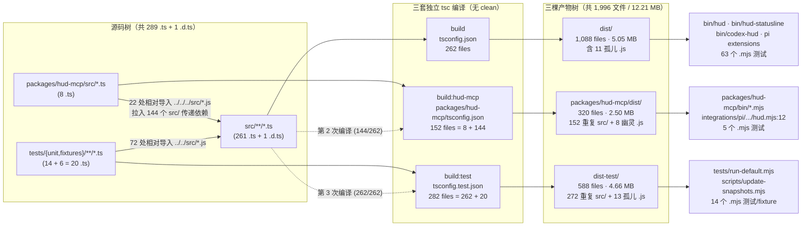
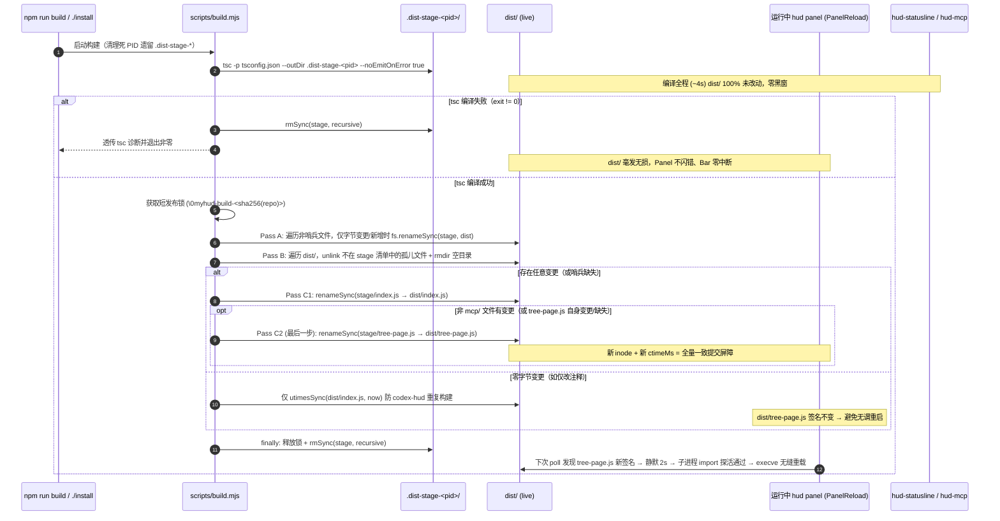
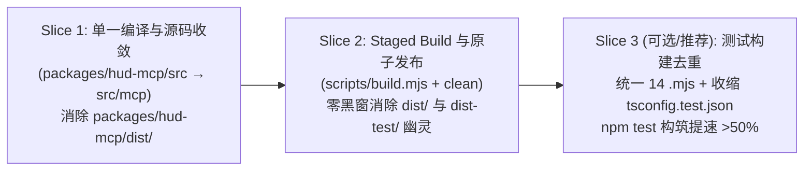

# 03. 修复 `dist/` 与 `packages/hud-mcp/dist/` 重复编译及幽灵残留产物问题

> **优先级**：P1（工程可靠性与构建提速） ｜ **类别**：构建系统 / 产物卫生 / 运行时一致性 ｜ **预估规模**：M（3 个垂直切片，净改动 ~350–450 行） ｜ **前置依赖**：无（纯 Node >=24 + 现有 `typescript@5.9.3`，零新依赖） ｜ **`docs/spec.md` 边界影响**：无产品边界变更（完全服务现行 §2.1 共享读取器/求值、§2.4 单命令安装、§3 不发布 npm、§4 轻量与零常驻服务；因涉及 `install`，按 `docs/delegation.md:41-42` 需单轮 reviewer 审查）

---

## 1. 背景与现状证据

### 1.1 现有三套构建的配置与依赖拓扑

仓库当前存在三套相互独立的 TypeScript 编译配置，且**均无清理步骤**，由根 `package.json`（L15–28）与 `install`（L74–75）串联调用：

| 构建脚本 | 入口命令与配置文件 | `rootDir` → `outDir` | `declaration` / `noEmitOnError` | 调用方 |
|---|---|---|---|---|
| `build` | `tsc`（`tsconfig.json:1-20`） | `./src` → `./dist` | `true` / 未设（默认 `false`） | `./install:75`、`npm test`、`bin/codex-hud:385`、`test:render`、`preview:png`、`snapshots:update` |
| `build:hud-mcp` | `tsc -p packages/hud-mcp/tsconfig.json`（`packages/hud-mcp/tsconfig.json:1-12`） | `../..` → `./dist`（即 `packages/hud-mcp/dist/`） | `false` / `true` | `./install:75`、`npm run build:test`（`package.json:19`） |
| `build:test` | `tsc -p tsconfig.test.json && npm run build:hud-mcp`（`tsconfig.test.json:1-12`） | `.` → `./dist-test` | `false` / `true` | `npm test`、`preview:png`、`snapshots:update` |



核心成因：
1. `packages/hud-mcp/tsconfig.json:4-5` 将 `rootDir` 设为 `"../.."`、仅 `include: ["src/**/*.ts"]`（8 个文件）。因为这 8 个文件通过 `../../../src/...` 直接导入了 `src/roles/`、`src/collectors/`、`src/cli/`、`src/jev/`、`src/render/`、`src/utils/` 与 `src/settings.ts` 共 22 个核心模块，TypeScript 沿依赖图将 **144 个 `src/` 文件**全部拉入编译程序并重新发射到 `packages/hud-mcp/dist/src/**`（连同自身 8 个文件落在深层嵌套路径 `packages/hud-mcp/dist/packages/hud-mcp/src/*.js`）。
2. `packages/hud-mcp` 并非独立 npm workspace（根 `package.json` 无 `workspaces` 字段，`packages/hud-mcp/package.json` 无独立依赖且 `"private": true`），仅是 M2 清理（`docs/spec.md:155`）前遗留的双 `tsconfig` 壳。
3. 三个 `tsconfig` 均直接覆写输出目录，没有任何删除已移除源文件对应产物的机制。

### 1.2 重复编译、磁盘体积与耗时量化数据

通过 `tsc -p <config> --listFilesOnly` 与当前产物树全量盘点，实测数据如下：

| 产物目录 | 当前文件总数 | 磁盘体积 | 有效 `.js` | 重复编译 `src/` `.js` | 幽灵/未发射 `.js`（含所有伴生文件） |
|---|---:|---:|---:|---:|---|
| `dist/` | 1,088（4 产物/源文件） | 5.05 MB | 261 | —（基准） | **11 个 `.js`**（44 文件，164.9 KiB） |
| `packages/hud-mcp/dist/` | 320（2 产物/源文件） | 2.50 MB | 152（8 自有 + 144 `src/`） | **152 个 `.js`**（含残留，占该目录 JS 体积 **87.9%** / 1.08 MB） | **8 个 `.js`**（6 源已删 + **2 已解耦未删**，共 16 文件） |
| `dist-test/` | 588（2 产物/源文件） | 4.66 MB | 281（261 `src/` + 20 `tests/`） | **272 个 `.js`**（含残留，占该目录 JS 体积 **90.8%** / 2.03 MB） | **13 个 `.js`**（11 `src/` + 2 `tests/fixtures/`，共 26 文件） |
| **合计** | **1,996** | **12.21 MB** | — | `npm test` 重复编 `src/` **3 遍（668 vs 262，2.55×）** | **32 个幽灵 `.js`**（86 个幽灵文件） |

实测类型检查耗时（宿主机：`linux 6.18.33.2-microsoft-standard-WSL2 x64`，AMD Ryzen 7 8745H 16 核，Node `v24.22.1`，TypeScript `5.9.3`，各连续 3 次 `--noEmit` 范围，不含磁盘 emit 耗时）：

| 命令（`--noEmit`） | 纳入编译的项目 TS 文件数 | 3 次实测（ms） | 区间（ms） | 冗余说明 |
|---|---:|---|---|---|
| `tsc -p tsconfig.json --noEmit` | 262 | 3917, 3891, 4310 | **3,891–4,310** | 根编译基准 |
| `tsc -p packages/hud-mcp/tsconfig.json --noEmit` | 152（8 自有 + 144 `src/`） | 2514, 2479, 2366 | **2,366–2,514** | 占 `./install` 编译检查总耗时 **~38%**，95% 文件为重复 `src/` |
| `tsc -p tsconfig.test.json --noEmit` | 282（262 `src/` + 20 `tests/`） | 3946, 4439, 4151 | **3,946–4,439** | 93% 文件为重复 `src/` |
| `./install` 串联（`build` + `build:hud-mcp`） | 414 | — | **~6,257–6,824** | 合并后可降至 ~4.0–4.4 s（**-36%**） |
| `npm test` 串联（三套全跑） | 696 | — | **~10,203–11,263** | 合并+测试去重后可降至 ~4.5–5.0 s（**-55%**） |

### 1.3 幽灵 `.js` 清单与真实隐患实证

当前工作树中实测检出的全部幽灵/过期 `.js`：
- **`dist/`（11 个，源 `.ts` 均已从 `src/` 删除）**：`cli/model-picker-zoom.js`、`render/inbox-home.js`、`roles/adapters.js`、`roles/job-receipt.js`、`roles/job-store.js`、`roles/model-curation.js`、`roles/roles.js`、`roles/routing.js`、`utils/click-map.js`、`utils/key-forward.js`、`utils/panel-command.js`。
- **`packages/hud-mcp/dist/`（共 8 个不再由当前 `tsc` 发射）**：
  - 6 个源已删的孤儿：`src/roles/{adapters,job-receipt,job-store,roles,routing}.js`、`src/utils/panel-command.js`；
  - **2 个源仍存在但 `hud-mcp` 已不再导入的僵尸拷贝**：`src/jev/runtime/types.js` 与 **`src/roles/pi-dispatch.js`**。
- **`dist-test/`（13 个）**：上述全部 11 个 `dist-test/src/` 孤儿 + 2 个已删 fixture（`dist-test/tests/fixtures/r5-jobs.js`、`work-card-p2.js`）。

这并非单纯的磁盘洁癖，而是已触发或持续潜伏的四类真实工程隐患：

1. **已实证的产物内容漂移（Split-Brain Drift）**：当前磁盘上 `packages/hud-mcp/dist/src/roles/pi-dispatch.js`（4,082 B，mtime `2026-11-18T06:26:19Z`）与 `dist/roles/pi-dispatch.js`（3,235 B，mtime `2026-11-21T18:15:05Z`）已存在 **3 天时间差与 847 字节内容分叉**。更危险的是：`npm run dev`（`package.json:16`，仅 `tsc --watch`）与 `bin/codex-hud:385`（`build_hud()` 仅执行 `npm run build`）都**只更新根 `dist/` 而绝不重建 `packages/hud-mcp/dist/`**。一旦修改 `src/roles/roster.ts`、`src/collectors/thin-jobs.ts`、`src/roles/lease.ts` 或 `src/roles/job-checks.ts`，面板和 CLI 会跑新代码，而 `hud-mcp`、`hud-watch.mjs`、`hud-cli.mjs`、`hud-jev.mjs`、`hud-check.mjs`、`worker-tools.mjs` 会静默执行旧拷贝——直接违背 `docs/spec.md:12-13`“panel、`hud_roster`、`hud_create` 共享同一套求值与读取器”的架构承诺。
2. **单进程双 ESM 模块实例分裂**：`tests/unit/cli-judge.test.mjs:9-10`、`tests/unit/hud-watch.test.mjs:9-11`、`tests/unit/thin-mcp.test.mjs:12-26` 同时从 `../../dist/...` 和 `../../packages/hud-mcp/dist/packages/hud-mcp/src/cli-judge.js` 导入，后者内部再加载 `packages/hud-mcp/dist/src/roles/worker-tree.js`。Node ESM 以解析后 URL 为缓存键，导致同一模块被实例化两份，任何类 `instanceof`（如 `HarnessSwitchError`）或模块级缓存/配置（`setLanguage`、`setDisplayConfig`）都会静默失效。
3. **`import.meta.url` 路径深度失配陷阱**：`src/roles/roster.ts:354,499,927` 与 `src/roles/role-control.ts:33` 写死 `new URL('../../packages/hud-mcp/', import.meta.url)`；`src/collectors/backup-skills.ts:5` 写死 `../../integrations/skills/backup-skills.json`；`src/cli/statusline.ts:62` 写死 `../../bin/hud-statusline`。这些默认路径**仅在根 `dist/`（深度 2）下正确**；在 `packages/hud-mcp/dist/src/roles/`（深度 5）下会解析到不存在的 `packages/hud-mcp/dist/packages/hud-mcp/`，在 `dist-test/src/roles/`（深度 3）下解析到不存在的 `dist-test/packages/hud-mcp/`，迫使 `thin-main.ts`、`hud-watch.mjs`、`hud-cli.mjs`、`hud-jev.mjs` 四处手动透传 `bundled`，漏传即静默降级为空对象 `{}`。
4. **幽灵 `.js` 掩盖死引用（本地假绿、CI/release 崩溃）**：`tests/run-default.mjs:2` 注释已明证仓库曾被 `dist-test/` 残留测试踩坑（`Resolve current sources rather than globbing stale tsc outputs after a test moves`）。同理，`.mjs` 脚本或测试如果误引用已删除的 `dist/roles/routing.js` 或 `packages/hud-mcp/dist/src/roles/pi-dispatch.js`，在开发者本地脏目录里会静默通过，却在干净 CI 或 `npm run test:release` 离线归档测试中直接 `ERR_MODULE_NOT_FOUND`。

---

## 2. 目标与非目标（Scope / Out of Scope）

### 目标（Scope）
1. **消除重复编译**：将 `src/` 与 `hud-mcp` 源码收敛为单次 `tsc` 编译、单一权威产物树 `dist/`，彻底移除 `packages/hud-mcp/dist/`。
2. **杜绝幽灵 `.js` 且不中断运行中进程**：引入零依赖 staged 编译 + 逐文件原子发布 + 自动孤儿修剪脚本（`scripts/build.mjs`），保证构建期间和编译失败时 `dist/` 零黑窗，并与 `PanelReload`（`src/utils/panel-reload.ts`）和 `bin/codex-hud:379` 精确协作。
3. **治理 `dist-test/` 残留与测试导入分裂**：清理 `dist-test/` 孤儿，统一 `.mjs` 测试从单一 `dist/` 导入，并提供消除 `build:test` 第 3 次编译 `src/` 的清晰路径。
4. **全链路路径与离线归档兼容**：保持 `install`、`install.d/*.sh`、`bin/*`、`packages/hud-mcp/bin/*`、已安装的 Pi 扩展（`integrations/pi/package/*`）、`pi-roles` 启动参数与 `scripts/release.sh` + `tests/release-archive.test.mjs` 离线构建完全兼容。

### 非目标（Out of Scope）
- **不引入任何新依赖**（不加 esbuild / tsup / tsx / rimraf / chokidar 以外的新包，仅用 Node >=24 内置模块与现有 `typescript@5.9.3`）。
- **不启用 npm workspaces、不改变 git-tracked `node_modules/`（275 文件）离线分发策略、不发布 npm**（遵守 `docs/spec.md:136`）。
- **不移动 `packages/hud-mcp/` 下的非 TS 资产与入口脚本**：`packages/hud-mcp/{bin,roles,instructions,harnesses.json,catalog.json,hud-convention.md,package.json,README.md}` 全部保持原位，避免破坏 `~/.local/bin/hud-mcp` 软链、`PiRoleClient`、`pi-roles` 参数与 `tests/release-archive.test.mjs`。
- **不改写 `docs/spec.md` 产品功能或 `PanelReload` 重载交互契约**（保留 2 秒静默窗口、子进程 `import()` 探活、脏草稿延迟重启和 `execve` 交接语义）。

---

## 3. 核心设计方案

### 3.1 重构架构方案对比与推荐

针对“如何消灭 `packages/hud-mcp/dist/` 中的 152 个重复 `src/` 产物”，对候选方案进行严格对照（尤其检验 Node ESM 运行时路径与 TypeScript 5.9.3 编译器硬约束）：

| 评估维度 | **方案 A1（朴素单 `tsconfig`，`rootDir: "."`）** | **方案 A2（推荐：单 `tsconfig` + 将 8 个 MCP `.ts` 迁至 `src/mcp/`）** | **方案 B（TS Project References `composite: true` + `tsc -b`）** | **方案 C（两包独立，无 `composite`，`hud-mcp` 直接导入 `../../../dist/`）** |
|---|---|---|---|---|
| 零新依赖 & 离线 `git archive` | 满足 | **完全满足**（无 workspace symlink 污染 tracked `node_modules/`） | 需搭配 `../../../dist/` 导入（否则需 `node_modules` 自链接破坏 tracked `node_modules`） | 满足，但仍需两次 `tsc` 且强依赖先后顺序 |
| `dist/` 现有入口与已安装 Pi 扩展兼容 | **全面破坏**：`dist/index.js`、`dist/tree-page.js`、`dist/harness/pi/package-entry.js` 全部偏移至 `dist/src/...`，击穿 `bin/*`、63 个测试、6 处 `import.meta.url` 与 `$HUD_HOME/pi-package` | **近 100% 兼容**：全部 261 个 `src/` 产物路径零变化；仅 6 个 `packages/hud-mcp/bin/*.mjs` 与 `hud.mjs:12` 改相对路径 | `dist/` 根路径不变；`packages/hud-mcp/dist/` 路径变扁（`dist/thin-main.js`），同样要改那 6 个 bin + `hud.mjs:12` | 同 B：同样要改那 6 个 bin + `hud.mjs:12` |
| Staged `--outDir` 与 `PanelReload` 安全性 | 破坏 `PanelReload.entry`（旧面板指向 `dist/tree-page.js` 变 `missing`） | **最佳**：仅一棵 `dist/` 树，`tsc --outDir .dist-stage-<pid>` 原生支持，尾置替换 `dist/tree-page.js` | **硬伤**：实测 TS 5.9.3 `tsc -b --outDir` 直接报 **`error TS5094`** 拒绝执行；增量构建会跳过未改动的 `tree-page.js`，静默破坏 `PanelReload`；且 `tsc -b` 不会自动删孤儿 | 可分两棵树做 staged 构建，但需协调两个目录发布与锁，复杂度翻倍 |
| 编译次数与 `./install` 耗时 | 1 次（~4.1 s） | **1 次（~4.1 s，省 ~2.4 s / -38%）** | 1 条 `tsc -b` 命令但内含 2 个 Project，需持续生成 `.tsbuildinfo` 与 544 个 `.d.ts` | 2 次串行 `tsc`（总耗时约 ~4.6–5.0 s） |
| IDE 重构 / 新克隆体验 / `npm run dev` | 统一 | **最佳**：跨 `src/` 与 `src/mcp/` 直接源码跳转与重命名；`npm run dev`（`tsc --watch`）与 `bin/codex-hud` 自动同步编 MCP；`npm run format:check` 一并覆盖 | **较差**：全新克隆未构建前导入 `../../../dist/*.js` 导致编辑器标红；跨包重构受 `.d.ts` 隔断；`tsc --watch` 需改 `-b -w` | **最差**：未先跑 `build` 时 `build:hud-mcp` 与编辑器均报错；单跑 `build:hud-mcp` 会默默链接过期 `dist/*.d.ts`；`npm run dev` 漏编 MCP |
| `declaration: true` 约束 | 可选 | **可自由选择**（见 §6 Open Question #1） | 强制 `true`（`composite` 硬要求） | 强制 `true`（供 `hud-mcp` 类型检查） |
| 唯一成本 | 不可接受 | `git mv` 8 个 `.ts` 文件（`packages/hud-mcp/src/*.ts` → `src/mcp/*.ts`） | 高配置复杂度 + 违背 staged 构建 | 保留双树同步心智负担 |

> **明确推荐：方案 A2（单一 root `tsconfig.json`，将 `packages/hud-mcp/src/` 的 8 个 `.ts` 文件迁入 `src/mcp/`，统一输出至根 `dist/`）**。
>
> 理由直白且符合 `docs/spec.md:143`（“Everything else takes the simplest implementation that works”）：`packages/hud-mcp/src/` 只有 8 个文件，且它本就深度依赖 `src/` 中超过 55% 的文件（144/262），不存在事实上的包隔离边界。把这 8 个 `.ts` 移进 `src/mcp/` 同时保留 `packages/hud-mcp/` 的 `bin/` 与静态配置资产，可以一次性获得：**零新依赖、单次 `tsc`、单一 `dist/`、零 `import.meta.url` 深度错位、原生兼容 staged `--outDir` 与 `PanelReload`、`npm run dev` / `bin/codex-hud` / `prettier` 自动覆盖**，且不需要碰任何已存在的 `src/` 产物路径。

#### 方案 A2 精确路径映射

1. **源码迁移（8 个文件，全部 `git mv`）**：
   - `packages/hud-mcp/src/{cli-judge,codex-statusline,launch-thinking,local-tickets,managed-worktree,pi-read-settlement,quiet-decision,thin-main}.ts` → `src/mcp/*.ts`
   - 8 个文件内部所有 `from '../../../src/<x>.js'` 统一缩短为 `from '../<x>.js'`。
   - `src/mcp/thin-main.ts` 的资产定位大幅简化（消除全部 6 处脆弱的 4 级向上 `../../../../`）：
     ```ts
     // 位于 dist/mcp/thin-main.js（深度 2，与 dist/roles/roster.js 完全一致）
     const bundled = fileURLToPath(new URL('../../packages/hud-mcp/', import.meta.url));
     const binScript = (name: string) => join(bundled, 'bin', name);
     const { ensureQueueWatcher, paneInfo, watching } = await import(pathToFileURL(binScript('hud-notify.mjs')).href);
     const worker = isWorker ? await import(pathToFileURL(binScript('worker-tools.mjs')).href) : undefined;
     // 原 L257 / L390 / L538 / L609 统一改为 binScript('hud-watch.mjs' | 'hud-notify.mjs' | 'hud-jev.mjs' | 'hud-cli.mjs')
     // 原 L405 join(bundled, '../../integrations/pi/package/extensions/hud.mjs') 与 L1626 method.md 保持完全不变！
     ```
2. **运行时入口脚本更新（仅 6 个 `packages/hud-mcp/bin/*.mjs` + 1 处 Pi 扩展）**：
   - `packages/hud-mcp/bin/surface.mjs:7`：`../dist/packages/hud-mcp/src/thin-main.js` → `../../../dist/mcp/thin-main.js`
   - `packages/hud-mcp/bin/hud-watch.mjs:10-15`：`../dist/src/<x>` → `../../../dist/<x>`；`../dist/packages/hud-mcp/src/<y>` → `../../../dist/mcp/<y>`
   - `packages/hud-mcp/bin/hud-cli.mjs:9-13`：同上
   - `packages/hud-mcp/bin/hud-jev.mjs:7`：`../dist/src/roles/roster.js` → `../../../dist/roles/roster.js`
   - `packages/hud-mcp/bin/hud-check.mjs:8-9`：`../dist/src/roles/{job-checks,worker-tree}.js` → `../../../dist/roles/{job-checks,worker-tree}.js`
   - `packages/hud-mcp/bin/worker-tools.mjs:9,13,14,59`：`../dist/src/roles/{lease,worker-tree}.js` → `../../../dist/roles/{lease,worker-tree}.js`；`../dist/packages/hud-mcp/src/{thin-main,cli-judge}.js` → `../../../dist/mcp/{thin-main,cli-judge}.js`
   - `integrations/pi/package/extensions/hud.mjs:12`：`new URL('../dist/packages/hud-mcp/src/launch-thinking.js', url)` → `new URL('../../../dist/mcp/launch-thinking.js', url)`（注意：`url` 指向 `packages/hud-mcp/bin/worker-tools.mjs`，向上三级即 `<repo>/dist/mcp/launch-thinking.js`）。
3. **完全不变的外部契约与 `pi-roles` / `install` 路径**：
   - `~/.local/bin/hud` → `<repo>/bin/hud`（不变）
   - `~/.local/bin/hud-mcp` → `<repo>/packages/hud-mcp/bin/hud-mcp.mjs`（不变）
   - `~/.local/bin/hud-statusline` → `<repo>/bin/hud-statusline`（不变）
   - `integrations/pi/package/binding.mjs:15` 校验的三入口 `['dist/harness/pi/package-entry.js', 'bin/hud', 'packages/hud-mcp/bin/hud-mcp.mjs']`（不变）
   - `src/harness/pi/role-client.ts:22`、`src/harness/pi/package-entry.ts:140`、`src/cli/watch.ts:214`、`src/cli/setup.ts:253`、`src/roles/roster.ts:354,499,927`、`src/roles/role-control.ts:33`（全部不变）
   - `dispatchPi` 传给外部 `pi-role` 的 `--notify`、`--hud-instructions`、`--hud-sonic-jobs`、`-e .../integrations/pi/package/extensions/hud.mjs`（解析出的绝对路径逐字节不变）。

---

### 3.2 零黑窗、面板自重载安全的 Staged Build 与原子发布设计（`scripts/build.mjs`）

#### 为什么不能用 `rm -rf dist && tsc`，也不能用符号链接切换？

先看 `src/utils/panel-reload.ts` 与 `src/tree-page.ts` 的真实行为：
- `PanelReload`（`src/utils/panel-reload.ts:46-66`）在每次采集 tick 仅 `statSync(this.entry)` 检查 `dist/tree-page.js` 的签名 `${s.ino}:${s.size}:${s.mtimeMs}:${s.ctimeMs}`（不存在时返回 `'missing'`）。一旦签名变化且持续静默 `>= 2000ms`（`now - this.changedAt >= 2000`），且无脏 Settings/Control/EXP 草稿，就会拉起子进程执行 `await import(pathToFileURL(this.entry).href)`（5 秒超时），失败则置 `this.failed = true`，`src/tree-page.ts:755` 随即在面板底行渲染 `"new build failed to load"`。
- `src/tree-page.ts:1536` 的主入口守卫写成：
  ```ts
  if (process.argv[1] && import.meta.url === pathToFileURL(path.resolve(process.argv[1])).href)
  ```
- `bin/codex-hud:377-381` 判断是否需要自动构建的依据是 `find "$HUD_DIR/src" -name '*.ts' -newer "$HUD_DIR/dist/index.js"`。

据此对比三种清理发布策略：

| 策略 | 行为与缺陷分析 | 结论 |
|---|---|---|
| **策略 1：朴素 `rm -rf dist && tsc`** | `tsc` 耗时 ~4–5 秒期间 `dist/` 完全缺失：**①** `hud-statusline`（Claude 5 秒刷新）与新启动的 `hud` / `hud-mcp` / `hud-watch` 直接撞 `ERR_MODULE_NOT_FOUND`；**②** 4 秒 > `PanelReload` 的 2 秒静默阈值，导致每次正常 `npm run build` 期间运行中的面板先误探活 `'missing'` 并闪烁 `"new build failed to load"`；**③** 编译有错时线上 `dist/` 已被删空不可用。 | **拒绝** |
| **策略 2：符号链接原子切换（`dist -> .dist-gen-N`）** | POSIX `rename` 切换 symlink 虽单 syscall 原子，但 **Node ESM 对 `import.meta.url` 做 realpath 解析**：**①** 击穿 `src/tree-page.ts:1536`（`process.argv[1]` 未经 realpath，与 `import.meta.url` 不相等，`node dist/tree-page.js` 静默退出不启动！）；**②** `PanelReload.entry` 构造时绑死在旧世代 `.dist-gen-1/tree-page.js` 上，下次切换 symlink 后旧文件永不变或变 `missing`，面板自重载彻底失效！ | **拒绝** |
| **策略 3（推荐）：同文件系统 Staged Compile + 逐文件原子 `renameSync` + 孤儿修剪 + 哨兵尾置提交** | `dist/` 始终是真实目录。编译先落入同目录旁边的 `.dist-stage-<pid>`（`noEmitOnError: true`），成功后再持短锁同步变动文件、删除孤儿、最后原子 `renameSync` 替换哨兵 `dist/index.js` 和 `dist/tree-page.js`。 | **采纳** |

#### `scripts/build.mjs` 核心状态机与发布时序



#### 关键接口契约、并发安全与边界条件（对照 `docs/ARCHITECTURE.md` §8）

1. **命令行接口（`scripts/build.mjs`）**：
   - `node scripts/build.mjs`（默认 `--target main`）：执行上述 staged compile + atomic sync + prune 到 `dist/`。
   - `node scripts/build.mjs --target test`：编译 `tsconfig.test.json` 到 `dist-test/`。因 `dist-test/` 无任何常驻/后台进程读取，但为防止并行测试踩踏且统一实现，同样采用 staged compile（`.dist-test-stage-<pid>`）+ 同步与孤儿修剪（或持独立锁 `\0myhud-build-test-<sha256(repo)>` 同步）。
   - `node scripts/build.mjs --clean`（对应 `npm run clean`）：显式人工清理 `dist/`、`dist-test/`、`packages/hud-mcp/dist/`、`.dist-stage-*`、`.dist-test-stage-*`（**绝不在 `build` 前自动调用**）。
   - 透传额外参数或诊断：子进程 `tsc` 继承 `stdio: 'inherit'`，保留原汁原味的 TypeScript 彩色诊断输出与退出码。
2. **并发构建锁（零新依赖，复用仓库既有模式）**：
   - 使用 `node:net` 监听 Linux abstract namespace socket `\0myhud-build-<sha256(realpathSync(repo))>`（与 `packages/hud-mcp/bin/hud-check.mjs:46-48` 及 `src/collectors/exp-proxy.ts`、`docs/ARCHITECTURE.md:402` 完全同源）。
   - 若遇到 `EADDRINUSE`，每 50ms 退避重试，最长等待 15s（发布阶段本身仅 ~10–40ms）；进程异常崩溃时内核自动释放 abstract socket，不存在陈旧锁文件死锁问题！
3. **同文件系统原子性保障**：
   - `.dist-stage-<pid>` 直接创建在 `<repo>` 根下（与 `dist/` 同挂载点），确保 `fs.renameSync(stageFile, distFile)` 永远在同一文件系统内单 syscall 完成，绝不触发 `EXDEV` 跨设备错误，也不会让并发读者看到写了一半的 `.js` 文件。
   - `.gitignore` 追加 `.dist-stage-*/` 与 `.dist-test-stage-*/`，确保即便 `SIGKILL` 中断构建也不污染 `git status`（不阻断 `scripts/release.sh:4`）。下次构建启动时，扫描根下 `.dist-stage-<pid>`：若 `<pid>` 已退出（`process.kill(pid, 0)` 抛 `ESRCH`）则自动 `rmSync` 清理。
4. **内容比对与哨兵语义细节**：
   - Pass A 中比较 `distFile` 与 `stageFile`：先比 `stat.size`，长度相同再 `Buffer.compare(readFileSync(a), readFileSync(b)) === 0`。相同则跳过 `renameSync`（跳过写入约 250+ 未改动文件，减少 WSL2 I/O 并保持热页缓存）。
   - Pass C 哨兵策略：
     - 只要有任意改动（`changed.length > 0 || removed.length > 0`），**必须**用 `renameSync` 替换 `dist/index.js`（满足 `bin/codex-hud:379` `find -newer`）；
     - 只要存在任意**非 `mcp/` 路径**的新增/修改/删除（`changed.concat(removed).some(p => !p.startsWith('mcp/'))`）或 `dist/tree-page.js` 缺失，**必须最后**用 `renameSync` 替换 `dist/tree-page.js`——即使本次只改了 `src/render/home-view.ts` 而 `tree-page.js` 自身字节未变，新 `renameSync` 也会产生新 `ino` 与 `ctimeMs`，精确唤醒 `PanelReload`！
     - 若仅改动了 `src/mcp/*.ts`（面板不加载 `dist/mcp/*`），不触碰 `dist/tree-page.js`，运行中的面板不会无谓重启。
   - **关于微秒级并发窗口的诚实界定**（对齐 `docs/ARCHITECTURE.md` §8 诚实边界原则）：单目录多文件逐一 `renameSync` 并非跨文件内核事务；在极罕见的 ~10ms Pass A 窗口内，如果新拉起的 `hud-statusline` 恰好跨越两个同时发生破坏性导出改名的关联文件，可能遇到一次性 `SyntaxError`/`ERR_MODULE_NOT_FOUND`（5 秒后下次刷新即恢复）。但相比旧方案 4,000ms 全目录消失窗口与半编译状态，暴露面缩短 >200× 且对运行中面板完全安全（`PanelReload` 仅在 Pass C 完成后才看到签名变化并有 2 秒静默 + 子进程探活兜底）。
5. **与 `npm run dev`（`tsc --watch`）的关系**：
   - `npm run dev` 保持 `node ./node_modules/typescript/bin/tsc --watch`（现在自动同时监视 `src/` 与 `src/mcp/`）。文档注明：`tsc --watch` 删除文件时不会清理孤儿，日常提交/安装/测试统一走 `npm run build`（即 `scripts/build.mjs`）自动收口。

---

### 3.3 `build:test` 与 `dist-test/` 清理方案

实测盘点 `tests/` 下全部导入后发现：
- **63 个** `.mjs` 测试/fixture 导入 `../../dist/...`；
- **14 个** `.mjs` 测试/fixture（97 行）中，**96 行**仅导入 `../../dist-test/src/...`（与 `dist/` 逐字节相同），**1 行**为 `tests/unit/panel-reload.test.mjs:187`（`cpSync(resolve('dist-test/src'), join(f.root, 'dist'))`），**0 行**导入 `dist-test/tests/`；
- **20 个** `.ts` 测试/fixture（14 个 `tests/unit/*.test.ts` + 6 个 `tests/fixtures/*.ts`）共 72 处 `from '../../src/...'`，全部不含非可擦除 TS 语法（`enum`/`namespace`/参数属性数为 0）。

因此 `build:test` 治理分两步推进：
1. **必做（Slice 2）**：
   - `package.json:19` 的 `build:test` 移除末尾冗余的 `&& npm run build:hud-mcp`；改由 `node scripts/build.mjs --target test` 驱动，自动清理 `dist-test/` 中全部 13 个孤儿 `.js`（含 `r5-jobs.js`、`work-card-p2.js`）。
2. **推荐跟进（Slice 3，依赖 Owner 拍板 Open Question #1）**：
   - 将那 14 个 `.mjs` 测试/fixture 统一改为从 `../../dist/` 导入（消除历史双口径）；
   - 若 Owner 选择保留 `tsconfig.json` 的 `"declaration": true`（推荐），则将 20 个 `tests/**/*.ts` 的 `../../src/*.js` 改为 `../../dist/*.js`，并将 `tsconfig.test.json` 的 `include` 收缩为 `["tests/unit/**/*", "tests/fixtures/**/*"]`（去掉 `"src/**/*"`）。届时：
     - `build:test` 仅编译 **20 个文件**（而非 282 个），`dist-test/` 从 588 文件 / 4.66 MB 骤降至 **~40 文件 / ~0.4 MB**；
     - `npm test` 总构建类型检查耗时从 **10.2–11.3 s** 降至 **~4.5–5.0 s**（省一半以上），`src/` 在整个仓库生命周期中**严格只编译 1 次**！

---

## 4. 垂直切片与实施路线（对齐 `docs/delegation.md`）

按 `docs/delegation.md`“每片端到端可独立验证、适合单个 implementer 会话完成”的原则，拆为 **3 个垂直切片**：



### Slice 1：合并 `packages/hud-mcp/src/` 至 `src/mcp/`，彻底消除重复编译
- **依赖**：无（首个落地）。
- **估行**：约 +120 / -140 行修改（不含 8 个文件的 `git mv` 移动本身；可删除 `packages/hud-mcp/tsconfig.json` 12 行与 `packages/hud-mcp/dist/` 全部 320 个产物文件）。
- **改动文件清单**：
  1. `git mv packages/hud-mcp/src/*.ts src/mcp/`（8 个文件）：
     - `src/mcp/{cli-judge,codex-statusline,launch-thinking,local-tickets,managed-worktree,pi-read-settlement,quiet-decision,thin-main}.ts`：更新相对导入 `../../../src/` → `../`；`src/mcp/thin-main.ts` 的 `bundled` 与 6 处 `bin/*.mjs` 路径统一改为基于 `new URL('../../packages/hud-mcp/', import.meta.url)`。
     - 对新迁入的 `src/mcp/*.ts` 执行 `npm run format`，确保 `npm run format:check` 绿灯。
  2. `packages/hud-mcp/bin/`（6 个文件）：
     - `surface.mjs`（L7）
     - `hud-watch.mjs`（L10–15）
     - `hud-cli.mjs`（L9–13）
     - `hud-jev.mjs`（L7）
     - `hud-check.mjs`（L8–9）
     - `worker-tools.mjs`（L9, L13–14, L59）
  3. `integrations/pi/package/extensions/hud.mjs`（L12：`new URL('../../../dist/mcp/launch-thinking.js', url)`）。
  4. `package.json`：
     - L19：`build:test` 改为 `node ./node_modules/typescript/bin/tsc -p tsconfig.test.json`（去掉 `&& npm run build:hud-mcp`）；
     - L28：`build:hud-mcp` 改为兼容别名 `"npm run build"`（或按 Open Question #2 移除）。
  5. `packages/hud-mcp/package.json`（L13：`scripts.build` 改为 `"node ../../node_modules/typescript/bin/tsc -p ../../tsconfig.json"`，Slice 2 再切至 `scripts/build.mjs`；保留 `"engines": { "node": ">=24.0.0" }`）。
  6. `install`（L74–75：`printf 'Building HUD\n'` + `npm run build || exit $?`）。**注意**：触及 `install`，按 `docs/delegation.md:41-42` 本片合入前安排 1 次 `reviewer` 审查。
  7. 测试文件（5 处功能改动 + 1 处注释）：
     - `tests/release-archive.test.mjs`（L139 `packages/hud-mcp/src/thin-main.ts` → `src/mcp/thin-main.ts`；L187 `packages/hud-mcp/dist/packages/hud-mcp/src/thin-main.js` → `dist/mcp/thin-main.js`；保留 L13/L149 对 `packages/hud-mcp/dist` 不入归档的断言）
     - `tests/unit/cli-judge.test.mjs`（L10 → `../../dist/mcp/cli-judge.js`）
     - `tests/unit/hud-watch.test.mjs`（L11 → `../../dist/mcp/cli-judge.js`）
     - `tests/unit/thin-mcp.test.mjs`（L25 → `../../dist/mcp/cli-judge.js`）
     - `tests/unit/pi-package.test.mjs`（L36：移除 `'packages/hud-mcp/dist'`，改为将根 `dist/mcp` 或 `dist` 链接进测试用 `release` 目录，使 `hud.mjs:12` 的 `../../../dist/mcp/launch-thinking.js` 在隔离沙箱中真实解析！）
     - `tests/unit/panel-try.test.mjs`（L284 注释更新为 `dist/mcp` / `npm run build`）。
  8. 文档同步：`README.md:179`、`README.zh.md:149`、`docs/ARCHITECTURE.md:35,63,453`、`packages/hud-mcp/README.md:34`。
  9. **可删除旧代码/配置**：`packages/hud-mcp/tsconfig.json`（及空目录 `packages/hud-mcp/src/`）。
- **独立验证**：`npm test && npm run test:release && npm run format:check && npm run check:fixtures`。

### Slice 2：引入 `scripts/build.mjs`（Staged Build + 原子发布 + 幽灵清理）与 `clean`
- **依赖**：Slice 1。
- **估行**：新增 ~170 行（`scripts/build.mjs`）+ 新增 ~140 行测试（`tests/unit/build-publish.test.mjs`）+ ~15 行配置/测试微调。
- **改动文件清单**：
  1. 新增 `scripts/build.mjs`：实现 `--target main|test` staged 编译、abstract socket 并发锁、按字节 diff 的非哨兵 `renameSync`、孤儿文件与空目录修剪、哨兵（`index.js` → `tree-page.js`）尾置提交、死 PID 残留 staging 目录回收，以及 `--clean`。
  2. `package.json`：
     - `build`: `"node scripts/build.mjs"`
     - `build:test`: `"node scripts/build.mjs --target test"`
     - `clean`: `"node scripts/build.mjs --clean"`
     - `packages/hud-mcp/package.json`: `scripts.build` 更新为 `"node ../../scripts/build.mjs"`。
  3. `.gitignore`：追加 `.dist-stage-*/` 与 `.dist-test-stage-*/`。
  4. `tests/release-archive.test.mjs`：L139–144 `required` 数组增加 `'scripts/build.mjs'`，确保离线归档可正常运行 `./install`；L12–13 `excluded` 增加 `.dist-stage-*`。
  5. 新增 `tests/unit/build-publish.test.mjs`：覆盖孤儿清理、编译错误保活、零黑窗、哨兵触发规则、并发锁与崩溃 staging 回收。
- **独立验证**：`node --test tests/unit/build-publish.test.mjs tests/unit/panel-reload.test.mjs && npm test && npm run test:release`。

### Slice 3（推荐）：消除 `build:test` 对 `src/` 的重复编译并统一测试导入口径
- **依赖**：Slice 2 + Owner 确认 Open Question #1。
- **估行**：约 ~120 行纯机械导入路径替换（14 个 `.mjs` + 20 个 `.ts`）+ `tsconfig.test.json` 3 行修改。
- **改动文件清单**：
  1. 14 个 `.mjs` 测试与 fixture 文件（`tests/fixtures/{card-details,card-fold,native-tree}.mjs`、`tests/unit/{call-breakdown,card-details,card-fold,claude-nested-replay,decision-labels,herdr-binding,home-recommendation,native-tree,panel-backoff,panel-reload,panel-scope}.test.mjs`）：将全部 96 处 `../../dist-test/src/` 统一改为 `../../dist/`，`panel-reload.test.mjs:187` 改为 `cpSync(resolve('dist'), ...)`。
  2. （若 Owner 确认保留 `declaration: true`）20 个 `tests/{unit,fixtures}/**/*.ts` 文件：72 处 `../../src/` → `../../dist/`；`tsconfig.test.json:10` 改为 `"include": ["tests/unit/**/*", "tests/fixtures/**/*"]`；`scripts/update-snapshots.mjs:4` 注释微调。
- **独立验证**：`npm test && npm run check:fixtures`，确认 `dist-test/` 仅含 ~40 文件且不再含 `dist-test/src/`。

### 迁移、兼容与回滚策略

1. **老运行中进程（面板、Pi 扩展、旧 Worker）平滑过渡**：
   - **运行中 `hud panel`**：Slice 1 保持 `dist/tree-page.js` 路径不变，新构建后 `PanelReload` 自动 2 秒静默 + 探活 + `execve` 无缝重载到新版本，无需手动重启面板。
   - **已安装的 `$HUD_HOME/pi-package/extensions/hud.mjs`**：`install.d/pi.sh:54` 安装时采用文件拷贝（非软链）。旧拷贝的第 12 行仍含 `../dist/packages/hud-mcp/src/launch-thinking.js`（仅当在无 `--hud-worker-tools` 的 fallback worker 模式下才会执行；常规主会话与由 `thin-main.ts:405` 显式 `-e` 启动的 Pi worker 均不受影响）。升级后只需按常例跑一次 `./install --with pi` 即可刷新 `$HUD_HOME/pi-package/extensions/hud.mjs`。
   - **旧世代存活中的 `worker-tools.mjs` 进程**：若迁移瞬间恰有旧 Pi/CLI worker 运行中，其内存中的旧版 `worker-tools.mjs` 在调用 `hud_report`/`hud_sonic` 时会惰性 `import('../dist/packages/hud-mcp/src/...')`。因此 **Slice 1/2 的日常 `npm run build` 不会静默删除旧 `packages/hud-mcp/dist/`**，仅在检测到其存在时打印一行提示；建议在无活跃 worker 时执行 `npm run clean && ./install` 一次性清除历史遗留目录。
2. **老配置与数据零影响**：不触碰 `$HUD_HOME`、`~/.claude`、`~/.codex`、`~/.pi` 下任何配置文件、作业记录或缓存。
3. **回滚方案**：三片严格解耦且无磁盘 schema 迁移；任意切片均可通过单次 `git revert` + `npm run clean && ./install` 秒级完整回退至旧构建拓扑。

---

## 5. 验证与验收方案

### 5.1 自动化单测与集成测试设计（全部使用临时目录与合成数据）

新增 `tests/unit/build-publish.test.mjs`（仅使用 `fs.mkdtempSync(join(tmpdir(), 'hud-build-'))` 构造最小合成工程，不触碰真实工作区 `dist/` 与任何用户目录）：

| # | 测试场景 | 构造方式 | 核心断言 |
|---|---|---|---|
| 1 | **孤儿 `.js/.map/.d.ts` 与空目录自动清理** | 在临时 `dist/` 预埋 `roles/orphan.js`、`roles/orphan.js.map`、`obsolete/dead.js` | 运行 `scripts/build.mjs` 后全部孤儿及空目录 `obsolete/` 被删除，现存合法产物完整保留 |
| 2 | **编译错误零破坏（`noEmitOnError` 保护）** | 已有有效 `dist/tree-page.js`（记录内容与 `ino`），向合成 `src/a.ts` 注入语法/类型错误 | `build.mjs` 退出码非零、透传 TS 错误；原 `dist/tree-page.js` 内容与 `ino` 100% 不变；`.dist-stage-*` 已清理干净 |
| 3 | **零黑窗并发读取** | 后台每 5ms 轮询 `statSync('dist/tree-page.js')` 并 `readFileSync`，同时执行完整构建 | 整个构建周期内 0 次 `ENOENT`、0 次读到空文件或截断文件 |
| 4 | **哨兵提交顺序与 `PanelReload` 联动** | ① 仅修改 `src/render/sub.ts`（`tree-page.ts` 未改）→ `dist/tree-page.js` 必须获得新 `ino`/`ctimeMs` 且仅在 `sub.js` 已更新后提交；② 仅追加注释（emit 字节一致）→ `dist/tree-page.js` 签名不变，`dist/index.js` `mtime` 刷新；③ 仅修改 `src/mcp/thin-main.ts` → `dist/tree-page.js` 签名不变 | 精确匹配 `PanelReload` 与 `bin/codex-hud:379` 双重契约 |
| 5 | **并发双构建互斥与崩溃 staging 回收** | 预置 `.dist-stage-999999`（已退出 PID），同时并发拉起两个 `scripts/build.mjs` | 两者均成功退出（exit 0），无 `ENOENT`/`EEXIST` 竞态，死 staging 目录被自动回收 |
| 6 | **离线发布包与 MCP/Pi 全链路回归** | 复用既有 `tests/release-archive.test.mjs`（`npm_config_offline=true` + 空 npm cache）与 `tests/unit/pi-package.test.mjs` | 归档包含 `src/mcp/thin-main.ts` 与 `scripts/build.mjs`、不含任何 `dist/`；`./install` 仅跑一次 `build` 即产出 `dist/cli/hud.js` 与 `dist/mcp/thin-main.js`；`hud-mcp` stdio `initialize`/`tools/list`/`hud_roster` 与卸载全绿 |
| 7 | **实时面板重载回归** | 运行 `tests/unit/panel-reload.test.mjs` 全部用例 | 2 秒静默聚合、脏草稿延迟、坏构建保活、重启状态/宽度恢复全绿 |

全量回归命令（隔离环境 `tmp/env.sh` 或临时 `HOME`/`HUD_HOME`）：
```sh
npm test
npm run test:release
npm run format:check
npm run check:fixtures
```

### 5.2 Owner 实机试用验收清单（Done 标准，对齐 `docs/spec.md:147`）

- [ ] **干净重建与产物检查**：在无活跃 worker 时执行 `npm run clean && ./install --with claude,pi,codex,browser,herdr`，确认：
  - `packages/hud-mcp/dist/` 不再存在；
  - `dist/` 与 `dist-test/` 均无任何孤儿 `.js`（`dist/mcp/thin-main.js` 存在）；
  - `./install` 构建阶段明显变快（单次 `tsc`）。
- [ ] **运行中面板零误报无缝自重载**：在 herdr 中打开 `/hud` 面板保持常驻，修改 `src/render/` 任一显示文案后执行 `npm run build`：
  - 构建的 ~4 秒期间，面板底栏**不出现** `"new build failed to load"` 误报；
  - 构建完成后约 2 秒，面板自动平滑重启并保持当前 tab、光标、滚动与宽度，新文案立即生效；
  - 仅加一行注释再跑 `npm run build`，面板不发生无谓重启；
  - 故意写一个 TS 语法错误再跑 `npm run build`，构建失败报错，但正在运行的面板与 Claude `hud-statusline` 持续正常工作。
- [ ] **MCP 与三端工具链正常**：在 Claude Code / Codex / pi 主会话中调用 `hud_roster`，并派发一个实际 `sonic` 或 `imp` 作业，确认 `hud-mcp`、`hud-watch.mjs`、CLI supervisor（`hud-cli.mjs`）或 pi worker 工具（`hud_report`/`hud_progress`）全部正常结算。

---

## 6. 需要 Owner 拍板的开放问题

| # | 开放问题与分叉选项 | 推荐默认项及理由 |
|---|---|---|
| **1** | **Slice 3：`tsconfig.json` 的 `declaration` 与 `build:test` 去重取舍**<br>• **选项 1A**：保留 `tsconfig.json` 的 `"declaration": true`，把 20 个 `tests/**/*.ts` 的 `../../src/` 改为 `../../dist/`，让 `tsconfig.test.json` 仅编译 20 个测试文件。<br>• **选项 1B**：关闭 `"declaration": false` / `"declarationMap": false`（`dist/` 从 ~1,080 文件 / ~5.1 MB 减半至 ~540 文件 / ~2.6 MB），但 `tsconfig.test.json` 仍需连带编译 `src/` 到 `dist-test/`。 | **推荐选项 1A**（保留 `declaration: true` + 去重 `build:test`）：实测 `npm test` 构建耗时可从 ~10.8 s 降至 ~4.7 s（**-56%**），彻底实现 `src/` 全局仅编译一次，且节省 `dist-test/` 4.2 MB 冗余（净总磁盘占用反而比 1B 更小：~5.5 MB vs ~7.3 MB）。 |
| **2** | **`package.json` 中 `build:hud-mcp` 脚本去留**<br>• **选项 2A**：Slice 1 暂保留 `"build:hud-mcp": "npm run build"` 作为无痛兼容别名（`install` 改为单条 `npm run build`），下个里程碑再删除。<br>• **选项 2B**：Slice 1 直接删除 `build:hud-mcp`。 | **推荐选项 2A**：零成本防止旧文档、记忆习惯或外部快捷脚本突然报 `Missing script: "build:hud-mcp"`；且不增加任何编译开销。 |
| **3** | **历史遗留 `packages/hud-mcp/dist/` 目录的清理方式**<br>• **选项 3A**：日常 `npm run build` 仅在检测到旧目录时打印一行清理提示；`./install` 与 `npm run clean` 自动 `rm -rf packages/hud-mcp/dist`。<br>• **选项 3B**：`scripts/build.mjs` 每次构建直接静默 `rm -rf packages/hud-mcp/dist`。 | **推荐选项 3A**：避免在升级过渡期，若尚有旧版 worker 进程在运行（内存里的旧 `worker-tools.mjs` 尚未退出）时被顺手删掉其惰性 import 目标；`./install` 或显式 `npm run clean` 时彻底清除更稳妥。 |
