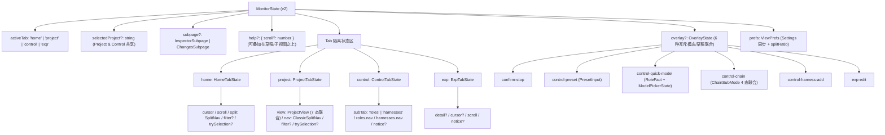
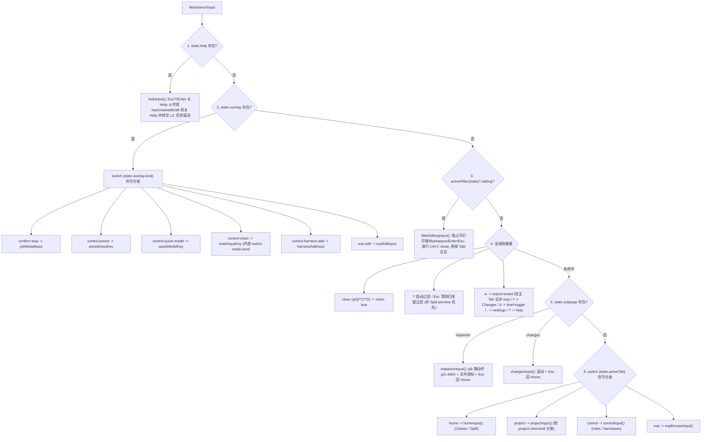
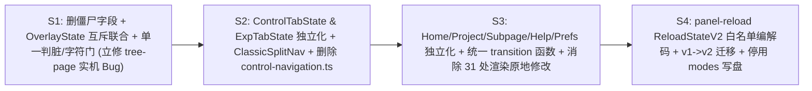

# 04. 用状态机联合类型重构 `MonitorState`（治理 60 个平铺字段与草稿/浮层状态泄漏）

> **优先级**：P1（渲染与输入状态架构清债 / 实机快捷键与重载漏检修复）
> **类别**：领域状态机重构 / 判别联合类型建模 / 纯函数渲染与序列化收口
> **预估规模**：L（4 个可独立编译与全绿交付的垂直切片；涉及 30 个 `src/` 文件与 52 个 `tests/` 文件的渐进收口；彻底删除 `src/render/control-navigation.ts`、4 个死 `PanelState` 字段、4 个僵尸顶层字段以及 3 处重复草稿/编辑器判脏表达式）
> **前置依赖**：无硬前置，可独立于 `universal-hud` 展开；与 **方案 02（切片 S4 拆解 `src/tree-page.ts`）** 存在低耦合交集——推荐先落 **本方案 S1**（立刻修复 `tree-page.ts` 中 `/` 与 `g` 及 `controlHarnessAdd` 重载漏检缺陷）或紧随 **方案 02 S4** 之后将状态机原语接入新拆出的 `panel-loop` 模块；与 **方案 01（清理僵尸观察栈）** 完成后可顺带移除 `Inspector` 仅剩的 `composed.aliases` 映射。
> **`docs/spec.md` 边界影响**：**不突破产品边界**。不增删任何 Tab、页面、快捷键或可见帧布局；反而修补了当前 `src/tree-page.ts` 在实机循环中遗漏 `spec §2.2` `/` 实时过滤、`g` 跳转 job tab 与 `Add back` 草稿延迟重载的实际缺陷。若干细粒度交互边界分叉（如 `/` 输入中与 `X` 停机确认是否阻止自重载、是否同步移除 `hud-settings.json` 已死字段 `changesPane`/`detailsPane`）列于 §6 供 Owner 拍板。

---

## 1. 背景与现状证据

### 1.1 `MonitorState` 的真实体量：已膨胀至 60 个平铺字段（53 可选 + 7 必填）

实读 `src/render/monitor.ts:53-133` 可确认，`MonitorState` 已从早期约 48 个可选字段进一步膨胀为 **60 个顶层平铺字段**（**53 个可选字段 + 7 个必填字段**），另含 `tree: PanelState` 内部 6 个子字段（`src/render/panel-state.ts:2-10`）。

这 60 个字段混合了 **4 个主 Tab 局部状态、6 套互斥浮层/模态/草稿、3 个全屏正交子视图、1 套 10 字段影子拷贝换入/换出 hack、8 个跨 Tab 偏好、以及多达 5 组历史死字段与渲染期派生缓存**。全量精确归类如下：

#### A. 60 个现有字段精确归类表

| 归类 | 数量 | 字段（`src/render/monitor.ts` 行号） | 当前归属与问题说明 |
|---|---:|---|---|
| **1. 顶层 Tab 与共享项目根** | **2** | `mainTab?` (`:54`), `projectRoot?` (`:69`) | `mainTab` 名义可选，实则 `initialMonitorState()` 初始化为 `'home'` 且 `mainTabOf()` 恒兜底 `'home'`；`projectRoot` 为 Project 与 Control 共享选中的项目根（Home 恒看自身项目）。 |
| **2. Home Tab 局部状态** | **10** | `homeTarget?` (`:90`), `homeScroll?` (`:91`), `boardExpanded?` (`:92`), `boardToggled?` (`:93`), `boardNewest?` (`:94`), `boardFolded?` (`:95`), `boardAnchor?` (`:97`), `splitCursor?` (`:119`), `trySelection?` (`:81`, 与 Project 共用), `tree.showAll` (`panel-state.ts:9`) | `homeTarget` 与 `boardAnchor` 形成隐式二选一游标（`boardAnchor` 覆盖 `homeTarget`，但切到 `boardAnchor` 时不清理 `homeTarget`）；`boardNewest` 是渲染期派生缓存；`trySelection` 为 `ReadonlyMap`，在 Home 与 Project 间共用同一字段且需手工排除序列化；`showAll` 寄宿在已基本废弃的 `tree: PanelState` 内。 |
| **3. Project Tab 局部状态** | **9** | `projectPage?` (`:67`), `projectList?` (`:71`), `projectBack?` (`:73`), `projectCursor?` (`:74`), `projectScroll?` (`:75`), `projectWait?` (`:77`), `projectTry?` (`:79`), `projectSaved?` (`:83`), `projectFolded?` (`:84`) | **5 个平铺字段共同编码互斥子路由**（`projectList` / `projectPage` / `projectWait` / `projectTry` / `projectBack`），可同时出现 `projectList: true` + `projectPage: 'progress'` 等非法组合；`projectCursor`/`projectScroll`/`projectFolded` 同时被 `control-navigation.ts` 劫持复用；`projectFolded` 还被 Home Split 的任务折叠逻辑直接写入（`workboard-input.ts:486,505`）。 |
| **4. Control Tab 局部状态** | **6** | `controlNav?` (`:57`), `controlHarnesses?` (`:58`), `controlHarnessNav?` (`:59`), `controlHarnessNotice?` (`:61`), `controlPresetNotice?` (`:65`), `modelPrevious?` (`:87`) | `controlNav` 与 `controlHarnessNav` 各自拷贝 10 个 Project/Split 字段（`src/render/control-navigation.ts:5-7`），每次渲染和输入都要全量换入再换出；`controlHarnessNotice` 仅在 `tree-page.ts:1237` 清理而纯 `handleMonitorInput` 永不清理；`controlPresetNotice` 在切到 Harnesses 时漏清（`workboard-input.ts:200-203`）。 |
| **5. EXP Tab 局部状态** | **1** | `expPage?` (`:56`) | `{ detail?, cursor?, scroll?, edit?, notice? }`（`src/render/exp-view.ts:53-59`）。其中 `edit` 实际是独占键盘的模态草稿，却嵌在 Tab 状态里导致多处额外判空。 |
| **6. 互斥浮层 / 模态 / 草稿** | **6** | `confirmStop?` (`:89`), `controlPresetInput?` (`:62`), `controlChain?` (`:63`), `controlQuickModel?` (`:64`), `projectInput?` (`:86`), `controlHarnessAdd?` (`:60`) | **6 个独立可选字段（外加 `expPage.edit` 共 7 处模态）毫无类型级互斥约束**。更甚：`projectInput`（历史命名残留）同时被 `controlQuickModel` 与 `controlChain.sheet` 两套入口共享，并重复存储 `role`/`index`；`controlChain`、`controlPresetInput`、`controlQuickModel` 内嵌完整 `RoleFact`（含 `editor.places[].raw` 原始启动参数）。 |
| **7. 全屏正交子视图（Help / Inspector / Changes）** | **6** | `focus` (`:101`), `boardInspect?` (`:98`), `inspectCursor?` (`:99`), `scroll` (`:103`), `help` (`:105`), `helpScroll?` (`:107`) | `focus: 'agents' \| 'changes' \| 'details'` 沿用旧三栏术语，实际编码「主 Tab vs Changes 全屏 vs Inspector 全屏」；`scroll.agents` 已彻底无人读取，仅 `scroll.changes` 与 `scroll.details` 存活；`help` 可叠加在未保存的 `controlChain` 草稿或任意子视图之上（`chain-input.ts:186-187`、`monitor-input.ts:41`）。 |
| **8. 跨 Tab 共享 Split 与 `/` 过滤状态** | **9** | `splitFocus?` (`:120`), `splitSub?` (`:121`), `splitList?` (`:123`), `splitScroll?` (`:124`), `splitListScroll?` (`:125`), `splitFor?` (`:132`), `boardRevealed?` (`:96`), `filterQuery?` (`:129`), `filterOpen?` (`:130`) | **Home Split 与 Project Split 共享同一组顶层 `splitFocus`/`splitSub`/`splitScroll`/`splitListScroll`/`splitFor` 字段**，跨 Tab 切换直接互相覆盖；`splitList` 仅因 `projectCursor` 兼任列表与预览游标而存在；`boardRevealed` 被 Home、Project、Control、EXP、Split 全部混用。 |
| **9. 跨 Tab 视图偏好（Settings 镜像 + 全局分栏比）** | **8** | `experiments?` (`:55`), `cardStallMinutes?` (`:108`), `cardFoldMinutes?` (`:110`), `cardHideMinutes?` (`:111`), `panelLayout?` (`:113`), `projectLayout?` (`:115`), `acceptance?` (`:117`), `splitRatio?` (`:127`) | 前 7 项由 `monitorSettings(settings)` 从 `HudSettings` 同步，未收敛为子对象，导致配置变更复位逻辑（`tree-page.ts:1184-1193`）与重载合并（`tree-page.ts:558`）散落多处。 |
| **10. 历史残留僵尸字段（零消费者）** | **4** (+4 子字段) | `preview` (`:104`, 恒为 `'agent'`), `zoom` (`:106`), `modes` (`:102`), `tree` (`:100`) 中的 `view`/`collapsed`/`filter`/`scroll` | 经全库检索验证：**`state.preview`、`state.zoom`、`state.scroll.agents`、`state.tree.{view,collapsed,filter,scroll}` 在 `src/` 中读取次数全部为 0**；`state.modes` 无任何渲染器读取，却在每次按 `v`/`f`/`Esc` 时触发 `tree-page.ts:1336-1338` 同步写盘 `hud-settings.json`！ |

> 字段计数核验：2 + 10（不含已计入第 10 类的 `tree`）+ 9 + 6 + 1 + 6 + 6 + 9 + 8 + 4 − 1（`tree.showAll` 属 `tree` 子字段）= **60 个顶层字段**（L54–L132 逐行核对完毕；53 可选 + 7 必填：`tree`, `focus`, `modes`, `scroll`, `preview`, `help`, `zoom`）。

---

### 1.2 实码查证的 6 类状态泄漏与生产级缺陷

以下每一条均经实读源码逐行验证，而非理论推测：

#### 缺陷 1（生产级实机 Bug）：`src/tree-page.ts` 三处手工拼装的“编辑器/草稿”布尔式互相漂移，导致实机吞掉 `/` 实时过滤与 `g` 跳转快捷键

`src/utils/workbench-input.ts:98-142` 中，`/` 与 `g` 均不在 `KEYS` 或 `workboard` 映射表中，解码输出为 `{ type: 'key', key: '', text: '/' }` 与 `{ type: 'key', key: '', text: 'g' }`；用户在 `/` 过滤栏中输入的普通字符（如 `e`、`u`、`z`、`0`）同样是 `key: ''`、`text: <char>`。

但在 `src/tree-page.ts` 中，存在 **三份各自手写、互不一致的平铺字段判空表达式**：

1. **输入批次预过滤 `editorInput()`（`src/tree-page.ts:1476-1484`）**：
   ```ts
   let picking = Boolean(state.projectInput || state.controlQuickModel || state.expPage?.edit || state.controlHarnessAdd || state.controlPresetInput || state.controlChain?.sheet);
   ```
   **漏掉了 `state.filterOpen`、`i.text === '/'`、`i.text === 'g'` 以及 `state.confirmStop`！**
2. **输入循环守卫（`src/tree-page.ts:1248`）**：
   ```ts
   if (input.type === 'key' && !input.key && !state.projectInput && !state.controlQuickModel && !state.expPage?.edit && !state.controlPresetInput && !state.controlChain?.sheet && !state.controlHarnessAdd) continue;
   ```
   **再次漏掉了 `state.filterOpen`、`input.text === '/'`、`input.text === 'g'` 以及 `state.confirmStop`！**
   - 直接后果：在实机 `runLivePage()` 中，按 `/` 无法打开实时过滤栏，按 `g` 无法跳转 job 的 herdr tab，且在 `confirmStop` 弹窗期间按未映射字母键（如 `z`）无法按 `job-actions.ts:74-80` 约定取消确认弹窗。单元测试 `tests/unit/panel-filter.test.mjs` 与 `tests/unit/panel-micro-actions.test.mjs` 之所以全绿，是因为它们直接调用 `handleMonitorInput()`，绕过了 `tree-page.ts` 的这两道过滤门。
3. **自重载判脏守卫 `reload.poll()`（`src/tree-page.ts:894-895`）**：
   ```ts
   const ready = await reload.poll(() => Boolean((settingsPage && settingsDirty(settingsPage)) || state.expPage?.edit ||
     state.controlPresetInput || state.controlChain?.draft || state.controlChain?.sheet || state.controlQuickModel || state.projectInput));
   ```
   **漏掉了 `state.controlHarnessAdd`、`state.confirmStop`（以及正在输入中的 `state.filterOpen`）**——当用户在 Harnesses 的 `Add back` 过滤框中打字时，构建落盘会直接触发面板重载并打断输入。

#### 缺陷 2（环境隐私与序列化脆弱点）：`src/utils/panel-reload.ts:69` 黑名单剔除不完整

`src/utils/panel-reload.ts:68-70` 注释明确要求：*"Never put raw launch options in the handoff environment."*（`RoleFact.editor.places[].raw` 含原始启动参数）。但实现采用黑名单解构：
```ts
const { trySelection: _marks, controlChain: _chain, ...state } = place.state;
```
- 仅排除了 `trySelection` 与 `controlChain`，**未排除 `controlPresetInput`、`controlQuickModel`、`projectInput`**——前两者同样内嵌完整 `RoleFact`！目前仅靠 `tree-page.ts:894-895` 阻止重载时碰巧未触发，且 `tree-page.ts:558` 启动时仅清了 `projectInput: undefined` 而未清其余浮层字段。
- 一旦新增任何含 `ReadonlyMap` 或敏感/大型对象的浮层字段，黑名单机制必然再次漏剔。

#### 缺陷 3（跨 Tab 状态覆盖）：Home Split 与 Project Split 共享同一组顶层字段

- `workboard-input.ts:68-83` 的 `goTab()` **既不保存也不清理** `splitFocus`、`splitSub`、`splitScroll`、`splitListScroll`、`splitFor`。
- 当用户在 **Home（Split）** 按 Enter 进入 preview（`splitFocus: 'preview'`, `splitSub: 'worker:...'`, `splitScroll: 12`）后按 `Tab` 切到 **Project（Split）** 时，`split-project.ts:266-280` 会把 Home 的 `splitFocus`/`splitSub` 当作 Project 的状态校验并重置归零，彻底破坏 Home 返回后的焦点与滚动位置。
- `tree-page.ts:1192` 在 Settings 修改 `projectLayout` 或 `acceptance` 时直接清零顶层 `splitFocus`/`splitList`/`splitSub`/`splitScroll`/`splitListScroll`/`splitFor`，附带误伤 Home 的 Split 状态。

#### 缺陷 4（局部清理不对称与字段泄漏）：`goTab()`、`useProject()`、`controlHarnesses` 与 `Inspector`

- `useProject()`（`workboard-input.ts:113-129`）切换项目时清空了 `projectCursor`/`projectScroll`/`projectFolded`/`controlNav`，却**漏清 `splitFocus`/`splitList`/`splitSub`/`splitScroll`/`splitListScroll`/`splitFor`**，只能依赖下一帧 `split-project.ts:270-280` 渲染期副作用碰巧兜底。
- `goTab()`（`workboard-input.ts:68-83`）：
  - `Project -> Control` 时 `keepingProject = true` 保留了 `trySelection`，随后再切到 `EXP` 时 `trySelection` 仍残留于 `MonitorState` 中；
  - `Home -> Project` 时清空了 `boardAnchor`（丢失 Home 停留在 progress/waiting 行的位置），而 `Project -> Home` 时清空了 `projectList`/`projectBack`；
- Control 切 `h`（Roles ↔ Harnesses，`workboard-input.ts:200-203`）直接提前 `return result()`，跳过 `:256` 对 `controlPresetNotice` 的清理，导致提示条跨子页残留；
- `workboard-input.ts:403` 打开 Inspector 时写入 `next.tree.selectedId = worker.nodeId`，但按 `Esc` 关闭 Inspector（`:416-421`）时**从未清除 `tree.selectedId`**。

#### 缺陷 5（10 字段影子拷贝 hack）：`src/render/control-navigation.ts` 导致四处绕过与强耦合

因 Control 强行复用 Project/Split 的 10 个平铺字段（`NAV = ['projectCursor', 'projectScroll', 'projectFolded', 'boardRevealed', 'splitFocus', 'splitList', 'splitSub', 'splitScroll', 'splitListScroll', 'splitFor']`），系统不得不在 `renderWorkboardFrame`（`work-view.ts:132-135`）与 `workboardInput`（`workboard-input.ts:60-61,229-232`）入口换入、出口换出。这迫使以下调用点被迫绕过封装直接手改影子对象：
- `tree-page.ts:1404-1408`（手改 `controlHarnessNav`）、`:1432` & `:1446`（手改 `controlNav`）；
- `chain-input.ts:52-53`（`finishChain` 手改 `controlNav`）；
- `workboard-input.ts:325-326`（Inbox 跳转 Control 时手改 `controlNav`）。

#### 缺陷 6（违反纯渲染原则 + 无效写盘）：31 处渲染期原地变更 & `modes` 僵尸写盘

- 实测 `src/render/` 中共有 **31 处** 在 `renderFrame` / `homeRows` / `homeScene` / `projectSplitScene` / `paintSplit` / `controlList` / `harnessAddRows` 中直接执行 `state.<field> = ...` 原地赋值（`work-view.ts` 14 处、`split-project.ts` 5 处、`split-home.ts` 4 处、`split-frame.ts` 4 处、`home-view.ts` / `control-page.ts` / `harness-page.ts` / `model-input.ts` 各 1 处）。当前仅靠 `reconcileMonitor()` 的顶层浅拷贝遮掩，一旦状态结构嵌套化将立刻产生静默跨帧串改。
- `state.modes`（`changesPane`/`detailsPane`）在 `src/` 中零读取，却在 `tree-page.ts:1336-1343` 中导致每次按 `v`/`f`/`Esc` 都同步调用 `saveSettings()` 重写 `$HUD_HOME/hud-settings.json`。

---

### 1.3 耦合面精准量化（源码与测试）

经脚本遍历全库实测（`src/` 全量 + `tests/unit/` 共 86 文件 + `tests/fixtures/` 共 17 文件）：

| 维度 | 统计数 | 关键热点文件 |
|---|---:|---|
| 引用 `MonitorState`/`initialMonitorState` 的 `src/` 文件 | **30** | `src/render/monitor.ts`、`workboard-input.ts`、`work-view.ts`、`project-view.ts`、`board-project.ts`、`inbox-project.ts`、`split-project.ts`、`split-home.ts`、`split-input.ts`、`split-frame.ts`、`control-page.ts`、`chain-input.ts`、`model-input.ts`、`preset-input.ts`、`harness-page.ts`、`exp-view.ts`、`filter.ts`、`job-actions.ts`、`tree-page.ts`、`panel-reload.ts` 等 |
| 涉及面板状态/渲染/输入的测试与 Fixture 文件 | **52**（45 `unit` + 7 `fixtures`） | Top 耦合：`split-layout.test.mjs`（26 字段）、`panel-reload.test.mjs`（24）、`control-tab.test.mjs`（18）、`project-progress.test.mjs`（18）、`panel-footers.test.mjs`（17）、`panel-keys-rows.test.mjs`（17）、`role-control.test.mjs`（17）、`panel-filter.test.mjs`（16）、`project-page.test.mjs`（16） |
| 直接展开构造 `{ ...initialMonitorState(), <field>: ... }` 的单测 | **28** | 集中在 `tests/unit/` 渲染与输入行为测试 |
| 复用共享 Fixture 构造器（`onPage`/`onControl`/`split`）的单测 | **22** | 通过更新 `tests/fixtures/project-page.mjs` 与 `split-layout.mjs` 可一次性收口大部分构造调用 |
| 直接读取/断言 `state.<flatField>` 的单测 | **32** | `mainTab` (31)、`projectCursor` (26)、`projectPage` (19)、`projectFolded` (17)、`focus` (14)、`homeTarget` (13)、`help` (12)、`panelLayout` (12)、`boardInspect` (10)、`controlChain` (9) |
| 构造或断言 `HUD_PANEL_RELOAD_PLACE` / `readPanelPlace()` 的单测 | **11** | `panel-reload.test.mjs`、`control-tab.test.mjs`、`panel-filter.test.mjs`、`project-list.test.mjs`、`split-layout.test.mjs`、`role-control.test.mjs` 等 |

按字段域拆分后的单测触达面呈明显阶梯分布（这直接决定了 §4 的低破坏垂直切片顺序）：
- 僵尸字段（`preview`/`zoom`/`modes`）：仅 **2** 个测试文件；
- 互斥浮层（6 字段 + `expPage.edit`）：仅 **11** 个测试文件；
- Control + EXP Tab 状态：仅 **12** 个测试文件；
- Home + Project + Subpage + Split + Prefs：其余 **~32** 个测试文件（其中约半数通过共享 fixture helper 解耦）。

---

## 2. 目标与非目标（Scope / Out of Scope）

### 2.1 目标（Scope）

1. **用编译期不可表示非法状态的嵌套状态机替代 60 字段平铺对象**：
   - 顶层拆分为：`activeTab`、`selectedProject?`、`subpage?`、`help?`、`overlay?`、按 Tab 严格隔离的 `home` / `project` / `control` / `exp`、以及 `prefs`。
   - 所有互斥模态/草稿统一收口为判别联合类型 `OverlayState`；`Project` 子路由收口为 `ProjectView` 判别联合；`Control` 链编辑器收口为 `ChainSubMode` 判别联合。
2. **建立单一真理源的状态迁移与查询纯函数模块 `src/render/monitor-state.ts`**：
   - `hasUnsavedDraft(state)`、`blocksReload(state)`、`acceptsRawText(state)`、`filterBatchInputs(state, inputs)`——用 `switch` 穷尽检查（`assertNever`）彻底替代 `tree-page.ts` 三处手写布尔表达式。
   - `transitionTab(state, nextTab)`、`switchProject(state, nextRoot)`、`transitionProjectView(state, nextView)`、`openSubpage` / `closeSubpage`、`applyViewPrefs`——所有跨视图/跨项目清理规则集中于一处，消灭局部遗漏。
3. **彻底消除 `control-navigation.ts` 影子换入/换出 hack 与 Home↔Project Split 状态污染**：
   - 抽出值对象 `ClassicSplitNav`，由 `home.split`、`project.nav`、`control.roles.nav`、`control.harnesses.nav` 各自独立持有。
4. **修复渲染期纯度（符合 `docs/ARCHITECTURE.md` §8）**：
   - `renderMonitor()` / `renderWorkboardFrame()` 对调用方传入的 `input.state` 及其全部嵌套子对象零原地修改（单测以 `deepFreeze(state)` 强验收）。
5. **升级 `src/utils/panel-reload.ts` 为白名单线协议 `ReloadStateV2`**：
   - `schemaVersion: 2` 显式白名单编码（天然剔除 `overlay` / `RoleFact` 原始启动参数 / `ReadonlyMap` `trySelection`）；
   - `ReadonlySet<string>` 序列化为普通 `string[]` 并带类型校验还原；
   - **完整兼容 v1（旧版 60 字段平铺 payload）与 v0（`skills` / `projectPage: 'control'`）向 v2 的无缝升级重载**。
6. **清理死代码**：删除 `src/render/control-navigation.ts`、`preview`、`zoom`、`modes`、`scroll.agents`、`paneShown()` 以及 `PanelState` 4 个零引用子字段。

### 2.2 非目标（Out of Scope）

1. **不改变任何可见 UI 布局、文案、主题色、热键映射或帧宽规则**（唯一行为变化是修复 `tree-page.ts` 实机漏传 `/`、`g` 与 `Add back` 重载打断缺陷，完全对齐 `docs/spec.md` §2.2）。
2. **不将 `Settings` 页（`SettingsPageState` / `SettingsConfirmationState`）并入 `MonitorState`**：Settings 在 `tree-page.ts` 中独立持有 `HudSettings` 完整草稿与 `ModelProbe` 生命周期，且不参与 `renderMonitor` 的纯帧渲染，强行并入会把配置校验和终端宽度副作用拖入 `src/render/monitor.ts`。
3. **不引入外部状态管理库或 schema 校验库**（严格遵守零多余依赖原则，仅用 TypeScript 类型系统 + 纯函数）。
4. **不修改任何 Collector、MCP 工具、磁盘 job/role 格式或 `install` 脚本**。

---

## 3. 核心设计方案

### 3.1 目标状态机架构总览



#### 关键分层不变量（Layering Invariants）

为什么设计为 **`activeTab` + `subpage?` + `overlay?` + `help?`** 四层，而不是把所有东西压成一个巨型 flat union？

1. **Tab 状态必须在切换后保留**：用户在 Home 展开的卡片、Project 的 `savedPages` 与折叠态、Control Roles 与 Harnesses 各自的光标/折叠态，切 Tab 再回来必须保留（`control-tab.test.mjs:50-55` 明确验证）。因此四个 Tab 状态对象作为常驻分区挂在顶层，由 `activeTab` 决定当前激活哪一个。
2. **`help?` 必须正交于 `overlay?` 与 `subpage?`**：实码验证（`chain-input.ts:186-187`、`monitor-input.ts:41`），当用户持有未保存的 `controlChain` 草稿时按 `?` 可打开 Help，再按 `Esc` 必须回到未保存的草稿，按 `q` 必须关闭 Help 并触发草稿的 `"Discard edits?"` 确认；同理 Help 也可叠加在 Inspector / Changes 之上，并且 Help 本身可跨自重载持久化（`panel-reload.test.mjs:253-266`）。因此 `help?: { scroll?: number }` 独立于瞬态 `overlay`。
3. **`subpage?`（Inspector / Changes）独立于 `overlay?`**：Inspector 与 Changes 是持久化的全屏视图（均需跨自重载保留，见 `panel-reload.test.mjs:253-272`），且 **Inspector 内部可以打开 `confirm-stop` 浮层**（`job-actions.ts:19-20,62-65`）。若将 Inspector 塞进 `overlay`，则无法在 Inspector 上弹出 `confirm-stop`。将其建模为 `subpage?` 后，Inspector + `overlay: { kind: 'confirm-stop', ... }` 自然成立，而退出 Inspector 时其私有 `target`/`cursor`/`scroll`/`selectedNodeId` 随 `subpage = undefined` 一次性清零。
4. **`overlay?` 承载全部 6 种严格互斥的瞬态交互流**：这 6 种交互流在任何合法路径下绝不可能同时出现两个，且 **全部不跨重载持久化**（脏态延迟重载，非脏态重载后安全回落至下层行，从而 100% 阻断 `RoleFact` 原始启动参数泄漏到环境变量）。

---

### 3.2 完整 TypeScript 类型契约（`src/render/monitor-state.ts`）

```ts
import type { WorkTarget } from '../collectors/workboard-types.js';
import type { TryTarget } from '../collectors/try-records.js';
import type { HudSettings } from '../settings.js';
import type { DraftPlace, PlaceFact, RoleFact } from '../roles/role-control.js';
import type { ExpAccount, ExpEdit } from '../exp-config.js';
import type { WorkbenchInput } from '../utils/workbench-input.js';
import type { MainTab } from './main-tabs.js';
import type { PresetInput } from './preset-input.js';

/** 可复用的列表与 Split 视图导航状态（值隔离，取代 control-navigation.ts 10 字段换入换出）。 */
export interface SplitNav {
  /** 'list' = 焦点在上半区列表；'preview' = 焦点在下半区预览。 */
  focus: 'list' | 'preview';
  /** 列表区当前选中项（即便 focus === 'preview' 也始终保留，取代 splitList / splitCursor 双轨）。 */
  listCursor?: string;
  listScroll: number;
  /** 预览区当前选中项（仅 focus === 'preview' 时有效）。 */
  previewCursor?: string;
  previewScroll: number;
  /** 预览滚动归属键（切换页面或列表项时自动归零 previewScroll）。 */
  previewFor?: string;
  /** 滚动入视去重标记（仅属于本视图，不再跨 Tab 串扰）。 */
  revealed?: string;
}

/** 同时支持 Classic 与 Split 的单视图导航单元（用于 Project、Control Roles、Control Harnesses）。 */
export interface ClassicSplitNav {
  cursor?: string;
  scroll: number;
  revealed?: string;
  split: SplitNav;
}

/** 视图级 `/` 实时过滤状态（归属 Home 或 Project progress/tickets，切离作用域自动清空）。 */
export interface ViewFilter {
  query: string;
  /** true = 正在输入中（独占可打印键）；false = 已按 Enter 保留过滤（仅过滤视图，普通快捷键恢复）。 */
  editing: boolean;
}

// ---------------------------------------------------------------------------
// 1. 各 Tab 隔离状态
// ---------------------------------------------------------------------------

/** Home 游标：要么落在 WorkTarget（卡片/lane），要么落在非卡片锚点（progress/waiting/task/fold）。 */
export type HomeCursor =
  | { kind: 'work'; target: WorkTarget }
  | { kind: 'anchor'; item: string; fallbackTarget?: WorkTarget };

export interface HomeTabState {
  cursor?: HomeCursor;
  scroll: number;
  revealed?: string;
  /** 取代 tree.showAll（`a` 显示/隐藏旧卡片）。 */
  showAll: boolean;
  expanded: ReadonlySet<string>;
  toggled: ReadonlySet<string>;
  foldedLanes: ReadonlySet<string>;
  /** Home Split Waiting 预览中展开的 task/ledger 行（与 Project 切根解耦）。 */
  expandedTasks: ReadonlySet<string>;
  /** 渲染期派生：当前最新已结算且未超折叠时间的卡片 key，供下一次 Enter 切换展开判断。 */
  newestCard?: string;
  /** Home 独享的 Split 导航状态，绝不被 Project 覆盖。 */
  split: SplitNav;
  /** Home 视图内 Space 多选待验收项（不序列化跨重载，离开 Home 清空）。 */
  trySelection?: ReadonlyMap<string, TryTarget>;
  filter?: ViewFilter;
}

export type ProjectSubPageKind = 'progress' | 'tickets' | 'tree' | 'docs';

/** Project 互斥子路由判别联合（终结 projectList / projectPage / projectWait / projectTry 组合爆炸）。 */
export type ProjectView =
  | { kind: 'projects-list' }
  | { kind: 'hub' }
  | { kind: 'progress'; onlyTry?: { returnCursor?: string; returnScroll: number } }
  | { kind: 'tickets' }
  | { kind: 'tree' }
  | { kind: 'docs' }
  | { kind: 'waiting'; index: number };

export interface ProjectTabState {
  view: ProjectView;
  /** 从 projects-list 进入 hub 时为 true，使 hub 按 Esc 返回列表；切子页后返回 hub 仍保持。 */
  fromProjectsList: boolean;
  nav: ClassicSplitNav;
  savedPages: Readonly<Partial<Record<ProjectSubPageKind, { cursor?: string; scroll: number }>>>;
  folded: ReadonlySet<string>;
  trySelection?: ReadonlyMap<string, TryTarget>;
  /** 仅当 view.kind === 'progress' | 'tickets' 时有效。 */
  filter?: ViewFilter;
}

export type ControlNotice =
  | { kind: 'preset'; role: string; name: string | null }
  | { kind: 'model'; role: string; index: number; model: string | null }
  | { kind: 'harness'; id: string; off: boolean };

export interface ControlTabState {
  subTab: 'roles' | 'harnesses';
  roles: {
    nav: ClassicSplitNav;
    folded: ReadonlySet<string>;
  };
  harnesses: {
    nav: ClassicSplitNav;
    folded: ReadonlySet<string>;
  };
  notice?: ControlNotice;
  /** 快速换模型成功后记录旧模型（key = JSON([path, preset, index])），供 picker 显示 `was` 标签。 */
  modelPrevious: Readonly<Record<string, string>>;
}

export type ExpDetail = ExpAccount | 'codex-help' | 'proxy-status';

export interface ExpTabState {
  detail?: ExpDetail;
  cursor?: string;
  scroll: number;
  notice?: 'Saved' | 'Could not save EXP setting' | 'Invalid value';
}

// ---------------------------------------------------------------------------
// 2. 正交全屏子视图与 Help 叠层（跨自重载保留）
// ---------------------------------------------------------------------------

export type SubpageState =
  | {
      kind: 'inspector';
      target: WorkTarget;
      cursor?: string;
      scroll: number;
      /** 取代 tree.selectedId：仅用于 refreshAgentContext 追踪被检视原生子代理，离开 Inspector 自动清空。 */
      selectedNodeId?: string;
    }
  | {
      kind: 'changes';
      scroll: number;
    };

export interface HelpOverlay {
  /** undefined 表示首次打开，按 activeTab 自动滚至对应分节锚点。 */
  scroll?: number;
}

// ---------------------------------------------------------------------------
// 3. 互斥浮层 / 模态 / 草稿判别联合（瞬态，绝不序列化跨重载）
// ---------------------------------------------------------------------------

export interface ModelPickerState {
  text: string;
  pick?: string;
  otherOpen?: boolean;
  scroll?: number;
  place: PlaceFact;
}

export type ChainField = 'target' | 'model' | 'kind' | 'thinking' | 'effort' | 'done';

export interface ChainDraft {
  name?: string;
  run: DraftPlace[];
}

export type ChainSheetInput =
  | { kind: 'choice'; text: string; at: number }
  | { kind: 'pi-model-picker'; picker: ModelPickerState };

export type ChainSubMode =
  | { kind: 'places' }
  | { kind: 'quick-model'; index: number; picker: ModelPickerState }
  | {
      kind: 'sheet';
      index: number;
      place?: DraftPlace;
      field: ChainField;
      error?: string;
      input?: ChainSheetInput;
    }
  | { kind: 'confirm-leave'; leave: WorkbenchInput };

export interface ExpEditDraft {
  text: string;
  pick: number;
  clicked?: boolean;
  preview?: Extract<ExpEdit, { field: 'grant' | 'renewal' | 'calibration' }>;
}

export type OverlayState =
  | { kind: 'confirm-stop'; jobId: string; role: string; dir: string }
  | { kind: 'control-preset'; sheet: PresetInput }
  | { kind: 'control-quick-model'; role: RoleFact; index: number; picker: ModelPickerState }
  | { kind: 'control-chain'; role: RoleFact; at: number; draft?: ChainDraft; error?: string; mode: ChainSubMode }
  | { kind: 'control-harness-add'; text: string; pick?: string }
  | { kind: 'exp-edit'; entryId: string; draft: ExpEditDraft };

// ---------------------------------------------------------------------------
// 4. 跨 Tab 偏好 & 顶层 MonitorState
// ---------------------------------------------------------------------------

export interface ViewPrefs {
  experiments: boolean;
  panelLayout: HudSettings['panelLayout'];
  projectLayout: HudSettings['projectLayout'];
  acceptance: HudSettings['acceptance'];
  cardStallMinutes: number;
  cardFoldMinutes: number;
  cardHideMinutes: number;
  /** 全局 Split 列表高度占比（0.2–0.8，经 `=`/`+`/`-` 调整，跨重载保留）。 */
  splitRatio?: number;
}

export interface MonitorState {
  activeTab: MainTab;
  /** Project 与 Control 共享选中的项目根；undefined 表示面板自身项目。 */
  selectedProject?: string;
  subpage?: SubpageState;
  help?: HelpOverlay;
  overlay?: OverlayState;
  home: HomeTabState;
  project: ProjectTabState;
  control: ControlTabState;
  exp: ExpTabState;
  prefs: ViewPrefs;
}
```

#### 这一建模一次性消灭的非法状态示例

| 曾经可能存在的非法/矛盾组合 | 新模型下的编译期保证 |
|---|---|
| `projectInput` 存在但 `controlQuickModel` 与 `controlChain.sheet` 皆空 | **不可表示**：`ModelPickerState` 仅存在于 `control-quick-model`、`control-chain(quick-model)` 或 `control-chain(sheet/pi-model-picker)` 三个分支中 |
| `controlPresetInput` 与 `controlChain` 或 `controlHarnessAdd` 并存 | **不可表示**：同属单一 `overlay?: OverlayState` 判别联合 |
| `controlChain` 同时有 `leave` 确认框与 `sheet` 表单 | **不可表示**：同属 `ChainSubMode` 4 态互斥联合 |
| `projectList: true` 同时 `projectPage: 'progress'` | **不可表示**：同属 `ProjectView` 7 态互斥联合 |
| `projectPage: 'waiting'` 但 `projectWait === undefined` | **不可表示**：`{ kind: 'waiting'; index: number }` 强制携带 `index` |
| `focus: 'details'` 但 `boardInspect === undefined` | **不可表示**：`{ kind: 'inspector'; target: WorkTarget; ... }` 强制携带 `target` |
| `controlQuickModel.index !== projectInput.index` | **不可表示**：单一 `index: number` 字段，无冗余副本 |

---

### 3.3 单一真理源纯函数接口（查询 + 状态迁移）

全部集中于 `src/render/monitor-state.ts`，供 `src/tree-page.ts`、`src/render/monitor-input.ts`、`src/render/workboard-input.ts`、`src/utils/panel-reload.ts` 统一调用，绝不各自拼字段：

#### 1) 草稿、重载阻断与原始字符输入判定（穷尽 `switch` + `never`）

```ts
const assertNever = (x: never): never => {
  throw new Error(`Unhandled state variant: ${JSON.stringify(x)}`);
};

/** 是否持有未保存草稿（用于退出确认、Help 上按 q 转发确认）。 */
export function hasUnsavedDraft(state: MonitorState): boolean {
  const ov = state.overlay;
  if (!ov) return false;
  switch (ov.kind) {
    case 'control-chain':
      return Boolean(ov.draft || ov.mode.kind === 'sheet' || ov.mode.kind === 'quick-model');
    case 'control-preset':
      return ov.sheet.mode !== 'list' || ov.sheet.text.length > 0;
    case 'control-quick-model':
    case 'control-harness-add':
    case 'exp-edit':
      return true;
    case 'confirm-stop':
      return false;
    default:
      return assertNever(ov);
  }
}

/** 当前活动视图上的 `/` 过滤状态（若存在）。 */
export function activeFilter(state: MonitorState): ViewFilter | undefined {
  if (state.help || state.subpage) return undefined;
  if (state.activeTab === 'home') return state.home.filter;
  if (state.activeTab === 'project' && (state.project.view.kind === 'progress' || state.project.view.kind === 'tickets'))
    return state.project.filter;
  return undefined;
}

/** 是否应延迟自动重载（唯一提供给 tree-page.ts `reload.poll` 的面板状态判脏函数）。 */
export function blocksReload(state: MonitorState): boolean {
  if (activeFilter(state)?.editing) return true;
  const ov = state.overlay;
  if (!ov) return false;
  switch (ov.kind) {
    case 'control-chain':
      // 仅浏览链（无 draft 且在 places 模式）不阻止重载，重启后回落角色行；任何编辑/弹窗均阻断。
      return Boolean(ov.draft || ov.mode.kind !== 'places');
    case 'control-preset':
    case 'control-quick-model':
    case 'control-harness-add':
    case 'exp-edit':
    case 'confirm-stop':
      return true;
    default:
      return assertNever(ov);
  }
}

/** 当前状态是否消费未命名可打印字符（`!input.key && input.text`），彻底取代 tree-page.ts:1248 与 :1477。 */
export function acceptsRawText(state: MonitorState): boolean {
  if (state.help) return false;
  if (activeFilter(state)?.editing) return true;
  const ov = state.overlay;
  if (!ov) return false;
  switch (ov.kind) {
    case 'confirm-stop':
      // 任何按键都应取消停机确认（job-actions.ts:74-80）
      return true;
    case 'control-preset':
      return ov.sheet.mode !== 'delete';
    case 'control-quick-model':
    case 'control-harness-add':
    case 'exp-edit':
      return true;
    case 'control-chain':
      return ov.mode.kind === 'quick-model' || (ov.mode.kind === 'sheet' && ov.mode.input !== undefined);
    default:
      return assertNever(ov);
  }
}

/**
 * 供 tree-page.ts 批量输入预过滤使用：除了 `acceptsRawText(state)` 外，
 * 放行能打开文本输入的单键（`/`、`m`、`i`、`p`/`N`/`I`/`R`、EXP `Enter`、鼠标左键）及显式动作字符（`g`）。
 */
export function filterBatchInputs(state: MonitorState, inputs: readonly WorkbenchInput[]): WorkbenchInput[] {
  let mayOpenText = acceptsRawText(state);
  const canFilter = !state.help && !state.subpage && (
    state.activeTab === 'home' ||
    (state.activeTab === 'project' && (state.project.view.kind === 'progress' || state.project.view.kind === 'tickets'))
  );
  const canGoJobTab = !state.help && (state.subpage?.kind === 'inspector' || (!state.subpage && state.activeTab === 'home'));
  return inputs.filter((i) => {
    if (i.type !== 'key') {
      mayOpenText ||= (state.prefs.experiments || state.activeTab === 'control') && i.button === 'left';
      return true;
    }
    if (i.text === '/' && canFilter) { mayOpenText = true; return true; }
    if (i.text === 'g' && canGoJobTab) return true;
    if (
      i.key === 'place-model' || i.key === 'place-add' ||
      (state.activeTab === 'control' && ['enter', 'preset-list', 'preset-copy', 'preset-empty', 'preset-rename'].includes(i.key)) ||
      (state.activeTab === 'exp' && i.key === 'enter')
    ) mayOpenText = true;
    return Boolean(i.key) || mayOpenText;
  });
}
```

> **亮点**：上述 `filterBatchInputs` 直接从状态机派生，彻底消除 `tree-page.ts:1248` 与 `:1476-1484` 两处重复且漂移的守卫；**实机 `/`、`g` 与 `confirmStop` 任意键取消一次性全部修复**，且未来只要在 `OverlayState` 新增变体，TypeScript 编译期会强制更新 `hasUnsavedDraft`、`blocksReload`、`acceptsRawText` 与路由 `switch` 四处，不可能再漏写。

#### 2) 标准状态转换纯函数（`transitionTab` / `switchProject` / `transitionProjectView` / `applyViewPrefs`）

```ts
/** 跨主 Tab 切换：清空离开视图的瞬态过滤/多选/提示条，退出子页与非草稿浮层，完整保留各 Tab 自身游标与 Split 状态。 */
export function transitionTab(state: MonitorState, nextTab: MainTab): MonitorState {
  const target: MainTab = nextTab === 'exp' && !state.prefs.experiments ? 'home' : nextTab;
  const leavingHome = state.activeTab === 'home' && target !== 'home';
  const leavingProject = state.activeTab === 'project' && target !== 'project';
  return {
    ...state,
    activeTab: target,
    subpage: undefined,
    overlay: undefined,
    home: leavingHome
      ? { ...state.home, filter: undefined, trySelection: undefined }
      : state.home,
    project: leavingProject
      ? { ...state.project, filter: undefined, trySelection: undefined }
      : state.project,
    control: state.control.notice ? { ...state.control, notice: undefined } : state.control,
  };
}

/** 切换 Project/Control 共享项目根：重置 Project 游标/页缓存/折叠/过滤与 Control Roles 导航，保留 Harnesses 机器级状态。 */
export function switchProject(state: MonitorState, nextRoot?: string): MonitorState {
  if (nextRoot === state.selectedProject) return state;
  const keepSwitchRow = state.project.nav.cursor === 'project:switch';
  return {
    ...state,
    selectedProject: nextRoot,
    // 项目级浮层关闭（含草稿时的离开确认由 chainInputKey 在调用 switchProject 前拦截）
    overlay: state.overlay?.kind === 'control-harness-add' ? state.overlay : undefined,
    project: {
      ...state.project,
      view: state.project.view.kind === 'progress' ? { kind: 'progress' } : state.project.view,
      fromProjectsList: false,
      nav: emptyClassicSplitNav(keepSwitchRow ? 'project:switch' : undefined),
      savedPages: {},
      folded: new Set(),
      trySelection: undefined,
      filter: undefined,
    },
    control: {
      ...state.control,
      roles: { nav: emptyClassicSplitNav(), folded: new Set(CONTROL_FOLDS) },
      notice: undefined,
    },
  };
}

/** 在 Project Tab 内切换子页面（自动存取 savedPages，清 filter 与 trySelection，保留 fromProjectsList）。 */
export function transitionProjectView(
  state: MonitorState,
  nextView: ProjectView,
  options?: { cursor?: string; fromProjectsList?: boolean }
): MonitorState { ... }

/** 应用新保存的 HudSettings：只重置真正受影响的视图，绝不因改 projectLayout 误伤 Home Split！ */
export function applyViewPrefs(state: MonitorState, settings: HudSettings): MonitorState {
  const prev = state.prefs;
  const nextPrefs: ViewPrefs = {
    ...prev,
    experiments: settings.experiments,
    panelLayout: settings.panelLayout,
    projectLayout: settings.projectLayout,
    acceptance: settings.acceptance,
    cardStallMinutes: settings.cardStallMinutes,
    cardFoldMinutes: settings.cardFoldMinutes,
    cardHideMinutes: settings.cardHideMinutes,
  };
  const layoutChanged = settings.panelLayout !== prev.panelLayout;
  const projectDisplayChanged =
    settings.projectLayout !== prev.projectLayout || settings.acceptance !== prev.acceptance;
  let next: MonitorState = { ...state, prefs: nextPrefs };
  if (!settings.experiments) {
    if (next.activeTab === 'exp') next = transitionTab(next, 'home');
    else if (next.overlay?.kind === 'exp-edit') next = { ...next, overlay: undefined };
  }
  if (layoutChanged) {
    next = {
      ...next,
      home: { ...next.home, cursor: undefined, scroll: 0, split: emptySplitNav(), trySelection: undefined },
      project: { ...next.project, view: stripOnlyTry(next.project.view), nav: emptyClassicSplitNav(), trySelection: undefined },
    };
  } else if (projectDisplayChanged) {
    // 仅重置 Project（及 Home 的 task-mode 多选），完整保留 Home 自身 Split 焦点与滚动！
    next = {
      ...next,
      home: settings.acceptance !== prev.acceptance ? { ...next.home, trySelection: undefined } : next.home,
      project: { ...next.project, view: stripOnlyTry(next.project.view), nav: emptyClassicSplitNav(), trySelection: undefined },
    };
  }
  return next;
}
```

---

### 3.4 输入路由优先级栈（`handleMonitorInput` 消除重复判断与快捷键串味）

当前 `src/render/monitor-input.ts:30-87` 与 `src/render/workboard-input.ts:58-627` 中，浮层分发靠 7 个散落的 `if` 顺序堆叠，且 `workboardInput` 长达 627 行、混杂了 Inspector、Control Roles、Control Harnesses、Project Hub/Pages、Home Classic/Split 以及 Changes 的全部逻辑。

重构后的 `handleMonitorInput()` 遵循严格 6 层确定性优先级栈：



这一分层带来 **4 项实质收益**：
1. **彻底根治快捷键串味**：
   - `confirm-stop` 位于 Layer 2，高于 `/` 与 `w`、`f`、`,`、`?`——避免当前 `monitor-input.ts:66-72` 中 `filterInput` 排在 `jobModalInput` 前而不得不手工加 `|| state.confirmStop` 特判（`filter.ts:105`）。
   - `control.notice` 的清理统一在 Layer 2 之后、进入非-Esc 普通输入时由 `clearTransientNotices(state, key)` 执行，Roles/Harnesses/纯单测行为完全一致。
2. **消除 `route` 递归回调用例的脆弱耦合**：`chainInputKey` 在 `"Discard edits?"` 确认离开时只需调用 `route(closeOverlay(state), leaveInput, ctx)`，且不再手写 `finishChain` 拼凑 `controlNav` 字段。
3. **拆分 627 行 `workboard-input.ts` 的自然边界**：Layer 6 按 `activeTab` 直接调用 `homeInput` / `projectInput` / `controlInput` / `expBrowseInput`，不再出现“先判断 `control` → 换入 `controlNav` → 和 `project` 共享 160 行 `if (control || project)` → 出口再换出”的意大利面代码。
4. **纯渲染对称受益**：`renderWorkboardFrame` 同样按 `help` → 全屏 `model-picker`（当 `overlay` 处于三种 picker 态之一）→ `subpage` → `activeTab` 清晰分派，且每次仅对**当前活动子对象**返回新副本（immutable update helper），31 处 `state.xxx = ...` 原地修改全部消除。

---

### 3.5 `src/utils/panel-reload.ts` 白名单序列化与跨版本平滑重载

#### 1) 显式白名单线协议 `ReloadStateV2`

放弃当前 `JSON.stringify({ ...place, state }, replacer)` 黑名单模式，改用强类型白名单编解码模块 `src/render/monitor-reload-codec.ts`（由 `src/utils/panel-reload.ts` 调用）：

```ts
export const RELOAD_SCHEMA_VERSION = 2 as const;

export interface ReloadSplitNavV2 {
  focus: 'list' | 'preview';
  listCursor?: string;
  listScroll: number;
  previewCursor?: string;
  previewScroll: number;
  previewFor?: string;
}

export interface ReloadClassicSplitNavV2 {
  cursor?: string;
  scroll: number;
  split: ReloadSplitNavV2;
}

export interface ReloadStateV2 {
  schemaVersion: typeof RELOAD_SCHEMA_VERSION;
  activeTab: MainTab;
  selectedProject?: string;
  subpage?:
    | { kind: 'inspector'; target: WorkTarget; cursor?: string; scroll: number; selectedNodeId?: string }
    | { kind: 'changes'; scroll: number };
  help?: { scroll?: number };
  home: {
    cursor?: HomeCursor;
    scroll: number;
    showAll: boolean;
    expanded: string[];       // ReadonlySet<string> -> string[]
    toggled: string[];        // ReadonlySet<string> -> string[]
    foldedLanes: string[];    // ReadonlySet<string> -> string[]
    expandedTasks: string[];  // ReadonlySet<string> -> string[]
    split: ReloadSplitNavV2;
    filterQuery?: string;     // 仅保留非空已确认 query；editing 恢复时固定 false（或按 §6 拍板保留）
  };
  project: {
    view: ProjectView;
    fromProjectsList: boolean;
    nav: ReloadClassicSplitNavV2;
    savedPages: Partial<Record<ProjectSubPageKind, { cursor?: string; scroll: number }>>;
    folded: string[];         // ReadonlySet<string> -> string[]
    filterQuery?: string;
  };
  control: {
    subTab: 'roles' | 'harnesses';
    roles: { nav: ReloadClassicSplitNavV2; folded: string[] };
    harnesses: { nav: ReloadClassicSplitNavV2; folded: string[] };
    modelPrevious: Record<string, string>;
  };
  exp: {
    detail?: ExpDetail;
    cursor?: string;
    scroll: number;
  };
  prefs: {
    splitRatio?: number;
    // 其余 Settings 派生字段（experiments/panelLayout/projectLayout/acceptance/card*Minutes）
    // 重启后由最新 loadSettings()/runtimeSettings() 重新注入，避免旧配置覆盖新保存的设置！
  };
  // 注意：白名单结构性省略以下瞬态/敏感/不可序列化字段：
  // - overlay (含 RoleFact / DraftPlace.raw 启动参数，绝不写入进程 env!)
  // - home.trySelection / project.trySelection (ReadonlyMap，按既有规格重载后清空多选)
  // - control.notice / exp.notice / home.newestCard / *.revealed (瞬态展示/派生缓存)
}
```

#### 2) 跨版本重载兼容矩阵（保证实机升级零中断）

| 场景 | 发射端 payload | 接收端 `readPanelPlace()` 处理 | 结果 |
|---|---|---|---|
| **稳态 v2 → v2** | `{ schemaVersion: 2, state: ReloadStateV2, settings, widthOverride, openedAt }` | 识别 `schemaVersion === 2`，经 `hydrateReloadStateV2(raw, basePrefs)` 校验字段类型、将 `string[]` 还原为 `new Set(...)`、合并当前 `runtimeSettings()` 的 `ViewPrefs`。 | 100% 无损还原 Tab/游标/滚动/折叠/Split/过滤/Help/Inspector/`openedAt`/`widthOverride` |
| **平滑升级 v1 → v2（旧运行面板热重载到新构建）** | 无 `schemaVersion`，扁平 60 字段 + `{ panelSet: [...] }` | 识别缺失 `schemaVersion`，经 `revivePanelSets` 还原 `Set`，再由 **`migrateV1ToV2(v1Raw, basePrefs)`** 逐字段映射到新结构：<br>• `mainTab`（含旧 `'skills' -> 'home'`）→ `activeTab`<br>• `projectPage === 'control'`（旧 v0 兼容路径，延续 `panel-reload.ts:19-31`）→ `activeTab: 'control'` + `control.roles.nav.cursor` + `control.roles.folded`<br>• `focus === 'details' && boardInspect` → `subpage: { kind: 'inspector', target, cursor: inspectCursor, scroll: scroll.details, selectedNodeId: tree.selectedId }`<br>• `focus === 'changes'` → `subpage: { kind: 'changes', scroll: scroll.changes }`<br>• `help === true` → `help: { scroll: helpScroll }`<br>• `homeTarget`/`boardAnchor`/`homeScroll`/`boardExpanded`/`boardToggled`/`boardFolded`/`tree.showAll`/`splitCursor` → `home`<br>• `projectList`/`projectPage`/`projectWait`/`projectTry`/`projectBack`/`projectCursor`/`projectScroll`/`projectSaved`/`projectFolded` → `project`<br>• `controlHarnesses`/`controlNav`/`controlHarnessNav`/`modelPrevious` → `control`<br>• `expPage`（剔除 `edit`/`notice`）→ `exp`<br>• `filterQuery` 按原 `filterScope` 归入 `home.filter` 或 `project.filter`<br>• 强制丢弃 `trySelection` 与全部浮层字段（`controlChain`/`controlPresetInput`/`controlQuickModel`/`projectInput`/`controlHarnessAdd`/`confirmStop`） | **运行中的旧面板在用户 `npm run build` 后无缝原地升级为新架构面板，不丢当前页、选中行、滚动位置与 `openedAt`** |
| **破损/未来未知版本 payload** | 非法 JSON 或 `schemaVersion > 2` | `try/catch` 安全返回 `undefined`（保留 `openedAt` 若有效），面板安全降级至 `initialMonitorState()`，绝不崩溃退出。 | 面板保持存活，零数据损坏 |
| **极端回滚 v2 → v1（git checkout 旧版）** | `schemaVersion: 2` | 旧版面板的 `readPanelPlace()` 读取后缺少顶层平铺字段，经旧版 `{ ...configuredState(), ...place?.state }` 安全降级至 Home 默认页，不崩不卡。 | 无损安全降级 |

---

### 3.6 安全、并发、纯度与性能核查（对照 `docs/ARCHITECTURE.md` §8）

| `docs/ARCHITECTURE.md` §8 规则 | 本方案应对措施 |
|---|---|
| **纯函数渲染（Passing `nowMs`, no I/O, no mutation during paint）** | 消除全部 31 处渲染期 `state.xxx = ...` 原地修改：`renderWorkboardFrame` 仅通过轻量浅克隆更新活动 Tab 子对象（如 `{ ...state, home: { ...state.home, scroll: offset, revealed: key } }`），调用方传入的 `input.state` 及其全部嵌套字段彻底不可变，由 `deepFreeze` 单测强制锁死。 |
| **零不必要依赖 / Node >= 24** | 零新依赖；纯 TypeScript 判别联合 + 原生 `Set`/`Map`/`JSON`。 |
| **隐私与凭据隔离** | `ReloadStateV2` 白名单从结构上杜绝 `RoleFact`/`DraftPlace.raw` 启动参数与任意未来浮层对象流入 `HUD_PANEL_RELOAD_PLACE` 环境变量；删除 `state.modes` 后消除按 `v`/`f`/`Esc` 触发的无效 `hud-settings.json` 写盘。 |
| **性能与内存开销** | 每次输入/渲染仅浅克隆当前活动路径（顶层 + 1 个子 Tab 对象，2 次对象展开），反而**少于**当前每次 `controlNavigation` + `storeControlNavigation` 调用 `Object.fromEntries(NAV.map(...))` 的动态对象分配开销；`ReadonlySet`/`ReadonlyMap` 仅在变更时复制。 |
| **并发与热重载一致** | `blocksReload(state)` 在 `reload.poll()` 的异步导入探测前后两次校验（`panel-reload.ts:56,62`），因覆盖了全部 6 类浮层及过滤编辑态，彻底消除导入检测窗口期内用户进入 `Add back` 或 `/` 输入被中途重启打断的竞态。 |

---

### 3.7 备选方案对比与选型结论

| 方案 | 简介 | 优点 | 缺点 | 结论 |
|---|---|---|---|---|
| **方案 A：Big-Bang 一次性重写** | 单 PR 同时改完 `MonitorState`、30 个 `src/` 与 52 个 `tests/` | 无中间态 | 80+ 文件巨型 diff，远超单个 `imp` 会话预算（违反 `docs/delegation.md`），冲突面极高且回归难以二分定位 | **否决** |
| **方案 B：永久平铺 Getter/Proxy 兼容层** | 内部存嵌套对象，对外用 JS `getter` 或 `Proxy` 长期维持 60 个平铺属性 | 老测试零修改 | `{ ...state }` 展开与 `JSON.stringify` 失效；编译期类型依然暴露 60 个平铺字段，无法阻止新代码继续写脏状态；违反 `docs/spec.md` §4 简洁性原则 | **否决** |
| **方案 C：4 切片由内向外渐进迁移 + 终态零残留（推荐）** | 按耦合半径从小到大拆 4 片：S1 僵尸清理 + `OverlayState` 联合（修复实机 bug）→ S2 Control/EXP 独立化并删 `control-navigation.ts` → S3 Home/Project/Subpage/Split/Prefs 独立化与纯渲染收口 → S4 `ReloadStateV2` 白名单与 v1→v2 迁移收尾 | 每片 1 个 `imp` 会话即可闭环交付、全量 `npm test` 绿灯；S1 即刻修掉实机 `/` 与 `g` 及重载缺陷；S4 结束后**零过渡胶水代码残留** | 过渡期 S1–S3 之间 `MonitorState` 会短暂呈“新字段 + 未迁字段”混合形态（仅跨 2 个切片，且每个切片都有明确删除清单） | **采用** |

---

## 4. 垂直切片与实施路线（对齐 `docs/delegation.md`）

严格按照 `docs/delegation.md` 原则：**每片端到端可编译、可独立验收、可适配单个 `imp` 会话预算**；按测试触达面从最小（2 / 11 文件）到最大（~32 文件）递增推进。



### 切片 S1：清理 4 组僵尸字段 + 引入 `OverlayState` 联合类型 + 统一 `tree-page.ts` 守卫

- **目标与直接收益**：
  1. 删除零读取僵尸字段 `preview`、`zoom`、`scroll.agents`、`paneShown()` 及 `PanelState` 中 4 个死子字段（`view`/`collapsed`/`filter`/`scroll`）。
  2. 新建 `src/render/monitor-state.ts`，落地 `OverlayState`（6 态互斥联合）、`ChainSubMode`（4 态互斥联合）、`hasUnsavedDraft`、`blocksReload`、`acceptsRawText`、`filterBatchInputs`。
  3. 用单一 `state.overlay?: OverlayState` 替代 7 个分散浮层字段：`confirmStop`、`controlPresetInput`、`controlChain`、`controlQuickModel`、`projectInput`、`controlHarnessAdd`、`expPage.edit`。
  4. **立即修复实机缺陷**：`src/tree-page.ts:894-895` 改调 `blocksReload(state)`，`:1248` 与 `:1476-1484` 改调 `acceptsRawText(state)` / `filterBatchInputs(state, all)`，同步补上实机 `/` 与 `g` 行为测试。
- **改动文件清单**：
  - 源码（14 文件）：`src/render/monitor-state.ts`（新增）、`src/render/monitor.ts`、`src/render/panel-state.ts`、`src/render/monitor-input.ts`、`src/render/workboard-input.ts`、`src/render/work-view.ts`、`src/render/chain-input.ts`、`src/render/model-input.ts`、`src/render/preset-input.ts`、`src/render/harness-page.ts`、`src/render/job-actions.ts`、`src/render/exp-view.ts`、`src/tree-page.ts`、`src/utils/panel-reload.ts`（过渡期剔除 `overlay`）。
  - 测试（13 文件）：`tests/fixtures/project-page.mjs`、`tests/fixtures/kept-pages.mjs`、`tests/unit/kept-pages.test.mjs`、`control-tab.test.mjs`、`model-picker.test.mjs`、`model-picker-pane.test.mjs`、`role-control.test.mjs`、`panel-filter.test.mjs`、`panel-micro-actions.test.mjs`、`panel-footers.test.mjs`、`panel-keys-rows.test.mjs`、`exp-page.test.mjs`、`split-layout.test.mjs`（仅更新涉及 7 个浮层字段的断言）。
- **估行**：~550 行改动（净删 ~140 行冗余判空与僵尸字段）。
- **可删除旧代码**：`preview`、`zoom`、`paneShown`、`PanelState.{view,collapsed,filter,scroll}`、`controlQuickModel`、`projectInput`、`controlPresetInput`、`controlChain`、`controlHarnessAdd`、`confirmStop`、`expPage.edit`，以及 `tree-page.ts` 3 处手写多字段布尔表达式。
- **依赖**：无（可优先独立合入）。

### 切片 S2：独立化 `ControlTabState` & `ExpTabState` + 抽取 `ClassicSplitNav` + 删除 `control-navigation.ts`

- **目标与直接收益**：
  1. 在 `src/render/monitor-state.ts` 落地 `SplitNav`、`ClassicSplitNav`、`ControlTabState`、`ExpTabState`。
  2. 将 `controlNav`、`controlHarnessNav`、`controlHarnesses`、`controlHarnessNotice`、`controlPresetNotice`、`modelPrevious` 全部收口至 `state.control`，将 `expPage` 收口为 `state.exp`（必填初始化，告别处处 `?.`）。
  3. 改造 `control-page.ts`、`harness-page.ts`、`split-project.ts`（`projectSplitScene` 接收显式 `nav: ClassicSplitNav` 参数而非读写 `state` 平铺字段）、`split-input.ts`，彻底告别换入/换出 trampoline。
  4. 统一在纯输入层清理 `control.notice`，对齐实机与单测行为。
- **改动文件清单**：
  - 源码（12 修改 + 1 删除）：`src/render/monitor-state.ts`、`src/render/monitor.ts`、`src/render/control-page.ts`、`src/render/harness-page.ts`、`src/render/model-input.ts`、`src/render/chain-input.ts`、`src/render/exp-view.ts`、`src/render/work-view.ts`、`src/render/workboard-input.ts`、`src/render/split-project.ts`、`src/tree-page.ts`、`src/utils/panel-reload.ts`；**删除 `src/render/control-navigation.ts`**（将 `CONTROL_FOLDS`/`controlRoleOf`/`controlRoleItem` 归入 `control-page.ts` 或 `monitor-state.ts`）。
  - 测试（12 文件）：`tests/fixtures/project-page.mjs`（更新 `onControl` helper）、`control-tab.test.mjs`、`role-control.test.mjs`、`model-picker.test.mjs`、`model-discovery.test.mjs`、`exp-page.test.mjs`、`exp-ledger.test.mjs`、`exp-proxy.test.mjs`、`panel-footers.test.mjs`、`panel-keys-rows.test.mjs`、`project-page.test.mjs`、`split-layout.test.mjs`。
- **估行**：~520 行改动，净删 `control-navigation.ts` 及 6 个平铺 Control 字段。
- **依赖**：S1。

### 切片 S3：独立化 `HomeTabState` / `ProjectTabState` / `SubpageState` / `help` / `ViewPrefs` + 纯渲染零原地变更

- **目标与直接收益**：
  1. 落地 `HomeTabState`（含 `HomeCursor` 与独立 `home.split`、`home.filter`、`home.trySelection`）、`ProjectTabState`（含 7 态 `ProjectView` 与独立 `project.nav`、`project.filter`、`project.trySelection`）、`SubpageState`（`inspector` | `changes`）、`HelpOverlay`、`ViewPrefs`、`selectedProject`。
  2. 落地全部核心迁移纯函数：`transitionTab`、`switchProject`、`transitionProjectView`、`openSubpage`、`closeSubpage`、`applyViewPrefs`；按 `activeTab` 拆分 `workboard-input.ts`（627L → `home-input.ts` / `project-input.ts` / `control-input.ts` 或清晰分区函数）。
  3. **消除全部 31 处渲染期原地变更**：`reconcileMonitor` / `renderWorkboardFrame` / `homeRows` / `homeScene` / `projectSplitScene` / `paintSplit` 全部改为返回不可变新状态，新增 `deepFreeze(state)` 单测守门。
  4. **如何最小化对 ~32 个测试文件的改动成本**：
     - 先更新 4 个共享 Fixture 构造器（`tests/fixtures/project-page.mjs` 的 `onPage`/`onControl`、`tests/fixtures/split-layout.mjs` 的 `split`、`tests/fixtures/kept-pages.mjs`、`tests/fixtures/home-progress.mjs`）——立刻自动覆盖 22 个依赖这些 helper 的测试；
     - 在 `tests/fixtures/state-helpers.mjs` 中提供简洁的测试构造器（如 `withHome(patch)`、`withProject(view, patch)`、`withPrefs(patch)`），替代冗长的多层手写嵌套字面量，保持单测高可读性。
- **改动文件清单**：
  - 源码（23 修改 + 1 删除）：`src/render/monitor-state.ts`、`src/render/monitor.ts`、`src/render/panel-state.ts`（**删除**：原 `PanelState` 全部 6 个字段已被 `home.showAll` 与 `inspector.selectedNodeId` 彻底取代）、`src/render/main-tabs.ts`、`src/render/filter.ts`、`src/render/job-actions.ts`、`src/render/try-input.ts`、`src/render/monitor-input.ts`、`src/render/workboard-input.ts`、`src/render/split-input.ts`、`src/render/split-frame.ts`、`src/render/split-home.ts`、`src/render/split-project.ts`、`src/render/work-view.ts`、`src/render/home-view.ts`、`src/render/work-lanes.ts`、`src/render/work-card.ts`、`src/render/work-visibility.ts`、`src/render/work-inspector.ts`、`src/render/project-view.ts`、`src/render/board-project.ts`、`src/render/inbox-project.ts`、`src/collectors/project-board.ts`（`projectShown` 签名）、`src/tree-page.ts`。
  - 测试（~32 文件）：4 个共享 fixture + ~28 个直接读写 `mainTab`/`projectPage`/`homeTarget`/`focus`/`help`/`splitFocus` 的单测。
- **估行**：~1,100 行源码重排（净删 ~280 行重复状态清理、平铺字段与 `panel-state.ts`）+ ~450 行测试适配。
- **依赖**：S2。（注：如单个 `imp` 会话接近尺寸上限，可按“S3a: `SubpageState` + `help` + `ViewPrefs` + `HomeTabState`”与“S3b: `ProjectTabState` + `ProjectView` + 消除剩余渲染原地变更”自然切为两半，两者仍独立绿灯。）

### 切片 S4：`panel-reload.ts` `ReloadStateV2` 白名单编解码 + `v1→v2` 迁移 + 停用僵尸 `modes` 写盘

- **目标与直接收益**：
  1. 新增 `src/render/monitor-reload-codec.ts`（纯函数，无进程/FS 依赖，便于穷尽单测），实现 `serializeReloadState(state)`、`deserializeReloadState(raw, prefs)` 与 `migrateV1ToV2(v1Raw, prefs)`（同时覆盖历史 v0 `skills` 与 `projectPage: 'control'`）。
  2. `src/utils/panel-reload.ts` 改用白名单编解码器，彻底移除旧 `{ panelSet: [...] }` 魔数 reviver（仅保留在 `migrateV1ToV2` 的 v1 入口处）与黑名单解构。
  3. 停用 `src/render/monitor.ts` 中 `monitorModes` / `monitorPreferences` 与 `src/tree-page.ts:1336-1343` 对僵尸 `modes`（`changesPane`/`detailsPane`）的无效写盘；按 §6 Owner 决定是否同步清理 `src/settings.ts` 的 `changesPane`/`detailsPane` 声明（已有 `mergeValidated` 会自动忽略旧配置文件中的退休键）。
- **改动文件清单**：
  - 源码（4–5 文件）：`src/render/monitor-reload-codec.ts`（新增）、`src/utils/panel-reload.ts`、`src/render/monitor.ts`、`src/tree-page.ts`、可选 `src/settings.ts`。
  - 测试（~11 文件）：`tests/unit/panel-reload.test.mjs` 升级主用例至 v2 并新增专门的 `v1 → v2` / `v0 → v2` / `RoleFact 零泄漏` 回归测试；更新其余 10 个引用 `readPanelPlace()` 的测试断言。
- **估行**：~360 行（含完整 `v1 → v2` 迁移器与边界测试）。
- **依赖**：S3。

### 4.1 迁移、兼容与回滚策略

1. **老配置/老数据零破坏**：不改变 `$HUD_HOME/hud-settings.json`、`roles/*.json`、`harnesses.json`、`exp/*`、`jobs/*` 任何磁盘格式；仅改变瞬态进程间环境变量 `HUD_PANEL_RELOAD_PLACE` 的内部 schema，且通过 `v1 → v2` 迁移器实现运行中面板无缝热替换。
2. **快照零抖动**：`npm run check:fixtures` 对比的是纯终端渲染帧（`plain(frame)`），重构全程保持帧输出 100% 字节一致——任何意外的渲染行为变化都会被现有帧快照立刻捕获。
3. **切片级回滚**：S1–S4 每片在独立 worktree 合入后即通过全量 `npm test` + `npm run check:fixtures`，任意一片出现异常均可单 commit `git revert` 回退，无需整系列作废。

---

## 5. 验证与验收方案

### 5.1 自动化单元与集成测试设计（全使用临时 `HOME`/`HUD_HOME` + 固定时钟 + 合成数据）

1. **编译期不可达状态守门（TypeScript `tsc --strict`）**：
   - 在 `src/render/monitor-state.ts` 对 `OverlayState`、`ChainSubMode`、`ProjectView`、`SubpageState` 全部使用 `assertNever(x)` 穷尽校验；
   - 专门单测验证 `hasUnsavedDraft` / `blocksReload` / `acceptsRawText` 覆盖全部 6 种 `OverlayState` 变体及其子模式（包括 `control-chain` 的 4 种 `ChainSubMode` 与 `control-preset` 的 5 种 `mode`）。
2. **纯渲染不可变性守门（`tests/unit/monitor-state-machine.test.mjs` 新增）**：
   - 编写 `deepFreeze(obj)` 工具递归冻结 `MonitorState` 及其全部子对象与 `Set`/`Map` 引用，对以下全部场景调用 `renderMonitor({ ...input, state: deepFreeze(state) })`：
     - Home（Classic / Split / 含 `/` 过滤 / 含 `confirm-stop`）
     - Project（Hub / Projects list / Progress / Tickets / Tree / Docs / Waiting × Timeline/Board/Inbox × Classic/Split）
     - Control（Roles / Harnesses / Chain / Preset / Quick Model / Harness Add）
     - EXP（主页 / Detail / Edit）、Inspector、Changes、Help
   - 断言**零异常抛出**且调用前后原 `state` 深度相等。
3. **跨 Tab / 跨项目状态隔离与防泄漏测试**：
   - **Home Split ↔ Project Split 隔离**：Home Split 进入 preview 并滚动至 `previewScroll = 8` → `Tab` 切 Project → Project Split 进入 preview → `Shift+Tab` 回到 Home → 断言 Home 的 `split.focus === 'preview'`、`split.previewCursor` 与 `split.previewScroll === 8` 毫发无损。
   - **Settings 改 `projectLayout` 不伤 Home Split**：`applyViewPrefs` 切换 `timeline → board` 后，断言 `project.nav` 重置而 `home.split` 保持原样。
   - **`switchProject` 原子清理**：在 Project Split preview + filter + trySelection 状态下按 `]` 切换项目 → 断言 `project.nav.split.focus === 'list'`、`project.filter === undefined`、`project.trySelection === undefined`、`control.roles.nav` 重置，而 `control.harnesses` 与 `home` 不受影响。
   - **Help 叠加未保存草稿**：在 `control-chain` 有 `draft` 时按 `?` 打开 Help → 断言 `state.help` 与 `state.overlay.kind === 'control-chain'` 共存 → 按 `Esc` 回到草稿 → 再次按 `?` 后按 `q` → 断言 Help 关闭且 `overlay.mode.kind === 'confirm-leave'`（`"Discard edits?"`）。
   - **Control Notice 与 Inspector 清理**：Roles 触发 `notice` 后按 `h` 切 Harnesses 断言 `notice === undefined`；Inspector 退出后 `subpage === undefined`（无残留 `selectedNodeId`）。
4. **实机循环 `runLivePage` 集成测试（临时目录 + 合成 job，覆盖本次查出的真实 Bug）**：
   - 在 `tests/unit/panel-reload.test.mjs` 与 `tests/unit/panel-filter.test.mjs` 增加经过真实 `runLivePage()` stdin 管道的端到端测试：
     - 输入 `/` + `sonic` + `Enter`：验证 live panel 不再吞掉 `/` 与未命名字符，屏幕出现 `/ sonic` 过滤条；
     - 在选中运行中合成 job 上输入 `g`：验证 `focusJobTab` 路径被触发（而非被 `editorInput` 吞掉）；
     - 打开 Harnesses `Add back`（`i`）后修改 `dist/tree-page.js` 并等待 >2.5s：验证 `blocksReload` 生效、面板**不**中途重启；按 `Esc` 关闭后再触发并顺利重启；
     - 触发 `confirm-stop`（`X`）后输入未映射字母 `z`：验证停机确认被立即取消。
5. **跨版本重载编解码矩阵测试（`tests/unit/panel-reload.test.mjs` 扩展）**：
   - **v2 → v2 往返**：覆盖全部 `ReadonlySet` 字段（`expanded`/`toggled`/`foldedLanes`/`expandedTasks`/`project.folded`/`control.roles.folded`/`control.harnesses.folded`）、`subpage`（Inspector / Changes）、`help`、保留的 `filterQuery`、`splitRatio`、`selectedProject`、`exp.detail`。
   - **隐私白名单断言**：人为构造携带 `overlay: { kind: 'control-chain' | 'control-preset' | 'control-quick-model', role: { ..., editor: { places: [{ raw: { args: ['--synthetic-secret-flag'] } }] } } }` 与 `trySelection: new Map(...)` 的 state 喂给 `serializeReloadState()` → 断言输出 JSON 字符串中**绝不包含** `--synthetic-secret-flag`、`overlay`、`trySelection` 键。
   - **v1 → v2 与 v0 → v2 平滑升级**：保留并扩充旧扁平 payload（含 `{ panelSet: [...] }`、`mainTab: 'skills'`、`projectPage: 'control'`、`focus: 'details'` + `boardInspect`、`filterQuery`、`trySelection` 历史普通对象）喂给 `readPanelPlace()`，断言全部精确还原至对应 v2 结构且首帧渲染与重构前一致。
6. **全量回归门禁**：
   ```sh
   npm run build && npm run build:test && npm run build:hud-mcp
   npm test
   npm run check:fixtures
   ```

### 5.2 Owner 实机试用验收清单（Done 标准，对齐 `docs/spec.md` §4）

- [ ] **原地无感热升级**：在旧版运行中的 `/hud` 侧边栏停留在 Project Progress 或 Control 某角色行，执行新版本 `npm run build`，等待 2 秒静默期后观察面板自动重载——页面停留原 Tab、原项目、原选中行，无报错、无白屏。
- [ ] **实机 `/` 与 `g` 修复验证**：在实机 `/hud` Home 页按 `/` 输入任意字母（含 `e`/`u`/`z` 等未映射键）实时过滤，Enter 保留，Esc 清除；在 HUD job 卡片按 `g` 正常切到该 job 的 herdr tab；按 `X` 后按任意非 `y`/Enter 键立即取消停机提示。
- [ ] **草稿与浮层重载保护**：分别打开 Control 链编辑草稿、Preset 重命名、Model Picker、Harnesses `Add back`、EXP 编辑表单，期间触发 `touch dist/tree-page.js` 验证均延迟重载；关闭或保存后自动完成重载。
- [ ] **Split 跨 Tab 独立性**：在 Split 布局下进入 Home 预览并滚动，按 `Tab` 切去 Project 再按 `Shift+Tab` 切回，确认 Home 列表/预览焦点与滚动位置未丢失；在 Settings 切换 `Project layout` 后 Home 布局与游标不受干扰。
- [ ] **高频切换零无效写盘**：多次按 `v`/`Esc`/`f`/`Esc` 进出 Inspector 与 Changes，观察 `$HUD_HOME/hud-settings.json` 的 `mtime` 不再无故更新。

---

## 6. 需要 Owner 拍板的开放问题

以下 3 个设计分叉均给出推荐默认项，均不阻塞 S1 启动，建议在合入 S3/S4 前确认：

1. **正在输入中的 `/` 过滤条（`filter.editing === true`）与 `X` 停机确认（`confirm-stop`）是否应阻塞自动重载？**
   - **背景**：当前 `tree-page.ts:894-895` 未检查这两项（一旦构建完成就会打断打字或取消停机确认）；而已按 Enter 保留的过滤条件（`filter.editing === false`）允许重载并保留 `filterQuery`（已有 `panel-filter.test.mjs:199-206` 覆盖）。
   - **推荐默认**：**阻塞**（仅在 `filter.editing === true` 或 `overlay.kind === 'confirm-stop'` 时延迟重载，几秒内用户输入完成或按 Enter/Esc 即可立即重载），体验最平滑且无副作用。

2. **是否在切片 S4 中一并从 `src/settings.ts` 删除历史僵尸配置键 `changesPane` / `detailsPane`？**
   - **背景**：实查全库，`changesPane` 与 `detailsPane` 在 `src/` 中零读取、在 `tests/` 中零引用，仅导致每次 `v`/`f`/`Esc` 无效写盘 `hud-settings.json`（`tree-page.ts:1336-1343`）。按 `docs/ARCHITECTURE.md` §7（`:377-378`）约定，退休键读取时自动忽略、下次保存时自然丢弃，不影响老用户配置文件。
   - **推荐默认**：**在 S4 一并清理**（连同 `monitorModes`、`monitorPreferences`、`tree-page.ts:1336-1343` 写盘钩子与 `settings.ts` 中 `PANE_KEYS`）。若 Owner 倾向严格最小改动，也可先仅停用 `tree-page.ts` 写盘并留待单独清理。

3. **Home（Split Waiting 预览）与 Project（Hub/Progress）的任务折叠集（`task:<key>` / `ledger:<id>`）应保持独立还是继续共享？**
   - **背景**：当前 Home Split 预览展开待验收任务时直接写入 `state.projectFolded`（`workboard-input.ts:505`），导致用户在 Project Tab 切换其它项目（`useProject` 清空 `projectFolded`）时会顺带把 Home 正在看的任务折起。
   - **推荐默认**：**按 Tab 隔离**（`home.expandedTasks` 独立于 `project.folded`；Classic Home 按 Enter 跳转至 Project Progress 时仍显式展开目标任务），彻底消除跨 Tab 意外折叠。
