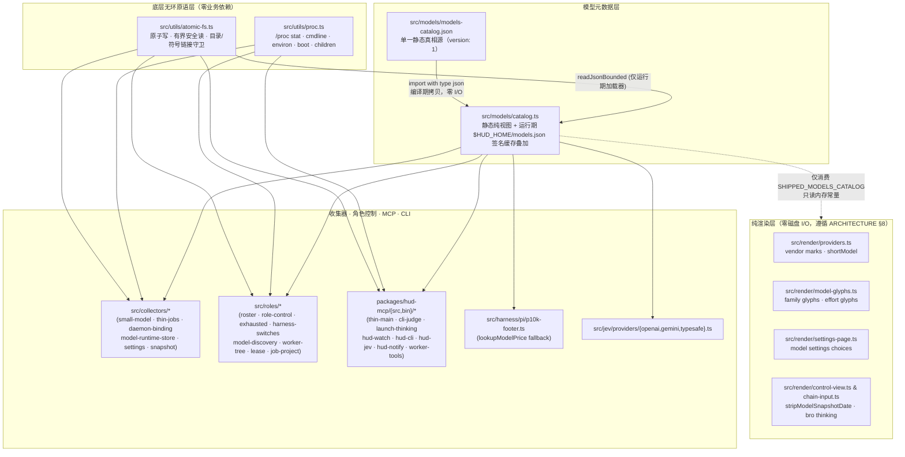
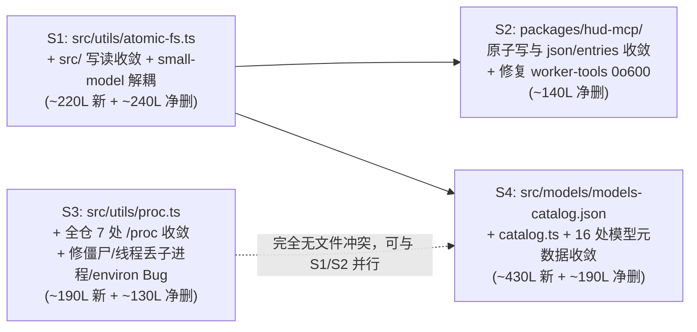

# 05. 收敛底层重复原语（原子私密写、`json`/`entries`、`/proc` 解析）并建立统一数据驱动的模型元数据注册表

> **优先级**：P1（底层工程基础设施收敛、高危隐蔽 Bug 根治与跨方案复用底座）
> **类别**：底层原语统一 / 安全与边界加固 / 数据驱动配置（Low-Risk Refactor + Bug Fixes）
> **预估规模**：M–L（4 个独立垂直切片，新增 3 个核心模块 + 1 个数据文件共 ~820L，净删 ~560L 重复手写实现与硬编码表）
> **前置依赖**：无（纯 Node ≥24 内置模块，零新增依赖）；与 **方案 01**（删除 `job-live-observation.ts`）、**方案 02**（`src/roles/job-io.ts` 复用 `src/utils/atomic-fs.ts`）、**方案 03**（统一单产物树）无缝衔接，**建议 S1/S3 尽早落地为方案 02 提供底座**（双向可独立顺序落地，详见 §3.5 与 §4.1）
> **`docs/spec.md` 边界影响**：**核心原语与内置 `models-catalog.json` 零产品规格变更**（纯内部收敛与真实缺陷修复，严格遵守 `docs/spec.md` §2.1「Control picker 无本地来源不展示价格列」、§3「离线零网络」、§4「最简可靠」与 `docs/ARCHITECTURE.md` §8「纯渲染零 I/O / 私有原子写」）。唯一需 Owner 拍板的可选边界扩展为 **新增用户覆盖文件 `$HUD_HOME/models.json`**（见 §6 #1）；若批准，同步补充 `docs/ARCHITECTURE.md` §7 状态表与 `docs/reference.md`。

---

## 1. 背景与现状证据

对当前 `universal-hud` 分支（`src/`、`packages/hud-mcp/`、`bin/`）做全量代码盘点，发现三类高频底层能力在整个仓库中被反复拷贝、各自演化，已产生**架构依赖倒置**、**真实权限/并发/僵尸进程 Bug**，以及**新增模型必须同步改 6+ 处 TypeScript 源码**的维护痛点。

### 1.1 类别 A：原子私密写与有界文件读取（`json` / `entries` / `slice`）

全仓共盘点出 **37 处独立手写的临时文件原子写实现**（35 处同步 `temp + renameSync`、1 处异步 `temp + rename`、1 处排他 `temp + linkSync`），外加 **9 处从 `src/collectors/small-model.ts` 转导 `writePrivateFile` 的调用点**（合计 **46 处**），另有 **6 处私有运行期状态仍在使用非原子直写**，以及 **18 处重复手写的 `json` / `readJson` / `entries` / 有界读取封装**。

#### A.1 架构倒置：`writePrivateFile` 寄生在 827 行 HTTP 模型队列模块中

`src/collectors/small-model.ts:318-331` 定义了目前仓库里写得最规范的 `writePrivateFile()`，但因为未下沉到 `src/utils/`，导致 **9 个毫不相干的模块**反向依赖了这个包含 HTTP 客户端、凭证读取、语言检测与单飞队列的 827 行 collector：
- `packages/hud-mcp/src/codex-statusline.ts:6`（轻量级 Codex 状态栏热路径仅仅为了写一个 1 行 JSON 时间戳就拉入了整个 `small-model.ts`！）
- `src/cli/board.ts:7`、`src/collectors/exp-store.ts:24`、`src/collectors/exp-proxy-refresh.ts:21`、`src/collectors/tree-scan-store.ts:16`、`src/collectors/decision-labels.ts:11`、`src/collectors/decision-titles.ts:3`、`src/collectors/job-sentences.ts:5`、`src/collectors/try-brief.ts:10`。

#### A.2 全仓 37 处原子写实现盘点与缺陷量化

| 编号 | 文件与行号 | 符号 | `mode` / `mkdir 0o700` | `randomUUID()` | `flag: 'wx'` | `finally` 清理 `.tmp` | 符号链接防护 | `.tmp` 后缀 | 现有缺陷与语义注记 |
|---:|---|---|---|---|---|---|---|---|---|
| 1 | `src/collectors/small-model.ts:318-331` | `writePrivateFile` | `0o600` / `0o700` | ✓ | ✓ | ✓ | 依赖 POSIX rename | ✓ | 模块位置倒置（被 9 处非模型模块导入） |
| 2 | `src/collectors/model-runtime-store.ts:66-79` | `atomicWrite` | `0o600` / `0o700` | ✓ | ✓ | ✓ | 依赖 POSIX rename | ✓ | 与 #1 几乎逐行重复 |
| 3 | `src/collectors/thin-jobs.ts:58-63` | `persist` | `0o600` / **缺 `0o700`** | **✗** (`pid`) | **✗** | ✓ | 无 | ✓ | 同 PID 重入碰撞；`display` 目录受 umask 影响 |
| 4 | `src/integrations/panel/receipt.ts:164-185` | `saveJson` | `0o600` / `0o700` | ✓ | ✓ | ✓ | `safePath`（全祖先） | ✓ | 含 `exclusive` 模式与 16 KiB 上限 |
| 5 | `src/statusline-settings.ts:214-229` | `replace` | `0o600` → `fchmodSync` | ✓ | ✓ | **⚠ 无 catch** | 上层 `pinned` | **✗** (`-tmp-<uuid>`) | `finally` 中 `existsSync && unlinkSync` 未包 `try/catch`；含 CAS + `fsyncSync` + `syncDirectory` |
| 6 | `src/snapshot.ts:306-325` | `SnapshotWriter.write` | `0o600` / `0o700` | **✗** (`pid`) | **✗** | ✓ (`catch`) | 无 | ✓ | 缺 `wx`/UUID；需在 `renameSync` 前 `statSync(tmp)` 持握 inode 归属 |
| 7 | `src/statusline-parity/storage.ts:50-67` | `saveJson` | `0o600` / `0o700` | ✓ | ✓ | ✓ | `noLinks`（全祖先） | **✗** (无 `.tmp`) | `tmp = file + '.' + randomUUID()` 不以 `.tmp` 结尾；1 MiB 上限 |
| 8 | `src/harness/pi/footer-settings.ts:90-101` | `saveFooterSettings` | `0o600` / `0o700` | ✓ | ✓ | ✓ (`rmSync`) | `safeAncestors` | ✓ | 64 KiB 上限 |
| 9 | `src/cli/trust.ts:101-112` | `commit` | `0o600` → `chmod(read.mode)` | **✗** (`pid-attempt`) | **✗** | **⚠ 无 catch** | 上层 `readNoFollow` | ✓ | 缺 `wx`/UUID；`finally` 未护 `unlinkSync`；需 CAS + 保留原文件权限 |
| 10 | `src/cli/setup.ts:511-525` | `atomicWrite` | `0o644` / 外部 `0o755` | ⚠ (`tmpSeq++`) | ✓ | ✓ (`catch`) | 外部校验 | ✓ | 写项目 `.hud/`（刻意 `0o644` 提交到 Git）；`tmpSeq` 仅单进程单调 |
| 11 | `src/cli/import.ts:127-134` | `runImport` | `0o600` / `0o700` | ✓ | ✓ | ✓ (`rmSync`) | `safeAncestors` | ✓ | 需在 `renameSync` 前做 CAS 原内容比对 |
| 12 | `src/cli/tickets.ts:346-355` | `writeFileAtomic` | 可选 `mode` / 无 mkdir | ✓ | ✓ | ⚠ (`catch` 无护) | 无 | **✗** (`.tmp-<uuid>`) | 写 `.scratch/` 公开票据；不以 `.tmp` 结尾；`rmSync` 在 `catch` 未护异常 |
| 13 | `src/roles/worker-tree.ts:116-125` | `rememberWorkerTree` | `0o600` / 无 mkdir | ✓ | ✓ | **刻意保留** | 无 | ✓ | **特殊语义**：`renameSync` 失败（如 `ENOSPC`）时刻意保留完整 `.tmp` 供后续 reaper 扫描恢复（`:86-90`） |
| 14 | `src/roles/lease.ts:38-46` | `publish` | `0o600` / 外部 `0o700` | ✓ | ✓ | ✓ (`unlinkSync`) | `linkSync` 排他 | ✓ | **特殊语义**：用 `fs.linkSync(tmp, file)` 排他发布（绝不覆盖现存租约） |
| 15 | `src/roles/exhausted.ts:142-160` | `writeExhausted` | `0o600` + `chmodSync` / 无 mkdir | ✓ | ✓ | ✓ | `assertExhaustedFile` | ✓ | 依赖调用方 `markExhausted:177` 建目录；`chmodSync(file)` 在 rename 后存在微小 TOCTOU |
| 16 | `src/roles/model-discovery.ts:217-237` | `writeModelListCache` | `0o600` + `chmodSync` / `0o700` | ✓ | ✓ | ✓ | `assertRegularOrMissing` | ✓ | 目录与目标均检 symlink；同上 rename 后 `chmodSync` |
| 17 | `src/roles/harness-switches.ts:49-56` | `setHarnessDisabled` | `0o600` / `0o700` | ✓ | ✓ | ✓ | 依赖 POSIX rename | ✓ | 1 MiB 上限 |
| 18 | `src/roles/roster.ts:848-853` | `recordFailureExhaustion` | `0o600` / 无 mkdir | **✗** (`pid`) | **✗** | **✗** | 无 | ✓ | **3 项缺失**：无 UUID、无 `wx`、失败永不删 `.tmp` |
| 19 | `src/roles/roster.ts:1008-1028` | `writeRoleRecord` | `0o600` + `chmodSync(tmp)` / `0o700` | ✓ | ✓ | ✓ | `lstatKind` (dir+file) | ✓ | 需在 rename 前执行 CAS `expected` 校验 |
| 20 | `src/roles/job-project.ts:52-62` | `adoptProjectJobs` | `0o600` / 无 mkdir | ✓ | ✓ | ✓ (`catch`) | 无 | ✓ | 仅在 `catch` 清 `.tmp` |
| 21 | `src/settings.ts:229-232` | `saveSettings` (`config.json`) | `0o600` / **缺 `0o700`** | ✓ | ✓ | **⚠ 无 catch** | 无 | ✓ | `mkdirSync` 缺 `0o700`；`finally` 中 `existsSync && unlinkSync` 无异常保护 |
| 22 | `src/settings.ts:234-245` | `saveSettings` (`hud-settings.json`) | `0o600` / **缺 `0o700`** | ✓ | ✓ | ✓ | 无 | ✓ | `mkdirSync` 缺 `0o700` |
| 23 | `packages/hud-mcp/src/thin-main.ts:169-171` | `save` (`job.json`) | `0o600` / 无 mkdir | **✗** (`pid`) | **✗** | **✗** | 无 | ✓ | **3 项缺失**；同 MCP 进程内多异步请求并发保存同一 job 时存在 `.pid.tmp` 碰撞 |
| 24 | `packages/hud-mcp/src/thin-main.ts:769-771` | `readRow` (`STATUS.json`) | `0o600` / 无 mkdir | **✗** (`pid`) | **✗** | **✗** | 无 | ✓ | **3 项缺失**；吞异常但残留 `.tmp` |
| 25 | `packages/hud-mcp/src/thin-main.ts:1457-1469` | `finishLaunch` (`STATUS.json`) | `0o600` / 无 mkdir | **✗** (`pid`) | **✗** | **✗** | 无 | ✓ | **3 项缺失** |
| 26 | `packages/hud-mcp/src/thin-main.ts:1875-1880` | `claimTask` (`mcp-task.json`) | `0o600` / 无 mkdir | **✗** (`pid`) | **✗** | **✗** | 无 | ✓ | **3 项缺失** |
| 27 | `packages/hud-mcp/src/cli-judge.ts:34-36` | `saveTurn` (`turn.json`) | `0o600` / 无 mkdir | **✗** (`pid`) | **✗** | **✗** | 无 | ✓ | **3 项缺失** |
| 28 | `packages/hud-mcp/bin/hud-check.mjs:41-43` | `save` (`checks.json`) | `0o600` / 无 mkdir | **✗** (`pid`) | **✗** | **✗** | 无 | ✓ | **3 项缺失** |
| 29 | `packages/hud-mcp/bin/hud-watch.mjs:195-197` | `saveJob` (`job.json`) | `0o600` / 无 mkdir | **✗** (`pid`) | **✗** | **✗** | 无 | ✓ | **3 项缺失** |
| 30 | `packages/hud-mcp/bin/hud-watch.mjs:259-260` | `scan` (CLI/tabClosed `STATUS.json`) | `0o600` / 无 mkdir | **✗** (`pid`) | **✗** | **✗** | 无 | ✓ | **3 项缺失** |
| 31 | `packages/hud-mcp/bin/hud-watch.mjs:293-294` | `scan` (quota `STATUS.json`) | `0o600` / 无 mkdir | **✗** (`pid`) | **✗** | **✗** | 无 | ✓ | **3 项缺失** |
| 32 | `packages/hud-mcp/bin/hud-watch.mjs:353-354` | `scan` (readClose `STATUS.json`) | `0o600` / 无 mkdir | **✗** (`pid`) | **✗** | **✗** | 无 | ✓ | **3 项缺失** |
| 33 | `packages/hud-mcp/bin/hud-notify.mjs:15-21` | `registerPiWatcher` | `0o600` / `0o700` | **✗** (`pid`) | ✓ | ⚠ (仅 rename catch) | 无 | ✓ | 缺 UUID；`unlinkSync` 无保护 |
| 34 | `packages/hud-mcp/bin/worker-tools.mjs:31-38` | `replace` | `0o600` / 无 mkdir | ✓ | ✓ | ✓ (`rmSync`) | 依赖 POSIX rename | ✓ | 仅覆盖 `report.md`/`done.json`，同文件 `:241` 未用 |
| 35 | `packages/hud-mcp/bin/hud-cli.mjs:187-188` | `write` (`STATUS.json`) | `0o600` / 无 mkdir | **✗** (`pid`) | **✗** | **✗** | 无 | ✓ | **3 项缺失** |
| 36 | `packages/hud-mcp/bin/hud-jev.mjs:46-47` | `status` (`STATUS.json`) | `0o600` / 无 mkdir | **✗** (`pid`) | **✗** | **✗** | 无 | ✓ | **3 项缺失** |
| 37 | `bin/codex-hud-herdr.mjs:157-170` | `writeBridgeHealth` (async) | `0o600` + `chmod` / `0o700` | **✗** (`pid`) | **✗** | ✓ (`unlink.catch`) | 无 | ✓ | **2 项缺失**（无 UUID、无 `wx`） |

**额外发现的 6 处私有状态非原子写与权限漏项**：
- **`packages/hud-mcp/bin/worker-tools.mjs:241`**（**真实权限 Bug**）：`fs.writeFileSync(q.qfile, questionBody(q), { encoding: 'utf8', flag: 'wx' })` **漏传 `mode: 0o600`**，导致 worker 问题文件 `qa/qN.md` 以默认 `0o644` 落盘，违反 `docs/ARCHITECTURE.md` §8 私有状态规范。
- `packages/hud-mcp/src/thin-main.ts:267`（`watch.pid`）、`packages/hud-mcp/bin/hud-watch.mjs:69`（`watch.pid`）、`packages/hud-mcp/bin/hud-notify.mjs:104`（`watchers/<pane>.pid`）、`packages/hud-mcp/bin/hud-cli.mjs:28`（`supervisor.pid`）、`packages/hud-mcp/bin/hud-jev.mjs:107`（Flow `report.md`）：均为直接覆盖写，无原子替换（读取方可能读到截断后的空 PID 或半截报告）。

**缺陷汇总量化（37 处原子写实现中）**：
- **18 处**缺少 `randomUUID()`（高并发异步写或重入触发 `.pid.tmp` 覆盖/竞态 `ENOENT`）；
- **17 处**缺少 `flag: 'wx'`（无法防止临时路径被预置符号链接或并发截胡）；
- **14 处**完全缺少 `finally` 临时文件清理，另有 **3 处** `finally` 清理未包 `try/catch`（可能遮蔽主异常）；
- **3 处** `mkdirSync` 漏传 `mode: 0o700`（`thin-jobs.ts:60`、`settings.ts:229, 234`），**1 处**私有文件写漏传 `mode: 0o600`（`worker-tools.mjs:241`）；
- **3 处**临时文件未以 `.tmp` 结尾（`storage.ts:56`、`tickets.ts:347`、`statusline-settings.ts:215`），可能穿透 watcher 的 `.endsWith('.tmp')` 忽略规则。

#### A.3 重复的 `json` / `readJson` / `entries` / 有界读取（18 处）

| 模块与行号 | 符号 | 大小上限 | `O_NOFOLLOW \| O_NONBLOCK` | 短读循环 | 现有缺陷 |
|---|---|---:|:---:|:---:|---|
| `packages/hud-mcp/src/thin-main.ts:119-150` | `json` / `entries` / `slice` | `json` 无上限；`slice` 有 | **✗** | **✗** | 与 `roster.ts` 几乎完全重复；未防 FIFO 阻塞与 symlink |
| `src/roles/roster.ts:97-107, 344-359` | `json` / `entries` / `slice` | `json` 无上限；`slice` 有 | **✗** | **✗** | `slice` 与 `thin-main.ts:135-150` 逐字节重复 |
| `packages/hud-mcp/bin/hud-watch.mjs:29-53` | `read` / `json` | 无上限 | **✗** | **✗** | `statSync` 后直读，无大小上限、未防 symlink/FIFO |
| `src/collectors/thin-jobs.ts:12-19, 65-105` | `entries` / `read` / `json` | 64 KiB | ✓ | **✗** | 单次 `readSync`；需保留签名缓存与 `complete` 语义 |
| `src/collectors/project-board.ts:141-154, 220-229` | `body` / `read` / `json` / `readJson` | `STATE_BYTES` / 64 KiB | ✓ | **✗** | 单次 `readSync` |
| `src/collectors/control-radar.ts:34-58` | `read` / `json` | 64 KiB / 256 KiB | ✓ | **✗** | 单次 `readSync`；含尾部读模式 |
| `packages/hud-mcp/src/codex-statusline.ts:37-52` | `readJson` | 调用方传入 | ✓ | **✗** | 单次 `readSync` |
| `src/statusline-parity/storage.ts:8-49` | `noLinks` / `readBytes` / `readJson` | 1 MiB | ✓ | **✗** | 单次 `readSync`；强校验 UTF-8 fatal + plain object |
| `src/integrations/panel/receipt.ts:134-163` | `safePath` / `readJson` | 16 KiB | ✓ | **✗** | 单次 `readSync`；含 uid/mode 0077 检查 |
| `src/settings.ts:185-207` | `readSettings` | 64 KiB | **✗** | ✓ | 唯一写了短读循环，但缺 `O_NOFOLLOW \| O_NONBLOCK` |
| `src/harness/pi/footer-settings.ts:50-76` | `readConfig` | 64 KiB | ✓ | **✗** | 单次 `readSync` |
| `src/roles/model-discovery.ts:140-144` | `defaultReadJson` | 1 MiB | **✗** (`lstatSync` → `readFileSync`) | — | **TOCTOU**：`lstatSync` 与 `readFileSync` 分离 |
| `src/roles/job-checks.ts:54-62` | `readCheckReceipt` | 192 KiB | **✗** (`lstatSync` → `readFileSync`) | — | **TOCTOU** |
| `src/roles/harness-switches.ts:18-28` | `readFile` | 1 MiB | **✗** (`lstatSync` → `readFileSync`) | — | **TOCTOU** |
| `src/roles/exhausted.ts:103-112` | `readMap` | 64 KiB | **✗** (`lstatSync` → `readFileSync`) | — | **TOCTOU** |
| `src/roles/cli-turn.ts:27-34, 43-51` | `readTurn` / `readDone` | `readTurn` 无上限；`readDone` 1 KiB | `readDone` ✓ | **✗** | `readTurn` 无上限、未防 symlink |
| `src/cli/setup.ts:282-284` | `readJson` | 无上限 | **✗** | — | 裸 `JSON.parse(readFileSync)` |
| `src/cli/panel-pane.ts:49-54` | `readJson` | 无上限 | **✗** | — | 裸 `JSON.parse(readFileSync)` 吞全部错误 |

---

### 1.2 类别 B：`/proc` 进程信息解析（6 处独立实现 + `thin-main.ts:261`）

全仓共有 **7 处**直接读取 Linux `/proc` 虚拟文件系统的代码，各自实现不同且包含多处真实 Bug：

| 编号 | 文件与行号 | 符号 | 读取的 `/proc` 路径 | 含空格/括号 `comm` 处理 | 僵尸态 `Z/X/x` 处理 | 启动时间 / Boot 基准 | 子进程枚举方式 | 实测 Bug 与差异 |
|---:|---|---|---|---|---|---|---|---|
| 1 | `src/roles/worker-tree.ts:6-20, 28, 94-110` | `readProcStat`, `procStat`, `boot`, `rememberWorkerTree` | `/proc/<pid>/stat`, `/proc/sys/kernel/random/boot_id`, `/proc` 全扫 | `lastIndexOf(')') + 1`，校验 `/^\d+$/`（较稳，但未显式拒绝 `lastIndexOf(')') === -1`） | `!/^[ZXx]$/`（最全） | `/proc/sys/kernel/random/boot_id`（UUID） | 全扫 `/proc/<pid>/stat` + 子父双检反 PID 复用 | 可靠性最高；但导出 `procStat` 被跨层借用（`cli-judge.ts:4`、`lease.ts:10`、`hud-check.mjs:9`） |
| 2 | `packages/hud-mcp/src/cli-judge.ts:39-140` | `workerAlive`, `bootstrap`, `workerHasChild` | `/proc/<pid>/cmdline`, `/proc/uptime`, `/proc/<pid>/task/*/children` | 复用 #1 `procStat` | `:42` 仅判 `state === 'Z'`（**漏 `X/x`**，与 `:125` 不一致） | `Date.now() - parseFloat(/proc/uptime) * 1000`（10ms 精度，硬编码 `/10`） | `opendirSync(task)` + 4 KiB 有界读 `children` + budget 512 | `cmdline` 无大小上限、无 `O_NONBLOCK`；`workerAlive` 漏 `X/x` |
| 3 | `src/collectors/daemon-binding.ts:323-367` | `comm`, `children`, `codexProcess`, `processStart` | `/proc/<pid>/comm`, `/proc/<pid>/task/*/children`, `/proc/<pid>/stat`, `/proc/stat` | `lastIndexOf(')') + 2`（**未检 `-1`**） | 无（不判存活态） | `/proc/stat` `^btime (\d+)$`（1s 精度，每次全读无缓存） | `readdirSync(task).flatMap(readFileSync(children))` | **真实 Bug**：任意单个线程在两次调用间退出抛出 `ENOENT`，整个 `flatMap` 中断进入 `catch` 返回 `[]`，**静默丢失该进程其余存活线程的全部子进程**；且未去重、无读取上限 |
| 4 | `src/collectors/model-runtime-store.ts:41-64` | `processIdentity`, `alive` | `/proc/<pid>/stat` | `lastIndexOf(')') + 2`（**未检 `-1`**） | `state === 'Z' \|\| state === 'X'`（缺 `x`） | 仅对 `fields[19]` 做 sha256 截断（不含 `boot_id`，宿主机重启若 PID+ticks 凑巧撞值未区分） | 无 | 重复解析 `/proc/<pid>/stat` |
| 5 | `src/collectors/job-live-observation.ts:105-144` | `procProbe`, `jevRuntimeAlive` | `/proc/<pid>/cmdline` | N/A | **无**（仅 `kill(pid, 0)`，僵尸判存活；`EPERM` 误判死亡） | 无 | 无 | 16 KiB 有界单次 `readSync`；**注：方案 01 计划整文件删除** |
| 6 | `packages/hud-mcp/bin/hud-notify.mjs:8-11, 35-48, 54-60, 77-79` | `startTime`, `watching`, `taskDelivery`, `notify` | `/proc/<pid>/stat`, `/proc/<pid>/cmdline`, `/proc/<pid>/environ` | `lastIndexOf(')') + 1`（**未检 `-1`**、无 `/^\d+$/` 校验） | **完全缺失！** | 无 | 无 | **两个真实 Bug**：① `watching()` 与 `taskDelivery()` 对僵尸进程（`kill(pid,0)` 成功且 `startTime` 不变）误判为存活，导致**僵尸 pi/MCP 进程持续吞掉 worker 问题推送**；② `:37-39` 解析 `environ` 时末尾 `\0` 与无 `=` 项导致 `at = -1`，`s.slice(0, -1)` 写入空键 `""` 或截断键名；③ `cmdline`/`environ` 无上限 |
| 7 | `packages/hud-mcp/src/thin-main.ts:258-264` | `ensureWatcher` | `/proc/<pid>/cmdline` | N/A | **无**（仅 `kill(pid, 0)` + `cmdline`） | 无 | 无 | 僵尸 watcher 若仍留 `/proc/<pid>/cmdline` 会被误认为存活而不重启；无上限直读 |

---

### 1.3 类别 C：散落的模型元数据（16 处分散硬编码）

每当厂商发布新模型、调整 thinking 档位、或需要更新估算单价时，当前必须在多个互不关联的文件中手工同步修改，且已出现多处明显漂移与漏项：

| 维度 | 文件与行号 | 符号 / 内容 | 现状缺陷与漂移证据 |
|---|---|---|---|
| **CLI Thinking 档位** | `packages/hud-mcp/src/launch-thinking.ts:5-23, 79-85` | `levels`, `cliLevels`, `cliModels`（claude 7 个、agy 3 个、codex 14 个），`nearestThinking` 特判 `'ultra'` | ① `codex` 模型支持 `'ultra'`，但 `catalog.json:19` 的 `cli.thinking` 漏了 `'ultra'`；② `grok` (`grok-4.7`) 完全缺失；③ 硬编码在 TS 中，加新模型必须改代码重编译 |
| **Offline Picker 目录** | `packages/hud-mcp/catalog.json:1-30` | `pi.{models,thinking}`, `cli.{agents,models,thinking}`, `bro.{tools,providers,kinds,models}` | 与 `launch-thinking.ts` 各自维护一套 CLI 模型清单（如 `codex` 在此仅列 2 个，在 `launch-thinking.ts` 列 14 个），互不校验 |
| **Harness 默认值** | `packages/hud-mcp/harnesses.json:1-54` | 各 harness 默认 `model`/`thinking`/`effort`/`state_trust` | 应继续专注「harness 绑定与默认参数」，但其引用的模型 ID 缺乏与注册表的自动化一致性校验 |
| **Role 默认链** | `packages/hud-mcp/roles/*.json`（7 文件） | `imp.json`, `oracle.json`, `reviewer.json`, `pro.json`, `sonic.json`, `general.json`, `flow.json` | 角色链引用 `fable`、`gemini-4-hydrogen-high`、`6 Pro`、`gemini-4-argon`；无单测校验这些模型是否已登记元数据 |
| **Browser Thinking** | `src/render/chain-input.ts:86` | `['Low', 'High']` 写死在组件函数内 | 未纳入任何配置文件 |
| **Pi 估算价格表** | `src/harness/pi/p10k-footer.ts:147-181` | `PRICES_PER_M`（11 个 Mistral/DeepSeek/GLM 模型）与 `priceFor()` | ① 写死在 859 行 footer 内部，无法由用户覆盖；② **`priceFor()` 未剥离 `provider/` 前缀**，传入 `mistral/deepseek-v4-1-flash-1017` 会直接 miss（当前靠 pi 恰好传短 ID 才生效） |
| **Summary 默认模型** | `src/collectors/small-model.ts:153-159` | `DEFAULT_API_BASE = 'https://api.mistral.ai/v1'`、`DEFAULT_API_MODELS`（3 档均为 `'deepseek-v4-1-flash-1017'`） | 同一个模型 ID 在 **3 处**重复硬编码 |
| **Settings 默认模型** | `src/settings.ts:90-91` | `briefingApiBase: 'https://api.mistral.ai/v1'`、`model: 'deepseek-v4-1-flash-1017'` | 与 `small-model.ts` 重复 |
| **Settings 下拉候选** | `src/render/settings-page.ts:131-137` | `values: ['deepseek-v4-1-flash-1017']` | 第 3 处重复硬编码 |
| **Decision API 默认模型** | `src/jev/providers/openai.ts:16`<br>`src/jev/providers/gemini.ts:10`<br>`src/jev/providers/typesafe.ts:92` | `OPENAI_DECISION_MODEL = 'gpt-6-luna'`<br>`model = 'gemini-decision-1'`<br>`'jev-latest'` | 3 个 provider 默认模型散落在 3 个文件里，无统一清点入口 |
| **Vendor 图标与识别** | `src/render/providers.ts:7-44` | `PROVIDERS`（11 项）、`providerMark()` 正则 | **真实漏项**：`:28` 正则 `/claude\|sonnet\|haiku\|opus/` **漏了 `fable`**（`oracle.json` 与 `catalog.json` 已使用 `fable` / `claude-fable-5-2`，却无法识别为 Anthropic 图标 `✻`！） |
| **模型缩写（冲突重名）** | `src/render/providers.ts:46-62`<br>`src/render/control-view.ts:26` | 两个同名导出 `shortModel()`！ | `providers.ts` 剥离 `provider/` + `VENDOR_WORDS` + 日期并转点号（用于状态栏）；`control-view.ts` 仅剥离日期后缀并保留 `provider/`（用于 Control 面板）。同名异义极易误用 |
| **家族星象图标 & Effort** | `src/render/model-glyphs.ts:4-68` | `MODEL_GLYPHS`, `MODEL_LABELS`, `EFFORT_GLYPHS`, `classifyModelFamily`, `versionedModelLabel` | 与 `launch-thinking.ts` 的 `levels` 各自维护 effort 列表（`minimal`/`off` vs `ultra`） |
| **动态发现层** | `src/roles/model-discovery.ts` | `ModelListCache`, `PiModelFacts`, `discoverModelLists` | 职责清晰（动态 `pi --list-models` / `agy models` / `grok models` 缓存），需保持高优先级覆盖静态目录 |
| **废弃死分支** | `src/collectors/codex-config.ts:81-93` | `getModelDisplayName` | 连续 5 个 `if (model.startsWith(...)) return model;` 全部原样返回 `model`，纯历史死分支 |

---

## 2. 目标与非目标（Scope / Out of Scope）

### 目标（Scope）

1. **建立全仓统一的文件系统安全原语 `src/utils/atomic-fs.ts`**：
   - 提供同步/异步原子写（`writeFileAtomic`、`writePrivateFile`、`writeJsonPrivate`、`writeFileAtomicAsync`、`publishExclusivePrivate`）与有界安全读取（`readFileBounded`、`readTextBounded`、`readJsonBounded`、`readDirSafe`、`assertNoSymlinkAncestors`、`assertRegularOrMissing`）。
   - 统一强制 `O_WRONLY | O_CREAT | O_EXCL | O_NOFOLLOW` + `fchmodSync(fd, mode)` + `${file}.${pid}.${uuid}.tmp` + `finally` 静默清理，消除全部 18 处 UUID 缺失、17 处 `wx` 缺失、14 处 `.tmp` 泄漏与 `worker-tools.mjs:241` 权限缺失。
   - 解除 `small-model.ts` 被 9 个无关模块导入的架构倒置。
2. **建立全仓统一的 Linux/WSL 进程解析原语 `src/utils/proc.ts`**：
   - 收敛 7 处 `/proc` 读取实现，修复 `hud-notify.mjs` 僵尸进程误判与 `environ` 空键 Bug、`daemon-binding.ts` 线程退出丢子进程 Bug、`cli-judge.ts:42` 漏判 `X/x` 态以及 `cmdline`/`environ` 无界读取问题。
   - 明确区分 `boot_id`（身份）、`/proc/uptime`（10ms 相对 tick 换算）与 `/proc/stat` `btime`（Unix 秒级起始时间），并针对 Linux procfs `st.size === 0` 特性与 WSL2 时钟跳变做显式防护。
3. **建立统一数据驱动的模型元数据注册表 `src/models/models-catalog.json` + `src/models/catalog.ts`（+ 可选 `$HUD_HOME/models.json`）**：
   - 以单一版本化 JSON 文件（`version: 1`）统一承载 `launch-thinking` 档位映射、Control picker 离线 fallback 清单、`p10k-footer` 估算单价表、Settings / SmallModel / Decision API 默认模型、以及纯渲染层所需的厂商/家族/Effort 展示元数据。
   - 保持 `render/*` 100% 纯函数零磁盘 I/O（静态导入内置目录），保持离线零网络，严格不向 Control picker 引入价格列。
   - 修复 `providers.ts:28` 漏识别 `fable`、`p10k-footer.ts:170` 不剥离 `provider/` 前缀与 `control-view.ts:26` 重名混淆问题，增加单测校验所有 `roles/*.json` 与 `harnesses.json` 引用的模型一致性。

### 非目标（Out of Scope）

1. **不改变产品 UX 或控制面行为**：不改变 MCP 工具名/schema、不新增 Control picker 价格列、不改变动态 `pi --list-models` 发现优先于静态目录的规则、不改动任何快捷键或渲染帧输出（`fable` 仅补齐原本遗漏的 Anthropic vendor mark）。
2. **不引入网络请求或在线定价同步**：严格遵守 `docs/spec.md` §2.2 与 §3（离线、无外部拉取、无厂商版本锁定）。
3. **不取代 `harnesses.json` 的开关与绑定职责**：`$HUD_HOME/harnesses.json` 仍归属 harness 禁用开关（`disabled`）与 harness 启动默认参数（`state_trust`/`tool`/`args`）；旧版 `harnesses.json.catalog` 键保持向后兼容读取，不强迫用户迁移。
4. **不强制合并两类语义迥异的特化写入**：
   - `src/roles/worker-tree.ts:116-125`（`renameSync` 失败时刻意保留完整 `.tmp` 供后续 reaper 扫描恢复）保持显式分段实现，仅把 `/proc` 解析迁入 `src/utils/proc.ts`；
   - `src/statusline-settings.ts:214-229`（编辑 Claude 全局 `~/.claude/settings.json`，依赖 `fsyncSync` + `syncDirectory` + 外部锁文件与哈希校验）保留其显式目录同步，或仅借用 `beforeRename` + `fsync` 选项（见 §3.1）。
5. **不删除僵尸观察栈或拆解巨石文件**：`job-observations.ts` / `job-live-observation.ts` 删除归属 **方案 01**；`thin-main.ts` / `tree-page.ts` 拆分归属 **方案 02**。

---

## 3. 核心设计方案

### 3.1 模块拓扑与依赖层次



---

### 3.2 `src/utils/atomic-fs.ts` 完整 API 契约与边界保护

#### 3.2.1 完整接口签名

```ts
import type * as fs from 'node:fs';

export type SymlinkGuard = 'none' | 'target' | 'ancestors';

export interface WriteAtomicOptions {
  /** 文件权限，默认 0o600（私有状态）。公开项目文件（如 .hud/、.scratch/）显式传 0o644。 */
  mode?: number;
  /** 自动创建父目录时的权限，默认 0o700。仅在 mkdir !== false 时生效。 */
  dirMode?: number;
  /** 是否递归创建父目录，默认 true。 */
  mkdir?: boolean;
  /**
   * 符号链接守卫级别，默认 'none'（POSIX rename(2) 天然原子替换目标路径而不跟随目标 symlink）：
   * - 'target'：rename 前确认父目录为真实目录、目标不存在或为普通文件（拒绝目标 symlink，对应 exhausted / model-discovery / roster）
   * - 'ancestors'：逐级 lstat 校验目标路径及所有已存在祖先不含任何 symlink（对应 receipt / statusline-parity / footer-settings / import）
   */
  guardSymlinks?: SymlinkGuard;
  /** 临时文件采用点前缀 `.basename.<pid>.<uuid>.tmp`（用于 .hud/、.scratch/、roles/ 避免被普通列举看见），默认 false。 */
  dotPrefix?: boolean;
  /** rename 前对临时文件执行 fsyncSync，默认 false（仅编辑宿主关键配置如 statusline-settings 时开启）。 */
  fsync?: boolean;
  /** rename 后对父目录执行 fsyncSync，默认 false。 */
  syncDir?: boolean;
  /** 写入大小上限（字节），超出在打开临时文件前直接抛 RangeError('file_oversize')。 */
  maxBytes?: number;
  /**
   * 在临时文件写完、fchmodSync/fsyncSync 完成并关闭 fd 之后，renameSync 之前触发的钩子。
   * 典型用途：
   * 1) `snapshot.ts` 捕获临时文件 `stat`（dev/ino）作为原子所有权凭证；
   * 2) `roster.ts` / `trust.ts` / `import.ts` / `statusline-settings.ts` 执行 CAS（检查目标未在编辑期被修改），抛错自动中止并清理临时文件。
   */
  beforeRename?: (tempPath: string, tempStat: fs.Stats) => void;
}

export interface WriteJsonOptions extends WriteAtomicOptions {
  /** true 使用 2 空格缩进 + 尾部 '\n'；false 使用单行紧凑 JSON + 尾部 '\n'（默认 false）。 */
  pretty?: boolean;
  replacer?: (key: string, value: unknown) => unknown;
}

export interface ReadBoundedOptions {
  /** 允许读取的最大字节数，默认 65_536（64 KiB）。 */
  maxBytes?: number;
  /** 是否允许跟随最终路径的 symlink，默认 false（使用 O_NOFOLLOW）。 */
  followSymlinks?: boolean;
  /** 是否校验全祖先路径不含 symlink，默认 false。 */
  checkAncestors?: boolean;
  /** 是否校验属主为当前 uid 且无 group/other 权限位（stat.mode & 0o077 === 0），默认 false。 */
  requirePrivateOwner?: boolean;
  /** ENOENT 时返回 null（默认 'null'）或抛出原始错误（'throw'）。 */
  missing?: 'null' | 'throw';
  /** 读取字节超出 maxBytes 时的行为：'truncate' 返回 truncated:true（默认）；'throw' 抛出 FileTooLargeError。 */
  onOversize?: 'truncate' | 'throw';
}

export interface BoundedBytes {
  bytes: Buffer;
  truncated: boolean;
  stat: fs.Stats;
}

export interface BoundedText {
  text: string;
  truncated: boolean;
  stat: fs.Stats;
}

export interface ReadJsonOptions extends Omit<ReadBoundedOptions, 'onOversize'> {
  /** 默认 262_144（256 KiB）；超过 maxBytes 一律视为无效/超限。 */
  maxBytes?: number;
  /** 是否要求顶层为非数组 plain object，默认 false。 */
  plainObject?: boolean;
  /** 使用 fatal UTF-8 解码拒绝非法字节序列，默认 false。 */
  fatalUtf8?: boolean;
  /** JSON 解析失败、超限或非 plainObject 时抛出异常（默认 'throw'）或返回 null（'null'）。 */
  onInvalid?: 'throw' | 'null';
}

export interface ReadDirOptions {
  /** ENOENT 时返回空数组（默认 'empty'）或抛出异常（'throw'）。 */
  missing?: 'empty' | 'throw';
  /** 上限条目数（防止巨目录拖垮热路径），默认不截断。 */
  maxEntries?: number;
}

export class FileTooLargeError extends Error {
  readonly code = 'FILE_TOO_LARGE';
  constructor(readonly path: string, readonly limit: number) {
    super(`File exceeds ${limit} byte limit: ${path}`);
  }
}

export class UnsafePathError extends Error {
  readonly code = 'UNSAFE_PATH';
  constructor(readonly path: string, readonly reason: string) {
    super(`Unsafe path (${reason}): ${path}`);
  }
}

// --- 写入原语 ---
export function writeFileAtomic(file: string, content: string | Uint8Array, options?: WriteAtomicOptions): fs.Stats;
export function writePrivateFile(file: string, content: string | Uint8Array, options?: Omit<WriteAtomicOptions, 'mode' | 'dirMode'>): fs.Stats;
export function writeJsonPrivate(file: string, value: unknown, options?: WriteJsonOptions): fs.Stats;
export function writeFileAtomicAsync(file: string, content: string | Uint8Array, options?: WriteAtomicOptions): Promise<fs.Stats>;
/** 排他原子发布（temp + linkSync + finally unlinkSync）：仅在目标不存在时成功，已存在抛 EEXIST（用于 lease.ts）。 */
export function publishExclusivePrivate(file: string, content: string | Uint8Array, options?: Pick<WriteAtomicOptions, 'mode' | 'dirMode' | 'mkdir' | 'maxBytes'>): void;

// --- 有界读取与路径守卫原语 ---
export function assertNoSymlinkAncestors(filePath: string): void;
export function assertRegularOrMissing(filePath: string, kind: 'file' | 'dir'): boolean;
export function readFileBounded(file: string, options?: ReadBoundedOptions): BoundedBytes | null;
export function readTextBounded(file: string, options?: ReadBoundedOptions & { fatalUtf8?: boolean }): BoundedText | null;
export function readJsonBounded<T = unknown>(file: string, options?: ReadJsonOptions): T | null;
export function readDirSafe(directory: string, options?: ReadDirOptions): string[];
```

#### 3.2.2 关键边界保护与实现不变量

1. **杜绝 `umask` 漂移与 rename 后 `chmodSync` TOCTOU**：
   - `writeFileAtomic` 内部使用 `fs.openSync(temp, fs.constants.O_WRONLY | fs.constants.O_CREAT | fs.constants.O_EXCL | fs.constants.O_NOFOLLOW, mode)`（等价严格 `wx` + 禁跟随），随后在关闭 `fd` 前调用 **`fs.fchmodSync(fd, mode)`** 与 **`fs.fstatSync(fd)`**，再关闭 `fd` 并 `fs.renameSync(temp, file)`。
   - **为什么优于 `writeFileSync(tmp, { mode })` + `chmodSync(file, mode)`**？① `open(2)` 的 `mode` 参数会被进程 `umask` 掩码截断（例如 `mode: 0o644` 在 `umask 0o077` 下变 `0o600`），而 `fchmodSync(fd, mode)` 作用于打开的 inode 描述符，彻底不受 `umask` 影响且无路径竞态；② 无需在 `renameSync` 后再对 `file` 路径做 `chmodSync`（消除了 `exhausted.ts:152`、`model-discovery.ts:229` 的 rename 后路径窗口）。
2. **临时文件命名全仓统一以 `.tmp` 结尾**：
   - 标准格式：`${file}.${process.pid}.${randomUUID()}.tmp`；
   - `dotPrefix: true` 格式：`join(dirname(file), `.${basename(file)}.${process.pid}.${randomUUID()}.tmp`)`。
   - 所有 watcher 过滤规则（`hud-cli.mjs:80`、`cli/watch.ts:125`）只需识别 `.endsWith('.tmp')` 即可 100% 免疫半写文件事件。
3. **`finally` 清理绝不遮蔽主异常**：
   - 追踪 `let renamed = false;` 标志；`finally` 中仅当 `!renamed` 时在独立 `try { fs.unlinkSync(temp); } catch { /* ignore */ }` 中删除临时文件，彻底修复 `settings.ts:232`、`statusline-settings.ts:227`、`trust.ts:111` 的潜在异常遮蔽问题。
4. **有界读取彻底消除 TOCTOU、FIFO 阻塞与短读截断**：
   - 直接 `fs.openSync(file, O_RDONLY | O_NONBLOCK | (followSymlinks ? 0 : O_NOFOLLOW))` 打开后对 **`fd` 调用 `fs.fstatSync(fd)`** 校验 `st.isFile()`（拒绝目录、FIFO、socket、字符设备），消除了 `model-discovery.ts:141` / `job-checks.ts:56` / `harness-switches.ts:19` / `exhausted.ts:106` 先 `lstatSync` 再 `readFileSync` 的 TOCTOU 窗口。
   - 读取循环遵循 `while (bytesRead < buffer.length)` 直到 `readSync` 返回 `0`（处理内核/WSL 短读），缓冲区大小为 `Math.min(maxBytes + 1, st.size > 0 ? st.size + 1 : maxBytes + 1)`；实际读到 `> maxBytes` 即判定超限（同时防文件在 `fstat` 后并发增长）。
5. **与方案 02（`src/roles/job-io.ts`）的精确分工**：
   - `src/utils/atomic-fs.ts` 是**领域无关的底层文件原语**；
   - 方案 02 的 `src/roles/job-io.ts` 只需作为薄领域封装（例如 `writeJobFile` / `writeStatusFile` / `readJobReceipt` 调用 `writeJsonPrivate` / `readJsonBounded`），绝不再维护第二套 `.tmp + renameSync` 实现。

#### 3.2.3 替换映射总表（覆盖全部 37 处原子写 + 6 处非原子私有写 + 18 处读 helper）

| 替换策略 | 涉及文件 | 具体调用替换 |
|---|---|---|
| **直接替换为 `writePrivateFile` / `writeJsonPrivate`**（26 处） | `model-runtime-store.ts:66`、`thin-jobs.ts:58`、`harness-switches.ts:49`、`roster.ts:848`、`job-project.ts:52`、`settings.ts:229,234`、`thin-main.ts:169,769,1457,1875`、`cli-judge.ts:34`、`hud-check.mjs:41`、`hud-watch.mjs:195,259,293,353`、`hud-notify.mjs:15`、`worker-tools.mjs:31`、`hud-cli.mjs:187`、`hud-jev.mjs:46`、`thin-main.ts:267`(watch.pid)、`hud-watch.mjs:69`(watch.pid)、`hud-notify.mjs:104`(watcher.pid)、`hud-cli.mjs:28`(supervisor.pid)、`hud-jev.mjs:107`(flow report) | 统一调用 `writeJsonPrivate` 或 `writePrivateFile`；同时修复 `worker-tools.mjs:241` 补加 `mode: 0o600` |
| **使用 `guardSymlinks: 'target' \| 'ancestors'` 与 `maxBytes`**（6 处） | `exhausted.ts:142` (`'target'`)、`model-discovery.ts:217` (`'target'`)、`receipt.ts:164` (`'ancestors'`, 16 KiB)、`statusline-parity/storage.ts:50` (`'ancestors'`, 1 MiB)、`footer-settings.ts:90` (`'ancestors'`, 64 KiB)、`cli/import.ts:127` (`'ancestors'` + `beforeRename` CAS) | 保留原有 symlink 与大小契约，删除重复实现 |
| **使用 `beforeRename` / `mode` / 返回 `fs.Stats`**（5 处） | `snapshot.ts:306`（取返回 `fs.Stats` 作为 `ownedFile`）、`roster.ts:1008`（`guardSymlinks:'target'`, `dotPrefix:true`, `beforeRename` CAS）、`cli/trust.ts:101`（`mode: read.mode`, `dotPrefix:true`, `beforeRename` CAS）、`cli/setup.ts:511`（`mode: 0o644`, `mkdir:false`, `dotPrefix:true`）、`cli/tickets.ts:346`（`mode`, `mkdir:false`, `dotPrefix:true`） | 保持各自精确的权限与 CAS 语义 |
| **使用专用原语**（2 处） | `bin/codex-hud-herdr.mjs:157` → `writeFileAtomicAsync`；`src/roles/lease.ts:38` → `publishExclusivePrivate` | 修复 async 缺 UUID/`wx`；复用排他发布 |
| **解除 `small-model.ts` 转导**（9 处） | `decision-labels.ts`、`exp-proxy-refresh.ts`、`try-brief.ts`、`tree-scan-store.ts`、`exp-store.ts`、`job-sentences.ts`、`decision-titles.ts`、`cli/board.ts`、`codex-statusline.ts` | 直接改为从 `utils/atomic-fs.js` 导入；`small-model.ts` 保留 `export { writePrivateFile } from '../utils/atomic-fs.js'` 过渡一个切片（兼容外部/测试直接导入），待全部测试迁移后可删 |
| **保留显式实现（不强行塞入）**（2 处） | `src/roles/worker-tree.ts:116-125`（`ENOSPC` 保留 `.tmp` 恢复协议）；`src/statusline-settings.ts:214-229`（编辑宿主 `~/.claude/settings.json`，仅修复 `:227` `finally` 中 `unlinkSync` 包 `try/catch` 并改为 `.tmp` 后缀） | 遵循 `docs/spec.md` §4「避免为了抽象而强加不自然分支」 |
| **有界读与目录列表收敛**（14 处） | `thin-main.ts:119-150`、`roster.ts:97-107,344-359`、`cli-turn.ts:27,43`、`job-checks.ts:54`、`harness-switches.ts:18`、`exhausted.ts:103`、`model-discovery.ts:140`、`settings.ts:185`、`codex-statusline.ts:37`、`cli/setup.ts:282`、`cli/panel-pane.ts:49`、`statusline-parity/storage.ts:8-49`、`integrations/panel/receipt.ts:134-163`、`harness/pi/footer-settings.ts:50-76` | 统一委派给 `readJsonBounded` / `readTextBounded` / `readFileBounded` / `readDirSafe`（`thin-jobs.ts`、`project-board.ts`、`control-radar.ts` 保留各自签名缓存表，底层 fd 读取复用到 `readFileBounded`） |

---

### 3.3 `src/utils/proc.ts` 完整 API 契约、Linux/WSL 边界保护与替换映射

#### 3.3.1 完整接口签名

```ts
/** Linux x86_64/arm64/WSL2 标准 USER_HZ（sysconf(_SC_CLK_TCK)）。 */
export const LINUX_USER_HZ = 100;

export interface ProcStat {
  pid: number;
  /** 进程短名（取自 `/proc/<pid>/stat` 首个 `(` 与末个 `)` 之间，安全支持空格、括号与换行）。 */
  comm: string;
  /** 单字符内核进程状态：R/S/D/Z/T/t/X/x/I 等。 */
  state: string;
  ppid: number;
  threads: number;
  /** 进程启动时钟滴答数（field 22，十进制整数字符串；与历史 `procStat(pid).start` 完全兼容）。 */
  start: string;
}

export interface ReadProcStatOptions {
  /**
   * false（默认）：任何错误（含 EACCES/非 Linux）返回 null。
   * true：仅在进程已退出（ENOENT/ESRCH）返回 null；/proc 不可读或解析损坏时抛错，
   * 以便调用方区分「已确认退出」与「状态未知」（worker-tree.ts 安全删除护栏）。
   */
  strict?: boolean;
}

export interface DirectChildrenResult {
  pids: number[];
  /** 若任一线程 children 文件达字节上限或总预算耗尽则为 true（不完整覆盖不可作为关闭依据）。 */
  truncated: boolean;
}

export function isValidPid(pid: unknown): pid is number;
export function isActiveProcState(state: string | undefined): boolean;

/** 纯函数解析 `/proc/<pid>/stat` 原始文本（零 I/O，便于单元测试覆盖奇异 comm）。 */
export function parseProcStat(raw: string, expectedPid?: number): ProcStat | null;

/** 读取并解析 `/proc/<pid>/stat`。 */
export function readProcStat(pid: number, options?: ReadProcStatOptions): ProcStat | null;

/**
 * 进程存活与身份核验：
 * - 进程不存在或处于 Z/X/x 僵尸/死亡态 → false；
 * - 进程活跃且提供 expectedStart → 返回 `stat.start === expectedStart`；
 * - 进程活跃但未提供 expectedStart → `requireStart: true` 返回 null（未知身份），`false` 返回 true；
 * - `/proc` 不可读（如 hidepid/EACCES）→ 返回 null（绝不误判为已退出）。
 */
export function isProcessAlive(
  pid: unknown,
  expectedStart?: string | null,
  options?: { requireStart?: boolean }
): boolean | null;

/** 读取 `/proc/<pid>/comm`（去尾换行，最大 256B）。 */
export function readProcComm(pid: number): string | null;

/** 读取 `/proc/<pid>/cmdline` 并按 `\0` 拆分（过滤尾部空串）；超上限或不可读返回 null。 */
export function readProcCmdline(pid: number, options?: { maxBytes?: number }): string[] | null;

/** 读取 `/proc/<pid>/environ` 为安全字典（跳过无 `=` 或键为空的项，修掉 hud-notify 空键 Bug）；默认上限 256 KiB。 */
export function readProcEnviron(pid: number, options?: { maxBytes?: number }): Record<string, string> | null;

/** 读取内核启动 UUID（`/proc/sys/kernel/random/boot_id`），进程生命周期内缓存一次。 */
export function readBootId(): string | null;

/** 读取 `/proc/stat` 中的 `btime`（Unix 整数秒），适合与 SQLite/墙钟秒级时间戳对齐。 */
export function readBootTimeSec(): number | null;

/** 通过 `/proc/uptime` 计算启动时刻（Unix 毫秒，10ms 精度），适合与 USER_HZ=100 相对 tick 做亚秒级比对。 */
export function readBootTimeMs(nowMs?: number): number | null;

/** 估算进程启动的 Unix 秒时间戳（`btime + Number(start) / LINUX_USER_HZ`），非 Linux 或不可读返回 null。 */
export function processStartUnixSec(pid: number): number | null;

/**
 * 枚举进程所有线程的直接子进程（`/proc/<pid>/task/<tid>/children`）：
 * - 对单线程并发退出（ENOENT/ESRCH）逐项容错，绝不丢失其他存活线程的子进程；
 * - 按 `Set` 去重、每线程有界读取（默认 4 KiB）并支持总预算上限；
 * - 进程自身不存在返回 null。
 */
export function readDirectChildren(
  pid: number,
  options?: { maxBytesPerTask?: number; budget?: number }
): DirectChildrenResult | null;

/** 全扫 `/proc/<pid>/stat` 构建 `ppid -> ProcStat[]` 映射（不依赖 CONFIG_PROC_CHILDREN，供 worker-tree 使用）。 */
export function scanProcChildrenMap(options?: {
  minStartTicks?: number;
  excludePids?: ReadonlySet<number>;
}): Map<number, ProcStat[]>;
```

#### 3.3.2 关键边界条件与 Linux / WSL2 兼容性设计

1. **Linux `procfs` 关键陷阱：`fstatSync(fd).size === 0`**：
   - 在 Linux 与 WSL2 内核中，`/proc/<pid>/stat`、`/proc/<pid>/cmdline`、`/proc/<pid>/environ`、`/proc/uptime`、`/proc/stat`、`/proc/<pid>/task/<tid>/children` 都是内核动态生成的虚拟文件，其 **`fstat().size` 恒为 `0`**！
   - 因此 `src/utils/proc.ts` 内部封装专用 `readProcVirtualFile(path, maxBytes)`：使用 `fs.openSync(path, O_RDONLY | O_NONBLOCK)`，**不看 `st.size`**，直接按固定分块（或 `maxBytes + 1`）循环 `fs.readSync` 直至返回 `0`；若总字节 `> maxBytes` 则返回 `{ truncated: true }`，彻底避免在 procfs 上误判为空文件或无限分配内存。
2. **含空格、括号与换行符的 `comm` 解析（`parseProcStat`）**：
   - Linux 进程可通过 `prctl(PR_SET_NAME)` 将 `comm` 设为任意 ≤15 字节（如 `Web Content (1)`、`) (test` 甚至含 `\n`）。
   - `parseProcStat` 严格查找 **`firstOpen = raw.indexOf('(')`** 与 **`lastClose = raw.lastIndexOf(')')`**，要求 `firstOpen > 0 && lastClose > firstOpen`；校验前面 PID 段为纯数字（且若传 `expectedPid` 必须匹配）；对 `raw.slice(lastClose + 1).trim().split(/\s+/)` 校验 `fields.length >= 20`、`fields[0].length === 1`、`/^\d+$/.test(fields[19])` 及 `ppid`/`threads` 为合法有限整数。任一不满足返回 `null`（`strict: true` 时抛错）。
3. **三种 Boot 基准的数学边界与 WSL2 时钟跳变防护**：
   - **`boot_id`（`/proc/sys/kernel/random/boot_id`）**：单次内核启动唯一 UUID，**完全免疫 NTP/Hyper-V/WSL2 休眠唤醒时钟跳变**。凡涉及「进程身份持久核验」（`worker-tree.ts` 落盘、`model-runtime-store.ts` 锁归属），优先以 `(bootId, pid, start)` 为准。
   - **`/proc/uptime`（`readBootTimeMs`）**：内核单调运行秒数（两位小数，10ms 精度，恰好匹配 `USER_HZ = 100`），适合 `cli-judge.ts` 判断「子进程是否在本轮 `sentAt` 之后启动」的短窗口亚秒比较；但 `Date.now() - uptime * 1000` 会随墙钟同步微小浮动，不用于跨重启身份判定。
   - **`/proc/stat` `btime`（`readBootTimeSec`）**：1 秒粒度整数，供 `daemon-binding.ts` 与 Codex SQLite 日志中的秒级时间戳做弱关联（允许 ±几秒窗）。
4. **僵尸进程统一判定**：
   - `isActiveProcState(state)` 统一使用 `!/^[ZXx]$/.test(state ?? '')`（覆盖 Zombie `Z`、Dead `X` 与旧内核 `x`）。
   - 同步修复 `hud-notify.mjs`（`watching()`、`taskDelivery()`）、`thin-main.ts:261`（`ensureWatcher()`）与 `cli-judge.ts:42`（`workerAlive()`）对僵尸进程的误判。
5. **非 Linux / 容器受限 `/proc`（`hidepid=2`）**：
   - 遵循 `docs/ARCHITECTURE.md` §8「失败返回 `null`/未知，绝不伪造已退出或健康」：`readProcStat(pid, { strict: false })` 返回 `null`，`isProcessAlive` 在无法确认时返回 `null`。

#### 3.3.3 `/proc` 7 处调用替换映射

| 现有文件与符号 | 替换为 `src/utils/proc.ts` | 顺带修复的问题 |
|---|---|---|
| `src/roles/worker-tree.ts:6-20, 28, 94-110` | `readProcStat`, `isValidPid`, `isActiveProcState`, `readBootId`, `scanProcChildrenMap`；保留 `export { readProcStat as procStat }` 兼容外部单测导入 | 显式校验 `lastIndexOf(')')` 与 `boot_id` 进程级缓存 |
| `packages/hud-mcp/src/cli-judge.ts:39-140` | `isProcessAlive`, `readProcCmdline`, `readBootTimeMs`, `readDirectChildren`, `LINUX_USER_HZ`；保留 `export { readProcStat as procStat }` 兼容既有单测 | 修复 `:42` 漏判 `X/x` 态；`cmdline` 变为有界非阻塞读取 |
| `src/collectors/daemon-binding.ts:323-367` | `readProcComm`, `readDirectChildren`, `processStartUnixSec` | **修复线程并发退出丢全部子进程 Bug**；去重 + 有界读 |
| `src/collectors/model-runtime-store.ts:41-64` | `readProcStat`, `isProcessAlive`, `readBootId`（可选混入 `start` hash 兼容旧锁） | 消除重复 stat 解析；补全 `x` 态与 `-1` 校验 |
| `packages/hud-mcp/bin/hud-notify.mjs:8-11, 35-48, 54-60, 77-79` | `readProcStat`, `isProcessAlive`, `readProcCmdline`, `readProcEnviron` | **修复僵尸进程吞问题推送 Bug**；**修复 `environ` 空键/截断 Bug**；有界读 |
| `packages/hud-mcp/src/thin-main.ts:258-264` | `isProcessAlive(pid, null, { requireStart: false })` + `readProcCmdline(pid)` | 僵尸 watcher 不再阻塞自动拉起；有界非阻塞读 |
| `src/collectors/job-live-observation.ts:105-144` | 若方案 01 先落地则已整删；若本方案先落地则委派给 `isProcessAlive` + `readProcCmdline` | 修复 `EPERM` 误判死亡与僵尸误判存活 |

---

### 3.4 统一数据驱动的模型元数据注册表（`models-catalog.json` + `src/models/catalog.ts`）

#### 3.4.1 存放位置方案对比与选型

| 维度 | 方案 A（推荐）：`src/models/models-catalog.json` + 静态 `import ... with { type: 'json' }` | 方案 B：`packages/hud-mcp/models-catalog.json` + 运行期 `readFileSync` 向上找仓根 |
|---|---|---|
| 纯渲染层零 I/O（`ARCHITECTURE.md` §8） | **天然满足**：`render/providers.ts`、`render/model-glyphs.ts` 直接消费只读内存常量，零磁盘访问 | 需要额外构建期 codegen 或被迫在模块顶层同步读磁盘 |
| 三棵构建树兼容（`dist/`、`dist-test/`、`packages/hud-mcp/dist/`）与方案 03 兼容 | **零路径脆弱性**：`tsconfig.json:13` 已启用 `resolveJsonModule: true`，Node ≥24 原生支持 JSON import attributes，`tsc` 自动将 JSON 拷贝到各 `outDir` | 依赖 `import.meta.url` 相对层数或向上遍历目录（类似 `setup.ts:241`） |
| 测试注入自定义 `bundled` 目录 | `placeCatalog(hudHome, bundled, readJson, ...)` 仍支持优先读取传入 `bundled/models-catalog.json` 或旧 `bundled/catalog.json`，缺省时直用静态内置目录 | 原生支持 |
| 人类/AI 维护体验 | 仓库内明文 JSON，一次修改全仓生效，单测自动校验与 `roles/*.json`、`harnesses.json` 的一致性 | 同左 |

**推荐选型**：**方案 A**（单一真相源位于 `src/models/models-catalog.json`，通过 `src/models/catalog.ts` 对外提供「纯静态视图」与「运行期叠加视图」双入口）。

#### 3.4.2 `models-catalog.json` 完整 Schema（`version: 1`）

```ts
export type ThinkingLevel = 'off' | 'minimal' | 'low' | 'medium' | 'high' | 'xhigh' | 'max' | 'ultra';
export type ModelFamilyId = 'astra' | 'sol' | 'terra' | 'luna' | 'spark';

export interface ModelPricePerM {
  /** USD / 1M input tokens */
  input: number;
  /** USD / 1M cached input tokens（缺省回退 input） */
  cacheRead?: number;
  /** USD / 1M cache-write tokens（缺省回退 input） */
  cacheWrite?: number;
  /** USD / 1M output tokens */
  output: number;
  /** 仅用于人工审计追踪，不展示在 UI（如 "mistral-docs-2026-11-02"） */
  source?: string;
}

export interface VendorMeta {
  glyph: string;
  ascii: string;
  color?: number;
  /** 匹配裸模型名（小写）的关键字/词干，优先于 gateway provider 归属。 */
  matchTokens?: readonly string[];
  /** 匹配完整正则（用于 o1/o3/o4 边界匹配等），编译一次缓存。 */
  matchPattern?: string;
}

export interface FamilyMeta {
  glyph: string;
  label: string;
}

export interface ModelEntry {
  vendor?: string;
  family?: ModelFamilyId;
  /** 别名或 CLI 简写（如 claude-fable-5-2 → ["fable"]，claude-opus-5-5 → ["opus"]）。 */
  aliases?: readonly string[];
  /** 按 CLI agent 维度声明其 `--effort` / `model_reasoning_effort` 支持的精确档位。 */
  cliThinking?: Partial<Record<'agy' | 'claude' | 'codex' | 'grok', readonly ThinkingLevel[]>>;
  /**
   * 仅服务 `p10k-footer.ts` 在 provider 未回报 usage.cost 时的本地估算回退（显示 `≈$`）。
   * 严格禁止暴露给 Control picker（遵循 docs/spec.md §2.1 "no price column without a local source"）。
   */
  pricingPerM?: ModelPricePerM;
  /** 可选：覆盖 `shortModel()` 算法结果的显式缩写。 */
  shortLabel?: string;
}

export interface ModelsCatalogDocument {
  version: 1;
  /** 全局有序 thinking 阶梯，供 `nearestThinking` 距离计算与校验共享。 */
  thinkingOrder: readonly ThinkingLevel[];
  /** HUD 内部辅助模型默认值（仅用于显示文本与 Decision API，非 worker 调度）。 */
  defaults: {
    summary: {
      apiBase: string;
      model: string;
      tiers: Record<'lite' | 'low' | 'medium', string>;
      settingsChoices: readonly string[];
    };
    decisions: {
      openai: string;
      gemini: string;
      typesafe: string;
    };
  };
  /** 离线 fallback 清单（仅在无有效动态发现缓存时由 Control picker / chain editor 消费）。 */
  harnesses: {
    pi: {
      offlineModels: readonly string[];
      thinking: readonly ThinkingLevel[];
    };
    cli: {
      agents: readonly ('agy' | 'claude' | 'codex' | 'grok')[];
      thinking: readonly ThinkingLevel[];
      models: Record<'agy' | 'claude' | 'codex' | 'grok', readonly string[]>;
    };
    bro: {
      tools: readonly ('jev-ask' | 'jev-aistudio' | 'jev-flow')[];
      providers: readonly ('chatgpt' | 'gemini')[];
      kinds: readonly ('image' | 'video')[];
      thinking: readonly string[];
      models: Record<string, readonly string[]>;
    };
  };
  /** 纯展示元数据（供 render/providers.ts 与 render/model-glyphs.ts 零 I/O 读取）。 */
  vendors: Record<string, VendorMeta>;
  families: Record<ModelFamilyId, FamilyMeta>;
  effortGlyphs: Record<string, string>;
  /** 规范化模型注册表：key 为不含 provider 前缀的标准模型 ID（小写基准）。 */
  models: Record<string, ModelEntry>;
}
```

#### 3.4.3 `src/models/models-catalog.json` 完整示例片段（使用仓库已有合成/公开模型名）

```json
{
  "version": 1,
  "thinkingOrder": ["off", "minimal", "low", "medium", "high", "xhigh", "max", "ultra"],
  "defaults": {
    "summary": {
      "apiBase": "https://api.mistral.ai/v1",
      "model": "deepseek-v4-1-flash-1017",
      "tiers": {
        "lite": "deepseek-v4-1-flash-1017",
        "low": "deepseek-v4-1-flash-1017",
        "medium": "deepseek-v4-1-flash-1017"
      },
      "settingsChoices": ["deepseek-v4-1-flash-1017"]
    },
    "decisions": {
      "openai": "gpt-6-luna",
      "gemini": "gemini-decision-1",
      "typesafe": "jev-latest"
    }
  },
  "harnesses": {
    "pi": {
      "offlineModels": [
        "openai/gpt-6.1-sol",
        "openai/gpt-6-astra",
        "mistral/deepseek-v4-1-flash-1017",
        "arena/gpt-6.1-sol"
      ],
      "thinking": ["off", "minimal", "low", "medium", "high", "xhigh", "max"]
    },
    "cli": {
      "agents": ["agy", "claude", "codex", "grok"],
      "thinking": ["low", "medium", "high", "xhigh", "max"],
      "models": {
        "agy": ["gemini-4-argon-high", "gemini-4-hydrogen-high", "gemini-3.8-flash-high"],
        "claude": ["opus", "sonnet", "haiku", "fable"],
        "codex": ["gpt-6.1-sol", "gpt-6-luna"],
        "grok": ["grok-4.7"]
      }
    },
    "bro": {
      "tools": ["jev-ask", "jev-aistudio", "jev-flow"],
      "providers": ["chatgpt", "gemini"],
      "kinds": ["image", "video"],
      "thinking": ["Low", "High"],
      "models": {
        "chatgpt": ["6 Pro"],
        "jev-aistudio": ["gemini-4-argon"]
      }
    }
  },
  "vendors": {
    "openai": { "glyph": "◎", "ascii": "OAI", "color": 79, "matchPattern": "gpt|o[134](?:-|$)" },
    "anthropic": { "glyph": "✻", "ascii": "Ant", "color": 173, "matchTokens": ["claude", "sonnet", "haiku", "opus", "fable"] },
    "copilot": { "glyph": "\uec1e", "ascii": "GH", "color": 110 },
    "mistral": { "glyph": "M", "ascii": "Mis", "color": 208 },
    "deepseek": { "glyph": "≋", "ascii": "DS", "color": 69, "matchTokens": ["deepseek"] },
    "huawei-maas": { "glyph": "❀", "ascii": "HW", "color": 160 },
    "xai": { "glyph": "⊘", "ascii": "xAI", "color": 245, "matchTokens": ["grok"] },
    "google-vertex": { "glyph": "▲", "ascii": "Gem", "color": 111 },
    "gemini": { "glyph": "▲", "ascii": "Gem", "color": 111, "matchTokens": ["gemini"] },
    "zai": { "glyph": "ℤ", "ascii": "GLM", "matchTokens": ["glm"] },
    "litellm": { "glyph": "\ueb2d", "ascii": "LLM", "color": 141 }
  },
  "families": {
    "astra": { "glyph": "☀", "label": "Astra" },
    "sol": { "glyph": "★", "label": "Sol" },
    "terra": { "glyph": "≡", "label": "Terra" },
    "luna": { "glyph": "☽", "label": "Luna" },
    "spark": { "glyph": "*", "label": "Spark" }
  },
  "effortGlyphs": {
    "low": "○", "medium": "◐", "high": "◕", "xhigh": "●", "max": "◆", "ultra": "✦"
  },
  "models": {
    "claude-fable-5-2": {
      "vendor": "anthropic",
      "aliases": ["fable"],
      "cliThinking": { "claude": ["low", "medium", "high", "xhigh", "max"] }
    },
    "claude-opus-5-5": {
      "vendor": "anthropic",
      "aliases": ["opus"],
      "cliThinking": { "claude": ["low", "medium", "high", "xhigh", "max"] }
    },
    "claude-sonnet-5-5": {
      "vendor": "anthropic",
      "aliases": ["sonnet"],
      "cliThinking": { "claude": ["low", "medium", "high", "xhigh", "max"] }
    },
    "haiku": {
      "vendor": "anthropic",
      "cliThinking": { "claude": ["low", "medium", "high", "xhigh", "max"] }
    },
    "gemini-4-argon-high": {
      "vendor": "gemini",
      "cliThinking": { "agy": ["low", "medium", "high", "xhigh", "max"] }
    },
    "gemini-4-hydrogen-high": {
      "vendor": "gemini",
      "cliThinking": { "agy": ["low", "medium", "high", "xhigh", "max"] }
    },
    "gemini-3.8-flash-high": {
      "vendor": "gemini",
      "cliThinking": { "agy": ["low", "medium", "high", "xhigh", "max"] }
    },
    "gpt-6.1-sol": {
      "vendor": "openai",
      "family": "sol",
      "cliThinking": { "codex": ["low", "medium", "high", "xhigh", "max", "ultra"] }
    },
    "gpt-6-luna": {
      "vendor": "openai",
      "family": "luna",
      "cliThinking": { "codex": ["low", "medium", "high", "xhigh", "max"] }
    },
    "gpt-5.5": {
      "vendor": "openai",
      "cliThinking": { "codex": ["low", "medium", "high", "xhigh"] }
    },
    "deepseek-v4-1-flash-1017": {
      "vendor": "deepseek",
      "pricingPerM": { "input": 0.3, "cacheRead": 0.007, "output": 1.2, "source": "mistral-docs-2026-11-02" }
    },
    "zai-glm-5-3-flash": {
      "vendor": "zai",
      "pricingPerM": { "input": 0.15, "cacheRead": 0.03, "output": 0.5, "source": "mistral-docs-2026-11-02" }
    }
  }
}
```
> 注：实施时 `models` 段将完整收录 `launch-thinking.ts:13-22` 全部 24 个 CLI 模型、`p10k-footer.ts:153-165` 全部 11 个定价模型、`catalog.json` 与 `roles/*.json` 引用的 `grok-4.7`、`gemini-4-argon`、`6 Pro` 等全部条目。

#### 3.4.4 统一查询 API（`src/models/catalog.ts`）与五大消费方对接

```ts
/** 只读内置常量，纯渲染层与默认配置直接导入，零磁盘 I/O。 */
export const SHIPPED_MODELS_CATALOG: Readonly<ModelsCatalogDocument>;

export interface LoadedModelCatalog {
  catalog: ModelsCatalogDocument;
  /** 若用户 `$HUD_HOME/models.json` 存在但解析/校验失败，记录可读错误（仅诊断，绝不阻断渲染/调度）。 */
  userOverrideError?: string;
}

/**
 * 加载内置目录并合并可选 `$HUD_HOME/models.json`（按文件 stat 签名缓存，256 KiB 上限，拒绝 symlink）。
 * 优先级（低 → 高）：SHIPPED_MODELS_CATALOG < legacy harnesses.json#catalog（由 placeCatalog 合并）< $HUD_HOME/models.json < 动态发现缓存/RPC 探测。
 */
export function loadModelCatalog(
  hudHome?: string,
  options?: { readJson?: (file: string) => unknown }
): LoadedModelCatalog;

/** 解析 CLI agent + model 支持的 thinking 档位（支持精确 ID、去 provider 前缀、别名与大小写无关匹配）。 */
export function resolveCliThinking(
  catalog: ModelsCatalogDocument,
  agent: 'agy' | 'claude' | 'codex' | 'grok',
  model: string
): readonly ThinkingLevel[] | undefined;

/** 仅用于 p10k-footer 估算回退：剥离可选 `provider/`、归一化 `.` → `-`、匹配精确键/别名/去日期后缀/最长前缀。 */
export function lookupModelPrice(
  modelId: string | undefined,
  catalog?: ModelsCatalogDocument
): ModelPricePerM | null;

/** 剥离模型快照日期后缀（-YYYYMMDD / -YYYY-MM-DD / -MMDD），保留 provider 前缀（供 Control 面板使用）。 */
export function stripModelSnapshotDate(model: string): string;
```

五大消费方精确接入方式与合规保证：
1. **`packages/hud-mcp/src/launch-thinking.ts`**：
   - 删除硬编码 `levels`、`cliLevels`、`cliModels`（`:5-23`）。
   - `launchThinking(hudHome, place, model)` 对 `place.harness === 'cli'` 调用 `resolveCliThinking(loadModelCatalog(hudHome).catalog, place.agent, model)`；对 `place.harness === 'pi'` 完整保留 `readModelListCache(hudHome)?.piFacts` 快速剪枝与 `pi --mode rpc --no-session` 离线探测（动态事实始终胜出）。
   - `nearestThinking(wanted, supported)` 直接按 `SHIPPED_MODELS_CATALOG.thinkingOrder` 计算阶梯索引，移除 `:80` 对 `'ultra'` 的特殊 hack。
2. **Control picker 离线 fallback 与 chain editor（`src/roles/roster.ts:placeCatalog`、`src/roles/role-control.ts`、`src/render/chain-input.ts`）**：
   - `placeCatalog()` 从 `loadModelCatalog(hudHome, { readJson }).catalog.harnesses` 取基础离线列表（当测试传入自定义 `bundled` 且存在 `catalog.json` 时优先读它，保持 `tests/unit/role-writes.test.mjs` 100% 兼容）；继续合并 `$HUD_HOME/harnesses.json#catalog`（向后兼容）与 `typedRoleModels`。
   - 动态发现缓存 `$HUD_HOME/display/model-lists.json` 优先级不变：**有成功发现列表（哪怕为空）则绝不使用离线目录**（严格遵循 `docs/spec.md` §2.1）。
   - `chain-input.ts:86` 的 `bro` thinking 候选改为读取 `ModelLists.editor.broThinking`（源自 `catalog.harnesses.bro.thinking`）。
   - **合规硬边界**：`ModelLists`、`PickEntry`、`control-view.ts` 与 `model-input.ts` **完全不引用 `pricingPerM`**，确保 Control picker 绝不出现价格列（`docs/spec.md` §2.1）。
3. **`src/harness/pi/p10k-footer.ts` 定价估算**：
   - 删除内置 11 行 `PRICES_PER_M` 常量与手写 `priceFor()`（`:147-181`），改为启动/刷新时通过 `loadModelCatalog(getHudHome(env)).catalog` 调用 `lookupModelPrice(modelId, catalog)`（按签名缓存，几乎零开销）。
   - 同时修复现网 `priceFor()` 遇到 `mistral/deepseek-v4-1-flash-1017` 带前缀无法命中的缺陷；`entryCost()` 依然仅在 `usage.cost.total <= 0` 时作为 `estimated: true` 回退使用。
4. **Settings / SmallModel / Decision API 默认模型**：
   - `src/settings.ts:90-91`、`src/collectors/small-model.ts:153-159`、`src/render/settings-page.ts:134` 统一引用 `SHIPPED_MODELS_CATALOG.defaults.summary`；
   - `src/jev/providers/{openai,gemini,typesafe}.ts` 统一引用 `SHIPPED_MODELS_CATALOG.defaults.decisions`（`openai.ts` 保持 `export const OPENAI_DECISION_MODEL = SHIPPED_MODELS_CATALOG.defaults.decisions.openai` 兼容既有单测）。
5. **纯展示缩写与图标（`render/providers.ts`、`render/model-glyphs.ts`、`render/control-view.ts`）**：
   - `render/providers.ts` 从 `SHIPPED_MODELS_CATALOG.vendors` 构建 `PROVIDERS` 与编译期缓存的 vendor 匹配器（**顺带修复 `fable` 识别为 Anthropic `✻`**）；`shortModel()` 先查 `models[normalized]?.shortLabel`，未指定则沿用既有剥离算法（100% 通过 `tests/unit/bar-layout.test.ts:456-463` 全部断言）。
   - `render/model-glyphs.ts` 从 `SHIPPED_MODELS_CATALOG.families` 与 `effortGlyphs` 派生 `MODEL_GLYPHS`、`MODEL_LABELS`、`EFFORT_GLYPHS`。
   - `render/control-view.ts:26` 将重名的 `shortModel` 明确委派给 `stripModelSnapshotDate`（保留导出或同步重命名内部调用，消除两处同名异义）。
   - `src/collectors/codex-config.ts:81-93` 简化死分支 `getModelDisplayName` 为 `config.model || 'default'`。

#### 3.4.5 `$HUD_HOME/models.json` 用户覆盖合并与安全校验规则

- **格式**：与 `models-catalog.json` 同构的局部覆盖（`version: 1`，除 `version` 外所有字段均为可选）。
- **读取边界**：通过 `readJsonBounded(join(hudHome, 'models.json'), { maxBytes: 256 * 1024, plainObject: true, missing: 'null' })`，拒绝符号链接、FIFO、非普通文件与超限文件；使用 `dev:ino:size:mtimeMs:ctimeMs` 签名缓存，避免面板每秒 tick 或连续 dispatch 重复解析。
- **合并策略**：
  - `models.<id>`：按模型键深合并（用户可仅覆盖 `pricingPerM` 或 `cliThinking`，不必重抄其余字段；某个字段设为 `null` 可显式清除内置值；无效数值如负数/NaN 价格、非法 thinking token 均拒绝该字段或拒绝整个覆写文件并记录 `userOverrideError`）；
  - `harnesses.{pi.offlineModels, cli.models.<agent>, bro.models.<key>}`：去重追加（与现行 `harnesses.json#catalog` 一致）；
  - `defaults.summary` / `defaults.decisions`：仅接受非空合法模型 token / `http(s)://` URL。
- **故障降级**：`$HUD_HOME/models.json` 损坏或超限时，**绝不阻塞** `hud_create`、状态栏或 footer，自动降级为 `SHIPPED_MODELS_CATALOG` 并在 `LoadedModelCatalog.userOverrideError` 中记录诊断原因。

### 3.5 与其他架构提案的衔接矩阵

| 关联方案 | 衔接点与推荐顺序 |
|---|---|
| **方案 01**（清理僵尸观察栈） | `src/collectors/job-live-observation.ts` 在方案 01 中将整文件删除。若方案 01 先落地，S3 跳过该文件；若 S3 先落地，仅将 `procProbe` 改为调用 `proc.ts`，不增加方案 01 删除成本。 |
| **方案 02**（拆解巨石 + `.mjs` 迁 TS） | 方案 02 在 S1 提出 `src/roles/job-io.ts` 的 `writeJsonAtomicPrivate`。**推荐本方案 S1 先行**（或同步落地），使 `job-io.ts` 直接复用调用 `src/utils/atomic-fs.ts`；若方案 02 先行，本方案 S2 只需将 `job-io.ts` 内部实现替换为一行的 `atomic-fs.ts` 转调即可。 |
| **方案 03**（消除重复 `dist/`） | `src/utils/atomic-fs.ts`、`src/utils/proc.ts`、`src/models/catalog.ts` 及 `src/models/models-catalog.json` 全部位于 `src/` 下，无论是当前双 `tsconfig` 构建还是方案 03 单构建树均零冲突、无需特殊路径兼容代码。 |

---

## 4. 垂直切片与实施路线（对齐 `docs/delegation.md`）

按 `docs/delegation.md` 的切片标准（每片可独立提交、独立跑通测试、fits 1 implementer session），将本方案拆分为 **4 个垂直切片**，支持局部并行：



### Slice S1：`src/utils/atomic-fs.ts` 基础设施 + `src/` 侧原子写与有界读取收敛

- **服务边界**：`docs/ARCHITECTURE.md` §8（私有状态原子写、安全有界读、依赖整洁）。
- **改动文件清单**：
  - **新增**：`src/utils/atomic-fs.ts`（~220L）、`tests/unit/atomic-fs.test.mjs`（~180L）。
  - **修改（原子写迁移）**：`src/collectors/small-model.ts`（删除内部实现，临时 re-export `writePrivateFile`）、`src/collectors/model-runtime-store.ts`、`src/collectors/thin-jobs.ts`、`src/snapshot.ts`、`src/settings.ts`、`src/statusline-parity/storage.ts`、`src/harness/pi/footer-settings.ts`、`src/integrations/panel/receipt.ts`、`src/roles/{exhausted,harness-switches,model-discovery,roster,job-project,lease}.ts`、`src/cli/{setup,tickets,import,trust}.ts`、`src/statusline-settings.ts`（仅护 `finally` + `.tmp` 后缀）、`bin/codex-hud-herdr.mjs`。
  - **修改（解除 `small-model.ts` 倒置导入）**：`src/collectors/{decision-labels,exp-proxy-refresh,try-brief,tree-scan-store,exp-store,job-sentences,decision-titles}.ts`、`src/cli/board.ts`、`packages/hud-mcp/src/codex-statusline.ts`。
  - **修改（有界读/`json`/`entries` 收敛）**：`src/roles/{roster,cli-turn,job-checks,model-discovery,harness-switches,exhausted}.ts`、`src/cli/{setup,panel-pane}.ts`、`src/settings.ts`。
- **预估规模**：新增 ~400L（含单测），替换并净删除 ~240L 重复代码。
- **依赖关系**：无前置依赖。
- **可删除旧代码**：`model-runtime-store.ts:66-79`、`exhausted.ts:130-160`、`model-discovery.ts:140-144,205-237`、`roster.ts:97-107,344-359,986-997`、`setup.ts:282-284,510-525`、`tickets.ts:346-355`、`lease.ts:38-46`、`panel-pane.ts:49-54` 等局部手写 helper。

### Slice S2：`packages/hud-mcp/` 全量原子写与 `json`/`entries` 收敛

- **服务边界**：根治 `packages/hud-mcp/` 14 处 `.pid.tmp` 竞态/无 `wx`/泄漏 `.tmp` 缺陷与 `worker-tools.mjs:241` 缺失 `mode: 0o600`。
- **改动文件清单**：
  - **修改**：`packages/hud-mcp/src/{thin-main,cli-judge,codex-statusline}.ts`、`packages/hud-mcp/bin/{hud-watch,hud-cli,hud-jev,hud-check,hud-notify,worker-tools}.mjs`；移除 `src/collectors/small-model.ts` 过渡 re-export（确认测试无引用后）。
  - **扩展测试**：`tests/unit/thin-mcp.test.mjs` / `tests/unit/hud-watch.test.mjs` / `tests/unit/worker-tools` 相关用例增加 `qa/qN.md` 权限 `0o600` 与并发写无 `.tmp` 残留断言。
- **预估规模**：净删除 ~140L（若在方案 02 之后落地，仅需修改 `src/roles/job-io.ts` 与 `worker-tools`，规模降至 ~40L）。
- **依赖关系**：依赖 S1。

### Slice S3：`src/utils/proc.ts` 统一 Linux/WSL `/proc` 解析层

- **服务边界**：收敛 7 处 `/proc` 解析并根治僵尸进程抑制问题推送、线程退出丢子进程、`environ` 空键与无界读取 Bug。
- **改动文件清单**：
  - **新增**：`src/utils/proc.ts`（~190L）、`tests/unit/proc.test.mjs`（~170L）。
  - **修改**：`src/roles/worker-tree.ts`、`packages/hud-mcp/src/cli-judge.ts`、`src/collectors/daemon-binding.ts`、`src/collectors/model-runtime-store.ts`、`packages/hud-mcp/bin/hud-notify.mjs`、`packages/hud-mcp/src/thin-main.ts:255-269`、（若方案 01 未删）`src/collectors/job-live-observation.ts`。
- **预估规模**：新增 ~360L（含单测），净删除 ~130L 重复 `/proc` 解析代码。
- **依赖关系**：无前置依赖（**可与 S1/S2 在独立 worktree 并行开发**）。
- **兼容注记**：`worker-tree.ts` 与 `cli-judge.ts` 继续导出 `procStat`（指向 `readProcStat`）以零改动兼容所有既有测试文件（`cli-judge.test.mjs`、`hud-watch.test.mjs`、`thin-mcp.test.mjs`）。

### Slice S4：统一数据驱动模型注册表（`models-catalog.json` + `src/models/catalog.ts`）

- **服务边界**：收拢 16 处硬编码模型元数据，修复 `fable` vendor 识别与 `priceFor()` 带 `provider/` 前缀查找；严格遵守 `docs/spec.md` §2.1 无价格列与离线约束。
- **改动文件清单**：
  - **新增**：`src/models/models-catalog.json`（~210L）、`src/models/catalog.ts`（~220L）、`tests/unit/model-catalog.test.mjs`（~180L）。
  - **修改**：`packages/hud-mcp/src/launch-thinking.ts`、`src/roles/roster.ts`（`placeCatalog`）、`src/roles/role-control.ts`（传递 `broThinking`）、`src/render/chain-input.ts:86`、`src/harness/pi/p10k-footer.ts`（删 `PRICES_PER_M`）、`src/collectors/small-model.ts`、`src/settings.ts`、`src/render/settings-page.ts`、`src/jev/providers/{openai,gemini,typesafe}.ts`、`src/render/providers.ts`、`src/render/model-glyphs.ts`、`src/render/control-view.ts`、`src/collectors/codex-config.ts`。
  - **删除**：`packages/hud-mcp/catalog.json`（`placeCatalog` 仍保留对自定义 `bundled/catalog.json` 的兼容回退，详见下节）。
  - **文档同步**（若 Owner 批准 `$HUD_HOME/models.json`）：`docs/ARCHITECTURE.md` §7、`docs/reference.md`。
- **预估规模**：新增 ~610L（含 JSON 与单测），净删除 ~190L 硬编码表与重复逻辑。
- **依赖关系**：依赖 S1（复用 `readJsonBounded`）。

### 4.1 迁移、向后兼容与回滚策略

1. **老配置 100% 零破坏兼容**：
   - `$HUD_HOME/harnesses.json` 中的 `catalog` 键继续由 `placeCatalog()` 合并（优先级低于新的 `$HUD_HOME/models.json`），老用户与 `tests/unit/role-writes.test.mjs` 无需任何手工迁移。
   - `$HUD_HOME/models.json` 为完全可选文件，缺失时静默使用内置 `models-catalog.json`；存在但格式错误时降级为内置目录，不崩溃。
   - 现有 `hud-settings.json`、`config.json`、`exhausted.json`、`display/model-lists.json` 磁盘 schema 均零变更。
2. **导出符号向后兼容**：
   - `worker-tree.ts` / `cli-judge.ts` 保留 `procStat` 导出；
   - `jev/providers/openai.ts` 保留 `OPENAI_DECISION_MODEL` 导出；
   - `render/providers.ts` 保留 `PROVIDERS` / `providerMark` / `shortModel` 签名，`render/model-glyphs.ts` 保留全部导出常量与函数签名。
3. **单切片独立回滚**：4 个切片均不修改持久化数据格式，任何切片出现回退只需 `git revert` 对应提交并重跑 `npm run build && npm run build:hud-mcp`，零数据迁移回滚成本。

---

## 5. 验证与验收方案

### 5.1 单元测试与集成测试设计（全程临时 `HOME` / `HUD_HOME` + 合成数据）

1. **`tests/unit/atomic-fs.test.mjs`**（S1/S2）：
   - **权限与 `umask` 免疫**：在临时目录与收紧/放宽 `umask` 下调用 `writePrivateFile` / `writeJsonPrivate`，断言落盘文件权限严格为 `0o600`、新建父目录严格为 `0o700`；`writeFileAtomic(..., { mode: 0o644 })` 严格为 `0o644`。
   - **同 PID 高并发写**：同一进程并发执行 20 次 `writeJsonPrivate` 写同一路径，断言无 `ENOENT`/`EEXIST` 异常、目标始终是合法完整 JSON、目录内零残留 `.tmp` 文件。
   - **异常清理与符号链接防护**：
     - 目标为预置 symlink：`guardSymlinks: 'target'` 拒绝并抛出 `UnsafePathError`，且 symlink 指向的原文件毫发无损、零 `.tmp` 残留；
     - 祖先目录含 symlink：`guardSymlinks: 'ancestors'` 拒绝；
     - `beforeRename` CAS 钩子抛错时，目标文件保持旧内容且临时文件已被自动删除，且抛出的正是 CAS 原始错误（不被 `finally` 遮蔽）。
   - **排他发布（`publishExclusivePrivate`）**：首次发布成功、二次发布抛 `EEXIST` 且原内容不变、零 `.tmp` 残留。
   - **有界安全读取（`readFileBounded` / `readJsonBounded` / `readDirSafe`）**：
     - 超过 `maxBytes` 分别验证 `'truncate'` 与 `'throw'`（`FileTooLargeError`）；
     - 目标为 symlink（`followSymlinks: false`）抛 `ELOOP`；
     - 目标为命名管道 FIFO（`mkfifo`）时 `O_NONBLOCK` 立即拒绝不挂起；
     - `ENOENT` 按 `missing: 'null' | 'throw'` 精确返回；
     - `worker-tools.mjs` 新建 `qa/q1.md` 权限断言为 `0o600`。

2. **`tests/unit/proc.test.mjs`**（S3）：
   - **纯函数 `parseProcStat` 极端用例**：
     - 含空格与多层括号的 `comm`：`12345 (Web Content (1) ) S 100 ...` → 精确提取 `comm = "Web Content (1) "`、`state = "S"`、`ppid = 100`、`start = "..."`；
     - 含换行符的 `comm`：`12345 (foo\nbar) R ...`；
     - 畸形/缺失 `)` / 字段不足 / 非数字 `start` → 返回 `null`（绝不越界切片）。
   - **僵尸进程与状态判定**：
     - 构造或 mock `state` 为 `Z`/`X`/`x` 时 `isActiveProcState` 返回 `false`；
     - 集成测试派生一个退出但暂未 wait 的子进程（真实短生命周期僵尸）验证 `isProcessAlive(zombiePid, start)` 返回 `false`，且 `hud-notify.mjs` 的 `watching()` / `taskDelivery()` 不再将僵尸判为存活！
   - **`environ` 解析边界**：合成包含末尾 `\0`、连续 `\0\0`、无 `=` 项、值中含多个 `=`（如 `FOO=a=b=c`）的缓冲，断言输出无空键 `""` 且 `FOO === 'a=b=c'`。
   - **活进程集成测试（Linux `/proc/self`）**：验证 `readProcStat(process.pid)`、`readProcCmdline(process.pid)`、`readProcEnviron(process.pid)`、`readBootId()`、`readBootTimeSec()`、`readBootTimeMs()`、`readDirectChildren(process.pid)` 均返回合法非空结构。

3. **`tests/unit/model-catalog.test.mjs`**（S4）：
   - **仓库一致性守卫（防止未来再次漂移）**：扫描仓库内所有 `packages/hud-mcp/roles/*.json` 与 `packages/hud-mcp/harnesses.json`，断言其引用的每个显式 `model` ID 都能在 `models-catalog.json`（含 `aliases` / `harnesses.*.models`）中解析到对应记录。
   - **`launch-thinking` 契约**：覆盖 `codex`（含 `ultra`、`gpt-5.5` 截断到 `xhigh`）、`claude`（含别名 `fable` / `opus`）、`agy` 及 `nearestThinking` 边界；验证 `$HUD_HOME/models.json` 新增模型可立即被 `resolveCliThinking` 识别。
   - **价格估算与隔离**：
     - `lookupModelPrice` 验证 `deepseek-v4-1-flash-1017`、`mistral/deepseek-v4-1-flash-1017`（带 provider 前缀！）、`gpt-5.2-pro` 点号归一化、去日期后缀与最长前缀匹配；
     - 验证 `$HUD_HOME/models.json` 覆盖某模型单价生效；
     - 验证 `controlFacts()` / `placeCatalog()` / `pickView()` 返回对象中**不包含任何 `pricingPerM` / price 字段**（硬性守卫 `docs/spec.md` §2.1）。
   - **纯展示与覆盖降级**：
     - 验证 `providerMark({ id: 'fable' })` 与 `providerMark({ id: 'claude-fable-5-2' })` 返回 Anthropic 标记 `✻`；
     - 验证 `shortModel`（`providers.ts`）与 `stripModelSnapshotDate`（`control-view.ts`）全部历史样例不回退；
     - 验证 `$HUD_HOME/models.json` 为损坏 JSON、symlink 或超过 256 KiB 时安全降级到 `SHIPPED_MODELS_CATALOG` 并填充 `userOverrideError`。

4. **全量回归门禁**：
   ```sh
   npm run build && npm run build:test && npm run build:hud-mcp
   npm test
   npm run check:fixtures
   ```

### 5.2 Owner 实机试用验收清单（Done 标准）

按 `docs/spec.md` §4「Done 意味着 Owner 安装并实机跑通」：
- [ ] 在真实主会话中运行 `./install` 与 `hud panel`，打开 **Control** 页与模型选择器：离线回退、动态 `pi --list-models` 发现、预设切换与模型切换均正常，且**picker 中无价格列**。
- [ ] 在 Claude Code / Codex / pi 分别派发一个短任务（如 `sonic` 与 `oracle`）：
  - `oracle` 使用 `fable` 时显示正确的 Anthropic 图标 `✻` 且 thinking 校验正常；
  - 检查 `$HUD_HOME/jobs/<job>/` 内 `job.json`、`STATUS.json`、`qa/q*.md` 权限均为 `0600`，且任务结束后目录内无残留 `.tmp` 文件。
- [ ] 在 pi 会话底部 ribbon 验证 gateway 模型的 `≈$` 估算费用正常显示（且若启用 `$HUD_HOME/models.json`，临时微调一条 `pricingPerM` 后重启/刷新立即生效）。
- [ ] 验证面板 `Settings → Models` 显示与探针（`t`）正常，且 `codex-statusline` / Claude statusline 无延迟回退。

---

## 6. 需要 Owner 拍板的开放问题

| 编号 | 决策分叉 | 备选方案 | 推荐默认项 |
|---:|---|---|---|
| **1** | **是否正式支持用户覆盖文件 `$HUD_HOME/models.json`？**（轻度触及 `$HUD_HOME` 磁盘清单，需同步 `docs/ARCHITECTURE.md` §7 与 `docs/reference.md`） | **A**：支持可选 `$HUD_HOME/models.json`（允许免重编译添加新模型 thinking 档位、CLI 离线候选与 footer 估算单价；同时向后兼容读取 `$HUD_HOME/harnesses.json#catalog`）。<br>**B**：不新增磁盘文件，仅以仓库内置 `src/models/models-catalog.json` 作为单一静态真相源，用户自定义仍只走现有 `$HUD_HOME/harnesses.json#catalog`。 | **推荐 A**（开销极小 ~40L 合并逻辑，让 Owner 遇到新发布模型或价格调整时无需改源码重编译；且保持完全可选与离线）。 |
| **2** | **`models-catalog.json` 中是否将 `codex` 的 `'ultra'` 加入 `harnesses.cli.thinking` 选项列表？** | **A**：保持 `harnesses.cli.thinking` 为 `["low","medium","high","xhigh","max"]`（与现有 `tests/unit/role-writes.test.mjs:57` 完全一致），仅在 `models.<codex-model>.cliThinking.codex` 放行 `ultra`。<br>**B**：将 `ultra` 加入 `harnesses.cli.thinking`（或按所选 CLI agent 动态取该 agent 支持档位的并集），让 Control 链编辑器也能直接点选 Codex `ultra`。 | **推荐 B（按所选 agent+model 动态求档位，回退到 agent 并集）**，但为保持零 UI 行为变动，S4 可先按 **A** 落地确保零测试破坏，若 Owner 希望 Control 编辑器直接选 `ultra` 再开启 **B**。 |
| **3** | **与方案 02（`src/roles/job-io.ts`）的落地顺序** | **A**：先落本方案 S1 + S3（提供 `atomic-fs.ts` 与 `proc.ts`），方案 02 直接基于它们实现 `job-io.ts` 与运行时 TS 化。<br>**B**：方案 02 先行，本方案 S2 随后收敛 `job-io.ts` 内部实现。 | **推荐 A**（避免 `job-io.ts` 写一遍原子写又在 05 中改写一遍，且 S1/S3 可立即修复 `worker-tools.mjs:241` 权限漏项与 `hud-notify.mjs` 僵尸 Bug）。 |
