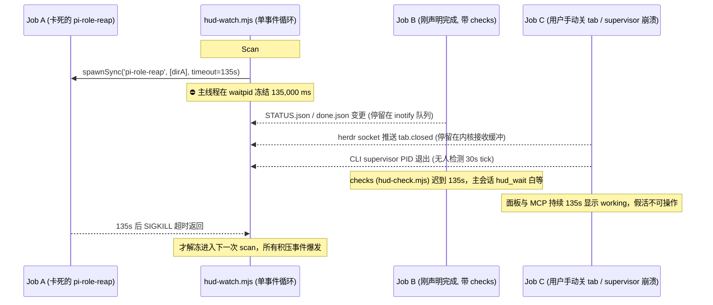
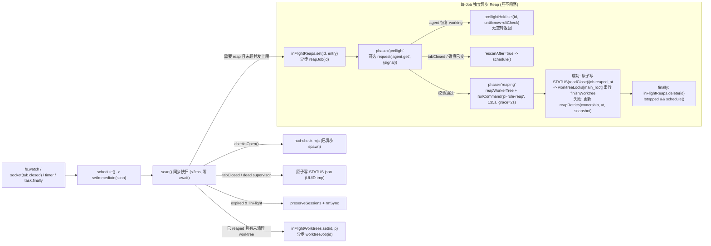
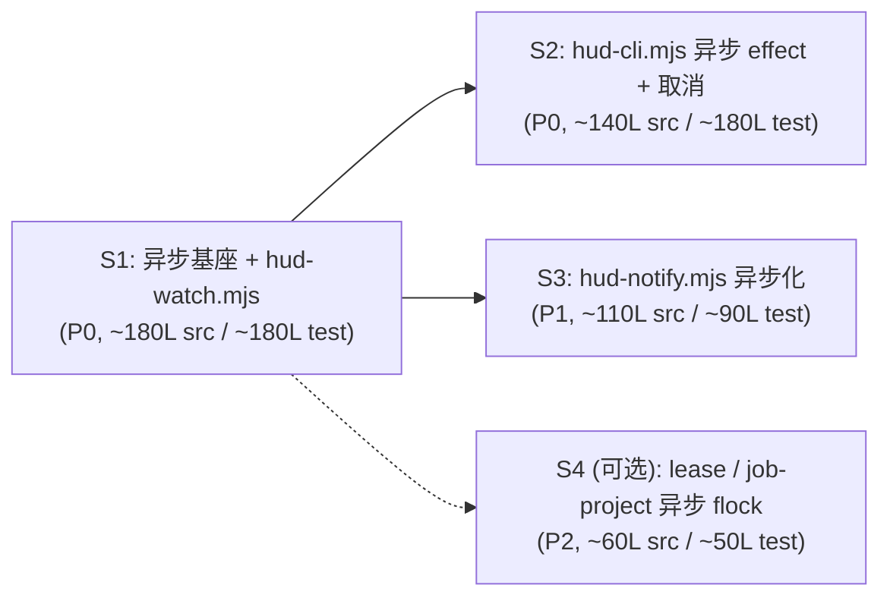

# 06. 消除事件循环中的长耗时 `spawnSync` 阻塞（`hud-watch.mjs` 异步 reap、`hud-cli.mjs` 异步 `herdr`）

> **优先级**：P0（高并发多任务场景下的核心可靠性与尾延迟修复）
> **类别**：运行期并发架构重构 / 事件循环解阻 / 信号与取消语义加固
> **预估规模**：2 个核心垂直切片（S1 + S2，必选）+ 1 个配套切片（S3，强烈推荐）+ 1 个可选尾项（S4）；核心改动约 320L 源码 + 360L 确定性回归测试，净移除 2 处最严重的长阻塞 `spawnSync`（含 S3 共移除 6 处）
> **前置依赖**：**零前置依赖**；与方案 02（`02-decompose-monoliths-and-ts-bins.md`）完全正交——既可直接落地于当前 `packages/hud-mcp/bin/*.mjs` 与 `src/roles/*.ts`，也可在方案 02 迁入 TypeScript 后直接平移到 `packages/hud-mcp/src/runtime/`
> **`docs/spec.md` 边界影响**：**无产品规格变更**（不新增常驻服务、不改动 MCP 工具契约、磁盘 JSON schema 或快捷键；严格兑现 `docs/spec.md` §2.1 “per-job concurrency so slow launches never block other jobs or answers” 与 §4 轻量事件驱动 watcher 要求；因涉及子进程终止与 `worker-tree.ts`，按 `docs/delegation.md` 需在合并前安排一次聚焦 `killing processes` 边界的 reviewer 审查）

---

## 1. 背景与现状证据

### 1.1 全仓事件循环 `spawnSync` 阻塞点盘点

对 `packages/hud-mcp/`、`src/roles/` 及相邻常驻/半常驻进程（`src/cli/watch.ts`）做全量代码扫描，当前存在以下阻塞事件循环的同步子进程调用（全仓无 `execFileSync` / `execSync`）：

| 优先级 | 文件与精确行号 | 符号与同步调用 | 单次最坏阻塞 | 所在进程类型 | 归属 |
|---|---|---|---:|---|---|
| **P0** | `packages/hud-mcp/bin/hud-watch.mjs:334–336` | `scan()` → `reapWorkerTree(..., () => spawnSync('pi-role-reap', [dir], { timeout: 135000, killSignal: 'SIGKILL' }))` | **135,000 ms**（$N$ 个 job 串行叠加 $135\text{s} \times N$） | 全局按需 watcher（单进程服务全部 job） | **本方案 S1** |
| **P0** | `packages/hud-mcp/bin/hud-cli.mjs:29–34` | `effect(args)` → `spawnSync('herdr', args, { timeout: 20000 })`，被 `run()` 于 `:214`（`collect-sonic`）、`:218`（`pane read`）、`:239`（`prompt-report`）、`:259`（`/quit`）调用 | **20,000 ms**（`decide` 路径叠加 `pane read` + `prompt-report` 达 **40,000 ms**） | 每-job CLI supervisor（事件推送 + 文件监听） | **本方案 S2** |
| **P1** | `packages/hud-mcp/bin/hud-notify.mjs:63, 73, 80, 89` | `paneInfo()`（`herdr pane get`, 2s）与 `notify()`（`pane get` 2s + `pane process-info` 2s + `codex queue` 20s + fallback `herdr agent prompt` 20s） | **2,000 ms**（MCP 主循环 `thin-main.ts:1203,1360,1519,1572,1795,1816`）；**44,000 ms**（`hud watch --queue` `src/cli/watch.ts:284,307` 与 worker MCP `hud_ask` `worker-tools.mjs:270`） | MCP Server / `hud watch --queue` / Worker MCP | **本方案 S3（推荐）** |
| **P2** | `src/roles/lease.ts:32` | `locked()`（在 `async takeLease` 内）→ `spawnSync(flock, ['-x', '-w', '1', '3'], { timeout: 1500 })` | **1,500 ms** | Main / Worker MCP Server | **本方案 S4（可选）** |
| **P2** | `src/roles/job-project.ts:47` | `adoptProjectJobs()`（已 `async`）→ `spawnSync('flock', ['-nx', '3'], { timeout: 1000 })` | **1,000 ms**（正常 `-nx` <5ms） | Main MCP Server / `hud watch` | **本方案 S4（可选）** |
| Out of Scope | `src/roles/projects.ts:24, 48` | `projectRoot()` / `sharedRoot()` → `spawnSync('git', [...SAFE_GIT_ARGS, 'rev-parse', ...], { timeout: 5000 })` | 5,000–10,000 ms | 多处同步调用方（panel / roster / MCP） | 见 §2 非目标 |
| Out of Scope | `src/collectors/daemon-binding.ts:314`、`pane-runtime-state.ts:116`、`statusline-parity/git.ts:33`、`bin/hud:12` | Codex tmux 辅助 / 一次性 statusline CLI / uninstall wrapper | 1,500 ms / 一次性 | 非 watcher/supervisor 路径 | 见 §2 非目标 |

### 1.2 精确调用链与伴随串行瓶颈

#### A. `packages/hud-mcp/bin/hud-watch.mjs`（405L）

`hud-watch.mjs` 是全机器所有 HUD job 共享的唯一按需收割器，单事件循环同时负责：
1. `fs.watch(jobs, { recursive: true })`（`:391–403`）与 `herdr` Unix socket `events.subscribe`（`tab.closed`, `:97–137`）；
2. `checksOpen()`（`:80–96, 268`）在 worker 声明完成后立即拉起 `hud-check.mjs`；
3. `tabClosed` 判定与 CLI dead-supervisor 兜底接管（`:239–262`）；
4. 配额耗尽打标（`:287–297`）、Pi 读后自动收割 `readCloseTurn`（`:191–193, 275–285, 323–331`）；
5. 终态 `pi-role-reap` + 后代进程树清理（`:333–366`）；
6. 托管 worktree 安全回收 `finishWorktree`（`:199–205, 299, 363`）与 24h 过期目录保留/删除 `preserveSessions` + `fs.rmSync`（`:153–177, 301–309`）。

但当前 `scan()`（`:206–383`）存在**双重阻塞**：
1. **内核级事件循环冻结（最严重）**：`:334–336` 向本已支持异步回调的 `reapWorkerTree()`（`src/roles/worker-tree.ts:134`，`thin-main.ts:1773` 与 `panel-pane.ts:64` 均传入异步 `runCommand`）传入了**同步** `spawnSync('pi-role-reap', [dir], { timeout: 135000, killSignal: 'SIGKILL' })`。在最多 135 秒内，Node 主线程完全卡死在 C 层 `waitpid`，**一切 timer、`fs.watch` 回调、herdr socket 读取、子进程 `exit` 监听全部停摆**。
2. **串行 `for ... await` 队头阻塞（Head-of-Line Blocking）**：即便仅把 `:335` 的 `spawnSync` 换成 `await runCommand(...)`，`scan()` 在 `:208–209` 用全局锁 `if (scanning) { queued = true; return; } scanning = true;` 互斥重入，并在 `:217–374` 的单层 `for (const id of fs.readdirSync(jobs))` 内串行执行 4 个 `await`：
   - `:299` `await finishWorktree(jobFile, id, job)`（`managed-worktree.ts:91–128` 最多串行执行 8–10 个 `worktreeGit` 5s 超时命令 + 最多 10 万项同步目录遍历 `nestedGitReason`）；
   - `:326` `await request('agent.get', { target })`（`herdr-request.mjs:12` 单次超时 2,000 ms）；
   - `:334` `await reapWorkerTree(...)`（异步 `pi-role-reap` 最长 135,000 ms + `delay(250)` + `10 × delay(50)` = 135,750 ms）；
   - `:363` `await finishWorktree(jobFile, id, latest)`（最长 ~50,000 ms）。
   **只要任意一个 job 在这 4 处 `await` 中耗时，整个 `scan()` 就处于 `scanning = true`，后续 job 以及新到达的 `schedule()` 请求全部被饿死！**
3. **无信号清理处理器**：`hud-watch.mjs` 全文未注册 `SIGTERM`/`SIGINT` 处理函数。外部终止时会遗留 `watch.pid` 并使在途 `pi-role-reap` 孤儿化。

#### B. `packages/hud-mcp/bin/hud-cli.mjs`（282L）

`hud-cli.mjs` 是每个交互式 CLI job 的独立事件驱动 supervisor（设计目标：静默期零 spawn、实时响应 herdr 推送与文件事件）。其 `effect(args)`（`:29–34`）用同步 `spawnSync('herdr', args, { encoding: 'utf8', timeout: 20000 })` 在 `async function run()`（`:191–281`）中有 4 处调用点：

1. `:214`（`next.action === 'collect-sonic'`）：`effect(['agent', 'prompt', name, prompt])` → 失败直接 `throw new Error('sonic collect prompt failed')` 落入 `:277` 写 `waiting_orchestrator: supervisor error`。
2. `:218`（`next.action === 'decide'`）：`effect(['pane', 'read', pane, '--source', 'recent'])` → 代码注释 `:219` 自己就写着 `// The pane read can block; don't ask using the earlier child sample.`，随后仅重采了 `sampleChild()` 与 `sonicChildren()`，**并未重验 `stop`/`close`/`tabClosed`/`turn.seq`/`reportSig`/`status` 就直接发起了 30s 超时的 `await decideQuietJob(...)`（付费 Decision API 请求）**。
3. `:239`（`decision.action === 'prompt-report'`）：`effect(['agent', 'prompt', name, prompt])` → 失败时直接使用 20 秒前采集的旧 `observed` 调用 `judge(prev, { ...observed, decision }, Date.now())`（`:248`），会覆盖期间到达的新状态。
4. `:259`（`next.action === 'quit'`）：`effect(['agent', 'prompt', name, '/quit'])` → 位于 `write(next)`（`:261`）之前；`/quit` 卡死 20s 期间 `STATUS.json` 一直无法翻转为 `closed`，且 `SIGTERM`/`STATUS.json.stop-requested`/`tab_closed` 均被冻结。

此外，`decideQuietJob()`（`packages/hud-mcp/src/quiet-decision.ts:129`）仅硬编码了 `AbortSignal.timeout(30_000)`，不接受外部取消信号；`:231` 的竞态重验清单也遗漏了 `latest.tabClosed` 与 `latest.turn.sent_at`。

### 1.3 真实故障场景推演



**场景 1（`hud-watch.mjs` 135s 全局雪崩）**：Job A 的 `pi-role-reap` 因 herdr 瞬时卡顿或进程关闭慢卡住 135s。期间同机器上 Job B 刚写完报告并声明完成，其 `checks`（`hud-check.mjs`）迟滞 135s 才启动；Job C 的 tab 被关闭或 supervisor 崩溃，MCP `changes` 与侧栏面板整整 135s 仍显示 `working`；Job D 的普通 reap 与过期清理全部饿死。

**场景 2（`hud-cli.mjs` 20–40s 僵死与竞态覆盖）**：CLI worker 静默超期进入 `decide`，`effect(['pane', 'read', ...])` 卡住 20s。期间第 1 秒主会话执行 `hud_close` 写入 `STATUS.json.stop-requested` 并发送 `SIGTERM`——但 `hud-cli.mjs` 冻结在 `spawnSync` 中既收不到 `fs.watch` 也响应不了 `SIGTERM`；20s 解冻后若又进入 `decideQuietJob`（30s）或 `prompt-report`（20s），最坏拖延 **70s** 才退出，且可能浪费一次 Decision API 额度或把 `stop` / `tab_closed` 覆盖成 `waiting_orchestrator (prompt-failed)`。

**场景 3（隐藏并发雷区——若草率异步化会立刻踩爆）**：
1. **自触发 `tab.closed` 污染 Pi `readClose`**：旧同步代码中，`pi-role-reap` 关 tab 触发的 `tab.closed` 因事件循环冻结被推迟到 `STATUS.json` 写成 `closed` 之后才读到。改为异步后，`pi-role-reap` 关 tab 的瞬间 `herdr` 就会推送 `tab.closed` 唤醒 `scan()`——若 `scan()` 不识别正在 `reaping` 的 job，`:256` 会抢先将仍处于 `idle_grace` 的 `STATUS.json` 篡改为 `state: 'failed', exit_reason: 'tab closed'`！
2. **同仓库并行 `reapWorktree` 的 Git 锁冲突**：两个归属同一 `main_root` 的 worktree job 并行执行 `git worktree remove` / `git branch -d`（`managed-worktree.ts:120–125`），会竞争 `.git/packed-refs.lock` / `.git/config.lock` 导致误判保留（写入 `worktree_kept_reason`）。
3. **测试时钟加速陷阱（`tests/unit/thin-mcp.test.mjs:396`）**：`clock.mjs` 在 `hud-cli.mjs` 进程内将 `globalThis.setTimeout` 除以 20！原先 `spawnSync(..., { timeout: 20000 })` 走的是 libuv 原生定时器不受影响；若 `runCommand` 使用 `globalThis.setTimeout`，`20_000 ms` 预算在测试里会被压成 `1000 ms`，CI 稍慢即触发虚假超时。
4. **共享 `${file}.${process.pid}.tmp` 命名碰撞**：`hud-watch.mjs:195, 259, 293, 353` 与 `hud-cli.mjs:187` 均未附带 `randomUUID()`，同进程异步并发写同一路径时存在临时文件互踩风险。

---

## 2. 目标与非目标（Scope / Out of Scope）

### 目标（Scope）

1. **增强异步命令执行基座（`src/roles/herdr-run.ts`、`src/roles/worker-tree.ts`、`packages/hud-mcp/bin/herdr-request.mjs`）**：
   - `runCommand` 支持 `SIGTERM → killGraceMs → SIGKILL` 优雅升级终止、输出超限（1 MiB 严格字节上限）同样升级 `SIGKILL`、修复 `stopReason` 归因、使用不受 `globalThis.setTimeout` 劫持的原生定时器；
   - `reapWorkerTree` 支持可选 `signal?: AbortSignal`，在 watcher 被信号终止取消 reap 时短路退出、避免在未完成 tab 校验前误杀后代；
   - `herdr-request.mjs` 支持 `{ timeoutMs, signal }` 取消与幂等清理。
2. **重构 `packages/hud-mcp/bin/hud-watch.mjs` 为“同步快扫 + 每-Job 独立异步任务”**：
   - 彻底移除 `spawnSync`，`scan()` 内零阻塞、零长 `await`（单次扫描 <2ms）；
   - 将 `readInGrace` preflight（`agent.get`）、`reapWorkerTree`（异步 `runCommand('pi-role-reap', ...)`）、终态落盘与 `finishWorktree` 封装为每 job 独立的 in-flight 异步任务，带并发上限、同 job 严格互斥、同 `main_root` worktree 串行锁、自触发 `tab.closed` 防护与 `preflightHold` 防空转；
   - 保持 `stop()` 退出屏障等待所有 in-flight 任务归零，并新增幂等 `SIGTERM`/`SIGINT` 优雅退出。
3. **重构 `packages/hud-mcp/bin/hud-cli.mjs` 与 `quiet-decision.ts` 为全异步可取消执行**：
   - 用异步 `runHerdr` 替换同步 `effect()`，在 `decideQuietJob` 中接入 `AbortSignal`；
   - 引入分层取消（进程级 `lifecycle` + 动作级 `activeEffect`），`SIGTERM`/`SIGINT`/`stop-requested`/`tab_closed` 毫秒级中止挂起中的 `herdr` 与 HTTP 请求；
   - 补齐 4 处 `await` 后的状态重验与 `stillQuiet()` 完整谓词，消除过时状态覆写与无效 API 调用。
4. **（切片 S3，推荐纳入）异步化 `packages/hud-mcp/bin/hud-notify.mjs`**：
   - 将 `paneInfo` / `notify` / `ensureQueueWatcher` 切换为异步 `runCommand`/`runHerdr`（带 `AbortSignal`），解除 `thin-main.ts`、`src/cli/watch.ts`（`--queue`）与 `worker-tools.mjs`（`hud_ask`）中的 2s–44s 同步阻塞。

### 非目标（Out of Scope）

1. **不引入常驻守护进程或新外部依赖**：严格遵守 `docs/spec.md` §3/§4（无 resident server，Node ≥24 内置模块零新增依赖）。
2. **不改动 `docs/spec.md`、MCP 工具 schema 或磁盘文件格式**：`job.json`、`STATUS.json`、`turn.json`、`worker-tree.json`、`checks.json` 与 `watch.log` 日志格式 100% 向后兼容。
3. **不迁移 `.mjs` 到 TypeScript**：模块拆分与 TS 化归属 **方案 02**；本方案保持文件路径与导出不变。
4. **不改动同步目录解析 `src/roles/projects.ts`（`projectRoot`/`sharedRoot`）**：其被大量同步函数（panel collectors、roster、projectJobFilter）调用，异步化波及面广，留作独立缓存/异步改造议题。
5. **不改动 Codex tmux 路径与一次性 CLI**：`daemon-binding.ts:314`、`pane-runtime-state.ts:116`（受方案 01 裁剪影响）、`statusline-parity/git.ts:33`（一次性状态栏进程）、`bin/hud:12`（一次性卸载透传）不在本方案范围内。

---

## 3. 核心设计方案

### 3.1 异步子进程与取消基座

#### 3.1.1 `src/roles/herdr-run.ts` 增强契约

当前 `packages/hud-mcp/dist/src/roles/herdr-run.js` 已随 `npm run build:hud-mcp` 编译输出（`thin-main.ts:24` 复用同一份源码），因此 `hud-watch.mjs`、`hud-cli.mjs` 与 `hud-notify.mjs` 可直接 `import { runCommand, runHerdr } from '../dist/src/roles/herdr-run.js'`，零构建配置变更。

扩展 `HerdrCallOptions`（100% 向后兼容现有调用方）：

```ts
export interface HerdrCallOptions {
  readonly budgetMs?: number;
  readonly signal?: AbortSignal;
  /** 超时或中止时先发 SIGTERM，等待该毫秒数后仍未退出再升格 SIGKILL。默认 0（保持短预算调用方既有即时 SIGKILL 语义）。 */
  readonly killGraceMs?: number;
}
```

关键实现修正（对照 `src/roles/herdr-run.ts:39–112`）：

1. **独立壁钟定时器（免疫 `clock.mjs` 20× 劫持）**：
   - 使用 `import { setTimeout as rawSetTimeout, clearTimeout as rawClearTimeout } from 'node:timers'`（或捕获模块加载期原生 timer）管理 `budgetMs` 与 `killGraceMs`，使子进程看门狗与原 `spawnSync` 的 libuv 定时器行为一致，不受 `tests/unit/thin-mcp.test.mjs:396` 对 `globalThis.setTimeout` 的 20 倍加速影响，同时仍可通过显式传入小 `budgetMs`（如 `100`）快速单测。
2. **`SIGTERM → killGraceMs → SIGKILL` 完整状态机**：
   - 将原布尔 `killedByUs` 替换为 `let stopReason: 'timeout' | 'aborted' | 'overflow' | null = null`。
   - `stop(reason)`:
     - 幂等守卫：`if (settled || stopReason !== null) return; stopReason = reason;`；清除 `budgetTimer`。
     - 若 `grace === 0`：直接 `child.kill('SIGKILL')`、销毁 `stdout`/`stderr` 流、`finish({ ok: false, reason, ... })`。
     - 若 `grace > 0`：发送 `child.kill('SIGTERM')`，启动 `killTimer = rawSetTimeout(forceKill, grace)`。
     - 注册 `child.once('exit', ...)`：当 `stopReason !== null` 且子进程在宽限期内响应 `SIGTERM` 退出时，立刻清除 `killTimer`、销毁 `stdout`/`stderr`（防止孙进程继承管道卡住 `close`——保持 `:71` 注释的承诺）并 `finish({ ok: false, reason: stopReason === 'overflow' ? 'lost' : stopReason, stdout, stderr, exitCode: null })`。
     - 若 `grace` 耗尽仍未退出：`forceKill()` 发送 `SIGKILL`、销毁管道并立刻 `finish(...)`。
3. **输出超限（1 MiB 严格字节上界）同样升级 `SIGKILL`**：
   - 当前 `:84–87` 在超过 `MAX_OUTPUT` 后仅调用 `child.kill()`（`SIGTERM`）且未销毁流、无 `SIGKILL` 升级，恶意或故障子进程忽略 `SIGTERM` 时会继续拖满 135s。
   - 改为按字节累积（`let usedBytes = 0`，用 `Buffer` 切片 + `StringDecoder('utf8')` 避免多字节 UTF-8 被截断产生乱码），一旦溢出立刻 `child.stdout?.destroy(); child.stderr?.destroy(); stop('overflow')`（宽限 `Math.min(grace || 250, 250)` ms 后 `SIGKILL`），最终返回 `{ ok: false, reason: 'lost', ... }`。
4. **`finish()` 严格清理**：无论从 `error`、`exit`、`close`、`timeout` 还是 `abort` 退出，均清除 `budgetTimer` 与 `killTimer`，并 `options?.signal?.removeEventListener('abort', onAbort)`，零内存与句柄泄漏。

#### 3.1.2 `src/roles/worker-tree.ts` 取消短路

在 `reapWorkerTree`（`src/roles/worker-tree.ts:134–172`）的选项对象中增加可选 `signal?: AbortSignal`：

```ts
export async function reapWorkerTree<T>(
  dir: string,
  status: unknown,
  reap: () => T | Promise<T>,
  ok: (result: T) => boolean,
  { carry, expectSnapshot, signal }: { carry?: Snapshot; expectSnapshot?: boolean; signal?: AbortSignal } = {}
)
```

- 在 `const result = await reap();`（`:137`）返回后，若 `signal?.aborted` 为 `true`：
  - **直接返回** `{ result, complete: false, issue: undefined, snapshot: before.snapshot ?? carry }`，不执行 `after = rememberWorkerTree` 与 `:161–167` 的 `SIGTERM / delay(250) / SIGKILL / 10×delay(50)` 循环。
  - 原因：watcher 收到 `SIGTERM` 主动中止 `pi-role-reap` 时，`pi-role-reap` 可能尚未完成 tab 归属校验；此时不应在退出路径上盲目杀后代或拖慢 750ms 退出，留待下次 watcher 启动完整收割即可。
- 若 `signal?.aborted` 为 `false` 且 `ok(result)` 为 `false`（普通 reap 失败，如 `thin-mcp.test.mjs:1686` 或 `cli-judge.test.mjs:97`）：**100% 保持既有行为**，继续清理已捕获血缘的后代进程。
- `:163, :165` 的 `delay(...)` 亦透传 `{ signal }` 并静默捕获 `AbortError`，保证停机期间若恰处于 `delay(250)` 也能瞬间收敛。

#### 3.1.3 `packages/hud-mcp/bin/herdr-request.mjs` 取消与幂等加固

扩展签名 `export function request(method, params, { timeoutMs = 2000, signal } = {})`：
- 若 `signal?.aborted` 直接 `Promise.resolve(null)`；
- `done(body = null)` 增加 `let settled = false` 幂等守卫，清理 `timer` 与 `signal` 监听，销毁 socket；
- 使用 `node:timers` 原生 `setTimeout` 避免被测试时钟加速器把 2000ms 压成 100ms（同时保留 `timeoutMs` 可配性）。

---

### 3.2 `packages/hud-mcp/bin/hud-watch.mjs`：同步快扫 + 每-Job 独立异步任务架构

#### 3.2.1 架构与数据流

核心设计思想：**将 `scan()` 彻底瘦身为纯同步、无长 `await` 的轻量调度器（单次 <2ms），把所有长耗时/外部 I/O 收尾操作抽离为 per-job 隔离的异步任务状态机**。



#### 3.2.2 状态数据结构与不变量

在 `hud-watch.mjs` 顶层维护以下精确状态（均为进程内易失状态，磁盘仍是唯一真相源）：

```ts
interface ReapEntry {
  readonly id: string;
  readonly ownership: string;       // JSON.stringify([session, status.pid, status.pid_start_time])
  readonly readClose: boolean;      // 是否源自 Pi read-close（含 resumeReadReap）
  phase: 'preflight' | 'reaping';   // 'preflight' 允许 tabClosed 中断；'reaping' 后禁止 scan 篡改 STATUS
  readonly controller: AbortController;
  readonly promise: Promise<void>;
}

interface PreflightHold {
  readonly ownership: string;
  readonly token: string;           // readCloseTurn 返回的签名串
  readonly until: number;           // Date.now() + cliCheck
}

const MAX_CONCURRENT_REAPS = 4;     // 防止收割风暴挤爆 WSL /proc 与 herdr
const REAP_BUDGET_MS = 135_000;
const REAP_KILL_GRACE_MS = 2_000;
const SHUTDOWN_DRAIN_MS = 3_000;

const inFlightReaps = new Map<string, ReapEntry>();
const inFlightWorktrees = new Map<string, Promise<void>>();
const worktreeLocks = new Map<string, Promise<void>>(); // 按 wt.main_root 串行化 Git 清理
const preflightHold = new Map<string, PreflightHold>();
```

**六条核心不变量（Invariants）**：
1. **单 Job 严格互斥**：同一 `id` 绝不同时出现在多个 `reapJob` 中，也绝不同时出现在 `inFlightReaps`、`inFlightWorktrees` 或 `fs.rmSync(dir)` 中。`scan()` 循环遇到 `inFlightReaps.has(id)` 或 `inFlightWorktrees.has(id)` 时，跳过该 job 的状态改写、删除与重复派发，继续处理其余 job。
2. **自触发 `tab.closed` 免疫**：一旦 `reapJob` 完成 preflight 进入 `phase = 'reaping'`（即将执行 `pi-role-reap`），或 `reapRetries.get(id)?.readClose === true`（上一次 read-close 已启动但待重试），`scan()` 的 `:239–262` **禁止**因为 `closedTabs.has(tab)` 将 `STATUS.json` 覆盖为 `failed: tab closed`。在 `phase === 'preflight'` 阶段若外部提前触发 `tab.closed`，则调用 `entry.controller.abort()` 立即中止 `agent.get` 并在 `reapJob` 返回后立刻重扫，交由 `scan()` 正常记录 `failed: tab closed`。
3. **Preflight 防空转（Anti-Spin）**：当 `readInGrace` 的 `agent.get` 返回 `'working'` 且磁盘 `STATUS.json` 仍停留在过时的 `idle_grace`（`thin-mcp.test.mjs:1533` 显式验证此场景），写入 `preflightHold.set(id, { ownership, token: readInGrace, until: Date.now() + cliCheck })` 且 **不**在 `finally` 中无条件调用 `schedule()`（除非存在 `reapBacklog` 或磁盘/tab 已变）。这样既避免毫秒级死循环狂刷 `agent.get`，又能在 `cliCheck` 到期或下次 `STATUS.json`/`report.md` 变更时自动复查。
4. **缓存读写隔离与无碰撞原子写**：
   - `scan()` 变为同步函数后，`:213` `seen.clear()` 与 `:375` 缓存淘汰在同一事件循环 tick 内原子完成，彻底消灭 `cache`/`seen` 并发污染；
   - 异步 `reapJob` / `worktreeJob` 内部一律通过独立的 `readJsonFresh(file)` 直接 `fs.readFileSync` + `JSON.parse`，**不触碰 `cache`/`seen`**，同时规避同 inode 同毫秒覆写命中脏缓存；
   - 所有落盘统一抽取 `writeJsonAtomic(file, data)`：使用 `${file}.${process.pid}.${randomUUID()}.tmp`、`{ flag: 'wx', mode: 0o600 }`、原子 `renameSync` 及 `catch` 中 `fs.rmSync(temp, { force: true })`。
5. **同仓库 Worktree 清理串行化**：
   - `finishWorktree(jobFile, id, job)` 通过 `withWorktreeLock(job.worktree.main_root, async () => ...)` 串行执行同一仓库的 `reapWorktree(id, job)`，不同仓库之间完全并发；
   - 已 `reaped_at`（或 `!session && dispatch_exit_code > 0`）但尚未写 `worktree_removed_at` / `worktree_kept_reason` 的过期 job，在 `scan()` 中启动 `startWorktreeJob` 后直接 `continue`，绝不在 `finishWorktree` 写入 `job.json` 期间执行 `fs.rmSync(dir)`；清理完成后由 `finally` 触发 `schedule()` 再删目录。
6. **并发上限与背压唤醒**：
   - 当 `inFlightReaps.size >= MAX_CONCURRENT_REAPS` 时，本轮 `scan()` 标记 `reapBacklog = true` 并跳过多余 reap；任意一个 `reapJob` 在 `finally` 退出后只要 `reapBacklog` 为真（或 `reapAttempted` / `rescanAfter` 为真）立即 `schedule()`，零饥饿、零漏扫。

#### 3.2.3 退出判定（`stop()`）与信号优雅清理（`SIGTERM` / `SIGINT`）

1. **空闲自然退出（`stop()`）**：
   - 扫描尾部退出条件升级为：
     ```js
     const hasInFlight = inFlightReaps.size > 0 || inFlightWorktrees.size > 0;
     if (open) subscribe();
     if (safetyCheck) nearest = Math.min(nearest, Date.now() + cliCheck);
     if ((open || hasInFlight || nearest !== Infinity) && !watcher) {
       nearest = Math.min(nearest, Date.now() + 1000);
     }
     scanning = false;
     if (nearest !== Infinity) timer = setTimeout(() => scan(true), Math.max(1, Math.ceil(nearest - Date.now())));
     if (queued) setImmediate(scan);
     else if (!open && !hasInFlight && nearest === Infinity) stop();
     ```
   - 验证关键测试兼容性：
     - `job-retention.test.mjs:738`（无 tab、无 `inFlight`、健康 `watcher`、断言禁止调用 `setTimeout`）：`open === false && hasInFlight === false && nearest === Infinity`，**零 `setTimeout` 调用**，立即 `stop()`；
     - 单闭环 job（如 `thin-mcp.test.mjs:2492`）：首轮 `scan()` 发起 `reapJob` 后 `hasInFlight === true` 不提前退出；`reapJob` 完成后 `finally` 删映射并 `schedule()`，次轮 `scan()` 见 `reaped_at` 已落盘且 `hasInFlight === false`，正常 `stop()` 删除 `watch.pid` 并以退出码 0 结束。
2. **信号优雅停机（`shutdown(signal)` 注册于 `SIGTERM` / `SIGINT`）**：
   - 幂等：`if (shuttingDown) return; shuttingDown = true; stopped = true;`
   - 立即关闭 `watcher`、销毁 `socket`、清除 `timer`，阻断一切新扫描与新任务启动；
   - 对 `inFlightReaps` 中每个 entry 调用 `entry.controller.abort()`，驱动 `runCommand` 执行 `SIGTERM → 2s → SIGKILL` 并驱动 `reapWorkerTree` 短路跳过后代信号循环；
   - 对 `checking`（已在运行的 `hud-check.mjs`）：保留 `child.unref()` 策略不强杀用户检查命令（`hud-check.mjs` 有独立抽象 socket 锁与 `checks.json` 状态机），也不让其句柄拖住 watcher 退出；
   - 等待 `Promise.race([Promise.allSettled([...allInFlightPromises]), rawDelay(SHUTDOWN_DRAIN_MS)])`（定时器 `.unref()`，一旦全员提前退出立即返回）；
   - 若 `pidFile` 内容仍为本进程 PID 则 `fs.unlinkSync(pidFile)`，仅向 `watch.log` 写入 `exit pid=${process.pid}: signal=${signal}`（**不写 `stderr`**，严格满足 `job-retention.test.mjs:27` `assert.equal(stderr(), '')`），随后有序退出（退出码 `0`）。
3. **日志与 Tab 归属拒绝契约 100% 兼容**：
   - `reapWorkerTree` 回调由 `() => spawnSync(...)` 换为 `() => runCommand('pi-role-reap', [dir], process.env, { budgetMs: REAP_BUDGET_MS, killGraceMs: REAP_KILL_GRACE_MS, signal: controller.signal })`，判定函数换为 `(run) => run.ok`；
   - 若 `stopped || result.reason === 'aborted'`，直接跳过状态落盘与 `reapRetries` 写入；
   - 归属拒绝判定升级为：
     ```js
     const refusal = !issue && !readClose && result.exitCode === 1 &&
       result.stderr.trimEnd().endsWith(`: TAB ${tab} name changed or missing; not closing`) &&
       !result.stderr.trim().includes('\n');
     ```
   - 日志格式化升级为 `exit=${result.exitCode ?? result.reason}`——正常退出（`0`/`1`）与现有测试断言（`thin-mcp.test.mjs:1551, 1657`）逐字符一致，超时与缺命令分别清晰记录 `exit=timeout` / `exit=unavailable`。

---

### 3.3 `packages/hud-mcp/bin/hud-cli.mjs`：异步 `effect()`、分层取消与完整竞态重验

#### 3.3.1 备选方案对比：`runHerdr` 异步 CLI vs `herdr-request.mjs` Unix Socket

| 维度 | 方案 A：全部 4 处 `effect()` 统一改用异步 `runHerdr`（**推荐**） | 方案 B：`pane read` 切到 `herdr-request.mjs` socket，3 处 `agent prompt` 用 `runHerdr` | 方案 C：全部 4 处切到 `herdr-request.mjs` socket |
|---|---|---|---|
| **是否可行** | 完全可行（`runHerdr` 已编译在 `packages/hud-mcp/dist/src/roles/herdr-run.js`） | 可行，但需核对 live `herdr` 的 `pane.read` JSON-RPC 全部参数语义 | **不可行**：`herdr agent prompt` 包含就绪等待/输入提交/卡死判定（`agent_prompt_stalled`/`agent_not_ready`），fake socket（`thin-mcp.test.mjs:526–553`）亦无 `agent.prompt` |
| **消除 20s 阻塞效果** | **100% 消除**，且支持 `AbortSignal` + `SIGTERM→SIGKILL` | 100% 消除 | N/A |
| **无 `HERDR_SOCKET_PATH` 鲁棒性** | 强：`herdr` CLI 自带默认 socket 发现 | 弱：`herdr-request.mjs:7` 无 env 直接返回 `null` | 弱 |
| **调用频次与性能** | `pane read` 每 10 分钟静默最多 1 次（单 turn 上限 3 次），fork ~5ms 相对 30s Decision API 可忽略 | 省 ~5ms/10min，无体感差异 | N/A |
| **与代码库和测试一致性** | 与 `thin-main.ts:553,717,811` 完全一致；兼容全部既有 `f.commands()` 断言（如 `thin-mcp.test.mjs:1897`） | 会分裂 `effect()` 为两条传输路径，且使 `thin-mcp.test.mjs:1897` 的 CLI `pane read` 计数断言失效 | 破坏大量测试 |

**结论**：采用 **方案 A**。`hud-cli.mjs` 保持 `herdr-request.mjs` 专职高频轻量读查询（`agent.get`、`pane.process_info`），将 `effect(args, signal)` 统一实现为 6 行异步包装：

```js
async function effect(args, signal) {
  const ran = await runHerdr(args, process.env, { budgetMs: 20_000, killGraceMs: 500, signal });
  let body = null;
  try { body = JSON.parse(ran.stdout); } catch { /* Effects can fail without proving worker death. */ }
  return { ok: ran.ok, reason: ran.reason, body };
}
```

#### 3.3.2 分层 `AbortSignal` 取消模型

在 `hud-cli.mjs` 中引入两级取消控制器与事件驱动取消矩阵：

```js
const lifecycle = new AbortController(); // 进程级：仅在 shutdown() 时触发
let activeEffect = null; // { kind: 'sonic' | 'read' | 'decide' | 'prompt' | 'quit', controller: AbortController, reason?: string }
let urgentWake = false;

function beginEffect(kind) {
  const controller = new AbortController();
  const entry = { kind, controller, reason: null };
  activeEffect = entry;
  return { entry, signal: AbortSignal.any([lifecycle.signal, controller.signal]) };
}
function endEffect(entry) {
  if (activeEffect === entry) activeEffect = null;
}
function cancelEffect(reason, kinds) {
  if (!activeEffect || (kinds && !kinds.has(activeEffect.kind))) return;
  activeEffect.reason = reason;
  activeEffect.controller.abort();
}
```

**外部事件 → 取消策略矩阵**：

| 到达的事件 | 触发来源 | 取消哪些在途 `activeEffect.kind` | 是否设置 `urgentWake = true` | 设计理由 |
|---|---|---|---|---|
| `SIGTERM` / `SIGINT` | `process.on` → `shutdown()` | **全部**（通过 `lifecycle.abort()`） | 否（直接退出） | 立即终止 `herdr` 子进程、`request()` socket 与 `decideQuietJob` HTTP 请求，防孤儿与误写 |
| `STATUS.json.stop-requested` 出现 | `watchDir()`（`fs.existsSync` 确认） | **全部**（`sonic`/`read`/`decide`/`prompt`/`quit`） | **是** | 显式停止优先于一切（`docs/spec.md` §2.1），毫秒级落盘 `stopped` |
| `tab_closed` / `pane_closed` | herdr `socket` 推送 | **全部**（`sonic`/`read`/`decide`/`prompt`/`quit`） | **是** | tab 已不存在，继续等待 `herdr` 毫无意义；对 `quit` 取消后仍按 `closed` 落盘 |
| `STATUS.json.close-requested`、`turn.json`、`report.md`、`DONE_FILE`、`qa/` | `watchDir()` / `watchQa()` | 仅 **`read`、`decide`** | 否 | 静默判定已过时，立即取消避免浪费 Decision API；**绝不**取消已提交中的 `sonic`/`prompt`/`quit` |
| `pane_agent_status_changed('working')` | herdr `socket` 推送 | 仅 **`read`、`decide`** | 否 | worker 恢复工作，立即放弃静默读取与模型裁决 |

当 `finally { busy = false; ... }` 检测到 `pending && !stopped` 时：若 `urgentWake` 为真（因 `stop`/`tabClosed` 中止了在途动作），清空 `urgentWake` 并用 `setImmediate(run)` 立刻进入下一轮判定，而非再等 250ms 防抖。

同步改造 `packages/hud-mcp/src/quiet-decision.ts:20–33, 129`：
- `QuietDecisionInput` 增加 `signal?: AbortSignal`；
- `provider.judge(...)` 传入 `signal: input.signal ? AbortSignal.any([AbortSignal.timeout(30_000), input.signal]) : AbortSignal.timeout(30_000)`；
- 若捕获的错误因 `input.signal?.aborted` 产生，直接返回 `{ choice: null, probability: null, action: 'needs-human', reason: 'aborted', asked }`（不污染错误统计）。

#### 3.3.3 四处 `await effect(...)` 后的完整竞态重验设计

抽取统一谓词 `stillQuiet(observed, latest)`（同时修复旧代码 `:231` 遗漏 `tabClosed` 与 `turn.sent_at` 的缺陷）：

```js
function stillQuiet(observed, latest) {
  return !stopped && !sendInFlight &&
    latest.turn.seq === observed.turn.seq &&
    latest.turn.sent_at === observed.turn.sent_at &&
    latest.reportSig === observed.reportSig &&
    latest.done?.at === observed.done?.at &&
    !latest.stop && !latest.close && !latest.tabClosed &&
    latest.alive !== false &&
    latest.status === observed.status &&
    latest.workingAt === observed.workingAt &&
    !latest.openQuestions &&
    latest.liveChild === false &&
    !latest.sonic.open && !latest.sonic.uncollected.length;
}
```

逐点核对 4 处异步调用的状态收敛：

1. **`collect-sonic`（`:210–216`）**：
   - 保持先 `sonicCollectPrompt` + `writeTurn(dir, { by: 'hud' })` 再 `await effect(['agent', 'prompt', name, prompt], signal)`。
   - 返回后：
     - `if (stopped) return;`（`SIGTERM` 优雅退出，**绝不** `throw` 落入 `catch` 污染 `STATUS.json`）；
     - `if (!res.ok && res.reason === 'aborted') { diskDirty = true; wake(); return; }`（被 `stop-requested`/`tabClosed` 取消，交由下一轮 `run()` 写终态，绝不误报 `supervisor error`）；
     - `if (!res.ok) throw new Error('sonic collect prompt failed');`（真实传输失败维持原语义）。
2. **`decide` — `pane read` + `decideQuietJob`（`:217–233`）**：
   - **阶段 1（`pane read`）**：用 `beginEffect('read')` 异步执行 `effect(['pane', 'read', pane, '--source', 'recent'], signal)`；
   - **关键新增重验（付费 API 前置闸门）**：`if (stopped) return;` → `diskDirty = true; const mid = collect(false, true);` → **`if (!stillQuiet(observed, mid)) { wake(); return; }`**。若在 `pane read` 期间出现了 `stop`、`tabClosed`、新 `turn`、新 `report.md`、子进程复活或恢复 `working`，直接跳过 `decideQuietJob` 省下 API 调用与问题计数！
   - **阶段 2（`decideQuietJob`）**：用 `beginEffect('decide')` 传入 `signal` 调用 `await decideQuietJob({ ..., backgroundChildAlive: mid.liveChild, paneText: text, signal })`；
   - **二次重验（写 `quiet_decision` / 发 `prompt-report` 前）**：`if (stopped) return;` → `if (decision.asked) quietQuestions += 1;` → `diskDirty = true; const latest = collect(false, true);` → `if (!stillQuiet(observed, latest)) { wake(); return; }`。
3. **`decide` — `prompt-report`（`:234–246`）**：
   - `writeTurn(dir, { by: 'hud', reportPromptSent: true })` 后用 `beginEffect('prompt')` 执行 `await effect(['agent', 'prompt', name, prompt], signal)`；
   - 返回后：
     - `if (stopped) return;`
     - 若 `res.ok`：`diskDirty = true; wake(); return;`（与现行一致）；
     - 若 `!res.ok`：先 `diskDirty = true; const after = collect(false);`
       - 若 `res.reason === 'aborted'` 或 `sendInFlight || after.stop || after.close || after.tabClosed || after.alive === false || after.turn.seq !== sent.seq || after.reportSig !== sent.report_sig || after.openQuestions`：说明期间已有终态/新 turn/新报告到达，**禁止**以过期 `observed` 覆写为 `prompt-failed`，直接 `wake(); return;`；
       - 否则（真实发送失败且无并发变更）：用新鲜的 `after`（`observed = { ...after, turn: sent }`）进入原 `prompt-failed` 回退逻辑，100% 保持 `thin-mcp.test.mjs:6590–6623` 行为。
4. **`quit`（`:251–268`）**：
   - **维持先发 `/quit` 再 `write(next)` 的顺序**（原因：`STATUS.json` 一旦写入 `closed`，`hud-watch.mjs` 会立刻调用 `pi-role-reap` 强关 tab，可能抢在 `/quit` 发出前撕毁进程并破坏 `thin-mcp.test.mjs:1761, 1918` 断言）；
   - `rememberWorkerTree(dir, current)` 成功后，用 `beginEffect('quit')` 执行 `await effect(['agent', 'prompt', name, '/quit'], signal)`；
   - 返回后：
     - `if (stopped) return;`（`SIGTERM` 退出，不写过期状态）；
     - 检查 `if (fs.existsSync(join(dir, 'STATUS.json.stop-requested')))`：若 `/quit` 期间收到了显式 stop，立即通过 `next = judge(prev, { ...observed, stop: true }, Date.now())` 升格为 `state: 'stopped', exit_reason: 'stop requested'`（严格遵守 `docs/spec.md` §2.1）；
     - 若 `/quit` 是被 `tab_closed` 取消的（CLI 自己响应 `/quit` 关闭了 tab）：**不**将其翻转为 `failed: tab closed`，直接继续 `write(next)` 记录 `state: 'closed'`！
5. **私有原子写加固**：`hud-cli.mjs:187` 同步改为 `${file}.${process.pid}.${randomUUID()}.tmp` + `'wx'` + `0o600` + 异常清理。

---

### 3.4 延伸异步化设计（切片 S3 推荐 / S4 可选）

#### 3.4.1 S3：`packages/hud-mcp/bin/hud-notify.mjs` 全异步化

1. `paneInfo(pane, env = process.env, options?)` → `async`：改用 `await runHerdr(['pane', 'get', pane], env, { budgetMs: 2000, signal: options?.signal })`，消除 `thin-main.ts`（`deliveryHint`、`ensureQueueWatcher`）和 `src/cli/watch.ts:284` 每轮扫描的 2s 同步阻塞。
2. `notify(pane, message, home, { queue = false, env = process.env, signal } = {})` → `async`：
   - 内部 3 处外部命令（`herdr pane process-info` 2s、`codex queue` 20s、`herdr agent prompt` 20s）统一改用 `runCommand`/`runHerdr`（带 `killGraceMs: 500, signal`）；
   - 返回对象保持 `{ status: outcome.exitCode, stdout, stderr, error, skipped?, detail? }` 兼容既有调用方判定；
   - `src/cli/watch.ts:284, 307` 将 `options.signal`（及 `SIGTERM`/`SIGINT` 驱动的内部 `AbortController`）透传给 `paneInfo`/`notify`，使 `hud watch --queue` 在 Codex 队列卡住时能秒级响应退出；
   - `packages/hud-mcp/bin/worker-tools.mjs:270`（`ask()` 已是 `async` 且已有 `signal` 参数）直接 `await notify(..., { signal })`，不再冻结 worker MCP 事件循环；
   - `packages/hud-mcp/src/thin-main.ts` 中 `deliveryHint` 改为 `async`（全部 3 处调用点 `:1665, :1673, :1675` 均已在 `async` 函数内），`ensureQueueWatcher` 改为 `async` 并在 5 处调用点（`:1203, :1360, :1519, :1572, :1816`）`await`（或 fire-and-forget 捕获错误，避免拖慢 `hud_create` 响应 2s——推荐 `void ensureQueueWatcher(...).catch(() => {})` 非阻塞后台确保！）；
   - `hud-notify.mjs:109–128` 命令行入口直接使用 Node 24 ESM top-level `await notify(pane, line)`。

#### 3.4.2 S4（可选）：`src/roles/lease.ts:32` 与 `src/roles/job-project.ts:47` 异步 `flock`

两处均已在 `async` 函数体内（`takeLease` 与 `adoptProjectJobs`），且依赖同一套 Linux 语义：父进程 `openSync(dir, 'r')` 获取 `fd`，将其作为 stdio fd `3` 传给子进程 `flock`，子进程加锁后立即退出，锁继续附着在共享 open file description 上直到父进程 `finally { fs.closeSync(fd); }` 释放。
将 `spawnSync('flock', ...)` 改为一个 ~20 行的私有异步 helper `acquireFlock(flockBin, args, fd, env, timeoutMs, signal)`（用 `spawn(..., { stdio: ['ignore', 'ignore', 'pipe', fd] })` + `AbortSignal` + 超时 `SIGKILL`），完全保留相同内核锁语义并消除租约竞争时 1.5s 的 MCP 主循环卡顿。

---

### 3.5 并发安全、性能与 `docs/ARCHITECTURE.md` §8 合规对照

| 检查维度 | 设计保障 |
|---|---|
| **无渲染/纯度破坏** | 本方案不触碰 `src/render/`，零渲染路径变动。 |
| **私有原子写（§8 Privacy）** | `hud-watch.mjs` 与 `hud-cli.mjs` 全部落盘升级为 `0o600` + `flag: 'wx'` + `${file}.${process.pid}.${randomUUID()}.tmp` + `renameSync` + 异常 `rmSync`；不跟随符号链接（`worker-tree.ts` 保留 `O_NOFOLLOW`）。 |
| **安全 Git（§8 Collection）** | `finishWorktree` 仍复用 `managed-worktree.ts`（基于 `SAFE_GIT_ARGS` + `neutralizeFilters`），并新增 per-`main_root` 串行锁防止同仓库并发写锁冲突。 |
| **无新增常驻态 / 零新依赖** | Node ≥24 原生 `AbortSignal.any`、`node:timers`、`node:crypto`，`package.json` 零改动；静默期与空闲期不增加任何定时器或轮询。 |
| **有界内存** | 所有子进程输出均受 `herdr-run.ts` 1 MiB 严格字节上界保护，超限立刻销毁流并升级 `SIGKILL`。 |
| **可观测性** | `watch.log` 保留现有 `reap <id> state=... exit=...` 格式，明确区分 `exit=0`/`1`/`timeout`/`aborted`/`unavailable`，并维持 60s/job 的 `warn()` 限流。 |

---

## 4. 垂直切片与实施路线（对齐 `docs/delegation.md`）

按 `docs/delegation.md` 原则拆分为 3+1 个可独立开发、独立验证、各自适合单个 `imp` 会话完成的垂直切片：



> 注：S2 与 S3 在 S1 落地 `herdr-run.ts` 的 `killGraceMs` 与原生定时器后**触及完全不相交的文件**，可在独立 worktree 并行派发！

### 切片明细表

| 切片 | 改动文件清单 | 预估行数 | 依赖 | 可删除的旧代码 |
|---|---|---:|---|---|
| **S1（P0）**<br>异步子进程基座 + `hud-watch.mjs` 并发隔离 reap | `src/roles/herdr-run.ts`<br>`src/roles/worker-tree.ts`<br>`packages/hud-mcp/bin/herdr-request.mjs`<br>`packages/hud-mcp/bin/hud-watch.mjs`<br>`tests/unit/hud-watch-async.test.mjs`（新增） | ~180L 源码<br>~180L 测试 | 无 | `hud-watch.mjs:3` 的 `spawnSync` 导入、`:335` 的同步 `spawnSync('pi-role-reap', ...)`、`scan()` 的 `async` 关键字与 4 处串行 `await`、`saveJob`/3 处手写无 UUID 临时文件写 |
| **S2（P0）**<br>`hud-cli.mjs` 异步 `effect()` + 分层取消 + 完整重验 | `packages/hud-mcp/src/quiet-decision.ts`<br>`packages/hud-mcp/bin/hud-cli.mjs`<br>`tests/unit/hud-cli-async.test.mjs`（新增） | ~140L 源码<br>~180L 测试 | S1（复用 `herdr-run.ts` `killGraceMs` & `herdr-request.mjs` `signal`） | `hud-cli.mjs:3` 的 `spawnSync` 导入、`:29–34` 的同步 `effect()`、`:220–221` 零散后检与 `:231` 缺失 `tabClosed` 的内联长条件 |
| **S3（P1，推荐）**<br>`hud-notify.mjs` 全异步化 | `packages/hud-mcp/bin/hud-notify.mjs`<br>`packages/hud-mcp/bin/worker-tools.mjs`<br>`packages/hud-mcp/src/thin-main.ts`<br>`src/cli/watch.ts`<br>`tests/unit/hud-watch.test.mjs`（更新 `:504,520` 并新增取消测试） | ~110L 源码<br>~90L 测试 | S1（复用 `herdr-run.ts`） | `hud-notify.mjs:63, 73, 80, 89` 共 4 处 `spawnSync` 及顶层 `spawnSync` 导入 |
| **S4（P2，可选）**<br>租约与项目接管异步 `flock` | `src/roles/lease.ts`<br>`src/roles/job-project.ts`<br>`tests/unit/lease.test.mjs`（扩展） | ~60L 源码<br>~50L 测试 | 无 | `lease.ts:32` 与 `job-project.ts:47` 的 2 处 `spawnSync('flock', ...)` |

### 迁移、兼容与回滚策略

- **数据与配置迁移**：**零迁移**。不改动 `$HUD_HOME/jobs/<id>/`、`watch.pid`、`watch.log` 或 `hud-settings.json` 的任何字段。
- **与旧进程平滑共存**：旧版 `hud-watch.mjs` 或 `hud-cli.mjs` 退出后，下一次 `hud_create`/`hud_send` 自动拉起新版；无需重启 MCP 以外的任何组件（重启会话后新版 MCP 生效）。
- **与方案 02 的衔接**：若方案 02 先合并，S1–S3 直接修改 `packages/hud-mcp/src/runtime/{watch,cli,notify}.ts`；若本方案先合并，方案 02 原样平移即可，零语义冲突。
- **回滚策略**：每个切片独立 commit、无 schema 变更，任一切片均可通过单个 `git revert <sha>` + `npm run build && npm run build:hud-mcp` 瞬时无损回滚。

---

## 5. 验证与验收方案

### 5.1 自动化单元测试与集成测试设计

全部测试严格运行在 `mkdtempSync` 临时 `HOME` / `HUD_HOME` 下，使用合成 fake 可执行脚本与临时 Unix socket，**绝不触碰真实 `~/.hud` / `~/.claude` / `~/.codex` / `~/.pi` / 真实 `herdr` 或 tmux**。

#### 切片 S1 核心测试场景（`tests/unit/hud-watch-async.test.mjs`）

| # | 场景 | 构造方式（合成夹具） | 确定性断言 |
|---|---|---|---|
| 1 | **零全局阻塞证明（核心回归）** | fake `pi-role-reap` 对 `jobA` sleep 5s、对 `jobB` 立即退出 0；同时放一个带 `checks: ['true']` 的 `jobC`、一个将收到 `tab.closed` 的 `jobD`、一个死 supervisor 的 CLI `jobE` | 监控启动后：`jobB` 在 **<500ms** 内获得 `reaped_at`；`jobC` 在 **<500ms** 内产出 `checks.json`；`jobD` 在 **<500ms** 内变为 `failed: tab closed`；`jobE` 在 **<500ms** 内变为 `waiting_orchestrator`；期间 `jobA` 仍在 reap，约 5s 后 `jobA` 获 `reaped_at`，watcher 随后自然退出 0 且删除 `watch.pid` |
| 2 | **单 Job 不重复并发 reap** | `jobA` 的 fake `pi-role-reap` 延迟 800ms 并向日志文件追加一行；期间连续 10 次修改 `jobA/STATUS.json` 和 `jobA/job.json` 触发 `fs.watch` | `jobA` 的 `pi-role-reap` 总调用次数 **严格等于 1** |
| 3 | **自触发 `tab.closed` 不污染 Pi `readClose`** | Pi `jobA` 处于 `idle_grace` 且已 `read_at`；fake `pi-role-reap` 启动后主动向 fake herdr socket 发送 `tab.closed` 事件，再 sleep 200ms 后退出 0 | 最终 `STATUS.json` 保持 `state: 'closed', exit_reason: 'closed after report read'`，**绝不被篡改为 `failed: tab closed`**，`job.json` 写入 `reaped_at` |
| 4 | **`readInGrace` 恢复 working 防空转** | fake socket 对 `agent.get` 返回 `agent_status: 'working'`，`HUD_WATCH_CLI_CHECK_MS=5000`；等待 600ms | `agent.get` 请求次数 **严格等于 1**（无热循环），`reap` 次数为 0 |
| 5 | **同仓库并行 worktree 清理无锁冲突** | 同一合成 Git 仓库创建 2 个已合并的托管 worktree job，同时置为 `closed` 触发并行 reap + `finishWorktree` | 两个 worktree 目录与分支均成功删除，两份 `job.json` 均记录 `worktree_removed_at` 且无 `worktree_kept_reason` |
| 6 | **`SIGTERM` 优雅停机（含抗拒 `SIGTERM` 的子进程）** | 两个子用例：fake `pi-role-reap` 分别 (a) 正常响应 `SIGTERM`、(b) 忽略 `SIGTERM`（sleep 30s）；运行 100ms 后向 `hud-watch.mjs` 发 `SIGTERM` | (a) <300ms 内退出；(b) `killGraceMs` 后 `SIGKILL` 杀掉子进程并退出；两者均满足：子进程已死、`watch.pid` 已删、`reaped_at` 未写入、`stderr === ''`、退出码 `0` |
| 7 | **`runCommand` 基座契约单测** | 合成 Node 子进程：(a) 忽略 `SIGTERM` 验证超时 `SIGTERM→SIGKILL` 升级；(b) 狂刷 >2 MiB stdout 验证 1 MiB 上界截断 + 升级 `SIGKILL` 返回 `reason: 'lost'`；(c) 外部篡改 `globalThis.setTimeout` 除以 20 后验证 `budgetMs: 400` 仍按真实壁钟等待（不被压成 20ms） | 均在 <1s 内确定性通过，无残留子进程 |

#### 切片 S2 核心测试场景（`tests/unit/hud-cli-async.test.mjs`）

| # | 场景 | 构造方式（合成夹具） | 确定性断言 |
|---|---|---|---|
| 1 | **`pane read` 卡 5s 期间写入 `stop-requested`** | fake `herdr pane read` sleep 5s 并记录 PID；启动 100ms 后写入 `STATUS.json.stop-requested` | `herdr` 子进程被中止退出，`STATUS.json` 在 **<500ms** 内变为 `state: 'stopped', exit_reason: 'stop requested'`，fake Decision API 收到 **0 次**请求 |
| 2 | **`pane read` 卡 5s 期间收到 `tab_closed`** | fake `herdr pane read` sleep 5s；100ms 后 fake socket 推送 `tab_closed` | `STATUS.json` 在 **<500ms** 内变为 `state: 'failed', exit_reason: 'tab closed'`，fake Decision API 收到 **0 次**请求 |
| 3 | **`decideQuietJob` HTTP 卡 5s 期间写入 `report.md` + `done.json`** | fake HTTP server 挂起不回包；100ms 后写入新 `report.md` 与 `done.json` | 服务端收到连接中止（`AbortSignal` 生效），`STATUS.json` 在 **<500ms** 内进入 `idle_grace` |
| 4 | **`prompt-report` 卡 5s 期间收到 `SIGTERM`** | Decision API 返回 `finished-no-report`；fake `herdr agent prompt` sleep 5s；100ms 后向 `hud-cli.mjs` 发 `SIGTERM` | `herdr` 子进程被中止，`hud-cli.mjs` 优雅退出，**绝不**将 `STATUS.json` 覆写为 `waiting_orchestrator (prompt-failed)` 或 `supervisor error` |
| 5 | **`prompt-report` 失败前到达 `stop-requested`** | fake `herdr agent prompt` sleep 200ms 后退出 1；第 50ms 写入 `STATUS.json.stop-requested` | `STATUS.json` 最终为 `state: 'stopped'`，**绝非** `prompt-failed` |
| 6 | **`/quit` 卡 5s 期间分别触发 `stop-requested` 与 `tab_closed`** | 两个子用例：读后结算触发 `/quit`（fake `herdr` sleep 5s），第 100ms 分别写入 `stop-requested` 或推送 `tab_closed` | `stop-requested` 用例在 <500ms 落盘 `state: 'stopped'`；`tab_closed` 用例在 <500ms 落盘 `state: 'closed'`（不误标 `failed`） |
| 7 | **`collect-sonic` 卡 5s 期间收到 `SIGTERM` / `stop-requested`** | fake `herdr agent prompt` sleep 5s；100ms 后发信号或写 `stop-requested` | `herdr` 被杀、无 `supervisor error: sonic collect prompt failed` |

#### 切片 S3 核心测试场景（扩展 `tests/unit/hud-watch.test.mjs`）

- fake `codex queue` sleep 5s 时向 `watchCommand(['--queue'], ..., { signal })` 触发 `ac.abort()`：在 **<500ms** 内干净返回 0 并杀掉 fake `codex` 子进程；
- worker `ask()` 在 fake 慢速 `notify` 期间收到 `AbortSignal` 立即中止而不冻结事件循环。

#### 全量回归命令

```sh
npm run build && npm run build:test && npm run build:hud-mcp
node --test tests/unit/hud-watch-async.test.mjs tests/unit/hud-cli-async.test.mjs \
  tests/unit/job-retention.test.mjs tests/unit/hud-watch.test.mjs \
  tests/unit/cli-judge.test.mjs tests/unit/thin-mcp.test.mjs
npm test
```

### 5.2 Owner 实机试用验收清单（Done 标准）

按 `docs/spec.md` §4 “Done means the owner can install it and use it”：

- [ ] 重新构建后在真实 herdr 会话内同时派发 2–3 个混合任务（Pi + CLI + 带 `checks` + 带 `isolation: "worktree"`）：
  - [ ] 手动关闭其中一个 worker 的 tab，另一个正在运行或刚完成的任务在 <1s 内正常完成 `checks` / `reap` / 面板状态刷新，无卡顿；
  - [ ] 对一个静默超期或正在退出的 CLI 任务执行 `hud_close`（或面板 `X` 强停），`STATUS.json` 迅速变为 `stopped` 且 `$HUD_HOME/watch.log` 无误报 `supervisor error` 或 `failed: tab closed`；
  - [ ] 所有任务结束后观察 `watch.pid` 自动消失，无残留 `hud-watch.mjs`、`hud-cli.mjs`、`pi-role-reap` 或 `herdr` 僵尸进程；
  - [ ] `ps`/`$HUD_HOME/watch.log` 确认静默运行期无高频 `agent.get` 或重复 `reap` 刷屏。

---

## 6. 需要 Owner 拍板的开放问题

以下 4 项均已有明确推荐默认项，**无阻塞 S1/S2 启动的硬分叉**：

1. **是否将切片 S3（`hud-notify.mjs` 全异步化）与 S4（`lease.ts`/`job-project.ts` 异步 `flock`）纳入同一批次？**
   - **推荐默认**：**纳入 S3，暂缓 S4**。S3 改动仅 ~110L 即可消除 `hud watch --queue` 与 `hud_ask` 中高达 44s 的事件循环冻结以及 MCP `hud_create`/`hud_send` 中的 2s 同步阻塞；S4 的 `flock` 仅在锁竞争时最多阻塞 1–1.5s，性价比次之，可按需后续补齐。
2. **`hud-cli.mjs` 的 `pane read` 传输方式：统一走 `runHerdr`（方案 A）还是改走 `herdr-request.mjs` Unix socket（方案 B）？**
   - **推荐默认**：**方案 A（统一异步 `runHerdr`）**。该路径每 10 分钟最多执行 1 次，fork 耗时可忽略；统一传输层避免协议与测试分叉，且在 `HERDR_SOCKET_PATH` 未设置时仍可工作。
3. **`hud-watch.mjs` 并发收割上限与终止宽限参数是否需要新增环境变量？**
   - **推荐默认**：**不新增环境变量**（遵守 `docs/spec.md` §4 最小选项原则），采用经过验证的内部常量：`MAX_CONCURRENT_REAPS = 4`、`REAP_KILL_GRACE_MS = 2000`、`HUD_CLI_KILL_GRACE_MS = 500`。
4. **`hud-watch.mjs` 收到 `SIGTERM` 时对已在运行的 `hud-check.mjs` 的策略**：
   - **推荐默认**：**仅 `.unref()` 不强杀**。`hud-check.mjs` 已有独立抽象 socket 锁与超时进程组回收，不强杀可避免打断用户正在执行的 `npm test` 检查命令，同时不阻塞 watcher 自身优雅退出。
