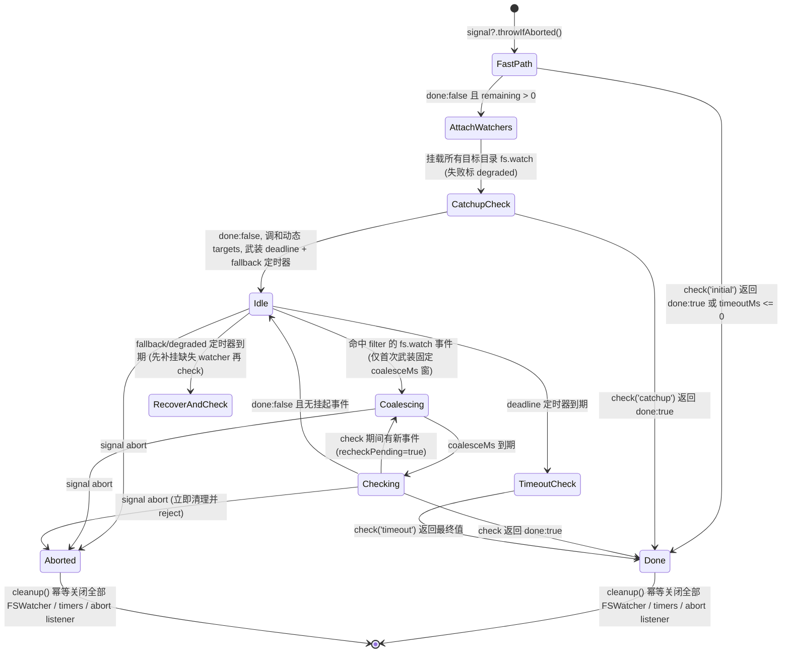
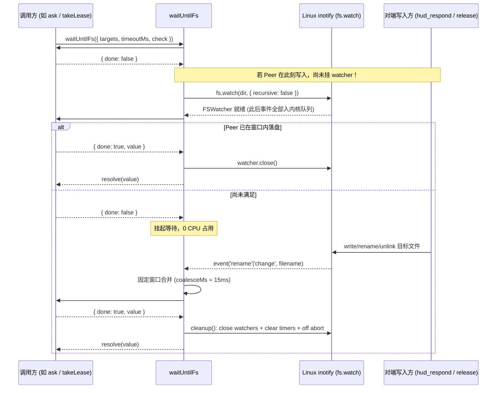
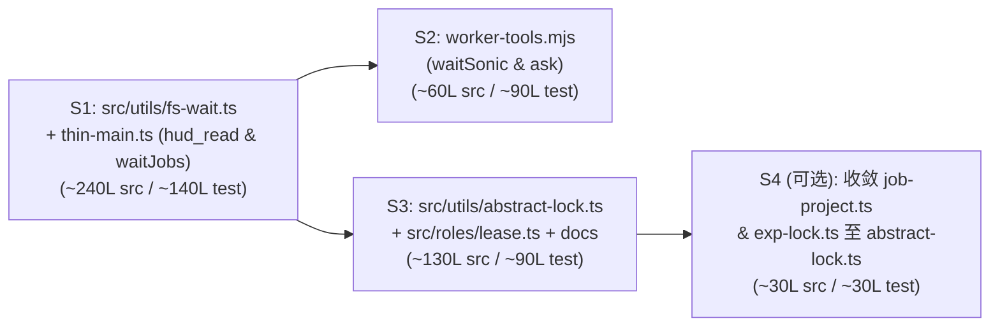

# 07. 统一 4 处残留轮询为事件驱动等待（`hud_read wait_ms`、`waitSonic`、`ask`、`takeLease` 去 `flock` 子进程开销）

> **优先级**：P1（消除交互式问答/等待/租约竞争的百毫秒至秒级尾延迟、无谓 CPU/syscall 唤醒及 `flock` 子进程开销）
> **类别**：事件驱动原语收敛 / 跨进程互斥升级 / 延迟与资源开销优化
> **预估规模**：M（3 个必选垂直切片 S1–S3 + 1 个可选收尾切片 S4；新增 2 个共享小模块 `src/utils/fs-wait.ts` ~185L 与 `src/utils/abstract-lock.ts` ~55L，净删 ~145L 散落轮询/手写 watcher/`flock` 胶水代码，新增 ~320L 确定性回归与低延迟验证测试）
> **前置依赖**：**零前置依赖**（纯 Node ≥24.0.0 标准库 `node:fs` / `node:net` / `node:crypto`，零新增第三方依赖）。与 **方案 02**（拆解 `thin-main.ts` / `.mjs` 迁 TS）正交——先落本方案时模块位于 `src/utils/`，方案 02 拆包后零改动直接复用；与 **方案 06**（消除长耗时 `spawnSync`）互补，本方案切片 S3/S4 **直接取代方案 06 的可选切片 S4**（用零子进程抽象套接字彻底替代异步 `flock`）
> **`docs/spec.md` 边界影响**：**零产品规格变更**（`docs/spec.md` §2.1 仅约束 `hud_lease` 单持锁、终结自动回收、无常驻进程，从未绑定 `flock` 实现细节；同时严格符合 `docs/spec.md` §1 & §3「单人单台 Linux/WSL 机器、无常驻服务」及 §4「最简可靠」）。若 Owner 批准方案 B1（抽象套接字取代 `flock`），仅需同步更新 2 处实现说明文档（`packages/hud-mcp/README.md:76`、`docs/reference.md:215`）及 1 处负向测试（`tests/unit/thin-mcp.test.mjs:3055–3063`）

---

## 1. 背景与现状证据

### 1.1 全仓等待路径对照：事件驱动与 4 处残留 `sleep` 轮询

MyHUD 的主观测链路（`src/cli/watch.ts`、`packages/hud-mcp/bin/hud-watch.mjs`、`packages/hud-mcp/bin/hud-cli.mjs`）以及 `hud_wait`（`packages/hud-mcp/src/thin-main.ts:854–924`）均已基于 Node 24 `fs.watch` 实现事件驱动。但对全仓 `timers/promises` 与 `sleep(` 的全面代码扫描显示，仍有 **4 处高频等待路径** 滞留在固定间隔 `sleep` 轮询，且 `takeLease` 叠加了同步子进程 `spawnSync('flock')` 开销：

| 序号 | 路径与精确行号 | 符号与调用入口 | 当前等待机制 | 默认/上限超时 | 平均/最坏唤醒延迟 | 单次满超时唤醒与系统调用成本 | 额外缺陷 |
|---:|---|---|---|---|---:|---|---|
| **参照** | `packages/hud-mcp/src/thin-main.ts:854–924` | `waitJobs()`（`hud_wait`） | `fs.watch(jobsRoot, { recursive: true })`（`:912`）+ 5s 兜底（`:909`） | 60s / 120s | **<10 ms** | 空闲仅 12 次安全检查 | 无事件合并防抖；无 `AbortSignal`；递归监听整棵 `jobs/` 暴露在 `sessions/` `ELOOP` 风险下；watcher `error` 后无降级重挂 |
| **#1** | `packages/hud-mcp/src/thin-main.ts:1696–1739` | `call('hud_read')`（带 `job` + `wait_ms`） | `while (true)` + `sleep(Math.min(500, end - Date.now()))`（`:1737`）+ 不一致重读 `sleep(200)`（`:1723`） | 0 / 120s | **250 ms / 500 ms** | 120s 内 **240 次唤醒**，约 **1,200+ 次** `stat/open/read/readdir` | 使用挂钟 `Date.now()`（`:1700`）而非单调时钟 `performance.now()`，受 WSL2/NTP 跳变影响 |
| **#2** | `packages/hud-mcp/bin/worker-tools.mjs:109–149` | `waitSonic()`（`hud_sonic` / `hud-sonic.mjs`） | `for (;;)` + `sleep(Math.min(250, left), undefined, { signal })`（`:132`） | **480s**（无上限） | **125 ms / 250 ms** | 480s 内 **1,920 次唤醒**；3 个子任务即 **5,760 次** `open+read+JSON.parse(STATUS.json)` | `sonicState()`（`sonic-jobs.mjs:5–13`）未兜底非原子写产生的瞬态 `SyntaxError` |
| **#3** | `packages/hud-mcp/bin/worker-tools.mjs:260–291` | `ask()`（`hud_ask` / `hud-ask.mjs`） | `while (timeoutSec > 0 && ...)` + `sleep(Math.min(2000, left), undefined, { signal })`（`:282`） | **1,200s**（20 分钟） | **1,000 ms / 2,000 ms** | 1200s 内 **600 次唤醒**，`statSync(qa/qN.answer.md)` 600 次 | **用户体感最差**（Owner 在面板按 `1`–`4`/`d` 或主会话调 `hud_respond` 后，worker 白等最多 2 秒）；使用 `Date.now()`（`:275`）；循环前漏检 `signal?.throwIfAborted()` |
| **#4** | `src/roles/lease.ts:28–96` | `takeLease()`（`hud_lease` / `workerLease` / `hud-lease.mjs`） | `locked()` 每次 `spawnSync(flock, ['-x', '-w', '1', '3'], { timeout: 1500 })`（`:32`）+ 竞争时 `sleep(Math.min(250, left))`（`:94`） | 120s / 300s | **125 ms / 250 ms** | 120s 内 **480 次唤醒**，每次触发 `readLease` + `leaseJob` + `/proc/<pid>/stat` + `kill(pid, 0)` ≈ **4,800 次 syscall**；每次无竞争获取/释放另付 **1 次 `fork+exec flock`** | `spawnSync` 阻塞 MCP 事件循环（无竞争 2–8 ms，竞争最坏 **1,500 ms**）；每次调用扫描 `PATH`（`executable('flock')`, `:56`）；强依赖外部 `util-linux` |

### 1.2 `hud_lease` 瓶颈与仓内已有抽象套接字先例

深入检查 `src/roles/lease.ts`（96L）及其消费方，暴露三组关键事实：

1. **目录级粗粒度锁 + 同步子进程开销**：`locked()`（`src/roles/lease.ts:28–36`）打开整个 `$HUD_HOME/leases` 目录（导致不同项目、不同租约名串行排队），随后 `spawnSync(flock, ['-x', '-w', '1', '3'], { stdio: ['ignore', 'ignore', 'pipe', fd], timeout: 1500 })`。在无竞争路径下，一次完整的 `acquire` + `release` 至少触发 **2 次 `PATH` 遍历 + 2 次 `fork/exec /usr/bin/flock`**；在方案 06（`docs/neon-proposal/06-async-watcher-and-supervisor.md:22, 428–431`）中，它与 `src/roles/job-project.ts:47` 是全仓仅剩的 2 处 `flock` 同步子进程。
2. **短命 CLI fallback 与面板只读观测强依赖磁盘租约记录**：
   - `packages/hud-mcp/bin/hud-lease.mjs:11–13` 为无 MCP 的 Antigravity / Grok Build worker 提供一次性命令行调用（传 `fallback = true`），`lease.ts:81–86` 特意将 `STATUS.json` 中的 worker PID 写入 `$HUD_HOME/leases/<sha256>.json` 而非 `hud-lease.mjs` 自身 PID（已由 `tests/unit/thin-mcp.test.mjs:3025–3036` 锁定契约）；命令打印 `{"granted":true}` 后**立刻退出**。
   - 面板 Control 页同步读取 `$HUD_HOME/leases/*.json`（`src/collectors/project-board.ts:247` → `src/collectors/thin-jobs.ts:310–316` `readActiveLeases` → `src/render/control-page.ts:143–149`），在纯渲染管线中展示活跃租约的 `name`、`holder` 与 `since`。
   - 租约回收有 **三条路径**（`src/collectors/thin-jobs.ts:304–309` `leaseActive`）：① 持有者显式 `release: true` 删除租约文件；② worker `STATUS.json` 进入 `closed`/`failed`/`stopped`（`leaseJob().terminal`）；③ 持有者进程退出（`workerTreeRootGone` 查 `/proc/<pid>/stat` 启动时间 + `process.kill(pid, 0)`）。
3. **仓内已成熟落地 Linux Abstract Unix Socket 互斥模式**：
   - `src/collectors/exp-lock.ts:5–15`：`tryExpLock(scope, key)` 监听 `\0myhud-exp-${scope}-${sha256(key)}` 并调用 `server.unref()`，在进程崩溃时由 Linux 内核零延迟回收；`src/collectors/exp-proxy-refresh.ts:82` 用其做非阻塞单飞刷新，`src/collectors/exp-ledger.ts:42–50` 用其做短临界区互斥（5–15ms 抖动退避），并已通过 4 进程并发 375 次写入压测（`tests/unit/exp-ledger.test.mjs:134–173`）。
   - `packages/hud-mcp/bin/hud-check.mjs:46–48`：监听 `\0myhud-check-${sha256(dir)}` 防止并发启动重复执行 check 命令。

### 1.3 历史 Watcher 踩坑证据（设计 `fs-wait.ts` 必守红线）

梳理 `src/cli/watch.ts`、`packages/hud-mcp/bin/hud-watch.mjs`、`packages/hud-mcp/bin/hud-cli.mjs` 及 `tests/unit/job-retention.test.mjs:303–515`，MyHUD 已在 Node 24 Linux/WSL2 实测踩过并沉淀了 **5 条血泪经验**：

1. **Node 24 `recursive: true` 遇符号链接环抛 `ELOOP`**（`docs/ARCHITECTURE.md:91–94`、`hud-watch.mjs:223–230`、`job-retention.test.mjs:303–327`）：pi job 的 `sessions/` 和 `.dispatch/*/sessions/` 存放符号链接；若对整个 job 目录或 `jobs/` 挂递归 watch，一个坏环就会击毁整个 watcher！反观 `hud-cli.mjs:68–88` 用**非递归双 watch**（`dir` + 动态按需挂载 `dir/qa`），彻底绕开 `sessions/` 且开销恒定。
2. **Setup 竞态丢事件**（`thin-main.ts:918`、`hud-watch.mjs:390`、`src/cli/watch.ts:276`）：必须先挂 `fs.watch` 再执行 catch-up 检查；降级恢复重挂 watcher 时也必须**先挂再扫**（`job-retention.test.mjs:501–515`）。
3. **持续异步 watcher 报错触发死循环风暴**（`job-retention.test.mjs:466–499`）：若 `watcher.on('error')` 直接同步重试或立即触发下一次检查，当 `fs.watch` 在 `nextTick` 反复报错时会打满 CPU；必须在 `error` 中仅清理坏 watcher 并交给受限速的降级定时器（≥500–1000 ms）重挂。
4. **新鲜目录不存在（`ENOENT`）与原子替换（`rename`）**（`src/cli/watch.ts:109–116`、`hud-watch.test.mjs:686–703`）：不能直接 `fs.watch` 单个文件（目标尚未创建报 `ENOENT`，且 `temp + renameSync` 换 inode 后单文件 watch 永久失明）；必须监听父目录，并在目标子目录动态创建时（如 `jobDir/qa`）及时补挂。
5. **非原子写的 `O_TRUNC` 瞬态撕裂窗口**：单测与外部工具的 `fs.writeFileSync` 会先 `O_TRUNC` 再 `write()`；250–500 ms 轮询几乎撞不到该微秒窗口，但切换至亚毫秒级 `fs.watch` 后首帧回调极易读到 0 字节或半截 JSON（触发 `SyntaxError`）——必须配合短暂非滑动合并窗口（coalescing）与瞬态 `SyntaxError` 退避重试。

---

## 2. 目标与非目标（Scope / Out of Scope）

### 目标（Scope）

1. **沉淀统一共享的事件驱动等待原语 `src/utils/fs-wait.ts`**：
   - 提供 `waitUntilFs<T>()`，统一覆盖单目录非递归监听、多目录动态监听（支持子目录动态创建与次级目标切换）及按阈值回退的递归目录监听；
   - 内建先挂后检防竞态、非滑动事件合并（防爆发抖动与非原子写撕裂）、`AbortSignal` 取消、watcher 故障自动降级与恢复、`performance.now()` 单调时钟、以及零 `FSWatcher`/timer/listener 泄漏保证。
2. **消除全部 4 处残留固定轮询（并同步收敛 `waitJobs()`）**：
   - `packages/hud-mcp/src/thin-main.ts`：`hud_read({ job, wait_ms })` 从 500 ms 轮询迁至非递归双目标 `waitUntilFs`（`dir` + 动态 `dir/qa`）；同步将 `waitJobs()`（`:854–924`）收口到 `waitUntilFs`，获得防抖、`AbortSignal` 与小目标集非递归免疫 `ELOOP` 能力。
   - `packages/hud-mcp/bin/worker-tools.mjs`：`waitSonic()` 从 250 ms 轮询迁至多子目录非递归 `waitUntilFs`（>32 个子任务自动退回单递归 watch）；`ask()` 从 2,000 ms 轮询迁至单目录 `qa/` 非递归 `waitUntilFs`。
   - `src/roles/lease.ts`：`takeLease()` 从 250 ms 轮询迁至双目标非递归 `waitUntilFs`（`leases/` + 当前持锁 worker 的 `jobs/<holder>/`），辅以 1,000 ms 死进程存活性兜底 tick。
3. **升级 `hud_lease` 临界区互斥机制（消除 `spawnSync('flock')` 子进程开销）**：
   - 沉淀共享零子进程抽象套接字互斥原语 `src/utils/abstract-lock.ts`（`tryAbstractLock` + `withAbstractLock`），以按租约键细粒度的 Linux Abstract Unix Socket 替代 `src/roles/lease.ts:28–36` 的目录级 `spawnSync('flock')`；
   - 可选切片 S4 将 `src/roles/job-project.ts:47` 与 `src/collectors/exp-lock.ts` 收敛到同一原语，彻底清空全仓最后一处 `flock` 外部二进制依赖。
4. **毫秒级端到端延迟验证**：
   - 正常变更路径（`hud_read` 结算、`waitSonic` 子任务完成、`ask` 收到 `hud_respond`、`takeLease` 收到 `release` 或持锁 worker 终结）唤醒延迟从 **125–2,000 ms** 降至 **< 30 ms**（实测目标 p95 ≤ 25 ms）。

### 非目标（Out of Scope）

1. **不改造 `src/cli/watch.ts`、`packages/hud-mcp/bin/hud-watch.mjs`、`packages/hud-mcp/bin/hud-cli.mjs` 的主循环**：三者是长生命周期流式/状态机守护进程（含 3s 结算批聚合、herdr socket 订阅、工作树回收队列），并非一次性“等待条件成立后返回”的请求型原语；其阻塞问题归属 **方案 06**。
2. **不引入任何第三方监听库（如 `chokidar`）到 `hud-mcp` 或 `worker-tools`**：严格使用 Node 24 原生 `node:fs` `fs.watch` 与 `node:net`，保持 MCP 与 CLI fallback 的冷启动速度与零依赖。
3. **不改变任何磁盘文件格式、工具名、参数 Schema 或返回字段**：`$HUD_HOME/leases/<sha256>.json`、`STATUS.json`、`qa/qN.answer.md`、`sonic-collected` 与 MCP JSON-RPC 协议 100% 向后兼容；`hud-lease.mjs`、`hud-ask.mjs`、`hud-sonic.mjs` 退出码与 stdout/stderr 格式保持不变。
4. **不将 `sharedRoot(cwd)`（`src/roles/projects.ts:46–60`）改为异步**：`sharedRoot` 被多处同步路径（`projectJobFilter`、Control 页收集器）调用，属于独立议题。
5. **不引入后台租约守护进程或租约 TTL 过期机制**：严格遵守 `docs/spec.md` §2.1 & §3（"with no resident process"）。

---

## 3. 核心设计方案

### 3.1 共享事件驱动等待原语：`src/utils/fs-wait.ts`（~185L）

#### 3.1.1 编译拓扑与跨入口复用

`tsconfig.json`（`rootDir: "./src"`, `outDir: "./dist"`）与 `packages/hud-mcp/tsconfig.json`（`rootDir: "../.."`, `outDir: "./dist"`, `include: ["src/**/*.ts"]`）共享 `src/` 源码树：
- `packages/hud-mcp/src/thin-main.ts` 导入 `../../../src/utils/fs-wait.js` → `npm run build:hud-mcp` 自动输出至 `packages/hud-mcp/dist/src/utils/fs-wait.js`；
- `src/roles/lease.ts` 导入 `../utils/fs-wait.js` → 同时输出至 `dist/utils/fs-wait.js` 与 `packages/hud-mcp/dist/src/utils/fs-wait.js`；
- `packages/hud-mcp/bin/worker-tools.mjs` 沿用已有模式（`:9` 导入 `../dist/src/roles/lease.js`）直接导入 `../dist/src/utils/fs-wait.js`，天然兼容 `tests/unit/pi-package.test.mjs:36` 的符号链接布局与全部 CLI fallback 脚本。

#### 3.1.2 类型契约与 API 设计

```ts
export interface WatchTarget {
  /** 必须为目录路径（绝不直接监听单文件，规避 ENOENT 与原子 rename 失明） */
  dir: string;
  /** 默认 false；仅在目标子目录数量超过阈值（如 >16/>32）或确需整树监听时开启 */
  recursive?: boolean;
  /**
   * 文件名过滤器。
   * 注意：当 inotify 队列溢出或平台省略名称时 filename 为 null，
   * 调用方在 filename === null 时应返回 true（保守触发一次检查，绝不漏事件）。
   */
  filter?: (filename: string | null, eventType: string) => boolean;
}

export interface FsWaitCheckContext {
  /** 本次检查是否由超时截止触发（true 时调用方通常应返回最终快照并结束等待） */
  timedOut: boolean;
  /** 距离截止的剩余毫秒数（基于 performance.now()，≥ 0） */
  remainingMs: number;
  /** 本次检查触发原因，便于诊断日志与测试断言 */
  reason: 'initial' | 'catchup' | 'event' | 'fallback' | 'timeout';
}

export type FsWaitStep<T> =
  | { done: true; value: T }
  | { done: false; /** 可选：当本次检查发现瞬态不一致（如 hud_read 快速/完整视图竞争）时的最小退避 ms */ minDelayMs?: number };

export interface FsWaitOptions<T> {
  /** 静态监听目录列表，或每次 check 后动态重新计算的目录列表（支持 qa/ 动态创建、lease holder 切换） */
  targets: readonly WatchTarget[] | (() => readonly WatchTarget[]);
  /** 最大等待时长（毫秒，≤0 时仅执行一次 initial check，零 watcher 开销） */
  timeoutMs: number;
  /** 每次唤醒时调用的判定函数；允许同步或异步，内部严格串行（单飞不重入） */
  check: (ctx: FsWaitCheckContext) => FsWaitStep<T> | Promise<FsWaitStep<T>>;
  /** 取消信号；预取消或中途取消均立即释放全部 watcher/timer 并抛出 AbortError / signal.reason */
  signal?: AbortSignal;
  /** 固定（非滑动）事件合并窗口，吸收 O_TRUNC+write 与爆发写入，默认 15 ms；测试可传 0 */
  coalesceMs?: number;
  /** 所有 watcher 健康时的安全兜底周期，默认 5000 ms（takeLease 传 1000 ms 用于死 PID 探测） */
  fallbackIntervalMs?: number;
  /** 任一 watcher 缺失/报错降级时的重试与轮询周期，默认 500 ms（防止 error-loop 旋锁） */
  degradedIntervalMs?: number;
  /** 可选：将检查中抛出的瞬态异常（如非原子写触发的 SyntaxError）视为未就绪并短退避重试 */
  isTransientError?: (error: unknown) => boolean;
  /** 可选：降级诊断钩子（不打日志、不耦合 stderr，供测试观测） */
  onWatchError?: (dir: string, error: unknown) => void;
}

export function waitUntilFs<T>(options: FsWaitOptions<T>): Promise<T>;
```

#### 3.1.3 核心状态机与时序保证



#### 3.1.4 消除 Setup 竞态的严格时序



#### 3.1.5 关键工程细节与边界防护（逐条对照 Node 24 Linux/WSL2 实测行为）

1. **非滑动固定合并窗口（Non-Sliding Coalesce）**：
   - 当 `dirty` 从 `false` 翻转为 `true` 时，若 `coalesceTimer === undefined` 且 `!inFlight`，设置 `coalesceTimer = setTimeout(() => evaluate('event'), Math.min(coalesceMs, remainingMs))`。
   - 窗口内后续到达的同批事件（如 `.tmp` 创建、写入、`rename`、`report.md` + `STATUS.json` 连写）看到 `coalesceTimer !== undefined` 直接忽略，**绝不重置定时器**。因此即使有噪声进程高频写入，检查也绝不会饿死，且能可靠吸干 `O_TRUNC`→`write()` 的微秒撕裂窗口。
   - 若事件到达时 `inFlight === true`（异步 `check()` 正在执行，如 `gitSummary` 或 `withAbstractLock`），仅置 `recheckPending = true`，待本次 `check()` 返回 `{ done: false }` 后自动按 `coalesceMs`（或 `minDelayMs`）续跑，天然单飞不重入。
2. **动态目标调和（Reconcile Targets）**：
   - 每次 `check()` 返回 `{ done: false }` 后，若 `targets` 是函数，调用 `reconcile(targets())`：以 `key = `${dir}\0${recursive ? 1 : 0}`` 对比 `activeWatchers: Map<string, Entry>`：
     - 不再需要的旧目录（如已结算的 sonic 子目录、已换手的旧租约持锁者 `jobs/<oldHolder>/`）立即 `watcher.close()` 并删除；
     - 新出现的目录（如刚创建的 `jobDir/qa`、新持锁者 `jobs/<newHolder>/`）立即尝试挂载 `fs.watch`——**若新挂载成功，立即置 `recheckPending = true` 补检一次**（消除新目录出现后到挂上 watcher 之间的二次 setup 竞态！）；
     - 已有健康目录仅原地更新 `entry.filter` 引用，不重建 inotify watch。
3. **Watcher 错误降级与无风暴恢复**：
   - `fs.watch` 同步抛出（`ENOENT` / `ELOOP` / `EMFILE` / `ENOSPC` / `EACCES`）或异步发出 `'error'` 事件时：
     - 立即关闭该 watcher 并从 `activeWatchers` 移除，标记 `degraded = true`，调用可选 `onWatchError(dir, error)`；
     - **严禁在 `error` 回调里立刻重挂或立刻调用 `evaluate()`**（规避 `job-retention.test.mjs:466–499` 记录的异步错误风暴）；改为将 `fallbackTimer` 切至 `degradedIntervalMs`（默认 `500 ms`，或剩余时间）；
     - 仅当 `fallbackTimer` 到期触发 `evaluate('fallback')` 时，**先尝试 `reconcile()` 重挂缺失 watcher，再执行 `check('fallback')`**（满足 `job-retention.test.mjs:501` 的恢复防漏不变量）。
4. **瞬态 `SyntaxError` 防护**：
   - 当外部工具或单测使用非原子 `fs.writeFileSync` 覆盖 `STATUS.json` 时，如 `check()` 命中 `isTransientError(err)`（例如 `err instanceof SyntaxError`）且 `!ctx.timedOut`，`waitUntilFs` 不直接 reject，而是将其视作 `{ done: false, minDelayMs: 25 }` 在 25 ms 后重试；仅当持续损坏直到超时或连续重试超过上限（如 5 次）时才将异常抛出（或由超时路径处理），兼顾容错与不掩盖真实损坏文件。
5. **单调时钟与 100% 资源清理**：
   - 全程使用 `performance.now()` 计算 `deadline = start + timeoutMs` 和 `remainingMs = Math.max(0, deadline - performance.now())`；
   - `timeoutMs` 做边界规范化：若 `timeoutMs > 2_147_483_647`（Node `setTimeout` 32-bit 溢出上限），对每次单步 `setTimeout` 延迟夹紧至 `Math.min(delay, 0x7fffffff)`（虽然 MyHUD 当前最大超时为 20 分钟 = 1,200,000 ms，夹紧使通用原语无隐藏溢雷）；
   - `cleanup()` 为严格幂等函数，统一清除 `deadlineTimer` / `coalesceTimer` / `fallbackTimer`、关闭并清空所有 `FSWatcher`、`signal?.removeEventListener('abort', onAbort)`，并由 `settled = true` 哨兵拦截任何延迟到达的回调。
6. **WSL2 `/mnt/c`（DrvFs / 9p）兼容性**：
   - `$HUD_HOME` 位于 Linux 原生 ext4/tmpfs（`~/.hud` 或 `/tmp`），inotify 延迟 <1 ms；即使极端情况下用户将 `HUD_HOME` 指向 `/mnt/c/...` 导致跨侧写入不发 inotify 事件，健康态 `fallbackIntervalMs`（2–5s，lease 为 1s）仍确保绝不永久挂起。

---

### 3.2 `hud_lease` 互斥机制升级对比与架构决策

#### 3.2.1 四种方案深度对比

| 维度 | **方案 A：保留 `flock`（改异步 `spawn`）+ `fs.watch` 等待** | **方案 B1（★ 推荐）：Abstract Unix Socket 短临界区锁 + 磁盘 JSON + `fs.watch` 等待** | **方案 B2（排除）：长持有 Abstract Unix Socket 本身作为 Lease** | **方案 C：`O_CREAT \| O_EXCL` 锁文件（`.lock`）+ `fs.watch` 等待** |
|---|---|---|---|---|
| **单次获取/释放开销** | 每次 `fork + exec` `flock`（2–8 ms + `PATH` 查找） | **< 0.3 ms**（纯内核 `socket/bind/listen/close`，**零子进程**） | < 0.3 ms | ~0.5 ms（纯 fs syscall，零子进程） |
| **外部依赖** | 强依赖 `util-linux` `flock` 在 `PATH` 上 | **零外部二进制依赖**（空 `PATH` 正常工作） | 零外部依赖 | 零外部依赖 |
| **临界区崩溃恢复** | 内核随进程关闭 fd 自动释放 | **内核随进程退出立即释放**（零残留垃圾文件） | 进程退出立刻释放 | **致命弱点**：`SIGKILL` 遗留 `.lock`，需陈旧判定 + 回收且存在经典 ABA 误删活锁竞态 |
| **`hud-lease.mjs` 短命 CLI 兼容** | ✅ 完整兼容（落盘 worker PID 后退出） | ✅ **完整兼容**（落盘 worker PID 后退出） | ❌ **彻底破坏**：CLI 退出即丢租约！ | ✅ 兼容 |
| **死 holder / 终态 worker 回收** | 磁盘 `leaseActive` 校验（`STATUS.json` 终态 + `/proc/<pid>/stat`） | ✅ **完全保留**；`STATUS.json` 变终态 via `fs.watch` **<20ms 唤醒**，`SIGKILL` 靠 1s fallback 回收 | 无法与 `STATUS.json` 终态对齐；且长持锁需常驻进程，违背 `docs/spec.md` §2.1/§3 | 同 B1 |
| **跨 worktree 共享 (`sharedRoot`)** | ✅ `sha256([sharedRoot(cwd), name])` | ✅ **完全保留**（key 含 `realpath(leasesDir)` + `leaseHash`，还从目录锁升级为**单租约细粒度锁**） | 同左，但 Control 页无法枚举 | ✅ 同 B1 |
| **Control 页观测 (`readActiveLeases`)** | ✅ 只读扫描 `leases/*.json` | ✅ **零改动兼容**（纯渲染/只读收集契约不变） | ❌ 破坏，抽象套接字无元数据（`holder`/`since`/`name`） | ✅ 兼容（需过滤 `.lock`） |
| **WSL2 / Linux 兼容性** | Linux / WSL2（依赖 `util-linux`） | **Linux / WSL2 原生稳定**（仓内 `exp-lock.ts` 与 `hud-check.mjs` 已在生产+压测验证） | Linux / WSL2 | 跨 POSIX（含 macOS） |
| **跨容器网络命名空间 (netns)** | ✅ 同挂载 inode 跨 netns | ⚠️ 同 host netns 内有效（MyHUD 单机 herdr 完全满足，与 `exp-lock.ts`/`hud-check.mjs` 一致） | ⚠️ 同 B1 | ✅ 同挂载跨 netns |
| **与 `docs/spec.md` 及文档关系** | 零文档改动 | **`docs/spec.md` 零改动**；仅更新 `packages/hud-mcp/README.md:76`、`docs/reference.md:215` 2 处实现说明 + 1 处测试 | **违反 `docs/spec.md`**（无常驻进程 & fallback CLI 契约） | 同 B1 |

#### 3.2.2 明确推荐：**方案 B1**（Abstract Unix Socket 短临界区互斥 + 磁盘租约 JSON + 双目标 `fs.watch`）

理由收敛为四点：
1. **彻底消除子进程与事件循环阻塞**：一次 `hud_lease` 调用不再 `fork/exec`，也不再需要维护 `spawn('flock')` 的 fd 3 继承、超时 `SIGKILL` 和 `AbortSignal` 清理逻辑（直接省掉方案 06 的 S4 复杂度）。
2. **零外部依赖、零陈旧锁文件**：相比方案 A 省去 `util-linux flock` 与 `PATH` 依赖；相比方案 C 省去陈旧 `.lock` 回收与 ABA 防护代码，与 `docs/spec.md` §4「最简可靠」高度一致。
3. **复用仓内已验证的统一模式**：`src/collectors/exp-lock.ts`（15L）和 `packages/hud-mcp/bin/hud-check.mjs:46–48` 已证明 Linux/WSL2 抽象套接字在 MyHUD 的 Node 24 环境与多进程高并发压测中完全可靠。
4. **完全保留产品契约与可观测性**：`$HUD_HOME/leases/<sha256>.json` 的磁盘格式、`publish()` 的 `wx + 0o600 + linkSync` 排他发布、`hud-lease.mjs` 短命 CLI、跨 worktree `sharedRoot` 以及 Control 页 `readActiveLeases` 零破坏。

#### 3.2.3 共享抽象套接字互斥原语：`src/utils/abstract-lock.ts`（~55L）

```ts
import { createHash } from 'node:crypto';
import { createServer } from 'node:net';
import { setTimeout as sleep } from 'node:timers/promises';

export type LockRelease = () => Promise<void>;

/**
 * 构造 Linux/WSL2 抽象 Unix 套接字地址。
 * Linux UNIX_PATH_MAX = 108 字节：\0myhud-<ns>-<64hex> 当 ns <= 30 字节时总长 <= 103 字节，严格安全。
 */
function socketAddress(namespace: string, key: string): string {
  if (!/^[a-z0-9-]{1,24}$/.test(namespace)) throw new Error(`invalid abstract lock namespace: ${namespace}`);
  const digest = createHash('sha256').update(key).digest('hex');
  return `\0myhud-${namespace}-${digest}`;
}

/** 非阻塞尝试获取抽象套接字锁；已被占用返回 undefined；内核随进程退出自动释放。 */
export function tryAbstractLock(namespace: string, key: string): Promise<LockRelease | undefined> {
  const address = socketAddress(namespace, key);
  return new Promise((resolve, reject) => {
    const server = createServer((socket) => socket.destroy());
    server.once('error', (error: NodeJS.ErrnoException) => {
      if (error.code === 'EADDRINUSE') resolve(undefined);
      else reject(error);
    });
    server.listen(address, () => {
      server.unref();
      let closed = false;
      resolve(() => {
        if (closed) return Promise.resolve();
        closed = true;
        return new Promise<void>((done) => server.close(() => done()));
      });
    });
  });
}

/**
 * 带超时与 AbortSignal 的短临界区互斥锁（适用于 <5ms 的磁盘读-改-写临界区）。
 * 竞争时采用 3–10ms 抖动退避，避免锁惊群；finally 中确定性释放。
 */
export async function withAbstractLock<T>(
  namespace: string,
  key: string,
  run: () => T | Promise<T>,
  options: { timeoutMs?: number; signal?: AbortSignal } = {}
): Promise<T> {
  const { timeoutMs = 1500, signal } = options;
  const deadline = performance.now() + timeoutMs;
  for (;;) {
    signal?.throwIfAborted();
    const release = await tryAbstractLock(namespace, key);
    if (release) {
      try {
        return await run();
      } finally {
        await release();
      }
    }
    const left = deadline - performance.now();
    if (left <= 0) throw new Error(`abstract lock timeout (${namespace})`);
    await sleep(Math.min(left, 3 + Math.random() * 7), undefined, { signal });
  }
}
```

关键细节校验：
- **地址长度**：`\0myhud-lease-<64hex>` = `1 + 12 + 64 = 77` 字节（远低于 Linux `sun_path` 108 字节上限）。
- **规范化 Key**：`takeLease` 先 `fs.mkdirSync(dir, { recursive: true, mode: 0o700 })`，再以 `const realDir = fs.realpathSync(dir)` 拼接 `${realDir}\0${leaseHash}` 作为 `key`——既避免符号链接路径指向同一 `$HUD_HOME` 却落到不同套接字，又保证并行测试的独立临时 `HUD_HOME` 互不冲突，且把原目录级粗锁细化为**按单个租约互斥**。
- **同进程多请求并发**：Linux 内核对同一进程内的两个 `bind('\0...')` 同样返回 `EADDRINUSE`，因此同一个 MCP server 进程内两个并发 `hud_lease` 调用（或多个并发 `takeLease` 单测）同样严格互斥。
- **排他发布双保险**：保留 `lease.ts:38–46` 的 `publish(file, record)`（`wx` 0o600 + `fs.linkSync(tmp, file)` + `finally { unlinkSync(tmp) }`），即使存在异常外部写者也绝不覆盖活租约或留下半截 JSON。

---

### 3.3 4 处改造 + `waitJobs()` 收敛的逐点设计

#### 点 1：`packages/hud-mcp/src/thin-main.ts` — `hud_read({ job, wait_ms })` 与 `waitJobs()`

1. **`hud_read({ job, wait_ms })`（替换 `:1696–1739`）**：
   - 将截止时钟由 `Date.now()` 改为 `performance.now()`（保留 `waitMs = Math.max(0, Math.min(120000, wait_ms ?? 0))` 语义）。
   - 保留 `initial = readRow(job, !isWorker).row` 与完全相同的 `isReady(row)` 判定（`settled(row.state) || row.state === 'waiting_orchestrator' || row.blocked || row.open_questions > 0 || jobChanges([initial], [row]).length > 0`）。
   - **动态双目标非递归监听**：
     ```ts
     const qaDir = join(dir, 'qa');
     const targets = (): WatchTarget[] => [
       {
         dir,
         filter: (name) =>
           name === null ||
           name === 'STATUS.json' ||
           name === 'job.json' ||
           name === 'report.md' ||
           name === 'qa',
       },
       ...(fs.existsSync(qaDir)
         ? [{ dir: qaDir, filter: (name: string | null) => name === null || /^q\d+(?:\.answer)?\.md$/.test(name) }]
         : []),
     ];
     ```
     - **完全不触碰 `dir/sessions/` 与 `dir/.dispatch/`**，从根本上免疫 Node 24 符号链接环 `ELOOP`；
     - 当 `qa/` 尚不存在时只挂 1 个 watch；一旦 worker 调用 `mkdirSync(qa)` 创建问题目录，`dir` 收到 `'qa'` 事件 → `reconcile` 自动补挂 `qa/` watch 并触发一次补检，绝不丢失紧随其后写入的 `q1.md`！
   - **完整读一致性检查（保留原 `:1712–1725` 防竞态语义）**：
     - 在 `check({ timedOut })` 中：先做轻量 `readRow(job, !isWorker)`；未就绪且 `!timedOut` 直接返回 `{ done: false }`；
     - 就绪或 `timedOut` 时，执行 `gitSummary`（异步）+ `observation()` + `currentRow` 复核；
     - 若 `!timedOut && !isReady(currentRow)`（说明异步 `gitSummary` 期间问题被回答或 job 被 `hud_send` 续跑），返回 `{ done: false, minDelayMs: 50 }` 重新挂起在 `fs.watch` 上，**绝不自旋、也不再硬睡 200 ms**；
     - 确认返回后，保持原有的 `read_at` / `observed_at` 写回逻辑（`:1726–1734`）不变。
   - **瞬态 `SyntaxError` 兜底**：`isTransientError: (e) => e instanceof SyntaxError`，防止非原子写 `STATUS.json` 在 `O_TRUNC` 瞬间击穿 `json()`。

2. **`waitJobs()`（同步收敛 `:891–924`）**：
   - 将手写的 `new Promise` + `fs.watch(jobsRoot, { recursive: true })` + `tick()`（34 行）替换为 `waitUntilFs`（~18 行）；
   - 目标选择策略：当 `targets.size <= 16` 时，对每个目标 job 挂**非递归** `dir` + 按需 `dir/qa`（彻底免疫其它无关 job 的 `sessions/` `ELOOP` 且避免无关目录噪声）；当 `targets.size > 16` 时自动退回单个 `fs.watch(jobsRoot, { recursive: true })`（过滤 `targets.has(id)` 且文件在 `['job.json', 'STATUS.json', 'report.md', 'qa']`），控制 fd 与 inotify 消耗有界；
   - 自动获得 15 ms 非滑动合并防抖、`SyntaxError` 瞬态重试、watcher 错误降级重挂与未来的 `AbortSignal` 支持。

#### 点 2：`packages/hud-mcp/bin/worker-tools.mjs` — `waitSonic()`（替换 `:125–148`）

- 当 `children.length === 0` 或 `seconds === 0` 时走 fast path（`timeoutMs: seconds * 1000`），**零 `fs.watch` 分配**。
- `sonicState(child)` 仅读取 `join(child, 'STATUS.json')`，`waitSonic` 最终读取 `report.md`：
  - 动态目标 `targets()` 仅跟踪**当前仍处于 `'open'` 状态的 sonic 子目录**（每结算一个自动摘除其 watcher，释放 fd！）：
    - 若 `openChildren.length <= 32`：逐个挂非递归 watch `{ dir: child, filter: (name) => name === null || name === 'STATUS.json' || name === 'report.md' }`；
    - 若 `openChildren.length > 32`：退回 1 个 `{ dir: root, recursive: true, filter: ... }` 限制 fd 上限。
- 瞬态保护：`isTransientError: (e) => e instanceof SyntaxError`（兜底 `sonicState()` 读取非原子写 `STATUS.json` 的瞬间截断）。
- 保留原 `signal` 透传语义（Pi 取消立即抛出 `AbortError`）、`reports`/`working`/`failed` 返回结构及 `sonic-collected` 落盘逻辑（`:135–147`）一字不差。

#### 点 3：`packages/hud-mcp/bin/worker-tools.mjs` — `ask()`（替换 `:274–290`）

- **单调时钟 + 预取消检查**：
  - 入口计算 `timeoutSec` 后，若 `signal?.aborted` 在进入等待前即 `signal.throwIfAborted()`（修复原代码 `timeoutSec === 0` 或预取消时未立即响应的缺口）；
  - `const started = performance.now()` 替换 `Date.now()`；`waited = Math.round((performance.now() - started) / 1000)`。
- **保持 `timeoutSec === 0` 语义**：当 `timeoutSec === 0` 时不等待、不建 watcher、直接返回 `Question qN recorded (...); not waiting. ...`（兼容 `hud-watch.test.mjs:440, 533`）。
- **单目录非递归监听 `qa/`**：
  - `qa = join(dir, 'qa')` 已于 `:263` 创建（`mode: 0o700`）；
  - 挂 1 个非递归 watch：
    ```ts
    const answerName = `q${published.n}.answer.md`;
    const answer = await waitUntilFs<string | undefined>({
      targets: [{ dir: qa, filter: (name) => name === null || name === answerName }],
      timeoutMs: timeoutSec * 1000,
      signal,
      coalesceMs: 15,
      fallbackIntervalMs: 5000,
      check: ({ timedOut }) => {
        const value = readQuestionAnswer(published);
        if (value !== undefined) return { done: true, value };
        if (timedOut) return { done: true, value: undefined };
        return { done: false };
      },
    });
    ```
  - **细节验证**：
    - `hud_respond`（`thin-main.ts:1750`）与面板微动作 `answerJobQuestion`（`src/collectors/panel-actions.ts`）均通过 `writeFileSync(afile, answer, { flag: 'wx', mode: 0o600 })` 写入，在 `qa/` 触发 `rename` + `change` 事件 → 15 ms 合并窗口后一次读取完整内容，**唤醒延迟从 1,000–2,000 ms 降至 ~15–20 ms（提升 ~100×）**！
    - 若人工用 shell 重定向创建空文件后慢速写入，首次 `readQuestionAnswer` 见 `size === 0` 返回 `undefined` 继续等待，待内容落盘触发 `change` 事件立即唤醒。

#### 点 4：`src/roles/lease.ts` — `takeLease()`（替换 `:28–36, 56–95`）

- 移除 `spawnSync`、`executable('flock')` 及 `locked()` 同步子进程；引入 `withAbstractLock`（`src/utils/abstract-lock.ts`）与 `waitUntilFs`（`src/utils/fs-wait.ts`）。
- **细粒度锁键**：
  ```ts
  const dir = join(home, 'leases');
  fs.mkdirSync(dir, { recursive: true, mode: 0o700 });
  const realDir = fs.realpathSync(dir);
  const hash = createHash('sha256').update(JSON.stringify([project, name])).digest('hex');
  const file = join(dir, `${hash}.json`);
  const lockKey = `${realDir}\0${hash}`;
  ```
- **单次尝试函数 `attempt()`**：
  1. 若 `!args.release`：先做无锁只读 fast-peek `readLease(file)`；若已被他人持有且 `leaseActive(home, peek)`，直接返回 `{ done: false, result: { granted: false, held_by: heldBy(peek) }, holderJobDir: peek.kind === 'worker' ? join(home, 'jobs', peek.holder) : null }`（零抽象套接字 bind 开销）。
  2. 否则进入 `await withAbstractLock('lease', lockKey, () => { ... }, { timeoutMs: 1500, signal })`（临界区纯同步 <0.5 ms），执行完全相同的 release / re-entrant grant / dead-or-terminal reclaim / `publish(file, record)` 逻辑；若仍被他人持有，记录当前 `holderJobDir` 返回 `{ done: false, result, holderJobDir }`。
- **双目标事件等待 + 1s 死进程存活性兜底**：
  ```ts
  let holderJobDir: string | null = null;
  let lastResult: Result | undefined;
  return waitUntilFs<Result>({
    targets: () => [
      { dir, filter: (entry) => entry === null || entry === `${hash}.json` },
      ...(holderJobDir && fs.existsSync(holderJobDir)
        ? [{ dir: holderJobDir, filter: (entry: string | null) => entry === null || entry === 'STATUS.json' }]
        : []),
    ],
    timeoutMs: args.release ? 0 : Math.min(seconds, MAX_WAIT) * 1000,
    signal,
    coalesceMs: 10,
    fallbackIntervalMs: 1000, // 覆盖 holder 被 SIGKILL 但未改 leases/ 也未改 STATUS.json 的纯 /proc 死亡场景
    degradedIntervalMs: 500,
    check: async ({ timedOut }) => {
      const outcome = await attempt();
      lastResult = outcome.result;
      holderJobDir = outcome.holderJobDir ?? null;
      if (outcome.done || timedOut) return { done: true, value: lastResult };
      return { done: false };
    },
  });
  ```
- **三类释放路径的延迟对比**：
  - 显式 `release: true`：原 125–250 ms → 现 **~12 ms**（`leases/` `rename` 事件直达）；
  - 持锁 worker 终结（`STATUS.json` 变 `closed`/`failed`/`stopped`）：原 125–250 ms → 现 **~12 ms**（动态 `jobs/<holder>/` `STATUS.json` 事件直达；且若中途租约换手给另一 worker C，`reconcile()` 自动切换监听到 C 的目录！）；
  - 持锁进程直接 `SIGKILL` 死亡（未改任何文件）：**≤ 1,000 ms**（安全兜底 tick 检查 `/proc/<pid>/stat` 后回收，同时 120s 空等唤醒次数仍减少 **4×**：480 → 120 次，且正常释放路径为 0 次额外轮询）。
  - 注意：`args.release === true` 时 `timeoutMs: 0`，走 `waitUntilFs` fast path 仅执行一次 `attempt()` 即返回，零 watcher 分配。

### 3.4 安全、并发与架构纪律自检（对照 `docs/ARCHITECTURE.md` §8）

- **纯渲染零影响**：全部改动位于 `src/utils/`、`src/roles/`、`packages/hud-mcp/`，不触碰任何 `src/render/` 模块；Control 页 `readActiveLeases` 保持只读且磁盘格式零变化。
- **私有原子写合规**：`lease.ts` 的 `publish()` 继续使用 `0o600` + `wx` + `randomUUID()` + `linkSync` + `finally unlinkSync`，目录权限维持 `0o700`。
- **单人本机最小权限**：抽象套接字地址以 `realpathSync` 哈希隔离每个 `HUD_HOME` 与租约键，不写额外临时文件到 `/tmp` 或用户目录，零常驻进程。
- **Node ≥24 契约一致**：完全符合 `docs/ARCHITECTURE.md` §3 的 Node 24 watcher 行为规范，并通过优先非递归监听进一步降低对 `recursive: true` 的依赖面。

---

## 4. 垂直切片与实施路线（对齐 `docs/delegation.md`）

遵循 `docs/delegation.md` 原则：每个切片独立闭环、可单独运行主路径验证、适合单个 `imp` 会话完成（size budget 明确）。



*注：S1 落地后，S2 与 S3 触及完全不相交的文件集合（`worker-tools.mjs` vs `src/roles/lease.ts`），可在两个 worktree 中**并行开发**！*

### 4.1 切片清单与精确改动范围

| 切片 | 改动文件清单 | 估行（源码 / 测试） | 依赖 | 可删除的旧代码 |
|---|---|---:|---|---|
| **S1（P1）**<br>共享 `fs-wait.ts` 底座 + `hud_read` / `waitJobs` 改造 | **新增**：`src/utils/fs-wait.ts`、`tests/unit/fs-wait.test.mjs`<br>**修改**：`packages/hud-mcp/src/thin-main.ts`、`tests/unit/thin-mcp.test.mjs` | ~225L 源码<br>~150L 测试 | 无 | `thin-main.ts:8` 若无其它引用则删 `timers/promises` `sleep` 导入；删 `thin-main.ts:894–923` 手写 watcher/timer（~30L）；删 `thin-main.ts:1700–1738` 500ms/200ms `sleep` 循环（~38L） |
| **S2（P1）**<br>`worker-tools.mjs` 的 `waitSonic` 与 `ask` 事件化 | **修改**：`packages/hud-mcp/bin/worker-tools.mjs`、`tests/unit/thin-mcp.test.mjs` | ~55L 源码<br>~85L 测试 | S1 | 删 `worker-tools.mjs:6` `timers/promises` `sleep` 导入；删 `:125–134` 250ms 轮询（~10L）与 `:275–283` 2000ms 轮询（~9L） |
| **S3（P1）**<br>`abstract-lock.ts` + `hud_lease` 去 `flock` 与事件化等待 | **新增**：`src/utils/abstract-lock.ts`<br>**修改**：`src/roles/lease.ts`、`packages/hud-mcp/README.md`、`docs/reference.md`、`tests/unit/thin-mcp.test.mjs` | ~115L 源码<br>~90L 测试 | S1 | 删 `lease.ts:2,6,9`（`spawnSync`、`sleep`、`executable` 导入）；删 `lease.ts:28–36` `locked()`；删 `lease.ts:56–57` `flock` 检查；删 `lease.ts:92–95` 250ms 轮询 |
| **S4（P2，可选）**<br>收敛全仓剩余 `flock` 与重复抽象锁 | **修改**：`src/roles/job-project.ts`、`src/collectors/exp-lock.ts`、`tests/unit/thin-mcp.test.mjs` | ~25L 源码<br>~30L 测试 | S3 | 删 `job-project.ts:1,40–48,64` 的 `spawnSync('flock', ['-nx', '3'])` 与目录 fd 打开逻辑；`exp-lock.ts` 薄代理到 `tryAbstractLock('exp-' + scope, key)`（保留原命名空间防滚动升级期间混跑冲突） |

### 4.2 迁移、兼容与回滚策略

1. **磁盘与运行期滚动兼容**：
   - `leases/<sha256>.json`、`STATUS.json`、`qa/qN.answer.md` 格式 100% 不变；
   - 仅在“新旧两版 MyHUD 二进制**同时**抢同一份 lease”的极短重建瞬间，旧版拿 `flock`、新版拿抽象套接字，二者互斥域不同——但 `publish()` 的 `fs.linkSync(tmp, file)` 仍保证绝不会覆写现存活租约（最坏仅抛 `EEXIST`），且按 `docs/delegation.md` 在 worktree 开发、重建后统一重启 MCP 即彻底消除混跑窗口；
   - S4 中 `exp-lock.ts` 保留完全相同的 `\0myhud-exp-${scope}-${sha256(key)}` 套接字名，确保与已在运行的旧版 pi footer / 面板完全互通。
2. **回滚成本**：
   - S1/S2/S3 各为独立 commit，无任何不可逆磁盘迁移；任一切片可单 commit `git revert` 瞬间回滚。
3. **与其它提案的协同**：
   - 若 **方案 02** 先落地，S1/S2 的改动直接落在拆分后的 `packages/hud-mcp/src/mcp/read-wait.ts` 与 `packages/hud-mcp/src/worker/{sonic,ask}.ts`，`src/utils/fs-wait.ts` 与 `src/utils/abstract-lock.ts` 路径完全不变；
   - S3+S4 落地后，**方案 06 的可选切片 S4 可直接取消**，避免重复折腾异步 `flock`。

---

## 5. 验证与验收方案

所有测试严格使用临时 `HOME` / `HUD_HOME`（`tmp/env.sh`）与合成数据，**不触碰真实 `~/.hud`、`~/.claude`、`~/.codex`、`~/.pi`**，并遵循 `docs/delegation.md:51–52`（默认单测测行为与宽松上界防 CI 抖动，精确毫秒分布作为独立诊断验证）。

### 5.1 单元测试与集成测试矩阵

#### A. 原语单元测试：`tests/unit/fs-wait.test.mjs`（S1 新增）

| 场景 | 验证要点 |
|---|---|
| 1. Fast-path 与 `timeoutMs: 0` | 首检即满足或 `timeoutMs <= 0` 时，通过 monkey-patch `fs.watch` 计数断言 **0 次 `fs.watch` 调用** |
| 2. Setup 竞态不丢事件 | 在 `fs.watch` 拦截器内同步写入目标文件（模拟 initial check 之后、watcher 生效瞬间落盘），断言 `catchup` 检查立刻返回，无需等待 5s fallback |
| 3. 原子 `rename` 与爆发合并 | 连续触发 20 次 `.tmp` 写入 + `rename` 替换，断言 `coalesceMs: 15` 下 `check` 仅执行 1–2 次且精确看到最终内容 |
| 4. 非原子 `O_TRUNC` 瞬态 `SyntaxError` | 首次回调模拟返回半截 JSON 抛 `SyntaxError`，随后补齐完整 JSON，断言 `isTransientError` 下自动重试成功、不误抛错 |
| 5. 动态目标增删（`qa/` 创建 & 目标切换） | 初始仅监听父目录，中途 `mkdirSync(qa)` 并写入 `q1.answer.md`，断言自动挂上 `qa/` watcher 并毫秒级唤醒；移除目标时旧 watcher `.close()` 被调用 |
| 6. Watcher 故障降级与无风暴恢复 | 注入同步抛 `ELOOP` / 异步 `nextTick` 反复 `emit('error')`（复现 `job-retention.test.mjs:466` 模式），断言按 `degradedIntervalMs` 节流扫描、不死循环；恢复后先挂 watcher 再 check，捕获过渡期落盘 |
| 7. `AbortSignal` 预取消与中途取消 + 零泄漏 | 断言已取消信号立即 reject `AbortError`；中途 `ac.abort()` 在 <20 ms 内 reject，且所有 `FSWatcher.close()` 计数与创建计数严格相等、无残留活跃句柄 |
| 8. 空闲零读取 | 类似 `hud-watch.test.mjs:611–649`，空闲 250 ms 内 `check` 计数停留在 catchup 后的 baseline，零多余磁盘读 |

#### B. 端到端业务行为与低延迟回归测试（扩展 `tests/unit/thin-mcp.test.mjs`）

| 切片 | 核心测试场景 |
|---|---|
| **S1** | - `hud_read({ job, wait_ms: 5000 })`：等待中写入 `STATUS.json`（及新建 `qa/q1.md`），断言在 **< 250 ms**（显著低于原 500 ms 最坏延迟）唤醒返回；同时在 `dir/sessions/` 预置符号链接环，断言非递归监听**完全不受 `ELOOP` 影响**。<br>- `hud_read` 快速/完整视图竞争分支：回答问题并发发生时不自旋，正常继续等待直至新事件或超时。<br>- `hud_wait` 既有 4 项测试（`thin-mcp.test.mjs:3370–3441`）全绿，另增 1 项带 `sessions/` 符号链接环的 `hud_wait` 用例验证免疫 `ELOOP`。 |
| **S2** | - `hud_ask` / `hud-ask.mjs`：worker 挂起等待回答后 `hud_respond` 写 `qa/q1.answer.md`，断言唤醒耗时 **< 250 ms**（原平均 1,000 ms / 最坏 2,000 ms，至少快 4–8× 以上；实机应 <30 ms）且返回格式与 `after 0s` 一致。<br>- `hud_sonic` / `hud-sonic.mjs`：2 个并发子任务先后写 `STATUS.json` 结算，断言第二个结算后 **< 200 ms** 唤醒返回报告；验证 `AbortSignal` 取消立即中断 `waitSonic` 与 `ask` 且不泄露 watcher。<br>- `tests/unit/pi-package.test.mjs:861–890` 全绿（验证 pi 扩展导入 `worker-tools.mjs` → `../dist/src/utils/fs-wait.js` 路径正确）。 |
| **S3** | - `hud_lease` 空 `PATH` 工作测试（替换 `thin-mcp.test.mjs:3055–3063`）：将 `PATH` 设为空目录，断言 `hud_lease` 获取与释放均正常成功，证明已零 `flock` 依赖。<br>- `hud_lease` 多进程并发互斥压测：4 个独立子进程同时对同一 `(project, name)` 循环抢锁/释放，断言任意时刻至多 1 个持锁者、绝不双授。<br>- `hud_lease` 低延迟唤醒（两路径）：① 持锁者 `release: true` 后等待者 **< 150 ms** 获锁；② 持锁 worker 不调 release 直接将 `STATUS.json` 改为 `closed`，等待者通过次级 `jobs/<holder>/` watch 在 **< 150 ms** 获锁。<br>- `hud_lease` 进程 `SIGKILL` 回收 + `hud-lease.mjs` 短命 CLI 契约：保留并加强 `thin-mcp.test.mjs:3016–3041`，验证 `SIGKILL` 后在 1s fallback 窗口内自动回收；Control 页 `tests/unit/control-tab.test.mjs:70–81` 保持全绿。 |
| **S4** | - `adoptProjectJobs` 空 `PATH`（无 `flock`）测试：两个并发接管调用仅一个成功，无 `flock` 报错。 |

#### C. 独立延迟实测对比命令（非默认门禁，用于验证与文档记录）

使用 `tmp/env.sh` 在当前 WSL2 主机（Linux 6.18.33.2-microsoft-standard-WSL2, Node v24.22.1）上连跑 3 轮合成基准脚本，记录改造前后 4 处路径的唤醒延迟（p50 / p95 / max）与 `hud_lease` 100 次无竞争 acquire+release 总耗时：

| 指标 | 改造前预期基线 | 改造后验收目标 |
|---|---|---|
| `hud_ask` 收到 `hud_respond` 唤醒延迟 | 1,000 ms（max 2,000 ms） | **p95 ≤ 30 ms**（≥ 30× 加速） |
| `hud_read(wait_ms)` 结算唤醒延迟 | 250 ms（max 500 ms） | **p95 ≤ 30 ms**（≥ 8× 加速） |
| `waitSonic` 子任务结算唤醒延迟 | 125 ms（max 250 ms） | **p95 ≤ 30 ms**（≥ 4× 加速） |
| `hud_lease` 释放 / worker 终结唤醒延迟 | 125 ms（max 250 ms） | **p95 ≤ 30 ms**（≥ 4× 加速） |
| `hud_lease` 100 次无竞争获取+释放总耗时 | ~400–1,200 ms（200 次 `flock` spawn） | **≤ 60 ms**（0 次子进程 spawn） |

### 5.2 全量检查命令与 Owner 实机试用验收清单（Done 标准）

全量自动化门禁（对齐 `docs/ARCHITECTURE.md` §9）：
```sh
npm run build && npm run build:test && npm run build:hud-mcp
./tmp/env.sh npm test
./tmp/env.sh npm run check:fixtures
```

Owner 实机试用验收清单（`docs/spec.md` §4「Done means the owner can install it and use it」）：
- [ ] 在真实 herdr 会话中派发一个带问题的 worker，在 HUD 侧栏按 `1`–`4`/`d`（或主会话调 `hud_respond`）回答后，观察 worker **瞬时恢复执行**（无原先 1–2 秒停顿感）。
- [ ] 在两个并行 worktree 的 worker 中分别申请同一 `hud_lease`（如 `install`），确认先到者获锁、Control 页正常显示该租约、释放或先到者结束后等待者**瞬时接管**；确认无需安装或暴露 `flock`。
- [ ] worker 派发多个 `hud_sonic` 子任务并调用 `hud_sonic({ wait })`，确认最后一个 sonic 结束后父 worker 无延迟立刻收到全部报告；中途取消（Pi abort）无挂起。
- [ ] 主会话调用 `hud_read({ job, wait_ms: 30000 })`，确认 job 结算或提问时立刻返回，等待期间进程 CPU 占用接近 0%，`/proc/<mcp-pid>/fd` 数量在多次等待结束后回归基线无泄漏。

---

## 6. 需要 Owner 拍板的开放问题

1. **`hud_lease` 互斥机制是否采用方案 B1（Linux Abstract Unix Socket 取代 `util-linux flock`）？**
   - **决策点**：采用 B1 将彻底消除每次加解锁的子进程 `fork/exec` 开销与 `util-linux flock` 外部依赖，代价是作用域限定在同机 Linux network namespace 内（与 `exp-lock.ts` / `hud-check.mjs` 及 `docs/spec.md` §1/§3 一致），并需更新 `packages/hud-mcp/README.md:76`、`docs/reference.md:215` 2 处说明以及替换 `thin-mcp.test.mjs:3055–3063` 的“缺 `flock` 报错”负向断言。若 Owner 存在跨容器网络命名空间共享同一 `$HUD_HOME` 的计划，则应改选方案 A（保留异步 `flock` + `fs.watch` 等待）。
   - **推荐默认**：**采用方案 B1**。

2. **是否执行可选切片 S4，顺手将 `src/roles/job-project.ts:47` 与 `src/collectors/exp-lock.ts` 收敛至 `src/utils/abstract-lock.ts`？**
   - **决策点**：仅增加 ~25L 改动，可彻底移除全仓最后一处 `flock` 子进程调用，使 MyHUD 对 `util-linux flock` 的依赖归零，并完全取代方案 06 的可选切片 S4。
   - **推荐默认**：**纳入 S4 一并收敛**（排在 S3 验收后）。

3. **切片 S1 是否顺带将已事件化的 `waitJobs()`（`thin-main.ts:854–924`）切换为 `waitUntilFs`？**
   - **决策点**：不切换也能完成 4 处轮询点改造；顺带切换可净删 30 行重复 watcher 逻辑，并一并修复 `waitJobs()` 缺少合并防抖、`AbortSignal` 以及递归监听暴露 `sessions/` `ELOOP` 的 3 处隐患。
   - **推荐默认**：**S1 一并收敛 `waitJobs()`**。
