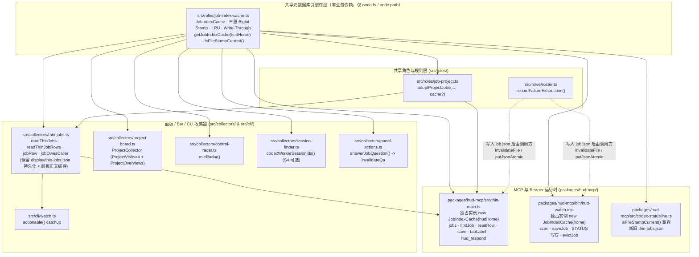
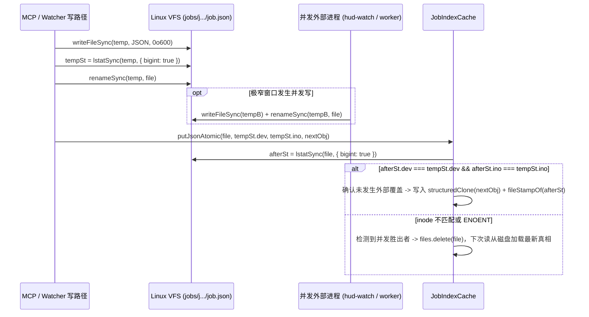
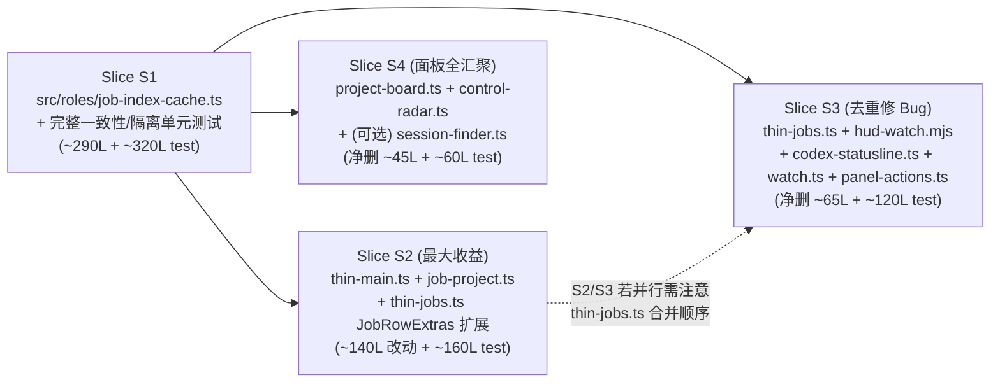

# 08. 为 MCP `jobs()` / `readRow()` 引入与 `thin-jobs` / `hud-watch` 共享的 mtime 缓存层

> **优先级**：P1（高频热路径 I/O 降噪与跨进程一致性加固） ｜ **类别**：存储读取架构重构 / 共享 mtime 索引缓存 ｜ **预估规模**：M–L（4 个垂直切片，新增 ~300L 共享核心 + ~320L 回归测试，净删 ~110L 重复手写缓存） ｜ **前置依赖**：无（基于 Node `>=24.0.0` 内置 `node:fs` / `node:path`，零新增依赖；与方案 02 / 03 / 05 / 06 完全正交且无缝衔接） ｜ **`docs/spec.md` 边界影响**：**无产品规格变更**（不新增常驻服务或账本数据库，不改动 MCP 工具契约与磁盘 JSON schema；直接强化 `docs/spec.md` §2.1“the panel and the MCP derive a job's state through one shared reader”与 §4 轻量高性能约束）

---

## 1. 背景与现状证据

MyHUD 的全部委派任务均以纯文件形态存于 `$HUD_HOME/jobs/j<16hex>/`（`job.json`、`STATUS.json`、`SESSION.txt`、`report.md`、`qa/qN.md`、`qa/qN.answer.md`、`checks.json`、`progress.jsonl`）。按当前保留策略（`packages/hud-mcp/bin/hud-watch.mjs:302-309`），已结束任务在关闭后至少保留 24 小时，一个高频开发日内 `$HUD_HOME/jobs/` 常驻 **50–200+** 个历史目录。

通过对全仓所有读取 `$HUD_HOME/jobs/` 的进程和模块进行逐行审计，现状存在两类结构性问题：**（1）MCP Server 处于完全无缓存冷读状态，单次工具调用反复全量扫描磁盘；（2）全仓其余 6 处读者各自维护互不相通的手写缓存，存在多处并发/失效/内存隔离缺陷。**

### 1.1 全仓 `$HUD_HOME/jobs/` 读者盘点（跨进程 + 同进程副本）

| # | 进程 / 运行时 | 模块与精确行号 | 扫描范围与读取文件 | 现有缓存机制 | 已验证的具体问题与缺陷 |
|---:|---|---|---|---|---|
| 1 | **MCP Server** (`hud-mcp`) | `packages/hud-mcp/src/thin-main.ts`: `jobs()` (L173–178), `findJob()` (L179–181), `tabLabel()` (L284–298), `readRow()` (L754–779), `listJobs()` (L817–850), `waitJobs()` (L854–924), `openQuestions()` (L926–932), `observation()` (L955–989), `dispatchWithKey()` (L1199–1200), `adoptSessionJobs()` (L1814–1818), `sessionJobs()`/`sessionRows()` (L1819–1828), `withChanges()` (L1831–1838), `sampleTask()` (L1942–1985), `receive()` (L2110–2123) | 无上限全量 `readdirSync(jobsRoot)` + 全部 `job.json` + 对应 `STATUS.json` + `qa/` + `report.md` + `SESSION.txt` | **完全零缓存** | 每次 `tools/call`（即使纯查静态配置的 `hud_roster`！）都执行 2–4 遍全量 `jobs()` 扫描；`hud_read({ job })` 对单个目标 job 在一次同步返回内冷读 `job.json` 5–6 次、`STATUS.json` 4 次、`qa/` 5 次；`listJobs(false)` 对项目全量历史 job 无上限逐个 `readRow()`。 |
| 2 | **On-Demand Reaper** (`hud-watch.mjs`) | `packages/hud-mcp/bin/hud-watch.mjs`: `cache`/`seen`/`read`/`json` (L27–53), `scan()` (L206–375) | 全量 `readdirSync(jobs)` + 每目录 `lstatSync` + `job.json` + `STATUS.json` + `SESSION.txt` + `supervisor.pid` | 私有 `Map`（stamp = `${mtimeMs}:${size}:${ino}`） | ① 用 `statSync`（跟随符号链接）且缺少 `dev`/`ctimeNs`/`mtimeNs`；② **隐蔽 Bug（L40）**：`ENOENT` 直接 `return null` 而未 `cache.delete(file)`（若单轮 scan 内先删后读会命中旧缓存）；③ **原地污染 Bug（L359–362）**：直接修改缓存引用 `latest.reaped_at = ...` 后再 `saveJob()`，若写入抛错会毒化内存缓存；④ 写完 `STATUS.json`/`job.json` 无写穿；⑤ `readdirSync(jobs)` 每次文件事件必跑。 |
| 3 | **Panel — Home / Workboard & Bars** (`tree-page.ts`, `index.ts`, `statusline.ts`, `segment.ts`, `board.ts`) | `src/collectors/thin-jobs.ts`: `cache`/`watchCache`/`seen`/`cacheHome` (L11, L27–30), `restore()`/`persist()` (L34–64), `read()`/`json()` (L65–105), `openQuestionIds()` (L182–192), `jobRow()` (L197–263), `jobOwesCaller()` (L273–280), `readThinJobs()` (L430–714) | 全量 `readdirSync(jobs)` + 全部 `lstatSync(dir)` 排序取前 200；读取 `job.json` / `STATUS.json` + 展示正文（`brief.md` / `report.md` / `qa/` / `review-N.md`） | 内存 `cache` + 磁盘 `$HUD_HOME/display/thin-jobs.json`（stamp = `${mtimeMs}:${size}:${ino}`） | ① **模块级全局状态冲突（L11, L27–30）**：`readThinJobs` 与 `readThinJobRows` 共用同一个模块级 `seen` 与 `complete`，同进程交替调用时 `seen.clear()` 会互相清掉对方追踪集合；② 切换 `HUD_HOME` 直接 `cache.clear()` 导致多 home 单测与多项目场景频繁冷启动；③ `jobRow({ dir })`（L224, L240, L244）每次必做 `readdirSync(qa)` + **`existsSync(report.md)` + `statSync(report.md)` 双重 stat**；④ `jobOwesCaller()`（L273–280）完全绕过缓存直接 `fs.readFileSync(STATUS.json)` + `statSync(STATUS.json)`。 |
| 4 | **`hud watch` CLI & pi Session Watch** | `src/cli/watch.ts`: `actionable()` (L31–72), `startSessionWatch()` (L163), `watchCommand()` (L285) → `thin-jobs.ts`: `watchReceipts()` (L363–381), `watchRows()` (L383–399), `readThinJobRows()` (L405–408), `readSessionJobRows()` (L410–418) | 全量 `readdirSync(jobs)` + 全部 `lstatSync(dir)` + 全部 `job.json`；匹配 pane 前 200 的 `STATUS.json` + `qa/` + `report.md` | 私有 `watchCache`（L28，无容量上限、不按 `HUD_HOME` 隔离） | ① `watchRows()` 每轮对所有匹配 pane 的 job 通过 `jobRow({ dir })` 无缓存执行 `readdirSync(qa)` + 双重 `report.md` stat；② `watch.ts:53` catchup（以及 `--queue` 模式每轮 L290）绕过缓存直接 `fs.readFileSync(job.json)` + `fs.statSync(STATUS.json)`；③ `watchCache` 无 LRU 上限，与 `cache` 重复解析同一批文件。 |
| 5 | **Panel — Project / Control / Projects List** | `src/collectors/project-board.ts`: `this.cache` (L109), `recentJobs()` (L203–211), `liveCwds()` (L298–307), `collect()` (L399–413, L460–519)；`src/collectors/project-visits.ts`: `ProjectVisits` (L6–42), `ProjectOverviews` (L67–82)；`src/collectors/control-radar.ts`: `roleRadar()` (L115–137), `last.cache` (L139–150) | `ProjectCollector` 每个访问过的项目根各自持有一份 `this.cache`（`ProjectVisits` 最多 4 份 + `ProjectOverviews.jobs` 1 份），各扫最新 64 个 job；`ControlRadar` 另持一份 `last.cache` 扫最新 200 个 job | 各自手写 `Map`（stamp = `dev:ino:size:mtimeMs:ctimeMs`） | **同一个面板进程内最多同时存在 6–7 份彼此隔离的 `jobs/` 缓存**（`thin-jobs.cache` + 4×`ProjectCollector` + `ProjectOverviews.jobs` + `control-radar`），切换页签或打开 Projects 列表时对同一批 `job.json`/`STATUS.json` 重复 `readdir` + `lstat` + `open`/`read`/`JSON.parse`。 |
| 6 | **Codex Native Statusline & Session Finder & Leases** | `packages/hud-mcp/src/codex-statusline.ts` (L61–111)；`src/collectors/session-finder.ts` (`codexWorkerSessionIds`, L518–581)；`src/collectors/thin-jobs.ts` (`leaseJob`, L297–303) | `codex-statusline` 读 `display/thin-jobs.json` 并 `lstatSync` 校验；`session-finder` 全量扫 `jobs/*/STATUS.json`；`leaseJob` 无缓存读 `STATUS.json`/`job.json` | `codex-statusline` 强绑定 `${mtimeMs}:${size}:${ino}` 字符串格式（L64）；`session-finder` 私有 `workerSessionCache` | `codex-statusline.ts:64` 硬编码 `display/thin-jobs.json` 的 stamp 字符串格式，任何升级持久化 stamp 格式的改动若未同步兼容，将导致 Codex 状态栏任务提醒静默失效；`session-finder` 在 Codex bar 进程内构成第 7 份独立 `jobs/` 扫描器。 |

> **说明**：`src/collectors/job-sentences.ts`（L15–42）、`decision-labels.ts`（L82–103）、`decision-titles.ts`（L80）与 `diff-stat.ts`（L88–100）面向单卡片按需读取模型输入正文或 diff，已有独立限容正文缓存或受限读取，**不属于**本方案收敛的“作业索引元数据”范畴（见 §2 非目标）。

---

### 1.2 MCP 单次工具调用的精确调用链与 I/O 量化（50 / 200 历史 Job）

以非 `taskClient`（标准 Claude Code / Codex / pi 会话）为基准，在 `packages/hud-mcp/src/thin-main.ts:2081–2140` 的 `receive()` 中，**每一次非 `hud_wait` 工具调用都会无条件夹心执行两道全量扫描**：
- **前置钩子（L2110）**：`await adoptSessionJobs()`（L1814–1818）→ `jobs()`（L173–178）= `1 × readdirSync(jobsRoot)` + `N × readFileSync(job.json)`；
- **后置钩子（L2118 / L2122）**：`withChanges()`（L1831–1838）→ `sessionRows()`（L1823–1828）→ `sessionJobs()`（L1819–1822）→ `jobs()` + `M × readRow()` = `1 × readdirSync(jobsRoot)` + `N × readFileSync(job.json)` + `M × (readFileSync(STATUS.json) + readdirSync(qa) + existsSync(report.md) + [statSync(report.md)])`。

设定两组典型合成工作负载（$N$ = `$HUD_HOME/jobs/` 总目录数，$P$ = 当前项目 job 数，$M$ = 当前会话 pane job 数，$P_{\text{rep}}/M_{\text{rep}}$ = 存在 `report.md` 的数量，$U$ = 未设 `reaped_at` 的历史/活跃 job 数）：
- **中负载（$N=50$）**：$P=40\,(P_{\text{rep}}=32),\; M=10\,(M_{\text{rep}}=8),\; U=5$
- **重负载（$N=200$）**：$P=150\,(P_{\text{rep}}=130),\; M=40\,(M_{\text{rep}}=35),\; U=15$

逐函数精确追踪单次调用实际执行的 `fs` 操作（内核 syscall 换算按 Linux x64/Node 24 保守基线：`readdirSync ≈ 3`、`readFileSync ≈ 4`、`open+read+close (slice) ≈ 3`、`existsSync/statSync/lstatSync = 1`）：

| MCP 工具调用 | 内部 `jobs()` / `readRow()` 精确轨迹（`thin-main.ts` 行号） | `readdir(jobs)` | `read(job.json)` | `read(STATUS)` | `readdir(qa)` | `exists/stat(report)` | `slice(SESSION)` | 50 job 总 FS / 估算 Syscall / `JSON.parse` | 200 job 总 FS / 估算 Syscall / `JSON.parse` |
|---|---|---:|---:|---:|---:|---:|---:|---:|---:|
| **`hud_roster`** | L2110 `adoptSessionJobs` → L2122 `withChanges`（工具体零 `jobs/` 读！） | 2 | $2N$ | $M$ | $M$ | $M+M_{\text{rep}}$ | 0 | **140 / ~494 / 110** | **557 / ~1,961 / 440** |
| **`hud_create`**（单次成功派发） | L2110 `adopt` → L1199 幂等查重 `jobs()` → L292 `tabLabel` `jobs()`+$U$×`SESSION.txt` → 4×`save()`(L157) → L1472 `finishLaunch` `readRow` → L191 `created` `readRow`+`primary` → L2122 `withChanges` | **4** | **$4N+6$** | $M+3$ | $M+3$ | $M+M_{\text{rep}}+3$ | $U+1$ | **263 / ~966 / 219** | **990 / ~3,663 / 849** |
| **`hud_read()`**（默认 `compact` 列表） | L2110 `adopt` → L818 `listJobs(false)` 全量 $P$ 次 `readRow`（无上限！）→ L2122 `withChanges` | **3** | **$3N$** | **$P+M$** | **$P+M$** | $P+M+P_{\text{rep}}+M_{\text{rep}}$ | 0 | **343 / ~1,049 / 200** | **1,338 / ~4,094 / 790** |
| **`hud_read({ job })`**（单 job，含 1 次收集） | L2110 `adopt` → L1692 `findJob` → L1701 `readRow` → L1710 `readRow` → L1712 `json` → L1714 `json` + L957 `observation` `readRow` + L959 `openQuestions` → L1716 `jobRow` + `json(STATUS)` → L1729 `json` + L157 `save` → L2122 `withChanges` | 2 | $2N+6$ | $M+4$ | $M+5$ | $M+M_{\text{rep}}+7$ | 0 | **162 / ~556 / 120** | **579 / ~2,023 / 450** |
| **`hud_send`**（单 job 续发） | L2110 `adopt` → L1510 `findJob` → L1525 `readRow` → L1533 `primary` → L1554/L1567/L1571 3×`json(job)` → L2122 `withChanges`（若触发 repair 则再叠加完整 `hud_create`！） | 2 | $2N+4$ | $M+1$ | $M+1$ | $M+M_{\text{rep}}+2$ | 1 | **149 / ~532 / 115** | **566 / ~1,987 / 445** |
| **`hud_wait`**（初始+每轮事件） | L863 `sessionJobs` → L864 `adopt` → 每轮 `fs.watch`/5s 轮询 `sample()` ($T$ 目标无缓存全读) → L2122 `withChanges` | 3+ | $3N+kT$ | $2M+kT$ | $2M+kT$ | $2(M+M_{\text{rep}})+2kT$ | 0 | 随事件数 $k$ 线性放大 | 随事件数 $k$ 线性放大 |

**核心发现**：
1. 一次普通 `hud_create` 竟然执行了 **4 次全量 `jobs/` 遍历**（200 job 时产生 **806 次 `readFileSync(job.json)`、849 次 `JSON.parse`、~3,663 次内核 syscall**）；
2. 一次不带参数的默认 `hud_read()` 产生 **600 次 `job.json` + 190 次 `STATUS.json` + 190 次 `qa/` 遍历 + 355 次 `report.md` stat（~4,094 次 syscall）**；
3. 一次单目标 `hud_read({ job })` 仅针对这 1 个 job 自身就冷读了 **6 次 `job.json`、4 次 `STATUS.json`、5 次 `qa/`、7 次 `report.md` stat**；
4. 即使 `hud_roster` 这样完全与任务目录无关的查询，在 200 job 目录下也要为前后钩子付出 **~1,961 次 syscall 和 440 次 `JSON.parse`**。

---

## 2. 目标与非目标（Scope / Out of Scope）

### 目标（Scope）
1. **建立跨进程/跨模块共享的作业索引缓存层 `src/roles/job-index-cache.ts`**：
   - 采用**目录级（`$HUD_HOME/jobs/`）+ 文件级（`job.json`/`STATUS.json`/`SESSION.txt`/`supervisor.pid`）+ `qa/` & `report.md` 元数据级**三重强校验 stamp 缓存；
   - 使用 Node 24 `fs.lstatSync(path, { bigint: true })` 获取纳秒级 `dev:ino:size:mtimeNs:ctimeNs`（目录附加 `nlink`），并在打开后通过 `fstatSync(fd, { bigint: true })` 消除 TOCTOU 竞态。
2. **提供进程内写穿（Write-Through）与原子防竞态失效钩子**：
   - 覆写 MCP `save(job)`、`finishLaunch`、`readRow` exhaustion 写 `STATUS.json`、`hud_respond`、`SESSION.txt` 写入、`adoptProjectJobs`、`hud-watch.mjs` `saveJob`/`STATUS.json`/删除过期目录、`panel-actions.ts` `answerJobQuestion` 全部写路径；
   - 原子替换写穿前捕获临时文件 `(dev, ino)`、rename 后核对目标 `(dev, ino)` 一致才写入缓存，从根源杜绝跨进程并发 rename 毒化缓存。
3. **接入全部核心读者并消除重复/缺陷实现**：
   - `packages/hud-mcp/src/thin-main.ts`、`src/collectors/thin-jobs.ts`、`packages/hud-mcp/bin/hud-watch.mjs`、`src/collectors/project-board.ts`、`src/collectors/control-radar.ts`、`packages/hud-mcp/src/codex-statusline.ts`（同步兼容新旧 `display/thin-jobs.json` stamp 格式）、`src/cli/watch.ts`、`src/roles/job-project.ts`（可选含 `src/collectors/session-finder.ts`）。
   - 修复盘点中发现的 3 个既有缺陷：`thin-jobs.ts` 全局 `seen`/`complete` 串扰、`hud-watch.mjs` `ENOENT` 缓存残留与 `latest.reaped_at` 原地污染、`jobRow` 对 `report.md` 的双重 `existsSync`+`statSync`。
4. **严格守住内存上限、多 `HUD_HOME` 隔离、隐私与 `complete` 完整性契约**：
   - 禁止缓存任何正文（`brief.md`、`report.md` 正文、`qa/qN.md`、`qa/qN.answer.md`、`review-N.md`、`sessions/*.jsonl`）与超大文件（>64 KiB JSON / >16 KiB `SESSION.txt`）；
   - 有界 LRU + 删目录即时回收 + 按规范化 `HUD_HOME` 隔离（最多保留 8 个 home 实例）；
   - 通过 `projection: 'full' | 'facts'` 标签彻底杜绝 `display/thin-jobs.json` 裁剪字段泄漏给需要完整 `job.json` 的读者，且完整保留 `thin-jobs.ts` 的 `observation.complete` 语义。

### 非目标（Out of Scope）
1. **不引入常驻缓存服务、SQLite 账本或跨进程共享内存**：严格遵守 `docs/spec.md` §3“no ledger database, no resident execution host”。跨进程复用仍仅限于既有的可丢弃展示缓存 `$HUD_HOME/display/thin-jobs.json`（只落盘 `factKeys` 白名单）。
2. **不在 MCP Server 中常驻 `fs.watch` 替代 `lstatSync`**：避免引入长生命周期 inotify 句柄、WSL2 漏事件漂移与额外复杂度（详见 §3.7 备选方案对比）。
3. **不缓存大正文或模型输入材料**：`job-sentences.ts`、`decision-labels.ts`、`decision-titles.ts`、`diff-stat.ts`、`project-board.ts` 对 `brief.md`/`report.md`/`qa/*.md`/`.scratch/` 的正文读取保持各自有界局部缓存，不进入 `JobIndexCache`。
4. **不改变 `readThinJobs` 的历史枚举上限语义**：遵循 `docs/ARCHITECTURE.md` §8 原则——不宣称目录枚举 `lstat` 是 $O(1)$ 常数成本，仍诚实保留 `candidates.length > 200` 触发 `complete = false` 的不完整覆盖标记。
5. **不耦合巨石拆分或异步化改造**：本方案不要求预先落地 方案 02（拆分 `thin-main.ts`）或方案 06（异步 `hud-watch.mjs`），且接口设计保证上述方案后续可直接平滑承接。

---

## 3. 核心设计方案

### 3.1 模块落点与依赖拓扑

将共享缓存层放在 **`src/roles/job-index-cache.ts`**（而非 `src/collectors/job-index.ts`），原因明确：
1. `src/roles/` 已是 `packages/hud-mcp/src/thin-main.ts`、`packages/hud-mcp/bin/hud-watch.mjs` 与 `src/collectors/thin-jobs.ts` 三方共同依赖的领域底层（如 `job-project.ts`、`job-checks.ts`、`worker-tree.ts`、`cli-turn.ts`）；
2. `hud-watch.mjs` 当前完全不导入 `src/collectors/`，放在 `src/roles/` 可避免引入任何工作板/UI 收集器传递依赖，保持单向无环 DAG；
3. 与方案 02 规划的 `src/roles/job-contracts.ts`、`src/roles/job-io.ts` 同属一层，仅依赖 `node:fs` 与 `node:path`。



---

### 3.2 三重 Stamp 校验机制与 Linux/WSL2 边界精确分析

#### 1) 为什么放弃 `${st.mtimeMs}:${st.size}:${st.ino}` 并改用 `BigIntStats`

现行 `thin-jobs.ts:71` 与 `hud-watch.mjs:33` 使用 `fs.lstatSync(path)` / `fs.statSync(path)` 构造 `${st.mtimeMs}:${st.size}:${st.ino}`，存在三个隐患：
1. **双精度浮点精度丢失**：现代 Unix 毫秒时间戳约 $1.79 \times 10^{12}$，IEEE 754 `double`（53 位有效位）仅剩约 12 位小数（$\approx 0.24\,\mu\text{s}$ 量化步长），会抹平纳秒级更新；
2. **缺少 `ctimeNs`**：当测试或工具通过 `fs.utimesSync` 回拨 `mtime`（如 `thin-panel-jobs.test.mjs:47`），或同尺寸原地覆盖并保持近似 `mtime` 时，内核仍强制推进 `ctimeNs`；缺少 `ctimeNs` 会漏检元数据/回拨变更；
3. **缺少 `dev` 与 `nlink`**：跨设备挂载点或 tmpfs 重挂载后仅看 `ino` 可能碰撞；目录项增删子目录时 `nlink` 是 POSIX ext4/tmpfs 的零成本额外变化信号。

在 Node 24 上，`fs.lstatSync(path, { bigint: true, throwIfNoEntry: false })` **只需同一条 `statx`/`newfstatat` 系统调用**即可获得完整 64 位整数纳秒字段。同时需注意 **Node 24 浮点兼容细节（已在本机 Node 24 实测验证）**：
- `BigIntStats.mtimeMs` 是**截断为整数毫秒的 `bigint`**（丢弃亚毫秒小数），而 `Number(st.mtimeNs) / 1e6` 会因浮点除法舍入与 `Stats.mtimeMs`（libuv 计算 `sec * 1000 + nsec / 1e6`）相差 $\approx 0.00024\,\text{ms}$，导致依赖 `assert.deepEqual(row.report_mtime, fs.statSync(...).mtimeMs)` 的既有测试（`tests/unit/thin-job-scan.test.mjs:210`）失败！
- 采用与 libuv 逐比特一致的换算函数即可做到 100% 等价：

```ts
const NS_PER_SEC = 1_000_000_000n;

/** 与 Node/libuv `Stats.mtimeMs` 逐比特等价的 IEEE 754 毫秒换算。 */
export function statsMtimeMs(mtimeNs: bigint): number {
  const rem = mtimeNs % NS_PER_SEC;
  const sec = rem < 0n ? mtimeNs / NS_PER_SEC - 1n : mtimeNs / NS_PER_SEC;
  const nsec = mtimeNs - sec * NS_PER_SEC;
  return Number(sec) * 1000 + Number(nsec) / 1e6;
}

/** 文件级 Stamp（5 字段整数串，与旧 3 字段 `mtimeMs:size:ino` 形态天然可区分）。 */
export function fileStampOf(st: fs.BigIntStats): string {
  return `${st.dev}:${st.ino}:${st.size}:${st.mtimeNs}:${st.ctimeNs}`;
}

/** 目录级 Stamp（用于 `$HUD_HOME/jobs/` 与 `qa/`，附加 `nlink` 强化子目录增删感知）。 */
export function dirStampOf(st: fs.BigIntStats): string {
  return `${st.dev}:${st.ino}:${st.size}:${st.nlink}:${st.mtimeNs}:${st.ctimeNs}`;
}
```

#### 2) 三重 Stamp 缓存职责与失效条件

| 缓存层 | 缓存键 | Stamp 来源 | 缓存内容（严格有界） | 什么磁盘变更保证触发失效 | 什么情况下 **不可跳过** |
|---|---|---|---|---|---|
| **Layer 1：根目录清单** | `this.jobsRoot` | `lstatSync(jobsRoot, { bigint: true })` → `dirStampOf(st)` | 合法 job ID 数组 `readonly string[]`（`/^j[0-9a-f]{16}$/`） | 任何进程在 `jobs/` 下 `mkdir`、`rm`、`rename` 子目录必改 `jobsRoot` 的 `mtimeNs`/`ctimeNs`（ext4/tmpfs 还改 `nlink`）；本进程 `noteJobDir`/`evictJob` 即时同步 | **绝不**用 `jobsRoot` stamp 跳过子目录内部文件 `lstat`（修改 `jobs/<id>/STATUS.json` 不会改 `jobs/` 的 `mtime`）！ |
| **Layer 2：结构化文件** | 规范绝对路径（`job.json`、`STATUS.json`、`SESSION.txt`、`supervisor.pid`、`checks.json`） | 命中检查：`lstatSync(file, { bigint: true })`；**落缓存使用 `fstatSync(fd, { bigint: true })`**（消除 TOCTOU！） | 解析后只读 JSON 对象（≤64 KiB，带 `projection: 'full' \| 'facts'`）、`SESSION.txt` 键表（≤16 KiB）、或 `truncated`/`invalid` 负结果标记 | ① **原子 rename**：新临时文件与旧目标共存，`ino` **必然改变**（即使同纳秒、同字节长度！）；② **`utimesSync` 回拨**：`ctimeNs` 必然改变；③ **原地覆写**：字节数不同由 `size` 检出，同字节由 Linux 6.6+ multigrain `mtimeNs`/`ctimeNs` 检出，本进程由 write-through 保证 100% 即时可见 | **绝不**用父目录 `jobs/<id>` 的 `mtime` 跳过文件 `lstat`（原地覆写已存在文件如测试 `thin-job-scan.test.mjs:58` 不会改父目录 `mtime`！）；符号链接或非普通文件（`!st.isFile()`）绝不缓存。 |
| **Layer 3：`qa/` 与 `report.md` 元数据** | `qa/`: `join(dir, 'qa')`；`report.md`: 单次 `lstatSync` | `qa/`: `lstatSync(qaDir, { bigint: true })` → `dirStampOf(st)`；`report.md`: `lstatSync(reportPath, { bigint: true })` | `qa/`: `{ exists, openIds: readonly string[], allQuestionFiles: readonly string[] }`（**仅文件名，绝不存正文**）；`report.md`: `{ present, mtimeMs, stamp }`（**绝不存正文**） | 任何新增 `qN.md`、写入 `qN.answer.md`、删除/重建 `qa/` 必改 `qa/` 目录项的 `mtimeNs`/`ctimeNs`（重建还改 `ino`）；`hud_respond` / `answerJobQuestion` 同步调用 `invalidateQa(id)`；**`ENOENT` 不做跨调用负缓存**（1 次 `lstat` 仅 ~1 µs，目录一建即刻可见） | `qa/` 非目录（如误建为普通文件或符号链接）直接删缓存并抛 `ENOTDIR`，保持既有错误语义。 |

> **关于 Linux 粗时钟同毫秒原地覆写的诚实边界说明**：MyHUD 全部生产写路径（`thin-main.ts`、`hud-watch.mjs`、`hud-cli.mjs`、`hud-jev.mjs`、`hud-check.mjs`、`worker-tools.mjs`、`job-project.ts`、`roster.ts`）对 `job.json`/`STATUS.json`/`checks.json`/`report.md` 均采用 temp-file + `renameSync` 原子替换（`ino` 100% 变化），仅 `SESSION.txt` 在 `thin-main.ts:447,533,697` 为原地 `writeFileSync`（本方案在写入后立即 `invalidateFile` 或改为原子替换）。在极少数外部进程于旧内核非 multigrain 挂载点、同一 1–4 ms tick 内、原地截断覆写**恰好相同字节数**的场景下，没有任何基于 `stat` 的缓存能在不读文件内容的情况下区分变化——这是 POSIX VFS 的物理下界；使用 `bigint` 纳秒 `mtimeNs + ctimeNs`（本机 Linux 6.18 / 6.6+ ext4 multigrain 在 `lstat` 查过后强制启用纳秒精度）叠加“生产路径全原子 rename + 进程内 write-through”已将该窗口降为事实上的零。

---

### 3.3 数据结构与完整 TypeScript 接口契约

```ts
// src/roles/job-index-cache.ts

export const JOB_ID_RE = /^j[0-9a-f]{16}$/;
export const DEFAULT_MAX_JSON_BYTES = 65_536;     // 64 KiB，对齐 thin-jobs.ts:92 & project-board.ts:146
export const DEFAULT_MAX_SESSION_BYTES = 16_384;  // 16 KiB，对齐 thin-main.ts:184
export const DEFAULT_MAX_CHECKS_BYTES = 196_608;  // 192 KiB，对齐 job-checks.ts:57
export const DEFAULT_MAX_FILE_ENTRIES = 1_024;    // 上限 ~2–3 MiB 堆内存
export const DEFAULT_MAX_QA_ENTRIES = 512;        // 仅文件名数组，上限 <64 KiB
export const MAX_CACHED_HOMES = 8;                // 跨 HUD_HOME 全局注册表上限，防单测泄漏

export type JsonProjection = 'full' | 'facts';

export type CachedJsonResult<T = Record<string, unknown>> =
  | { status: 'ok'; value: T; stamp: string; at: number; projection: JsonProjection; hit: boolean }
  | { status: 'missing' }
  | { status: 'truncated'; stamp: string; at: number }
  | { status: 'invalid'; stamp: string; at: number; error: unknown }
  | { status: 'error'; error: NodeJS.ErrnoException | Error };

export interface QaSnapshot {
  readonly exists: boolean;
  /** 未回答问题 ID（数值升序，如 ['q1', 'q2', 'q10']），不含任何正文。 */
  readonly openIds: readonly string[];
  /** 所有 qN.md 文件名（数值升序），供 MCP task `seenQuestions` 复用。 */
  readonly allQuestionFiles: readonly string[];
  readonly stamp: string | null;
}

export interface ReportStat {
  readonly present: boolean;
  /** 与 `fs.statSync(report).mtimeMs` 逐比特一致；缺失或非普通文件时为 null。 */
  readonly mtimeMs: number | null;
  readonly stamp: string | null;
}

export interface SessionFields {
  readonly task?: string;
  readonly tab?: string;
  readonly tabName?: string;
  readonly left?: string;
  readonly right?: string;
  readonly orch?: string;
  readonly base?: string;
  readonly primary?: string;
}

export interface JobDirMeta {
  readonly id: string;
  readonly dir: string;
  readonly mtimeMs: number;
  readonly birthtimeMs: number;
}

export interface JobIndexCacheOptions {
  maxFileEntries?: number;
  maxQaEntries?: number;
  maxJsonBytes?: number;
  /** 仅测试模式启用：对缓存的 JSON 对象执行递归 Object.freeze，捕获任何误改缓存引用的调用方。 */
  freezeCachedValues?: boolean;
}

export interface PersistedFactRow {
  rel: string;
  stamp: string;
  at: number;
  whole: boolean;
  json: Record<string, unknown> | null;
}
```

#### 核心类 `JobIndexCache` 与工厂契约

```ts
export class JobIndexCache {
  readonly hudHome: string;
  readonly jobsRoot: string;

  constructor(hudHome: string, options?: JobIndexCacheOptions);

  // --- Layer 1: $HUD_HOME/jobs/ 目录清单 ---
  listJobIds(opts?: { onError?: (error: NodeJS.ErrnoException) => void }): readonly string[];
  listJobDirsByMtime(opts?: {
    limit?: number;
    sortBy?: 'mtime' | 'birthtime';
    onDirError?: (error: NodeJS.ErrnoException) => void;
    onStatError?: (id: string, error: unknown) => void;
  }): { dirs: JobDirMeta[]; totalValid: number };

  // --- Layer 2: 结构化元数据文件 ---
  readJson<T = Record<string, unknown>>(
    filePath: string,
    opts?: { maxBytes?: number; parse?: (text: string) => unknown; acceptFacts?: boolean }
  ): CachedJsonResult<T>;
  readJob<T = Record<string, unknown>>(
    id: string,
    opts?: { parse?: (text: string) => unknown; acceptFacts?: boolean }
  ): CachedJsonResult<T>;
  /** 供需原地修改再回写的路径（save / sendJob / hud_read / hud-watch reaped_at），返回 structuredClone 副本。 */
  readJobMutable<T = Record<string, unknown>>(id: string): CachedJsonResult<T>;
  readStatus<T = Record<string, unknown>>(
    id: string,
    opts?: { parse?: (text: string) => unknown; acceptFacts?: boolean }
  ): CachedJsonResult<T>;
  readSession(id: string): { fields: SessionFields; stamp: string } | null;
  readPid(filePath: string): number | null;

  // --- Layer 3: qa/ 与 report.md 元数据 ---
  /** 非 ENOENT 错误原样抛出，保持 thin-jobs.ts 与 jobRow 错误语义。 */
  readQa(idOrDir: string): QaSnapshot;
  readReportStat(idOrDir: string): ReportStat;

  // --- Write-Through & 显式失效钩子 ---
  /**
   * 原子替换写穿：仅当 rename 后目标 (dev, ino) 与写入前的临时文件 (tempDev, tempIno) 完全一致时
   * 才以新 stamp 写入缓存；若期间被外部进程抢先替换，则直接 delete 失效，绝不毒化缓存。
   */
  putJsonAtomic(
    filePath: string,
    tempDev: bigint,
    tempIno: bigint,
    value: Record<string, unknown>
  ): void;
  invalidateFile(filePath: string): void;
  invalidateQa(idOrDir: string): void;
  invalidateJob(id: string): void;
  noteJobDir(id: string): void;
  evictJob(id: string): void;
  clear(): void;

  // --- 仅 thin-jobs.ts 冷启动持久化桥接 ---
  hydrateFacts(rows: readonly PersistedFactRow[]): void;
  exportFacts(
    seenPaths: ReadonlySet<string>,
    factKeys: ReadonlySet<string>
  ): [string, string, { at: number; whole: boolean; json: Record<string, unknown> | null }][];
}

/** 按规范化 hudHome 隔离的进程内 LRU 注册表（上限 MAX_CACHED_HOMES = 8），供 panel / CLI 收集器共享。 */
export function getJobIndexCache(hudHome: string, options?: JobIndexCacheOptions): JobIndexCache;
export function clearJobIndexCaches(): void;

/** 同时兼容新 5 字段 BigInt stamp 与旧 3 字段 `mtimeMs:size:ino` stamp（供 codex-statusline.ts & thin-jobs.ts）。 */
export function isFileStampCurrent(filePath: string, stamp: string): boolean;
```

---

### 3.4 关键设计精要与防陷阱机制

#### 1) 写穿原子替换的跨进程竞态免疫（`putJsonAtomic` 状态机）

若进程 A 在 `renameSync(temp, file)` 后直接 `lstatSync(file)` 并将自己的对象写入缓存，存在一个经典分布式竞态：如果进程 B 恰好在 `renameSync` 和 `lstatSync` 之间用更新的内容原子替换了 `file`，进程 A 就会把自己的旧对象绑定到进程 B 的新 inode stamp 上，导致永久脏读！

解决方案——**rename 前捕获 `tempSt = lstatSync(temp, { bigint: true })`，rename 后核对 `(dev, ino)`**：



对于非原子写入（`hud_respond` 写 `qa/qN.answer.md`、`SESSION.txt` 原地写），直接调用 `invalidateQa(id)` / `invalidateFile(path)`，同样 100% 无竞态。

#### 2) 杜绝 `display/thin-jobs.json` 的 `factKeys` 裁剪污染全量读者（`projection: 'full' | 'facts'`）

审计 `src/collectors/thin-jobs.ts:32–33` 发现，`display/thin-jobs.json` 持久化时只保留 24 个展示白名单键（`factKeys`），刻意剔除了 `cwd`、`project_root`、`worktree`、`reaped_at`、`cli`、`checks`、`observed_at`、`task_length`、`request_key`、`send_outcomes`。如果直接把 `restore()` 恢复的精简对象当作普通缓存塞给同进程内的 `ProjectCollector`、`readThinJobRows` 或 `ControlRadar`，后者读到 `job.cwd === undefined` 会直接静默丢弃所有作业！

因此每条 JSON 缓存记录强制携带 `projection: 'full' | 'facts'`：
- `hydrateFacts()` 写入的条目一律标记为 `projection: 'facts'`（且不覆盖已存在的 `'full'` 条目）；
- 仅 `readThinJobs` 的快筛阶段传入 `{ acceptFacts: true }`（保持 `thin-job-scan.test.mjs:103` 冷启动 1,000 个旧 job `parses <= 3` 的零回归！）；
- 所有需要完整 `job.json` 字段的调用方（`thin-main.ts`、`hud-watch.mjs`、`readThinJobRows`、`ProjectCollector`、`ControlRadar`）默认 `acceptFacts: false`：遇到 `'facts'` 自动视为 miss，读盘后无缝升级为 `projection: 'full'`；
- `readThinJobs` 落盘 `persist()` 调用 `exportFacts()` 时仍只过滤输出 `factKeys` 白名单（且跳过带 `checks` 的条目），保证隐私与磁盘格式 100% 不退化。

#### 3) 缓存引用只读防污染（应对 5 处原地修改点）

代码中存在 5 处直接修改已读取 `Job` 对象的写点：`thin-main.ts:762` (`readRow` 设置 `job.exhaustion_marked = true`)、`thin-main.ts:1552-1553` (`sendJob` `push` `send_outcomes`)、`thin-main.ts:1569-1570` (`sendJob` 改写 `attempted`)、`thin-main.ts:1731-1732` (`hud_read` 改写 `latest.read_at`/`observed_at`)、`hud-watch.mjs:361` (`latest.reaped_at = ...`)。

防污染策略：
- 热读路径（`jobs()`、`listJobs()`、`sessionRows()`、`readThinJobs()`、`ProjectCollector`）返回缓存对象引用（零克隆开销），在 TypeScript 类型签名上声明为 `Readonly<...>`；
- 上述 5 处修改再回写点统一调用 `readJobMutable(id)`（内部 `structuredClone`，1 KiB JSON 耗时 ~2 µs）或使用不可变展开 `{ ...latest, reaped_at: ... }`，且 `putJsonAtomic` 入库前同样执行 `structuredClone`；
- 单元测试开启 `freezeCachedValues: true`（递归 `Object.freeze`），任何漏网的原地修改都会在 `npm test` 期间立刻以 `TypeError` 暴露。

#### 4) 进程内实例隔离 vs 全局单例策略

| 运行时场景 | 实例策略 | 理由 |
|---|---|---|
| **MCP Server (`thin-main.ts`)** | 模块顶层显式独占实例 `new JobIndexCache(hudHome)` | 长生命周期单 `HUD_HOME` 进程，拥有全部写穿控制权，不与任何其他 home 共享。 |
| **On-Demand Reaper (`hud-watch.mjs`)** | 进程顶层显式独占实例 `new JobIndexCache(home)` | 单 `HUD_HOME` 进程，需要精细的 `putJsonAtomic` 与 `evictJob` 控制。 |
| **Panel / CLI / Bar / 单元测试 (`thin-jobs.ts`, `project-board.ts`, `control-radar.ts`, `panel-actions.ts`, `session-finder.ts`)** | 共享按规范化 `resolve(hudHome)` 分桶的 `getJobIndexCache(hudHome)`（LRU 上限 `MAX_CACHED_HOMES = 8`） | ① 同面板进程内 6–7 个读者（Home + 4×ProjectVisits + ProjectOverviews + ControlRadar）自动共享同一份 `job.json`/`STATUS.json` 缓存，切页签零重复读盘；② 单测频繁创建临时 `HUD_HOME` 彼此严格隔离，超过 8 个自动淘汰最旧临时 home，零内存泄漏。 |

#### 5) 内存有界淘汰与已删除目录回收

- **容量硬顶**：`files` Map 上限 `1,024` 条（`~2–3 MiB` 封顶），`qa` Map 上限 `512` 条（`<64 KiB`）；每次命中执行 `map.delete(k); map.set(k, v)` 维持 O(1) 真 LRU，超出上限立即淘汰队首最久未用条目。
- **删目录即时回收**：
  - `listJobIds()` 每次因 `jobsRoot` stamp 变化重扫目录时，立刻对 `files` 与 `qa` 扫描一次并删除所有已不在 `liveIdSet` 中的 job 条目；
  - 任意文件/目录 `lstatSync` 返回 `ENOENT` 时立刻 `delete` 对应缓存键；
  - `hud-watch.mjs` 执行 `fs.rmSync(dir, { recursive: true, force: true })` 后主动调用 `jobCache.evictJob(id)`。

#### 6) 完整保留 `thin-jobs.ts` 的 `observation.complete` 语义

对照 `src/collectors/thin-jobs.ts` 全部 11 处 `complete = false` 条件：
- `readJson()` 的 5 态判别联合（`ok | missing | truncated | invalid | error`）保证：**即使命中缓存的 `truncated` 或 `invalid` 条目**，`readThinJobs` 依然能收到精确状态并置 `complete = false`（与现行 L73/L93/L103 完全等价）；
- `listJobDirsByMtime()` 返回 `{ dirs, totalValid }` 并在目录不可读或任意单子目录 `lstat` 抛错时触发回调置 `complete = false`，且 `totalValid > 200` 依然置 `complete = false`（对齐 L443–445）；
- `complete` 与 `seen` 从模块级全局变量（L11, L29）收归 `readThinJobs()` 局部作用域，彻底根除 `readThinJobs` 与 `readThinJobRows` 并发/交替调用时的全局状态串扰；
- `readThinJobs` 依然持有面板局部的 `artifactCache`（按 `hudHome` 分桶、上限 512 条、**永不落盘**）来缓存 `brief.md`、`report.md` 正文、`qa/qN.md`、`review-N.md`、`progress.jsonl`（保持 L487–599 渲染所需内容与既有缓存命中率不变）。

#### 7) 对照 `docs/ARCHITECTURE.md` §8 工程规范逐项核验

| §8 规则 | 本方案合规落地 |
|---|---|
| 渲染纯函数（无 I/O） | 缓存层完全位于 `src/roles/` 与 `src/collectors/`，绝不被 `src/render/*` 导入。 |
| 失败读返回 null/unknown，不伪造零值或健康态 | 非 `ENOENT` 错误返回 `{ status: 'error' }` 或原样抛出，绝不缓存错误为健康条目；`complete` 忠实反映不完整覆盖。 |
| 保持边界与不完整覆盖说明 | 不宣称 `lstat` 扫描为 $O(1)$；保持 200 历史上限、64 KiB JSON 上限、16 KiB `SESSION.txt` 上限。 |
| 私有原子写（`0o600` + temp + rename） | `display/thin-jobs.json` 与 `save()` 继续保持 `0o600` 临时文件 + 原子 rename；不扩大磁盘持久化字段集。 |
| Node `>=24.0.0`、零新依赖、合成测试数据 | 仅用 Node 24 内置 `fs.lstatSync(..., { bigint: true })` 与 `structuredClone`；全量测试用临时 `HUD_HOME` + 合成数据。 |

---

### 3.5 各调用方具体接入方案

#### A. `packages/hud-mcp/src/thin-main.ts`
1. 模块初始化创建独占实例：`const jobCache = new JobIndexCache(hudHome);`（L49 旁）。
2. `jobs()`（L173–178）：改为遍历 `jobCache.listJobIds()` + `jobCache.readJob<Job>(id)`（`ok` 收录，`missing` 跳过，`invalid`/`error` 保持现行 `thin-main.ts:122–124` 抛错语义，不静默吞错）。
3. `findJob(id)`（L179–181）：校验 `JOB_ID_RE` 后调用 `jobCache.readJob<Job>(id)`；需修改后保存的 3 处（`sendJob` L1510/L1567、`hud_read` L1729、`closeJob` L1777）改调 `jobCache.readJobMutable<Job>(id)`。
4. `save(job, newAttempt)`（L154–172）：
   - 合并最新字段读 `jobCache.readJob<Job>(job.job)`（`lstat` 自动发现外部 `hud-watch.mjs` 的 `reaped_at` 或 `adoptProjectJobs` 的 `herdr_pane` 变更）；
   - 写 temp 文件（`${file}.${process.pid}.${randomBytes(4).toString('hex')}.tmp`，`mode: 0o600, flag: 'wx'`），`tempSt = fs.lstatSync(temp, { bigint: true })`，`fs.renameSync(temp, file)`，随后调用 `jobCache.putJsonAtomic(file, tempSt.dev, tempSt.ino, merged)` + `jobCache.noteJobDir(job.job)`。
5. `readRow(job, markExhaustion)`（L754–779）：
   - `STATUS.json` 改走 `jobCache.readStatus(job.job)`；
   - `jobRow(job, status, { dir, cache: jobCache })`（`qa/` 命中 Layer 3、`report.md` 合并为单次 `lstatSync`）；
   - 若 `recordFailureExhaustion` 返回 `marked: true`：先 `jobCache.invalidateFile(join(dir, 'job.json'))`（因 `roster.ts:850` 原子替换了 `job.json`），再用 temp+rename+`putJsonAtomic` 写 `STATUS.json`，重算 `jobRow` 时直接复用缓存的 `qa/` 与 `report.md`！同时避免原地修改入参 `job`（或在内部用副本 `{ ...job, exhaustion_marked: true }`）。
6. `tabLabel()`（L284–298）与 `primary()`（L182–188）：改走 `jobCache.readSession(id)?.fields.tabName` / `.primary`，消除每次 `hud_create` 对所有未 reap 历史 job 的 `SESSION.txt` 重复 `open`/`read`/`close`；`dispatchPi`/`dispatchCli`/`dispatchBro` 写完 `SESSION.txt`（L447, L533, L697）后立即调用 `jobCache.invalidateFile(join(dir, 'SESSION.txt'))`。
7. `openQuestions(dir)`（L926–932）与 `questionFiles(dir)`（L1888）：改走 `jobCache.readQa(dir).openIds` / `.allQuestionFiles`；`hud_respond`（L1750）写入 `qa/${request}.answer.md` 后立即 `jobCache.invalidateQa(job.job)`。
8. `dispatchWithKey` 重试清理（L1324）后调用 `jobCache.invalidateJob(id)`；`finishLaunch`（L1457–1469）写 `STATUS.json` 后调用 `jobCache.putJsonAtomic(...)`；`finishLaunch`（L1472）把刚算好的 `row` 传给或复用，避免 `created(job)`（L191）在 0.05 ms 后白算一遍。
9. `hud_read({ job })`（L1712–1720）：`observation()` 返回 `row` 供 `currentRow` 复用，或在 L1716 传入 `questionIds` 与 `reportAt` + `cache: jobCache`，彻底消除单次 `hud_read({ job })` 内 4 次重复读 `STATUS.json` 与 5 次重复扫 `qa/`。
10. `adoptSessionJobs()`（L1815）：向 `adoptProjectJobs()` 透传 `jobCache`（`src/roles/job-project.ts` 改写 `job.json` 后 `putJsonAtomic`，且 `jobOwesCaller` 复用 `jobCache`）；`listJobs()`（L846）把 `statusAt` 传给 `failureUnobserved(dir, job.observed_at, statusAt)` 消除失败任务的二次 `statSync(STATUS.json)`。

#### B. `src/collectors/thin-jobs.ts` + `packages/hud-mcp/src/codex-statusline.ts` + `src/cli/watch.ts`
1. `thin-jobs.ts` 移除顶层 `watchCache`（L28）、共享 `seen`（L29）、单值 `cacheHome`（L30）和全局 `complete`（L11）；改为 `const idx = getJobIndexCache(home)` + 每 `home` 独立的面板局部 `artifactCache`（仅存正文头，上限 512）+ 函数局部 `seen` / `complete`。
2. `restore(home)` 通过 `WeakSet<JobIndexCache>` 确保每个 `JobIndexCache` 实例只从 `display/thin-jobs.json` 恢复一次，通过 `idx.hydrateFacts(...)` 标记 `projection: 'facts'`；`persist(home)` 仅在 `readThinJobs()` 尾部调用 `idx.exportFacts(seen, factKeys)`，**绝不**在 `readThinJobRows()` 中写盘（100% 满足 `tests/unit/thin-job-scan.test.mjs:313`）。
3. `jobRow(job, status, extras)` 扩展 `JobRowExtras` 支持 `{ cache?: JobIndexCache; questionIds?: readonly string[]; reportAt?: number | null }`：
   - 传入 `questionIds` 时跳过 `qa/` 读取；否则优先 `extras.cache.readQa(extras.dir).openIds`；
   - `report.md` 合并 `existsSync` + `statSync` 为单次 `readReportStat(extras.dir)`（或无 `cache` 时单次 `lstatSync(..., { bigint: true, throwIfNoEntry: false })`）。
4. `readThinJobRows` / `readSessionJobRows` / `jobOwesCaller` 全部接入 `getJobIndexCache(home)` 并把 `cache` 透传给 `jobRow` 与 `adoptProjectJobs`。
5. `packages/hud-mcp/src/codex-statusline.ts:61–68` 的 `stillCurrent(fact)` 改为调用共享 `isFileStampCurrent(fact.path, fact.stamp)`，兼容 5 字段新 stamp 与 3 字段旧 stamp（平滑过渡热更新前后的 `display/thin-jobs.json`）。
6. `src/cli/watch.ts:53` 的 catchup 检查改为通过 `getJobIndexCache(home).readJob(row.job)` 与 `readStatus(row.job)`（使用缓存的 `at`），消除 `hud watch --queue` 每轮对失败/阻塞 job 的无缓存冷读。
7. `src/collectors/panel-actions.ts:22` 写完 `qa/${qid}.answer.md` 后调用 `getJobIndexCache(home).invalidateQa(job)`，面板内回答后同一 tick 立即可见。

#### C. `packages/hud-mcp/bin/hud-watch.mjs`
1. 导入 `JobIndexCache`（当前路径 `../dist/src/roles/job-index-cache.js`；方案 03 落地后随其他 `src/roles/*` 一并切为 `../../../dist/roles/job-index-cache.js`），实例化 `const jobCache = new JobIndexCache(home);`。
2. 删除 L27–53 整段私有 `cache`/`seen`/`read`/`json`；L54 读 `logFile` 与 L143 读 `pidFile` 改为独立 3 行轻量 `readTextIfExists()`，不污染 job 索引缓存。
3. `scan()` 内 `fs.readdirSync(jobs)` 改为 `jobCache.listJobIds()`；`job.json`、`STATUS.json`、`SESSION.txt`、`supervisor.pid` 全部走 `jobCache`，并在 `res.status === 'error'` 时原样 `throw res.error` 以保持 L236 `open = true` 安全语义，在 `res.status === 'invalid'` 时返回 `null` 以保持 L49 语义。
4. `saveJob()`（L194–198）及 3 处 `STATUS.json` 写入（L259–260, L293–294, L353–354）统一改为 `tempSt` + `renameSync` + `jobCache.putJsonAtomic(...)`；L361 改用 `saveJob(jobFile, { ...latest, reaped_at: new Date().toISOString() })` 根除原地污染；L306 `fs.rmSync(dir, ...)` 后立即 `jobCache.evictJob(id)`。

#### D. `src/collectors/project-board.ts` & `src/collectors/control-radar.ts`（+ 可选 `session-finder.ts`）
1. `ProjectCollector` 的 `recentJobs()`（L203）、`liveCwds()`（L298）、`editing`（L402）与 `collect()` 作业循环（L469–480）统一改为消费 `getJobIndexCache(this.hudHome)`（`listJobDirsByMtime({ limit: 64 })` + `readJob` + `readStatus`）；项目本地文件（`STATE.md`、`.scratch/`、`docs/`、`roles/`、`credentials.env`）和 `brief.md` 摘要继续留在 `ProjectCollector.cache`。
2. `control-radar.ts` 的 `roleRadar()`（L115–137）改用 `getJobIndexCache(hudHome).listJobDirsByMtime({ limit: 200, sortBy: 'birthtime' })` + `readJob` + `readStatus`。
3. （S4 可选）`src/collectors/session-finder.ts:518–581` 的 `codexWorkerSessionIds()` 改用 `getJobIndexCache(home).listJobIds()` + `readStatus(id)`，删除私有 `workerSessionCache` 与 `workerSessionsHome`。

---

### 3.6 `hud_create` / `hud_read` 改造前后 Syscall 对比（热态，50 / 200 历史 Job）

以 §1.2 同一组工作负载为准（热态下历史 job 未变；`hud_create` 新增 1 个 job，`hud_read({ job })` 1 个目标 job 刚产出报告；仅统计读路径 syscall，采用**严格每次 `lstat` 零陈旧**策略）：

| 指标（单次调用） | `hud_create`（50 job）前 → 后 | `hud_create`（200 job）前 → 后 | `hud_read()` 列表（50 job）前 → 后 | `hud_read()` 列表（200 job）前 → 后 | `hud_read({ job })`（50 job）前 → 后 | `hud_read({ job })`（200 job）前 → 后 |
|---|---|---|---|---|---|---|
| `readdirSync(jobsRoot)` | 4 → **1** (-75%) | 4 → **1** (-75%) | 3 → **0** (-100%) | 3 → **0** (-100%) | 2 → **0** (-100%) | 2 → **0** (-100%) |
| `readFileSync(job.json)` | 206 → **0** (-100%) | 806 → **0** (-100%) | 150 → **0** (-100%) | 600 → **0** (-100%) | 106 → **1** (-99.1%) | 406 → **1** (-99.8%) |
| `readFileSync(STATUS.json)` | 13 → **1** (-92.3%) | 43 → **1** (-97.7%) | 50 → **0** (-100%) | 190 → **0** (-100%) | 14 → **1** (-92.9%) | 44 → **1** (-97.7%) |
| `readdirSync(qa)` | 13 → **1** (-92.3%) | 43 → **1** (-97.7%) | 50 → **0** (-100%) | 190 → **0** (-100%) | 15 → **1** (-93.3%) | 45 → **1** (-97.8%) |
| `exists`+`stat(report.md)` | 21 → **12** `lstat` (-42.9%) | 78 → **42** `lstat` (-46.2%) | 90 → **50** `lstat` (-44.4%) | 355 → **190** `lstat` (-46.5%) | 25 → **12** `lstat` (-52.0%) | 82 → **42** `lstat` (-48.8%) |
| `slice(SESSION.txt)` | 6 → **1** (-83.3%) | 16 → **1** (-93.8%) | 0 → **0** | 0 → **0** | 0 → **0** | 0 → **0** |
| **`JSON.parse` 次数** | **219 → 1 (-99.5%)** | **849 → 1 (-99.9%)** | **200 → 0 (-100%)** | **790 → 0 (-100%)** | **120 → 2 (-98.3%)** | **450 → 2 (-99.6%)** |
| **总读路径内核 Syscall** | **~966 → ~261 (-73.0%)** | **~3,663 → ~964 (-73.7%)** | **~1,049 → ~303 (-71.1%)** | **~4,094 → ~1,173 (-71.3%)** | **~556 → ~152 (-72.7%)** | **~2,023 → ~542 (-73.2%)** |
| **说明（非 `lstat` 重 I/O 降幅）** | 225 次 `open+read+close` 降至 **2 次**（**-99.1%**） | 865 次 `open+read+close` 降至 **2 次**（**-99.8%**） | 253 次目录/文件打开降至 **0 次**（**-100%**） | 983 次目录/文件打开降至 **0 次**（**-100%**） | 137 次目录/文件打开降至 **3 次**（**-97.8%**） | 497 次目录/文件打开降至 **3 次**（**-99.4%**） |

> 面板内协同收益：面板打开 Project / Control / Projects 列表时，由于 `ProjectCollector`（最多 4 个）+ `ProjectOverviews` + `ControlRadar` 全部复用 `readThinJobs` 已热好的同一个 `JobIndexCache(hudHome)`，切换页签时的 `job.json`/`STATUS.json` 重复 `open`/`read`/`JSON.parse` 亦从最多 **6×** 降至 **0**。

---

### 3.7 关键架构备选方案对比

| 维度 | 方案 A（**推荐**）：严格按需 `BigInt` 三重 `lstat` + 进程内 Write-Through | 方案 B：MCP 进程内常驻 `fs.watch` 维护脏集合（跳过 `lstat`） | 方案 C：短 TTL（如 200 ms）内跳过 `lstat` |
|---|---|---|---|
| **一致性 / 陈旧窗口** | **零陈旧窗口**（外部进程任意原子写下次读取即刻可见） | WSL2 / inotify 队列溢出或 `ELOOP` 时存在静默丢事件风险，必须叠加速度慢的兜底全扫 | 存在 0–200 ms 陈旧窗口，会直接破坏 `hud_wait`、`hud_read` 紧随 `hud_respond` 等确定性场景与单测 |
| **系统资源与复杂度** | **0 常驻句柄、0 定时器**；核心实现 ~280L 纯同步无状态机 | 增加常驻递归 inotify FD（目录多时触及 `max_user_watches`）+ 重连/背压状态机 | 需引入时钟注入，破坏纯文件系统真相语义 |
| **200 job 热态开销** | 仅内存 dentry 缓存 `lstat`（实测 Linux 200 次 `lstat` < 0.8 ms），**99.5%+ 重 I/O 与 JSON 解析归零** | 理论 0 `lstat`，但仅比方案 A 再省 <1 ms，换来显著复杂度与失效风险 | 省去 <1 ms，换来不可接受的陈旧读风险 |
| **符合 `docs/spec.md` §4** | **完全符合**（最简可靠实现，无常驻复杂度） | 过度工程 | 破坏确定性 |

**结论**：毫无疑问推荐 **方案 A**。

---

## 4. 垂直切片与实施路线（对齐 `docs/delegation.md`）

按 `docs/delegation.md` 的单会话小切片原则，拆为 **4 个可独立编译、测试与验收的垂直切片**：



### 切片明细表

| 切片 | 改动文件清单 | 预估规模 | 依赖 | 可删除的旧代码 | 独立验证目标 |
|---|---|---:|---|---|---|
| **S1：共享缓存底座** | 新增 `src/roles/job-index-cache.ts`；新增 `tests/unit/job-index-cache.test.mjs` | +290L 源码 / +320L 测试 | 无 | 无 | 覆盖全部 9 类一致性/失效/隔离/LRU/防污染/兼容 stamp 场景，三树构建全绿 |
| **S2：MCP Server 全面接入** | 修改 `packages/hud-mcp/src/thin-main.ts`、`src/collectors/thin-jobs.ts`（仅扩展 `JobRowExtras` 与 `failureUnobserved`/`jobOwesCaller` 可选参数）、`src/roles/job-project.ts`；新增 `tests/unit/mcp-job-cache.test.mjs` | ~140L 变更 / +160L 测试 | S1 | 删 `thin-main.ts` 无缓存 `openQuestions()` 的逐文件 `existsSync` 冗余与 `hud_read` L1716 重复读 | 现有 6,600+ 行 `thin-mcp.test.mjs` 全绿 + 新增 MCP `hud_create`/`hud_read`/`hud_respond`/`hud_roster` syscall 断言测试全绿 |
| **S3：收敛 `thin-jobs`、`hud-watch`、`watch` 与 `codex-statusline`** | 修改 `src/collectors/thin-jobs.ts`、`packages/hud-mcp/bin/hud-watch.mjs`、`packages/hud-mcp/src/codex-statusline.ts`、`src/cli/watch.ts`、`src/collectors/panel-actions.ts`；扩展 `tests/unit/thin-job-scan.test.mjs` & `tests/unit/job-retention.test.mjs` | ~110L 新增 / **-175L 删除**（净 -65L）/ +120L 测试 | S1（建议在 S2 后合并避免 `thin-jobs.ts` 冲突） | ① 删 `hud-watch.mjs:27–53` 手写缓存；② 删 `thin-jobs.ts:11,27–30` 全局 `watchCache`/`seen`/`cacheHome`/`complete`；③ 删 `jobRow` L240 `existsSync`+`statSync` 双重 stat；④ 删 `watch.ts:53` 直接读盘 | `thin-job-scan.test.mjs`（含 1,000 旧 job 冷启动与消失目录）、`thin-panel-jobs.test.mjs`、`hud-watch.test.mjs`、`job-retention.test.mjs` 全绿 |
| **S4：面板其余读者汇聚** | 修改 `src/collectors/project-board.ts`、`src/collectors/control-radar.ts`、可选 `src/collectors/session-finder.ts`；扩展 `tests/unit/project-data.test.mjs` / `control-radar.test.mjs` | ~55L 新增 / **-100L 删除**（净 -45L）/ +60L 测试 | S1 | 删 `project-board.ts` `recentJobs()` 与 `liveCwds()` 的独立目录枚举、`control-radar.ts` 独立 job 目录枚举、（可选）`session-finder.ts:518–542` `workerSessionCache` | `project-*.test.mjs`、`control-radar.test.mjs` 全绿，验证同面板多 `ProjectCollector` 共享零二次解析 |

### 迁移、兼容与回滚策略
1. **磁盘缓存零中断迁移（`display/thin-jobs.json`）**：
   - `display/thin-jobs.json` 的 JSON 顶层结构仍为 `[rel, stamp, { at, whole, json }][]`，版本号与文件位置不变；
   - `isFileStampCurrent()` 与 `thin-jobs.ts` `restore()` 同时识别新 5 字段 `dev:ino:size:mtimeNs:ctimeNs` 与旧 3 字段 `mtimeMs:size:ino`：
     - 老面板写入的旧缓存文件被新代码读到时，旧格式按需兼容或平滑 miss 后以新格式覆写；
     - 新面板写入的新缓存文件被尚未重载的老 `codex-statusline` 读到时，最坏后果仅是 `stillCurrent` 返回 `false` 跳过状态栏提醒直至下次 MCP 重启（绝不报错或崩溃），而一旦 S3 部署，`codex-statusline` 立即识别新旧两种格式。
2. **与方案 03（统一 `dist/`）的兼容**：
   - 当前阶段 `npm run build && npm run build:hud-mcp` 同步编译根 `dist/` 与 `packages/hud-mcp/dist/`；每个切片提交前必跑 `npm test`（含 `build:hud-mcp`），避免产物漂移。
3. **原子回滚**：
   - S1–S4 每个切片均为独立纯内部重构 commit，无任何磁盘 schema 不可逆迁移；任意切片出现问题均可通过单条 `git revert` 干净回退，`$HUD_HOME/display/thin-jobs.json` 本身即自动重建的可丢弃缓存。

---

## 5. 验证与验收方案

### 5.1 自动化单元测试与集成测试设计（全量使用临时 `HUD_HOME` + 合成数据）

全部测试通过 `tmp/env.sh` 或 `fs.mkdtempSync(join(tmpdir(), '...'))` 隔离运行，绝不触碰真实 `~/.hud` / `~/.claude` / `~/.codex` / `~/.pi`。

#### 1) 核心缓存一致性与边界套件：`tests/unit/job-index-cache.test.mjs`（S1）
1. **同毫秒原子替换（相同字节长度）**：
   - 连续在同一个事件循环同步执行：写 `{"state":"working"}`（19 B）→ `readStatus()` 命中 → 原子 temp+rename 写入 `{"state":"stopped"}`（同样 19 B！）→ 立即 `readStatus()` 必须立刻读到 `"stopped"`（验证 `ino` 变化 100% 穿透同毫秒+同长度场景）。
2. **同毫秒 `utimesSync` 回拨 + 原地覆写**：
   - 写入 `STATUS.json` 并用 `utimesSync` 固定旧时间戳 `T` → `readStatus()` → 原地 `writeFileSync` 写入不同内容并立刻再次 `utimesSync` 回拨到完全相同的 `T` → `readStatus()` 必须读到新内容（验证 `ctimeNs` 捕获回拨与原地修改）。
3. **跨进程并发外部修改 + `putJsonAtomic` 防毒化竞态**：
   - 模拟进程 A 完成写 temp 文件获取 `(tempDev, tempIno)`、rename 之后，外部写入方抢先用另一个 temp+rename 覆盖目标文件（新 `ino`）→ 调用进程 A 的 `putJsonAtomic(file, tempDev, tempIno, staleObj)` → 验证缓存被安全失效而非写入 `staleObj`，紧接着 `readStatus()` 读到外部写入方的最新对象！
4. **`qa/` 问答即时可见性与 `ENOENT` 不做陈旧负缓存**：
   - `qa/` 不存在时 `readQa()` 返回 `{ exists: false, openIds: [] }` → 创建 `qa/q1.md` → 立即 `readQa()` 返回 `['q1']` → 第二次 `readQa()` 验证 `fs.readdirSync` spy 调用次数为 **0**（命中 dir stamp！）→ 写入 `qa/q1.answer.md` → 立即 `readQa()` 返回 `[]`（即使未调 `invalidateQa`，靠 `qa/` 目录 stamp 自动刷新；再单独测试 `invalidateQa` 强制路径）。
5. **删除目录回收与内存 LRU 上限**：
   - 创建 60 个合成 job → 全量读取 → 删除其中 20 个目录 → 调用 `listJobIds()` → 验证已删 20 个 job 的 `files` 与 `qa` 缓存键全部自动清除；
   - 构造 `new JobIndexCache(home, { maxFileEntries: 16, maxQaEntries: 8 })`，写入 40 个 job，验证内部缓存条数始终不超过上限且热条目保留、冷条目淘汰。
6. **多 `HUD_HOME` 强隔离与注册表上限**：
   - 创建 `homeA` 与 `homeB` 各自包含相同 ID `j0000000000000001` 但不同 `role`/`state` → 交替调用 `getJobIndexCache(homeA)` 与 `getJobIndexCache(homeB)` 验证零串扰且不清空彼此缓存；再创建 12 个临时 home 验证注册表自动淘汰最旧 home 不超过 `MAX_CACHED_HOMES = 8`。
7. **防缓存污染（`freezeCachedValues: true`）与 `projection: 'full' | 'facts'` 隔离**：
   - 验证通过 `hydrateFacts()` 注入仅含 `factKeys` 的记录后：`readJob(id, { acceptFacts: true })` 命中、`readJob(id)`（默认 `'full'`）自动 miss 并从磁盘加载完整 `cwd`/`worktree`/`cli` 后升级为 `'full'`；
   - 验证 `readJobMutable(id)` 返回独立副本，修改其嵌套 `send_outcomes` 数组绝不影响缓存中的对象。
8. **安全与 `complete` 完整性语义边界**：
   - 符号链接 `job.json` / `report.md` 返回 `error` / `{ present: false }` 且绝不缓存；
   - >64 KiB `job.json` 返回 `{ status: 'truncated' }`，第二次访问命中负缓存（0 次 `openSync`）且仍返回 `truncated`；
   - 损坏 JSON 返回 `{ status: 'invalid' }`，第二次访问命中负缓存且仍返回 `invalid`；
   - `report.md` 的 `mtimeMs` 与 `fs.statSync(reportPath).mtimeMs` 严格 `===` 逐比特相等；
   - `isFileStampCurrent()` 同时通过 5 字段新 stamp 与 3 字段旧 stamp 校验，且修改文件后两者均返回 `false`。

#### 2) MCP 与跨模块集成回归测试（S2–S4）
- **S2 (`tests/unit/mcp-job-cache.test.mjs`)**：
  - 预置 60 个合成历史 job，启动 MCP 逻辑（或通过可测入口 / `fs` spy）执行 `hud_roster` → `hud_create` → `hud_read()` → `hud_read({ job })` → `hud_respond` → `hud_send`：
    - 断言 `hud_roster` 与 `hud_read()` 热态下 `job.json` / `STATUS.json` `openSync`/`readFileSync` 次数为 **0**、`qa/` `readdirSync` 次数为 **0**；
    - 断言 `hud_create` 热态下仅读取新建 job，历史 60 个 job 零重读；
    - 断言 `hud_respond` 写 `q1.answer.md` 后，同响应附带的 `changes` 与紧随的 `hud_read({ job })` 立即显示 `open_questions === 0`；
    - 断言外部模拟进程修改 `STATUS.json` 为配额失败后，`hud_read` 触发 exhaustion 标记并立即更新缓存，`hud_roster` 下一刻即可观察到最新状态且不重复标耗尽。
- **S3**：全量回归 `tests/unit/thin-job-scan.test.mjs`（特别验证 1,000 旧 job 冷启动 `parses <= 3`、`readThinJobRows` 不创建 `display/`、消失目录从 `display/thin-jobs.json` 清除）、`tests/unit/thin-panel-jobs.test.mjs`、`tests/unit/hud-watch.test.mjs`、`tests/unit/job-retention.test.mjs`，并新增回归用例验证：
  - 同进程交替调用 `readThinJobs` 与 `readThinJobRows` 不互相清掉缓存或污染 `complete`；
  - `hud-watch.mjs` 删除 `STATUS.json` 后单轮内再读返回 `null`（回归 L40 Bug）；`saveJob` 失败时不污染缓存（回归 L361 Bug）；
  - `codex-statusline.ts` 消费新格式 `display/thin-jobs.json` 正确展示 `HUD: ...` 提醒，且目标文件变更后提醒即时消失。
- **S4**：在 `tests/unit/project-data.test.mjs` / `control-radar.test.mjs` 中新增断言：同 `HUD_HOME` 下先运行 `readThinJobs` 后再运行 `ProjectCollector.collect` / `ProjectOverviews.liveCwds` / `collectControlRadar`，对历史 job 的 `job.json`/`STATUS.json` `openSync` 次数为 **0**（验证面板内单份共享缓存真正生效）。

#### 3) 全量验证命令（里程碑合入前）
```sh
npm run build
npm run build:test
npm run build:hud-mcp
npm test
npm run check:fixtures
```

---

### 5.2 Owner 实机试用验收清单（Done 标准，对齐 `docs/spec.md` §4）

1. **安装与重启**：在主工作区构建并重启 Claude / Codex / pi 对应 MCP 会话与 `/hud` 侧边栏面板，确认无报错、无孤儿 `.tmp` 文件残留。
2. **多历史任务日常手感**：在 `$HUD_HOME/jobs/` 留有 50+ 历史任务目录的真实工作环境下，连续执行 `hud_roster`、`hud_create`（含重复任务标题触发 `tabLabel` 查重）、`hud_read()`、`hud_read({ job })`、`hud_respond`、`hud_send`，确认响应无卡顿且行为与旧版完全一致。
3. **即时一致性实测**：
   - worker 提问后，从 MCP `hud_respond` 或面板按 `1`–`4`/`d` 回答，确认下一次 MCP 响应的 `changes` 与面板 Home 卡片立刻清除问题标记；
   - worker 产出报告后执行 `hud_read({ job })`，确认状态栏未读圆点 `[✓●]` 立刻变为 `[✓]`，且 `hud-watch` 按预期回收空闲 worker；
   - 面板中在 Home → Project → Projects 列表 → Control 间快速切换，确认工作板、运行中计数、Control 角色统计与 Codex 原生状态栏提醒全部准确显示。
4. **性能对比采样（可选）**：开启 `CODEX_HUD_PROFILE=1` 对比改造前后 3 次面板刷新与 MCP 调用的耗时区间（注明宿主机与历史 job 数量），留作工程观测证据。

---

## 6. 需要 Owner 拍板的开放问题

以下三项均已有明确的**推荐默认方案**，均不阻塞 S1 启动，请 Owner 确认是否按默认项推进：

1. **Q1：`display/thin-jobs.json` 的持久化字段集是否保持精简白名单（`factKeys`）？**
   - **背景**：当前 `thin-jobs.ts:32–33` 仅落盘 24 个展示白名单字段（不含 `cwd`、`worktree`、`reaped_at`）。若只升级 stamp 格式（双格式兼容）而保持 `factKeys` 不变，则冷启动短命进程（如 `hud statusline`）行为 100% 不变，面板热态仍靠内存 `projection: 'full'` 全量共享；若额外把 `cwd`/`reaped_at` 加入 `factKeys`，则面板冷启动首次打开 Project tab 也可省去一次读盘，但会把本地项目路径写入 `display/thin-jobs.json`。
   - **推荐默认**：**保持现有 `factKeys` 白名单不扩字段**，仅升级 5 字段 `BigInt` stamp 并由 `isFileStampCurrent` 双格式兼容（更符合 `docs/ARCHITECTURE.md` §8 最小持久化原则）。

2. **Q2：MCP 读路径在 `adoptSessionJobs()` 与 `withChanges()` 之间是否始终保留严格 `lstat` 校验？**
   - **背景**：对于 `hud_roster`、`hud_read()` 这类本身不修改 `jobs/` 的调用，保留 `withChanges()` 重新 `lstat` 会多做约 $N$ 次内存 dentry `lstat`（200 job 约 <0.5 ms），但保证外部进程在工具执行期间（例如 `hud_roster` 扫描磁盘或 `hud_create` 等待 `herdr` 期间）产生的所有变化都能在同一次响应的 `changes` 里即时体现。
   - **推荐默认**：**始终保留 `lstat` 校验**（0 陈旧风险、逻辑最简单；已削减 99%+ 重 I/O 与 ~73% 系统调用），仅消除单函数同步段内的无意义重复调用（如 `hud_read` L1716 与 `finishLaunch`→`created` 重复 `readRow`）。

3. **Q3：是否将 `src/collectors/session-finder.ts` 的 `codexWorkerSessionIds()` 一并纳入 S4 收敛？**
   - **背景**：`session-finder.ts:518–581` 也在扫 `$HUD_HOME/jobs/*/STATUS.json` 并维护独立 `workerSessionCache`，改动仅 ~15 行，纳入后 Codex bar/panel 进程内再少一份独立 `jobs/` 缓存。
   - **推荐默认**：**纳入 S4 一并收敛**。
