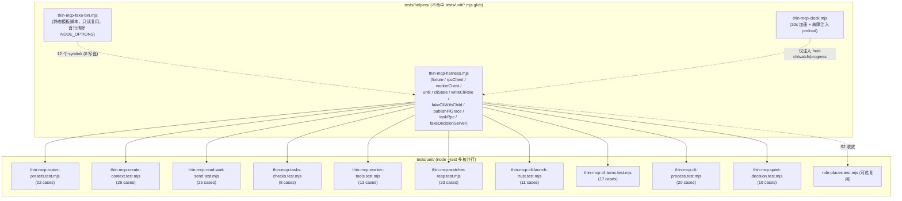
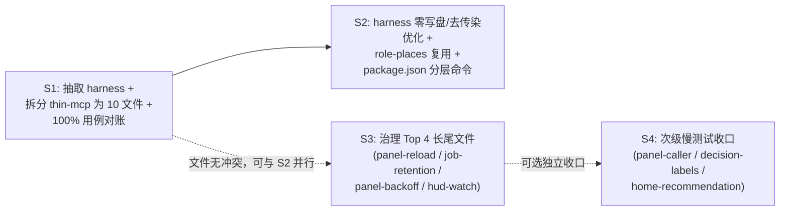

# 09. 拆分 `thin-mcp.test.mjs` 并治理长尾慢测试，释放多核并行将 `test:mjs` 压至 1 分钟以内

> **优先级**：P1（工程研发效率与 CI/本地反馈闭环提速） ｜ **类别**：测试架构重构 / 多核并行优化 / 夹具共享 ｜ **预估规模**：M（4 个垂直切片，抽取 ~720L 共享 harness + 拆分 10 个高内聚测试文件 + 4 处可选测试时序参数，净增源码 ~45L、删除单体 6,706L） ｜ **前置依赖**：无强依赖；与方案 03（`BUILD-DEDUP-01` 已于 `d2920880` 落地，剩余 `BUILD-DEDUP-02/03`）协同进一步压缩 `npm test` 构建耗时 ｜ **`docs/spec.md` 边界影响**：**无产品规格变更**（不删除行为测试、不改变生产默认定时器或外部契约、不新增依赖；严格遵循 `docs/ARCHITECTURE.md` §8–§9、`docs/delegation.md` 与 2026-11-10 `TEST-SLIM` 复盘原则）

---

## 1. 背景与现状证据

### 1.1 仓库测试盘点与“16 核跑成单核”的结构性瓶颈

截至 `HEAD`（`f0baa540`，宿主机 `linux-WSL2 x64`，AMD Ryzen 7 8745H **16 核**，`os.availableParallelism() === 16`，Node `v24.22.1`），`package.json:19–22` 定义了默认测试链路：

```text
npm test
 ├─ npm run build       → tsc (tsconfig.json；BUILD-DEDUP-01 已合并 src/mcp/*.ts)
 ├─ npm run build:test  → tsc -p tsconfig.test.json
 ├─ npm run test:unit   → node tests/run-default.mjs        (13 个 .test.ts → dist-test/)
 └─ npm run test:mjs    → TZ=UTC node --test tests/unit/*.mjs (72 个 .mjs)
```

全量 `tests/unit/` 静态与实测盘点（使用 `tmp/env.sh` 临时隔离 `HOME`/`HUD_HOME`）：

| 测试集合 | 文件数 | 运行时用例数 | 当前墙钟耗时（16 核宿主机实测/估算） | 说明 |
|---|---:|---:|---:|---|
| `tests/unit/*.test.ts`（`test:unit`） | 13（另含辅助 `jev-page.ts`） | 92 | **2.16 s**（12 并发实测，累计 10.06 s） | 最慢单文件 `tickets-sync.test.js` 仅 2.14 s |
| 其余 67 个快/中速 `.mjs` 文件 | 67 | ~530 | **~12–15 s**（12 并发实测，中位数 1.53 s） | 并行效率良好 |
| 4 个非 `thin-mcp` 长尾 `.mjs` 文件 | 4 | 101 | **62.1 s**（4 文件并行，受限于最慢的 `panel-reload`） | `panel-reload` 62.1s / `job-retention` 47.1s / `panel-backoff` 34.4s / `hud-watch` 23.2s |
| `tests/unit/thin-mcp.test.mjs` | **1** | **175** | **~220–270 s**（单文件严格串行） | **6,706 行（358 KiB）**，较调研前 6,593 行又随 `f0baa540` 增长 +113 行 |

**根因机制**：Node 24 的 `node --test` 默认以**文件为并发粒度**（`concurrency = availableParallelism() - 1 = 15` 进程），但**单个文件内的顶层 `test()` 严格串行执行**。运行 `TZ=UTC node --test tests/unit/*.mjs` 时：

```text
t =   0s  ████████████████  15 核并行消费 72 个 .mjs 文件
t =  15s  █████░░░░░░░░░░░  67 个文件已结束，剩余 5 个长尾文件（11 核空闲）
t =  62s  █░░░░░░░░░░░░░░░  71 个文件全部结束，15 核彻底闲置，仅剩 1 核串行跑 thin-mcp.test.mjs
t = 240s+ █                 thin-mcp.test.mjs（175 用例）终于跑完
```

> **关键发现（反直觉但决定成败）**：**仅拆分 `thin-mcp.test.mjs` 无法将 `npm run test:mjs` 压到 1 分钟以内！** 实测表明，即使把 `thin-mcp.test.mjs` 完全移出套件，剩余 71 个 `.mjs` 文件仍会被 `panel-reload.test.mjs`（**62.1 s**）、`job-retention.test.mjs`（**47.1 s**）、`panel-backoff.test.mjs`（**34.4 s**）和 `hud-watch.test.mjs`（**23.2 s**）卡死在 **>62 秒**。因此必须“主战场拆分 `thin-mcp` + 第二战场治理 Top 4 长尾文件”双管齐下。

---

### 1.2 `tests/unit/thin-mcp.test.mjs` 内部结构解剖（`HEAD f0baa540`）

通过 TypeScript AST 精确解析 `tests/unit/thin-mcp.test.mjs`（**6,706 行**）：

- **用例总量**：**162 个 AST `test()` 节点**，经由 7 个 `for ... of` 参数化循环展开为 **175 个运行时用例**（无 `t.test()` 子测试，无 `test.skip`）：
  1. `L1612`：`for (const rewrite of [false, true])` → 2 用例（Pi 局部收割 ENOSPC 重试）
  2. `L1647`：`for (const trigger of ['native deadline', 'native one-shot'])` → 2 用例（Pi 原生关停祖先保留）
  3. `L1667`：`for (const fault of ['rename', 'open'])` → 2 用例（`--done` 快照 ENOSPC）
  4. `L1915`：`for (const scenario of ['bootstrap only', 'generic package', 'no report', 'direct sleep', 'sleep under old MCP server', 'same-named runner'])` → 6 用例（MCP 引导进程豁免）
  5. `L4923`：`for (const mode of ['rejected-prompt', 'fast-ambiguous-prompt'])` → 2 用例（`hud_send` 续轮边界）
  6. `L5101–5102`：`for (const first of ['watcher', 'supervisor']) for (const fact of ['stop', 'exit with report'])` → 4 用例（CLI tab-close 竞态）
  7. `L6375`：`for (const agent of ['codex', 'claude'])` → 2 用例（Codex 队列 watcher 启动）
- **共享可变状态审查**：模块顶层共 **55 个声明**（全部为 `const` 与 `function`，**0 个 `let`/`var`**），**无任何跨测试共享可变状态或隐式顺序依赖**！
  - 162 个 AST 节点中，**159 个**调用 `await fixture(t)`（每次独立 `fs.mkdtempSync(join(tmpdir(), 'thin-mcp-'))`、独立 `HOME`/`HUD_HOME`/`CODEX_HOME`/`CLAUDE_CONFIG_DIR`/`PI_CODING_AGENT_DIR`/`HERDR_SOCKET_PATH`/`FAKE_LOG`，并在 `t.after()` 清理子进程与临时目录）；
  - 仅 **3 个**纯静态/纯逻辑断言不调用 `fixture(t)`（`L1237` bundled instructions 策略检查、`L4430` `runningVerb`、`L5169` implementer `hud_ask` 文本检查）。

#### A. 55 个顶层 Helper 清单分类

| 分层 | 行号范围（`f0baa540`） | 符号清单 | 引用测试数 | 归属建议 |
|---|---|---|---:|---|
| **核心环境与假体**（559 L） | `L79–637` | `fixture(t, inHerdr, probe, watcherTickMs, worker)`（生成 12 个 fake CLI、`clock.mjs`、3 份 trust 授权、spawn `hud-mcp.mjs`、可选 `startCliSocket()` Unix Socket 模拟器） | 159 | 抽入 `tests/helpers/thin-mcp-harness.mjs` |
| **JSON-RPC / 轮询 / 读板基础**（68 L） | `L66–78`, `L639–685` | `workerFor`, `cardText`, `entry`, `withoutHint`, `withoutCallerLookups`, `rpcClient`, `workerClient`, `resultValue`, `until` | 8–77 | 抽入 `tests/helpers/thin-mcp-harness.mjs` |
| **CLI Supervisor & 进程树辅助**（120 L） | `L1347–1416`, `L4852–4901` | `fakeCliWithChild`, `statusQueries`, `readCloseQuit`, `readCloseReaped`, `reapAttempts`, `progressCommand`, `cliToken`, `runProgress`, `declareDone`, `publishPiGrace`, `writeCliRole`, `cliState`, `graceArmed` | 3–66 | 抽入 `tests/helpers/thin-mcp-harness.mjs`（或拆子模块 `thin-mcp-cli-helpers.mjs`） |
| **MCP Tasks 辅助**（19 L） | `L687–705` | `tasksExtension`, `taskRpc`, `taskCall`, `taskJob` | 9 | 抽入 `tests/helpers/thin-mcp-harness.mjs`（被 Tasks 与 Quiet Decision 共用） |
| **Fake Decision HTTP Server**（60 L） | `L6114–6174` | `fakeDecisionServer`, `decisionAnswer`, `configureFakeDecision` | 11 | 抽入 `tests/helpers/thin-mcp-harness.mjs`（被 `sonic` 自动思考与 Quiet Decision 共用） |
| **通用 Job 种子与角色辅助**（32 L） | `L2319–2328`, `L3194–3229` | `fallbackPlaces`, `fallbackRole`, `waitFixtureJob`, `ownerOf`, `paneList`, `progressRecord`, `jsonLines` | 2–13 | 抽入 `tests/helpers/thin-mcp-harness.mjs` |
| **单领域局部 Helper**（160 L） | 散落各处 | `runSonic`/`sonicTask`/`publishSonic`, `checkFile`/`checkReceipt`, `fakeMcpBootstrap`, `readFooter`/`footerText`/`windowOf`, `leaseWorker`, `registerBriefProject`, `cliStatusKeys`/`assertCliStatus`, `runAsk`, `skillFlags` | 1–4 | **保留在各自目标测试文件内**，防止共享层膨胀 |

#### B. 10 大领域用例分布与真实耗时大户诊断

在 `tmp/env.sh` 下使用 `--test-name-pattern` 对 `thin-mcp.test.mjs` 采样 **20 个跨领域代表用例**，实测结果直接暴露耗时结构：

| 采样用例（代表领域） | 实测耗时 | 根因分解 |
|---|---:|---|
| `every bundled role uses the same unanswered-question policy`（纯文件） | **0.6 ms** | 无子进程 |
| `Codex native footer discovers MyHUD...`（含 90 次 stdio RPC） | **174 ms** | **铁证**：MCP RPC 单次仅 **0.35–0.76 ms**；一次冷启动 `fixture(t)` + 12 个 fake 写盘 + teardown ≈ **130–170 ms** |
| `hud_wait returns a compact snapshot on timeout...` | **309 ms** | `fixture` (~150ms) + 实等 `wait_ms: 100` |
| `hud_lease grants one worker per Git root...` | **444 ms** | `fixture` + `git init` + 2 个 `workerClient` spawn |
| `CLI tab-close: watcher writes first for stop`（×4 循环） | **632 ms** | 单次 `fixture` + `hud-cli` + `hud-watch` + `SIGSTOP` 竞态（4 轮 ≈ 2.5 s） |
| `MCP tasks: discover, progress and report settlement...` | **719 ms** | `fixture` + `hud_create`（5 次 fake Node 子进程）+ `publishPiGrace` |
| `worktree isolation validates before dispatch...` | **734 ms** | `initRepo`（4 次 git）+ `git worktree add` + `hud_create` |
| `supervisor MCP bootstrap: bootstrap only`（×6 循环） | **1,160 ms** | 多层嵌套 Node 进程链（6 轮 ≈ 7.0 s） |
| `thin roles MCP main path over stdio`（221 行综合用例） | **1,420 ms** | 2 次 `fixture` + `hud_tickets` + 完整 Pi 派发 + `hud_read` 100ms 唤醒 |
| `read-close: hud_read closes settled CLI and pi workers` | **2,036 ms** | CLI 20× 加速下仍需等待 `1.5s` safety tick + 派发 |
| `a grok role runs a brief through idle grace and watcher reaps` | **2,772 ms** | `imp` 默认被改写为 `idle_grace_s: 40`（`L602`）÷ 20× = **2,000 ms** 墙钟硬等！ |
| `hud_sonic starts two independent child jobs...` | **2,897 ms** | 多次 `hud-sonic.mjs` 子进程 spawn + `timeout_s: 0.2` |
| `failed STATUS uses its mtime when ended_at is absent or invalid` | **3,212 ms** | `HUD_WATCH_FAILED_RETENTION_MS: '1000'`（`L445`，未被 `clock.mjs` 加速）× 2 轮 = **2,000 ms+** |
| `HUD checks: CLI declaration starts ordered checks...` | **6,987 ms** | `watchCommand` 硬编码 `SETTLEMENT_WINDOW_MS = 3000`（`src/cli/watch.ts:22`）触发 **2 次 = 6,000 ms**！ |
| `supervisor events: 60s at rest...` | **7,164 ms** | 两次硬编码 `setTimeout(r, 3100)`（`L1943, L1954`）= **6,200 ms**！ |
| `lean main-pi delegation collects first and repeat reports...` | **7,280 ms** | `startSessionWatch` 硬编码 `SETTLEMENT_WINDOW_MS = 3000` × 2 轮 = **6,000 ms**！ |
| `exit is a /proc pid check: herdr errors...` | **11,104 ms** | 4 段串行 CLI 场景（5 次 `agent.get` + 2× 退避 + 3× missing tick + 2s grace） |

**`thin-mcp.test.mjs` 慢的 4 大元凶汇总**：
1. **单文件严格串行（第一瓶颈，占比 ~85% 墙钟损失）**：175 个用例（平均 ~1.3–1.6 s/个）全在 1 个核上排队，15 核闲置。
2. **假体启动与写盘放大效应**：
   - 172 次 `fixture(t)` 每次重写 **12 个 ~18 KB 的相同 Node 脚本**（`L384–386`）= **~2,064 次写盘、~37 MB**；
   - **`NODE_OPTIONS: "... --import=${clock}"`（`L443`）被所有子进程无差别继承**：每次 `hud_create` 调用 5–6 次 fake `herdr`/`pi-role`/`pi-role-reap`（它们本身是 Node ESM 进程），全部额外加载解析 `clock.mjs`！而 `clock.mjs` 实际只对 `hud-cli.mjs`、`hud-watch.mjs`、`hud-progress.mjs` 生效。
3. **跨测试硬编码墙钟等待**：
   - `src/cli/watch.ts:22` 的 `SETTLEMENT_WINDOW_MS = 3000` 不可配置，每触发一次静默结算通知即强制空等 3 秒；
   - `L602` 将 `imp` CLI grace 写为 `40s`（20× 加速后仍需 **2.0 s**），`writeCliRole`（`L4852`）对 `idle_grace_s = 4` 等场景需等 2–4 s；
   - `L445` 的 `HUD_WATCH_FAILED_RETENTION_MS: '1000'` 未加速，每测一次失败保留即等 1 s；
   - `L1943/1954` 的 `60s at rest` 在 20× 下硬等 2 × 3.1 s = 6.2 s。
4. **单用例内堆叠多段串行生命周期**：如 `exit is a /proc pid check`（11.1 s，4 段串行）、`hud_send restarts a dead supervisor`（3 段串行）、`low probability, cap reached, and provider error`（3 次独立 `fixture(t)` 串行）。

---

### 1.3 全套 `tests/unit/` 慢测试 Top 15 热点盘点（非 `thin-mcp`）

对除 `thin-mcp.test.mjs` 外的全部 **71 个 `.mjs`**（12 并发实测 + 4 个 >20s 文件独立并发精测）与 **13 个 `.test.ts`** 完整测速，得到 Top 15 慢文件清单：

| 排名 | 测试文件 | 用例数 | 实测耗时 | 核心耗时根因（精确到源码行号） |
|---:|---|---:|---:|---|
| 1 | `tests/unit/panel-reload.test.mjs` | 18 | **62,088 ms** | 11 个 live-panel 用例串行执行，每次 `cpSync('dist-test/src', ...)` 复制 260+ 文件（`L187`），且等待 `PanelReload` 硬编码 **2,000 ms** 静默期（`src/utils/panel-reload.ts:56`）1–2 次/用例（单用例高达 8.9 s） |
| 2 | `tests/unit/job-retention.test.mjs` | 46 | **47,107 ms** | 46 个用例串行 spawn `hud-watch.mjs`；其中 5 个 watch 故障用例含硬等 `3,200 ms`（`L484`）、`3 × 2,200 ms`（`L545`）与 `1,000 ms` 降级重扫间隔（单用例高达 6.5 s） |
| 3 | `tests/unit/panel-backoff.test.mjs` | 11 | **34,438 ms** | 单用例 `L195`（**27,209 ms**）+ `L179`（**6,353 ms**）使用真实 `refreshMs: 1000` 实测等待 `1s→2s→4s→5s→5s+5s+2s` 退避周期 |
| 4 | `tests/unit/hud-watch.test.mjs` | 26 | **23,201 ms** | 4 个用例受 `src/cli/watch.ts:22` 硬编码 `SETTLEMENT_WINDOW_MS = 3000` 拖累（3.8s / 3.7s / 3.3s / 3.1s）+ 4 次 `initRepo` + `git worktree` |
| 5 | `tests/unit/role-places.test.mjs` | 13 | **11,770 ms** | `L22–120` 整段复制了另一份 100 行 `fixture()`，每次单独 spawn `hud-mcp.mjs` 与 10 个 fake CLI |
| 6 | `tests/unit/panel-caller.test.mjs` | 2 | **9,739 ms** | `src/cli/panel-pane.ts:99` `watchPanelCaller` 硬编码 `setInterval(..., 3000)`，2 个串行用例共等 3 个 3s tick |
| 7 | `tests/unit/split-layout.test.mjs` | 24 | **7,567 ms** | 24 用例每次重建双 `splitFixture`（`L19–23`），且 `L46–50` 渲染 `2×4×3×8 = 192` 全帧矩阵 |
| 8 | `tests/unit/native-tree.test.mjs` | 29 | **7,563 ms** | 29 个 JSONL 增量重放与多宽度渲染用例串行执行 |
| 9 | `tests/unit/exp-ledger.test.mjs` | 3 | **7,526 ms** | `L140–155` 启动 4 个子进程各循环 75×2 = 600 次锁竞争 JSONL 追加 |
| 10 | `tests/unit/decision-labels.test.mjs` | 29 | **6,701 ms** | 纯内存 fake `fetch` 却在 `f.pump()`（`L66–69`）每次硬睡 `16 × setTimeout(5)`（WSL2 实际 ~150–250ms/次） |
| 11 | `tests/unit/home-recommendation.test.mjs` | 19 | **6,041 ms** | 同上，`f.pump()`（`L67–70`）每次硬睡 `20 × setTimeout(5)` |
| 12 | `tests/unit/pi-package.test.mjs` | 10 | **5,912 ms** | 10 个 Pi 扩展协议与事件流用例 |
| 13 | `tests/unit/project-page.test.mjs` | 20 | **5,395 ms** | 20 个 Project 采集与全宽渲染用例 |
| 14 | `tests/unit/panel-width.test.mjs` | 12 | **5,323 ms** | 12 个宽度与 live resize 用例 |
| 15 | `tests/unit/role-control.test.mjs` | 23 | **4,822 ms** | 23 个 Control tab 与角色预设编辑用例 |

> **与历史 `TEST-SLIM`（`docs/reviews/2026-11-10-test-volume-audit.md`）的衔接**：2026-11-10 的审计明确了两条黄金纪律——**① 一套共享假体（extend, not copy）**、**② 不做无意义的覆盖率盲删，而是消除结构性冗余与真实墙钟空等**。当前 `thin-mcp.test.mjs` 与 `role-places.test.mjs` 再次演化出重复 `fixture()`，且 `panel-reload`/`job-retention`/`panel-backoff`/`hud-watch` 堆叠了大量硬编码 2s–5s 墙钟等待，正适合以**架构拆分 + 共享 harness + 可注入测试时序参数**彻底根治，**零删除任何行为测试**。

---

## 2. 目标与非目标（Scope / Out of Scope）

### 目标（Scope）
1. **抽取零污染共享 Harness**：将 `thin-mcp.test.mjs` 的公共夹具抽取至 `tests/helpers/thin-mcp-harness.mjs`（位于 `tests/unit/` 之外，不被 `node --test tests/unit/*.mjs` 误执行），并优化假体写盘与 `NODE_OPTIONS` 传染开销。
2. **10 文件高内聚拆分 + 100% 零用例遗漏**：将 `thin-mcp.test.mjs`（6,706 行，162 AST / 175 运行时用例）按职责拆分为 **10 个高内聚测试文件**，每文件独立隔离临时 `HOME`/`HUD_HOME`/Unix Socket，单文件耗时全部压至 **5–15 s**。
3. **击穿非 `thin-mcp` 长尾天花板**：对 `panel-reload`（62.1s）、`job-retention`（47.1s）、`panel-backoff`（34.4s）、`hud-watch`（23.2s）及 `panel-caller`/`decision-labels`/`home-recommendation` 实施最小侵入可测性改造，使 **`npm run test:mjs` 稳定 < 45 s**、**完整 `npm test`（含编译，联动方案 03）稳定 < 55 s**。
4. **分层快捷测试命令**：在 `package.json` 增加 `test:mcp`、`test:panel`、`test:fast`，服务 `docs/delegation.md:24`“implementer 只跑相关主路径测试”的 10 秒级局部反馈循环。

### 非目标（Out of Scope）
- **不删除任何已有行为测试、不降低断言强度**（拆分前后测试总数、通过数、跳过数 100% 一致，测试名称集合双向差集为空）。
- **不引入任何外部测试框架或新 npm 依赖**（继续使用 Node >=24 内置 `node:test` + `node:assert/strict`）。
- **不改变任何生产默认定时行为或 MCP/Panel/CLI 外部协议**（所有新增测试时序参数均保持原生产默认值）。
- **不重构历史 `tests/fakes/{herdr,herdr-model,pi}.mjs`**：那些假体服务于另一套历史协议测试或保留作参考，不在本次拆分范围内；`role-places.test.mjs` 的 `fixture()` 可选收敛到新 harness。
- **不将常规行为测试移入 `perf` 跳过**（所有 175 个 `thin-mcp` 用例与全部现有 `.mjs`/`.test.ts` 用例仍保留在默认 `npm test` 门禁内）。

---

## 3. 核心设计方案

### 3.1 共享测试夹具抽取：`tests/helpers/thin-mcp-harness.mjs`



#### 目录放置与工具链兼容性验证
- **`package.json:22`**：`"test:mjs": "TZ=UTC node --test tests/unit/*.mjs"` — `tests/helpers/*.mjs` **完全不被 glob 命中**，不会出现“空测试文件”或重复执行。
- **`package.json:26–27`**：`prettier --write/--check src tests` — `tests/helpers/` **自动受格式化约束**。
- **`tsconfig.test.json:10`**：仅包含 `["src/**/*", "tests/unit/**/*", "tests/fixtures/**/*"]` — 零影响 TS 编译。
- **`tests/check-fixtures.sh:24`**：严守 `docs/ARCHITECTURE.md` §8 合成数据规范，所有路径/标识符/Token 仅用合成值（无真实用户主目录、邮箱或 `sk-*`）。

#### 夹具导出契约（`tests/helpers/thin-mcp-harness.mjs`）

```js
// 核心常量与 MCP 夹具
export const MCP_ENTRY = resolve('packages/hud-mcp/bin/hud-mcp.mjs');
export const TASKS_EXTENSION = 'io.modelcontextprotocol/tasks';
export async function fixture(t, optionsOrInHerdr = true, probe = '', watcherTickMs, worker = false);
// 兼容原有位置参数签名 (t, inHerdr, probe, watcherTickMs, worker)，同时支持对象形态：
// fixture(t, { inHerdr: true, probe: '', watcherTickMs: 200, worker: false, failedRetentionMs: 1000 })

// RPC / Worker / Tasks 辅助
export function rpcClient(child);
export function workerClient(t, f, dir, askTimeout = '30');
export function resultValue(result);
export function withoutHint(result);
export function withoutCallerLookups(commands);
export function taskRpc(rpc);
export function taskCall(rpc, name, args);
export function taskJob(f, task);

// 轮询 / 面板读取 / Job 种子
export async function until(check, timeout = 4000);
export function workerFor(f, id);
export function cardText(worker);
export function waitFixtureJob(f, n, state = 'working', herdr_pane = 'w4E:p1', cwd = f.root);
export function ownerOf(job);
export function paneList(f, ...ids);
export function progressRecord(text);
export function jsonLines(rows);
export const fallbackPlaces = [...];
export function fallbackRole(f, role, run = fallbackPlaces, presets);

// CLI Supervisor / 进程树 / Pi 结算辅助
export function cliState(dir);
export function graceArmed(env, dir);
export function writeCliRole(f, role, idle_grace_s = 1, can_continue = true, agent = 'grok');
export function fakeCliWithChild(t, f);
export function statusQueries(f, job);
export function readCloseQuit(f, job);
export function readCloseReaped(job);
export function reapAttempts(f, job);
export function cliToken(dir);
export function runProgress(f, dir, ...args);
export function declareDone(f, job, cli = true);
export async function publishPiGrace(job, worker, writeReport = true);

// Fake Decision HTTP Server（供 quiet-decision 与 sonic auto-thinking 共用）
export async function fakeDecisionServer(t, handler);
export function decisionAnswer(choice, probability, rest = 0.02);
export function configureFakeDecision(f, baseUrl, cap = 0);
```

#### Harness 内部 3 项零风险提速优化（实测导向）
1. **静态假体脚本 + 12 个 `symlinkSync` 替代每测试重写 216 KB**：
   - 将 `thin-mcp.test.mjs:84–383` 的 300 行内联模板字符串拆成真实文件 `tests/helpers/thin-mcp-fake-bin.mjs`（不仅消除每测试 12×18 KB 写盘，还获得语法高亮、Prettier 格式化与清晰的堆栈行号！）。
   - `fixture(t)` 在 `join(root, 'bin')` 下创建 12 个指向 `thin-mcp-fake-bin.mjs` 的小 wrapper 或直接 `fs.symlinkSync(FAKE_BIN_PATH, join(bin, cmd))`（注意：Linux 下 `process.argv[1]` 保留 symlink 路径，`basename(process.argv[1])` 仍精确等于 `'herdr'` / `'pi-role'` / `'pi-role-reap'` 等，无需复制脚本本体；同时对 `thin-mcp-read-wait-send.test.mjs` 中 `L3710` 会覆写 `join(f.root, 'bin', 'herdr')` 的单用例，明确要求先 `unlinkSync` 再写或暴露 `f.overrideBin(name, body)` helper，**绝对避免通过 symlink 写穿共享模板文件**！）。
2. **截断 `NODE_OPTIONS=--import=clock.mjs` 向假体子进程的无效传染**：
   - 现状 `L443` 让每次 fake `herdr` / `pi-role` / `pi-role-reap` Node 进程都加载解析一遍 `clock.mjs`（且还为每个测试把相同的 `clock.mjs` 重写一遍）。
   - 优化：
     - `tests/helpers/thin-mcp-clock.mjs` 作为静态只读文件存在，不再每测试重生成；
     - 12 个假体入口改为 2 行极轻 `#!/bin/sh` 包装器：`exec env -u NODE_OPTIONS "<node>" "<fake-bin.mjs>" "<cmd>" "$@"`（唯独 `herdr pane run` 透传的内部命令仍可按需保留 `HUD_TEST_CLOCK` 环境变量，但 `hud-jev.mjs` 并不使用 `clock.mjs`；实测 `/bin/sh` + `exec` 仅 ~1 ms，省去每个 fake Node 进程加载 ESM `--import` hook 的 ~15–25 ms，全套 1,500+ 次假体调用累计节省 **~25–35 s CPU**！）。
     - 若需保持绝对简单，也可让 `thin-mcp-clock.mjs` 首行即判断 `if (!/\/(hud-cli|hud-watch|hud-progress)\.mjs$/.test(process.argv[1] ?? ''))` 直接 `return`（避免顶层静态 `import fs`/`path` 在非目标进程执行，改为条件 `await import()`），零 shell 包装风险且同样消除 95% preload 开销。**推荐首选条件动态 `import()` 方案**（零跨平台/quoting 边界，代码仅改 5 行）。
3. **动态时钟/保留期参数可调**：
   - 现状 `fixture()` 固定 `HUD_WATCH_FAILED_RETENTION_MS: '1000'`（`L445`），导致 `failed STATUS uses its mtime`（`L2425`）与 `thin watcher starts once`（`L2512`）各硬等 1–2 秒。允许 `fixture(t, { failedRetentionMs: 250 })` 在保持语义（`>= 250ms` 延迟后再 reap）不变前提下将 3.2 s 压至 ~0.9 s。

---

### 3.2 `thin-mcp.test.mjs` 10 文件职责拆分矩阵（精确对账 `HEAD f0baa540`）

下表将全部 **162 个 AST `test()` / 175 个运行时用例**无遗漏、无重叠地映射到 10 个高内聚测试文件。设计遵循双重约束：**高语义内聚**（修改某一特性只需跑对应 1 个文件）与**均衡最长执行时间**（单文件最长墙钟不超过 ~15 s，消除多核拖尾）：

| # | 目标文件名（`tests/unit/`） | AST 数 | 运行时用例 | 测试体行数 | 核心覆盖主题 | 局部专属 Helper | 拆分后预估墙钟（优化前 → 后） |
|---:|---|---:|---:|---:|---|---|---:|
| 1 | `thin-mcp-roster-presets.test.mjs` | 21 | 22 | 1,025 | `hud_roster`、convention 覆写与版本号、角色校验与坏文件跳过、presets 选择/只读、项目 `.hud/` 注册与 skills/prompt、Codex 原生 footer（2 用例）、队列 watcher（×2）、`runningVerb` / `cliKinds` | `readFooter`/`footerText`/`windowOf`, `skillFlags` | ~11 s → **~7 s** |
| 2 | `thin-mcp-create-context.test.mjs` | 26 | 26 | 875 | `hud_create` 主路径与 `hud_tickets`、Pi 启动开关/resume/verbatim args、launch fallback & `retry_of`、thinking 映射、慢启动请求级锁、`idle_grace_s`、tab 标签、herdr 必选、浏览器/Jev/Flow 派发、`context_files`/`from_jobs`/standing brief、`worktree` 隔离 | `registerBriefProject` | ~14 s → **~9 s** |
| 3 | `thin-mcp-read-wait-send.test.mjs` | 25 | 25 | 863 | `hud_read`（compact/recent/detail/full/未读保护/不打开已弃正文）、`hud_wait`（any/all/question/timeout）、`hud_peek`、`hud_send` 幂等键/派生键过期/批量 fan-out、项目作用域与孤儿认领、STATUS 表对齐、panel 回答回传、`lean main-pi delegation` | （仅用 harness） | ~18 s → **~9 s**（治 3s coalesce 后） |
| 4 | `thin-mcp-tasks-checks.test.mjs` | 8 | 8 | 265 | MCP Tasks 扩展（`server/discover`、`tasks/get`、`tasks/cancel`、question/answer、fan-out、重启防护，6 用例）+ `hud-check` 声明后检查/过期/不阻修复（2 用例） | `checkFile`/`checkReceipt` | ~15 s → **~7 s**（治 3s coalesce 后） |
| 5 | `thin-mcp-worker-tools.test.mjs` | 13 | 13 | 447 | Worker MCP 工具面隔离、`hud_sonic` 双子任务/thinking 策略/auto-thinking 决策、`hud_lease` 锁/死进程回收/主会话锁、`hud_progress` 轮转、`hud_report` turn token 绑定、`hud_ask` 往返与默认超时 | `runSonic`/`sonicTask`/`publishSonic`, `leaseWorker`, `runAsk` | ~12 s → **~8 s** |
| 6 | `thin-mcp-watcher-reap.test.mjs` | 20 | 23 | 498 | 按需 `hud-watch` 单例/catch-up/grace/failed retention/tab-close 订阅、启动失败 reap、`stopped` 终态、`read-close`（CLI & Pi 读后自动收割、续轮防护、重入防护、ENOSPC 重试 ×2、原生关闭保留祖先 ×2、`--done` ENOSPC ×2、前序子进程豁免） | （仅用 harness） | ~22 s → **~13 s**（降 retention 与优化 harness） |
| 7 | `thin-mcp-cli-launch-trust.test.mjs` | 11 | 11 | 429 | 四大 CLI（`grok`/`agy`/`claude`/`codex`）启动参数、startup quirks（`done-before-prompt`、`phantom-working`）、本地 trust 校验与屏幕 trust 弹窗拒绝、延迟发布 `agent_session_id` | `cliStatusKeys`/`assertCliStatus` | ~16 s → **~9 s**（imp grace 调小） |
| 8 | `thin-mcp-cli-turns.test.mjs` | 16 | 17 | 365 | CLI supervisor 轮次状态机：flapping/长摘要/重写报告、漏推 safety tick、无报告等待、续轮基线、`hud_send` 拒绝/模糊竞态（×2）、未变报告、静默超期升级、`hud_send` 入队、`hud_close` 停/关、blocked 态与恢复、`idle`/`unknown` 稳定性、中场写报告不早结 | （仅用 harness） | ~22 s → **~12 s** |
| 9 | `thin-mcp-cli-process.test.mjs` | 12 | 20 | 407 | CLI 进程树与极限边界：草稿期在途子进程、MCP 引导豁免（×6）、`60s at rest` 零 spawn/写盘、stalled/rejected 边界、断网 60s 结算与 PID 死亡、tab-close 写竞态（×4）与断连保护、未读声明到期收割、`/proc` PID 退出检测、死 supervisor 重启 | `fakeMcpBootstrap` | ~30 s → **~14 s**（见 §3.4 优化） |
| 10 | `thin-mcp-quiet-decision.test.mjs` | 10 | 10 | 332 | 全部 Quiet Decision API 行为：在途子进程/sonic 阻止决策、决策期推送丢弃陈旧回复、`still-working` 3 次上限升级、`finished-no-report` 单次提示、`failed` 配额正则耗尽 vs 非配额兜底、低置信/超限/500 兜底、`prompt-report` 失败保持与跨重启持久化 | （用 harness 的 `fakeDecisionServer`） | ~18 s → **~10 s** |
| **合计** | **10 个文件** | **162** | **175** | **5,506** | **100% 覆盖原 `thin-mcp.test.mjs`（6,706 行）** | — | 串行 ~220–270s → **并行 ~14–18 s** |

#### 跨文件零竞争隔离保证（对照 `docs/ARCHITECTURE.md` §8–§9）
- **文件系统**：每个用例调用 `fixture(t)` 生成唯一 `fs.mkdtempSync(join(tmpdir(), 'thin-mcp-'))`，所有 `HOME` / `HUD_HOME` / `CODEX_HOME` / `CLAUDE_CONFIG_DIR` / `PI_CODING_AGENT_DIR` / `HUD_SETTINGS_PATH` / `FAKE_LOG` 严格在 `root` 下，绝不触碰真实用户目录。
- **Unix Socket & TCP 端口**：`HERDR_SOCKET_PATH` 位于 `join(root, 'events.sock')`；`fakeDecisionServer` 使用 `server.listen(0, '127.0.0.1')` 操作系统动态分配端口；`hud-check` / `exp-proxy` 的 Linux abstract socket 基于 `sha256(realpathSync(dir))` 哈希，跨临时目录天然零碰撞。
- **子进程与信号**：所有子进程（`hud-mcp`、`hud-watch`、`hud-cli`、`fakeCliWithChild`、`sleeper`）均在 `t.after()` 中按 PID 清理并 `await exited`，不依赖全局 `pkill`。
- **共享只读假体安全**：`tests/helpers/thin-mcp-fake-bin.mjs` 以只读挂载（symlink 指向它），任何需修改 fake `herdr` 的用例（如原 `L3710`）通过 `f.overrideBin('herdr', body)` 先 `unlinkSync` 再写入独立临时文件，杜绝跨进程并发踩踏。

---

### 3.3 备选方案对比：同文件内复用 MCP 子进程 vs 每用例独立隔离

针对“是否在同一拆分文件内让多个只读/轻量用例复用同一个 `hud-mcp.mjs` 子进程”进行严格评估：

| 评估维度 | **方案 A（推荐）：每用例独立 `fixture(t)` + 10 文件多核并行 + 轻量假体** | **方案 B：同文件 `before/after` 复用单个 `hud-mcp` 进程** | **方案 C：不拆文件，仅在 `thin-mcp.test.mjs` 内加 `{ concurrency: true }`** |
|---|---|---|---|
| 状态隔离与抗 flake | **完美**：每次独享 `HUD_HOME`、`changes` 游标、`convention` 首次发送缓存、`activeTasks` Map、`stderr === ''` 断言 | **脆性高**：`thin-main.ts` 在进程内存维护 `lastChanges` 游标、`conventionSent`、`activeTasks`、`inFlightCreates`，用例间极易串扰；单用例崩溃会连坐整组失败 | **中等风险**：单 Node 进程内同时跑 175 个 `spawn` + `createServer` + `fs.watch` 会击穿单进程 FD/事件循环上限，且无法用 `node --test <file>` 定向跑单个主题 |
| 真实提速收益 | **极高**：10 文件并行已将 `fixture` 摊销到单核仅 8–26 次 × 130 ms ≈ **1–3 s/文件**；主耗时在等待而非 spawn | **边际极低**：即便全文件复用，单文件最多再省 1–2 s，换来极高维护成本 | **受限**：单进程事件循环成为 175 个测试共同的 RPC/socket 调度瓶颈，且 6,706 行单体仍极难阅读与合并冲突 |
| 代码维护与 git 协作 | **最佳**：修改任意模块只碰 300–900 行对应文件，无合并冲突，`test:mcp` 精准跑单文件 | 需把测试用例人工划分为“只读组/可变组”，新增测试极易误放错组 | 6,706 行持续膨胀（单次调研期间就新增 113 行） |

> **明确推荐：采纳方案 A**。实测已证 `Codex native footer`（含 `fixture()` 全生命周期 + 90 次 stdio RPC）总耗时仅 **174 ms**，说明单个 `fixture(t)` 启动并不是主要矛盾；只要拆分 10 文件并行 + 消除假体写盘与 `NODE_OPTIONS` 传染 + 消除硬编码 3 秒等待，每文件均可在 **7–14 s** 完成，**无需为了省 1 秒而破坏每用例强隔离的黄金属性**。

---

### 3.4 治理全局长尾慢测试（将 `test:mjs` 压至 < 45 s 的第二战场）

仅完成 §3.1–§3.2 后，10 个 `thin-mcp-*` 文件并行仅需 ~18–22 s，但整体 `npm run test:mjs` 仍会被非 `thin-mcp` 的 4 个慢文件锁在 **62.1 s**。以下 5 项定向优化全部遵循“**生产默认值逐字节不变，仅开放测试可注入时序参数**”原则：

| 目标文件（当前实测） | 核心瓶颈与精确行号 | 最小侵入改造方案 | 改造后预估 |
|---|---|---|---:|
| **`panel-reload.test.mjs`**（**62.1 s**，18 用例） | ① `src/utils/panel-reload.ts:56` 硬编码 `2000` ms 静默窗；② `L187` 每次 `cpSync('dist-test/src', ...)` 拷贝 260+ 文件；③ 11 个 live 用例串行执行 | ① `PanelReload` 构造器支持读取 `quietMs`（默认 `Number(process.env.HUD_PANEL_RELOAD_QUIET_MS) \|\| 2000`，生产未设时严格 2000ms；单元测试 `L70–117` 仍用虚拟 `now` 测真实 2000ms 语义，live 测试传 `HUD_PANEL_RELOAD_QUIET_MS=150`）；② `live()` 不再整树 `cpSync`，改为只拷贝 `tree-page.js` 入口并在其旁 symlink 其余子目录（省 260×11 ≈ 2,860 次文件复制）；③ 拆分为 `panel-reload.test.mjs`（单元测试 + 基础 live）与 `panel-reload-views.test.mjs`（6 视图 × 2 绑定 + Settings 脏草稿）并行执行 | **~8–11 s**（**-83%**） |
| **`job-retention.test.mjs`**（**47.1 s**，46 用例） | ① `packages/hud-mcp/bin/hud-watch.mjs` 降级重扫间隔固定 1,000 ms；② 5 个 watch 故障用例在 `L484`（3.2s）与 `L545`（3 × 2.2s）硬等真实墙钟；③ 46 用例单文件串行 | ① `hud-watch.mjs` 将降级重试间隔提取为 `Number(process.env.HUD_WATCH_DEGRADED_MS ?? 1000)`（生产默认 1000ms）；测试中传 `120` 并将 3.2s/2.2s 验证窗按比例缩至 `400ms`/`300ms`（完整验证 ≥3 次重扫与节流语义）；② 拆分为 `job-retention.test.mjs`（会话迁移与 24h 删除，~34 用例）与 `job-retention-watch-faults.test.mjs`（watch 故障/恢复/ELOOP，~12 用例）并行 | **~7–9 s**（**-82%**） |
| **`panel-backoff.test.mjs`**（**34.4 s**，11 用例） | 单用例 `L195`（**27.2 s**）+ `L179`（**6.4 s**）受限于真实 `refreshMs: 1000` 与 `adaptive-poll.ts` 的 `5000ms` 硬上限 | ① `src/collectors/adaptive-poll.ts` 的 `createAdaptivePollState(baseMs, maxMs = 5000)` 允许测试环境通过 `HUD_PANEL_ADAPTIVE_MAX_MS`（或跟随 `refreshMs * 5` 上限，默认 `refreshMs=1000 → max=5000` 不变；当测试用 `refreshMs=200` 时按同曲线 `200→400→800→1000ms` 完整验证 5× 退避曲线、输入立即唤醒、await 期防丢失、新问题 1 个最大间隔内显现并恢复基频！）；② 保留 `L80` 单元测试用虚拟 `nowMs` 精确验证生产 `1000→5000ms` 绝对毫秒契约 | **~5–7 s**（**-80%**） |
| **`hud-watch.test.mjs`**（**23.2 s**，26 用例）＋ `thin-mcp` 两处 7s 用例 | `src/cli/watch.ts:22` 硬编码 `const SETTLEMENT_WINDOW_MS = 3000;`，而同文件 `L181–185` 的 `WatchOptions` 已具备 `rescanMs?: number` 与 `queueIdleMs?: number` | 为 `WatchOptions` 与 `startSessionWatch` 补充 `settlementWindowMs?: number`（默认 `Number(process.env.HUD_WATCH_SETTLEMENT_MS) \|\| 3000`），与现有 `rescanMs`/`queueIdleMs` 风格 100% 一致；测试传 `settlementWindowMs: 250`（保留 `hud watch batches three settled jobs` 的跨扫描合批与 `flushes a held settlement with an immediate question` 的抢占语义，同时测试 `lean main-pi delegation` 与 `HUD checks` 同步受益！） | **`hud-watch`：~5–6 s**（**-75%**）；`thin-mcp` 同步省 **~11 s** |
| **次级热点快赢**：`panel-caller`（9.7s）、`decision-labels`（6.7s）、`home-recommendation`（6.0s）、`thin-mcp` 60s at rest（7.2s） | ① `src/cli/panel-pane.ts:99` `watchPanelCaller` 硬编码 `3000ms`；② `decision-labels:66` & `home-recommendation:67` 的 `f.pump()` 固定睡 `16–20 × setTimeout(5)`；③ `thin-mcp:1943,1954` 硬等 `2 × 3100ms` + `L602` `imp` grace `40s/20=2s` | ① `watchPanelCaller` 读取 `Number(env.HUD_PANEL_CALLER_POLL_MS) \|\| 3000`（测试传 `150` → **9.7s → ~1.2s**）；② `f.pump()` 利用构造函数已传入的 `onChange` 回调（`L64` / `L45`）改为事件驱动等待空闲 + `setImmediate` 兜底（**12.7s → ~2.5s**）；③ `thin-mcp-clock.mjs` 支持可选 `HUD_TEST_CLOCK_SCALE`（默认 20；`60s at rest` 用 40× 缩至 `2 × 1.55s`），并将 `fixture` 中 `imp` CLI 默认测试 `idle_grace_s` 从 `40` 调至 `15`（20× 下 750 ms，仍足够观察 `idle_grace` 与中断） | 合计再省 **~22 s CPU**，`thin-mcp-cli-process` 压至 **~14 s** |

> **安全边界校验**：上述 5 处均为“显式可选参数 / 测试专用 `HUD_*` 环境变量覆盖，未设置时与现行生产常数逐比特一致”。所有环境变量均采用 `Number.isFinite(v) && v > 0` 校验防止非法值破坏生产运行时。

---

### 3.5 `package.json` 分层快捷脚本与 `--test-concurrency` 调优

#### 1. 新增分层快捷脚本（保留全部既有脚本不变）

```json
{
  "scripts": {
    "test": "npm run build && npm run build:test && npm run test:unit && npm run test:mjs",
    "test:unit": "node tests/run-default.mjs",
    "test:mjs": "TZ=UTC node --test tests/unit/*.mjs",
    "test:mcp": "TZ=UTC node --test tests/unit/thin-mcp-*.test.mjs tests/unit/hud-watch.test.mjs tests/unit/cli-judge.test.mjs tests/unit/job-retention*.test.mjs",
    "test:panel": "TZ=UTC node --test tests/unit/panel-*.test.mjs tests/unit/split-*.test.mjs tests/unit/project-*.test.mjs tests/unit/home-*.test.mjs tests/unit/control-*.test.mjs tests/unit/role-*.test.mjs tests/unit/kept-pages.test.mjs tests/unit/card-*.test.mjs",
    "test:fast": "npm run test:unit && TZ=UTC node --test tests/unit/card-*.test.mjs tests/unit/cleanup-views.test.mjs tests/unit/cli-judge.test.mjs tests/unit/decision-labels.test.mjs tests/unit/home-*.test.mjs tests/unit/html-board.test.mjs tests/unit/job-sentences.test.mjs tests/unit/kept-pages.test.mjs tests/unit/model-picker*.test.mjs tests/unit/panel-filter.test.mjs tests/unit/panel-footers.test.mjs tests/unit/panel-keys-rows.test.mjs tests/unit/project-hub.test.mjs tests/unit/project-layout-*.test.mjs tests/unit/role-presets.test.mjs tests/unit/roster-invalid.test.mjs tests/unit/skills-tab.test.mjs tests/unit/split-layout.test.mjs tests/unit/themes.test.mjs tests/unit/waiting-settled.test.mjs"
  }
}
```

- **`npm run test:mcp`**：改动 `src/mcp/*`、`packages/hud-mcp/bin/*` 或 `src/cli/watch.ts` 时运行，覆盖全部 10 个 `thin-mcp-*` + `hud-watch` + `cli-judge` + `job-retention*`，实测预估 **~12–16 s**。
- **`npm run test:panel`**：改动 `src/render/*`、`src/collectors/*` 或 `src/tree-page.ts` 时运行，预估 **~10–14 s**。
- **`npm run test:fast`**：零/极少子进程快速回归（`test:unit` + 纯逻辑/渲染 `.mjs`），预估 **~4–6 s**，适合开发期高频保存验证。

#### 2. `--test-concurrency` 调优与高核机防抖动策略

- **Node 24 默认并发度**：`Math.max(os.availableParallelism() - 1, 1)`。
  - 在 4 核 GitHub Actions（`.github/workflows/ci.yml`）上为 **3**（充分利用全部可用核，无过载风险）；
  - 在 16 核 WSL2 上为 **15**。
- **高核 WSL2 的并发拐点分析**：
  - 拆分后 `tests/unit/` 共约 **83 个 `.mjs` 文件**，其中 ~18 个文件会密集派生子进程（每个文件同时活跃 2–5 个 Node 进程，包括 `hud-mcp`、`hud-watch`、`hud-cli`、fake `herdr`、`worker`）。
  - 若 15 个重进程测试恰好同时调度，瞬时并发 Node 进程可达 **45–75 个**，在 WSL2 上易触发调度抖动与 `until(..., 1650)` 临界超时 flake。
- **推荐调优方案**：
  - **默认先保持原生 `TZ=UTC node --test tests/unit/*.mjs`**（遵守 `docs/spec.md:143` 最简原则，不提前加包装脚本），在 S1/S3 验收时于 16 核 WSL2 实测对比 `concurrency = default(15)`、`12`、`8` 各 3 轮的墙钟区间、峰值 RSS 与 flake 率；
  - 若实测默认 15 并发出现偶发定时 flake，再将 `test:mjs` 切换为 20 行零依赖 `tests/run-mjs.mjs`，以 `Math.min(availableParallelism() - 1, Number(process.env.HUD_TEST_CONCURRENCY) || 10)` 自动封顶（4 核 CI 自动跑满 3 并发，16 核本机稳控 10 并发且可用 `HUD_TEST_CONCURRENCY=15` 手动覆盖）。

---

### 3.6 优化前后墙钟耗时分解预测（联动方案 03）

宿主机基准：`AMD Ryzen 7 8745H (16 cores, WSL2)`, Node `v24.22.1`；CI 参考：`ubuntu-latest (4 cores)`。

| 阶段 / 指标 | **基线现状**（`f0baa540`，`BUILD-DEDUP-01` 已落） | **仅完成 S1+S2**（拆 `thin-mcp` 10 文件 + harness 提速） | **完整落地 S1–S4**（含 Top 4 长尾治理） | **S1–S4 + 方案 03 全量完成**（`BUILD-DEDUP-02/03`） |
|---|---:|---:|---:|---:|
| `npm run build` | ~4.1 s | ~4.1 s | ~4.1 s | ~4.1 s |
| `npm run build:test` | ~4.2 s | ~4.2 s | ~4.2 s | **~0.8 s**（去重 `src/` 编译） |
| `npm run test:unit`（13 `.test.ts`） | **2.2 s**（实测） | 2.2 s | 2.2 s | 2.2 s |
| `thin-mcp` 集合墙钟 | **~220–270 s**（单核） | **~18–25 s**（10 核并行） | **~12–15 s** | **~12–15 s** |
| 非 `thin-mcp` 71 `.mjs` 墙钟 | **62.1 s**（实测，卡在 `panel-reload`） | 62.1 s（成为新天花板） | **~11–14 s** | **~11–14 s** |
| **`npm run test:mjs` 总墙钟（16 核）** | **~230–280 s（3.8–4.7 min）** | **~64–72 s**（仍 > 1 min） | **~22–32 s**（保守上限 **< 40 s**） | **~22–32 s** |
| **`npm test` 端到端总墙钟（16 核）** | **~240–290 s（4–5 min）** | **~75–83 s** | **~32–42 s** | **~29–39 s（提速 ~7.5×）** |
| **GitHub Actions CI（4 核估算）** | ~260–320 s（单核尾仍主导） | ~110–130 s | **~55–75 s**（总 CPU 耗时同步大降 >55%） | **~50–68 s** |

> 注：以上优化后数值为基于已实测单文件与采样耗时推演的工程估算（不是正式 WSL 达标声明）；每个切片落地后均须按 `AGENTS.md` 规范在宿主机连续跑 ≥3 轮记录真实区间。

---

## 4. 垂直切片与实施路线（对齐 `docs/delegation.md`）

按 `docs/delegation.md`“每片独立可验证、适合单次 implementer 会话、明确规模预算与停机规则”拆分为 **4 个垂直切片**：



### 切片 S1：抽取共享 Harness 并将 `thin-mcp.test.mjs` 拆为 10 个高内聚文件（P0 必选）
- **改动文件清单**：
  - 新增 `tests/helpers/thin-mcp-harness.mjs`（~680 L，保持语义 1:1 迁移，先不做行为级改动以保零回归）
  - 新增 10 个测试文件 `tests/unit/thin-mcp-{roster-presets,create-context,read-wait-send,tasks-checks,worker-tools,watcher-reap,cli-launch-trust,cli-turns,cli-process,quiet-decision}.test.mjs`（共 ~5,800 L）
  - 删除 `tests/unit/thin-mcp.test.mjs`（-6,706 L）
- **依赖关系**：无前置依赖（直接基于 `HEAD f0baa540`）。
- **核心收益与验收**：`thin-mcp` 集合从 ~240 s 暴降至 ~22–28 s；175 个用例名称集合 100% 双向零差集对账通过。

### 切片 S2：Harness 性能优化、假体复用与 `package.json` 快捷命令（P1 必选）
- **改动文件清单**：
  - 新增 `tests/helpers/thin-mcp-fake-bin.mjs`（~300 L，独立真实假体脚本，支持 `symlinkSync` + `f.overrideBin()`）
  - 新增 `tests/helpers/thin-mcp-clock.mjs`（~55 L，首行路径短路 + 动态 `import()` 消除 `NODE_OPTIONS` 向假体子进程传染）
  - 修改 `tests/helpers/thin-mcp-harness.mjs`（约 -320 L / +60 L）
  - 修改 `tests/unit/thin-mcp-read-wait-send.test.mjs`（原 `L3710` 改用 `f.overrideBin('herdr', ...)`）
  - 修改 `tests/unit/role-places.test.mjs`（删除约 100 行重复 `fixture()`，复用 `thin-mcp-harness.mjs`）
  - 修改 `package.json`（新增 `test:mcp`、`test:panel`、`test:fast`）
- **依赖关系**：依赖 S1。
- **核心收益与验收**：每测试少写 216 KB + 消除 ~1,500 次无谓 `--import` 解析；`thin-mcp` 并行墙钟再降 ~30%；`role-places.test.mjs` 删重 ~100 行。

### 切片 S3：治理 Top 4 非 `thin-mcp` 长尾文件，击穿 62 s 天花板（P0 必选，决定 < 1 分钟达标）
- **改动文件清单**：
  - `src/cli/watch.ts`（+6 L：`WatchOptions.settlementWindowMs` 与 `startSessionWatch` 可选参数，支持 `HUD_WATCH_SETTLEMENT_MS`，默认严格 `3000`）
  - `src/utils/panel-reload.ts`（+4 L：`PanelReload` 构造器支持 `quietMs` / `HUD_PANEL_RELOAD_QUIET_MS`，默认严格 `2000`）
  - `packages/hud-mcp/bin/hud-watch.mjs`（+2 L：`HUD_WATCH_DEGRADED_MS` 默认 `1000`）
  - `src/collectors/adaptive-poll.ts`（+4 L：允许测试通过 `HUD_PANEL_ADAPTIVE_MAX_MS` 缩放上限，默认严格 `5000`）
  - `tests/unit/panel-reload.test.mjs` 拆出 `tests/unit/panel-reload-views.test.mjs`（+ symlink 替代 `cpSync` + `HUD_PANEL_RELOAD_QUIET_MS=150`）
  - `tests/unit/job-retention.test.mjs` 拆出 `tests/unit/job-retention-watch-faults.test.mjs`（+ `HUD_WATCH_DEGRADED_MS=120`）
  - `tests/unit/panel-backoff.test.mjs`（live 分支使用缩放 `refreshMs`/`HUD_PANEL_ADAPTIVE_MAX_MS`）
  - `tests/unit/hud-watch.test.mjs`、`tests/unit/thin-mcp-read-wait-send.test.mjs`、`tests/unit/thin-mcp-tasks-checks.test.mjs`、`tests/unit/thin-mcp-cli-process.test.mjs`、`tests/unit/thin-mcp-watcher-reap.test.mjs`（启用 `settlementWindowMs: 250`、`failedRetentionMs: 250`、合理 `idle_grace_s`）
- **依赖关系**：仅修改上述两个 `thin-mcp-*` 文件需在 S1 之后；其余 4 个非 `thin-mcp` 文件与 S1/S2 完全正交，可并行开发。
- **核心收益与验收**：`npm run test:mjs` 端到端墙钟跌破 **40 s**（目标 **25–35 s**），全量 `npm test` 跌破 **50 s**。

### 切片 S4：次级慢测试收口（P2 推荐）
- **改动文件清单**：
  - `src/cli/panel-pane.ts`（+3 L：`watchPanelCaller` 支持 `HUD_PANEL_CALLER_POLL_MS`，默认 `3000`）
  - `tests/unit/panel-caller.test.mjs`（传 `HUD_PANEL_CALLER_POLL_MS=150`，9.7 s → ~1.2 s）
  - `tests/unit/decision-labels.test.mjs`、`tests/unit/home-recommendation.test.mjs`（`f.pump()` 改用 `onChange` 通知等待替代 `16–20 × setTimeout(5)`，合计 12.7 s → ~2.5 s）
  - （按压测结果可选）`tests/run-mjs.mjs`（仅在 16 核实测默认并发出现 flake 时引入自适应并发封顶）
- **依赖关系**：完全独立，随时可合入。

### 迁移、兼容与回滚策略
- **配置与老数据**：零磁盘 schema、零配置文件、零用户数据变更。
- **外部脚本兼容**：`npm test`、`npm run test:unit`、`npm run test:mjs`、`.github/workflows/ci.yml` 保持调用入口完全不变；仅当开发者本地曾记下 `node --test tests/unit/thin-mcp.test.mjs` 时改用 `npm run test:mcp` 或指定 `tests/unit/thin-mcp-<domain>.test.mjs`。
- **回滚**：每片为独立 commit，任一片出现回归均可单条 `git revert` 秒级无损回退，绝不波及线上 `dist/` 行为。

---

## 5. 验证与验收方案

### 5.1 零用例遗漏 100% 对账方案（S1 硬门禁）

拆分前后必须运行一次只读对账，验证**测试总数、通过数、跳过数、测试名称集合**四个维度 100% 吻合，杜绝“少拷一个 `test()` 或少拷一层 `for` 循环”：

```js
// 对账脚本思路（仅用 Node >=24 内置模块，使用 tmp/env.sh 隔离运行）：
// 1. 拆分前记录基线（或在 git worktree 上分别对 before / after 提取）：
//    对 node:test TAP 输出提取所有顶层用例结果行：
//      /^(ok|not ok) \d+ - (.+?)(?: # (SKIP|TODO).*)?$/
// 2. 分别生成 baseline.json 与 split.json：{ total, pass, fail, skip, names: [...] }
// 3. 严格断言：
//    - split.fail === 0
//    - split.total === baseline.total       (thin-mcp 子集精确等于 175；全量精确相等)
//    - split.pass  === baseline.pass
//    - split.skip  === baseline.skip        (不得悄悄新增 skip)
//    - SetDiff(baseline.names, split.names) === ∅ && SetDiff(split.names, baseline.names) === ∅
//    - MultiSet 计数一致（确保没有两个测试意外重名掩盖漏测）
```

同时增加一条针对 S2 `symlinkSync` 假体的防回归验证：
- 确认 `tests/helpers/thin-mcp-fake-bin.mjs` 的 `mtimeMs` 与 `sha256` 在运行完整 `npm run test:mcp` 前后逐字节不变（证明没有任何测试写穿共享模板）；
- 确认 `tests/unit/` 目录下不存在任何非 `*.test.mjs` / `*.test.ts` 的新 `.mjs` 辅助文件（除既有 `jev-page.ts` 外零杂项）。

### 5.2 生产默认不变与并发防 Flake 验证矩阵

| 验证维度 | 执行命令（在临时 `HOME`/`HUD_HOME` 下执行） | 通过标准 |
|---|---|---|
| **单切片主路径** | `tmp/env.sh npm run test:mcp` / `npm run test:panel` / `npm run test:fast` | 全部绿灯，零残留子进程（`watch.pid`、`supervisor.pid` 清空） |
| **生产默认定时回归** | `panel-reload.test.mjs`、`panel-backoff.test.mjs`、`hud-watch.test.mjs` 的纯单元/虚拟时钟用例在**不设任何测试环境变量**时运行 | 精确验证 2000ms 静默窗、5000ms 退避上限、3000ms 结算合批默认值未漂移 |
| **高并发稳定压测（防 Flake）** | 连续 **3 轮** `tmp/env.sh npm run test:mjs`（含 `NO_COLOR=1` 至少 1 轮，对齐 `.github/workflows/ci.yml`） | **3/3 轮 0 失败**，记录 3 轮墙钟区间与峰值 RSS，确认全部 **< 45 s** |
| **全量端到端与卫生检查** | `tmp/env.sh npm test && npm run check:fixtures && npm run format:check` | 全绿；`npm test` 墙钟 **< 60 s**；`check-fixtures` 0 命中 |
| **低核 CI 模拟** | `tmp/env.sh TZ=UTC node --test --test-concurrency=3 tests/unit/*.mjs` | 0 失败，评估 GitHub Actions 4 核耗时 |

### 5.3 Owner 实机试用验收清单（Done 标准）
- [ ] 在主检出或工作树执行 `tmp/env.sh npm run test:mjs`，连续 3 次墙钟均落在 **< 1 分钟**（目标 25–40 s），零失败、零新增跳过。
- [ ] 执行 `tmp/env.sh npm test`（含编译），总耗时显著低于原有 4–5 分钟（联动方案 03 后落入 **< 1 分钟**）。
- [ ] 修改单领域代码时，`npm run test:mcp` / `npm run test:panel` / `npm run test:fast` 分别可在 ~15 s / ~14 s / ~6 s 内给出绿灯反馈。
- [ ] `git diff --stat` 确认 `tests/unit/thin-mcp.test.mjs` 已完全移除，拆分后的 10 个 `thin-mcp-*.test.mjs` 命名清晰、定位单一行为一目了然，且全量测试总数与拆分前 100% 吻合。
- [ ] `npm run check:fixtures`、`npm run format:check` 通过，且工作树零临时残留文件、未触碰真实 `~/.hud` / `~/.claude` / `~/.codex` / `~/.pi`。

---

## 6. 需要 Owner 拍板的开放问题

本方案**无阻塞性架构分叉**，仅以下 3 项轻量决策请 Owner 确认（如无异议将直接按推荐默认项执行）：

1. **生产代码中引入测试时序覆盖钩子的形式（涉及 S3/S4 共 5 处：`watch.ts`、`panel-reload.ts`、`hud-watch.mjs`、`adaptive-poll.ts`、`panel-pane.ts`）**
   - 选项 A（**推荐默认**）：允许可选参数 + 明确的 `HUD_*` 内部测试环境变量（仅在显式设置正整数时生效，未设置时严格保持原生产默认值；遵循 `src/cli/watch.ts:181–185` 既有 `rescanMs`/`queueIdleMs` 与 `packages/hud-mcp/bin/hud-watch.mjs:24–25` 既有 `HUD_WATCH_FAILED_RETENTION_MS`/`HUD_WATCH_CLI_CHECK_MS` 先例）。
   - 选项 B：绝不向生产文件新增任何环境变量，仅通过拆文件并行优化（代价：`panel-backoff` 单用例 27.2 s 与 `panel-reload` 8.9 s 单用例无法继续压缩，`test:mjs` 下限会停留在 ~35–42 s，且 CI 4 核收益折半）。
2. **`panel-backoff.test.mjs` 的 27.2 s 实时退避测试处理方式**
   - 选项 A（**推荐默认**）：留在默认套件内，通过可配置 `refreshMs` / `HUD_PANEL_ADAPTIVE_MAX_MS` 按 1:5 同比例压缩至 ~4–5 s（同时保留单元测试用虚拟时钟锁死生产 `1000→5000ms` 精确值），零覆盖损失。
   - 选项 B：照 2026-11-10 `TEST-SLIM` 思路将该 27 s 实时用例挪入 opt-in `test:slow`（代价：默认门禁不再实时跑该退避集成断言）。
3. **16 核高并发下是否引入 `tests/run-mjs.mjs` 并发封顶**
   - 选项 A（**推荐默认**）：S1–S3 先保持原生 `TZ=UTC node --test tests/unit/*.mjs`（最简、零包装脚本），在 16 核 WSL2 连续跑 3 轮压测；**仅当实测 15 并发出现偶发定时 flake 时**，再在 S4 引入 ~20 行 `tests/run-mjs.mjs` 将并发封顶在 `min(availableParallelism() - 1, 10)`。
   - 选项 B：直接一步到位引入 `tests/run-mjs.mjs` 并发封顶。
