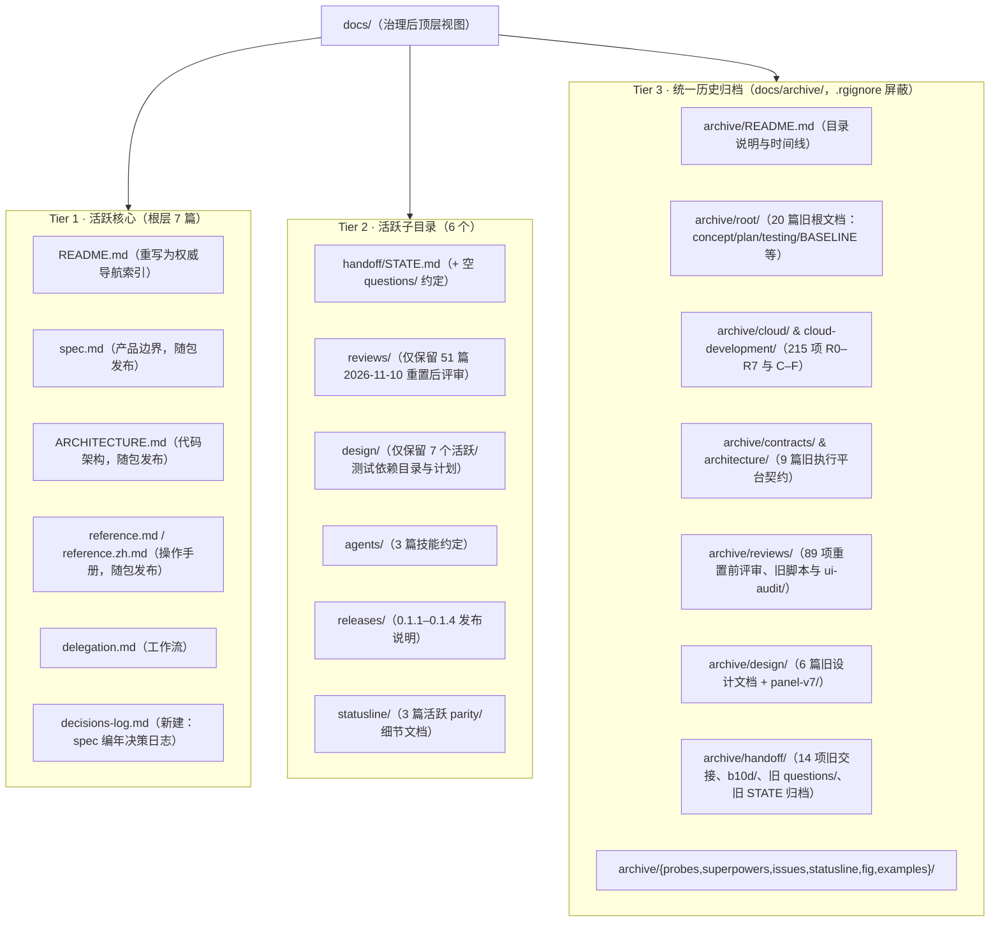
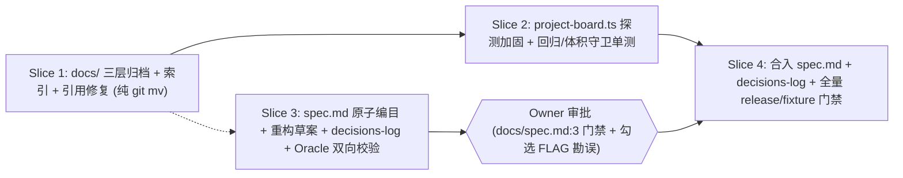

# 17. `docs/spec.md` 结构化重构与 `docs/` 历史文档归档治理

> **优先级**：P2（高杠杆文档与搜索降噪治理；消除 `docs/reviews/` 已触发的 128 项截断缺陷与 `docs/spec.md` 逼近 64 KiB 截断风险）
> **类别**：文档信息架构治理 / Collector 健壮性加固（Documentation Governance & Collector Hygiene）
> **预估规模**：M（4 个垂直切片：Slice 1 纯 `git mv` 归档 409 个历史文件 + 重建索引；Slice 2 加固 `project-board.ts` ~20 行 + 回归单测 ~50 行；Slice 3–4 `docs/spec.md` 语义零漂移重构 + `docs/decisions-log.md` 剥离 + Oracle 双向校验）
> **前置依赖**：无代码前置依赖；Slice 3–4 **强前置 Owner 对 `docs/spec.md` 改动的显式审批**（遵循 `docs/spec.md:3` 硬规则）。与 `CODE-HEALTH` 现有 lane 基本无文件冲突（仅 Slice 2 触及 `src/collectors/project-board.ts`，可排在 `PRUNE-OBS` / `MCP-SPLIT` 间隙独立合入）
> **`docs/spec.md` 边界影响**：**语义零新增、零删减、零静默修正**。本方案属于 `docs/spec.md` 自身的结构整理（重排版、分层编号、将 103 处内联 `(owner, date)` 编年史外置至 `docs/decisions-log.md`），不改变任何产品边界；对现行 `docs/spec.md` 中已存在的 6 处内部自相矛盾/漂移句，一律以「待 Owner 确认勘误表」显式呈现，未经 Owner 勾选不得改动语义。

---

## 1. 背景与现状证据

经过从 `codex-hud` 早期阶段、2026-11-01–09 的云端多包 `R0–R7` 阶段，再到 2026-11-10 重置后的轻量化 `universal-hud` 阶段（`M1`–`M4`、`0.1.x`、`MCP-ORCH`、`CODE-HEALTH`），仓库的 `docs/` 目录与核心产品边界文档 `docs/spec.md` 出现了严重的**结构性退化**与**两个已实证的程序级隐患**。

### 1.1 `docs/spec.md` 结构病灶（实测数据，截至 HEAD `77ae90b6`）

当前 `docs/spec.md` 总计 **39,230 字节（39.2 KB）、6,183 词、205 行**（估算 ~8,300–9,500 tokens），其中 **80.0% 的体量堆积在 `## 2. What it must do` 的 4 个大编号项下，且存在极端单行/单段膨胀**：

| 章节 / 条目 | 行号范围 | 行数 | 空行数 | 字节数 | 占比 | 词数 | 最长单行 | 主要病灶 |
| --- | --- | ---: | ---: | ---: | ---: | ---: | --- | --- |
| Preamble + `§1 What it is` | `L1–L9` | 9 | 3 | 495 B | 1.3% | 87 | — | 简洁清晰，包含 `L3` 所有权铁律 |
| **`§2.1 Delegate through one MCP`** | **`L12–L23`** | **12** | **0** | **15,546 B** | **39.6%** | **2,493** | **`L13`（11,844 B / 1,896 词）** | **整节为 1 个无空行巨段**；单 `L13` 一行即占全文件 30.2%，`L16` 达 2,587 B；且把 **Control tab / Model picker 面板 UI 规范**混入委派节 |
| **`§2.2 Show what is happening`** | **`L24–L103`** | **80** | **0** | **12,749 B** | **32.5%** | **2,004** | **`L103`（1,517 B / 226 词）** | **80 行无空行巨段**；混排状态行、面板布局、Project/Home、EXP、可选模型、微操作与 HTML 导出 |
| `§2.3 Set up a project's workers` | `L104–L121` | 18 | 0 | 2,829 B | 7.2% | 410 | `L104`（750 B） | 混排 `hud setup`、可选 skills 目录与 `hud tickets sync` |
| `§2.4 Install and uninstall` | `L122–L124` | 3 | 1 | 228 B | 0.6% | 31 | `L122`（118 B） | 正常 |
| `§3 What it does not do` | `L125–L137` | 13 | 2 | 795 B | 2.0% | 127 | — | 正常 |
| `§4 Threat model and quality bar` | `L138–L148` | 11 | 2 | 771 B | 2.0% | 128 | — | 正常 |
| `§5 Milestones` | `L149–L200` | 52 | 2 | 5,506 B | 14.0% | 846 | `L199`（615 B） | 已被 `project-board.ts:385-386` 正则硬解析；`M5` 内含已移入 `MCP-ORCH` 的冗余追记 |
| `§6 How work is done` | `L201–L205` | 5 | 1 | 279 B | 0.7% | 51 | — | 正常 |
| **合计** | **`L1–L205`** | **205** | **11** | **39,230 B** | **100%** | **6,183** | **`11,844 B`** | **107 处 `2026-11-xx` 日期 / 103 处 `(owner, ...)` 括注** |

由此引发的 5 项直接工程后果：

1. **单行 11.8 KB 摧毁 `git diff` 与 Agent `grep`**：每次对 `§2.1` 追加一句话，`git diff` 都输出一整段 11,844 字节的单行变更，人工审阅几乎无法一眼看出改了什么；Agent 用 `grep` 命中 `§2.1` 任意关键字（如 `hud_create`、`Control`、`done receipt`），单行即灌入 ~2,600–3,000 tokens 噪声。
2. **三层嵌套 `(owner, 2026-11-xx)` 追记掩盖现行语义**：全文件共有 **103 处含 `owner` 的括注、107 处日期标注**（单 `2026-11-17` 一天就有 20 处），其中非嵌套简单括注本身就占 ~4.7 KB，且出现多层嵌套（如 `L13` 的 `(owner, 2026-11-14; preset override ... (owner, 2026-11-17) ..., owner 2026-11-14)`）。Agent 必须自行沿时间线推理哪句覆盖了哪句。
3. **跨主题错位与内部自相矛盾**：
   - `Control tab` 与 `pi model picker` 整段面板 UI 规范（~2.6 KB）写在 `§2.1`（`L13`）而非 `§2.2`；
   - `§2.2 L24` 仍写 `A side panel (Home, Project)`、`L47` 与 `L55` 仍把 `control plane` 算作 Project 的子页，而 `L13` 与 `L79` 已明确 `Home, Project, Control, EXP` 为顶层主标签；
   - `§2.3 L116` 仍称 `The Skills tab lists the whole inactive collection`，而 `§2.2 L79` 已将其迁入 `Help (?)` 并取消独立 Skills tab；
   - `§2.1 L12` 列举的 MCP 工具共 9 个，未含同节 `L16` 提及的 `hud_lease` 与实装中的 `hud_statusline`（`tests/release-archive.test.mjs:238-239` 为 11 个）；
   - `§5 L199` 的 `M5 candidates` 仍保留 `(Moved into MCP-ORCH, owner 2026-11-21:) MCP tasks ...` 大段重复叙述。
4. **逼近 `STATE_BYTES = 65536`（64 KiB）无声截断红线**：`src/collectors/project-board.ts:146,151,385` 读取 `docs/spec.md` 时复用了 `STATE_BYTES = 65536`（定义于 `src/collectors/state-ledger.ts:4`）。当前 `docs/spec.md` 已达 **39.2 KB（60.0%）**，一旦再增长 ~26 KB，位于文件末尾的 `## 5. Milestones` 将被**静默截断**，导致 Project 页里程碑条 `out.ladder.ids` 直接变空。（注：`docs/handoff/STATE.md` 已达 **50.2 KB / 76.5%**，同样逼近该上限。）
5. **跨里程碑 ID 解析失配**：`project-board.ts:386` 使用正则 `/^[-*] \*\*(M[^,\s*]+),/gm`，只识别以 `M` 开头且紧跟逗号的里程碑（当前命中 `['M1', 'M2', 'M3', 'M3b', 'M4', 'MCP-ORCH']`），遗漏 `§5 L184` 的 `0.1.x` 以及 `docs/handoff/STATE.md:3` 当前声明的 `Milestone: 0.2.0`。

---

### 1.2 `docs/` 目录全景盘点（Git HEAD `77ae90b6` 精确统计）

截至 `77ae90b6`，`git ls-files docs/` 共追踪 **517 个文件（含 403 篇 `.md`），总计 18.90 MB（19,821,339 B）**，其中 `.md` 占 **6.54 MB（6,859,582 B）**。（另注：当前本地工作树还有未提交的 `docs/neon-proposal/` 16 篇提案约 616 KB，不属于历史归档对象。）

#### A. 按顶层目录分类盘点

| 顶层条目 | 追踪文件数 | `.md` 数 | 总大小 | 最早 / 最后提交 | 文件类型构成 | 现状性质 |
| --- | ---: | ---: | ---: | --- | --- | --- |
| `(根文件)` | 26 | 23 | 578.0 KB | `01-16` / `11-21` | 23 `.md`, 3 `.json` | **混杂**：5 篇核心活跃文档 + 1 篇过时 `docs/README.md` + 20 篇历史报告/旧计划 |
| `agents/` | 3 | 3 | 5.8 KB | `11-12` / `11-20` | 3 `.md` | **活跃**：`CLAUDE.md`、`delegation.md`、`hud_tickets` 技能直接引用 |
| `releases/` | 4 | 4 | 6.6 KB | `11-13` / `11-14` | 4 `.md` | **活跃**：`0.1.1`–`0.1.4` 正式发布说明 |
| `handoff/` | 15 | 14 | 502.8 KB | `11-03` / `11-21` | 14 `.md`, 1 `.json` | **混杂**：仅 `STATE.md`（49.0 KB）活跃；其余 14 项（`b10d/`、`questions/` 旧问、`archive/`、`11-07..11` 交接）均为历史 |
| `reviews/` | 140 | 131 | 2,819.9 KB | `09-22` / `11-21` | 131 `.md`, 2 `.py`, 2 `.mjs`, 2 `.png`, 1 `.html`, 2 `.json` | **混杂且超限**：136 个直接目录项已超过 `project-board.ts` 的 `limit=128`；含 51 篇 `11-10` 重置后评审 + 89 项重置前评审/旧脚本/`ui-audit/` |
| `design/` | 50 | 14 | 8,255.9 KB | `11-01` / `11-20` | 14 `.md`, 14 `.mjs`, 5 `.html`, 14 `.png`, 3 `.txt` | **混杂且含测试硬依赖**：`control-tab/`、`model-picker/` 被 5 个单测直接 `import`；`panel-v8/`、`project-ux/`、`ux-pass/`、`panel-ux/`、`exp-usage-plan.md` 活跃；其余 6 篇旧设计 + `panel-v7/` 为历史（1.05 MB） |
| `statusline/` | 10 | 7 | 64.8 KB | `11-05` / `11-17` | 7 `.md`, 3 `.txt` | **混杂**：`feature-coverage.md`（被 parity fixture README 引用，`11-17` 更新）、`native-details.md`、`opt-in-observation.md` 活跃；其余 7 项（`11-05` 草案与 `validation/`）为历史 |
| `cloud/` | 207 | 156 | 4,433.3 KB | `11-02` / `11-10` | 156 `.md`, 28 `.txt`, 18 `.log`, 4 `.json`, 1 `.tsv` | **纯历史**：云端 dots `R0–R7` 编排记录、`handoff/`（113 项）、`rulings/`（50 项） |
| `cloud-development/` | 8 | 8 | 81.8 KB | `11-05` / `11-10` | 8 `.md` | **纯历史**：2026-11-05 云端 `C–F` 路线图手册 |
| `contracts/` | 7 | 7 | 586.2 KB | `11-01` / `11-07` | 7 `.md` | **纯历史**：旧执行平台 `01-identity`–`07-outbound-compat` 契约（已在 11-10 重置中被 `spec.md` 取代） |
| `architecture/` | 2 | 2 | 61.4 KB | `11-07` / `11-07` | 2 `.md` | **纯历史**：11-07 过渡期 harness 架构分析 |
| `probes/` | 10 | 10 | 147.6 KB | `11-01` / `11-02` | 10 `.md` | **纯历史**：早期环境探针记录（注意：`tests/check-fixtures.sh:24` 仍扫描此目录） |
| `superpowers/` | 5 | 5 | 79.7 KB | `09-22` / `11-02` | 5 `.md` | **纯历史**：09–10 月旧面板重写计划 |
| `issues/` | 19 | 19 | 27.8 KB | `01-29` / `11-17` | 19 `.md` | **历史为主（含 1 条待修复 `issue-017`）**：根 `ISSUES.md` 指向此处（16 条已修复旧单 + `017`） |
| `fig/` | 9 | 0 | 1,701.7 KB | `10-04` / `10-31` | 9 `.png` | **纯历史**：旧 `codex-hud` 截图（`README.md` 已不再引用） |
| `examples/` | 2 | 0 | 3.6 KB | `11-01` / `11-09` | 1 `.json`, 1 `.toml` | **纯历史**：旧 `delegate.codex-headless.json`、`routing.toml` |
| **合计（HEAD 追踪）** | **517** | **403** | **18.90 MB** | — | — | **活跃仅 ~108 文件（74 `.md`），历史占 409 文件（329 `.md`，79.1%）** |

#### B. `docs/` 根目录 26 个文件明细

- **活跃核心（5 篇，均在 `2026-11-20/21` 更新，254.5 KB）**：`ARCHITECTURE.md`（35.9 KB）、`reference.md`（94.3 KB）、`reference.zh.md`（84.3 KB）、`delegation.md`（6.9 KB）、`spec.md`（39.2 KB）。
- **需就地重写（1 篇）**：`docs/README.md`（144 B，2026-10-04 遗留存根，仍写着「Linux / macOS Apple Silicon / Windows testing pending」，与 `spec.md` §3 及 `README.md` 直接矛盾）。
- **明确历史（20 篇，323.4 KB）**：
  - 0 字节空文件：`ANALYSIS-REPORT.md`（0 B，2026-01-18）；
  - 早期 `codex-hud` 记录（2026-01–10）：`PROGRESS.md`、`TODO.md`、`code-review-checklist.md`、`BASELINE.md`、`herdr-context-fix.md`、`performance-20261024.md`、`acceptance-20261025.{md,json}`、`observability-20261025.{md,json}`、`ux-plan-20261027.md`；
  - 11-10 重置前方案与实验：`universal-hud-concept.md`（145.9 KB）、`universal-hud-engineering-plan.md`（49.2 KB）、`universal-hud-plan.md`（12.8 KB）、`delegate.example.json`、`pi-local-launch.md`、`sonic-ab.md`、`codex-vs-pi-ab.md`、`testing.md`（22.0 KB，`TEST-SLIM-0` 旧提案草稿，正文仍引用已删除的 `WP0` 与 `R6A`）。

---

### 1.3 代码、测试、脚本与配置对 `docs/` 的硬依赖清单

在全仓库执行 `git grep "docs/"` 后核实，以下路径存在**不可盲目移动的程序或发布门禁依赖**：

| 依赖类别 | 精确位置（文件与行号） | 依赖的 `docs/` 路径 / 格式契约 | 风险与处理约束 |
| --- | --- | --- | --- |
| **运行时 Collector（里程碑解析）** | `src/collectors/project-board.ts:146,151,385-387`<br>`src/collectors/state-ledger.ts:4` | 读取 `docs/spec.md`（受 `STATE_BYTES = 65536` 截断限制）；切分 `/^## 5\. Milestones[ \t]*\r?$/m` 到下一个 `^## `；匹配 `/^[-*] \*\*(M[^,\s*]+),/gm`；面板 Docs 页 Enter 打开 `docs/spec.md` | **强约束**：必须保留 `docs/spec.md` 路径、`## 5. Milestones` 精确标题、`- **<ID>,` 列表语法，且文件体积须远小于 64 KiB |
| **运行时 Collector（最新评审探测）** | `src/collectors/project-board.ts:133-140,388-397`<br>`src/cli/board.ts:40-60`<br>`src/render/html-board.ts:191,207` | 扫描 `docs/reviews/` 取 `.md` 文件按名倒序前 12 个再按 `mtimeMs` 选最新一篇；**实测已触发缺陷**：`this.names(reviews)` 默认 `limit = 128`，在 `opendirSync` 未排序遍历时截断，`docs/reviews/` 现有 136 项导致**每次静默丢弃 8 项**！且若在 `docs/reviews/` 放入 `README.md`，因 ASCII `'R' > '2'` 且 mtime 最新，会直接劫持“最新评审” | **强约束**：保留 `docs/reviews/` 目录；**严禁**放非评审 `.md`（如 `README.md`）到 `docs/reviews/`；Slice 2 修复 `limit=128` 截断并排除 `README.md` |
| **运行时 Collector（STATE 账本）** | `src/collectors/state-ledger.ts:5` + 10+ 处测试 | 硬编码首选路径 `docs/handoff/STATE.md`（回退根 `STATE.md`） | **强约束**：`docs/handoff/STATE.md` 必须留在原位 |
| **单元测试 ESM `import`** | `tests/unit/control-tab.test.mjs:9`<br>`tests/unit/role-control.test.mjs:15`<br>`tests/fixtures/project-page.mjs:13`<br>`tests/unit/model-picker.test.mjs:6`<br>`tests/unit/model-picker-pane.test.mjs:12` | 直接 ESM 导入 `../../docs/design/control-tab/gen/frames.mjs` 与 `../../docs/design/model-picker/gen/{world,frames}.mjs` | **强约束**：`docs/design/control-tab/` 与 `docs/design/model-picker/` **绝不能迁走**（否则 5 个单测直接 `ERR_MODULE_NOT_FOUND`） |
| **测试夹具与契约断言** | `tests/fixtures/project-page.mjs:24-27`<br>`tests/unit/project-page.test.mjs:39,748-751,765,775` | 合成目录验证 `docs/spec.md`、`docs/reviews/*.md`、`docs/handoff/STATE.md` 的读取与 `ladder.ids` | Slice 2 扩展测试覆盖 >128 篇评审与 `README.md` 过滤 |
| **源码发布归档与坏链门禁** | `.gitattributes:6-10`<br>`scripts/release.sh:11`<br>`tests/release-archive.test.mjs:12,79-89,136` | `/docs/* export-ignore`，仅反排除 `ARCHITECTURE.md`、`reference.md`、`reference.zh.md`、`spec.md`；`audit()` **全量校验所有随包发布的 `.md` 内每个相对 Markdown 链接**，目标缺失即 `npm run test:release` 失败 | **强约束**：随包发布的 4 篇文档（含 `spec.md`）不得用相对 `[...](...)` 链接指向未随包发布的 `docs/decisions-log.md` 或 `docs/archive/`；`excluded` 列表保持校验 `docs/reviews`、`docs/handoff` 并补加 `docs/archive` |
| **公开仓库卫生扫描** | `tests/check-fixtures.sh:24` | 默认扫描 `tests/fixtures tests/prototypes docs/probes docs/design` | 迁移 `docs/probes` 后须同步更新扫描列表（覆盖 `docs/archive/probes` 或 `docs/archive` 文本），防止卫生门禁出现盲区 |
| **公开文档外链（GitHub URL）** | `README.md:199`, `README.zh.md:164`<br>`docs/ARCHITECTURE.md:7`<br>`docs/reference.md:18`, `docs/reference.zh.md:17` | 5 处均指向 `tree/universal-hud/docs/reviews`；另有 `docs/reference.md:820`、`docs/reference.zh.md:534` 引用 `docs/design/panel-v8/` | 保留 `docs/reviews/` 与 `docs/design/panel-v8/` 原路径即零坏链 |
| **Agent 指令与技能** | `CLAUDE.md:17-43`、`AGENTS.md:3-53`<br>`.hud/brief.md:5`、`packages/hud-mcp/instructions/oracle.md:10,30`<br>`docs/delegation.md:5-57`、`integrations/tickets/method.md:7,13,26`<br>`integrations/skills-optional/{to-spec,hud-build,grill-with-docs}/*`<br>`tests/fixtures/claude-hud-parity/README.md:12`<br>`ISSUES.md:5-21` | 引用 `docs/spec.md`、`docs/ARCHITECTURE.md`、`docs/delegation.md`、`docs/handoff/STATE.md`、`docs/handoff/questions/`、`docs/agents/*`、`docs/reviews/2026-11-10-test-volume-audit.md`、`docs/design/panel-v8/gen/`、`docs/statusline/feature-coverage.md`、`docs/issues/*` | 活跃路径全部保留原位；`CLAUDE.md` / `AGENTS.md` / `ISSUES.md` 中指向已归档路径的少量说明同步更新 |

---

### 1.4 Agent Grep 噪声实测（历史文档的真实干扰度）

在当前 HEAD 上统计 7 个高频业务关键词的 `git grep` 命中分布（排除 `package-lock.json`）：

| 关键词 | 全仓库总命中 | `docs/` 命中（占比） | 活跃 7 篇核心文档命中 | 拟迁入 `docs/archive/` 命中 | 归档 + `.rgignore` 后 `docs/` 降噪幅度 |
| --- | ---: | ---: | ---: | ---: | ---: |
| `Jev` | 662 | 599（90.5%） | 3 | 521 | **-87.0%**（总仓降噪 -78.7%） |
| `worktree` | 786 | 450（57.3%） | 32 | 309 | **-68.7%** |
| `STATE.md` | 206 | 119（57.8%） | 20 | 75 | **-63.0%** |
| `pi-roles` | 168 | 131（78.0%） | 16 | 69 | **-52.7%** |
| `hud_create` | 465 | 122（26.2%） | 42 | 48 | **-39.3%** |
| `Control` | 1,046 | 281（26.9%） | 46 | 103 | **-36.7%** |
| `watcher` | 864 | 308（35.6%） | 31 | 82 | **-26.6%**（注：余下 188 处集中在 2026-11-11–21 `docs/reviews/`，详见 §3.6） |

> 结论：超过 **81.6% 的 Markdown 文档（329 / 403 篇）** 是已被 2026-11-10 重置取代的历史记录，但散落在 14 个顶层目录与 20 个 `docs/` 根文件中，每次 Agent 搜索都被旧时代“owned Jev / native host / ledger / R0–R7”术语淹没。

---

## 2. 目标与非目标（Scope / Out of Scope）

### 目标（Scope）
1. **结构化重构 `docs/spec.md`（语义零漂移）**：拆解 `§2.1`/`§2.2` 超大单段与 11.8 KB 怪兽行，建立清晰编号子节与声明式表格；将 103 处 `(owner, 2026-11-xx)` 决策追记与被取代的演变过程完整迁入 `docs/decisions-log.md`，把 `docs/spec.md` 体量压回 **~24–28 KB**，并保持 `project-board.ts` 零破坏兼容。
2. **建立可验证的语义零漂移迁移协议**：通过原子条款编目（`S-001`..`S-NNN`）+ `KEEP / LOG / FLAG` 全双射映射 + 独立 `oracle` 双向校验 + Owner 显式批准门禁，严格履行 `docs/spec.md:3`。
3. **三层归档治理 `docs/`**：将 409 个历史文件（329 篇 `.md`，10.80 MB）用 `git mv` 收拢进统一 `docs/archive/`，重写过时的 `docs/README.md` 作为清晰导航地图，同步修正受影响文档/脚本链接。
4. **修复 `project-board.ts` 实证缺陷**：消除 `docs/reviews/` 超过 128 项时的无序截断 Bug，防止非评审 `.md`（如 `README.md`）劫持最新评审显示，并守护 `docs/spec.md` 不越过 `STATE_BYTES` 上限。
5. **降低 Agent 搜索噪声而不损历史与发布**：引入 `.rgignore` 屏蔽 `docs/archive/`（默认开启，见 §6 Q4），同时确保 `git log --follow`、`git grep`、`npm run check:fixtures`、`npm run test:release` 全部保持健康。

### 非目标（Out of Scope）
- **不新增、删减或暗中修改任何产品需求**：即使发现现行 `docs/spec.md` 与代码存在轻微漂移，也只列为 `FLAG` 交 Owner 裁决，绝不在重构中偷渡改动。
- **不重写 git 历史、不物理删除历史文档**：归档一律使用 `git mv` 保留追溯链；唯一特例为 0 字节空文件 `docs/ANALYSIS-REPORT.md`（默认一并归档或由 Owner 决定删除）。
- **不动 `.scratch/`、`docs/neon-proposal/`、`docs/handoff/STATE.md` 账本正文**：`.scratch/` 属于活跃工单追踪器（`project-board.ts:156`）；`STATE.md` 内容裁剪与 `STATE_BYTES` 扩容议题另案处理（本文仅提示其 50.2 KB 风险）。
- **不改动被单测直接 `import` 的设计生成器路径**：`docs/design/control-tab/` 与 `docs/design/model-picker/` 保留原位，不重构其测试导入。
- **不改写 `docs/reference.md` / `docs/reference.zh.md` / `docs/ARCHITECTURE.md` 正文**（仅确保它们引用的路径有效，不在本方案中顺带翻修用户手册）。

---

## 3. 核心设计方案

### 3.1 `docs/spec.md` 结构化方案对比：方案 A vs 方案 B

| 评估维度 | **方案 A（推荐）：单文件结构化 `docs/spec.md` + `docs/decisions-log.md`** | 方案 B：拆分为 `docs/spec/01-delegation.md` 等多文件 + 索引页 |
| --- | --- | --- |
| **Agent 读取 token 与延迟** | 重构后 ~24–28 KB（~5.5k–6.5k tokens），**1 次 `Read`** 即可掌握全局边界（占 200k 窗口 <3%），防止 Agent 只读局部子文件而违背 `§3` 非目标或 `§4` 威胁模型；局部定位可通过顶层 TOC + 三级标题 1 次精准切片读取 | 需先读索引页再读 2–4 个子文件（3–5 次串行/并行工具调用）；Agent 极易只读单个子文件而漏掉跨模块硬约束（如 `Control` 同时涉及委派链路与面板 UI） |
| **`project-board.ts` 与测试兼容** | **100% 原生兼容**：`docs/spec.md` 路径、`## 5. Milestones` 标题、`- **<ID>,` 语法全部保留；体量从 39.2 KB 降至 ~26 KB，距 64 KiB `STATE_BYTES` 余量从 26 KB 扩大到 ~38 KB | `project-board.ts:385-387`、`tests/fixtures/project-page.mjs:25`、`CLAUDE.md:23`、`.hud/brief.md:5`、`oracle.md:10`、`.gitattributes:10` 全部假定单一 `docs/spec.md`；要么改代码和 10+ 处提示词，要么保留壳文件作跳转，徒增维护层 |
| **Owner 编辑与审阅便利性** | 单一文件在 `$EDITOR` / GitHub 网页中一次 `Ctrl+F`、一份连续 diff 即可审完全部条款；按 `docs/spec.md:3` 审阅边界改动成本最低 | 一次 grill 或跨功能决议（如 MCP 任务同时影响委派、面板与里程碑）需同步改 3–4 个文件，跨文件漂移风险高 |
| **`git diff` 与并发冲突面** | 消除 11.8 KB 单行，每条规范独立成句/行（≤100 列软换行）+ 按 `#### 2.x.y` 细分后，改动任何规则仅产生 1–5 行局部 diff | 冲突面略小，但 `docs/spec.md` 本身仅在 Owner 拍板时由主会话编辑，不存在多 worker 并发写冲突 |
| **发布归档（`.gitattributes`）** | 继续只需 `/docs/spec.md -export-ignore` 一行；`docs/decisions-log.md` 不随发布包分发，零多余文件 | 需将 `/docs/spec/** -export-ignore` 整目录放行，并由 `tests/release-archive.test.mjs` 维护多文件交叉相对链接 |
| **何时适用** | **当前阶段最优**（目标体积 24–28 KB） | 仅当声明式 `docs/spec.md` 未来再次突破 **48 KiB（`STATE_BYTES` 的 75%）或 12,000 tokens** 时才触发拆分 |

**明确推荐：采用方案 A**。当前 `docs/spec.md` 的痛点根本不是“总量大到模型读不下”（全篇仅 ~8.3k tokens），而是**零分段、11.8 KB 单行、103 处历史追记与现状混写、Control tab 章节错位**。方案 A 以最低改动成本和零生态破坏根治全部病灶。

---

### 3.2 重构后的 `docs/spec.md` 目标信息架构与 `docs/decisions-log.md` Schema

#### A. `docs/spec.md` 章节骨架（保留全部 `## 1.`–`## 6.` 顶层契约）

```markdown
# HUD product spec

Status: **active boundary** (originally drafted 2026-11-10; restructured 2026-11-XX with zero semantic drift).
Only the owner decides what this page says: an agent may edit it only after telling the owner the change and the reason for it.
It is the boundary for every brief, answer and review. When anything here conflicts with older documents, this page wins.
Chronological decision dates and superseded rationales live in `docs/decisions-log.md`.

## 1. What it is
(保持现状：单人 Linux/WSL、herdr 内、面向 Claude Code / Codex / pi 的统一 HUD)

## 2. What it must do

### 2.1 Delegation through one MCP
#### 2.1.1 MCP tool surface and thin-layer boundary       ← 工具清单表 + 无硬上限 + 薄封装 pi-roles/herdr
#### 2.1.2 Logical roles, chains, presets and routing     ← 角色表(imp/reviewer/sonic/oracle/pro/general/architect别名) + 配额/启动失败顺延 + harnesses.json 开关 + bro vs Jev 命名边界
#### 2.1.3 Interactive CLI harnesses and local trust      ← 4 种 CLI、只传 model/effort/bypass、启动前 trust 校验与唯一例外 `hud trust <dir>`
#### 2.1.4 Dispatch inputs, isolation and launch guards   ← context_files/from_jobs、worktree、pi 开关、thinking 能力校验、sonic 默认 high + 可选 Decision API 档位
#### 2.1.5 Job lifecycle, settlement, receipts and cleanup← 事实终结、quiet-job 唯一例外、live-child 与 MCP 豁免、done receipt 签名、读后即关、hud_send 续修、衍生幂等键
#### 2.1.6 Event delivery, project scope and worker surface← 共享只读状态、changes/watch/Codex/pi 投递、worker 中立性与专属 MCP 工具、hud_lease、checks、项目作用域与手工恢复
#### 2.1.7 Built-in ticket method (`hud_tickets`) and convention ← 唯一内置方法例外 + 极简默认约定与方法论解耦

### 2.2 Observation, status bars and side panel
#### 2.2.1 Bottom status lines and bar themes             ← 三端常开底栏 + tokens/s + 8 主题（Stacked 两行特例）
#### 2.2.2 Side panel shell, tabs, layouts and input      ← `/hud` 按需打开、统一独立 herdr 侧栏、主标签 Home/Project/Control/(EXP)、Classic/Split、鼠标与键位规则、`/` 过滤
#### 2.2.3 Home tab and native subagents                  ← 单页结构、隐藏规则、Recommended 模式、原生子代理缩进、空闲紧凑进度板、任务/切片视图切换
#### 2.2.4 Project tab, progress board, layouts and export← Project hub 与页面、Timeline/Board/Inbox、STATE 约定、`y`/`n` 批量试用记录、`(waits on ...)`、TryBriefs、`hud board` 静态 HTML
#### 2.2.5 Control tab and in-pane model picker           ← 【从原 §2.1 L13 归位】Roles/Attention/Usage/Files、Harnesses 开关、预设与原地链编辑、终端内联模型选择器与排序规则
#### 2.2.6 Panel micro-actions and visual cues            ← `g`、`1`–`4`/`d`、`X`；火花线、`hud-progress`、`sonic` 子树、`--numstat` top 12、配额水位/花费/健康
#### 2.2.7 Experimental EXP tab                           ← Experiments 默认关；Codex 原生栏、pi 订阅代理 `≈`、API 赠额 JSONL 账本与只读无阻断约束
#### 2.2.8 Optional external model features               ← 显示专用、单总开关、Decision API 标签与排序、无权限/同意层
#### 2.2.9 Help and backup skills catalog                 ← Help 内只读备份 skills 目录，40 列完整折行

### 2.3 Project setup, skills and ticket sync
#### 2.3.1 Project `.hud/` setup and trust gate           ← `hud setup`、`$HUD_HOME/projects.json`、`.hud/brief.md`、仅 pi worker 可定制
#### 2.3.2 Skills policy                                  ← 已安装 3 技能 + `integrations/skills-optional/` 非激活集合
#### 2.3.3 GitHub Issues one-way mirror (`hud tickets sync`)

### 2.4 Installation and uninstallation                   ← `./install`、`hud uninstall`、官方客户端注册命令

## 3. What it does not do                                 ← 原样保持（逐条核对）
## 4. Threat model and quality bar                        ← 原样保持（逐条核对）
## 5. Milestones                                          ← 【严格保持标题与 `- **<ID>,` 兼容语法】
## 6. How work is done                                    ← 原样保持
```

#### B. 排版与发布链接硬约束
- **只写声明式现状**：`docs/spec.md` 正文不再内嵌 `(owner, 2026-11-xx)` 括号追记和已被覆盖的历史演变过程；但凡对外部设计样例或工单仍有现行约束力的引用（如 `docs/design/control-tab/design.md`、`docs/design/panel-v8/notes.md`、`docs/design/exp-usage-plan.md`），统一放在对应小节首行 `Reference:` 元行中。
- **单行长度约束**：正文采用自然断行（每行建议 ≤ 110 字符），每条独立约束使用短段落或 bullet，**彻底杜绝 > 300 字节的巨型单行**。
- **发布包链接防呆（对齐 `tests/release-archive.test.mjs:79-89`）**：`docs/spec.md` 随源码包发布（`.gitattributes:10`），而 `docs/decisions-log.md`、`docs/delegation.md`、`docs/design/**`、`.scratch/**` 均**不随包发布**。因此 `docs/spec.md` 中引用这些仓库内路径时，**一律使用反引号路径**（如 `` `docs/decisions-log.md` ``），**绝不使用相对 Markdown 超链接 `[...](./...)`**，确保 `npm run test:release` 的相对链接审计 100% 通过。

#### C. `docs/decisions-log.md` Schema（外置编年史）

将现行 `docs/spec.md` 中剥离出来的 **103 处 `(owner, 2026-11-xx)` 决策标注与被取代的历史过程**，按日期倒序完整沉淀至 `docs/decisions-log.md`：

```markdown
# HUD product decisions log

Owner decisions extracted from `docs/spec.md` (and future boundary updates).
`docs/spec.md` states the current active boundary; this log preserves when and why each rule changed or superseded an earlier one.

## 2026-11-21
- **D-2026-11-21-01** (`§2.1.2`): Grok paused — `grok` CLI and `xai` provider switched off by default; Grok presets removed from `imp`.
- **D-2026-11-21-02** (`§2.1.4`): Sonic thinking defaults to `high` and callers do not pick a level; optional off-by-default Decision API pick added (*rationale*: marginal gain does not justify changing model behaviour; sonic tasks are simple). *Supersedes* earlier same-day per-call sonic thinking selection.
...

## 2026-11-10
- **D-2026-11-10-01** (`§2.1.1`, `§3`): Initial thin-HUD reset; `pi-roles` not bundled; ported claude-hud statusline and p10k footer do not track upstream.
```

---

### 3.3 语义零漂移四步迁移核对机制（履行 `docs/spec.md:3`）

为防止重构悄悄丢弃任何约束、例外条件或历史限定词，执行严格四步协议：


1. **Step 1 — 原子条款编目**：脚本辅助按句号/分号拆解现行 `docs/spec.md` `L1–L205`，人工校对为带编号的原子条款表（预计约 160–190 条 `S-001`..`S-NNN`），暂存于任务临时目录（`tmp/tasks/spec-restructure/clause-map.md`，不入库）。
2. **Step 2 — 三分类全双射覆写**：每条 `S-xxx` 必须登记确切去向，不允许出现未映射行：
   - `KEEP -> §x.y.z`：现行有效边界，落入重构版 `docs/spec.md` 对应子节；
   - `LOG -> D-YYYY-MM-DD-NN`：纯决策日期/原因说明，或原文中已被更晚日期句**明文声明取代**的历史过程句（例如 `2026-11-17` 取消 MATT-PARADIGM 后的过程描述、`2026-11-17` 曾写「仅 Home 与 Project 两个主标签」随即被同句 `2026-11-20` 补充 Control/EXP 取代）；
   - `FLAG -> F-N`：原文自身存在**未清理的自相矛盾或过时措辞**，需要 Owner 决定是「勘误对齐现行决议」还是「原样保留」。
3. **Step 3 — 独立 `oracle` 双向核验**：派发 fresh `oracle` 只读审阅 `HEAD:docs/spec.md`、`候选 docs/spec.md`、`候选 docs/decisions-log.md` 与 `clause-map.md`：
   - **正向校验**：逐条抽核高风险例外（如 `hud trust` 写入例外、quiet-job Decision API 触发条件、live-child 与 MCP launcher 豁免、done receipt 失效条件、`pi-roles` 不打包、EXP 零估算不阻断 CLI、无常驻服务等）无一弱化或遗漏；
   - **反向校验**：候选 `docs/spec.md` 每一句均须溯源至旧条款或 `FLAG` 清单，零私加条款。
4. **Step 4 — Owner 显式授权落盘**：向 Owner 汇报结构变更摘要、`FLAG` 勘误表、Oracle 核验报告与 diff，**仅在 Owner 明确同意后合入**。

#### 本次调研已预识别的 6 处 `FLAG` 勘误候选（供 Owner 在 §6 一次性拍板）

| 编号 | 现行 `docs/spec.md` 位置 | 现状矛盾 / 漂移证据 | 建议勘误（须 Owner 批准） |
| --- | --- | --- | --- |
| `F-1` | `L24`, `L47`, `L55` vs `L13`, `L79` | `L24` 仍写 `side panel (Home, Project)`、`L47`/`L55` 仍把 `control plane` 列在 Project 页内；`L13` 与 `L79`（2026-11-20）已把 `Control` 升格为顶层主标签并从 Project 移除 | 统一为顶层主标签 `Home, Project, Control`（及可选 `EXP`），将原 `L47`/`L55` 的控制面描述并入 `§2.2.5 Control tab` |
| `F-2` | `L116` vs `L79` | `L116` 仍写 `The Skills tab lists the whole inactive collection`；`L79`（2026-11-17）已将 Skills 列表移入 `Help (?)` | 改为 `The Skills section in Help (?) lists the whole inactive collection` |
| `F-3` | `L12` vs `L16` & 实装 | `L12` 列 9 个工具，遗漏同节 `L16` 的 `hud_lease`；实际 `tools/list`（`tests/release-archive.test.mjs:238-239`）为 11 个（含 `hud_statusline`） | 补齐 `hud_lease`（是否同步列入 `hud_statusline` 交 Owner 定） |
| `F-4` | `L101` vs `L85` | `L101` 写 `Inbox is deleted`（指 `panel-v8` 整体布局的 Inbox），而 `L85` 新增 Project 布局的 `Inbox`；分开后易混淆 | 显式注明「`panel-v8`'s panel-level Inbox layout was dropped; Project-tab layout still offers Timeline / Board / Inbox」 |
| `F-5` | `L199` vs `L191–192` | `§5 M5 candidates` 仍保留 `(Moved into MCP-ORCH, owner 2026-11-21:) MCP tasks ...` 大段重复句 | 现行 `MCP tasks` 规格并入 `MCP-ORCH` 条目，从 `M5 candidates` 列表移除重复句，迁移记录记入 `decisions-log.md` |
| `F-6` | `L184`, `STATE.md:3` vs `project-board.ts:386` | `STATE.md:3` 当前为 `Milestone: 0.2.0`，但 `§5` 只有 `M1`–`M4`、`0.1.x`、`MCP-ORCH` 且 `0.1.x` 不被现有正则命中 | 见 §6 Q3：由 Owner 决定是否保持 `§5` 里程碑文本不变、还是补齐 `0.2.0` / 放宽正则 |

---

### 3.4 `docs/` 三层归档治理架构

将 `docs/` 从“16 个顶层目录 + 26 个散乱根文件”收敛为清晰的**三层结构**，全部历史文档统一收拢至单一 `docs/archive/` 目录树：



#### 精确分流与数量核对表（覆盖全部 517 个 HEAD 追踪文件，无遗漏）

| 原路径 | 保留活跃（文件 / `.md` / 体积） | 迁入 `docs/archive/`（文件 / `.md` / 体积） | 目标归档路径 | 理由与引用联动 |
| --- | --- | --- | --- | --- |
| `docs/` 根文件（26） | **6** / 6 / 254.6 KB（5 篇核心 + 重写 `README.md`） | **20** / 17 / 323.4 KB | `docs/archive/root/` | 保留全部随包文档与 `delegation.md`；更新 `CLAUDE.md:27` 中 `universal-hud-*.md` 路径 |
| `docs/agents/`（3） | **3** / 3 / 5.8 KB | 0 | — | 被 `CLAUDE.md`、`delegation.md`、`integrations/tickets/method.md`、`to-spec` 引用 |
| `docs/releases/`（4） | **4** / 4 / 6.6 KB | 0 | — | 正式发布说明，体积极小且仍具参考价值 |
| `docs/handoff/`（15） | **1** / 1 / 49.0 KB（`STATE.md`） | **14** / 13 / 453.8 KB | `docs/archive/handoff/` | `STATE.md` 被 `state-ledger.ts:5` 硬编码；同步更新 `STATE.md:6` 与 `AGENTS.md:10` 中的旧 STATE 归档路径；`docs/handoff/questions/` 仍作为新问题的约定落点 |
| `docs/reviews/`（140） | **51** / 51 / 760.0 KB（`11-11..21` 48 篇 + `11-10` 3 篇重置锚点） | **89** / 80 / 2,059.9 KB（`<11-10` 64 篇 + `11-10` 16 篇 R5/R6/TEST-SLIM + 9 项脚本/`ui-audit/`） | `docs/archive/reviews/` | **零破坏**：`STATE.md` 与 `delegation.md:5` 全部 20+ 条评审引用均在保留的 51 篇内；`README*.md` / `ARCHITECTURE.md` / `reference*.md` 5 处 GitHub `docs/reviews` 链接保持有效；直接条目从 136 降至 51 |
| `docs/design/`（50） | **40** / 6 / 7,176.5 KB（`control-tab/`, `model-picker/`, `panel-v8/`, `project-ux/`, `ux-pass/`, `panel-ux/`, `exp-usage-plan.md`） | **10** / 8 / 1,079.4 KB（6 篇旧设计 + `panel-v7/`） | `docs/archive/design/` | `control-tab/` 与 `model-picker/` 被 5 个单测 `import`；`panel-v8/` 等被 `spec.md`、`delegation.md`、`reference*.md`、`src/render/*.ts` 引用；移走 `jev-in-hud.md`、`native-hud-v2.md` 等高噪声旧设计 |
| `docs/statusline/`（10） | **3** / 3 / 41.8 KB（`feature-coverage.md`, `native-details.md`, `opt-in-observation.md`） | **7** / 4 / 23.0 KB（`11-05` 3 篇旧稿 + `validation/` 4 项） | `docs/archive/statusline/` | `feature-coverage.md` 被 `tests/fixtures/claude-hud-parity/README.md:12` 引用且 11-17 仍维护 |
| `docs/cloud/`（207） | 0 | **207** / 156 / 4,433.3 KB | `docs/archive/cloud/` | 2026-11-03–10 云端 dots 历史记录；更新 `AGENTS.md` 中的历史指针说明 |
| `docs/cloud-development/`（8） | 0 | **8** / 8 / 81.8 KB | `docs/archive/cloud-development/` | 2026-11-05 云端 C–F 路线图；更新 `AGENTS.md:3,5` 链接 |
| `docs/contracts/`（7） | 0 | **7** / 7 / 586.2 KB | `docs/archive/contracts/` | 旧执行平台 01–07 契约；更新 `AGENTS.md:23` |
| `docs/architecture/`（2） | 0 | **2** / 2 / 61.4 KB | `docs/archive/architecture/` | 11-07 旧架构分析（注意：与活跃的 `docs/ARCHITECTURE.md` 彻底消歧） |
| `docs/probes/`（10） | 0 | **10** / 10 / 147.6 KB | `docs/archive/probes/` | 早期环境探针；**同步更新 `tests/check-fixtures.sh:24`** 继续扫描 `docs/archive/probes` |
| `docs/superpowers/`（5） | 0 | **5** / 5 / 79.7 KB | `docs/archive/superpowers/` | 09–10 月旧面板计划 |
| `docs/issues/`（19） | 0（见 §6 Q5：`issue-017` 处置） | **19** / 19 / 27.8 KB | `docs/archive/issues/` | 同步更新根 `ISSUES.md:5-21` 的路径；若 `issue-017` 仍未闭环，可单留或转入 `.scratch/` |
| `docs/fig/` + `docs/examples/`（11） | 0 | **11** / 0 / 1,705.2 KB | `docs/archive/{fig,examples}/` | 旧截图与旧配置示例，仓库内已无活跃引用 |
| **总计（HEAD 517 追踪文件）** | **108 文件（20.9%）/ 74 `.md`（18.4%）/ 8.10 MB** | **409 文件（79.1%）/ 329 `.md`（81.6%）/ 10.80 MB** | `docs/archive/` | **活跃 `.md` 数量下降 81.6%（403 → 74）**；`docs/design/` 中 6.0 MB 为活跃 HTML/PNG 视觉稿，非文本搜索目标 |

---

### 3.5 `docs/reviews/` 治理与 `src/collectors/project-board.ts` 代码加固

#### 1. 修复已实证的两个 `docs/reviews/` 探测隐患（`src/collectors/project-board.ts:388-397`）

现行代码（`src/collectors/project-board.ts:388-397`）：
```ts
const reviews = join(this.cwd, 'docs/reviews');
const review = this.names(reviews).filter((n) => n.endsWith('.md')).reverse().slice(0, 12)
  .flatMap((n) => {
    const path = join(reviews, n);
    try {
      const st = fs.lstatSync(path);
      return st.isFile() ? [{ path, at: st.mtimeMs }] : [];
    } catch { return []; }
  }).sort((a, b) => b.at - a.at)[0];
```

存在两处缺陷：
- **缺陷 1（已触发）**：`this.names(reviews)` 默认 `limit = 128`（`project-board.ts:133`），而 `fs.opendirSync` 按文件系统 inode/哈希表任意顺序读出前 128 项即停止，之后才调用 `.sort()`。在当前 `docs/reviews/` 136 项的真实目录上，实测每次随机丢弃 8 篇评审；未来新评审随时可能被静默跳过。
- **缺陷 2（防劫持）**：`filter((n) => n.endsWith('.md'))` 未排除说明类文件（如 `README.md`）。一旦目录内误放 `README.md`，ASCII `'R' > '2'` 使其排进 `.reverse().slice(0, 12)` 首位且 mtime 最新，直接把 Project 页与 `hud board` 的「Latest milestone review」替换成 README 文本。

**修复方案（~8 行改动，遵守 `docs/ARCHITECTURE.md` §8 有界与安全读规则）**：
1. 读取目录名时使用明确上界（如 `const REVIEW_DIR_LIMIT = 4096`，避免无界 `Infinity` 风险同时覆盖数年评审规模），或采用只保留字典序最大 12 个 `.md` 文件名的流式收集（内存 `O(1)`，不截断遍历）；
2. 过滤条件改为 `n.endsWith('.md') && !/^readme\.md$/i.test(n)`（既屏蔽 `README.md` 劫持，又兼容测试中可能出现的非日期合成名）；
3. 依然遵守 `docs/reviews/` 内**不放 `README.md`** 的约定，归档说明统一放在 `docs/README.md` 与 `docs/archive/README.md`。

#### 2. `docs/spec.md` 读取与 Milestone 解析保护（`project-board.ts:385-387`）

- **现状兼容**：重构后的 `docs/spec.md` 保持 `## 5. Milestones` 精确标题与 `- **<ID>,` 语法，且体积压至 ~26 KB（远低于 `STATE_BYTES = 65536`）。
- **可选增强（见 §6 Q3）**：
  - 将 milestone 提取正则从 `/^[-*] \*\*(M[^,\s*]+),/gm` 放宽为兼容版本型里程碑（例如 `/^[-*] \*\*((?:M[^,\s*]+|\d+\.\d+(?:\.\w+)?)),/gm` 或支持冒号/逗号前粗体 ID），从而同时识别 `M1`–`M4`、`0.1.x`、`0.2.0`、`MCP-ORCH`，同时排除 `M5 candidates (...)` 与嵌套子项（保留既有 `tests/fixtures/project-page.mjs:25` 语义）；
  - 新增静态单测断言 `Buffer.byteLength(fs.readFileSync('docs/spec.md')) < STATE_BYTES * 0.85`（55.7 KiB 预警红线），在 CI 中提前阻止 `docs/spec.md` 再次无声越界截断。

---

### 3.6 降低 Agent Grep 噪声与安全/发布协同（对照 `docs/ARCHITECTURE.md` §8）

1. **新增仓库根 `.rgignore`（5 行）**：
   ```gitignore
   # Historical documentation archived under docs/archive/ (search explicitly with `rg -u` or `git grep`)
   docs/archive/
   ```
   - **效果**：Claude Code `Grep`、pi grep、开发者 `rg` 自动跳过全部 409 个历史归档文件；实测 `Jev` 降噪 87%、`worktree` 降噪 68.7%、`STATE.md` 降噪 63%、`pi-roles` 降噪 52.7%。
   - **可追溯性无损**：`git status`、`git log --follow`、`git grep`、GitHub 网页与直接 `Read("docs/archive/...")` **完全不受影响**；需要搜索历史时 `rg -u ... docs/archive/` 即可。
   - **发布包排除**：在 `.gitattributes` 新增 `/.rgignore export-ignore`（与现有 `/.prettierignore export-ignore` 一致），并在 `tests/release-archive.test.mjs:12` 的 `excluded` 数组中追加 `'docs/archive'` 与 `'.rgignore'`。
2. **重写 `docs/README.md` 与新建 `docs/archive/README.md`**：
   - `docs/README.md` 取代 2026-10-04 的过时 9 行存根，成为 30 行简洁导航页（分「核心权威文档 / 活跃子目录 / 历史归档说明 / 发布包边界」四表），供人机快速定向；
   - `docs/archive/README.md` 说明所有历史子目录的时间段与已被 `docs/spec.md` / `docs/ARCHITECTURE.md` 取代的关系，避免误读旧契约。
3. **对照 `docs/ARCHITECTURE.md` §8 合规检查**：
   - **隐私与公开仓库卫生**：`tests/check-fixtures.sh:24` 原本扫描 `docs/probes`，归档后同步更新为扫描 `tests/fixtures tests/prototypes docs/design docs/archive/probes`（并确保新增的 `docs/decisions-log.md`、`docs/README.md`、`docs/archive/README.md` 零个人路径、零邮箱、零秘钥，全部通过 `tests/release-archive.test.mjs` 的 `audit()` 正则）；
   - **集合有界性**：`project-board.ts` 对 `docs/reviews/` 的遍历保持有界（`REVIEW_DIR_LIMIT = 4096`）且复用 `lstatSync` 签名缓存，不增加热路径 I/O（`ProjectCollector` 仅在 Project 页显示或 `hud board` 导出时收集）；
   - **纯渲染与零新依赖**：不改任何渲染器，不引入任何 npm 依赖，Node ≥ 24 兼容。

---

## 4. 垂直切片与实施路线（对齐 `docs/delegation.md`）

按 `docs/delegation.md` 原则拆分为 **4 个可独立落地、独立验证、独立回滚的垂直切片**；其中 Slice 1–2 不碰 `docs/spec.md` 正文，可在 Owner 确认大方向后先行落地；Slice 3–4 严格走 `docs/spec.md:3` 审批流。



### Slice 1：`docs/` 历史文档归档与导航治理（无代码逻辑变更）
- **预估规模**：409 次 `git mv` + 新增 3 个小文档（~100 行）+ 修改 6 处引用文件（~30 行变动）
- **依赖**：无（建议在当前无其他切片改 `docs/` 时一次性执行，减少合并冲突）
- **改动文件清单**：
  1. `git mv` 409 个历史文件到 `docs/archive/{root,cloud,cloud-development,contracts,architecture,reviews,design,handoff,probes,superpowers,issues,statusline,fig,examples}/`（按 §3.4 分流表执行，保留完整 git 历史）；
  2. 重写 `docs/README.md`（~40 行导航表，淘汰 2026-10-04 过时存根）；
  3. 新增 `docs/archive/README.md`（~35 行历史目录时间线与免责声明）；
  4. 新增 `.rgignore`（~5 行，若 Owner 批准 §6 Q4），并在 `.gitattributes` 追加 `/.rgignore export-ignore`；
  5. 更新受迁移影响的内部路径指针：`CLAUDE.md:27`、`AGENTS.md:3,5,10,18-19,23-24,38`、`docs/handoff/STATE.md:6`、`ISSUES.md:5-21`、`tests/check-fixtures.sh:24`、`tests/release-archive.test.mjs:12`；
  6. 可删除旧文件：`docs/ANALYSIS-REPORT.md`（0 字节空文件，随归档一并删除或移入 `archive/root/`，见 §6）。
- **验证**：`npm test`、`npm run check:fixtures`、`npm run test:release` 全绿（特别确认 5 个 `docs/design/` 单测与发布包相对链接全绿）。

### Slice 2：`project-board.ts` 评审探测与 `spec.md` 守卫加固
- **预估规模**：生产代码 ~15–25 行，单测 ~60–80 行
- **依赖**：无强依赖（可与 Slice 1 顺序或并行执行，文件零重叠）
- **改动文件清单**：
  1. `src/collectors/project-board.ts:133,385-397`：
     - `docs/reviews/` 扫描脱离默认 `limit = 128`，改用明确高上限（`4096`）或流式 top-12 字典序保留，彻底消除未排序截断；
     - 过滤排除 `README.md`（大小写不敏感），防止说明文件劫持最新评审；
     - （视 §6 Q3 Owner 决定）放宽 milestone 正则兼容 `0.1.x` / `0.2.0`；
  2. `tests/unit/project-page.test.mjs`（或新增 `tests/unit/project-docs.test.mjs`）：增加 >140 篇合成 review 文件探测、含最新 mtime `README.md` 排他性、以及现仓 `docs/spec.md` 体积 `< 55 KiB` 与 `## 5. Milestones` 可解析性守卫测试。
- **可删除旧代码**：无（原地收紧 385–397 行逻辑）。

### Slice 3：`docs/spec.md` 重构草案、编年史剥离与独立 `oracle` 双向核验（待审批态）
- **预估规模**：重构后 `docs/spec.md` ~450–550 行（~24–28 KB）；新增 `docs/decisions-log.md` ~180–240 行（~12–16 KB）；临时 `clause-map.md`（`tmp/tasks/`，不入库）
- **依赖**：逻辑上可与 Slice 1–2 并行起草；**不得在 Owner 审批前合入主分支**
- **产出与校验**：
  1. 生成 `tmp/tasks/spec-restructure/clause-map.md`（全部原子条款 `S-001`..`S-NNN` → `KEEP / LOG / FLAG` 映射）；
  2. 起草结构化 `docs/spec.md` 与 `docs/decisions-log.md`；
  3. 派发 fresh `oracle` 执行正向防遗漏 + 反向防偷渡审计，输出审计报告；
  4. 将结构摘要、`F-1..F-6` 勘误表、Oracle 报告呈报 Owner 签字。

### Slice 4：Owner 批准后落盘与全量发布验证
- **预估规模**：合入已批准的 `docs/spec.md` 与 `docs/decisions-log.md`，必要时更新 `CLAUDE.md` / `docs/README.md` 一行指向 `docs/decisions-log.md`
- **依赖**：Slice 1、Slice 2、Slice 3 及 **Owner 明确批准**
- **变动与验证**：
  1. 合入 `docs/spec.md`、`docs/decisions-log.md`（以及若 Owner 选随包分发，更新 `.gitattributes`）；
  2. 运行完整验证集：`npm test`、`npm run check:fixtures`、`npm run test:release`（验证离线打包与所有随包 `.md` 零坏链）。

### 迁移、兼容与回滚策略
- **Git 历史连续性**：Slice 1 全程使用 `git mv`，不改动文件内容（重写 `docs/README.md` 单独一个 commit 或明确分开），确保 Git 重命名检测 100% 生效，`git log --follow docs/archive/...` 完整可溯。
- **外部链接与发布包零破坏**：
  - `README.md` / `README.zh.md` / `ARCHITECTURE.md` / `reference*.md` 指向的 `docs/reviews`、`docs/ARCHITECTURE.md`、`docs/reference*.md`、`docs/spec.md`、`docs/design/panel-v8/` 全部保持原路径；
  - 源码发布包成员清单在默认方案下**零增减**（依然只含 `ARCHITECTURE.md`、`reference.md`、`reference.zh.md`、`spec.md`）。
- **回滚方案**：每个 Slice 为独立提交（或 `--no-ff` 合并），任一环节出现意外均可单命令 `git revert` 无损回滚，不涉及 `$HUD_HOME` 持久化数据迁移。

---

## 5. 验证与验收方案

### 5.1 自动化测试与静态检查设计（临时目录 + 合成数据）

| # | 测试 / 门禁类别 | 核心场景（使用 `mkdtemp` 合成目录，不触碰真实 home） | 期望断言 |
| --- | --- | --- | --- |
| 1 | `ProjectCollector` >128 评审回归 | 在临时 `docs/reviews/` 写入 **160 个**合成 `.md` 文件（`2026-01-01-old.md` … `2026-11-21-newest.md`），设定目标最新文件名与 mtime | `out.docs.find(d => d.label === 'review')` **必命中** `2026-11-21-newest.md`，不会因 `opendirSync` 顺序丢弃 |
| 2 | `ProjectCollector` 排他 `README.md` | 在临时 `docs/reviews/` 同时放 `2026-11-20-milestone.md` 与 mtime 更新的 `README.md`（及 `readme.md`） | `label === 'review'` 必返回 `2026-11-20-milestone.md`，绝不被 `README.md` 劫持 |
| 3 | `docs/spec.md` 结构与体积守卫 | 针对仓库真实 `docs/spec.md` 运行轻量校验 | ① 文件字节数 `< 55 KiB`（远低于 `STATE_BYTES = 65536`）；② 含精确 `## 5. Milestones` 标题；③ `ProjectCollector` 解析出非空 `ladder.ids` 且包含 `M1`–`M4`、`MCP-ORCH`；④ 单行最大字节数 `<= 512 B`（防止怪兽行回潮） |
| 4 | `docs/design/` 测试夹具回归 | 运行 `control-tab.test.mjs`、`role-control.test.mjs`、`model-picker.test.mjs`、`model-picker-pane.test.mjs`、`project-page.test.mjs` | 全部 5 套件通过，证明 `docs/design/` 活跃生成器路径完好 |
| 5 | 活跃文档内部路径完整性检查 | 临时校验脚本（一次性验收或单测）：扫描 `CLAUDE.md`、`AGENTS.md`、`.hud/brief.md`、`ISSUES.md`、`docs/README.md`、`docs/spec.md`、`docs/delegation.md`、`docs/ARCHITECTURE.md` 中的仓库内 `docs/...` 路径 | 所有非占位符路径在工作树中 100% 存在，零死链 |
| 6 | 公开仓库卫生门禁 | `npm run check:fixtures` | 退出码 0，且确认输出目录包含 `docs/design` 与 `docs/archive/probes` |
| 7 | 源码发布包全量排练 | `npm run test:release` | 退出码 0；归档中不含 `docs/archive/`、`.rgignore`、`docs/decisions-log.md`（若选不随包）；第一方 `.md` 相对链接 0 断裂；私密路径/邮箱/密钥 0 命中 |
| 8 | Grep 降噪验证 | 在工作树分别运行 `rg -c "Jev" docs/` 与 `rg -u -c "Jev" docs/archive/` | 默认 `rg` 跳过 `docs/archive/`（噪声下降 >80%）；显式 `-u` 仍可完整检索历史归档 |

### 5.2 Owner 实机试用与审阅验收清单（Done 标准）

- [ ] **Owner 逐项确认 `F-1`–`F-6` 勘误表与 Oracle 双向审计报告**，在阅读重构版 `docs/spec.md` 后确认无任何需求丢失、弱化或私加。
- [ ] 在 `$EDITOR` 或 GitHub 页面打开重构版 `docs/spec.md`：目录层级一目了然，能在 5 秒内定位到任意子模块规则（如 Control tab、Model picker、done receipt、EXP）；改一句话时 `git diff` 只变动 1–3 行而非 11.8 KB 整段。
- [ ] 在实时面板打开 **Project → Docs** 与 **Progress**，执行 `hud board` 导出静态 HTML：里程碑条正常显示，最新评审准确指向最新里程碑评审（而非旧评审或 README），按 Enter 可直接打开 `docs/spec.md`。
- [ ] 查看 `ls docs/` 顶层目录干净（核心 7 篇 + 6 个活跃子目录 + `archive/`）；新开一轮对话让 Agent 搜索 `Jev` / `worktree` / `pi-roles` 时，不再被 `R0–R7` 云端历史文档刷屏。
- [ ] 全量门禁 `npm test`、`npm run check:fixtures`、`npm run test:release` 在干净工作树下全部通过。

---

## 6. 需要 Owner 拍板的开放问题

以下 6 项分叉均提供明确推荐默认值，拍板后即可按 Slice 1 → 4 顺序推进（Slice 1–2 不依赖 Q1/Q2 即可先行）：

| # | 决策项 | 选项对比 | 推荐默认 |
| --- | --- | --- | --- |
| **Q1** | **`docs/spec.md` 内的 6 处既有勘误（`F-1`–`F-6`）是否一并修正？** | **A（推荐）**：在本次重构中按 §3.3 `F-1`–`F-5` 一次性对齐现行已生效决议（`F-6` 随 Q3 处理），把旧表述归入 `docs/decisions-log.md`；**B**：严格逐字保留 6 处旧措辞，只做排版拆分 | **选 A**（消除 Agent 反复误读“只有 Home/Project 两标签”或“Skills 是独立主标签”的根源） |
| **Q2** | **`docs/decisions-log.md` 是否随 `hud-<version>.tar.gz` 源码包发布？** | **A（推荐）**：不随包发布（与 `docs/reviews/`、`docs/handoff/` 同级，`docs/spec.md` 用反引号路径引用）；**B**：在 `.gitattributes` 添加 `/docs/decisions-log.md -export-ignore` 随包发布 | **选 A**（发布包面向最终安装使用者，保持仅 4 篇核心文档最精简，且免除相对链接维护负担） |
| **Q3** | **`§5 Milestones` 与 `project-board.ts:386` 的里程碑 ID 解析是否顺带扩展？** | **A（推荐）**：`project-board.ts:386` 正则兼容 `M*` 与 `0.x.y`（如 `0.1.x`、`0.2.0`），并在 `§5` 补入当前 `0.2.0` 与 `CODE-HEALTH` 或保持 `STATE.md:3` 对齐；**B**：不改正则，继续只认 `M*` 开头里程碑 | **选 A**（修复当前 `STATE.md:3` 的 `Milestone: 0.2.0` 在里程碑芯片条中无法高亮匹配的实际脱节） |
| **Q4** | **是否新增仓库根 `.rgignore` 自动屏蔽 `docs/archive/`（以及是否也屏蔽 `docs/reviews/`）？** | **A（推荐）**：新增 `.rgignore` 仅屏蔽 `docs/archive/`（立减 40–87% 历史噪声，仍默认可搜近期的 51 篇 `docs/reviews/`）；**B**：同时屏蔽 `docs/archive/` 与 `docs/reviews/`（进一步把 `watcher` 噪声再降 61%，但查近期评审需显式指路径）；**C**：不加 `.rgignore`，仅靠目录分层与 `CLAUDE.md` 约束 | **选 A**（收益最大且零意外盲区；近期里程碑评审仍可被默认搜到） |
| **Q5** | **`docs/issues/issue-017`（标为“待修复”）与 0 字节 `docs/ANALYSIS-REPORT.md` 的处置？** | **A（推荐）**：`docs/issues/` 整体迁入 `docs/archive/issues/` 并更新 `ISSUES.md`，同时确认 `issue-017` 是否已被 `MCP-ORCH`（启动前失败识别与重试）覆盖，若仍需修则按现行规约转入 `.scratch/` 跟踪；0 字节 `ANALYSIS-REPORT.md` 直接删除；**B**：`docs/issues/` 原位不动 | **选 A**（彻底统一工单入口到 `.scratch/` + `hud_tickets`，消除旧 `ISSUES.md` 与新 `.scratch/` 双轨制） |
| **Q6** | **`docs/reviews/` 是否只保留 2026-11-10 重置后 51 篇，还是再进一步把已完成旧里程碑 `M1–M4`（2026-11-11–14，36 篇）也归档？** | **A（推荐）**：保留全部 2026-11-10 重置后 51 篇（零改 `STATE.md` 中 20+ 条评审引用，条目已从 136 降至 51）；**B**：连同 `11-11–14` 36 篇一并迁入 `docs/archive/reviews/`，同步批量替换 `STATE.md` 中 18 条路径（`docs/reviews/` 仅留最近 15 篇） | **选 A**（改动最克制、零触碰 `STATE.md` 历史切片行；未来每次大版本发布再按年/版本滚动归档即可） |
