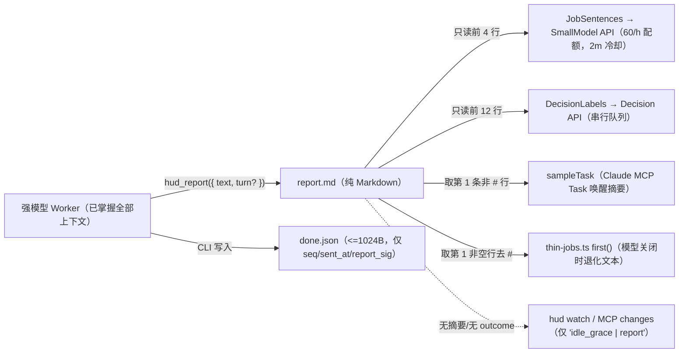
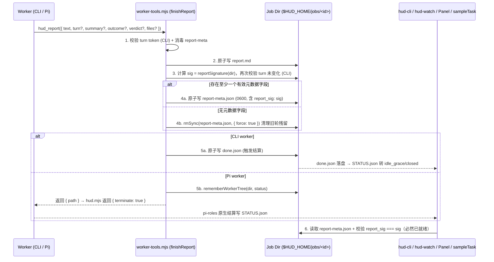
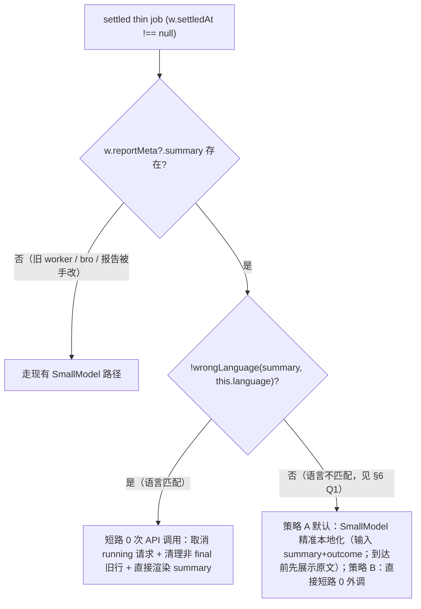
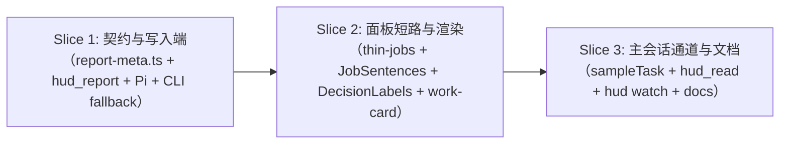

# 18. `hud_report` 支持结构化摘要/结果/文件清单，大幅削减外部二次 LLM 摘要调用

> **优先级**：P1（直接削减面板外部 API 成本/配额消耗与 0–120s 结算展示延迟，同时提升 Claude MCP Tasks / `hud watch` / `hud_read` 信息密度）
> **类别**：Worker 协议扩展 / 观测短路优化 / 展示增强
> **预估规模**：M（3 个垂直切片，净增源码 ~360 行、测试 ~610 行、文档 ~40 行，删除 1 处重复签名缓存）
> **前置依赖**：无硬依赖；与 **方案 02**（`thin-main.ts` 拆解与 `bin/*.mjs` 迁 TS）通过独立 TS 模块 `src/roles/report-meta.ts` 解耦，可任意顺序落地；与 **方案 14**（`$HUD_HOME/archive/YYYY-MM.jsonl` 归档）天然互补（仅 ~6 行可选衔接）
> **`docs/spec.md` 边界影响**：**小幅增补（需 Owner 确认）**——在 `docs/spec.md` §2.1 补充 `hud_report` 可选结构化展示元数据，在 §2.2 / §5 明确“已绑定报告签名的结构化 `summary`/`outcome` 优先复用，缺失或签名失效时退回外部模型”；**严格不触碰任何生命周期/验收红线**（展示辅助，绝不改变 `STATUS.json.state`、不跳过 `checks`、不构成验收裁决）

---

## 1. 背景与现状证据

### 1.1 现状全链路：强模型写完 `report.md`，外部小模型再盲猜一遍

今天一个本地 worker（Claude / Codex / Pi / fallback CLI）完成工作后，所有下游观测点只能拿到一份纯文本 `report.md`，被迫走“二次外部 LLM 重读”或“截首行启发式”：



### 1.2 精确代码证据与量化痛点

| 环节 | 精确代码定位 | 现状行为 | 具体痛点（成本 / 延迟 / 误判） |
|---|---|---|---|
| **Worker 汇报工具** | `packages/hud-mcp/bin/worker-tools.mjs:41-66` (`finishReport`)、`:169` (`callWorkerTool`)、`:195-209` (`workerTools`) | `hud_report` 仅接受 `{ text, turn? }`，且 schema 设 `additionalProperties: false`（`:197`）；CLI 写 `done.json`（`:54`），Pi 不写 `done.json` 仅抓进程树（`:55-64`） | 强模型在调用 `hud_report` 时 KV cache 中已持有全部改动、测试结果与阻塞项，却只能把信息全揉进自由 Markdown，结构化元数据当场丢弃 |
| **Pi 原生工具注册** | `integrations/pi/package/extensions/hud.mjs:12-22` | 自动加载 `worker-tools.mjs` 的 `listWorkerTools(false)` 并原样注册 `parameters: inputSchema`，`hud_report` 返回 `{ terminate: true }`（`:19`） | 好消息：工具定义单一真相源，扩展 `worker-tools.mjs` 即自动覆盖 Claude MCP、Codex MCP 与 Pi 原生扩展三端 |
| **无 MCP CLI fallback** | `packages/hud-mcp/bin/hud-progress.mjs:7-15`、`src/mcp/thin-main.ts:1386-1403` (`writeBrief`)、`src/mcp/cli-judge.ts:10-14` (`withDonePrompt`) | Antigravity / Grok Build 写完 `report.md` 后调用 `hud-progress.mjs --done --dir <dir> --turn <token>`，目前仅支持 `--dir`/`--done`/`--turn` | 若不给 `--done` 增加可选参数，fallback harness 无法享受同等结构化汇报 |
| **面板摘要二次调用** | `src/collectors/job-sentences.ts:78-135` (`material`)、`:233-297` (`update`)、`src/collectors/small-model.ts:32,150,155-159,221-222` | 每个 settled thin job 触发 1 次 `SmallModel.submit`（`feature: 'job-sentence'`，默认 `deepseek-v4-1-flash-1017`，`maxOutputTokens: 200` + `REASONING_TOKEN_ALLOWANCE = 512` → `max_tokens: 712`），**仅截取 `report.md` 前 4 行**（`:130`） | ① **配额消耗**：与全盘所有卡片共享 `60 次/小时` 上限（`small-model.ts:150`），并行派发多 sonic + imp 时极易撞 cap；② **最高 120s 冻结延迟**：`:245` 对 `final` 施加 `120000 ms` 冷却地板，若任务结算前刚刷新过 running 句，结算后最多白等 2 分钟才能更新，期间展示陈旧的 running 句；③ **严重误判**：按 `packages/hud-mcp/instructions/implementer.md:37-40`，报告前 4 行通常是 `# Report` 与 `## Files changed` 列表，测试失败或未完成项在尾部，小模型根本看不到 |
| **Decision API 结果判别** | `src/collectors/decision-labels.ts:84-86` (`:outcome`)、`:97-102` (`:severity`)、`:117-120` (串行 `this.active`) | 每个 settled thin job 排队发 1 次 Decision API（OpenAI/Gemini/TypeSafe）分类 `OUTCOMES = ['done','partial','failed','blocked']`，**仅截取 `report.md` 前 12 行**（`:85`）；且全服务严格单请求串行（`:117`） | ① **重复付费 + 排队延迟**：每任务额外 1 次网络往返，排在 `:kind`/`:severity`/`:loop` 之后；② **误判率高**：未做项（`3. Anything in the brief you did not do`）常在第 20 行之后，前 12 行容易把 `partial`/`blocked` 误标为 `done`；③ 无 Decision key 时卡片完全丢失 `[partial]`/`[blocked]` 提示 |
| **MCP Tasks 唤醒摘要** | `src/mcp/thin-main.ts:1979-1985` (`sampleTask`) | 取 `report.md` 前 2 KiB 中**第一行不以 `#` 开头的文本**（`:1983`），截断到 240 字符作为 `Summary:` | 真实报告中第一条非 `#` 行往往是 `- src/foo.ts: ...`、`---` 或表格分隔符，导致主会话收到低信息量唤醒消息 |
| **无模型退化 / watch / read** | `src/collectors/thin-jobs.ts:113-118` (`first`)、`:321-332` (`formatJobChange`)、`:615-620`、`src/mcp/thin-main.ts:961-995` (`observation`) | 模型关闭时卡片仅显示 `first(report.text)`（常是 `Report` 标题）；`hud watch` 只报 `idle_grace \| report`；`hud_read` 仅返回整篇 64 KiB `report` 原文，无结构化摘要/结果/文件列表 | 主会话无法先扫一眼 `outcome`/`verdict`/`summary` 排优先级，必须先全量拉取 `report.md` 占用主会话上下文 |
| **日均冗余量估算** | 综合 `JobSentences` + `DecisionLabels` | 一个典型工作日 40–80 个本地 worker 任务（imp + sonic + reviewer + oracle），每个任务结算后固定产生 **≥2 次**（1 次 `SmallModel` + 1 次 Decision API `:outcome`）外部调用 | 每天 **80–160 次**完全可避免的外部 LLM 调用；若改为强模型在 `hud_report` 同一次 tool call 中顺带吐出 20–50 个 output token，**额外输入 token = 0，额外 HTTP 往返 = 0**，准确度反升不降 |

---

## 2. 目标与非目标（Scope / Out of Scope）

### 目标（Scope）

1. **扩展 `hud_report` 工具契约（全本地 harness 统一）**：新增 4 个**全部可选**的字段 `summary`、`outcome`、`verdict`、`files`，一次改动覆盖 Claude MCP、Codex MCP、Pi 原生扩展（`hud.mjs`）及 `hud-progress.mjs --done` CLI fallback。
2. **引入签名绑定的独立元数据文件 `report-meta.json`**：严格绑定 `report_sig`（`mtimeMs:bytes:sha256`），保证 `report.md` 被手工改写或新一轮覆盖时元数据自动失效并优雅降级，且 100% 兼容不写 `done.json` 的 Pi worker。
3. **严格消毒与安全边界**：单行、≤160 Unicode 码点、清除控制字符/ANSI/BiDi 双向覆盖字符、路径清洗与数量封顶；私密原子写（`0o600`）+ `O_NOFOLLOW` 限长读（≤16 KiB）。
4. **下游全链路联动短路**：
   - `JobSentences`：存在签名匹配（且按语言策略命中）的 `summary` 时**零 API 调用直接短路**，同时清除旧 running 阶段残留覆盖句。
   - `DecisionLabels`：存在签名匹配的 `outcome` 时**跳过 `:outcome` Decision API 调用**，并在模型关闭/无 key 时同样为卡片提供 `[partial]`/`[blocked]` 标识。
   - 面板渲染（`work-card` / `work-inspector` / `filter`）：无重复渲染行、无伪造百分比置信度，在 Inspector 补充 `verdict` 与有界 `reported files`。
   - 主会话通道：`sampleTask`（Claude MCP Tasks）、`hud watch` / MCP `changes`、`hud_read`（单任务与列表）优先利用结构化元数据，并预留与提案 14 `archive` 的自然衔接。
5. **100% 向后兼容**：旧 worker / 省略新参数的调用行为零回归；浏览器任务（`bro`/`jev`）、原生 subagent 与运行中任务继续沿用现有路径。

### 非目标（Out of Scope）

1. **绝不让结构化字段参与生命周期或验收裁决**：`outcome` / `verdict` 绝不写入或改变 `STATUS.json.state`、不触发 `failed`/配额耗尽标记、不跳过 `hud_create` 的 `checks`、不自动勾选 ticket/ledger 验收、不触发角色自动串联（严格遵守 `docs/spec.md` §2.1 & §3、`docs/ARCHITECTURE.md` §8 & §11）。
2. **不替换 `git_summary` / `diffStat` 真相源**：`files` 是 worker 自报文件列表（尤其对只读 reviewer/oracle 或非 worktree 任务有用），绝不覆盖基于安全 Git `--numstat` 的 `Changes` 展示或 `hud_read` 的 `git_summary`。
3. **不在 v1 扩展 `findings` 逐条结构化数组**：保持 `hud_report` 参数极简（4 个轻字段），降低 worker 填写认知负担与 schema 失败率；`DecisionLabels` 的 `:kind`、`:loop`、`:question-category`、`:severity` 默认维持现有逻辑（`:severity` 在 `verdict === 'accept'` 时的可选短路见 §6 Q4）。
4. **不将面板语言设置注入 worker prompt**：遵循 `docs/spec.md:15,36`（worker 中立、展示层不干预执行层）。
5. **不改造浏览器任务（`hud-jev.mjs`）或原生 subagent 转录格式**。

---

## 3. 核心设计方案

### 3.1 `hud_report` 扩展 Schema 与消毒规则

#### 工具输入 Schema（单一定义：`packages/hud-mcp/bin/worker-tools.mjs` `workerTools(cli)`）

保留 `additionalProperties: false` 与原必填集（CLI `['text', 'turn']`，Pi `['text']`），新增 4 个可选属性：

```ts
{
  text: { type: 'string', description: 'Full markdown report body.' },
  ...(cli ? { turn: { type: 'string', description: 'Use the token in the prompt you are answering, not a newer turn.' } } : {}),
  summary: {
    type: 'string',
    maxLength: 320, // schema 宽松接收，写入前严格归一化并截断至 160 码点，避免因多写几字打断 worker 收尾
    description: 'Optional one-line summary of the result (plain text, <=160 chars, no markdown headings). Display/triage hint only.',
  },
  outcome: {
    type: 'string',
    enum: ['done', 'partial', 'blocked'],
    description: 'Optional self-reported task outcome for display/triage only (does not change job state or checks).',
  },
  verdict: {
    type: 'string',
    enum: ['accept', 'changes_required'],
    description: 'Optional review/advisor verdict hint only (does not accept work or skip checks).',
  },
  files: {
    type: 'array',
    items: { type: 'string', maxLength: 260 },
    maxItems: 50,
    description: 'Optional list of key relative file paths changed or inspected (up to 50).',
  },
}
```

> **为什么 `outcome` 只提供 3 个值（不含 `failed`）？**
> 按 `docs/spec.md:13`，“只有事实才结束/失败任务”（进程退出、tab 关闭、派发被拒）。worker 能主动调用 `hud_report` 说明回合正常执行完毕；若测试未过或范围未完成应报 `partial`，若缺权限/待拍板应报 `blocked`。排除 `failed` 可避免模型把“发现缺陷”与“worker 执行崩溃”混为一谈；且 3 个值均是 `DecisionLabels.OUTCOMES`（`['done','partial','failed','blocked']`）与现有 `i18n`（`done`、`partial: '部分完成'`、`blocked: '受阻'`）的真子集，零渲染冲突。

> **关于 `verdict` 的连字符/下划线兼容细节**：
> 现有代码 `src/collectors/work-artifacts.ts:111`、`src/collectors/workboard-types.ts:39`、`src/render/workboard-i18n.ts:49` 与 `packages/hud-mcp/instructions/reviewer.md:45` 使用 `'changes-required'`。为兼顾 JSON/CLI 参数直观性与历史习惯：schema 推荐 `'accept' | 'changes_required'`（或按 §6 Q3 由 Owner 定夺），`normalizeReportMeta()` 在运行时同时宽容接受 `'changes-required'` 并归一化存储，渲染端统一映射到现有 `t('changes-required')`（`'需修改'`）。

#### 校验与消毒策略：结构错误拒绝，格式瑕疵温和清洗

`hud_report` 是 worker 的最后一步（Pi 上返回即触发 `terminate: true`，CLI 上报错会迫使强模型多跑一轮）。因此严格区分两类校验：

1. **类型/枚举违规 → 返回 `invalid_arguments: <field>`**（沿用 `worker-tools.mjs:158,164` 与 `lease.ts:51`）：
   - `summary !== undefined && typeof summary !== 'string'`
   - `outcome !== undefined` 且不在 `['done', 'partial', 'blocked']`
   - `verdict !== undefined` 且不在 `['accept', 'changes_required', 'changes-required']`
   - `files !== undefined` 且非 `string[]`
2. **空白/控制字符/长度超限 → 确定性清洗而非阻断报告发布**（沿用 `worker-tools.mjs:69-70` `progress()` 范式）：
   - **`summary` 清洗**：
     1. 剥离 ANSI 转义序列（`\x1b\[[0-?]*[ -/]*[@-~]`、OSC 序列）；
     2. 将 `[\r\n\u2028\u2029]+` 替换为空格，清除所有控制字符 `\p{Cc}` 及 BiDi 方向覆盖字符 `[\u202a-\u202e\u2066-\u2069]`；
     3. 去除首尾空白、折叠连续空格为单空格、剥离误带的前导 Markdown 标题/列表符号（`^(?:#{1,6}\s+|[-*•]\s+)`）；
     4. 按 Unicode 码点（`Array.from`）截断：超过 `160` 码点则保留前 `159` 码点 + `…`；
     5. 若清洗后为空字符串 → 视为未提供（省略 `summary` 字段）。
   - **`files` 清洗**：
     1. 逐项清除 `\p{Cc}` 与 BiDi 字符后 `trim()`；包含 NUL/换行、为空、长度 > 260 字符或为纯 `.`/`..` 的条目直接丢弃；
     2. 规范化前导 `./`（`./src/a.ts` → `src/a.ts`），去重且保序；
     3. 截取前 `50` 项；若最终数组为空 → 省略 `files` 字段。
   - **空元数据**：若 4 个可选字段清洗后全部为空，不写 `report-meta.json`（并清理可能残留的上一轮 `report-meta.json`）。
   - **返回契约不变**：`finishReport()` 仍严格返回 `{ path }`，完全兼容现有测试（如 `tests/unit/thin-mcp.test.mjs:1808`）且不增加 worker 上下文体积。

#### CLI fallback 扩展（`packages/hud-mcp/bin/hud-progress.mjs`）

为无 MCP harness（Antigravity / Grok Build）在 `--done` 模式下增加完全可选参数：

```sh
node ".../hud-progress.mjs" --done --dir "<job-dir>" --turn <token> \
  [--summary "<one line>"] \
  [--outcome done|partial|blocked] \
  [--verdict accept|changes_required] \
  [--file <path> ...]   # parseArgs { type: 'string', multiple: true }，天然支持含逗号路径
```

- 任一新 flag 未配 `--done` 时报错退出（与现有 `--turn requires --done` 一致，`hud-progress.mjs:16`）。
- 全部省略时与旧命令行为 100% 相同。

---

### 3.2 落盘位置方案对比与最终选型

| 对比维度 | **方案 A：独立 `report-meta.json`（推荐）** | 方案 B：写入 `done.json` | 方案 C：`report.md` YAML frontmatter |
|---|---|---|---|
| **Pi worker 覆盖度** | **全覆盖**：`finishReport` 的 Pi 分支（`worker-tools.mjs:55-64`）与 CLI 分支共享同一写入逻辑 | **不可行**：Pi 原生结算，**根本不写 `done.json`**；强行写入会污染 CLI 语义 | 可写，但将展示元数据与正文强耦合 |
| **CLI 生命周期安全** | **零风险**：`done.json` 仍只存 `{ seq, sent_at, report_sig, at }`；`report-meta.json` 不进入 `hud-cli.mjs:81` / `hud-watch.mjs:395` 的状态机监听白名单 | **高危破坏**：`src/roles/cli-turn.ts:48` 硬编码 `st.size <= 1024`，含 `summary` + 多个 `files` 会立刻突破 1 KiB 导致 `readDone()` 返回 `null`，**CLI 任务无法结算！** | 不触碰 `done.json` |
| **报告被手工改写后防漂移** | **强一致自校验**：内嵌 `report_sig`（`mtimeMs:bytes:sha256`），读取方与当前 `report.md` 签名比对；不匹配即自动失效退回小模型/首行 | 仅 CLI 有效；且与 turn receipt 生命周期耦合 | **无法自检漂移**：人工改正文漏改头部 frontmatter 会导致展示与事实永久错位 |
| **对现有解析器的兼容性** | **100% 零破坏**：`report.md` 保持纯 Markdown | 对报告零破坏，但无法支持 Pi | **破坏多处现存契约**：`work-artifacts.ts:110` 的 `reviewVerdict()` 要求第 1 行严格等于 `Verdict: accept`；`thin-jobs.ts:113` `first()`、`sampleTask` 及 `from_jobs` 上下文注入全被 `---` 破坏，且需自研 YAML 解析器 |
| **读性能与回滚成本** | 独立小文件（≤16 KiB），stat 缓存命中 0 I/O；不存在即优雅降级，随时无损回滚 | 改动核心收据，回滚影响状态机 | 历史报告被永久污染 |

**结论**：采用 **方案 A（`$HUD_HOME/jobs/<job>/report-meta.json`）**，由新增独立 TypeScript 模块 `src/roles/report-meta.ts` 作为全仓单一读写真相源（与 `src/roles/job-checks.ts` 的 `checks.json` + `report_sig` 范式完全一致）。

#### `report-meta.json` 磁盘 Schema

```json
{
  "v": 1,
  "report_sig": "1732250400000:1842:9f86d081884c7d659a2feaa0c55ad015a3bf4f1b2b0b822cd15d6c15b0f00a08",
  "at": "2026-11-22T08:00:00.000Z",
  "summary": "Added report-meta.json writer and unit tests; 18/18 checks pass.",
  "outcome": "done",
  "verdict": "accept",
  "files": [
    "src/roles/report-meta.ts",
    "packages/hud-mcp/bin/worker-tools.mjs"
  ]
}
```

- 仅序列化存在的可选字段（`summary` / `outcome` / `verdict` / `files`），缺失即省略，不写 `null` 或空数组（对齐 `docs/ARCHITECTURE.md:427`）。
- 权限：`0o600`；原子替换 `${file}.${randomUUID()}.tmp` → `renameSync` → `finally { rmSync(tmp, { force: true }) }`。
- 读取硬限：`lstatSync` 校验 `isFile()` 且 `size <= 16384`，`openSync(..., O_RDONLY | O_NOFOLLOW | O_NONBLOCK)` + `fstatSync` inode 二次校验，解析失败、版本非 `1` 或 `report_sig` 不匹配均静默返回 `null`。

#### 关键写时序：彻底消除与 `done.json` / `STATUS.json` 的竞态



> **核心不变量**：`report-meta.json` **严格先于** `done.json`（CLI）或 `{ terminate: true }`（Pi）落盘；并且 `src/cli/watch.ts:125` 忽略 `/report-meta.json` 变更事件，因此任何下游观察者在感知结算的瞬间，`report-meta.json` 必定已原子可见，既不会提前惊动 watcher，也不会发生读空竞态。

---

### 3.3 共享模块职责与签名缓存去重

新增 **`src/roles/report-meta.ts`**（~130 行，编译到 `dist/roles/report-meta.js`，供 `src/` 与 `packages/hud-mcp/bin/*.mjs` 共同导入）：

- **`cachedReportSignature(dir: string): string | null`**：抽离并复用 `src/roles/job-checks.ts:22-34` 现有的 stat 签名缓存（key 为 `dir`，stamp 为 `${st.ino}:${st.size}:${st.mtimeMs}:${st.ctimeMs}`，上限 256 条）。消除 `job-checks.ts` 局部私有缓存，使 `job-checks`、`thin-jobs`、`thin-main`、`hud watch` 共享同一份 SHA-256 缓存。
- **`normalizeReportMeta(input: ReportMetaInput): ReportMetaFields`**：严格校验类型/枚举并执行上述消毒/截断/去重，不抛格式异常、仅抛 `invalid_arguments`。
- **`writeReportMeta(dir: string, reportSig: string, fields: ReportMetaFields, nowIso?: string): void`**：若 `fields` 非空则私密原子写 `report-meta.json`，否则 `rmSync(..., { force: true })` 清理旧轮文件。
- **`readReportMeta(dir: string, expectedSig?: string | null): ReportMeta | null`**：
  - **快路径零哈希**：先 `lstatSync(join(dir, 'report-meta.json'), { throwIfNoEntry: false })`；文件不存在直接返回 `null`，**不触发任何 `report.md` 哈希计算**！
  - 文件存在时走内存 stat 缓存（上限 256 条），再与 `expectedSig ?? cachedReportSignature(dir)` 精确比对 `meta.report_sig`；不等或异常均返回 `null`。
  - 读取时再次过一遍轻量化消毒校验（防人工篡改 `report-meta.json` 注入控制字符）。

---

### 3.4 下游全面联动设计

#### 1. `thin-jobs.ts`（`src/collectors/thin-jobs.ts`）与 `workboard-types.ts`

- **`OwnerWorker` 扩展**（`src/collectors/workboard-types.ts:48`）：
  ```ts
  readonly reportMeta?: {
    readonly summary?: string;
    readonly outcome?: ReportOutcome;
    readonly verdict?: ReportVerdict;
    readonly files?: readonly string[];
    readonly reportSig: string;
  };
  ```
- **仅对已结算任务生效（防多轮续写泄漏！）**：
  - 在 `readThinJobs()` 中，仅当 **`settledAt !== null && report !== null`** 时才调用 `readReportMeta(directory)` 并挂载到 `worker.reportMeta`。
  - 理由：若一个可续写任务在 Turn 1 报了 `outcome: 'partial'`，随后主会话 `hud_send` 开启 Turn 2（此时 `settledAt === null`，但 Turn 1 的 `report.md` 与 `report-meta.json` 仍在盘上），限定 `settledAt !== null` 确保 Turn 1 的 `outcome`/`summary`/`verdict` **绝不会污染 Turn 2 的运行中卡片**！
- **无模型 / 未就绪时的事实行升级**：
  - `thin-jobs.ts:615-620` 中，当 `report && report.at >= phaseAt` 且 `settledAt !== null` 时，`sentence` 优先取 `reportMeta?.summary || first(report.text)`。
  - **收益**：即便 Owner 关闭 `Model text` 总开关或没有配置任何 API key，面板卡片（Classic Home、Split Home、Project 进度、静态 HTML Board）也立刻显示清晰的一句话结果，告别 `# Report` 废话标题。
- **自报 `outcome` 与 `verdict` 挂载**：
  - 若 `reportMeta?.outcome` 存在，在 `thin-jobs.ts` 中直接为 `worker` 预置 `labels: { outcome: { value: reportMeta.outcome, source: 'reported' } }`（不依赖 `DecisionLabels` 开关，无 key 同样可见 `[partial]`/`[blocked]` 徽章）。
  - 若 `reportMeta?.verdict` 存在，向 `files` 数组中 `report.md` 条目写入 `verdict: reportMeta.verdict === 'changes_required' ? 'changes-required' : 'accept'`（复现 `work-inspector.ts:135-137` 既有绿/黄着色展示）。
- **`display/thin-jobs.json` 磁盘缓存不变**：遵循 `thin-jobs.ts:31` 原则，不把报告摘要持久化进 `display/thin-jobs.json`。

#### 2. `JobSentences` 短路与陈旧 running 句清理（`src/collectors/job-sentences.ts`）

这是削减 `SmallModel` API 调用的核心联动点，需同时处理**短路、跨语言与陈旧 running 句覆盖**三个微妙状态：



关键边界处理：
1. **清除 running 阶段残留 `modelSentence`（防“旧句遮新句” Bug）**：
   - 假设任务在运行中（第 1 分钟）由 `JobSentences` 生成过一条 `rows.get(key) = { text: "正在修改 «parser»…", final: false }`；第 6 分钟 worker 通过 `hud_report` 结算并带了 `summary`。
   - 若 `update()` 短路时只写 `continue`，`apply()` 仍会把 `rows.get(key)` 的陈旧 running 句塞进 `w.modelSentence`，盖掉 `reportMeta.summary`！
   - **修复**：短路命中时，在 `update()` 中：① 取消并移除 `this.active.get(key)`；② 删除该 job 对应语言下 `!old.final` 的缓存条目（或写入 `{ final: true, settledAt: w.settledAt, source: 'reported', text: undefined }` 并不保存至磁盘）；确保 `apply()` 不再用旧 running 句覆盖结算卡片。
2. **语言不匹配回退时的输入增强**：
   - 当走默认策略 A（英文 worker 配中文面板，触发本地化）时，`material()`（`job-sentences.ts:119-134`）中若 `w.reportMeta?.summary` 存在，直接传递 `reportedSummary: w.reportMeta.summary` 与 `reportedOutcome: w.reportMeta.outcome`（替代或置于 4 行 `report.md` 之前）。输入 token 更少，且绝不会再因为截断前 4 行而编造结论。
   - 同时需按 `docs/ARCHITECTURE.md:444` 更新 §5 外发字段表（属于原 `report.md` 子集，无新增隐私面）。

#### 3. `DecisionLabels` 短路（`src/collectors/decision-labels.ts`）

- **`DisplayLabels['outcome']` 类型微调**（`:19-20`）：
  ```ts
  outcome?: { value: string; confidence?: number; source?: 'reported' | 'decision' };
  ```
- **`update()` 短路**（`:84-86`）：
  - 当 `w.settledAt !== null && !w.reportMeta?.outcome` 时才读取 `report.md` 前 12 行并计划 `w.id + ':outcome'`。
  - 若 `w.reportMeta?.outcome` 存在，**完全跳过 `:outcome` 计划**——省去 1 次 Decision API 调用与整条串行队列等待！
- **`apply()` 合并保留**（`:171-187`）：
  - 若 `this.enabled` 为 `false`，直接返回 `board`（`thin-jobs.ts` 已为 `w.labels.outcome` 预填了 reported 值，不会丢失）。
  - 若 `this.enabled` 为 `true`，合并时优先保留 `w.labels?.outcome`（`source: 'reported'`），否则回退 Decision API 缓存结果（`source: 'decision'`），其余 `kinds`/`looping`/`category`/`severity` 照常附加。

#### 4. 面板渲染层（`work-card.ts` / `work-inspector.ts` / `filter.ts`）

保持 100% 纯渲染（`docs/ARCHITECTURE.md` §8），关键修正 4 处细节：

1. **展开卡片去重**（`src/render/work-card.ts:233-244`）：
   - 现状：当卡片展开（`open === true`）且同时存在 `modelSentence` 与 `work.reason` 时，`:239` 与 `:243` 会先后渲染两段。
   - 若未来采用 `generated = card.worker.modelSentence ?? card.worker.reportMeta?.summary`（以支持关键词/路径着色），展开时需跳过与 `generated` 去标记后完全相同的 `workCardDetail`，**杜绝展开卡片和 Inspector 出现两行一模一样的 summary**！
   - 若 `modelSentence` 仅用于外部小模型文本，而 `reportMeta.summary` 仅走 `work.reason`（通过 `stemLines` + `identifiers()` 自动给路径/代码着色），则天然零重复，改动更小（详见 §6 Q2）。
2. **Inspector 不伪造置信度百分比**（`src/render/work-inspector.ts:102`）：
   - 现状：`` `${t(worker.labels.outcome.value)} ${Math.round(worker.labels.outcome.confidence * 100)}%` ``
   - 改为：有 `confidence` 时保留原百分比格式，无 `confidence` 时展示 `` `${t(outcome.value)} · ${t('reported')}` ``（绝不填假 `100%`）。
3. **Inspector 展示 `verdict` 与有界 `reported files`**：
   - `facts` 新增 `['verdict', worker.reportMeta?.verdict ? t(worker.reportMeta.verdict === 'changes_required' ? 'changes-required' : 'accept') : '']`（复用现有 `workboard-i18n.ts:48-49,84`）。
   - 当 `!worker.diffStat && worker.reportMeta?.files?.length`（例如只读 reviewer/oracle 或非 worktree 任务）时，在 `Files` 上方展示最多 12 行 `Reported files`（超出复用现有 `t('+{n} more files')`，`src/render/i18n.ts:257`）；当 `worker.diffStat` 存在时，仍以安全 Git `--numstat` 为准，仅在 `facts` 里可省略或保留计数，绝不与 Git diff 混淆。
4. **Home `/` 实时过滤**（`src/render/filter.ts:37-40`）：
   - `homeMatcher` 补充匹配 `w.reportMeta?.summary`、`w.reportMeta?.outcome`（及其翻译）和 `w.reportMeta?.verdict`。

#### 5. Claude MCP Tasks `sampleTask`、`hud watch`、`hud_read` 与提案 14 衔接

- **Claude MCP Tasks `sampleTask`**（`src/mcp/thin-main.ts:1979-1985`）：
  - 结算检测到新报告时，调用 `const meta = readReportMeta(dir)`（自动校验 `report_sig`）。
  - `summary` 优先使用 `meta?.summary`（若含 `«»` 则用 `keywordMarks(meta.summary).plain` 剥离，保证主会话收到干净纯文本），无则退回现有“首条非 `#` 行”逻辑。
  - 返回文本保持精炼（遵循 `docs/spec.md:199`“不是完整 read”）：
    ```text
    j0123456789abcdef (imp) — idle_grace
    Report: /tmp/hud/jobs/j0123456789abcdef/report.md
    Outcome: partial
    Verdict: changes_required
    Summary: Added report-meta contract and tests; skipped live tmux probe.
    Files: src/roles/report-meta.ts, packages/hud-mcp/bin/worker-tools.mjs (+3 more)
    ```
    （`Outcome`/`Verdict`/`Files` 仅在存在时输出；`Files` 最多列前 8 项 + `(+N more)`；`statusMessage` 仅在 `outcome && outcome !== 'done'` 或 `verdict` 存在时附简短标签如 `idle_grace — [partial] report ready`）。
- **`hud watch` & MCP `changes`**（`src/collectors/thin-jobs.ts:321-332` `formatJobChange`、`src/cli/watch.ts:125`）：
  - `JobRow` 新增可选 `report_meta?: Pick<ReportMeta, 'summary' | 'outcome' | 'verdict'>`（在 `watchRows` / `readRow` 仅当 `row.report_present && settled` 时通过 `readReportMeta(dir)` 读取）。
  - `formatJobChange(row)` 输出：
    - 无元数据（旧行为不变）：`j0123456789abcdef imp PKG: idle_grace | report | checks 2/2`
    - 有元数据：`j0123456789abcdef imp PKG: idle_grace | report [partial] | checks 2/2 | Added report-meta writer; skipped live probe`（`outcome === 'done'` 且无 `verdict` 时不冗余打印 `[done]`；`verdict` 存在时打印 `[accept]` / `[changes_required]`；`summary` 经单行与去 `«»` 处理并截断至 140 字符）。
  - `jobChanges()` diff 判定（`thin-jobs.ts:348-358`）保持仅按 `(state, reason, report_present, open_questions, checks)` 触发，不因元数据本身产生重复行。
  - `src/cli/watch.ts:125` 将 `file.endsWith('/report-meta.json')` 加入忽略过滤，防止早于 `done.json`/`STATUS.json` 触发无意义扫描。
- **`hud_read`**（`src/mcp/thin-main.ts:961-995` `observation`、`:787-798` `compactRow`、`:823-856` `listJobs`）：
  - 单任务 `hud_read({ job })`：当 `report_exists` 且 `readReportMeta(dir)` 命中当前签名时，附加 `report_meta: { summary?, outcome?, verdict?, files? }`（隐藏内部 `v`/`report_sig`/`at` 字段，保持 MCP 响应干净）。当 `report_unchanged: true`（已读二次查询）时同样可返回 `report_meta`，方便主会话快速回忆结论而无需 `full: true` 重读 64 KiB 正文！
  - 列表模式 `hud_read()` / `hud_read({ view: 'recent' })`：对已结算且存在有效 `report-meta.json` 的条目，在 `compactRow` / `recent` 行中可选附带 `outcome`、`verdict`、`summary`（截断 ≤120 字符，不附 `files` 列表以免列表响应膨胀）。
- **与提案 14 `archive`（`$HUD_HOME/archive/YYYY-MM.jsonl`）自然衔接**：
  - 提案 14 现状（`14-job-archive-ledger.md:30,75`）仅从面板的 `decision-labels` 缓存读 `outcome`；若面板未开或未配 Decision key，归档中 `outcome` 必然缺失。
  - 本方案落地后，`src/roles/job-archive.ts` 在删除目录前优先调用 `readReportMeta(dir)`：
    - `outcome`：`meta?.outcome ?? cachedDecisionLabelOutcome`（无面板/无 API key 也能准确记录）；
    - `verdict`：`meta?.verdict`（纯枚举，零项目文本泄漏）；
    - `reported_files_count`：`meta?.files?.length`（仅数字，严格遵守提案 14 默认“不留项目 prose/路径”的隐私边界；若 Owner 在提案 14 Q1 选择保留摘要，亦可直接复用 `meta.summary`）。

#### 6. 角色指令轻量引导（`packages/hud-mcp/instructions/*.md`）

遵循 `docs/spec.md:16`（不塞协议路径或命令，只提自然工具习惯），在 6 个内置角色说明的 `## Report` 段落各增 1 句轻指引：
- `implementer.md` / `frontend-implementer.md` / `general.md`：调用 `hud_report` 时附带简短单行 `summary`、客观 `outcome`（`done`/`partial`/`blocked`）及改动的相对路径 `files`。
- `reviewer.md` / `oracle.md`：调用 `hud_report` 时附带 `summary`、`outcome` 与（若为评审/裁决）`verdict`。
- `sonic.md`：附带一句话 `summary` 与 `outcome`。

---

## 4. 垂直切片与实施路线（对齐 `docs/delegation.md`）

按 `docs/delegation.md` 的单会话预算、端到端可验证与最小冲突原则，拆分为 **3 个独立垂直切片**：



### Slice 1：核心契约与多端写入（M，1 个 `imp` 会话）

- **目标**：全本地 harness（Claude MCP、Codex MCP、Pi 原生、CLI fallback）均可原子写出带 `report_sig` 的 `report-meta.json`，并通过统一模块安全读写。
- **改动文件与估行**：
  - 新增 `src/roles/report-meta.ts`（~130L）：类型、`cachedReportSignature`、`normalizeReportMeta`、`writeReportMeta`、`readReportMeta`。
  - 修改 `src/roles/job-checks.ts`（~-15/+5L）：**删除**局部 `signatures` 缓存（`:22-34`），改为复用 `cachedReportSignature`。
  - 修改 `packages/hud-mcp/bin/worker-tools.mjs`（~+35L）：扩展 `workerTools`、`callWorkerTool`、`finishReport`（写 `report-meta.json` 严格先于 `done.json` / `rememberWorkerTree`；无元数据时清理旧轮 `report-meta.json`）。
  - 修改 `packages/hud-mcp/bin/hud-progress.mjs`（~+18L）：为 `--done` 增加 `--summary` / `--outcome` / `--verdict` / `--file`。
  - 修改 `packages/hud-mcp/instructions/{implementer,frontend-implementer,reviewer,oracle,general,sonic}.md`（~+12L）。
  - 修改 `src/mcp/thin-main.ts`（~+2L，仅 fallback `writeBrief` 可选参数提示，保持 Pi/MCP `brief.md` 逐字节不变）。
  - 测试：新增 `tests/unit/report-meta.test.mjs`（~180L），扩展 `tests/unit/thin-mcp.test.mjs` & `tests/unit/pi-package.test.mjs`（~60L）。
- **可删除旧代码**：`src/roles/job-checks.ts:22-34` 重复的 `signatures` Map 与 `report()` 哈希包装。
- **独立验收**：调用 MCP `hud_report`、Pi `hud.mjs` 工具与 `hud-progress.mjs --done` 均能产出 0600 `report-meta.json`；手工修改 `report.md` 后 `readReportMeta()` 自动返回 `null`；旧无参调用返回值仍严格等于 `{ path }`。

### Slice 2：面板收集短路与纯渲染联动（M，依赖 S1，1 个 `imp` 会话）

- **目标**：实现核心降本增效——已结算结构化任务在面板上 **0 次 `SmallModel` 调用 + 0 次 Decision API `:outcome` 调用**，模型关闭时同样展现摘要与结果徽章。
- **改动文件与估行**：
  - 修改 `src/collectors/workboard-types.ts`（~+12L）：`OwnerWorker.reportMeta`、`JobRow.report_meta`。
  - 修改 `src/collectors/thin-jobs.ts`（~+35L）：`readThinJobs` 仅在 `settledAt !== null` 读取 `reportMeta`、更新 `work.reason` 与预置 `labels.outcome`、更新 `formatJobChange` 与 `watchRows`。
  - 修改 `src/collectors/job-sentences.ts`（~+28L）：短路逻辑 + 取消活跃请求/清理陈旧非 `final` 缓存行 + 语言不匹配回退时将 `reportedSummary`/`reportedOutcome` 注入 `material()`。
  - 修改 `src/collectors/decision-labels.ts`（~+15L）：`DisplayLabels.outcome` 扩展可选 `confidence`/`source`，`:outcome` 跳过计划，`apply()` 保留 reported outcome。
  - 修改 `src/render/work-card.ts`（~+10L）：展开卡片去重防护。
  - 修改 `src/render/work-inspector.ts`（~+20L）：无假 `%` 的 `outcome`、`verdict` 行、`!diffStat` 时的有界 `Reported files`。
  - 修改 `src/render/filter.ts`（~+3L）：`/` 过滤覆盖 `reportMeta`。
  - 修改 `src/render/i18n.ts` / `src/render/workboard-i18n.ts`（~+4L）：EN/ZH 词条（`reported` / `报告声明`、`Reported files` / `报告文件`）。
  - 测试：扩展 `tests/unit/job-sentences.test.mjs`、`tests/unit/decision-labels.test.mjs`、`tests/unit/thin-panel-jobs.test.mjs`、`tests/unit/card-details.test.mjs`（~220L）。
- **独立验收**：同语言 settled 任务 `SmallModel` fetch 计数为 `0`、Decision API `:outcome` 请求数为 `0`；running→settled 切换时旧 running 句立刻消失不遮挡 `summary`；`modelEnabled=false` 时卡片仍显示 `summary` 与 `[partial]`/`[blocked]`。

### Slice 3：主会话编排通道、提案 14 衔接与文档同步（S，依赖 S2，1 个 `imp` 会话）

- **目标**：打通主会话 `sampleTask`、`hud_read`、`hud watch` 与文档更新。
- **改动文件与估行**：
  - 修改 `src/mcp/thin-main.ts`（~+35L）：`sampleTask`（`:1979-1985`）、`observation`（`:961-995`）、`compactRow`/`listJobs`（`:787-856`）。
  - 修改 `src/cli/watch.ts`（~+1L）：`watchInputs`（`:125`）忽略 `/report-meta.json`。
  - （可选，视提案 14 进度）修改 `src/roles/job-archive.ts`（~+6L）：优先消费 `readReportMeta(dir)`。
  - 文档更新：`docs/ARCHITECTURE.md`（§5 外发输入表、§7 磁盘状态表）、`docs/reference.md`、`docs/reference.zh.md`、`packages/hud-mcp/README.md`，并在 Owner 确认 §6 Q5 后更新 `docs/spec.md`。
  - 测试：扩展 `tests/unit/thin-mcp.test.mjs`（MCP Tasks + `hud_read`）与 `tests/unit/hud-watch.test.mjs`（~150L）。
- **独立验收**：Claude MCP Task 唤醒文本携带结构化 `Outcome`/`Summary`/`Files`；`hud_read` 返回 `report_meta`；`hud watch` 结算事件行携带 `[partial]` 与摘要且无重复唤醒。

### 迁移、兼容与回滚策略

- **老数据/旧 worker 零迁移**：历史任务目录或老版本 worker 不存在 `report-meta.json`，所有读取路径均静默返回 `null` 并走原逻辑。
- **与方案 02 并发安全**：核心逻辑封装在 `src/roles/report-meta.ts`，即使方案 02 将 `worker-tools.mjs` 迁入 TS，只需平移导入路径即可，零重写。
- **一键回滚**：若发现任何未预期问题，回退 `worker-tools.mjs` 写入与各消费方对 `readReportMeta` 的调用即可；盘面上遗留的 `report-meta.json` 不被任何旧代码读取，随现有 24 小时清理策略（`hud-watch.mjs:302-306`）自动消失。

---

## 5. 验证与验收方案

### 5.1 单元测试与集成测试矩阵（全部使用临时 `HOME`/`HUD_HOME` 与合成数据）

| 模块 | 核心测试场景 |
|---|---|
| **`report-meta.test.mjs`**（S1） | ① 合法字段原子写（权限 `0600`）+ `readReportMeta` 校验 `report_sig` 命中；② 手工改写 `report.md` 1 字节后 `readReportMeta` 立刻返回 `null`；③ 消毒规则：换行/制表符/ANSI CSI/BiDi 控制符清除、160 码点中英文截断带 `…`、`files` 去重+去 `./`+50 项封顶+拒绝 NUL；④ 非法类型/枚举（如 `outcome: 'failed'`、`summary: 123`）抛 `invalid_arguments`；⑤ 拒绝符号链接 `report-meta.json`、拒绝 >16 KiB 文件、畸形 JSON 静默返回 `null`；⑥ 缺失 `report-meta.json` 时不读取/哈希 `report.md` |
| **Worker 协议写入（`thin-mcp.test.mjs` / `pi-package.test.mjs`）**（S1） | ① CLI `hud_report` 带结构化参数写 `report-meta.json` 且不增大 `done.json`（仍 `<=1024B`），返回值仍为 `{ path }`；② Turn 2 续写不传元数据时旧 `report-meta.json` 被清理且旧签名失效；③ Turn token 不匹配时拒绝写 `report-meta.json` 与 `done.json`；④ Pi 原生 `hud_report` 写 `report-meta.json` 且返回 `terminate: true`；⑤ `hud-progress.mjs --done --summary ... --outcome partial --file a --file b` 端到端写入，非 `--done` 带新参数报错；⑥ `bro` 任务仍被 `finishReport` 拒绝 |
| **生命周期红线验证（`cli-judge.test.mjs` / `thin-mcp.test.mjs`）**（S1–S2） | ① worker 报 `outcome: 'blocked'` 或 `'partial'` 时，`STATUS.json.state` 仍正常进入 `idle_grace`/`closed`，**绝不**变 `failed` 或标记 `exhausted.json`；② 带 `checks` 的任务即使 worker 报 `outcome: 'done'` 或 `verdict: 'accept'`，`hud-watch` 仍照常执行 `checks` 并独立记录结果 |
| **`JobSentences` 短路（`job-sentences.test.mjs`）**（S2） | ① 英文面板 + 英文 `reportMeta.summary`（及中文面板 + 中文 `summary`）：`f.calls.length === 0`；② 任务先处于 `working`（已有非 final running 句），随后结算带 `summary` → running 句被清除、活跃请求被取消、卡片显示新 `summary`、0 次新调用；③ 英文 `summary` + 中文面板（策略 A）：触发 1 次本地化调用且 prompt 包含 `reportedSummary`，到达前 `work.reason` 已先显示原文；④ `report.md` 被改写致签名不匹配 → 自动退回 `SmallModel` 调用；⑤ 浏览器任务与旧无 `report-meta.json` 任务行为不变 |
| **`DecisionLabels` 短路（`decision-labels.test.mjs`）**（S2） | ① settled 任务含 `reportMeta.outcome: 'partial'` → 0 次 `:outcome` 请求（`:kind` 等仍正常独立运行），卡片显示 `[partial]`，Inspector 显示 `partial · reported`（无假 `%`）；② `modelEnabled = false` / 无 key 时，卡片仍显示 `[partial]` / `[blocked]`；③ 多轮任务进入 Turn 2 (`working`, `settledAt === null`) 时，Turn 1 的 `outcome` 不泄露到卡片；④ `report.md` 改写后退回 Decision API `:outcome` |
| **渲染与宽度不变量（`card-details.test.mjs` / `thin-panel-jobs.test.mjs`）**（S2） | ① Classic / Split / Inspector 在 40 列窄屏与 100 列宽屏下 EN/ZH 均满足每行 `visualLength === width`、`NO_COLOR=1` 无转义码；② 展开卡片与 Inspector 不重复渲染两行相同的 `summary`；③ Inspector 在无 `diffStat` 时渲染有界 `Reported files`（>12 项折为 `+{n} more files`），有 `diffStat` 时不覆盖 Git `Changes`；④ `/` 过滤可命中 `summary` 与 `outcome` |
| **主会话通道（`thin-mcp.test.mjs` / `hud-watch.test.mjs`）**（S3） | ① Claude MCP Task `sampleTask` 优先返回 `reportMeta.summary` + `Outcome` + `Verdict` + 有界 `Files`，手改报告后自动退回首条非 `#` 行；② `hud_read({ job })` 在首次读和 `report_unchanged: true` 时均返回 `report_meta`；③ `hud watch` 输出含 `[partial]` 与摘要且仅写 `report-meta.json` 时不提前触发多余事件 |

### 5.2 Owner 实机试用验收清单（Done 标准，对齐 `docs/spec.md:147`）

- [ ] 分别派发 1 个 Claude/Codex `imp`、1 个 Pi `imp` 和 1 个 `reviewer` 任务，观察 `$HUD_HOME/jobs/<id>/report-meta.json` 权限为 `-rw-------` 且含 `report_sig`、`summary`、`outcome`（reviewer 含 `verdict`）。
- [ ] 在 `hud panel` 中对比 Settings → Models 的每小时调用计数：上述任务结算瞬间，卡片立即可见清晰单行结果与 `[partial]`/`[blocked]` 标签（0 秒冷却等待），`job-sentence` 与 `outcome` 计数不增加。
- [ ] 在 Settings 关闭 `Model text` 后，新结算的卡片仍显示清晰一句话摘要与 `[partial]`/`[blocked]` 标签，不再退化为 `# Report`。
- [ ] 手动向某个已结算任务的 `report.md` 追加一行文字，确认面板自动感知签名失效并退回旧路径（不展示过期摘要）。
- [ ] 在 Claude Code 主会话观察 MCP Task 唤醒结果或 `hud watch` 输出，能够一眼看到结果摘要与关键文件，无需盲读完整报告再排优先级。
- [ ] 确认 worker 报 `outcome: "blocked"` 且附带 `checks` 时，任务仍按事实结算且 `checks` 正常跑完，没有任何自动验收或假失败行为。

---

## 6. 需要 Owner 拍板的开放问题

| # | 设计分叉与选项 | 推荐默认项与理由 |
|---|---|---|
| **Q1** | **跨语言面板策略（例如英文 worker 写英文 `summary`，而面板设为中文）**<br>• **A**：`wrongLanguage(summary, panelLang)` 为真且 `Model text` 开启时，回退 `JobSentences` 做 1 次精准本地化（输入直接给 `summary`+`outcome`；完成前卡片先显示原文），关闭时直接显示原文。<br>• **B**：无论语言是否一致，有绑定 `summary` 即 100% 短路零 API 调用（中文面板直接显示英文技术摘要）。 | **推荐 A**（严格守住 `docs/spec.md:162`“in the panel's language”与 `ARCHITECTURE.md:263`，同时彻底消除“前 4 行盲猜”误判；若 Owner 本身更偏好中英混排零外调，切 B 仅 1 行改动）。 |
| **Q2** | **是否引导 worker 在 `summary` 中使用 `«keyword»` 着色标记**<br>• **A**：`hud_report` 要求纯文本 `summary`（不向 worker 注入 `«+…»`/`«-…»` 展示语法）；面板用现有 `identifierPattern` 给路径/代码着色；若 worker 偶然写了 `«…»`，在面板端可着色、在 `hud_read`/`sampleTask`/`hud watch` 出口自动剥离为纯文本。<br>• **B**：在 `hud_report` 描述中显式教 worker 用 `«…»` 标注 1–3 个关键词，使短路卡片与小模型卡片视觉风格完全一致。 | **推荐 A**。遵循 `docs/spec.md:16` 保持 worker 协议与展示语法解耦，避免工具描述膨胀和跨通道符号污染；且面板已具备确定性标识符着色。 |
| **Q3** | **`verdict` 枚举的命名风格**<br>• **A**：schema 用 `'accept' \| 'changes_required'`（JSON/CLI 参数风格），写入归一化层同时宽容接受 `'changes-required'`，渲染映射至现有 `t('changes-required')`。<br>• **B**：schema 直接用 `'accept' \| 'changes-required'`，与 `work-artifacts.ts:111`、`workboard-i18n.ts:49`、`reviewer.md:45` 及 `tool-definitions.ts:14` 的连字符枚举严格统一（同时宽容接受 `'changes_required'`）。 | **推荐 B**（或 A，二者内部归一化后等价）；若更看重与 `reviewer.md` 全仓字符串零转换选 **B**，若更偏好纯下划线 JSON 枚举选 **A**。 |
| **Q4** | **`verdict: 'accept'` 时是否同步短路 `DecisionLabels :severity`**<br>• **A**：v1 仅短路 `:outcome`，保留 `:severity` 原逻辑（确保 `accept` 评审中的 `optional` 建议仍计数）。<br>• **B**：`verdict === 'accept'` 时同步跳过 `:severity`，避免把评审报告里的 “Files read” 列表送进 Decision API 逐条判 `not a finding`。 | **推荐 A**（先稳妥落地，不改变既有 `findings` 语义）；若实机观察 `accept` 评审在 Decision API 占比高，后续 3 行即可切 B。 |
| **Q5** | **`docs/spec.md` 增补确认**（按 `docs/spec.md:3` 须 Owner 同意后才改 spec）<br>建议在 §2.1 `hud_report` 括号内补充：`and optional display/triage metadata (summary, outcome, verdict, files) in report-meta.json bound to the report's signature`；在 §2.2 补充：`When a settled local worker supplies signature-bound summary or outcome metadata, the panel and main-session notices reuse them directly without external model calls, falling back when absent or stale; they remain display hints only and never alter job state, checks or acceptance.` | 建议按此措辞在切片合入前更新 `docs/spec.md`。 |
