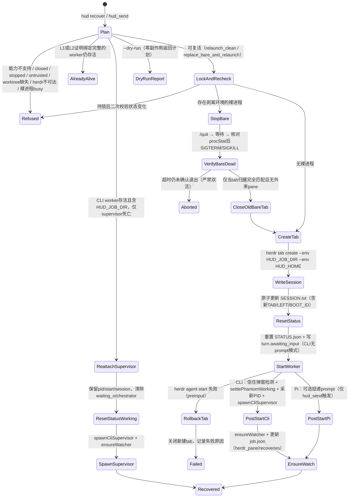
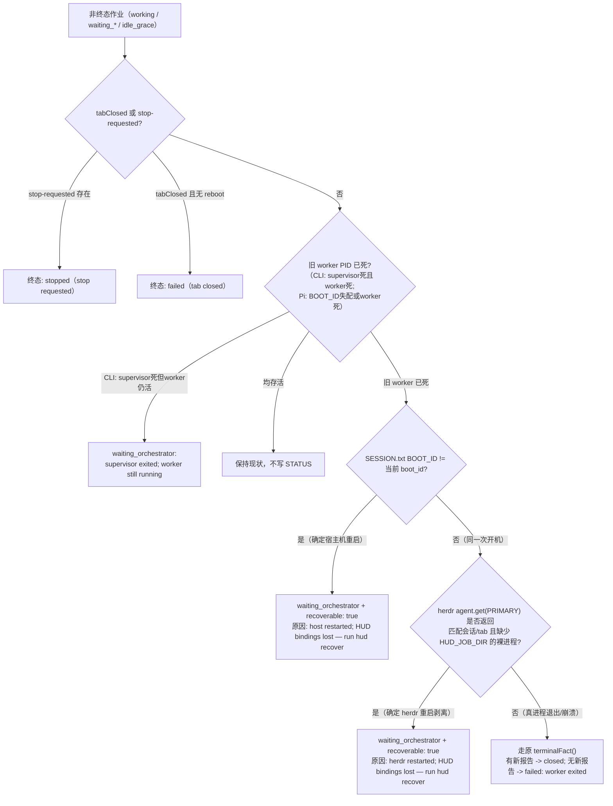

# 19. HUD 驱动的断点复活（`hud recover` / 重绑 `HUD_JOB_DIR` 与 supervisor，解决 `STATE.md` 待决问题）

> **优先级**：P1（直接回应 `docs/handoff/STATE.md` 历史待决项与 `.scratch/mcp-orch/issues/05-project-scope-and-restart-recovery.md` 遗留条目，消除宿主机/WSL/herdr 重启后的半途上下文报废与越权裸进程风险）
> **类别**：任务生命周期可靠性 / 断点复活引擎 / CLI 与可选 MCP 扩展
> **预估规模**：M–L（3 个核心垂直切片 + 1 个实机探针校准切片；新增核心源码约 480–580 行、既有热路径薄钩子约 70–95 行、合成 herdr 回归测试约 420–500 行；零新增第三方依赖）
> **前置依赖**：无硬代码前置（基于 Node `>=24.0.0` 内置模块）；核心逻辑独立置于 `src/roles/job-recover.ts`，与在途 **方案 02（MCP-SPLIT）**、**方案 06（ASYNC-WATCH）**、**方案 08（JOB-INDEX）** 文本冲突极低（建议 S1 的 `hud-watch.mjs` 钩子排在 **ASYNC-WATCH-01** 之后，或按 §4.2 薄接缝随其平移）；Pi 续写端到端实机验证需一次性确认外部 `pi-roles` 在既有 `<job>/STATUS.json` + `sessions/*.jsonl` 上传入 `--session <realpath>` 的幂等行为（见 S4）
> **`docs/spec.md` 边界影响**：**需 Owner 明确同意后修订 `docs/spec.md:16` 中的 1 句话**。当前 `docs/spec.md:16` 记录了 2026-11-21 的暂行退让条款：“*and after a machine restart recovering a worker stays manual: herdr's resume drops the HUD's job bindings, and the HUD does not relaunch resumed sessions (owner, 2026-11-21)*”。本方案提出将“完全手工”升级为**“绝不静默自动重启，但提供受控、显式触发的 HUD 驱动复活（`hud recover`，可选经 `hud_send` 触发）”**——既守住 Owner 当初否决后台自动拉起的安全边界，又终结多步骤手工抢救。按 `docs/delegation.md:8,41-42`，实施前须由 Owner 拍板 spec 边界，且因涉及停止裸进程（`killing processes`）须在合并前经过一次聚焦进程安全的 reviewer 审查。

---

## 1. 背景与现状证据

### 1.1 历史脉络与 Ticket 05 现场实测证据

2026-11-21 的真实使用现场（`.scratch/mcp-orch/issues/05-project-scope-and-restart-recovery.md:6`）暴露了一个高痛点故障：宿主机重启后，`herdr` 自动恢复了运行中的 `pi imp` 与 `Claude oracle` 两个 worker，但 HUD 却将两者全部判为 `failed` 且未能正常收割或继续协作。

随后在两个连续切片中积累了第一手实证：

1. **`MCPORCH-05`（commit `7accf14c`，`ticket 05:14-19`）**：完成了项目级作用域过滤（`projectJobFilter`）与孤儿作业认领（`adoptProjectJobs`，`src/roles/job-project.ts:12-66`），但重启恢复项触及 stop rule 暂停——因为重启后 `hud-watch.mjs` 看到旧 `supervisor.pid` 与旧 `pid`/`pid_start_time` 已死，立刻写入 `failed: worker exited`，而 `herdr 0.9.5` 的 pane ID 是 server 作用域且磁盘回执未固定 server/boot 身份。
2. **`RESTART-RECOVERY` 隔离实测（job `jed235679bed45e93`，`ticket 05:20-25`）**：在隔离的 `herdr 0.9.5` stop/start 烟测中验证了以下铁律事实：
   - **保留的字段**：`herdr 0.9.5 resume` 保留了 worker 的精确 `agent_session`、agent 名称（`<job>-primary`）与所在 tab，但分配了**新的 PID**；
   - **剥离的绑定**：**`HUD_JOB_DIR`（及 tab 自定义 env）被完全剥离**；
   - **剥离的启动参数**：`pi` 被裸重启为 `pi --session <path>`，丢失 `--task-dir`、`--hud-worker-tools`、`-e .../hud.mjs` 等全部启动契约；`claude` 被裸重启为 `claude --resume <id>`，丢失 `--model`、`--effort`、`--dangerously-skip-permissions` 与 role `args`；**即使配置 `herdr` 的 `resume_argv` 也无法改变该行为**。
3. **Owner 阶段性裁决（commit `4a80749b`，`ticket 05:26`、`docs/spec.md:16`、`docs/handoff/STATE.md:17-18,44`）**：由于当时仅验证了“被动认领 PID 不可行”，尚未形成安全可靠的 HUD 主动复活方案，Owner 暂选 Option B（重启后留给人工手工处理），`ticket 05` 仍处于 `ready-for-human` 且第 3 条验收项未勾选（`[ ] A job whose worker herdr resumed after a restart is shown as working and settles normally`）。

### 1.2 精确技术根因：五重连锁故障机制（逐行代码证据）

结合当前 HEAD 代码逐行追踪，宿主机或 `herdr` 重启后共触发 **5 处相互放大的机制性失效**：

| # | 失效环节 | 精确代码位置与符号 | 重启后的实际行为与后果 |
|---:|---|---|---|
| **1** | **环境注入仅存于初始 tab shell，无法穿透 `herdr resume`** | `src/mcp/thin-main.ts:421-434`（`dispatchPi`）、`:673-686`（`dispatchCli`）；`docs/probes/herdr-env.md:41,81` | `herdr agent start` 本身没有 `--env` 参数，HUD 依赖 `herdr tab create --env HUD_JOB_DIR=<dir> --env HUD_HOME=<hudHome>` 把变量注入初始 shell。`herdr 0.9.5` 重启恢复 tab 时不回放 `--env`，新启动的 shell 与 agent 均丢失 `HUD_JOB_DIR` 与 `HUD_HOME`。 |
| **2** | **缺失 `HUD_JOB_DIR` 导致危险的“权限面反转”（Worker → Main Session！）** | `src/mcp/thin-main.ts:46-48`（`isWorker = jobDir !== undefined`）；`integrations/pi/package/extensions/hud.mjs:5,7,25-27` | **最易被忽略的高危隐患**：对 Claude/Codex，`hud-mcp` 失去 `HUD_JOB_DIR` 后判定 `isWorker = false`，向这个裸 worker 暴露**主会话 MCP 工具集**（`hud_create`、`hud_close`、`hud_roster` 等），同时完全隐藏 `hud_report`/`hud_ask`/`hud_sonic`/`hud_progress`；对 Pi，`hud.mjs:5` 落入 `:25-27` 的 `installPiPackage(..., 'delegate')`，同样把它变成主会话表面，彻底击穿 WORKER-UNIFY 边界且无法汇报结算。 |
| **3** | **`hud-watch.mjs` 将重启导致的旧 PID 消失误判为终态崩溃（CLI）或陷入永久僵死（Pi）** | `packages/hud-mcp/bin/hud-watch.mjs:239-262`、`src/mcp/cli-judge.ts:39-44`（`workerAlive`）、`:186-193`（`terminalFact`） | **CLI**：watcher 首次扫描即命中 `:245`（`pid && !supervisorAlive(pid)`）→ `:246` `workerAlive(oldPid, oldStart) === false` → `terminalFact()` 直接写入 `state: 'failed', exit_reason: 'worker exited'`（若磁盘恰有新报告则写成 `closed`），2 小时后（`:24,311-318`）触发 `pi-role-reap` 甚至尝试关 tab，24 小时后（`:301-309`）删除任务目录。<br>**Pi**：`:256` 对非 CLI 仅检查 `else if (tabClosed)`。若是优雅关机，`pi-roles` 的 SIGTERM 处理把 `STATUS.json` 写成 `failed`；若是断电/硬崩溃，`STATUS.json` 永久停在 `working`（带失效旧 PID），watcher 永远挂起且裸 Pi 进程无人监管。 |
| **4** | **`hud-cli.mjs` 无法直接对重启后的作业原地拉起** | `packages/hud-mcp/bin/hud-cli.mjs:35-47`（`initialStatus`）、`:184-186`（`write()` 终态自杀）、`:198-202`（`!current.pid_start_time` 才查进程）；`src/mcp/thin-main.ts:1581-1593`（`sendJob`） | ① `hud-cli.mjs:41-42` 从旧 `STATUS.json` 继承死掉的 `pid`/`pid_start_time`；② `:198` 仅在 `!current.pid_start_time` 时才查 `pane.process_info`，导致不会重新发现新 PID；③ `:185` 见到磁盘 `STATUS.json` 为 `failed` 会立刻 `shutdown()` 自杀；④ `thin-main.ts:1586-1589` 仅在旧 `workerAlive === true` 时才重拉 supervisor，重启后永远为 `false`。 |
| **5** | **`SESSION.txt` 缺少开机纪元锚点，且重启后无受控重绑入口** | `src/mcp/thin-main.ts:442-459,692-709`（`SESSION.txt` 格式）；`src/roles/worker-tree.ts:28`（`boot_id` 仅存于 `worker-tree.json`）；`src/cli/hud-main.ts:12-47` | `SESSION.txt` 仅记录 `TASK/TAB/TAB_NAME/LEFT/RIGHT/ORCH/BASE/PRIMARY`，不记录内核 `BOOT_ID`；`worker-tree.json` 只在收割/汇报阶段才生成。CLI 无 `hud recover` 命令，主会话只能手工查 `agent_session_id` 或 `sessions/*.jsonl`、手动关 tab、手动拼几十个参数重跑。 |

### 1.3 Pi Worker 与 CLI Worker 重启后的结构性差异

| 维度 | Pi Worker（`!job.cli && !job.bro`） | CLI Worker（`job.cli`: `claude` / `codex` / `agy` / `grok`） |
|---|---|---|
| **会话存储位置** | 真实 `.jsonl` 位于 `${PI_CODING_AGENT_DIR:-~/.pi/agent}/sessions/--<cwd>--/*.jsonl`；任务目录 `<job>/sessions/*.jsonl` 存**符号链接**（`STATE.md:118` SESSION-LINK、`thin-jobs.ts:121-139` `latestSession`、`hud-watch.mjs:153-177` 兼容旧实文件） | 各自原生存储（Claude `~/.claude/projects/.../<uuid>.jsonl`、Codex `$CODEX_HOME/sessions/.../rollout-*-<uuid>.jsonl` 等）；任务目录内**无任何会话文件或链接**（`packages/hud-mcp/README.md:175,276`） |
| **会话 ID 落盘点** | `STATUS.json.session_id`（`src/roles/pi-dispatch-status.ts:8`）+ `<job>/sessions/*.jsonl` 链接目标实路径（头行 JSON 含 `id` 与 `cwd`） | `STATUS.json.agent_session_id`（`hud-cli.mjs:43,106,141` 由 `herdr agent.get` 采得；注意 `.scratch/cli-workers/spec.md:44`：Claude 就绪即出、Codex/agy 需首个 prompt 后才出） |
| **生命周期写入方** | 外部 `pi-roles` 扩展在 Pi 进程内直接写 `STATUS.json` 与 `qa/`，无独立 supervisor 进程 | 独立 per-job `packages/hud-mcp/bin/hud-cli.mjs` 进程（PID 记于 `supervisor.pid` 与 `STATUS.json.supervisor_pid`），经 `cli-judge.ts:judge()` 驱动 `STATUS.json` 与 `turn.json`/`done.json` |
| **Worker 工具注入方式** | `herdr tab create --env HUD_JOB_DIR` + `pi-role --args-json` 生成 `--task-dir`/`--hud-worker-tools`/`-e .../hud.mjs` 等全套参数 | `herdr tab create --env HUD_JOB_DIR`（Claude 直接继承；Codex 通过 `install.d/codex.sh:52` `env_vars` 透传 `HUD_JOB_DIR` 给 `hud-mcp`）；`agy`/`grok` 靠 brief/prompt 内嵌 fallback 脚本 |
| **重启后 `herdr 0.9.5` 的破坏点** | `pi --session <path>` 丢失 `HUD_JOB_DIR`、`--task-dir`、`--hud-worker-tools`、`-e hud.mjs`、skills/prompt；`STATUS.json` 滞留 `failed`（优雅关机）或僵尸 `working`（硬重启） | `claude --resume <id>` 丢失 `HUD_JOB_DIR`、model/effort/bypass/`args`；`hud-cli.mjs` 死亡；`hud-watch.mjs` 立即写 `failed: worker exited` |
| **恢复所需还原要素** | 重建含 `HUD_JOB_DIR`/`HUD_HOME` 的新 tab + 复用 `pi-role --args-json` 契约 + 追加 `--session <realpath>`（实测续写同一文件，见 `docs/probes/pi-resume.md:42`） | 重建含 `HUD_JOB_DIR`/`HUD_HOME` 的新 tab + 原生 resume 参数 + 原 model/effort/bypass/`args` + 重置 `STATUS.json` + 重拉 `hud-cli.mjs` + 保留 `turn.json` 护栏 |

---

## 2. 目标与非目标（Scope / Out of Scope）

### 目标（Scope）

1. **受控、显式触发的断点复活引擎（`src/roles/job-recover.ts` + CLI `hud recover`）**：
   - 支持单作业 `hud recover <jobId> [--dry-run] [--json] [--force-stop-bare] [--allow-stopped]` 与项目批量 `hud recover --project [--cwd DIR] [--dry-run] [--json] [--force-stop-bare]`；
   - 完整还原 `HUD_JOB_DIR`、`HUD_HOME`、原生 resume 会话句柄、原始模型/思考等级/权限绕过/`pi_args`/skills/worker prompt、`SESSION.txt`、`STATUS.json` 与 CLI `hud-cli.mjs` supervisor；
   - 严格实行**只读预检（`planRecovery`）与执行（`executeRecovery`）分离**，`--dry-run` 零副作用。
2. **重启精准识别，杜绝误判 `failed` 与误删 tab**：
   - 启动时在 `SESSION.txt` 记录内核 `BOOT_ID`，`hud-watch.mjs` 结合 `BOOT_ID` 失配或 `herdr agent.get` + `/proc/<pid>/environ` 剥离检测，将重启中断的作业置为 `waiting_orchestrator`（带 `recoverable: true` 与明确提示），**不误标 `failed`、不触发 2h 自动 reap、不触发 24h 目录删除**，同时让 `adoptProjectJobs` 与面板/watch/MCP task 立即通知新主会话。
3. **绝对防双活与安全红线**：
   - 复活前通过 `/proc` + `herdr` + `flock` 三层校验确保绝不双开活着的 worker、绝不未经授权杀掉用户正在手工操作的裸进程、绝不跳过 `isCliDirTrusted` 目录信任校验、绝不破坏或重建丢失的 managed worktree、绝不擅自向刚复活的 worker 发送续跑 prompt。
4. **清晰分类处理全部 Harness（`pi`、`claude`、`codex`、`agy`、`grok`、`bro`）**：
   - 完整支持 `pi`、`claude`、`codex` 原生会话复活；对未验证原生 resume 的 `agy`/`grok` 及单次请求型 `bro` 给出确定性 `resume_unsupported` 拒绝与 `hud_create({ retry_of })` 引导。
5. **可选 MCP 集成（Slice 3，待 Owner 拍板 M1 vs M2 vs CLI-only）**：
   - 支持主会话直接经 `hud_send({ job, text })` 触发复活并投递续跑指令（或提供独立 `hud_recover` 工具），并与 Claude Code MCP Tasks 护栏无缝衔接。

### 非目标（Out of Scope）

1. **绝不做后台静默自动复活**：`hud-watch.mjs` 只做观测与降级标记（`waiting_orchestrator`），**永不在后台未经人工或主会话显式触发就自动重启或杀掉进程**（遵守 `docs/spec.md` §3/§4）。
2. **不新增常驻守护进程、数据库或外部依赖**：延续按需 `hud-watch.mjs`、纯文件磁盘状态与 Node `>=24.0.0` 内置库。
3. **不修补或绕过 `herdr 0.9.5` 自身行为**：不修改 herdr 配置，不依赖未经验证的 `resume_argv`，不假设未来 herdr 版本会保留 `--env`。
4. **不修改任何 CLI 自身的会话存储或配置**：不拷贝/重写 `~/.claude`、`$CODEX_HOME`、`~/.pi/agent/sessions` 内容，不自动调用 `hud trust` 授予目录信任。
5. **不恢复已正常结算（`closed`）的作业，不自动重放历史 prompt**：已 `closed` 作业继续走 `hud_send` 既有的 `continued_as` 修复链路（`thin-main.ts:1535-1540`）；无会话句柄的启动期失败作业继续走 `hud_create({ retry_of })`（`thin-main.ts:1167-1177`）。
6. **不复活 `bro` 浏览器作业**：`jev-ask` / `jev-aistudio` / `jev-flow` 涉及网页提交与潜在计费/积分消耗，显式拒绝并引导 `retry_of`。
7. **不在面板新增独立复活快捷键（首期）**：面板已天然展示 `waiting_orchestrator` 提示文案；是否增加面板微动作留待 Owner 试用 CLI 稳定后再评估，避免破坏 `docs/spec.md:103` 的三微动作边界。

---

## 3. 核心设计方案

### 3.1 方案对比与选型

| 维度 | 方案 A：留给用户手工处理（当前 `spec.md:16` 现状） | 方案 B：被动认领 `herdr resume` 后的裸进程 PID | 方案 C（**推荐**）：HUD 驱动的受控复活（`hud recover` + 重启标记） |
|---|---|---|---|
| **能否恢复 worker 协议（`hud_report` / `hud_ask` / `pi-roles`）** | 仅当用户手工关 tab 并手工拼装完整 env 与 15+ 参数重跑，极易遗漏 | **物理不可行**（Linux 下无法向已运行进程安全注入 `HUD_JOB_DIR` 与 CLI 启动标志；`ticket 05` 实测 `resume_argv` 无效） | **完全恢复**：以全新 `herdr tab create --env` + 原生 resume + 全套启动契约重启 |
| **越权裸进程风险** | **高**：`herdr` 复活的裸进程无 `HUD_JOB_DIR`，误加载主会话 MCP/pi 工具，且常被 `hud-watch` 标 `failed` 后遗忘 | **极高**：若强行认领，裸进程仍拿着主会话工具且缺少权限 bypass，随时卡在审批提示且永不结算 | **彻底消除**：预检识别并安全停掉剥离环境的裸进程，重绑隔离的 worker 工具面 |
| **防双活 / 误杀风险** | 靠人肉判断，易忘关旧 tab 导致双进程写同一 `.jsonl` | N/A | **三层机械门禁**：`/proc` + `herdr` + `flock`，活跃工作中的裸进程默认拒杀 |
| **自动化程度与可控性** | 零自动化，中断即几乎等同丢弃上下文 | 试图全自动但底层不成立 | **观测自动（标 `waiting_orchestrator`），复活显式（`hud recover` / `hud_send`），`--dry-run` 可预览** |
| **改动规模与维护成本** | 0 | 不可落地 | 中等（1 个独立核心模块 `job-recover.ts` + 薄接线），零新依赖 |

**结论**：方案 B 已被 `ticket 05` 实测证伪，方案 A 让长耗时 `imp`/`oracle` 任务在 WSL 休眠/宿主机重启后被迫报废或陷入越权裸态；**方案 C 是唯一在技术上成立、在安全上闭环、在体验上可落地的解**。

---

### 3.2 全 Harness 恢复能力矩阵

统一将 CLI 复活参数构造收敛到 `src/roles/cli-kinds.ts` 的 `CliKind` 声明中（数据驱动，不散落 `if/else`）：

```ts
// src/roles/cli-kinds.ts 增量字段
export interface CliKind {
  model: (model: string) => string[];
  effort: (thinking: string) => string[];
  bypass: readonly string[];
  trust: { text: string | null; decline: readonly string[] } | null;
  startTimeoutMs: number | null;
  startupQuirk: 'none' | 'done-before-prompt' | 'phantom-working';
  /**
   * 构造原生续写会话的完整 CLI 参数（含原 model/effort/bypass/args）；
   * null 表示该 CLI 尚未验证原生交互式 resume，hud recover 必须显式拒绝并引导 retry_of。
   */
  resume: ((sessionId: string, baseArgs: readonly string[]) => string[]) | null;
}
```

六种后端的完整能力矩阵：

| Harness / Agent | 恢复支持 | 会话句柄来源（按优先级） | 原生复活启动形态 | 启动前置校验 | 不可恢复时的降级策略 |
|---|---|---|---|---|---|
| **`pi`** | **支持** | ① `<job>/sessions/*.jsonl`（`realpathSync` 解析链接或旧实文件，校验首行 `type: "session"` 且若 `STATUS.session_id` 存在须匹配 `id`）<br>② 回退：`${PI_CODING_AGENT_DIR:-~/.pi/agent}/sessions/--<cwd>--/*_<STATUS.session_id>.jsonl` | 重跑 `pi-role --args-json ...`（与 `dispatchPi` 一致，更新 `--notify` 为当前 `callerPane`），剥离冲突 `--session`/`--session-id` 后追加 `['--session', sessionRealpath]`，在带 `--env HUD_JOB_DIR --env HUD_HOME` 的新 tab 启动 `herdr agent start <PRIMARY> --kind pi` | `pi-role` 在 PATH；`job.cwd` / worktree 在位；harness/provider 未在 `harnesses.json` 禁用；会话 `.jsonl` 存在且非空 | 若无有效 `.jsonl` → 拒绝 `session_missing`，提示 `hud_create({ retry_of })` |
| **`claude`** | **支持** | ① `STATUS.json.agent_session_id`（UUID）<br>② 回退：匹配 `PRIMARY` 的裸 herdr agent 的 `agent_session.value`（`kind === 'id'`，UUID） | `cliKinds.claude.resume`: `['--resume', id, ...baseArgs]`（`baseArgs` 含原 `--model`、`--effort`、`--dangerously-skip-permissions`、`place.args`），新 tab 带 `--env HUD_JOB_DIR --env HUD_HOME` + 重拉 `hud-cli.mjs` | `isCliDirTrusted('claude', job.cwd)` 为真（worktree 同时验 `main_root`）；`cli:claude` 未禁用；UUID 格式合法；不吞信任弹窗 | 无 UUID → `session_missing`（引导 `retry_of`）；未信任 → `untrusted_cwd`（引导 `hud trust <dir>`） |
| **`codex`** | **支持** | ① `STATUS.json.agent_session_id`（UUID）<br>② 回退：匹配 `PRIMARY` 的裸 herdr agent 的 `agent_session.value` | `cliKinds.codex.resume`: `['resume', id, ...baseArgs]`（**注：Codex `resume` 为子命令而非 `--resume` 标志**，其与 `-m`/`-c`/`--dangerously-bypass-approvals-and-sandbox` 的先后顺序由 S4 实机探针一行锁定）；保留 `--timeout 90000` 与 `settlePhantomWorking`；新 tab `--env HUD_JOB_DIR` 经 `install.d/codex.sh:52` `env_vars` 透传给 `hud-mcp` | `cli:codex` 未禁用；`job.cwd` / worktree 在位；UUID 合法（`trust: null` 跳过目录信任文件） | 首个 prompt 前即崩溃导致 `agent_session_id` 为空 → `session_missing`（引导 `retry_of`） |
| **`agy`** | **首期不支持**（`resume: null`） | `STATUS.json.agent_session_id`（仅作诊断信息展示） | 无（尚未实测验证稳定交互式 resume 标志，且依赖 prompt fallback 脚本） | N/A | 显式拒绝 `resume_unsupported`，输出 worktree 路径/分支及 `hud_create({ retry_of })` 建议；若存在裸进程一并报告其 tab/pane |
| **`grok`** | **首期不支持**（`resume: null`） | 同 `agy` | 无（且 `grok` 当前已被 Owner 暂停关闭，`docs/spec.md:12`） | N/A | 同 `agy`，显式拒绝 `resume_unsupported` 并提示 `retry_of` |
| **`bro` / `jev`** | **永久不支持** | N/A | N/A（单次网页提交，无交互式会话可重绑，重发可能引发重复提交或 Flow 积分扣费） | N/A | 显式拒绝 `resume_unsupported`，说明原因并提示 `hud_create({ retry_of })` |

> **关键设计约束**：绝不对 `agy`/`grok` 猜测或编造未实测的 `--resume` 标志。未来一旦某个版本实测验证通过，仅需在 `src/roles/cli-kinds.ts` 对应行填入 `resume` 函数即可自动激活整条恢复链路。

---

### 3.3 安全红线与三层防双活门禁

重启复活最危险的故障是**脑裂双活（两个进程并发写同一个 Pi `.jsonl` 或 Claude/Codex 会话库及同一个 Git worktree）**和**误杀正常工作的进程**。本方案强制执行 6 条不可绕过的安全红线：

1. **红线 1 — 严禁双活（三层校验）**：
   - **L1（`/proc` 核验）**：读取 `workerAlive(status.pid, status.pid_start_time)`（`cli-judge.ts:39-44`）并检查 `/proc/<pid>/environ`：
     - `alive === true` 且 `environ` 含 `HUD_JOB_DIR=<realpath(dir)>`：说明原 worker **真活着且绑定完整**！
       - 对 Pi：直接拒绝并返回 `already_alive`；
       - 对 CLI：若 `supervisorAlive(supervisorPid)` 也为真 → 拒绝 `already_alive`；若仅 supervisor 死掉 → 走**轻量 `reattach_supervisor` 路径**（只重拉 `hud-cli.mjs`，**绝不重启或打扰活着的 worker**！）。
     - `alive === null` 且 `status.pid` 非空（例如 `/proc` 暂时不可读）→ 拒绝 `liveness_unverified`（宁拒不猜死，遵守 `docs/ARCHITECTURE.md:436`）。
   - **L2（Herdr 实况与裸进程核验）**：调用 `herdr agent get <PRIMARY>` 与 `herdr pane process-info --pane <pane>`：
     - 若查到名为 `<PRIMARY>` 的进程，取其前台进程 PID `fgPid` 并读 `/proc/<fgPid>/environ`：
       - 若 `fgPid` 带有 `HUD_JOB_DIR=<realpath(dir)>` → **拒绝 `already_alive`**（覆盖 `STATUS.json` 尚未记录 PID 的竞态窗口！）；
       - 若 `fgPid` **不含 `HUD_JOB_DIR`**，且满足身份双重印证（`agent.name === PRIMARY` 且 `agent_session` 匹配或 `tab_id === SESSION.TAB` 且 `tab.label === SESSION.TAB_NAME`）→ 识别为 **`herdr resume` 产生的剥离环境裸进程**：
         - 若 `agent.agent_status === 'working'` → 默认**拒绝 `bare_agent_busy`**（防止误杀用户在重启后手工继续操作的进程），仅在调用方显式传入 `--force-stop-bare` 时才允许停止；
         - 若 `agent.agent_status` 为 `idle`/`done`/`blocked`/`unknown`（或指定 `--force-stop-bare`）→ 计划优雅停止该裸进程并校验其退出（详见 §3.4），**若未能确认退出则立即中止复活（`bare_agent_still_alive`），绝不启动第二份**！
     - 若 `herdr agent get` 返回传输错误/超时（非明确的 `agent_not_found`）→ **拒绝 `herdr_unavailable`**，绝不在无法观测 herdr 时盲起第二份！
   - **L3（跨进程排他锁）**：执行阶段先对 `<jobDir>/.recover.lock` 取非阻塞 `flock -nx`（与 `src/roles/job-project.ts:47`、`src/roles/lease.ts:32` 同源；MCP 内同时叠加 `keyLock('job:' + id)`），并在持锁后**二次重验 L1+L2** 消除 TOCTOU 竞态。
2. **红线 2 — Worktree 与 CWD 完整性不可降级**：
   - `job.cwd` 必须存在且为目录；
   - 若 `job.worktree` 存在：必须 `job.worktree_removed_at` 未设置、`fs.realpathSync(wt.root) === wt.root`，且通过安全 Git（`worktreeGit` + `neutralizeFilters`）确认 `git worktree list --porcelain -z` 中仍注册着精确的 `(wt.root, wt.branch)`。缺失或漂移时**拒绝 `worktree_missing`**——绝不偷偷新建一个空白 worktree 欺骗已有上下文的 worker。
3. **红线 3 — 目录信任永不自动授予**：
   - 复活前必须运行 `isCliDirTrusted(agent, job.cwd, env)`（managed worktree 同时核验 `main_root` 是否已受信任，仅在 `main_root` 已信任时调用 `propagateCliTrust`，完全复刻 `thin-main.ts:1422-1434`）。未受信任时直接拒绝 `untrusted_cwd`，绝不自动写用户 CLI 配置文件。
4. **红线 4 — 尊重 Control 开关（`harnesses.json`）**：
   - 通过 `readHarnessSwitches` 检查该 job 的 harness / agent / pi provider 是否已被禁用，禁用时拒绝 `harness_disabled`。
5. **红线 5 — 绝不复活主动终止的作业**：
   - `state === 'closed'`（已正常完成）永远拒绝 `already_closed`（引导 `hud_send` repair）；
   - `state === 'stopped'` 或存在 `STATUS.json.stop-requested` 默认拒绝 `intentionally_stopped`（防止复活 Owner 用 `hud_close` 或面板 `X` 主动杀掉的任务；CLI 仅在显式 `--allow-stopped` 时放行并清除 stop 标记）。
6. **红线 6 — 绝不擅自发送续跑 prompt**：
   - `hud recover <job>` 只负责恢复进程与绑定，**永不自动向 worker 注入“请继续”之类的 prompt**（遵守 `docs/spec.md:13` “never prompt or quit for it” 与 “the main session decides every next step”）。只有由主会话显式调用 `hud_send`（或用户后续手动发消息）时才投递下一轮 prompt。

---

### 3.4 复活执行协议：为什么必须新建 tab `--env` 及完整状态机

#### 关键工程决策：新建 tab（`herdr tab create --env`） vs 原位复用旧 tab

`docs/probes/herdr-env.md:41,81` 已经实测证明：**`herdr agent start` 没有 `--env` 参数**，环境变量只能通过 `herdr tab create --env` 或 `herdr pane split --env` 在创建 shell 时注入。重启后原 tab 根 pane 的 shell 环境里已经没有 `HUD_JOB_DIR` 和 `HUD_HOME`。

| 方案 | 做法 | 优缺点 |
|---|---|---|
| **方案 1（推荐）：关旧裸 tab + 建新 tab（`herdr tab create --env`）** | 若存在已验明身份的裸 tab，优雅停裸进程后关闭旧 tab；用与 `dispatchPi`/`dispatchCli` 100% 相同的 `herdr tab create --workspace ... --cwd ... --label <TAB_NAME> --env HUD_JOB_DIR=<dir> --env HUD_HOME=<hudHome> --no-focus` 开干净新 tab，更新 `SESSION.txt` | **零脏 shell 状态**、无需向交互式 shell 注入 `export` 命令、同时天然兼容“旧 tab 已被关闭/未恢复”的场景、完全复用既有启动契约与 `TAB_NAME` 校验 |
| 方案 2（备选）：在旧 tab 内 `pane split --env` 再关旧 pane | 保留原 tab ID 与标签页顺序，但需要先 split 出带 env 的新 pane 再关闭原 pane | 多出 pane split/layout 竞态（旧 tab 可能已有 `RIGHT` helper pane），且旧 tab 不存在时仍需回退到方案 1，增加两套路径复杂度 |

因此推荐**统一采用方案 1（新 tab + 优雅关闭旧裸 tab）**，仅在旧 tab 存在且完全通过身份印证（`TAB_NAME` + `PRIMARY` 匹配且无其他用户 pane）时才关闭旧 tab；若旧 tab 内有额外未知 pane，则只停掉裸 agent 进程而不关闭旧 tab，避免误关用户手工开的 pane！

#### 复活状态流转与时序图



#### 裸进程优雅停止细节（对应 `StopBare` → `VerifyBareDead`）

1. 记录裸进程精准身份 `(fgPid, fgStart = procStat(fgPid).start)`，并二次确认 `/proc/<fgPid>/environ` **不含** `HUD_JOB_DIR`。
2. **第一阶段（优雅退出，≤ 3 s）**：发送 `herdr agent prompt <PRIMARY> /quit`（四种 CLI 与 Pi 均支持 `/quit`，见 `.scratch/cli-workers/spec.md:43`），每 100 ms 轮询 `workerAlive(fgPid, fgStart)`。
3. **第二阶段（信号升级，≤ 2 s）**：若仍存活，**发送信号前再次核对 `procStat(fgPid)?.start === fgStart`**（沿用 `src/roles/worker-tree.ts:149-160` 铁律防 PID 复用误杀），发送 `SIGTERM` 等待至多 1.5 s；仍未退再核对一次后发送 `SIGKILL` 等待 500 ms。
4. **第三阶段（退出确认）**：必须观察到 `workerAlive(fgPid, fgStart) === false` 且 `herdr agent get <PRIMARY>` 返回 `agent_not_found`（允许短暂重试 500 ms 等待 herdr 注销 agent 名称），否则立刻返回 `bare_agent_still_alive` 中止复活！

---

### 3.5 `hud-watch.mjs` 重启识别与 `cli-judge.ts` `awaiting_input` 护栏

这是整套方案的**两个关键粘合剂**，缺一不可：

#### A. `hud-watch.mjs` 区分“重启/环境剥离”与“真进程崩溃”

在 `packages/hud-mcp/bin/hud-watch.mjs:239-262` 的非终态检查分支中，将现有逻辑升级为轻量异步判定函数 `classifyRestartInterruption`（实现放在 `src/roles/job-recover.ts` 中供 `hud-watch.mjs` 复用）：



关键细节与边界保障：
- **对 `recoverable: true` 作业的 watcher 约束**：
  - `STATUS.json` 写入 `state: 'waiting_orchestrator'`, `recoverable: true`, `reason: 'herdr/host restarted; HUD bindings lost — run hud recover <job> or hud_send'`, `ended_at: null`, `exit_reason: null`, `error: null`；
  - **绝不把 `safetyCheck` 置为 true**（避免无意义的 30 s 轮询消耗 CPU；仅靠 `fs.watch` 监听后续 `hud recover` 或 `hud_close` 写盘）；
  - 因状态为 `waiting_orchestrator`，天然跳过 `hud-watch.mjs:311-318` 的 2h failed 自动 reap 和 `:301-309` 的 24h 目录删除；
  - 若该作业属于不支持原生复活的 harness（`agy`/`grok`/`bro`），仍可识别重启并将 `recoverable` 设为 `false`，`reason` 明确提示 `herdr/host restarted; <agent> cannot auto-resume — inspect worktree or retry_of`，同样避免在 2h 内误删其 tab/worktree，由 Owner 决定 `hud_close` 或 `retry_of`！
- **Pi 作业的额外兜底**：当 `BOOT_ID` 失配且 Pi 作业的 `STATUS.json` 在硬重启后卡在 `working` 时，上述逻辑同样将其翻转为 `waiting_orchestrator`（`recoverable: true`），彻底解决当前 `hud-watch.mjs:256` 对 Pi 僵尸作业完全盲区的问题。
- **异步兼容性**：若落地在 **方案 06（ASYNC-WATCH）** 之后，`agent.get` 与 `/proc` 探查放入 per-job 异步任务而非阻塞 `scan()`；若先于 06 落地，仅在“CLI 旧 PID 已死且 `BOOT_ID` 相同”的极低频分支才触发单次 2 s 超时的 `request('agent.get', ...)`，正常热路径零新增 I/O。

#### B. `cli-judge.ts` 的 `awaiting_input` 护栏（防止无 prompt 复活后误触发 Decision API）

正如我们在源码审查中发现的隐患：若 `hud recover <job>` 复活了一个 CLI worker 而不发 prompt，此时 `herdr` 报 `idle`，旧 `turn.json` 仍未产生新报告——若无护栏，`cli-judge.ts:279-293` 会在静默期满后触发 `action: 'decide'`（消耗付费 Decision API 甚至向 worker 发 `prompt-report`）！

**最小精确修复**：
1. 在 `src/roles/cli-turn.ts` 的 `Turn` 接口中增加可选字段 `awaiting_input?: boolean` 与 `recovered_at?: string`。
2. 当 `hud recover <job>`（无 prompt 模式）复活 CLI worker 时，更新 `turn.json`（保持原 `seq` 不变，写入 `awaiting_input: true, recovered_at: nowIso`），并初始化 `STATUS.json` 为 `state: 'waiting_orchestrator', reason: 'recovered; hud_send to continue or hud_close to stop', pid: newPid, pid_start_time: newStart, recovered_at: nowIso`（**清除旧终态 `failed`/`ended_at`/`exit_reason`，保留 `agent_session_id` 与 `started_at`**）。
3. 在 `src/mcp/cli-judge.ts:judge()` 中，位于 `terminalFact` 与 `facts.close` 之后、静默判定（`:254`）之前加入 5 行纯逻辑：
   ```ts
   const recoveredAt = facts.turn.awaiting_input ? Date.parse(facts.turn.recovered_at ?? '') : NaN;
   const resumedManually = Number.isFinite(recoveredAt) && (facts.workingAt ?? -Infinity) > recoveredAt;
   if (facts.turn.awaiting_input && !resumedManually && !report && !facts.openQuestions && facts.status !== 'working') {
     return { ...next, state: 'waiting_orchestrator', reason: 'recovered; hud_send to continue or hud_close to stop' };
   }
   ```
   - 效果：刚复活、尚未收到 `hud_send` 的 CLI worker 在 `hud-cli.mjs` 完整监管下静静等待——**若它崩溃或被关 tab，`terminalFact` 仍立刻捕获；若用户手工在 tab 里输入触发 `working`，它自动切回正常轮次结算；若主会话调用 `hud_send`，`writeTurn(dir)` 递增 `seq` 且不带 `awaiting_input`，瞬间进入正常 `working` 并等待新 `done.json` 回执！**
   - `hud-cli.mjs:184-186` 无需削弱终态保护：因为 `executeRecovery` 已经在拉起 `hud-cli.mjs` **之前**把 `STATUS.json` 原子切出 `failed` 状态，旧的防覆盖护栏继续原样保护并发写安全！

---

### 3.6 磁盘契约增量（100% 向后兼容）

所有新增字段均为可选增量，旧代码、面板、`hud_read`、`pi-role-reap` 与 `hud doctor`（方案 13）均零破坏兼容：

| 文件 | 新增可选字段 | 写入方 | 用途 |
|---|---|---|---|
| `SESSION.txt` | `BOOT_ID=<uuid>`（来自 `/proc/sys/kernel/random/boot_id`） | `dispatchPi`、`dispatchCli`、`executeRecovery` | O(1) 判定是否跨越了内核重启；旧作业无此行时安全退化到 `herdr agent.get` 探查 |
| `STATUS.json` | `recoverable?: boolean`<br>`recovered_at?: string`<br>`recovery_count?: number` | `hud-watch.mjs`（标 `recoverable`）、`executeRecovery`（标 `recovered_at`/`recovery_count`） | 区分重启等待与普通 `waiting_orchestrator`；保留审计信息；**不修改 `version: 1` 与既有字段语义** |
| `turn.json` | `awaiting_input?: boolean`<br>`recovered_at?: string` | `executeRecovery`（仅无 prompt 复活 CLI 时） | 阻断 `cli-judge` 对刚复活待命 CLI 的虚假静默/Decision API 触发 |
| `job.json` | `recoveries?: Array<{ at: string; mode: RecoveryMode; from_state: string | null; old_tab?: string | null; new_tab?: string | null; bare_stopped?: boolean }>`（最多保留最近 10 条） | `executeRecovery` | 留存断点复活审计轨迹，供 `hud_read({ detail: true })` / `hud doctor` 查阅 |
| `.recover.lock` | 空锁文件（`0600`） | `executeRecovery` | `flock -nx` 防止 `hud recover` 与 `hud_send` 并发双启 |

---

### 3.7 触发入口与接口契约

#### 1. CLI 入口：`hud recover`（必选，Slice 2）

注册于 `src/cli/hud-main.ts`，实现于 `src/cli/recover.ts`：

```text
Usage: hud recover <jobId> [--dry-run] [--json] [--force-stop-bare] [--allow-stopped]
       hud recover --project [--cwd DIR] [--dry-run] [--json] [--force-stop-bare]
       hud recover --help
```

- **退出码约定**（对齐 `src/cli/private-home.ts` 与 `hud-main.ts`）：
  - `0`：目标作业全部恢复成功，或 `--dry-run` 完成（或 `--project` 无待恢复作业）；
  - `1`：单作业被拒绝/恢复失败，或 `--project` 中至少 1 个合格作业执行失败；
  - `2`：参数错误（`CliError`）；
  - `3`：非法 `HUD_HOME`（`privateHome` 校验失败）。
- **人类可读输出示例（合成数据，`--dry-run`）**：
  ```text
  job      j0000000000000001  role imp      harness claude  state waiting_orchestrator (recoverable)
  action   replace_bare_and_relaunch (dry-run)
  session  claude --resume 00000000-0000-4000-8000-000000000001
  bare     tab w0A:t2 pane w0A:p4 pid 41203 status idle (HUD_JOB_DIR missing) -> will /quit & close tab
  checks   cwd ok (/tmp/synthetic-project-wt/imp-000001) · worktree ok (wt/imp-000001) · trust ok · harness on
  launch   new tab "imp synthetic-task" with HUD_JOB_DIR + HUD_HOME + hud-cli supervisor (no prompt sent)
  ```
- **JSON 输出契约（`--json`）**：直接序列化 `RecoveryPlan`（`--dry-run`）或 `RecoveryOutcome`（执行模式），包含稳定字段 `ok`, `job`, `action`, `code?`, `reason?`, `suggestion?`, `harness`, `session_ref`, `old_tab`, `new_tab`, `new_pane`, `supervisor_pid?`。

#### 2. MCP 集成（Slice 3，二选一推荐 M1）

- **推荐方案 M1 — 融入单作业 `hud_send({ job, text })`（零新增工具）**：
  - 在 `src/mcp/thin-main.ts:1544-1552` 的 `sendJob` 中，当 `!workingOnly`（排除 `jobs:[...]` 广播）且 `current` 处于可复活状态（`status?.recoverable === true`，或 `state === 'failed'` 且 `exit_reason` 为重启/进程退出类中断、未 `reaped_at`+移除 worktree、非 pre-input 失败）：
    1. 先调用 `planRecovery`；若属于 `resume_unsupported`（`agy`/`grok`/`bro`）或安全拒绝（`bare_agent_busy`/`untrusted_cwd`/`worktree_missing`），直接返回 `{ ok: false, code, reason, suggestion }`，**不擅自创建新作业**；
    2. 若可执行（`reattach_supervisor` / `relaunch_clean` / `replace_bare_and_relaunch`），调用 `executeRecovery(..., { prompt: message })` 完成复活与首条续跑指令投递（与既有 `send_outcomes` 幂等键、CLI `turn.json`、`taskClient` MCP Task 创建全面打通！）；
    3. 返回结果在普通 `send` 基础上附带 `recovered: true, recovery_mode: '...'`（Claude MCP Task 模式在 `Launch:` 摘要中注明 `recovered (<mode>)`）。
  - **为什么 M1 最契合 MyHUD 哲学**：
    - `hud_send` 本就承担“对已关闭作业自动 `continued_as` 修复（`:1535-1540`）”和“对存活 CLI 自动重拉死亡 supervisor（`:1581-1593`）”的统一续作语义；
    - 不膨胀 `ROLE_TOOLS` 列表，所有主会话每轮零额外 schema token 成本；
    - 严格满足红线 6：因为触发源就是主会话自己发出的 `text` prompt。
- **备选方案 M2 — 独立 `hud_recover` MCP 工具**：
  - 若 Owner 希望主会话能在发 prompt 前先调一次纯恢复/预检（如 `hud_recover({ job, dry_run?: true })`），可将同一 `planRecovery`/`executeRecovery` 暴露为 `hud_recover` 工具（`src/roles/tool-definitions.ts` +15 行）。M1 与 M2 共享 100% 底层引擎，详见 §6 请 Owner 拍板。

---

### 3.8 模块职责划分与 `docs/ARCHITECTURE.md` §8 合规审计

```text
src/roles/cli-kinds.ts         ──► 新增 CliKind.resume 映射（claude / codex 支持，agy / grok 为 null）
src/roles/cli-turn.ts          ──► Turn 新增可选 awaiting_input / recovered_at
src/mcp/cli-judge.ts           ──► judge() 增加 5 行 awaiting_input 静默免打扰护栏
src/roles/job-recover.ts       ──► 【核心新模块 ~360L】
                                   ├─ resolveSessionRef()（Pi symlinks+store / CLI STATUS+herdr）
                                   ├─ classifyRestartInterruption()（供 hud-watch 复用）
                                   ├─ planRecovery()（纯只读预检 + 三层防双活门禁）
                                   └─ executeRecovery()（flock + 二次校验 + 停裸 + 建tab + 重绑）
src/cli/recover.ts             ──► 【CLI 薄层 ~120L】参数解析、人类表格格式化、--json、退出码
src/cli/hud-main.ts            ──► 注册 `recover` 子命令（+3 行）
packages/hud-mcp/bin/hud-watch.mjs ► 调用 classifyRestartInterruption()（~20 行）
src/mcp/thin-main.ts           ──► ① SESSION.txt 增写 BOOT_ID（+2 行）
                                   ② 复用/导出 dispatch 共享辅助（pi-role argv / tabLabel / settlePhantomWorking / spawnCliSupervisor）
                                   ③ [S3] sendJob 单作业可复活分支接入 executeRecovery（~25 行）
```

**对照 `docs/ARCHITECTURE.md` §8 逐项审计**：
- **纯函数与读取安全**：`planRecovery` 严格只读，绝不调用 `readRow()`（避免触发 `recordFailureExhaustion` 写 `STATUS.json`，同方案 13）；任何 `/proc`、`git` 或 `herdr` 读取失败均返回 `null`/`unknown` 并拒绝执行，绝不伪造“已死亡”或“目录干净”。
- **安全 Git**：worktree 存在性与分支归属校验复用 `src/collectors/worktrees.ts` 的 `worktreeGit` 与 `src/utils/git-safety.ts` 的 `neutralizeFilters`，绝不执行仓库内 git filter/hook。
- **私有原子写**：所有 `SESSION.txt`、`STATUS.json`、`turn.json`、`job.json` 更新一律使用 `temp + randomUUID() + 0o600 + renameSync`（带 `finally` 清理临时文件）；锁文件 `.recover.lock` 使用 `0o600`。
- **零新依赖与 Node 24**：仅使用 `node:fs`、`node:path`、`node:crypto`、`node:child_process`、`node:timers/promises`，复用 `runHerdr`、`procStat`、`workerAlive`、`isCliDirTrusted`、`projectJobFilter`。
- **不破坏面板纯渲染**：面板零改动即可通过共享 `jobRow()` 正确显示 `waiting_orchestrator` 与恢复提示（`src/collectors/thin-jobs.ts:231-232,563-574`）。

---

## 4. 垂直切片与实施路线（对齐 `docs/delegation.md`）

按 `docs/delegation.md` “每片端到端可独立验证、适合单个 `imp` 会话、不拆过碎”的原则，划分为 **3 个主力切片 + 1 个轻量实机校准切片**：

### Slice 1：重启锚点 + `hud-watch` 重启识别 + `cli-judge` `awaiting_input` 护栏
- **交付价值**：即便尚未执行复活命令，宿主机/herdr 重启后作业不再被误判为 `failed: worker exited`、不再被 2h 自动收割或 24h 删除，新主会话自动认领并立刻收到清晰告警。
- **改动文件与估行**：
  - `src/mcp/thin-main.ts`（+6L）：`dispatchPi`（`:442`）与 `dispatchCli`（`:692`）写入 `SESSION.txt` 时追加 `BOOT_ID=<boot_id>`（`/proc/sys/kernel/random/boot_id` 不可读时省略）。
  - `src/roles/cli-turn.ts`（+3L）：`Turn` 接口新增可选 `awaiting_input?: boolean` 与 `recovered_at?: string`。
  - `src/mcp/cli-judge.ts`（+10L）：`judge()` 新增 `awaiting_input` 静默免打扰分支。
  - `src/roles/job-recover.ts`（新建首版 ~110L）：导出 `currentBootId()`、`sessionField()`、`classifyRestartInterruption()`、`inspectBareAgent()`。
  - `packages/hud-mcp/bin/hud-watch.mjs`（+28L）：接入 `classifyRestartInterruption()`，覆盖 CLI 重启与 Pi 硬重启僵尸检测，标 `waiting_orchestrator` + `recoverable` 且跳过无意义的 `safetyCheck` 轮询。
  - `tests/unit/hud-watch.test.mjs`、`tests/unit/cli-judge.test.mjs`（+140L）：覆盖重启识别 vs 真崩溃、Pi 僵尸检测、`awaiting_input` 护栏。
- **依赖关系**：无硬前置；若 **ASYNC-WATCH-01（方案 06）** 已合入，钩子直接挂入其 per-job 异步判定入口。
- **可删除旧代码**：无。

### Slice 2：核心复活引擎 + CLI `hud recover`（支持 `pi` / `claude` / `codex`，显式拒绝 `agy` / `grok` / `bro`）
- **交付价值**：Owner 可在任何终端执行 `hud recover <jobId> --dry-run`、`hud recover <jobId>` 和 `hud recover --project`，一键完成停裸进程、开带 env 新 tab、原会话续写与重绑 supervisor。
- **改动文件与估行**：
  - `src/roles/cli-kinds.ts`（+12L）：补充 `CliKind.resume` 声明（`claude`、`codex` 实现，`agy`、`grok` 为 `null`）。
  - `src/roles/job-recover.ts`（扩展 +260L）：实现 `resolveSessionRef()`、`planRecovery()`、`stopBareAgent()`、`executeRecovery()`（含 `flock`、二次防双活校核、worktree/trust/harnesses 校验、`reattach_supervisor`、`relaunch_clean`、`replace_bare_and_relaunch`）。
  - `src/mcp/thin-main.ts`（重构抽取 ~30L，净增 ~10L）：抽取并导出无副作用的 launch helper（如 `buildPiRoleArgv`、`settlePhantomWorking`、`spawnCliSupervisor`、`ensureWatcher`、`tabLabel`），避免 `job-recover.ts` 重复拼装启动契约（也顺势呼应方案 02 解耦方向）。
  - `src/cli/recover.ts`（新建 ~130L）：CLI 命令实现与人类/`--json` 格式化。
  - `src/cli/hud-main.ts`（+4L）：注册 `recover` 子命令与 help 行。
  - `docs/reference.md`、`docs/reference.zh.md`（各 +15L）：补充 `hud recover` 命令说明。
  - `tests/unit/hud-recover.test.mjs`（新建 ~280L）：全矩阵合成 herdr 回归测试（见 §5.1）。
- **依赖关系**：依赖 Slice 1。
- **可删除旧代码**：消除未来 `thin-main.ts` 与恢复路径之间的启动参数拼装重复（抽取为共享 helper）。

### Slice 3：MCP 触发入口集成（默认方案 M1：`hud_send` 单作业自动复活）
- **交付价值**：主会话（Claude Code / Codex / pi）收到重启中断通知后，无需切终端，直接发一条 `hud_send({ job, text })` 即可原地复活并继续执行（同步兼容 Claude Code MCP Tasks 与 `send_outcomes` 幂等）。
- **改动文件与估行**：
  - `src/mcp/thin-main.ts`（+35L）：`sendJob()` 单作业路径接入 `planRecovery` / `executeRecovery`（支持 `prompt` 参数），`workingOnly` 广播模式明确返回 `needs_recovery` 跳过。
  - `packages/hud-mcp/README.md`、`src/roles/tool-definitions.ts`（+6L）：更新 `hud_send` 说明（若 Owner 选择 M2，则改为新增 `hud_recover` 工具声明 + ~25L 路由）。
  - `tests/unit/hud-recover.test.mjs`（+100L）：覆盖 MCP `hud_send` 触发复活、MCP Task 唤醒、幂等重放、fan-out 不触发、不支持 harness 拒返 `resume_unsupported`。
- **依赖关系**：依赖 Slice 2 与 Owner 对 §6 Q2（M1 vs M2 vs CLI-only）的拍板。

### Slice 4（轻量实机探针与微调，Local-Only）：校准 `codex resume` 与 `pi-roles` 续写细节
- **交付价值**：用真实 `herdr 0.9.5` + `pi-roles` + `claude` + `codex`（使用 `codex2` 免费账号，遵守 `docs/delegation.md:83`）验证两个只能在实机确认的外部 CLI 细节：
  1. `codex resume <id>` 与 `-m` / `-c model_reasoning_effort=...` / `--dangerously-bypass-approvals-and-sandbox` 的准确参数顺序（如与 Slice 2 默认不一致，1 行修正 `src/roles/cli-kinds.ts`）；
  2. `pi-role --args-json` + `--session <realpath>` 在已含 `STATUS.json` 与 `sessions/*.jsonl` 符号链接的任务目录中启动时，`pi-roles` 扩展是否优雅覆盖/复用链接并正确接管 `STATUS.json`（若 `pi-roles` 因 `EEXIST` 报错，同步向 Fishpref 提最小 1 行修复并在 `docs/probes/` 记录脱敏证据）。
- **预计改动**：0–15 行微调 + 1 份探针记录。

### 迁移、兼容与回滚策略
- **老数据向后兼容**：重启前已存在的旧作业目录没有 `SESSION.txt.BOOT_ID` 与 `STATUS.json.recoverable`：`hud-watch` 仍能通过 `herdr agent.get` 剥离检测识别重启；`hud recover <jobId>` 对老 `failed (worker exited)` 作业同样可直接从旧 `STATUS.json.agent_session_id` 或 `<job>/sessions/*.jsonl` 复活，**无需任何历史数据迁移脚本**。
- **与在途提案衔接**：
  - **方案 02（MCP-SPLIT）**：`src/roles/job-recover.ts` 本身就在 `src/roles/` 强类型目录，方案 02 拆解 `thin-main.ts` 时仅需更新 import 路径；
  - **方案 06（ASYNC-WATCH）**：`classifyRestartInterruption()` 为纯异步函数，可直接作为方案 06 per-job 任务的一步；
  - **方案 13（`hud doctor`）**：两者互补（doctor 纯只读诊断磁盘，recover 探测 live herdr/proc 并执行复活），`doctor` 会自动原样打印新字段 `recoverable` / `recovered_at`。
- **回滚方案**：若需紧急回滚，仅需移除 `hud-main.ts` 的 `recover` 分支、`thin-main.ts` 的 `sendJob` 复活分支与 `hud-watch.mjs` 的 `classifyRestartInterruption` 调用即可 100% 退回原有行为；磁盘上多出的 `BOOT_ID`、`recoverable`、`recoveries` 字段均被旧版读取器安全忽略，不留任何数据污染。

---

## 5. 验证与验收方案

### 5.1 自动化测试方案（全临时 `HOME` / `HUD_HOME` + 合成 `herdr`/`pi-role` 桩，零触碰真实用户目录）

遵循 `docs/ARCHITECTURE.md` §9，所有自动化测试使用 `tmp/env.sh` 隔离临时目录、合成作业 ID（`j0000000000000001` 等）与可控 fake `herdr` / `pi-role` / `pi-role-reap` 可执行桩（复用 `tests/unit/thin-mcp.test.mjs` 与 `tests/unit/hud-watch.test.mjs` 的成熟模式）：

| # | 测试分类 | 核心场景（全合成数据） | 关键断言 |
|---:|---|---|---|
| 1 | **`hud-watch` 重启识别** | CLI 作业旧 supervisor 与旧 worker 均已死，且 `SESSION.txt` 的 `BOOT_ID` 与当前不同 | `STATUS.json` 变为 `waiting_orchestrator` + `recoverable: true`；**不标 `failed`**；2h 后不触发 `pi-role-reap`；24h 后不删除目录 |
| 2 | **`hud-watch` 同开机 herdr 重启** | `BOOT_ID` 相同，旧 PID 已死，fake `herdr agent.get` 返回同名且匹配 `agent_session_id` 的新进程，但该进程 env 缺 `HUD_JOB_DIR` | 识别为 `herdr restarted` → `waiting_orchestrator` + `recoverable: true` |
| 3 | **`hud-watch` 真崩溃不回归** | `BOOT_ID` 相同，旧 PID 已死，fake `herdr agent.get` 返回 `agent_not_found`（或 `tabClosed`） | 保持原行为：无新报告写 `failed: worker exited`，有新报告写 `closed: settled` |
| 4 | **`hud-watch` Pi 硬重启僵尸** | Pi 作业 `STATUS.json` 停在 `working` 且 `BOOT_ID` 失配 | 翻转为 `waiting_orchestrator` + `recoverable: true`，通知新主会话 |
| 5 | **防双活 — 真活着的 worker** | 真实合成睡眠子进程带 `HUD_JOB_DIR=<dir>`，PID/start 匹配 | Pi 返回 `already_alive`（零 herdr 写操作）；CLI supervisor 活返 `already_alive`，supervisor 死走 `reattach_supervisor`（不杀 worker，只启 `hud-cli.mjs`） |
| 6 | **防双活 — 裸进程忙时拒杀** | fake `herdr` 返回无 `HUD_JOB_DIR` 的裸进程且 `agent_status: 'working'` | 默认拒绝 `bare_agent_busy`（裸进程存活、未开新 tab）；传入 `--force-stop-bare` 后优雅 `/quit` 并确认退出才建新 tab |
| 7 | **防双活 — 裸进程杀不死中止** | fake 裸进程忽略 `/quit` 与 `SIGTERM`（或 `herdr agent get` 仍存活） | 断言中止返回 `bare_agent_still_alive`，**绝不调用 `herdr tab create` 或 `herdr agent start`** |
| 8 | **`--dry-run` 零副作用** | 对可复活的 Pi/Claude/Codex 作业执行 `hud recover <id> --dry-run --json` | 运行前后目录所有文件 mtime/内容零变化，fake `herdr` 仅收到只读查询，零 `tab create`/`agent start`/`tab close` |
| 9 | **Pi 端到端复活** | 合成 Pi 作业带 `sessions/<ts>_<uuid>.jsonl` 指向模拟 `~/.pi/agent/sessions/...` | 新 tab 收到 `--env HUD_JOB_DIR=<dir>` 与 `--env HUD_HOME=<home>`，`herdr agent start` 含 `pi-role` 契约 + `--session <realpath>`，`SESSION.txt` 更新，无自动 prompt |
| 10 | **Claude & Codex 端到端复活** | 合成 Claude/Codex 作业带 `STATUS.agent_session_id` + 信任配置 | Claude 收到 `--resume <id>` + model/effort/bypass；Codex 收到 `resume <id>` + `--timeout 90000` + `phantom-working` 等待；新 `hud-cli.mjs` 启动后停在 `waiting_orchestrator`（`awaiting_input: true`），**不调用 Decision API** |
| 11 | **拒绝矩阵全覆盖** | `agy`、`grok`、`bro`、`closed`、`stopped`、无 session、worktree 被删/移位、Claude 目录未信任、`harnesses.json` 已禁用 | 分别返回确定性错误码（`resume_unsupported` / `already_closed` / `intentionally_stopped` / `session_missing` / `worktree_missing` / `untrusted_cwd` / `harness_disabled`），零副作用 |
| 12 | **并发锁防竞态** | 并发启动两个 `hud recover <sameId>` | 仅一个持锁执行复活，另一个立刻返回 `recovery_in_progress` 或 `already_alive`，绝不启动双份 |
| 13 | **MCP `hud_send` 复活与 Task 衔接**（S3） | 对 `recoverable: true` 作业调用 `hud_send({ job, text })` 及 `hud_send({ jobs: [id], text })` | 单作业发送自动复活 + 投递 `text` + 清除 `awaiting_input` + 正常结算（Claude Task 客户端正常唤醒）；广播 `jobs:[...]` 跳过并标 `needs_recovery`；重复 `message_key` 幂等不二次复活 |

### 5.2 Owner 实机重启验收清单（Done 标准）

按 `docs/spec.md:147`（“**Done means the owner can install it and use it**”）与 `docs/delegation.md:41-42`（涉及 `killing processes` 须额外经过 reviewer 审查）：

- [ ] **前置审查**：聚焦“防双活与裸进程终止安全性”的独立 reviewer 审查通过（verdict: accept），且 `npm test` + `npm run check:fixtures` 全绿。
- [ ] **实机探针（S4）**：在隔离 `codex2` 与临时项目目录下实测确认 `codex resume <id>` 参数顺序及 `pi --session <realpath>` + `pi-roles` 续写幂等性。
- [ ] **实机场景 1（`herdr` 重启 — Claude + Pi 双作业）**：
  1. 在一个测试项目中同时派发 1 个 `pi` 作业和 1 个 `claude` 作业（例如带 managed worktree），待两者开始工作并写出首个进度/会话 ID 后，重启 `herdr`（或模拟宿主机重启）；
  2. 打开新主会话，确认 `hud_read({})` 自动认领这两个作业且状态为 `waiting_orchestrator`（**而非 `failed`**），面板与 `hud watch` 均清晰提示重启失绑；
  3. 执行 `hud recover --project --dry-run`，核对预检输出的会话 ID、worktree 状态、裸进程识别准确无误，且未产生任何副作用；
  4. 执行 `hud recover <piJob>`（不发 prompt），确认旧裸 tab 被安全替换、新 tab 环境含 `HUD_JOB_DIR`、Pi 载入原对话历史且工具面仅含 worker 工具（不再出现 `hud_create`）；
  5. 对 `<claudeJob>` 直接在主会话执行 `hud_send({ job, text: "继续完成报告并 hud_report" })`（若选 M1），确认旧裸 Claude 被优雅替换、新 Claude 以 `--resume <id>` + `--dangerously-skip-permissions` + 完整 `HUD_JOB_DIR` 续跑、最终成功调用 `hud_report` 写入 `report.md` + `done.json`，并由 `hud-watch` 正常读后收割关闭 tab。
- [ ] **实机场景 2（Codex 复活）**：使用 `codex2` 派发 Codex worker，重启 `herdr` 后用 `hud recover <codexJob>` 复活，验证 `HUD_JOB_DIR` 透传到 Codex 的 `hud-mcp` 且能调用 `hud_report` 结算。
- [ ] **实机场景 3（不支持后端安全降级）**：对一个中断的 `agy` 作业与一个 `pro`（`bro`）作业执行 `hud recover`，确认立即拒绝并打印 `resume_unsupported` 与保留的 worktree 路径 / `retry_of` 指引，未破坏任何现场文件。
- [ ] **实机场景 4（防双活验证）**：对一个正在正常运行的 `pi` 与 `claude` 作业误执行 `hud recover <id>`，确认均安全拒绝并返回 `already_alive`，原 worker 毫发无损。

---

## 6. 需要 Owner 拍板的开放问题

本提案直接承接并协助 Owner 终结 `docs/handoff/STATE.md` / `ticket 05` 的重启恢复待决决策，以下 4 项决策一旦拍板即可直接生成切片 brief：

| # | 开放决策点 | 可选方案 | 推荐默认与理由 |
|---:|---|---|---|
| **Q1** | **是否修订 `docs/spec.md:16`，启用受控的 HUD 驱动重启复活？** | **A.** 修订 `docs/spec.md:16`：重启后 watcher 标为 `waiting_orchestrator (recoverable)`（绝不静默自动重启），允许 Owner/主会话经 `hud recover` 显式复活<br>**B.** 维持 2026-11-21 现行决定：重启完全手工，不实施本提案 | **推荐 A**。当时选 B 是因被动认领 PID 不可行且担心后台自动重启失控；本方案用“只标不自动起 + `--dry-run` + 三层防双活”彻底化解了风险，同时根除了重启后裸进程误拿主会话 MCP 工具的安全漏洞。 |
| **Q2** | **MCP 主会话触发入口选型（Slice 3）** | **M1.** 融入单作业 `hud_send({ job, text })`（不新增 MCP 工具，发续跑指令即自动复活并投递）<br>**M2.** 新增独立 MCP 工具 `hud_recover({ job, dry_run?, force_stop_bare? })`<br>**M3.** 首期仅提供 CLI `hud recover`，暂不接入 MCP | **推荐 M1**（次选 M3 先跑 CLI 一周再加 M1）。M1 零工具数量膨胀、与 `hud_send` 既有的 closed-job repair 和 dead-supervisor respawn 语义高度统一，且天然杜绝无 prompt 擅自续跑。 |
| **Q3** | **对已 `stopped`（Owner 主动停止）作业的复活策略** | **A.** 默认拒绝 `intentionally_stopped`，CLI 仅允许显式 `--allow-stopped` 覆写，MCP 永远拒绝<br>**B.** 永远拒绝（CLI 与 MCP 均只能用 `hud_create({ retry_of })`） | **推荐 A**。默认安全防止误复活主动杀掉的任务，同时为“误按 `X` 停掉长会话”留一条仅限终端手动确认的抢救通道。 |
| **Q4** | **是否允许对 `agy` 做一次 5 分钟的离线 `--help` 探针以确认未来是否可支持原生 resume？** | **A.** 首期固定 `agy.resume = null`（按 `resume_unsupported` 优雅降级，零额外范围）<br>**B.** 在 Slice 4 实机校准时顺带只读检查 `agy --help`（不发起模型请求、不改配置），若存在稳定 `--resume` 标志再单列后续小切片 | **推荐 A（或 B 仅记录事实、不扩大本轮范围）**。先确保 `pi` / `claude` / `codex` 三大主力 harness 稳健闭环，避免因第三方 CLI 变动拖慢验收。 |
