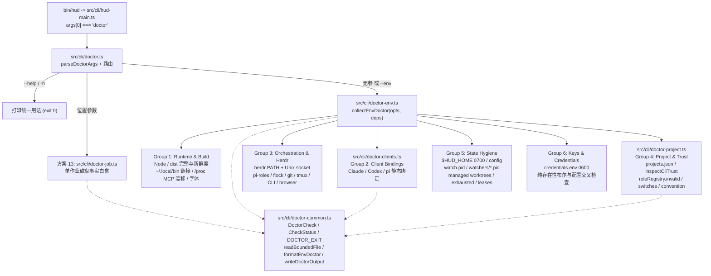
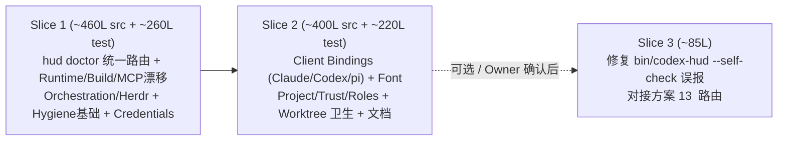

# 20. 全局环境与全链路健康体检 `hud doctor`（与方案 13 单作业诊断互补）

> **优先级**：P2（排障减耗与升级闭环，Owner 挑选后排期） ｜ **类别**：CLI / 运行链路诊断 / 安装与状态卫生 ｜ **预估规模**：M（2 个核心垂直切片 + 1 个可选兼容收敛切片；核心源码 ~850 行，测试 ~480 行，文档 ~40 行） ｜ **前置依赖**：无硬前置、零新第三方依赖（纯 Node ≥24 标准库 + 现有 `@iarna/toml`）；与 **方案 13**（`hud doctor <jobId>`）共享同一命令入口和输出契约，二者可按任意顺序独立落地；已适配 `BUILD-DEDUP-01..02` 单一 `dist/` 布局 ｜ **`docs/spec.md` 边界影响**：无产品红线突破——命令行按需、严格只读、零网络请求、零常驻服务，不在面板新增诊断页（严守 `docs/spec.md:170-171` 2026-11-11 决定“delete Timeline, the Activity hub, Summary and the diagnostics pages”），仅新增一个用户 CLI 子命令 `hud doctor`（建议 Owner 确认后在 `docs/reference.md` / `docs/reference.zh.md` 登记；若 Owner 希望同步写入 `docs/spec.md` §2.4 安装与自检一句，须先获拍板）

---

## 1. 背景与现状证据

### 1.1 现行环境诊断能力碎片化、盲区多且存在陈旧失效检查

MyHUD 已经演进为覆盖 Claude Code、Codex、pi、herdr、pi-roles、外部交互式 CLI（`claude`/`codex`/`agy`/`grok`）与浏览器工具（`google-chrome`/`jev-*`）的完整本地编排系统，但排障检查仍散落在 4 处互不联通的脚本与模块中，缺少“一条命令看清整机与当前项目链路健康度”的统一只读体检入口：

| 现有检查面 | 源码位置 | 已做检查 | 现状缺陷与覆盖盲区 |
|---|---|---|---|
| `bin/codex-hud --self-check` | `bin/codex-hud:1102-1170`（分发见 `:1231-1234`） | `ZDOTDIR`、`codex` PATH/防递归、`node` 存在、`tmux`、shell rc 中的 `# codex-hud alias`（`ALIAS_MARKER`，`:45`）、`dist/index.js` 存在 | **1. 标准安装必败**：`:1145-1158` 强制要求 rc 文件含 `# codex-hud alias`，但现行 `./install` 明确不修改 shell rc（`install:103-113`、`install.d/README.md:24`、`docs/reference.md:34`），导致正常安装后 `--self-check` 必然返回 `exit 1`。<br>**2. 未查 Node ≥24**：`:1126-1131` 只查 `node` 在 PATH，未核验主版本 ≥24。<br>**3. 盲区巨大**：不查 `dist/` 是否落后 `src/`、不查 MCP/Claude/pi/herdr/trust/权限/死 PID。 |
| `install.d/{herdr,browser}.sh` (`hud_ext_check`) | `install.d/herdr.sh:3-19`<br>`install.d/browser.sh:3-18` | PATH 检查 `herdr`/`pi-role`/`pi-role-reap`/`pi-dispatch`/`pi` 及 `google-chrome`/`jev-{ask,aistudio,flow}` | 仅在 `./install` 阶段作为 bash preflight 运行（`install:42-46`），无法在日常运行时按需复查；不查 `flock`（`src/roles/lease.ts:56-57`）、`tmux`、`HERDR_SOCKET_PATH` 连通性，也不感知 `$HUD_HOME/harnesses.json` 的禁用开关。 |
| `bin/codex-hud-fonts --check` | `bin/codex-hud-fonts:38-136` | 纯本地只读检查 MesloLGS NF 四字重（WSL 查 Windows 字体目录，Linux 查 `XDG_DATA_HOME/fonts` 和 `fc-list`） | 仅覆盖终端字体，且独立于 `hud` 主 CLI 入口。 |
| `src/cli/hud-main.ts` | `src/cli/hud-main.ts:12-47` | 子命令有 `statusline`/`panel`/`codex`/`trust`/`setup`/`tickets`/`watch`/`board`（外加 `bin/hud:7-15` 的 `uninstall` 与 `src/cli/hud.ts:40-43` 的 `import`） | **无 `doctor` 诊断命令**。面板虽然有 `Control` 视图展示角色与开关（`src/roles/role-control.ts`），但不检查构建新旧、运行中进程漂移、客户端绑定完整性、目录权限与死 PID。 |

### 1.2 反复出现的真实运行期痛点（均已有代码或日志实证）

1. **改完代码忘 `npm run build`，或 `npm run build` 后忘记 `/mcp` 重连导致旧 MCP 代码继续服务**：
   - `scripts/build.mjs:84-111` 仅在字节变化时原子替换 `dist/` 文件，每次成功构建都会刷新 `dist/index.js` 的 mtime（`:103-108`），仅在非 `mcp/` 文件变化时最后替换 `dist/tree-page.js` 以触发面板 `PanelReload`（`src/utils/panel-reload.ts:38-66`）。
   - 但 `docs/ARCHITECTURE.md:484` 指出“Panels reload after a valid build; bars still need restarting for new code”，**常驻于主会话的 stdio `hud-mcp` 进程同样不会自重载**。`docs/handoff/STATE.md:22-24` 与 `:229-230` 反复出现人工提醒“`/mcp` reconnect first (sessions started before today run old MCP code)”。此外，`BUILD-DEDUP-01..02` 落地后，老工作目录可能残留废弃的 `packages/hud-mcp/dist/`（`scripts/build.mjs:11,134-136`）。
2. **目录与凭据权限/形态错误导致运行时隐蔽报错**：
   - `privateHome()`（`src/cli/private-home.ts:14-33`）要求 `$HUD_HOME` 为非符号链接真实目录且 mode 满足 `(mode & 0o077) === 0`（`0700`），不合规时直接 `invalid_hud_home`（exit 3）。
   - `readPrivateAssignments()`（`src/jev/ask/config.ts:62-78`）要求 `$HUD_HOME/credentials.env` 必须为非 symlink 普通文件、严格 `0600`、≤64 KiB，否则抛 `JevFailure('jev_env_perms')` 使全部模型特性静默失能。
3. **客户端绑定漂移与 `env_vars` 缺失**：
   - `./install` 将 `~/.local/bin/{hud,hud-mcp,hud-statusline}` 与各客户端技能链接到当前 checkout，且写入 `$HUD_HOME/pi-{package,display}/binding.json`（`install.d/pi.sh:63-72`，加载校验见 `integrations/pi/package/binding.mjs:4-18`）。一旦移动/切换工作树或手动编辑配置，就会出现多份 checkout 指向不一致、Codex `config.toml` 遗漏 `env_vars`（`install.d/codex.sh:52` 需要透传 `HERDR_*` 与 `HUD_JOB_DIR`）、或遗留已退役的 `to-tickets` 技能链接（`install.d/claude.sh:73-79`）。
4. **项目级配置、trust 与状态文件卫生缺少一次性自检视图**：
   - 克隆仓库自带 `.hud/` 但未在 `$HUD_HOME/projects.json` 注册时会被静默忽略（`src/roles/roster.ts:515-523` `projectConfigIgnored()`）；
   - 交互式 CLI 派发前要求当前 `cwd` 已在 `claude`/`agy`/`grok` 本地 trust 文件中显式授权且拒绝 symlink（`src/cli/trust.ts:25-37,132-148`）；
   - `$HUD_HOME/harnesses.json` 语法损坏会抛 `HarnessSwitchError`（`src/roles/harness-switches.ts:11-16`）瘫痪整套角色求值；无效 role JSON 仅在 `registry.invalid()` 中静默跳过（`src/roles/roster.ts:537-600`）；
   - 运行期会留下 `$HUD_HOME/watch.pid`（`packages/hud-mcp/bin/hud-watch.mjs:22,69`）、`$HUD_HOME/watchers/*.pid`（`src/cli/watch.ts:264-275` 与 `packages/hud-mcp/bin/hud-notify.mjs:13-26`）、未清理或带 `worktree_kept_reason` 的托管 worktree（`packages/hud-mcp/bin/hud-watch.mjs:199-205`、`src/mcp/managed-worktree.ts:91-128`）、生效中的 `exhausted.json` 配额冷却（`src/roles/exhausted.ts:162-164`）与 `$HUD_HOME/leases/*.json` 锁文件（`src/roles/lease.ts:59-60`）。

### 1.3 与方案 13（`hud doctor <jobId>`）及现有脚本的清晰边界

| 工具 / 方案 | 定位与回答的问题 | 输入范围 | 关系与边界 |
|---|---|---|---|
| **方案 20（本方案）**<br>`hud doctor` / `hud doctor --env` | **全局环境与全链路健康体检**：“这台机器和这个目录能不能可靠地跑 HUD、MCP、面板、worker 和外挂工具？有哪些陈旧进程/配置/权限/残留状态？” | 宿主机运行时、构建产物、`/proc` 进程、客户端绑定、herdr socket、`--cwd` 项目/trust、`$HUD_HOME` 状态卫生、凭据权限与存在性 | 统一 `hud doctor` 的无参默认模式与 `--env` 显式模式。与方案 13 共享 CLI 路由、输出格式约定与退出码，**零职责重叠**。 |
| **方案 13**<br>`hud doctor <jobId>` | **单作业磁盘事实白盒**：“作业 `j...` 为什么没 settle / 没通知 / 回执不匹配？” | `$HUD_HOME/jobs/<jobId>/` 下 10+ 作业文件及 `/proc` worker/supervisor 存活 | 统一 `hud doctor` 的位置参数模式（匹配 `/^j[0-9a-f]{16}$/`）。**不查全局环境，不连 herdr socket**（见 `13-hud-doctor-job.md:48-52`）。 |
| `install.d/{herdr,browser}.sh` (`hud_ext_check`) | **安装期前置门槛**（`./install` 运行在 build 之前） | 外部 CLI PATH 存在性 | 保持 bash 原样服务 `./install`；`hud doctor` 在 TS 侧对齐同一清单并扩展运行时维度，不 `source` bash 脚本。 |
| `bin/codex-hud --self-check` | **Codex tmux 包装器兼容自检**（受 `docs/contracts/07-outbound-compat.md:163` 约束） | Codex tmux 启动器局部依赖 | 保留命令不破坏外向兼容；可选 Slice 3 修复失效的 `ALIAS_MARKER` 误报、补齐 Node ≥24 检查，并在输出末尾指引使用 `hud doctor`。 |
| `bin/codex-hud-fonts --check` | **终端字体独立检测/安装工具** | MesloLGS NF 字体目录 | `hud doctor` 在 TS 侧复用同等纯本地只读目录判定（绝不下载），缺失时提示运行 `bin/codex-hud-fonts` 或切 ASCII 图标。 |

> **与方案 13 §6 Q3 的显式衔接**：方案 13 原稿在 `13-hud-doctor-job.md:136` 对“不带 id 运行 `hud doctor` 时做什么”给出的默认建议是“打印用法并退出 2，不做整条链路体检”。若 Owner 采纳本方案 20，则两份方案收敛为一个清晰命令面：**无参 `hud doctor`（及 `hud doctor --env`）做全局环境体检，`hud doctor <jobId>` 做单作业诊断**；二者代码完全解耦，先后落地互不阻塞。

---

## 2. 目标与非目标（Scope / Out of Scope）

### 目标（Scope）

1. **统一入口与参数契约**：
   - `hud doctor [--env] [--json] [--cwd <dir>] [--offline]`：运行 6 组全局环境与链路健康检查；
   - `hud doctor <jobId> [--json]`：预留并路由至方案 13 的单作业磁盘白盒诊断；
   - `hud doctor --help`：打印覆盖两种模式的简洁帮助并退出 `0`。
2. **六大分组全链路离线体检**：覆盖 **Runtime & Build（含运行中 `hud-mcp` 进程漂移）**、**Client Bindings（Claude/Codex/pi）**、**Orchestration & Herdr（含本地 Unix socket 探活）**、**Project & Trust（注册、CLI trust、无效 role、switches、convention）**、**State Hygiene（`$HUD_HOME` 权限、配置校验、`watch.pid`、`watchers/*.pid`、托管 worktree、`exhausted.json`、`leases/`）**、**Keys & Credentials（`0600` 权限与存在性，零值泄漏）**。
3. **严格只读、零副作用、零外网请求**：
   - 不写/改/删任何文件，不创建目录，不改权限，不发送信号杀死进程，不启动 watcher/Chrome/外部模型 CLI；
   - 不发任何 HTTP/HTTPS 请求（绝不校验 API Key 在线有效性、绝不触发付费或登录探测）；唯一主动 I/O 是可选的本地 `HERDR_SOCKET_PATH` Unix domain socket 只读探活（`--offline` 时跳过）；
   - 每条非 `ok`/`skip` 检查项给出**明确状态级别（`warn`/`fail`）与单条具体修复提示（`fix:`）**。
4. **结构化与脚本友好**：提供稳定退出码（`0` / `1` / `2`）和 `--json`（`schema_version: 1`），全纯函数格式化、固定英文、无 ANSI 转义，可直接被主会话或脚本消费。

### 非目标（Out of Scope）

1. **不做自动修复（无 `--fix`）**：不自动 `chmod`、不自动删死 PID、不自动 `git worktree remove`、不自动运行 `./install` 或 `hud trust`（遵守 `docs/spec.md:140-141` 防不可逆变更与 `docs/delegation.md:41-42` 风险边界；作为开放问题交 Owner 确认）。
2. **不发任何网络或模型调用**：不调用 OpenAI / Gemini / Mistral / TypeSafe / GitHub `gh` API，不调用 `pi --list-models`、`agy models`、`grok`、`claude`、`codex` 或启动 `google-chrome`（吸取 `STATE.md:236-237` 教训，外部 CLI 绝不探测执行，仅做 PATH 可执行性与静态配置文件只读检查）。
3. **不新增 MCP 工具，不在面板新增诊断页**：严格遵守 `docs/spec.md:170-171` 不在面板恢复 diagnostics 页面的决定；不扩大 `hud-mcp` 工具面。
4. **不替代单作业诊断**：不对单个 `j<16hex>` 作业展开 `turn.json`/`done.json`/`report.md` 回执比对（归属方案 13）。
5. **不修改任何运行时状态或缓存**：绝不实例化 `ProjectCollector`（避免顺手落盘 `display/thin-jobs.json` 缓存），绝不调用 `thin-main.ts` 的 `readRow()`（避免改写 `STATUS.json`/`exhausted.json`）。

---

## 3. 核心设计方案

### 3.1 命令路由与模块职责划分



各模块边界与复用关系：

| 文件 | 职责 | 只读复用的现有导出 |
|---|---|---|
| `src/cli/doctor-common.ts` | 共享 `CheckStatus`、`DoctorCheck`、`DOCTOR_EXIT`、`JOB_ID_RE`、安全有界读取 `readBoundedFile`（`O_RDONLY \| O_NOFOLLOW \| O_NONBLOCK`）、通用文本/JSON 输出辅助 | 仅 Node 内置模块 |
| `src/cli/doctor.ts` | `hud doctor` 统一路由入口：参数校验、帮助文本、派发到 `doctorEnvCommand` 或方案 13 的单作业诊断 | `CliError`（`src/cli/private-home.ts:5-12`） |
| `src/cli/doctor-env.ts` | 全局环境体检编排器 `collectEnvDoctor()` + 纯格式化 `formatEnvDoctor()` + Group 1（Runtime/Build/MCP 进程漂移）、Group 3（Orchestration/Herdr socket）、Group 5 核心（权限/配置/PID/exhausted/leases）、Group 6（Credentials 零泄漏检查） | `installationRoot`（`compat.ts:8`）、`getHudHome`（`hud-home.ts:6`）、`executable`（`roster.ts:85`）、`readHarnessSwitches`（`harness-switches.ts:30`）、`readExhausted`（`exhausted.ts:162`）、`readLease`/`leaseActive`（`thin-jobs.ts:291,304`）、`procStat`（`worker-tree.ts:18`）、`herdrId`（`herdr-run.ts:139`）、`readHudConfig`/`resolveDecisions`（`jev/ask/config.ts:26,34`）、`loadSettings`（`settings.ts`） |
| `src/cli/doctor-clients.ts` | Group 2 客户端绑定静态检查（Claude Code / Codex / pi）+ 纯本地字体只读检查 | `@iarna/toml`、`executable`（`roster.ts:85`） |
| `src/cli/doctor-project.ts` | Group 4 项目注册、CLI trust、角色/开关/convention 体检 + Group 5 托管 worktree 与安全 Git `prunable`/孤立目录检查 | `registeredProject`/`sharedRoot`（`projects.ts:46,72`）、`roleRegistry`（`roster.ts:501`）、`inspectCliTrust`（从 `trust.ts` 抽出的纯只读判定）、`worktreeGit`/`parseWorktreeList`（`worktrees.ts:43,85`） |

### 3.2 退出码与数据结构契约

#### 退出码语义（环境模式与单作业模式统一）

| 退出码 | 常量 | 触发条件 |
|---|---|---|
| `0` | `DOCTOR_EXIT.OK` | 环境体检中 `fail === 0`（全部 `ok`/`skip` 或仅有 `warn`）；或 `--help`；或单作业诊断成功读出报告 |
| `1` | `DOCTOR_EXIT.FAIL` | 环境体检中至少存在 1 条 `status === 'fail'`；或发生未预期的内部/输出失败 |
| `2` | `DOCTOR_EXIT.USAGE` | 非法选项、缺失 `--cwd` 值、`--cwd` 非目录、非法的 `<jobId>`、或混用 `<jobId>` 与 `--env`/`--cwd`/`--offline` |

> **关键设计决定**：与 `privateHome()`（`src/cli/private-home.ts:14-33`，失败直接抛 `exitCode = 3`）不同，`hud doctor` 遇到 `$HUD_HOME` 不存在或权限非 `0700` 时**绝不提前中止**，而是将 `hygiene.hud_home_perms` 记为 `fail` 后继续运行其余检查，让用户一次输出看到完整问题清单，最终以 `exit 1` 退出。

#### TypeScript 数据结构与 `--json` Schema

```ts
export type CheckStatus = 'ok' | 'warn' | 'fail' | 'skip';

export type DoctorGroupId =
  | 'runtime'
  | 'clients'
  | 'orchestration'
  | 'project'
  | 'hygiene'
  | 'credentials';

export interface DoctorCheck {
  /** 稳定机器可读检查 ID，格式 `<group>.<name>` */
  id: string;
  group: DoctorGroupId;
  label: string;
  status: CheckStatus;
  /** 单行摘要（固定英文、无 ANSI、严禁含凭据值） */
  summary: string;
  /** 可选逐条明细（有界，最多保留 20 条，文本渲染默认展示前 5 条） */
  details?: string[];
  /** 非 ok/skip 时的单条可执行修复建议 */
  fix?: string;
}

export interface DoctorEnvReport {
  schema_version: 1;
  mode: 'env';
  checked_at: string;
  install_root: string;
  hud_home: string;
  cwd: string;
  offline: boolean;
  summary: { ok: number; warn: number; fail: number; skip: number };
  checks: DoctorCheck[];
}

export interface DoctorEnvDeps {
  env?: NodeJS.ProcessEnv;
  cwd?: string;
  installRoot?: string;
  nowMs?: number;
  nodeVersion?: string;
  platform?: NodeJS.Platform;
  procRoot?: string;
  uid?: number;
  euid?: number;
  probeHerdrSocket?: (socketPath: string, paneId: string | undefined, timeoutMs: number) => Promise<HerdrSocketProbe>;
  runGit?: WorktreeGit;
}
```

### 3.3 六大分组完整检查矩阵

每项均保证：**严格只读零副作用、零外网请求、绝不输出任何密钥值、单条明确修复提示**。

#### 分组 1：`runtime`（Runtime & Build & 运行中进程漂移）

| ID | 检查项 | 检查来源与判定规则 | `ok` | `warn` | `fail` | `skip` | 修复提示（`fix`） |
|---|---|---|---|---|---|---|---|
| `runtime.node` | Node.js 版本 | `nodeVersion` 主版本对比 `>= 24`（`package.json:40-42`、`docs/ARCHITECTURE.md:87`） | `>= 24` | — | `< 24` | — | `Install Node >=24.0.0 (Node 24 is the tested supported line)` |
| `runtime.dist_complete` | `dist/` 关键入口完整性 | 以 `installRoot` 为基准 `statSync` 校验 6 个入口：`dist/index.js`、`dist/tree-page.js`、`dist/cli/hud.js`、`dist/cli/statusline.js`、`dist/mcp/thin-main.js`、`dist/harness/pi/package-entry.js` | 全部为普通文件 | — | 缺失任一入口 | — | `Run npm run build in <installRoot>` |
| `runtime.dist_fresh` | `dist/` 相对 `src/` 新鲜度与构建卫生 | 若 `<installRoot>/src` 存在：遍历 `src/**/*.ts` 取 `maxSrcMtime`，对比 `dist/index.js` 的 `mtimeMs`（`scripts/build.mjs:103-108` 每次 build 必刷新 `index.js` mtime）；同时检出废弃 `packages/hud-mcp/dist/`（`scripts/build.mjs:11,134-136`）及死 `.dist-stage-*` 目录（`:12,46-53`） | `maxSrcMtime <= distIndexMtime` 且无遗留目录 | `src/` 较 `dist/index.js` 新（列出最新文件与时差）；或存在废弃 `packages/hud-mcp/dist/` / 死 stage 目录 | — | 无 `src/` 目录（如 release 归档安装） | `Run npm run build in <installRoot>`（若有废弃目录：`Run npm run clean after workers stop, then npm run build`） |
| `runtime.bin_symlinks` | `~/.local/bin` 符号链接与 PATH | 检查 `$HOME/.local/bin/{hud,hud-mcp}`（若 Claude 扩展已装则含 `hud-statusline`）的 `lstatSync` / `realpathSync` 是否指向 `<installRoot>` 对应目标（`install:83-94`、`install.d/claude.sh:81-86`）；并检查 `$HOME/.local/bin` 是否在 `env.PATH` | 链接全部有效且指向当前 `<installRoot>`，且在 PATH | `~/.local/bin` 不在 PATH；或链接有效但指向另一份 checkout | 任一核心命令缺失、非预期断链（dangling symlink） | — | `Run ./install --skip-build from <installRoot> (and add ~/.local/bin to PATH)` |
| `runtime.mcp_process_drift` | 运行中 `hud-mcp` 进程漂移 | 扫描 `procRoot`（`/proc`）存活非僵尸进程，匹配运行 `hud-mcp` / `hud-mcp.mjs` 且属于同一 `HUD_HOME` 的进程（区分主会话 `HUD_JOB_DIR` 未设 vs worker 进程）；用 `btime + starttime * 10ms` 计算启动时间，对比 **MCP 可达产物真实最新 mtime**（见 §3.4 详解）与加载路径 | 无运行中主会话 `hud-mcp`，或所有主会话 `hud-mcp` 启动晚于最新 MCP 构建且来自同一 `<installRoot>` | 检测到 ≥1 个主会话 `hud-mcp` 启动早于最新 MCP 产物（列出 PID、启动时间、落后时长）或来自另一 checkout | — | 非 Linux 或 `/proc` 不可读 | `Reconnect MCP in active sessions (run /mcp in Claude Code, or restart Codex/pi)` |
| `runtime.font` | 终端字体 MesloLGS NF（体验提示） | 读取 `loadSettings(env).icons`；若非 `ascii`，纯本地只读检查 WSL Windows 字体目录或 Linux `XDG_DATA_HOME/fonts` / `CODEX_HUD_FONT_DIR` 四字重文件（同 `bin/codex-hud-fonts:52-74`，绝不下载） | 4 字重文件齐全 | 缺失字体文件（仅提醒，不阻塞） | — | `icons === 'ascii'` | `Run bin/codex-hud-fonts (or set Settings -> Display -> Icons to ascii)` |

#### 分组 2：`clients`（Client Bindings：Claude Code / Codex / pi）

> **安装子集感知原则**：`docs/spec.md:122-123` 允许只安装部分客户端扩展（`./install --with claude,pi` 等）。因此，**若某客户端 CLI 不在 PATH 且对应配置目录不存在**，该项记为 `skip`（`not installed`），绝不产生误报。

| ID | 检查项 | 检查来源与判定规则 | `ok` | `warn` | `fail` | `skip` | 修复提示（`fix`） |
|---|---|---|---|---|---|---|---|
| `clients.claude` | Claude Code 绑定 | 对照 `install.d/claude.sh:54-101` 与 `config-counts.ts:15-46`：<br>1. `claude` PATH；<br>2. `$CLAUDE_CONFIG_DIR/.claude.json` / `~/.claude.json` / `$CLAUDE_CONFIG_DIR/settings.json` 中 `mcpServers.hud` 存在、未在 `disabledMcpServers`、命令目标可执行、`HUD_MCP_SURFACE` 合法（未设或 `roles`，见 `surface.mjs:6-8`）；<br>3. `settings.json` 的 `statusLine`（HUD statusline 且 `hud-statusline` 有效，或保留的 owner 自定义 statusline）；<br>4. `commands/hud.md` 存在；<br>5. `skills/{hud-delegate,hud-setup,hud-handoff}` 指向当前 `<installRoot>`，且无遗留 HUD 所属 `skills/to-tickets` 链接 | 全部已注册且指向当前 `<installRoot>` | `claude` 已装但未注册 HUD MCP、部分 skill/command 缺失、指向旧 checkout 或残留旧 `to-tickets` 链接 | `settings.json` / `.claude.json` JSON 损坏，或已注册的 `mcpServers.hud.command` 指向不存在路径 / 无效 `HUD_MCP_SURFACE` | 无 `claude` 且无 `$CLAUDE_CONFIG_DIR` | `Run ./install --skip-build --with claude from <installRoot>` |
| `clients.codex` | Codex CLI 绑定 | 对照 `install.d/codex.sh:41-66` 与 `codex-config.ts:15-52`：<br>1. `codex` PATH，且**不指向** `bin/codex-hud`（防循环调用，继承 `bin/codex-hud:1117-1120`）；<br>2. 解析 `$CODEX_HOME/config.toml`（`@iarna/toml`，上限 256 KiB）：校验 `[mcp_servers.hud]` 存在、`enabled !== false`、`command` 可执行，且 `env_vars` 覆盖关键透传项 `HERDR_PANE_ID`、`HERDR_SOCKET_PATH`、`HERDR_ENV`、`HUD_JOB_DIR`（`install.d/codex.sh:52`）；<br>3. `skills/{hud,hud-delegate,hud-setup,hud-handoff}` 指向当前 `<installRoot>`，且无遗留 HUD 所属 `to-tickets` | 全部已注册、透传变量完整且指向当前 `<installRoot>` | `codex` 已装但未注册 MCP、`env_vars` 缺项、skill 漂移或残留 `to-tickets` | `config.toml` TOML 损坏、`[mcp_servers.hud]` 指向断链、或 `codex` 解析到 `bin/codex-hud` | 无 `codex` 且无 `$CODEX_HOME` | `Run CODEX_HOME=<codexHome> ./install --skip-build --with codex from <installRoot>` |
| `clients.pi` | pi 扩展与包绑定 | 对照 `install.d/pi.sh:49-84` 与 `integrations/pi/package/binding.mjs:4-18`：<br>1. `pi` PATH；<br>2. 校验 `$HUD_HOME/pi-{package,display}/binding.json`：字段 `release`/`hudHome`/`node` 均为有效路径、关键文件 `dist/harness/pi/package-entry.js` 存在，且 `release === installRoot`、`hudHome === resolvedHudHome`；<br>3. 校验 `$PI_CODING_AGENT_DIR/settings.json` 中 `packages` 包含 `pi-package` 与 `pi-display`，`extensions` 包含 `-extensions/p10k-footer.ts`（`install.d/pi.sh:23`）；<br>4. `$HUD_HOME/pi-package/skills/{hud-delegate,hud-setup,hud-handoff}` 链接完整 | 两个包均有效注册且 `binding.json` 与当前环境一致 | `pi` 已装但未注册包、`binding.json` 指向另一 checkout、缺 `p10k-footer` 过滤器或 skill 漂移 | `pi` 已在 `settings.json` 注册了 `pi-package`/`pi-display`，但 `binding.json` 损坏或目标文件缺失（会导致 pi 启动直接抛 `invalid_pi_binding`），或 `settings.json` JSON 损坏 | 无 `pi` 且无 `$PI_CODING_AGENT_DIR` 且无 `pi-package` | `Run ./install --skip-build --with pi from <installRoot>` |

#### 分组 3：`orchestration`（Orchestration, Herdr & 外部依赖）

| ID | 检查项 | 检查来源与判定规则 | `ok` | `warn` | `fail` | `skip` | 修复提示（`fix`） |
|---|---|---|---|---|---|---|---|
| `orchestration.herdr_bin` | `herdr` 二进制 | `executable('herdr', env)`（对照 `install.d/herdr.sh:5,18`） | 可执行 | — | 不在 PATH | — | `Install herdr and add it to PATH` |
| `orchestration.herdr_socket` | `HERDR_SOCKET_PATH` 本地 IPC 探活 | 非 `--offline` 且 `HERDR_SOCKET_PATH` 已设时：`lstatSync` 验证为 socket 文件，经 `node:net` `createConnection`（1000 ms 硬超时）发只读 JSON-RPC 探测（见 §3.4） | socket 连通且返回合法 JSON 响应 | `HERDR_SOCKET_PATH` 未设置（在 herdr 外部终端运行） | `HERDR_SOCKET_PATH` 已设置但文件缺失、非 socket、`ECONNREFUSED`、超时或协议畸形 | `--offline` | `Run inside a live herdr pane, or restart herdr if the socket is stale` |
| `orchestration.pi_roles` | `pi-roles` 工具链 | `executable` 检查 `pi-role-reap`、`pi-role`、`pi-dispatch`、`pi`（对照 `install.d/herdr.sh:5-17`），结合 `readHarnessSwitches` 感知 `pi` 是否被禁用 | 全部存在（或 `pi` 禁用时仅 `pi-role-reap` 存在） | `pi`/`pi-role`/`pi-dispatch` 缺失（在 `pi` 启用时） | `pi-role-reap` 缺失（`hud-watch.mjs:335` 与 `panel-pane.ts:64` 清理所有 worker tab 均依赖它） | — | `Install the external pi-roles bundle and add its bin/ to PATH` |
| `orchestration.utilities` | 基础系统工具 | `executable` 检查 `git`、`flock`（`src/roles/lease.ts:56-57` `hud_lease` 硬依赖）、`tmux`（`bin/codex-hud:344`） | 全部存在 | 仅 `tmux` 缺失（影响 `hud codex` 底部栏） | `git` 或 `flock` 缺失 | — | `Install missing OS tools (git, util-linux for flock, tmux)` |
| `orchestration.cli_agents` | 启用的交互式 CLI 代理 | 遍历当前生效角色链中引用的 `cli` 代理（`claude`/`codex`/`agy`/`grok`，`src/roles/cli-kinds.ts:2`），排除在 `harnesses.json` 中已 `disabled` 的 `cli:<agent>`，检查 `executable(agent, env)` | 所有启用且被引用的 CLI 均存在 | 至少 1 个启用且被引用的 CLI 缺失 | — | 无启用中的 CLI 角色 | `Install <agent> on PATH, or disable cli:<agent> in hud panel (Control -> Harnesses)` |
| `orchestration.browser_tools` | 浏览器工具链（纯 PATH） | `executable` 检查 `google-chrome`、`jev-ask`、`jev-aistudio`、`jev-flow`（对照 `install.d/browser.sh:5-17`、`project-board.ts:295`、`docs/ARCHITECTURE.md:247-248`，**绝不启动 Chrome 或联网**），结合 `harnesses.json` 禁用状态 | `google-chrome` 与启用中的 `jev-*` 均存在 | 缺 `google-chrome` 或启用的 `jev-ask`/`jev-aistudio`/`jev-flow` | — | 全部 `bro:*` 已禁用且无活跃 `bro` 角色 | `Install google-chrome and external jev-* CLIs separately on PATH` |

#### 分组 4：`project`（Project, Roles & CLI Trust — 针对 `--cwd`）

| ID | 检查项 | 检查来源与判定规则 | `ok` | `warn` | `fail` | `skip` | 修复提示（`fix`） |
|---|---|---|---|---|---|---|---|
| `project.registration` | 项目注册与 `.hud/` 生效状态 | 调用 `registeredProject(hudHome, cwd)`（`src/roles/projects.ts:72-92`）与 `registry.projectConfigIgnored()`（`src/roles/roster.ts:515-523`）；顺检 `$HUD_HOME/projects.json` 语法及是否含已删除目录的失效条目；汇报 `.hud/brief.md` 存在性 | 已注册或无 `.hud/` 目录，且 `projects.json` 合法无死项 | 存在 `<root>/.hud/` 但未注册（配置被静默忽略）；或 `projects.json` 含已删除目录的失效条目 | `$HUD_HOME/projects.json` JSON 损坏 | — | `Run hud setup --detect (or /hud-setup) in <root> to register .hud/` |
| `project.cli_trust` | 当前 `--cwd` 的 CLI Trust 状态 | 调用只读 `inspectCliTrust(agent, cwd, env)`（从 `src/cli/trust.ts` 抽出）逐一检查 `claude`/`agy`/`grok`（`codex` 标注 `skipped: bypass flag`），并结合 `readHarnessSwitches` 将已禁用代理标注为 `disabled` 不触发告警 | 所有启用且已安装本地配置文件的 CLI 均已信任 `<cwd>` | 存在启用且已安装的 CLI 尚未信任 `<cwd>`；或对应信任文件为 symlink / 格式损坏（会导致 `dispatchCli` 拒绝启动） | — | 无启用中的需 trust CLI | `Run hud trust <cwd>`（若信任文件为 symlink：`Replace symlinked trust file with a regular file before running hud trust`） |
| `project.roles_and_switches` | 角色定义、开关与 Convention | 1. 调用 `readHarnessSwitches(hudHome)` 捕获 `HarnessSwitchError`；<br>2. 调用 `roleRegistry(hudHome, cwd, env)` 获取 `registry.invalid()`（`src/roles/roster.ts:598-600`）；<br>3. 对每个有效角色执行 `registry.assignment(role, nowMs)` 检查 `available === false` 与 `preset_missing`（`:589`）；<br>4. 检查 `registry.convention()`（`:715-728`） | `harnesses.json` 合法、无无效 role 文件、全部角色至少有 1 个可用 place、convention 有效 | 存在 `registry.invalid()` 无效 role 文件；或有角色 `available === false` / `preset_missing` | `harnesses.json` 损坏（`HarnessSwitchError`）或 `convention_not_found` | — | `Fix invalid role JSON / harnesses.json listed above, or switch place in hud panel (Control)` |

#### 分组 5：`hygiene`（目录权限与状态卫生）

| ID | 检查项 | 检查来源与判定规则 | `ok` | `warn` | `fail` | `skip` | 修复提示（`fix`） |
|---|---|---|---|---|---|---|---|
| `hygiene.hud_home_perms` | `$HUD_HOME` 目录安全与权限 | 复用 `privateHome(env)` 的精确 6 条判据（`src/cli/private-home.ts:14-33`）：绝对路径、不含 `\0`、存在且非 symlink、`realpathSync(home) === home`、属主匹配 `uid === euid`、权限 `(mode & 0o077) === 0`（`0700`） | 全部满足 | — | 目录不存在、是 symlink、属主不匹配或权限过宽（如 `0755`） | — | `chmod 700 <hudHome> (or mkdir -m 700 <hudHome>)` |
| `hygiene.config_files` | `hud-settings.json` & `config.json` | 校验 `$HUD_HOME/hud-settings.json`（≤64 KiB、合法 JSON 对象、权限建议 `0600`）与 `$HUD_HOME/config.json`（`readHudConfig` + `resolveDecisions`，`src/jev/ask/config.ts:26-61`） | 合法或尚未创建 | 文件存在但权限过宽（`(mode & 0o077) !== 0`） | JSON 损坏、非对象、超 64 KiB 或 `decisions` 字段非法 | — | `Fix JSON syntax in <file> or chmod 600 <file>` |
| `hygiene.watch_pid` | `watch.pid` 与 `watch.log` | 只读检查 `$HUD_HOME/watch.pid`（`hud-watch.mjs:22,69`、`thin-main.ts:265`）：校验 PID 存活且 `/proc/<pid>/cmdline` 含 `hud-watch.mjs`；交叉比对当前是否存在开放 job 但 watcher 已死；读取 `watch.log` 尾部最后 8 KiB 检出近期错误 | 无 `watch.pid` 且无开放 job，或 PID 存活且身份匹配 | `watch.pid` 指向死 PID / PID 复用；或存在开放 job 但 watcher 未运行；或 `watch.log` 尾部含近期错误 | — | — | `Remove stale <hudHome>/watch.pid if no jobs are open (restarts on next hud_create)` |
| `hygiene.pane_watchers` | `watchers/*.pid` 陈旧死 PID | 扫描 `$HUD_HOME/watchers/*.pid`（有界最多 256 项），按 `packages/hud-mcp/bin/hud-notify.mjs:28-52` 相同规则只读验证纯数字 PID（`hud watch`）与 JSON 对象（pi 原生 `{pid, start, pane, home}`）的存活、`/proc/<pid>/stat` 启动时间与 `HERDR_PANE_ID` 归属 | 全部存活或目录为空 | 发现 ≥1 个陈旧/死 PID/格式损坏的 `.pid` 文件（列出文件名与 PID） | — | — | `Remove stale PID file(s) under <hudHome>/watchers/` |
| `hygiene.managed_worktrees` | 托管 worktree 与孤立目录卫生 | 1. 扫描最新 200 个 `$HUD_HOME/jobs/j*/job.json`（单文件 ≤64 KiB，超限标截断）：统计含 `worktree_kept_reason` 的保留 worktree 及已终结但悬空的 worktree；<br>2. 若 `--cwd` 位于 Git 仓库，经安全只读 `worktreeGit(sharedRoot, ['worktree', 'list', '--porcelain', '-z'])` 检出 `prunable` worktree 以及 `<parent>/<repo>-wt/*`（`managed-worktree.ts:14`）中不被任何 job 引用的孤立目录 | 无保留/悬空/孤立/`prunable` worktree | 存在带 `worktree_kept_reason` 的未清理 worktree、悬空托管 worktree、`prunable` 记录或 `-wt/` 孤立目录 | — | — | `Review changes then run git worktree remove <path> (or git worktree prune)` |
| `hygiene.exhausted` | `exhausted.json` 配额冷却清单 | 先做非静默文件检查（非 symlink、≤64 KiB、合法 `version: 1` JSON），再调用 `readExhausted(hudHome, nowMs)`（`src/roles/exhausted.ts:162-164`）列出所有仍在冷却期的 `placeKey`、剩余时长与截断后的 `reason` | 文件合法（或不存在）且无生效中的配额冷却 | 存在 ≥1 条生效中的配额冷却；或 `exhausted.json` 为 symlink / 损坏 / 超大 | — | — | `Wait for quota reset or clear marks in hud panel (Control tab)` |
| `hygiene.leases` | `$HUD_HOME/leases/*.json` 锁文件卫生 | 遍历 `$HUD_HOME/leases/*.json`（有界 256 项），复用 `readLease` + `leaseActive`（`src/collectors/thin-jobs.ts:291-316`），汇报当前活跃锁数量及是否残留损坏或过期锁文件 | 无损坏锁与过期堆积（活跃锁在 summary 中如实展示） | 存在损坏锁文件，或已过期未回收的陈旧锁文件 | — | — | `Stale leases auto-reclaim on next hud_lease; remove corrupt files under <hudHome>/leases/` |

#### 分组 6：`credentials`（Keys & Credentials — 严格零泄漏、零联网）

| ID | 检查项 | 检查来源与判定规则 | `ok` | `warn` | `fail` | `skip` | 修复提示（`fix`） |
|---|---|---|---|---|---|---|---|
| `credentials.file_perms` | `credentials.env` 权限与形态 | 对齐 `readPrivateAssignments`（`src/jev/ask/config.ts:62-78`）：以 `O_RDONLY \| O_NOFOLLOW \| O_NONBLOCK` 打开后 `fstatSync`，必须为普通文件、严格 `mode === 0o600`、体积 `<= 65536` B | 不存在（标注 optional），或满足普通文件 + `0600` + ≤64 KiB | — | 是 symlink、非普通文件、权限非 `0600`（如 `0644`）或超过 64 KiB | — | `chmod 600 <hudHome>/credentials.env`（若是 symlink：`Replace symlink with a regular 0600 file`） |
| `credentials.key_presence` | 凭据变量存在性与开关交叉校验 | 仅提取变量名与非空布尔值（对齐 `project-board.ts:281-294` 零值留存范式，**严禁保留或输出任何值/前缀/长度/哈希**），汇报 `OPENAI_API_KEY`、`GEMINI_API_KEY`、`MISTRAL_API_KEY`、`TYPESAFE_API_KEY` 及 `TEXT_MODEL_*` 来源（`file`/`env`/`file+env`/`absent`）；结合 `loadSettings(env).modelEnabled` 与 `resolveDecisions(config).primary` 交叉校验 | 开关与对应 key 配置自洽（或模型功能关闭且无需 key） | `modelEnabled === true` 但无任何文本模型 key；或 `decisions.primary` 及自动 fallback 均无对应 key | — | `credentials.file_perms` 为 `fail` 时仅检查 `env` 并标注文件未读 | `Add needed keys to <hudHome>/credentials.env (0600) or run hud import, or turn off Model text in Settings` |

### 3.4 关键机制深度设计与边界处理

#### 机制 A：精准检测 `dist/` 新鲜度与运行中 `hud-mcp` 进程漂移（无假阳性）

通过阅读 `scripts/build.mjs:84-111` 发现一个极易踩坑的事实：**`npm run build` 在无源码变动时会原地跳过相同字节文件，但仍会 `fs.utimesSync(dist/index.js, now, now)`（`:107`）**；反之，若修改了 `src/roles/roster.ts` 并重新 build，`dist/roles/roster.js` 与 `dist/index.js` 的 mtime 会更新，而 `dist/mcp/thin-main.js` 自身字节未变，**其 mtime 保持旧值**！

如果天真地只比对 `procStartMs < stat('dist/mcp/thin-main.js').mtimeMs`，会在修改 `src/roles/*` 后漏报漂移；如果改用 `dist/index.js` 的 mtime，又会在零变更 `npm run build` 后产生误报。因此采用两套精确口径分离：

1. **构建新鲜度（`runtime.dist_fresh`）**：`maxMtime(src/**/*.ts)` vs `stat(dist/index.js).mtimeMs`（与 `bin/codex-hud:379` 和 `scripts/build.mjs:105` 注释完全对齐）。
2. **MCP 进程漂移（`runtime.mcp_process_drift`）**：
   - 计算 MCP 运行时依赖树的真实最新文件修改时间 `mcpArtifactMtimeMs` = `max(mtimeMs)`，覆盖：
     - `dist/mcp/**/*.js`、`dist/roles/**/*.js`、`dist/collectors/**/*.js`、`dist/jev/**/*.js`、`dist/utils/**/*.js`、`dist/hud-home.js`、`dist/settings.js`、`dist/cli/trust.js`、`dist/cli/private-home.js`
     - 以及 `packages/hud-mcp/bin/*.mjs`（**显式排除 `dist/index.js`**，避免空构建误报）。
   - 计算宿主机开机基准时间 `bootMs`：优先解析 `${procRoot}/stat` 的 `btime <sec>`（乘 `1000`），缺失时回退 `nowMs - parseFloat(${procRoot}/uptime) * 1000`（与 `src/mcp/cli-judge.ts:90` 一致）。
   - 扫描 `${procRoot}/<pid>`：
     1. 读 `cmdline`（NUL 分隔），识别 `node`/`nodejs` 启动且脚本参数匹配 `/(?:^|\/)hud-mcp(?:\.mjs)?$/` 的进程；
     2. 读 `stat` 确认状态非僵尸（`!/^[ZXx]$/`）并取第 22 字段 `starttime`（`fields[19]`，10 ms/tick，复用 `src/roles/worker-tree.ts:6-16` 解析口径），得 `procStartMs = bootMs + Number(startTicks) * 10`；
     3. 若 `environ` 可读，仅流式匹配 `HUD_HOME=` 与 `HUD_JOB_DIR=` 两项（**不构造全量 env 字典、不留存其他变量**）：
        - 若进程的 `HUD_HOME`（未设则视为 `$HOME/.hud`）与当前 `hudHome` 不一致，视为独立测试/其他实例并跳过；
        - 若设置 `HUD_JOB_DIR`，标记为 `worker` 进程（随当前作业结束自动退出，不要求 `/mcp` 重连）；未设则标记为 `main` 主会话 MCP 进程；
     4. 对每个 `main` 进程判定：
        - 路径漂移：脚本 `realpathSync` 可解析且不等于 `realpathSync(join(installRoot, 'packages/hud-mcp/bin/hud-mcp.mjs'))`；
        - 构建漂移：`procStartMs + 1000 < mcpArtifactMtimeMs`（1 秒容差吸收 `btime` 秒级精度）。

#### 机制 B：本地 `HERDR_SOCKET_PATH` 只读探活（零网络、防挂死）

对照 `packages/hud-mcp/bin/herdr-request.mjs:5-19` 与 `bin/codex-hud-herdr.mjs:68-114` 的协议格式：
- 当 `offline === true`：直接 `skip`；
- 当 `HERDR_SOCKET_PATH` 未设：记 `warn`（用户可能在普通终端或 SSH 下跑体检，不应报错退出 1）；
- 当 `HERDR_SOCKET_PATH` 已设：
  1. `lstatSync(socketPath)` 校验存在且 `isSocket()`（不存在直接 `fail`）；
  2. `net.createConnection(socketPath)`，总超时 `1000 ms`，响应体上限 `64 KiB`；
  3. 连接后发送一行纯只读 JSON-RPC：若 `herdrId(env.HERDR_PANE_ID)` 为真则发 `{"id":"hud-doctor","method":"pane.get","params":{"target":paneId}}\n`，否则发 `{"id":"hud-doctor","method":"tab.list","params":{}}\n`；
  4. 收到任意可解析 JSON 响应行（且 `reply.id === 'hud-doctor'`，若 `pane.get` 返回有效 `pane` 则顺带回报当前 pane 存活；即便返回 `not_found` 也说明 herdr 守护进程存活而 `HERDR_PANE_ID` 陈旧，可精准标 `warn`！）；连接错误或超时标 `fail`。
  5. 立即 `socket.destroy()`，无长连接、无重试循环。

#### 机制 C：零密钥泄漏边界（防御纵深）

对照 `docs/ARCHITECTURE.md:246-247` 与 §8 隐私规则：
- 新增纯只读函数 `inspectCredentialsEnv(file)`，直接仿照 `src/collectors/project-board.ts:282-291` 在逐行正则扫描阶段即把右侧值坍缩为 `boolean`（是否非空），**函数返回值类型中不存在 `string` 凭据字段**；
- 环境变量检查同样只做 `Boolean(env[name]?.trim())`；
- `DoctorCheck.summary`、`details`、`fix` 永远只出现变量名（如 `OPENAI_API_KEY: present (file)`），从类型系统和数据流两层杜绝任何 key 片段落入终端、日志或 `--json` 输出。

#### 机制 D：输出样例（全部为合成数据）

```text
hud doctor (env) · /path/to/MyHUD · HUD_HOME=/home/dev/.hud · cwd=/home/dev/project

Runtime & Build
  [OK]   node                v24.22.1 (>=24.0.0)
  [OK]   dist complete       6/6 entry files present
  [WARN] dist freshness      dist/index.js is 4m older than src/roles/roster.ts
         fix: Run npm run build in /path/to/MyHUD
  [OK]   bin symlinks        hud, hud-mcp, hud-statusline -> /path/to/MyHUD (on PATH)
  [WARN] mcp process drift   1 main hud-mcp process older than latest MCP build
         - pid 41012 (started 2026-11-21T08:10:00Z, 2h 15m behind dist/roles/roster.js)
         fix: Reconnect MCP in active sessions (run /mcp in Claude Code, or restart Codex/pi)
  [OK]   terminal font       MesloLGS NF installed

Client Bindings
  [OK]   claude              MCP hud, statusline, /hud command, 3/3 skills
  [WARN] codex               MCP hud registered; env_vars missing HUD_JOB_DIR
         fix: Run CODEX_HOME=/home/dev/.codex ./install --skip-build --with codex from /path/to/MyHUD
  [OK]   pi                  pi-package & pi-display bound to /path/to/MyHUD

Orchestration & Herdr
  [OK]   herdr binary        /usr/local/bin/herdr
  [OK]   herdr socket        connected (/run/user/1000/herdr.sock, pane p-synth-1 ok)
  [OK]   pi-roles            pi-role, pi-role-reap, pi-dispatch, pi
  [OK]   system utilities    git, flock, tmux
  [OK]   cli agents          claude, codex, agy (grok disabled)
  [OK]   browser tools       google-chrome, jev-ask, jev-aistudio, jev-flow (PATH only)

Project & Trust (/home/dev/project)
  [OK]   project setup       registered (.hud/brief.md present)
  [WARN] cli trust           claude trusted · agy untrusted · grok disabled · codex skipped
         fix: Run hud trust /home/dev/project
  [OK]   roles & switches    7 roles ready · 0 invalid · convention: default

State Hygiene
  [OK]   hud home perms      /home/dev/.hud (0700, owned by current user)
  [OK]   config files        hud-settings.json ok · config.json ok (decisions: openai)
  [OK]   watch.pid           no active watcher (0 open jobs)
  [WARN] pane watchers       1 stale PID file under /home/dev/.hud/watchers/
         - p-old-99.pid (pid 39811 not running)
         fix: Remove stale PID file(s) under /home/dev/.hud/watchers/
  [OK]   managed worktrees   0 kept · 0 orphaned · 0 prunable (scanned 12/12 jobs)
  [WARN] quota exhausted     1 place in cooldown
         - cli:agy:gemini-4-argon-high (until 2026-11-22T09:30:00Z · rate limit)
         fix: Wait for quota reset or clear marks in hud panel (Control tab)
  [OK]   leases              0 active · 0 stale

Keys & Credentials
  [FAIL] credentials.env     mode 0644 (must be 0600; ignored at runtime)
         fix: chmod 600 /home/dev/.hud/credentials.env
  [WARN] key presence        OPENAI_API_KEY env · GEMINI_API_KEY absent · MISTRAL_API_KEY absent · TYPESAFE_API_KEY absent (credentials.env unreadable)
         fix: Fix credentials.env permissions or add needed keys, or turn off Model text in Settings

summary: 19 ok · 7 warn · 1 fail · 0 skip
```

### 3.5 关键备选方案对比与推荐

| 维度 | 备选 A | 备选 B（推荐） | 推荐理由 |
|---|---|---|---|
| CLI 入口归属 | 新增独立命令 `hud check` / 扩写 bash `codex-hud --self-check` | **统一 `hud doctor`**（无参/`--env` 体检环境，`<jobId>` 查单作业） | 符合业界 `doctor` 心智模型；避免子命令碎片化；bash 难以复用 TS 的 `roleRegistry`/`inspectCliTrust`/`@iarna/toml`/`readLease`。 |
| 进程漂移探测 | 执行 `ps -eo pid,lstart,args` | **纯 Node 只读 `/proc`**（可注入 `procRoot`） | MyHUD 明确仅支持 Linux/WSL（`docs/spec.md:8`）；仓内 `worker-tree.ts`/`cli-judge.ts`/`hud-notify.mjs` 全用 `/proc`；无 locale 解析坑；离线单测可 100% 构造伪 `/proc`。 |
| herdr 探活方式 | `spawn('herdr', ['pane', 'get', ...])` | **直接连 `HERDR_SOCKET_PATH` Unix socket**（复用 `herdr-request.mjs` 协议） | 零子进程启动开销；精确区分缺失 socket / `ECONNREFUSED` / 超时 / 畸形响应；测试只需本地临时 `net.createServer`。 |
| 是否带 `--fix` | 内置 `--fix` 自动清理死 PID / `chmod` | **首批严格只读，零写操作，仅输出 `fix:`** | 遵守 `docs/spec.md:140-141` 威胁模型与 `docs/delegation.md:41-42`（涉及写真实配置/删文件需额外审查）；与方案 13 的只读语义一致。 |

---

## 4. 垂直切片与实施路线（对齐 `docs/delegation.md`）

按 `docs/delegation.md:15-26` 拆分为 **2 个核心垂直切片 + 1 个可选收敛切片**，每片可在 1 个 `imp` 会话内独立闭环、端到端可运行可验证：



### Slice 1：核心骨架 + Runtime/Build/MCP 漂移 + Orchestration + Hygiene 基础 + Credentials

- **交付价值**：落地立即可用的 `hud doctor` / `hud doctor --env`（含 `--json`、`--cwd`、`--offline`），直接解决最高频的“忘 build / 忘 `/mcp` 重连 / `credentials.env` 权限错 / `$HUD_HOME` 权限错 / herdr socket 断连 / 死 PID / 配额冷却”痛点。
- **改动文件清单**：
  1. 新增 `src/cli/doctor-common.ts`（~70 行）：共享类型、退出码常量、有界只读 IO 与格式化基础函数。
  2. 新增 `src/cli/doctor.ts`（~65 行）：统一 `doctorCommand`、参数解析、`--help`、`<jobId>` 路由占位（若方案 13 尚未合入，给清晰提示 `job doctor not installed yet` 并退 2；合入后 1 行接入）。
  3. 新增 `src/cli/doctor-env.ts`（~320 行）：Group 1（Node、`dist` 完整/新鲜、bin 链接、`/proc` MCP 漂移）、Group 3（herdr PATH + Unix socket、`pi-roles`、系统工具、CLI/browser PATH）、Group 5 核心（`$HUD_HOME` 权限、settings/config、`watch.pid`/`watch.log`、`watchers/*.pid`、`exhausted.json`、`leases/`）、Group 6（`credentials.env` `0600` 权限与零值泄漏存在性检查）。
  4. 修改 `src/cli/hud-main.ts`（+3 行）：接入 `args[0] === 'doctor'`，更新 help 与 `invalid_command` 列表。
  5. 新增 `tests/unit/hud-doctor-env.test.mjs`（~260 行）。
- **依赖与冲突评估**：零前置依赖。仅改动 1 个现有文件（`src/cli/hud-main.ts` +3 行），与在途 `CODE-HEALTH` lane（`PRUNE-OBS`、`TEST-SPLIT`、`BUILD-DEDUP-03`、`ASYNC-WATCH`、`MONITOR-STATE`）几乎零文件冲突。
- **可删除旧代码**：无。

### Slice 2：Client Bindings + Project/Trust/Roles + Managed Worktree 卫生 + 参考文档

- **交付价值**：补全 Claude/Codex/pi 静态绑定深度校验、字体本地只读检测、当前 `--cwd` 项目注册与 `claude`/`agy`/`grok` trust 体检、`registry.invalid()` 无效角色检查、以及安全 Git 托管 worktree 卫生检查；补齐中英参考文档。
- **改动文件清单**：
  1. 修改 `src/cli/trust.ts`（+28 行）：抽出纯只读 `inspectCliTrust(agent, dir, env)`（返回明确原因枚举 `trusted | untrusted | not_installed | symlink_refused | unreadable | skipped`），`isCliDirTrusted` 改为调用它并保持 100% 既有语义。
  2. 新增 `src/cli/doctor-clients.ts`（~190 行）：Group 2（Claude/Codex/pi 静态绑定）+ `runtime.font` 纯本地目录只读检查。
  3. 新增 `src/cli/doctor-project.ts`（~160 行）：Group 4（项目注册、CLI trust、角色/开关/convention）+ Group 5（托管 worktree 的 `worktree_kept_reason`/悬空/安全 Git `prunable` 与 `-wt/` 孤立目录）。
  4. 修改 `src/cli/doctor-env.ts`（+25 行）：接入 `doctor-clients` 与 `doctor-project`。
  5. 扩展 `tests/unit/hud-doctor-env.test.mjs`（+220 行）。
  6. 修改 `docs/reference.md` 与 `docs/reference.zh.md`（各 +18 行，补充 `hud doctor` 说明）。
- **依赖与冲突评估**：依赖 Slice 1；仅轻微改动 `src/cli/trust.ts`（非高冲突区）。
- **可删除旧代码**：无（`trust.ts` 内无重复逻辑产生）。

### Slice 3（可选）：`bin/codex-hud --self-check` 收敛修复与方案 13 联调

- **交付价值**：消除历史 `bin/codex-hud --self-check` 在标准 `./install` 下的 `ALIAS_MARKER` 必然假失败，并引导至 `hud doctor`；若方案 13 同时或先后落地，完成 `src/cli/doctor.ts` 对 `doctorJobCommand` 的 1 行集成。
- **改动文件清单**：
  1. 修改 `bin/codex-hud`（~25 行）：`self_check()` 移除已废弃的 `ALIAS_MARKER` 硬失败（改为 `info` 提示使用 `codexH` 函数）、补齐 Node ≥24 版本检查、尾部输出 `For full universal HUD diagnostics, run: hud doctor`。
  2. 修改 `src/cli/doctor.ts`（~5 行，仅当方案 13 存在时接入 `doctorJobCommand`）。
  3. 新增 `tests/unit/codex-hud-self-check.test.mjs`（~60 行）。
- **可删除旧代码**：删除 `bin/codex-hud:45` 废弃的 `ALIAS_MARKER="# codex-hud alias"` 常量及 `:1145-1158` 失效的 rc 文件 grep 报错分支（~15 行）。

### 迁移、兼容与回滚策略

- **零破坏迁移**：全新子命令 `hud doctor`，不改任何磁盘 schema、不改 `./install` 流程、不破坏 `codex-hud --self-check` 既有 CLI 标志（满足 `docs/contracts/07-outbound-compat.md:163`）。
- **极简回滚**：核心逻辑均位于独立 `src/cli/doctor*.ts` 文件内；回滚仅需撤销 `hud-main.ts` 3 行与删除新增文件，对面板、MCP、状态栏零残留影响。

---

## 5. 验证与验收方案

### 5.1 离线单元测试与集成测试矩阵（临时 `HOME`/`HUD_HOME` + 全部合成数据）

遵循 `docs/ARCHITECTURE.md:459-464` 与 `AGENTS.md` 远端测试规则：所有测试在 `os.tmpdir()` 下构造临时 `HOME`、`HUD_HOME`、`CODEX_HOME`、`CLAUDE_CONFIG_DIR`、`PI_CODING_AGENT_DIR`、伪 `PATH`、伪 `procRoot` 与本地临时 Unix socket，**绝不触碰真实用户家目录，绝不执行真实外部 CLI，绝不访问网络**。

| # | 切片 | 测试场景 | 构造方式（全合成） | 核心断言 |
|---|---|---|---|---|
| 1 | S1 | **严格只读不变性** | 构造完整临时 `$HUD_HOME`、假 `$HOME`、假项目目录，快照全树路径/大小/`mtimeMs` 后运行 `hud doctor` | 运行前后目录树完全一致（0 修改、0 新文件、0 删除） |
| 2 | S1 | **零密钥泄漏红线** | 在 `credentials.env`（`0600`）与伪 `procRoot/<pid>/environ` 写入哨兵 `SYNTHETIC_SECRET_DO_NOT_LEAK_999` | 文本输出与 `--json` 输出均不包含该哨兵或其任意切片；仅出现 `OPENAI_API_KEY` 存在性标记 |
| 3 | S1 | Node 版本与 `dist/` 完整性 | 注入 `nodeVersion: '22.13.0'`；分别缺 `dist/mcp/thin-main.js` | `runtime.node` / `runtime.dist_complete` 标 `fail`，退出码 `1` |
| 4 | S1 | `dist/` 落后 `src/` & 废弃 `packages/hud-mcp/dist/` | 令 `src/roles/roster.ts` mtime 晚于 `dist/index.js`；创建空 `packages/hud-mcp/dist/` | `runtime.dist_fresh` 标 `warn` 且点名最新 `.ts` 文件与 `packages/hud-mcp/dist/` |
| 5 | S1 | 零变更 build 不误报 MCP 漂移 | 伪 `/proc/1234` 主会话 `hud-mcp` 启动于 T1；仅 `dist/index.js` 为 T2，而 `dist/mcp/*` 与 `dist/roles/*` 为 T0 (< T1) | `runtime.mcp_process_drift` 标 **`ok`**（验证排除 `dist/index.js` 生效） |
| 6 | S1 | MCP 进程真实漂移 & worker/异 home 隔离 | 伪 `/proc` 含：主会话 `hud-mcp`（T0 < `dist/roles/roster.js` T2）、worker `hud-mcp`（含 `HUD_JOB_DIR`）、另一 `HUD_HOME` 的 `hud-mcp` | 仅主会话陈旧 PID 触发 `warn` 与 `/mcp` 重连提示；worker 与异 home 进程被忽略 |
| 7 | S1 | `~/.local/bin` 符号链接校验 | 覆盖正常指向、断链、指向另一 checkout、`~/.local/bin` 不在 PATH 四种情况 | 断链 `fail`、指向别处/不在 PATH `warn`、正常 `ok` |
| 8 | S1 | `HERDR_SOCKET_PATH` 本地 Unix socket 探活与 `--offline` | 启动临时 `net.createServer().listen(tmpSock)` 返回合成 JSON；测连通、`ECONNREFUSED`、未设环境变量、`--offline` | 分别对应 `ok` / `fail` / `warn` / `skip`；`--offline` 时 server 收到 0 次连接 |
| 9 | S1 | `$HUD_HOME` 权限 `0755` 不提前崩溃 | `chmod(hudHome, 0o755)` | `hygiene.hud_home_perms` 标 `fail`，其余检查继续完整输出，总退出码 `1` |
| 10 | S1 | `credentials.env` 权限 `0644` 与 symlink 拒绝 | 创建 `0644` 文件和指向它的 symlink | 均标 `fail`（`chmod 600` 提示），绝不读取其内容 |
| 11 | S1 | `watch.pid`、`watchers/*.pid`（纯数字 + pi JSON）陈旧死 PID | 写入不存在 PID 与伪 `/proc` 中 PID 复用的 `cmdline` 不匹配项 | 精确识别陈旧死 PID 标 `warn`，存活且匹配的标 `ok` |
| 12 | S1 | `exhausted.json` 生效清单与损坏检测 | 写入未过期与已过期配额项；另测损坏 JSON | 仅列出未过期项并标 `warn`；损坏 JSON 不被静默吞掉而是标 `warn` |
| 13 | S1 | `leases/*.json` 活跃锁与过期/损坏锁 | 写入伪 `/proc` 存活锁、已退出锁、损坏 JSON 锁 | 正确区分活跃、过期与损坏锁 |
| 14 | S2 | Claude / Codex / pi 绑定与未安装 `skip` | 分别测未装跳过、正常注册、Codex 缺 `HUD_JOB_DIR`、pi `binding.json` 损坏、遗留 `to-tickets`、Claude 自定义 owner statusLine | 状态级别与修复提示全部精准匹配；未装客户端全部 `skip` |
| 15 | S2 | CLI Trust 精细状态与禁用代理屏蔽 | `claude` 已信任、`agy` 未信任、`grok` 未信任但在 `harnesses.json` 禁用、symlink trust 文件 | 仅 `agy` 告警、`grok` 标 `disabled` 不告警、symlink 明确提示安全拒绝 |
| 16 | S2 | 无效 role JSON、损坏 `harnesses.json`、未注册 `.hud/` | 写入非法 role JSON；创建未注册 `.hud/`；另测损坏 `harnesses.json` | 分别检出 `registry.invalid()` 路径与原因、`.hud/` ignored 提示、`HarnessSwitchError` 标 `fail` |
| 17 | S2 | 托管 worktree 卫生与安全 Git 防注入 | 初始化临时 git repo + 1 个 `worktree_kept_reason` job + 1 个孤立 `-wt/` 目录，并在 repo `.git/config` 植入恶意 `core.fsmonitor`/`filter` | 正确报告保留与孤立 worktree，恶意 git 配置绝不执行 |
| 18 | S1/S2 | 参数解析、退出码与 `--json` schema | 测 `--help`、未知 flag、`--cwd` 不存在、`<jobId>` 混用 `--offline`、全绿 / 仅 warn / 含 fail | 退出码严格满足 `0` / `1` / `2`；`--json` 为合法 JSON 且 `schema_version === 1` |

### 5.2 Owner 实机试用验收清单（Done 标准，对齐 `docs/spec.md:147`）

- [ ] 在真实 MyHUD 仓库中运行 `hud doctor`：1 秒内完整输出 6 组体检报告，无报错、无乱码、无任何 API Key 片段。
- [ ] 修改某 `src/roles/*.ts` 文件但不 build，运行 `hud doctor`：`runtime.dist_fresh` 准确标 `[WARN]` 并点名该文件。
- [ ] 运行 `npm run build` 后（不执行 `/mcp` 重连）再次运行 `hud doctor`：`runtime.dist_fresh` 转绿，`runtime.mcp_process_drift` 准确标 `[WARN]` 指出活跃主会话 `hud-mcp` PID 并提示 `/mcp` 重连；在 Claude Code 执行 `/mcp` 重连后再跑，`runtime.mcp_process_drift` 转 `[OK]`。
- [ ] 在 `herdr` 内运行 `hud doctor` 显示 `herdr socket [OK]`；加 `--offline` 显示 `[SKIP]`；在普通非 herdr 终端运行显示 `[WARN]` 且退出码仍为 `0`（若无其他 `fail`）。
- [ ] 对一个未 trust 的临时目录运行 `hud doctor --cwd /tmp/untrusted-dir`：准确列出需 trust 的启用 CLI 与 `fix: Run hud trust ...`。
- [ ] 运行 `hud doctor --json | node -e "JSON.parse(require('fs').readFileSync(0,'utf8'))"`：解析成功，且全程对 `$HUD_HOME` 和项目目录零写入。

---

## 6. 需要 Owner 拍板的开放问题

| # | 问题 | 备选分叉 | 推荐默认 |
|---|---|---|---|
| 1 | **无参 `hud doctor` 的语义（与方案 13 §6 Q3 协调）** | A. 无参 `hud doctor`（及 `--env`）跑本方案的全局环境体检，`hud doctor <jobId>` 跑方案 13 单作业诊断；<br>B. 无参报错退 2，必须显式写 `hud doctor --env` 才查环境 | **选 A**：最符合 `doctor` 命令直觉，日常排障敲最少字符，`--env` 作为脚本显式别名保留。 |
| 2 | **是否坚持严格只读，不提供 `--fix`** | A. 首批严格只读，不加 `--fix`，每条异常只输出精确的一行 `fix:`；<br>B. 内置 `--fix` 自动清理死 PID / `chmod` | **选 A**：避免任何意外改动用户配置或误删文件，免去 `docs/delegation.md:41-42` 的写操作风险；日后若死 PID 清理确有高频需求，再以独立切片评估 `--clean-stale-pids`。 |
| 3 | **历史 `bin/codex-hud --self-check` 的去留** | A. 保留兼容（满足 `07-outbound-compat.md:163`），在可选 Slice 3 移除失效的 `ALIAS_MARKER` 强报错、补 Node ≥24 检查，并文末指引 `hud doctor`；<br>B. 原样不动，不做 Slice 3 | **选 A**：改动仅 ~25 行即可修掉当前标准安装下必败的 bug，同时保持 100% 兼容。 |
| 4 | **`runtime.font`（MesloLGS NF 检测）是否默认纳入** | A. 纳入，仅当 `icons !== 'ascii'` 时做纯本地只读目录检查，缺失记 `warn`（不影响 exit 0）；<br>B. 不查字体，留给 `bin/codex-hud-fonts --check` | **选 A**：WSL/新终端环境下字体缺失导致面板边框错位很常见，纯本地 `stat` 耗时 <2 ms 且不联网、不标 `fail`。 |
| 5 | **`hud doctor` 是否需要同步补记到 `docs/spec.md`** | A. 仅更新 `docs/reference.md` / `docs/reference.zh.md`（与方案 13 相同定位，作为排障便利 CLI）；<br>B. 在 `docs/spec.md` §2.4 补充一句“`hud doctor` checks local setup and job files read-only” | **选 A**（先保持 `docs/spec.md` 精炼，若 Owner 认为值得纳入产品规格再按 `docs/spec.md:3` 拍板补写）。 |
