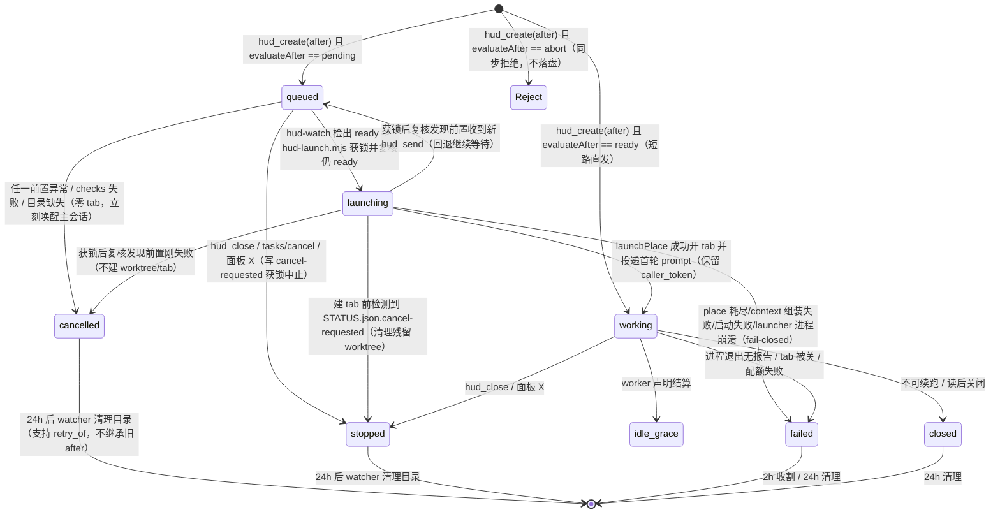
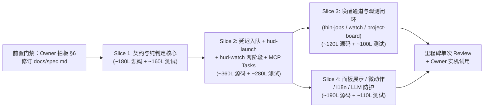

# 21. 轻量级后继触发条件 `after` + `require_checks`（极简 DAG，异常立即唤醒主会话）

> **优先级**：P2（候选里程碑特性；需 Owner 先拍板是否对 `docs/spec.md` 做受控解禁）
> **类别**：编排调度最小扩展 / 事件驱动延迟启动 / 异常即时唤醒
> **预估规模**：M–L（4 个独立垂直切片；新增源码 ~560–680L、既有文件薄改动 ~260–340L、合成竞态与渲染测试 ~550–650L；净删 1 处条件写入分支，零新增第三方依赖）
> **前置依赖**：**无硬代码前置**（基于 Node `>=24.0.0` 内置模块）；与 **方案 02（巨石拆解与 bin 迁 TS）** 通过独立模块 `src/roles/after-dag.ts` 与 `src/mcp/job-launch.ts` 自然对齐；与 **方案 06（异步 watcher/supervisor）** 在 `hud-watch.mjs` 上完全同构（建议 Slice 2 排在方案 06 S1 之后，或按 §3.4.4 薄接缝平移）；与 **方案 18（结构化 `hud_report`）** 正交互补（`after` 严格只读结算事实与 checks 退出码，绝不消费展示型 `outcome`/`verdict`）
> **`docs/spec.md` 边界影响**：**显式受控扩展（必须先经 Owner 批准再动工，按 `docs/delegation.md:8`）**——当前 `docs/spec.md:13`（“*The main session decides every next step; the HUD never chains roles itself*”）、`docs/spec.md:129`（“*No workflow engine and no automatic role chaining*”）、`docs/spec.md:193-195`（MCP-ORCH 明确排除 `after` chaining）及 `packages/hud-mcp/hud-convention.md:34` 均明文禁止自动串联。本方案将扩展边界**死锁在 Owner 2026-11-21 亲自划定的最小形态**（`.scratch/mcp-orch/proposal.md:25-27`）：仅支持主会话显式声明的单步启动前提 `after` + `require_checks`，零工作流引擎语义、零常驻服务、一切异常与歧义立刻取消启动并唤醒主会话。

---

## 1. 背景与现状证据

### 1.1 Owner 历史裁决与机会量化

在 2026-11-21 的 MCP-ORCH 实证调研（`.scratch/mcp-orch/proposal.md:6-27`）中，Owner 既明确了当时暂不做串联的理由，也同时写下了未来若需引入时的**精确最小形态边界**：

- **量化基线**（`.scratch/mcp-orch/proposal.md:8,15-16`）：一个项目工作日约 500 轮主会话交互中，从 worker 写完报告到主会话读到报告的中位延迟为 **20 s**（在主会话长回合推理、工具执行或人离开屏幕时可达数分钟），单纯的链式触发原本可省约 11/500 轮；全量扫描所有 job 目录仅耗时约 **3 ms**，不足以支撑引入常驻服务。
- **Owner 划定的最小形态原文**（`.scratch/mcp-orch/proposal.md:25-27`）：
  > *"If chaining is ever wanted, the smallest form is a start condition on one job (`after: [jobs]`) that fires only when every predecessor has a declared settlement for its current turn, no open question, and passed checks bound to the same report signature; anything else wakes the main session."*

随着 MCP-ORCH 里程碑已落地 **显式完成回执（`done.json` + `reportSignature`）**、**HUD 托管校验（`checks` + `checks.json`）**、**`from_jobs` 跨任务上下文拼装** 与 **Claude Code MCP Tasks（`tasks/get` / `tasks/cancel`）**，主会话日常已频繁出现两类纯机械衔接场景：
1. **单步门禁交接**：主会话派发 `imp`（附带 `checks: ["npm test"]`）的同时，已确知只要 `imp` 干净完成且单测全绿，紧接着就需要 `reviewer`（附带 `from_jobs: [imp]`）或后续独立切片 `imp2` 开工——主会话无需卡在半途等 20s–数分钟后再发一条无决策增量的 `hud_create`。
2. **多路汇聚启动**：主会话并行派发 2–3 个只读 `sonic` 调研任务，希望全部干净结算后立刻拉起汇总/实现任务（`after: [s1, s2, s3]`, `from_jobs: [s1, s2, s3]`），而一旦任一 `sonic` 失败、被停或提问，立刻中止后续启动并唤醒主会话介入。

### 1.2 现有代码基座与 7 处关键事实/暗礁盘点

逐行核查当前 HEAD 源码，MyHUD 已具备约 75% 的底层积木，但直接堆叠会踩中 **7 处真实代码暗礁**，必须在设计阶段一并消化：

| # | 现状位置与符号 | 现有实现事实 | 对本方案的直接影响（必须显式处理） |
|---:|---|---|---|
| **1** | `packages/hud-mcp/bin/hud-cli.mjs:177` | `write()` 仅在 `job.checks?.length` 为真时才向 `STATUS.json` 写入 `declared_report_sig`：`...(job.checks?.length ? { declared_report_sig: result.declared ? result.reportSig : null } : {})` | 若 CLI 前置任务未配置 `checks`，`STATUS.json` 缺失 `declared_report_sig`，下游无法仅凭 `STATUS.json` 区分“显式声明完成”与“旧式静默 10s 超时结算”。必须移除该条件卫语句，**所有 CLI 作业统一写入 `declared_report_sig`**。 |
| **2** | `src/roles/job-checks.ts:41-53` (`checkBinding`) | 已精准校验 `output_written === true`、`settled >= sent`、CLI `receiptForTurn + done.report_sig === r.sig + status.declared_report_sig === r.sig`、Pi `r.mtime > sent && r.mtime <= settled`，但入口 `:42` 硬绑定了 `job.checks?.length` | 应将其中的“当前轮显式结算签名绑定”抽成共享纯函数 `settlementBinding(dir, job, status)`，供 `checkBinding` 与 `after` 判定共同复用，避免两套轮次判定逻辑漂移。 |
| **3** | `src/mcp/thin-main.ts:1064-1098` (`assembleContext`)、`:1264-1271` (`dispatchWithKey`) | `hud_create` 入队前立即校验 `from_jobs` 的每个 `<id>/report.md` 必须已在磁盘可读，且 `planWorktree` 在此刻固定 `base_head` | 当 `from_jobs` 引用了 `after` 中的前置 job 时，前置尚未产出 `report.md`，立即校验必报错；且若 `isolation: "worktree"` 在入队时就锁定旧 `base_head`，会漏掉前置提交或提前创建僵尸 worktree。必须实行**二段校验 + 触发时组装/建 tree**。 |
| **4** | `src/mcp/thin-main.ts:1912-1918` (`taskFence`)、`:1950-1993` (`sampleTask`) | `taskFence(job)` 对 CLI 作业读取 `turn.json` 的 `turn.caller_token ?? turnToken(turn)`，无 `turn.json` 时退回 `job.created_at` | **高危暗礁**：排队中的 CLI 作业在 `hud_create` 返回 MCP Task 时还没有 `turn.json`，`task.fence` 锁死为 `job.created_at`；待后来延迟启动写入 `turn.json (seq: 1)` 时，`taskFence` 突变为 `1@sent_at`，导致 `sampleTask:1953` **瞬间把正常启动的任务误判为 `failed: no longer current`**！启动阶段必须设 `caller_token: job.created_at`。 |
| **5** | `packages/hud-mcp/bin/hud-watch.mjs:395`、`hud-watch.mjs:264-309` | `fs.watch` 回调正则仅放行 `STATUS.json\|SESSION.txt\|job.json\|checks.json\|report.md\|done.json\|turn.json`，**未监听 `qa/` 与 `STATUS.json.cancel-requested`**；`:281-284` 仅把 `working`/`waiting*` 视为 `open = true`；`:301-309` 过期 24h 即删目录 | 若不补全：① `qa/qN.md` 写入瞬间无法第一时间唤醒 watcher；② 仅有 `queued`/`launching` 作业时 watcher 会误以为无活跃任务而自杀退出；③ 前置超过 24h 目录可能被删除导致后继 `from_jobs` 读取失败。 |
| **6** | `src/collectors/work-card.ts:50`、`src/collectors/job-sentences.ts:236-246`、`src/collectors/decision-labels.ts:81-113`、`src/collectors/thin-jobs.ts:32-33,53` | ① `projectWorkCard` 将 `settledAt === null` 且超过 10 分钟无写入的作业标为 `stalled`；② `JobSentences` 与 `DecisionLabels` 对所有 `settledAt === null` 的 thin job 调度外部小模型/Decision API；③ `display/thin-jobs.json` 白名单 `factKeys` 不含 `after`/`cancel_source` | 若不显式识别 `queued`：① 排队超 10 分钟的作业会被误报 `stalled` 置顶抢占注意力；② 未开工的排队作业会白白消耗 SmallModel/Decision API 配额；③ 面板重启恢复缓存时会丢失 `after` 字段。 |
| **7** | `src/cli/panel-pane.ts:56-68` (`stopJob`)、`src/mcp/thin-main.ts:1769-1793` (`closeJob`)、`src/render/job-actions.ts:43-66` | `stopJob` 与 `closeJob` 均直接调 `pi-role-reap`；`homeKeys` 对任意 HUD job 都展示 `g job tab` | `queued` 作业无 `SESSION.txt`、无 tab、无 PID，调 `pi-role-reap` 会失败。必须抽共享的锁保护取消原语 `cancelQueuedJob`，且面板在 `queued` 行隐藏 `g job tab`、将 `X` 映射为无 tab 取消。 |

---

## 2. 目标与非目标（Scope / Out of Scope）

### 2.1 目标（Scope）

1. **最小启动前提契约**：在 `hud_create` 增加两个纯可选参数 `after?: string[]`（1–8 个同项目有效 job ID，禁止环与自依赖）与 `require_checks?: boolean`（默认 `true`，意为“对每个定义了 `checks` 的前置强制校验通过”）。
2. **可观测的排队态与延迟派发**：引入作业状态 `queued`（以及短瞬态 `launching` 与终态 `cancelled`）；在 `queued` 阶段**绝不开 herdr tab、绝不建 Git worktree、绝不消耗角色模型配额**；触发时刻再解析当前生效的角色链/预设、重新抓取最新 `HEAD` 创建 worktree、并完成包含前置 `report.md` 的 `from_jobs` 上下文组装。
3. **铁律级触发判据**：后继作业**仅当且仅当**满足全部三项事实才会启动——① 每个前置对当前轮次拥有显式声明结算且无在途/更新轮次；② 每个前置无任何未答 `qa/qN.md`；③ 若 `require_checks` 生效且前置定义了 `checks`，其 `checks.json` 为 `done`、严格绑定同一 `(turn, report_sig)`、且全部命令 `exit_code === 0` 且未超时。
4. **异常即时中止与全通道唤醒**：任一前置进入异常态（`failed` / `stopped` / `cancelled` / `blocked` / `waiting_orchestrator` / checks 失败 / 未声明结算 / 目录缺失），后继（及更下游的级联后继）**立即进入 `cancelled`**、绝不打开 tab，并零延迟通过 `hud watch` / pi 原生 watch / Codex `--queue` / MCP `changes` / Claude Code MCP Tasks 唤醒主会话。
5. **零常驻进程 + 强并发安全**：完全复用既有按需 `hud-watch.mjs` 与短命 `hud-launch.mjs`（与 `hud-check.mjs` 同构），用 Linux abstract socket 锁 + 取消墓碑文件彻底消灭双重启动、取消竞态与中途崩溃悬挂。
6. **面板、读取与微动作一等公民支持**：`hud_read` / `hud_wait` / `hud_peek` / `hud_close` / `retry_of`、面板 Classic & Split Home / Inspector / Filter / `g` & `X` 微动作全链路一致，且零外部 LLM 浪费。

### 2.2 非目标（Out of Scope）——与重型 Workflow Engine 的严格红线

本方案**明确拒绝**演化为工作流引擎。下表划定不可逾越的边界：

| 维度 | 重型 Workflow Engine（**严禁引入**） | 本方案 `after` + `require_checks`（**唯一允许形态**） |
|---|---|---|
| **依赖表达** | 条件表达式语言（`if: outcome == 'accept'`）、模板插值、动态变量传递 | 仅静态显式前置 job ID 集合 `after: string[]`（上限 8）+ 布尔 `require_checks` |
| **图拓扑** | 循环、条件分支、失败分支（`on_failure`）、动态 fan-out、并行归约合成器 | 严格无环静态单步前提（最大传递深度 8）；无分支、无循环、无合成器 |
| **控制权归属** | 引擎根据报告文本/review 结论自动决定下一角色或自动修复循环 | **主会话预先显式创建每一个 job**；HUD 不读报告语义、不解释 `outcome`/`verdict`、不自动重试 |
| **异常处理** | 自动重试策略、回退分支、补偿事务 | **一律中止后继启动（`cancelled`）并立刻唤醒主会话**，由主会话裁决 |
| **运行形态** | 常驻调度守护进程、SQLite/状态机数据库 | 零常驻进程；复用按需 `hud-watch.mjs` + 短命 `hud-launch.mjs` + 纯 JSON 文件 |
| **前置已读状态** | 自动消费前置输出并提前关闭前置 | **绝不修改前置 `read_at`**（与 `from_jobs` 契约一致），主会话仍亲自读报 |
| **Worker 权限** | 允许 worker 编排 DAG | **严禁**：worker 仍只能调用 `workerTools`（`hud_sonic` 不暴露 `after`），`dispatchJob` 对 `parentJob` 显式拒绝 `after` |

---

## 3. 核心设计方案

### 3.1 `hud_create` 接口扩展与二段校验契约

#### 3.1.1 Tool Schema 扩展（`src/roles/tool-definitions.ts:24-68`）

在 `hud_create` 的 `properties` 中仅新增 2 个可选字段（维持 `additionalProperties: false`）：

```ts
after: {
  type: 'array',
  items: { ...text, pattern: '^j[0-9a-f]{16}$' },
  minItems: 1,
  maxItems: MAX_AFTER, // 8
  description:
    'Optional predecessor job IDs (same project, max 8). Queues this job without opening a tab until every predecessor has a declared settlement for its current turn, no open question, and passed checks (when require_checks is true). Any failure, stop, attention pause or failed check cancels this job and wakes the main session.',
},
require_checks: {
  type: 'boolean',
  default: true,
  description:
    'Only with after. When true (default), every predecessor that defines checks must finish them with all exit_code === 0 bound to the settled report signature.',
},
```

#### 3.1.2 入口参数与图合法性校验（`src/mcp/thin-main.ts` `dispatchJob` / `dispatchWithKey`）

1. **Worker 防御**：`if (parentJob && (args.after !== undefined || args.require_checks !== undefined))` → 直接返回 `{ ok: false, code: 'invalid_arguments', error: 'worker child jobs cannot use after' }`。
2. **互斥与类型校验**：
   - `require_checks !== undefined && args.after === undefined` → `invalid_arguments: require_checks requires after`。
   - `after` 若给出：必须是长度 `1..8` 的字符串数组，每项匹配 `/^j[0-9a-f]{16}$/`；按出现顺序去重（若去重后为空或超限则拒）。
   - `require_checks` 默认 `true`（仅在 `after` 存在时落盘为 `after_require_checks: boolean`）。
3. **存在性、同项目作用域与防环/深度检查**：
   - 每个前置 `predId` 必须 `findJob(predId) !== null`，且满足 `projectJobFilter(cwd)(pred)`（禁止跨项目挂载前置，避免另一个项目目录的作业静默触发当前项目修改）。
   - 虽然新分配的 `id` 尚不存在、天然不可能形成自环，但仍对已有 `job.json` 做有界 DFS 遍历前置链，校验：**无环**（防磁盘手工篡改）且 **传递深度 `depth <= MAX_AFTER_DEPTH`（8）**（防退化深链）；违者返回 `{ ok: false, code: 'invalid_arguments', error: 'cyclic_after' | 'after_depth_exceeded' }`。
4. **`derivedKey` 幂等键兼容**（`thin-main.ts:1181-1183`）：
   - 未传 `after` 时保持完全原有元组 `derivedKey(kind, pane, role, cwd, task, retryOf)`，对既有测试与调用方零变化。
   - 传入 `after` 时使用 `derivedKey(kind, pane, role, cwd, task, retryOf, normalizedAfter, requireChecks)`，避免仅变更依赖集合时被 10 分钟窗口误折叠到旧作业。
5. **入队前即时前置评估（避免空转与死胎）**：
   - 调用共享 `evaluateAfter(jobsRoot, normalizedAfter, requireChecks)`：
     - 若返回 **`abort`**（例如某前置已 `failed`/`stopped`/`cancelled`/`blocked`/`waiting_orchestrator` 或 checks 已失败）：**直接同步拒绝 `hud_create`**，返回 `{ ok: false, code: 'predecessor_not_runnable', predecessor, reason }`，**不创建目录、不留死胎作业**。
     - 若返回 **`ready`**（全部前置此刻已干净结算且 checks 已通过）：**跳过 `queued`，走原有即时派发路径**（同时把 `after` 与 `after_require_checks` 记入 `job.json` 留痕，并在启动前照常立即执行 `assembleContext` 与 `addWorktree`）。
     - 若返回 **`pending`**（至少一个前置仍在运行/排队/跑 checks，且无任何异常）：进入 **延迟入队路径**！

#### 3.1.3 二段校验策略（解决 `from_jobs` / `context_files` / `worktree` 的时序矛盾）

| 校验项 | 阶段 1：`hud_create` 入队时刻（同步快失败） | 阶段 2：`hud-launch.mjs` 触发时刻（真实构建） |
|---|---|---|
| `role` / `preset` / `on` / `checks` / `package` / `pi_args` / `idle_grace_s` / `herdrId(pane)` | **全量强校验**（含 `found.assignment` 存在至少 1 个合法配置与 `placeOptions` 合法性；注意即使此刻某 place 处于暂时 quota 冷却，只要 role 配置本身有效是否允许入队？建议：至少校验 `placeOptions` 与非空 `run` 链，真正选 place 推迟到触发时刻重新计算 `found.assignment(definition, Date.now(), ...)`，从而尊重排队期间 Owner 在 Control 面板切的 preset 或刚恢复的配额！） | **重新执行 `found.assignment`** 选取当下最优可用 place；若全部不可用/停用/耗尽则以 `failed: no_available_place` 终结并唤醒主会话 |
| `from_jobs` | 校验数组长度 `<= 16`、ID 正则与 `findJob(id)` 存在。对**不在 `after` 集合（含传递祖先）内**的 `id`，立即校验 `report.md` 存在且为可读 UTF-8；对**属于 `after`（或传递祖先）的 `id`**，仅记录待延迟拼装 | 所有前置已结算，执行完整 `assembleContext()` 读取并校验所有 `from_jobs` 的 `report.md`（含浏览器 `inline` 256 KiB 体积上限） |
| `context_files` & `.hud/brief.md` | 立即校验路径存在、落在 `cwd`/`project.root` 内、为可读 UTF-8 文本（拼写错误立刻报错） | 重新执行 `assembleContext()`（保证 `bro` 内联读到前置修改后的最新文件内容） |
| `isolation: "worktree"` | 调用 `planWorktree(cwd, id, label)` **只读验证** `cwd` 是带有效 `HEAD` 的 Git 检出；**绝不调用 `addWorktree`** | 重新调用 `planWorktree` 捕获最新 `HEAD` 作为 `base_head`，随后在 `launchPlace` 中执行 `addWorktree` + `populateWorktree` |
| `brief.md` | 写入纯 `task` 正文（`mode: 0o600`）并记录 `job.task_length = task.length`——使面板 `readThinJobs` 立即可提取标题与 package 泳道，且按 `o` 可查看任务简报 | `writeBrief(..., /* first = */ false)` 覆盖为完整 `task + Context References/Context + harness footer`（保留 `task_length` 切片不变量，确保 `originalTask` 与 `retry_of` 100% 兼容） |

---

### 3.2 磁盘 Schema 与作业状态机

#### 3.2.1 `job.json` 与 `STATUS.json` 增量 Schema

所有磁盘写入严格使用私密原子替换（`${file}.${process.pid}.${randomUUID()}.tmp`, `flag: 'wx', mode: 0o600` + `renameSync` + `finally rmSync`）。

**`job.json` 增量字段（向后 100% 兼容 `Job` 接口，`src/mcp/thin-main.ts:63-108`）**：

```ts
interface PendingDispatch {
  /** 入队时已通过格式校验的原始调度选项（不含已写入 brief.md 的 task 文本），供 hud-launch.mjs 触发时重放。 */
  readonly args: Record<string, unknown>;
  readonly repair_of?: string;
}

interface Job {
  // ... 既有字段保持不变 ...
  after?: string[];                  // 去重后的显式前置 job ID（1..8）
  after_require_checks?: boolean;    // 仅当存在 after 时落盘，默认 true
  pending_dispatch?: PendingDispatch;// 仅 queued/launching 阶段保留；触发进入派发循环后清除或留作审计（推荐启动后删除以减小 job.json 体积，create_options 已承载 retry_of）
  launched_at?: string;              // 实际由 hud-launch.mjs 启动的 ISO 时间戳（区别于 created_at）
}
```

**`STATUS.json` 新增状态与字段**：

```ts
type LifecycleState =
  | 'queued'                // 新增：等待 after 前置条件，未开 tab / 未建 worktree
  | 'launching'             // 新增：hud-launch.mjs 已获锁正在拉起（短瞬态）
  | 'working'
  | 'waiting_helper'
  | 'waiting_orchestrator'
  | 'idle_grace'
  | 'closed'
  | 'done'
  | 'failed'
  | 'stopped'
  | 'cancelled';            // 新增：因前置异常在未开工前被中止（终态，零 tab）

interface QueuedOrCancelledStatus {
  version: 1;
  task_dir: string;
  slot: 'primary';
  role: string;
  state: 'queued' | 'launching' | 'cancelled';
  output_path: string;
  output_written: false;
  after: string[];
  require_checks: boolean;
  /** 仅 queued/launching 时记录当前尚未就绪的前置列表（供面板/hud_read 快速展示，真相仍实时计算）。 */
  waiting_on?: string[];
  /** 仅 launching 时写入，供 hud-watch.mjs 识别异常崩溃的启动助手。 */
  launcher_pid?: number | null;
  launcher_start_time?: string | null;
  /** 仅 cancelled 时写入：区分前置异常中止与用户主动取消（用户取消直接落 state:'stopped'）。 */
  cancel_source?: 'predecessor' | 'user';
  cancel_predecessor?: string;
  reason: string | null;
  exit_reason: string | null;
  error: string | null;
  started_at: string | null;  // queued/cancelled 未开工为 null；launching 写入启动时间
  settled_at: string | null;  // cancelled 写入取消时刻
  ended_at: string | null;    // cancelled 写入取消时刻
  updated_at: string;
}
```

> **设计抉择说明（`stopped` vs `cancelled`）**：
> - **用户主动取消**（`hud_close`、Claude `tasks/cancel`、面板 `X`）→ 写入 `state: 'stopped', cancel_source: 'user', exit_reason: 'stop requested'`，与现有“手动停止作业”的语义、图标（`−`）、颜色（`muted`）及 MCP Task 状态（`'cancelled'`）保持完全一致；
> - **前置异常自动中止** → 写入 `state: 'cancelled', cancel_source: 'predecessor', cancel_predecessor: predId, exit_reason: 'predecessor <id> ...'`，使其在 MCP Task 中映射为 `status: 'failed'`（清晰醒目地唤醒 Claude Code），在 `hud watch` 中强制 `defer: false` 立刻推送，且在面板中视觉明确区别于“曾经跑起来后崩溃（`failed`）”与“用户主动停掉（`stopped`）”。

#### 3.2.2 完整状态转换图



---

### 3.3 严苛触发判据与异常中止真值表（`src/roles/after-dag.ts`）

#### 3.3.1 统一结算绑定原语：`settlementBinding()`

先将 `packages/hud-mcp/bin/hud-cli.mjs:177` 的条件写入改为**无条件写入**：
```js
// 改造前（hud-cli.mjs:177）：仅带 checks 的 CLI 作业写 declared_report_sig
...(job.checks?.length ? { declared_report_sig: result.declared ? result.reportSig : null } : {}),
// 改造后：所有 CLI 作业统一落盘显式声明签名，作为 checks 与 after 的共同真相源
declared_report_sig: result.declared ? result.reportSig : null,
```

随后在 `src/roles/job-checks.ts` 抽出并导出纯函数 `settlementBinding(dir, job, status)`（`checkBinding` 直接复用它，仅在入口追加 `job.checks?.length` 与 `!job.bro && !job.jev` 检查）：

```ts
export interface SettlementBinding {
  readonly harness: 'cli' | 'pi' | 'bro';
  readonly turn: string;
  readonly report_sig: string;
}

export function settlementBinding(
  dir: string,
  job: Record<string, unknown>,
  status: Record<string, unknown> | null
): SettlementBinding | null {
  if (!status || status.output_written !== true) return null;
  const state = String(status.state ?? '');
  if (!['idle_grace', 'closed', 'done'].includes(state)) return null;

  // 1. 若有在途 hud_send（exit_code === null），绝不能把旧轮结算误当当前轮！
  const sends = Array.isArray(job.send_outcomes) ? job.send_outcomes : [];
  const lastSend = sends.at(-1) as { exit_code?: unknown } | undefined;
  if (lastSend && lastSend.exit_code === null) return null;

  // 2. 磁盘 report.md 必须存在且非空，获取带 sha256 的 reportSignature
  const r = report(dir); // 复用 job-checks.ts:23-34 签名缓存
  if (!r) return null;

  // 3. 按 Harness 校验当前轮显式声明
  if (job.bro || job.jev) {
    // hud-jev.mjs:113-116 仅在 report.md 非空且外部命令 exit 0 后写 state:'closed', output_written:true
    if (state !== 'closed') return null;
    const turn = typeof job.created_at === 'string' ? job.created_at : null;
    return turn ? { harness: 'bro', turn, report_sig: r.sig } : null;
  }

  const { cli, turn, sent } = jobTurn(dir, job);
  const settled = Date.parse(String(status.settled_at ?? ''));
  if (!turn || !Number.isFinite(sent) || !(settled >= sent)) return null;

  if (cli) {
    const done = readDone(dir);
    if (!receiptForTurn(cli, done) || done.report_sig !== r.sig) return null;
    // 兼容升级过渡期旧作业：若 STATUS.json 已含 declared_report_sig 字段则必须精确相等
    if (Object.hasOwn(status, 'declared_report_sig') && status.declared_report_sig !== r.sig) return null;
    return { harness: 'cli', turn, report_sig: r.sig };
  }

  // Pi 原生结算：report.md 的修改时间必须严格落在 (sent, settled] 区间内
  if (r.mtime <= sent || r.mtime > settled) return null;
  return { harness: 'pi', turn, report_sig: r.sig };
}
```

#### 3.3.2 单前置评估真值表：`evaluatePredecessor(jobsRoot, predId, requireChecks)`

`evaluatePredecessor` 返回三元联合类型：
- `{ kind: 'ready'; binding: SettlementBinding }`
- `{ kind: 'pending'; detail: string }`
- `{ kind: 'abort'; reason: string }`

完整状态真值表（按优先级自上而下判定，**任何未明确落入 `ready` 或 `pending` 的情况一律 Fail-Closed 落入 `abort`**）：

| 优先级 | 前置 `P` 观测事实 | 判定结果 | 触发原因 / 说明 |
|---:|---|---|---|
| **1** | 目录不存在 / `job.json` 缺失或损坏 / `job.job !== predId` | **`abort`** | `predecessor <id> missing or unreadable` |
| **2** | `STATUS.json` 缺失且 `dispatch_exit_code > 0` | **`abort`** | `predecessor <id> failed: <stderr first line>` |
| **3** | `STATUS.json` 缺失且 `dispatch_exit_code === null \|\| 0` | **`pending`** | `starting`（派发刚落盘，尚未写首个 STATUS） |
| **4** | `state` 为 `failed` / `stopped` / `cancelled`（即使 `output_written: true`！） | **`abort`** | `predecessor <id> <state>: <exit_reason>`（人工 `stopped` 绝不触发后继） |
| **5** | `blocked === true` 或 `state === 'waiting_orchestrator'` | **`abort`** *(Policy A 默认)* | `predecessor <id> blocked / waiting_orchestrator (<reason 或 open question qN>)`（见 §3.3.3 讨论与 §6 Q2） |
| **6** | `qa/` 存在未答 `qN.md`（直接扫 `qa/` 目录，不信任可能滞后的 `STATUS.json`） | **`abort`** *(Policy A 默认)* | `predecessor <id> has open question <qN>` |
| **7** | `state` 为 `queued` / `launching` / `working` / `waiting_helper` | **`pending`** | `<state>`（前置仍在正常推进） |
| **8** | `state` 为 `idle_grace` / `closed` / `done`，但 `send_outcomes.at(-1)?.exit_code === null` 或 `turn.sent_at > status.settled_at` 或 `pi_sent_at > status.settled_at` | **`pending`** | `new turn starting`（刚收到 `hud_send`，`STATUS.json` 尚未翻回 `working`，绝不误触发！） |
| **9** | `state` 为 `idle_grace` / `closed` / `done`，但 `settlementBinding(dir, job, status) === null` | **`abort`** | `predecessor <id> settled without declared report`（覆盖无报告退出、CLI 静默超时未写 `done.json`、报告在 `done.json` 后被篡改） |
| **10** | `settlementBinding` 非空，且 `requireChecks === true` 且 `Array.isArray(job.checks) && job.checks.length > 0`： | | |
| 10a | ↳ `job.bro \|\| job.jev`（浏览器作业不跑本地 checks） | **`abort`** | `predecessor <id> cannot run checks on browser harness`（同时在 `hud_create` 拒绝 `bro + checks` 组合） |
| 10b | ↳ `checks.json` 不存在，或 `!sameChecks(binding, receipt)`，或 `receipt.state === 'running'` | **`pending`** | `checks running`（`hud-watch.mjs` Pass 1 会拉起或重启中断的 `hud-check.mjs`） |
| 10c | ↳ `receipt.state === 'done'` 且 `sameChecks(binding, receipt)`，但 `results.length !== job.checks.length` 或任一项 `exit_code !== 0 \|\| timed_out` | **`abort`** | `predecessor <id> checks failed (<passed>/<total>)` |
| 10d | ↳ `receipt.state === 'done'` 且 `sameChecks(binding, receipt)` 且全部 `exit_code === 0 && !timed_out` | **`ready`** | 满足全部三项硬条件！ |
| **11** | `settlementBinding` 非空，且（`requireChecks === false` 或前置未配置 `checks`） | **`ready`** | 满足显式声明结算 + 无未答问题！ |
| **12** | 其他未知 `state` | **`abort`** | `predecessor <id> in unexpected state <state>`（Fail-Closed） |

**聚合规则 `evaluateAfter(jobsRoot, after, requireChecks)`**：
- 逐项评估 `after` 中的全部前置（短路径保护：**只要任意一个返回 `abort`，立刻整体返回 `abort`**——即使其他前置仍在 `working`！避免让后继傻等到其他无关前置跑完才告知主会话该链已断）；
- 若无 `abort` 且存在任意 `pending` → 返回 `{ kind: 'pending', waiting_on: pendingIds }`；
- 仅当**全部前置均为 `ready`** → 返回 `{ kind: 'ready', bindings }`。

#### 3.3.3 关于前置运行中出现 `qa/qN.md` 的设计对比（Policy A vs Policy B）

- **Policy A（严格快断，推荐默认）**：如上表第 5–6 行，一旦前置出现未答 `qa/qN.md`（或进入 `waiting_orchestrator` / `blocked`），后继立刻 `cancelled` 并唤醒主会话。
  - **理由**：① 严格逐字兑现 `.scratch/mcp-orch/proposal.md:26-27`（*"no open question ... anything else wakes the main session"*）；② 工程语义最安全——worker 提问往往意味着方案/边界发生变化，主会话给出答复后，事先写好的后继 `brief.md` 很可能已经过时，若继续自动启动会白烧一轮错误上下文；主会话答复前置后可按新结论重新派发或 `retry_of`。
- **Policy B（区分可答 QA 与阻塞异常，作为 §6 Q2 备选）**：当前置仍在活动轮次且仅因结构化 `qa/qN.md` 等待答复时，后继暂保持 `queued`（因为前置自身的 `qa/qN.md` 已经第一时间唤醒了主会话；若答复使后继作废，主会话可顺手 `hud_close(Q)`），而 `blocked`、非 QA `waiting_orchestrator`（静默无报/supervisor 死亡/报告篡改）以及“带着未答 `qa/qN.md` 结算”则一律立刻 `abort`。

---

### 3.4 零常驻触发执行架构：`hud-watch.mjs` + 短命 `hud-launch.mjs` + 双层排他锁

#### 3.4.1 备选触发方案对比

| 方案 | 架构方式 | 优点 | 缺点与风险 | 结论 |
|---|---|---|---|---|
| **方案 A（推荐）** | 复用既有按需 `hud-watch.mjs` 侦测就绪 → 异步 `spawn` 短命 `packages/hud-mcp/bin/hud-launch.mjs <dir>`（复刻 `hud-check.mjs` 模式） | 零常驻进程；`scan()` 保持 <2ms 纯同步；与方案 06 架构 100% 同构；launcher 崩溃不拖垮全局 watcher；每-job abstract socket 锁天然隔离 | 每次触发多一次短命 Node 子进程启动（~40ms，相对于 5–30s 的 agent 启动可忽略） | **强烈推荐** |
| 方案 B | 在 `hud-watch.mjs` 进程内直接 `await import(thin-main)` 执行 `launchPlace` | 省 40ms 子进程开销 | ① `launchPlace` 涉及 `herdr` 30s 等待、`git worktree`、`Decision API`、`prompt-stall` 120s 等待，严重污染全局 watcher 稳定性与内存；② 违背方案 06 的单进程轻扫目标；③ `thin-main.ts` 顶层 `await` 会把 MCP stdio 副作用带入 watcher | 否决 |
| 方案 C | 引入常驻 `hud-daemon` 统一调度 DAG | 极低触发延迟 | 直接违背 `docs/spec.md:145` & `.scratch/mcp-orch/proposal.md:23`（明确拒绝 resident server） | 否决 |

#### 3.4.2 正常触发与异常级联中止时序

```mermaid
sequenceDiagram
    participant Main as 主会话 (Claude/Codex/Pi)
    participant MCP as thin-main.ts (hud_create)
    participant Watch as hud-watch.mjs (按需共享)
    participant Chk as hud-check.mjs (短命)
    participant Lch as hud-launch.mjs (短命)
    participant Worker as 下游 Worker Tab

    Main->>MCP: hud_create({ role:"reviewer", after:[P], from_jobs:[P] })
    MCP->>MCP: 校验 after/图无环/同项目 + 二段校验 + evaluateAfter == pending
    MCP-->>Main: 写 job.json + brief.md + STATUS.json(queued), ensureWatcher(); 返回 queued / MCP Task

    Note over Watch: 前置 P 写 report.md + done.json -> STATUS(idle_grace)
    Watch->>Chk: Pass 1: checksOpen(P) -> spawn hud-check.mjs
    Note over Watch: Pass 2: evaluateAfter(Q) == pending (checks running)

    alt Happy Path: P 的 checks 全部 exit 0
        Chk-->>Watch: checks.json(state:done, passed:N/N) 触发 fs.watch
        Watch->>Lch: Pass 2: evaluateAfter(Q) == ready -> spawn hud-launch.mjs Q
        Lch->>Lch: 绑 \0myhud-launch-<hash> -> 复核 cancel-requested & evaluateAfter
        Lch->>Lch: STATUS(launching, pid) -> 重选 place -> planWorktree -> assembleContext(from_jobs:[P])
        Lch->>Worker: addWorktree + herdr tab create + agent start + prompt (CLI: caller_token=created_at)
        Lch-->>Watch: 写 STATUS(working) / 清除 pending_dispatch，退出 0
        Note over Main: Q 无缝接力执行；完成后通过既有通道通知主会话
    else Anomaly Path: P 失败 / 被停 / 提问 / checks 失败
        Chk-->>Watch: checks.json(state:done, passed:1/2) 触发 fs.watch
        Watch->>Watch: Pass 2: evaluateAfter(Q) == abort(predecessor P checks failed)
        Watch->>Watch: 写 Q/STATUS.json(state:cancelled, cancel_source:predecessor)（绝不开 tab!）
        Watch->>Watch: 若下游 R 依赖 Q -> 立刻重扫级联取消 R
        Watch-->>Main: hud watch(defer:false) / Codex --queue / MCP Tasks(failed) 毫秒级唤醒主会话
    end
```

#### 3.4.3 双层防竞态协议（彻底根除双重启动 & 取消竞态）

1. **进程间排他锁（无 `flock` 子进程、崩溃自动释放）**：
   - 沿用 `packages/hud-mcp/bin/hud-check.mjs:46-48` 与 `src/exp-proxy.ts` 已验证的 Linux abstract Unix socket 模式：
     ```ts
     const launchLockAddr = (dir: string) =>
       `\0myhud-launch-${createHash('sha256').update(fs.realpathSync(dir)).digest('hex')}`;
     ```
   - `hud-launch.mjs` 监听该 socket；若遇 `EADDRINUSE`（另一竞争 watcher 已拉起或取消正在进行），静默退出 `0`。若 `hud-launch.mjs` 被 `SIGKILL`，内核自动回收 socket，永无死锁文件。
2. **取消墓碑文件（`STATUS.json.cancel-requested`）**：
   - `cancelQueuedJob(dir, { source, predecessor, reason })` 被 `hud_close`、Claude `tasks/cancel`、面板 `X` 与 `hud-watch.mjs` 共同调用：
     1. 先原子落盘 `<dir>/STATUS.json.cancel-requested`（`flag: 'wx', mode: 0o600`，内容为 `{ source, predecessor, reason, at }`）；
     2. 尝试以短超时（最多重试 ~150 ms）绑定 `launchLockAddr(dir)`：
        - **获锁成功**：重读磁盘 `STATUS.json`；若仍为 `queued`（或刚死掉的 `launching`），直接原子写入 `state: source === 'user' ? 'stopped' : 'cancelled'` 并释放锁，返回 `{ cancelled: true }`；若已变为 `working`（竞态中 tab 已开），返回 `{ cancelled: false, alreadyLaunched: true }` 交由 `closeJob` / `stopJob` 走常规 `reapWorkerTree`！
        - **锁被活跃 `hud-launch.mjs` 长期占用**：`hud-launch.mjs` 在 `addWorktree` 前、以及 `herdr tab create` 前均会检查 `fs.existsSync(cancelMarker)`；一旦发现墓碑立刻中止启动、清理已建 worktree 并按墓碑内容写入 `stopped`/`cancelled` 后退出！若已越过 `herdr tab create` 不可逆点，`hud_close` 在短暂等待 `SESSION.txt` 落盘后直接走 `reapWorkerTree` 关闭 tab。
3. **启动崩溃 Fail-Closed 保护（绝不重复盲启）**：
   - `hud-launch.mjs` 在复核通过、即将执行实质外部副作用（`addWorktree` / `herdr tab create`）前，先原子写入 `STATUS.json`：`state: 'launching', launcher_pid: process.pid, launcher_start_time: procStat(process.pid)?.start`。
   - `hud-watch.mjs` 扫描遇到 `state === 'launching'` 时：
     - 若 `workerAlive(status.launcher_pid, status.launcher_start_time) === true`：`open = safetyCheck = true`（30s 安全 tick 持续巡检）。
     - 若 `=== false` 且磁盘无 `SESSION.txt`：说明启动助手异常崩溃，watcher 立刻将其置为 `state: 'failed', exit_reason: 'launch helper exited before worker started'`，绝不二次重试开出幽灵 tab，而是唤醒主会话（主会话可安全 `retry_of`）。
4. **跨进程 Worktree 锁（与方案 06 协同）**：
   - 在 `src/mcp/managed-worktree.ts` 为 `addWorktree` 与 `reapWorktree` 增加可选的轻量 per-`main_root` abstract socket 串行锁（`\0myhud-wt-<sha256(main_root)>`，带短退避重试），消除 `hud-launch.mjs` 建新 worktree 与 `hud-watch.mjs` 回收旧 worktree 并发争抢同一仓库 `.git/config.lock` 的隐患。

#### 3.4.4 `hud-watch.mjs` 两阶段改造与方案 06 衔接

在 `packages/hud-mcp/bin/hud-watch.mjs` 中保持 `scan()` 100% 同步快扫（对齐方案 06 `06-async-watcher-and-supervisor.md` §3.2）：

1. **补齐文件监听正则（`hud-watch.mjs:395`）**：
   ```js
   if (!path || !path.includes('/') ||
       /^[^/]+\/(STATUS\.json(?:\.cancel-requested)?|SESSION\.txt|job\.json|checks\.json|report\.md|done\.json|turn\.json|qa\/q\d+(?:\.answer)?\.md)$/.test(path)) {
     schedule();
   }
   ```
2. **新增进程内非阻塞跟踪集合**（与 `checking` 同构，零 `await` 阻塞）：
   - `const launching = new Set();`（最大并发 `MAX_CONCURRENT_LAUNCHES = 4`，超限标记 `launchBacklog = true`，任一子进程退出 `finally` 时 `schedule()`）。
   - `stop()` 退出屏障：`!open && !hasInFlight && launching.size === 0 && nearest === Infinity`；`SIGTERM`/`SIGINT` 优雅退出时与 `checking` 一致，对已在途 `hud-launch.mjs` 保持 `child.unref()` 使其按自身锁干净收敛而不截断在半截 worktree 中。
3. **Pass 1（既有 per-job 循环）最小增量**：
   - 收集 `queuedJobs`（`status.state === 'queued'`）与 `pinnedPredecessors`（所有 `queued`/`launching` 作业的 `job.after` + `job.from_jobs`，及若 `queuedJob.cwd === pred.worktree?.root` 时亦顺带跳过该前置的 `finishWorktree` 自动删 tree！）。
   - 对 `status.state === 'queued'` 或 `'launching'`：标记 `open = true` 并 `continue`（不走 reap/过期删目录）。
   - 24h 目录清理（`hud-watch.mjs:303`）增加守卫：`&& !pinnedPredecessors.has(id)`。
4. **Pass 2（同步评估 `queuedJobs`）**：
   - 遍历 `queuedJobs`，跳过已在 `launching.has(id)` 的项，调用 `evaluateAfter(jobs, job.after, job.after_require_checks !== false)`：
     - `abort`：调用同步取消（不冲突则立刻写 `STATUS.json` `state: 'cancelled'`，记录 `log(\`cancel ${id}: ${res.reason}\`)`，若存在其他 `queuedJobs` 依赖 `id` 则置 `queued = true` 立刻下一 tick 级联取消！）；
     - `ready`：若 `launching.size < MAX_CONCURRENT_LAUNCHES`，`spawn(process.execPath, [join(bundled, 'bin', 'hud-launch.mjs'), dir], { stdio: 'ignore' })`，加入 `launching`，注册 `exit`/`error` 回调清理并 `schedule()`；
     - `pending`：保持 `open = true`（若有前置是 CLI 或 `checks` 在跑，置 `safetyCheck = true`）。
5. **共享启动器抽取（对齐方案 02）**：
   - 从 `src/mcp/thin-main.ts` 抽出无 top-level `await` 的 `src/mcp/job-launch.ts`（承载 `assembleContext`、`writeBrief`、`launchPlace`、`finishLaunch`、`executeLaunchCandidates`、`cancelQueuedJob`），让 `thin-main.ts` 与 `packages/hud-mcp/bin/hud-launch.mjs` 共用单一真相源，零代码复制！`hud-launch.mjs` 启动时剥离 `HUD_JOB_DIR`（同 `hud-check.mjs:14`），确保绝不触发 worker 模式。

---

### 3.5 全表面 MCP 工具与四大唤醒通道协同矩阵

#### 3.5.1 MCP 工具行为契约

| 工具 | 对 `queued` 作业的行为 | 对 `cancelled` 作业的行为 |
|---|---|---|
| **`hud_create`** | 若 `after` 全就绪则短路直发；若任一异常则同步拒（`predecessor_not_runnable`）；否则落盘 `queued` 并 `ensureWatcher()`。 | 支持 `retry_of: <cancelledJobId>`！继承原 `task`/选项，**默认剥离旧 `after`**（同剥离旧 `on`，`thin-main.ts:1173`），调用方可传新 `after` 或直接运行。 |
| **`hud_read`（列表）** | `hud_read({})`（compact）**必包含** `queued` 作业（含 `after`、`waiting_on`、`reason`）；`view: 'recent'` 同含。 | `hud_read({})` **必包含**尚未观测（`failureUnobserved`）的 `cancelled` 作业，直到主会话读过或关闭。 |
| **`hud_read`（单作业）** | 返回 `state: 'queued'`, `display_state: 'queued'`, `after`, `require_checks`, `waiting_on`（含各前置实时状态）, `report_exists: false`。`wait_ms > 0` 在发生状态跃迁（启动或取消）时唤醒。 | 返回 `state: 'cancelled'`, `cancel_source`, `cancel_predecessor`, `reason`, `exit_reason`，并**自动写入 `observed_at`** 清除未读告警。 |
| **`hud_wait`** | `queued` / `launching` **不属于 `settled`**！`hud_wait({ jobs: [Q] })`（及省略 `jobs`）持续等待直至 `Q` 启动并结算、或中途变为 `cancelled` 立刻返回；`fs.watch` 监听 `STATUS.json` 零轮询唤醒。若待等集合含 `queued` 作业，顺带调 `ensureWatcher()` 兜底防 watcher 意外退出。 | `cancelled` 属于 `settled`（且属异常触发），`hud_wait` **立刻返回** `ready: true, triggered: [Q]`。 |
| **`hud_peek`** | 返回 `status`（含 `after`/`waiting_on`）与空 `progress`；传入 `lines` 时返回 `pane_lines: null, pane_reason: 'queued (not launched yet)'`。 | 返回 `status`（`cancelled` + 原因）；`lines` 返回 `pane_lines: null, pane_reason: 'no pane'`。 |
| **`hud_send`** | **推荐禁止**：单发返回 `{ ok: false, code: 'job_queued', reason: 'job is queued; use hud_close and hud_create to change it' }`；群发 `jobs: [...]` 归入 `skipped: [{ job, reason: 'job_queued' }]`。避免改写 `brief.md` 与 `hud-launch.mjs`、MCP Tasks 护栏及 `derivedKey` 语义冲突（备选改写方案见 §6 Q3）。 | 返回 `{ ok: false, code: 'not_continuable' }`（从未开工不可 repair，提示用 `hud_create({ retry_of })`）。 |
| **`hud_close`** | 调用 `cancelQueuedJob({ source: 'user' })`：**不调 `pi-role-reap`**，直接落 `state: 'stopped'`（若恰好竞态启动开了 tab，无缝回落 `reapWorkerTree`）。若关闭的是某排队作业的前置 `P`，watcher 自动级联取消下游 `Q`。 | 幂等返回 `{ exit_code: 0, last_line: 'already cancelled' }`，并盖章 `observed_at`。 |
| **`adoptProjectJobs`** | `jobOwesCaller`（`thin-jobs.ts:273-280`）对 `queued`/`launching` 及未观测 `cancelled` 返回 `true`：同项目新主会话自动认领断连窗格留下的排队作业。 | 同左（未观测 `cancelled` 会被认领并展示，已观测则不再打扰）。 |

#### 3.5.2 四大主会话唤醒通道精准行为

| 通道 | `queued → working`（正常接力启动） | `queued → cancelled`（前置异常中止） | 关键代码点 |
|---|---|---|---|
| **Claude Code MCP Tasks** | `hud_create` 立即返回 `TaskReply`（`status: 'working'`, `statusMessage: 'jQ (reviewer) — queued (waiting on jP)'`）；启动时 `hud-launch.mjs` 写入 CLI `turn.json.caller_token = job.created_at`，**保活 `taskFence`**，随后 `tasks/get` 刷新为 `working` 直至出报 `completed`（并动态拼入实际 `used_place`/`thinking` 的 `launchSummary`）。`tasks/cancel` 走 `cancelQueuedJob`。 | `sampleTask` 见 `state === 'cancelled'` + `cancel_source === 'predecessor'` → 立刻结束为 **`status: 'failed'`**，正文携带 `jQ (reviewer) — cancelled — predecessor jP checks failed (1/2). No tab was opened.`，立即唤醒 Claude Code！ | `thin-main.ts:1912-1918` (`taskFence`), `:1950-1993` (`sampleTask`), `:1994-2008` (`taskRequest`) |
| **`hud watch`（Claude Monitor）与 `startSessionWatch`（Pi 原生）** | 静默模式下**不唤醒**主会话（正常无感接力，不制造噪声）；`--verbose` 输出 `jQ reviewer: working`。 | `settled()` 纳入 `'cancelled'`；`actionable()` 中将 `cancelled` 标为 **`defer: false`**（绕过 `SETTLEMENT_WINDOW_MS = 3000ms` 合并窗口），**0ms 立刻推送** `jQ reviewer pkg: cancelled \| predecessor jP ...`；`catchup` 对未观测 `cancelled` 同样补推。 | `src/cli/watch.ts:29, 50-70` |
| **Codex `hud watch --queue`** | `queued`/`launching` 不属 `settled`，`watch.ts:289` 保持 `pending = true`，**阻止队列 watcher 提前空闲退出**。 | 通过 `delivery.notify(..., { queue: true })` 立刻安静入队到 Codex 主线程。 | `src/cli/watch.ts:288-309` |
| **MCP `changes`（所有非 Task 客户端）** | 下一次任意 MCP 调用的 `changes` 数组带回 `jQ reviewer: working`。 | 下一次任意 MCP 调用的 `changes` 数组带回 `jQ reviewer: cancelled \| predecessor jP ...`。 | `thin-jobs.ts:321-362`, `thin-main.ts:1839-1846` |

> **安全边界**：遵循 `packages/hud-mcp/bin/hud-jev.mjs:123` 与 `docs/spec.md:13` 的既定原则，当没有活动 `hud watch` / pi 原生 watch / Codex `--queue` / MCP Tasks 时，**绝不向主会话编辑器强行键入取消通知**（避免破坏用户草稿），仍由 `hud_read` / MCP `changes` / `hud_wait` 承担。

---

### 3.6 面板展示、微动作与 `ARCHITECTURE.md` §8 合规设计

#### 3.6.1 面板状态映射与视觉规范（Classic & Split Home + Inspector）

遵循 `docs/ARCHITECTURE.md` §8（纯渲染、`visualLength`/`truncateAnsi`、`monitorText`、EN/ZH `t()`、`theme.board` 语义色、无 I/O）：

```text
Classic Home（40 列窄屏合成示意）:
auth-fix  queued              ✓ ◌ reviewer
◌ reviewer  Review auth-fix    queued 2m
┃ waiting on j1a2b3c4 (imp, checks 1/2)
┃

Split Home（预览区 / 列表行）:
◌ auth-fix      waiting on imp  queued 2m
```

- **`src/collectors/thin-jobs.ts`**：
  - `JobRow['display_state']` 扩展为 `'queued' | 'working' | 'done' | 'failed' | 'stopped'`（`launching` 映射为 `'queued'` 或 `'working'`，推荐 `'queued'` 直到真实 worker 写入 `working`；`cancelled` 映射为 `'stopped'` 或 `'failed'`？推荐保持 `rawState: 'cancelled'`, `display_state: 'failed'` 当 `cancel_source === 'predecessor'` 且在 `work-card` 专门按 `w.state === 'cancelled'` 显示 `⊘ cancelled`（中文 `已取消`）+ `theme.board.attention` 琥珀色——既能区别于真正跑崩的红 `✗ failed` 与手动停掉的灰 `− stopped`，又天然享受 30 分钟最小保留期与高优先级可见性！）。
  - `factKeys`（`:32-33`）增加 `'after'`, `'after_require_checks'`, `'cancel_source'`, `'cancel_predecessor'`, `'waiting_on'`；且 `persist()`（`:53`）对含 `after` 的作业同样不落盘过时缓存（`!snap.json?.checks && !snap.json?.after`），保证状态变化实时可见。
  - `OwnerWorker`（`src/collectors/workboard-types.ts:47-109`）新增可选只读展示字段：
    `readonly after?: readonly { readonly job: string; readonly role?: string | null; readonly state: string }[];`
    `readonly requireChecks?: boolean;`
- **`src/collectors/work-card.ts`**：
  - `WorkState` 扩展为 `'needs-you' | 'in-progress' | 'awaiting-acceptance' | 'stalled' | 'done' | 'queued'`。
  - `projectWorkCard()` 在判断 `stalled` 之前优先判断 `if (worker.state === 'queued') return ... state: 'queued'`——**彻底杜绝排队超过 10 分钟被误标为 `stalled`**！
- **`src/render/work-card.ts` & `work-lanes.ts` & `home-view.ts` & `split-home.ts`**：
  - `workStateGlyph`: `queued` → `mark('◌', '.')`；`cancelled` → `mark('⊘', '!')`。
  - `workStateWord`: `queued` → `t('queued')`（ZH：`排队中`）；`cancelled` → `t('cancelled')`（ZH：`已取消`）。
  - `workStateInk`: `queued` → `theme.board.muted`（不抢运行中卡片视觉焦点）；`cancelled` → `theme.board.attention`（琥珀警示，与红 `failed`、灰 `stopped` 三分清晰）。
  - `workerPriority`（`work-lanes.ts:12-26`）：`0: homeNeedsHuman` → `1: stalled` → `2: failed / cancelled` → `3: awaiting-acceptance` → `4: in-progress` → `5: queued` → `6: done / stopped`。`split-home.ts:119` 对应放宽至 `group(l) <= 5` 使含 `queued` 作业的泳道仍留在 `Waiting for you` 之上。
  - `home-view.ts:80`：`running` 计数排除 `w.state === 'queued'`；若 `queuedCount > 0`，顶行追加 `· {n} queued`（ZH：`· {n} 排队中`），不增加额外行数。
  - `work-inspector.ts`：在 `facts` 增加 `after` 行（展示各前置短 ID、角色与当前状态）与 `require checks` 行（`yes` / `no`）；`queued` 时 `ran` 为空、`started` 显示 `queued` 创建时间。
  - `filter.ts:38-39`：`homeMatcher` 补全 `'queued'` 与 `'cancelled'`，支持 `/` 按中英文状态词即时过滤。
- **面板微动作兼容（`src/render/job-actions.ts` & `src/cli/panel-pane.ts`）**：
  - `homeKeys()`（`job-actions.ts:45`）：当 `job.worker.state === 'queued'` 时，**不显示 `'g job tab'`**（尚无 tab），显示 `'X cancel'`（EN: `'X cancel'`, ZH: `'X 取消'`，新增 1 条至 `split-i18n.ts`）；若用户手误按 `g`，`focusJobTab` 已有优雅提示 `'no tab recorded'`。
  - `stopPromptRows()`（`job-actions.ts:49-52`）：对 `queued` 复用同一二次确认条（`Cancel {role} {id}? y confirm · Esc cancel`）。
  - `stopJob()`（`panel-pane.ts:56-68`）：检测到 `status?.state === 'queued' || status?.state === 'launching'` 时直接调用共享 `cancelQueuedJob(jobDir, { source: 'user', reason: 'stop requested' })`，**不再调用 `pi-role-reap`**（若恰好竞态启动开了 tab，再无缝回落 `reapWorkerTree`）。
- **外部模型零浪费防护**：
  - `src/collectors/job-sentences.ts:236`：新增 `if (w.state === 'queued') continue;`。
  - `src/collectors/decision-labels.ts:83,104`：新增 `if (w.state === 'queued') continue;`（既不查 `:kind` 也不查 `:loop`，待真实启动后再纳入正常调度）。
  - `src/collectors/project-board.ts:80`：`SETTLED_JOB_STATES` 新增 `'cancelled'`，确保 Project 页 Active 列表只留真正活跃与排队作业。

#### 3.6.2 `docs/ARCHITECTURE.md` §8 工程规范逐项核对

- **纯渲染**：所有 `queued`/`cancelled` 展示判定仅消费传入的 `WorkboardSnapshot` 与 `nowMs`，渲染期零磁盘 I/O、零模型请求、零生命周期推进。
- **宽度与多语言**：所有新增标签（`queued`/`排队中`、`cancelled`/`已取消`、`{n} queued`/`{n} 排队中`、`X cancel`/`X 取消`、`Cancel {role} {id}?  y confirm · Esc cancel`）均走 `t()` 且配齐 EN/ZH；外部文本经 `monitorText` 消毒，`visualLength`/`truncateAnsi` 严格保宽，通过 `tests/unit/panel-keys-rows.test.mjs` 与 `panel-footers.test.mjs`。
- **安全 Git**：`planWorktree` / `addWorktree` / `populateWorktree` 全部复用既有 `managed-worktree.ts`（`neutralizeFilters` + `--no-checkout` + `read-tree`），不执行仓库自带 Git filter/hook。
- **隐私与原子写**：所有新状态文件（`STATUS.json`、`job.json`、`STATUS.json.cancel-requested`）均为 `0o600` 原子写（UUID 临时文件 + `renameSync`）；读 `done.json`/`checks.json`/`job.json` 保持大小上限与 `O_NOFOLLOW`；零新增外发模型输入（`ARCHITECTURE.md` §5 外发表无新增）。
- **依赖与运行环境**：零新增 npm 依赖，纯 Node `>=24.0.0` 内置模块（`node:fs`, `node:net`, `node:crypto`, `node:child_process`）。

---

## 4. 垂直切片与实施路线（对齐 `docs/delegation.md`）

按 `docs/delegation.md` 的 “Grill（先定 `spec.md`）→ Slice → Build → Integrate → Milestone Review → Owner 实机试用” 节奏，拆分为 **4 个可独立编译、独立测试、单 imp 会话可交付的垂直切片**：



*(注：Slice 3 与 Slice 4 触碰的文件几乎正交，Slice 2 落地后可由两个 `imp` 在各自 worktree 中并行推进！)*

### Slice 1：结算绑定统一与纯 DAG 判定核心（零运行期侵入）

- **目标**：统一 `settlementBinding()`、补齐 CLI 无条件写 `declared_report_sig`、实现纯函数 `after` 图校验与前置真值评估、注册 `hud_create` Schema。
- **改动文件清单**：
  - 新增：`src/roles/after-dag.ts`（~150L：`MAX_AFTER=8`, `MAX_AFTER_DEPTH=8`, `validateAfterGraph`, `evaluatePredecessor`, `evaluateAfter`, `formatAfterReason`）
  - 修改：`src/roles/job-checks.ts`（~30L：抽出导出 `settlementBinding`，`checkBinding` 复用之）
  - 修改：`packages/hud-mcp/bin/hud-cli.mjs`（1L：`:177` 删除 `job.checks?.length ?` 条件，始终写 `declared_report_sig`）
  - 修改：`src/roles/tool-definitions.ts`（~12L：`hud_create` 新增 `after` 与 `require_checks`）
  - 新增测试：`tests/unit/after-dag.test.mjs`（~160L：覆盖全部 12 行真值表、环/深度/跨项目/自依赖校验）
- **可删除/简化旧代码**：删除 `hud-cli.mjs:177` 的 `job.checks?.length` 特判分支与 `job-checks.ts` 中仅服务 checks 的重复结算判断。
- **依赖**：Owner 批准 `docs/spec.md` 边界修订。

### Slice 2：延迟入队、短命启动器 `hud-launch.mjs`、Watcher 两阶段编排与 MCP Tasks 闭环

- **目标**：打通完整的 `hud_create(after)` → `queued` → `hud-watch.mjs` → `hud-launch.mjs` → `working` / `cancelled` 执行闭环，含排他锁、二段校验、`hud_close`/`hud_send`/`hud_wait`/`retry_of` 与 Claude MCP Tasks `taskFence` 修复。
- **改动文件清单**：
  - 新增：`src/mcp/job-launch.ts`（~220L：从 `thin-main.ts` 抽离可被 `hud-launch.mjs` 无副作用复用的启动核心与 `cancelQueuedJob` + `\0myhud-launch-<hash>` 锁原语）
  - 新增：`packages/hud-mcp/bin/hud-launch.mjs`（~65L：短命触发启动助手，剥离 `HUD_JOB_DIR`，获锁、复核前置、建 worktree、拼 `from_jobs`、派发 tab）
  - 修改：`src/mcp/thin-main.ts`（~130L：`Job` 增量类型、入队/短路/快拒分支、二段 `assembleContext`、`derivedKey` 扩展、`hud_read`/`hud_wait`/`hud_peek`/`hud_send`/`hud_close`/`retry_of`、MCP Tasks `taskFence` `caller_token` 与 `sampleTask`）
  - 修改：`packages/hud-mcp/bin/hud-watch.mjs`（~85L：补全 `qa/` 与 `cancel-requested` watch 正则、`queued`/`launching` 保活、24h pin、Pass 2 评估/级联取消/异步拉起 `hud-launch.mjs`）
  - 可选修改：`src/mcp/managed-worktree.ts`（~20L：轻量跨进程 per-`main_root` abstract socket 串行锁）
  - 新增测试：`tests/unit/thin-mcp-after-dag.test.mjs`（~280L：覆盖全竞态与故障矩阵）
- **可删除/简化旧代码**：`thin-main.ts` 中被抽至 `job-launch.ts` 的 ~160L 重复启动代码净迁出（顺带为方案 02 减负）。
- **依赖**：Slice 1（若方案 06 S1 已合入，`hud-watch.mjs` 直接挂入其同步 `scan()` 与 `hasInFlight`）。

### Slice 3：主会话唤醒通道与项目收集闭环

- **目标**：让 `hud watch`、pi 原生 `startSessionWatch`、Codex `--queue`、MCP `changes` 与 `ProjectCollector` 精准理解 `queued`/`cancelled`，确保前置异常 0ms 唤醒主会话。
- **改动文件清单**：
  - 修改：`src/collectors/thin-jobs.ts`（~55L：`display_state` 新增 `'queued'`、`factKeys` 与 `persist()` 过滤、`jobRow`、`jobOwesCaller`、`formatJobChange`/`jobChanges`、`readThinJobs` 构建 `OwnerWorker.after`）
  - 修改：`src/cli/watch.ts`（~25L：`settled` 纳入 `'cancelled'`、`actionable` 设 `cancelled` `defer: false` + catchup 未读告警 + `queued → working` 静默、Codex `--queue` 保活）
  - 修改：`src/collectors/project-board.ts`（~10L：`SETTLED_JOB_STATES` 纳入 `'cancelled'`）
  - 修改测试：`tests/unit/hud-watch.test.mjs`、`tests/unit/thin-job-scan.test.mjs`（~100L）
- **依赖**：Slice 2。

### Slice 4：面板展示、微动作兼容、i18n 与外部模型防护

- **目标**：Classic/Split Home、Inspector、`/` Filter、`g`/`X` 微动作与 EN/ZH 完整适配 `queued`/`cancelled`，并屏蔽对 `queued` 作业的外部 LLM 调用。
- **改动文件清单**：
  - 修改：`src/collectors/workboard-types.ts`、`src/collectors/work-card.ts`（~25L：`WorkState` 新增 `'queued'`，防误标 `stalled`）
  - 修改：`src/render/work-card.ts`、`src/render/work-lanes.ts`、`src/render/home-view.ts`、`src/render/split-home.ts`、`src/render/work-inspector.ts`、`src/render/work-visibility.ts`、`src/render/filter.ts`（~105L）
  - 修改：`src/render/job-actions.ts`、`src/cli/panel-pane.ts`（~30L：`queued` 隐藏 `g`、`X cancel` 走 `cancelQueuedJob`）
  - 修改：`src/render/workboard-i18n.ts`、`src/render/split-i18n.ts`（~15L：EN/ZH 词条）
  - 修改：`src/collectors/job-sentences.ts`、`src/collectors/decision-labels.ts`（~8L：跳过 `w.state === 'queued'`）
  - 修改文档：`docs/spec.md`、`docs/ARCHITECTURE.md`、`docs/reference.md`、`docs/reference.zh-CN.md`、`packages/hud-mcp/hud-convention.md`（~30L，按 Owner 最终拍板结果更新）
  - 新增/扩展测试：`tests/unit/card-details.test.mjs`、`tests/unit/panel-micro-actions.test.mjs`、`tests/unit/panel-filter.test.mjs`（~110L）
- **依赖**：Slice 2（与 Slice 3 并行）。

### 4.2 迁移、向后兼容与回滚策略

- **零老数据迁移**：历史 `job.json` 与 `STATUS.json` 不含 `after`/`cancel_source`/`declared_report_sig` 字段；读取路径全部将其视为可选字段，老作业 100% 沿既有路径运行与收割。
- **零侵入开关与热重载安全**：只要不传 `after` 参数，`hud_create` 走原代码路径零分支变化；若升级期间有正在运行的旧 CLI 作业（`hud-cli.mjs` 尚未写入 `declared_report_sig`），`settlementBinding()` 用 `Object.hasOwn(status, 'declared_report_sig')` 兼容，待新启动的 CLI 作业自动享受强字段校验。
- **回滚路径**：各切片独立合入；若任意阶段需回滚，只需撤回对应提交，磁盘残留的 `queued` 目录可由主会话直接删除或留待 24h 清理（无外部数据库状态、无 client 配置文件改动）。

---

## 5. 验证与验收方案

### 5.1 自动化测试设计（全合成数据 + 临时 `HOME`/`HUD_HOME` + 固定时钟）

严格遵守 `AGENTS.md` 与 `docs/ARCHITECTURE.md` §9：所有测试运行在隔离临时目录（`tmp/env.sh` 风格），使用合成 fake `herdr` / fake `pi-role` / fake CLI，**绝不触碰真实 `~/.hud`、`~/.claude`、`~/.codex`、`~/.pi`**。

#### 核心竞态与故障测试矩阵（`tests/unit/thin-mcp-after-dag.test.mjs` + `after-dag.test.mjs`）

| 编号 | 测试场景 | 构造方式（合成环境） | 严格断言（Pass 标准） |
|---:|---|---|---|
| **T1** | **前置刚结算但 `checks` 仍在跑** | `P`（带慢速 `checks: ["sleep 0.4"]`）声明完成；`Q` 挂 `after: [P], from_jobs: [P]` | `checks.json` 为 `running` 期间 `Q` 严守 `queued` 且未创建 tab；`checks` 全部 exit 0 后 `Q` 自动启动，且 `Q/brief.md` 包含 `P/report.md` 引用 |
| **T2** | **前置结算后又收到 `hud_send` 开启新轮** | `P`（CLI 与 Pi 各测 1 组）先结算 Turn 1，立刻对 `P` 发 `hud_send` 推进到 Turn 2（模拟 `STATUS.json` 尚未翻回 `working` 的瞬时窗口） | `evaluateAfter` 与 `hud-launch.mjs` 锁内二次复核均判定 `pending`；`Q` **绝不在 Turn 1 误启动**，直到 Turn 2 声明结算（及新签名 `checks` 通过）才启动 |
| **T3** | **两个 `hud-watch.mjs` 并发竞态触发** | 同时拉起两个 `hud-watch.mjs` 指向同一 `HUD_HOME`，`P` 结算瞬间同时触发 | 两个 watcher 同时 spawn `hud-launch.mjs`，abstract socket 排他锁仅放行 1 个；`herdr tab create` 调用次数严格 `=== 1` |
| **T4** | **前置 `checks` 失败触发多跳级联取消** | 构建 `A → B → C`（`A` 带必定失败的 `checks: ["exit 1"]`） | `A` 写报告后 `checks` 失败 → `B` 立即变为 `cancelled`（`predecessor A checks failed (0/1)`）→ `C` 级联变为 `cancelled`（`predecessor B cancelled`）；`B`/`C` 零 tab 创建；`hud watch` 在 <300ms（绕过 3s 合并窗）输出两条取消行 |
| **T5** | **未声明结算（CLI 静默超时无 `done.json`）** | 合成 CLI `P` 写 `report.md` 但不写 `done.json`，`STATUS.json` 置 `idle_grace` 且 `declared_report_sig: null` | `Q` 绝不启动，立刻 `cancelled`（`settled without declared report`）并唤醒主会话 |
| **T6** | **报告在 `done.json` 之后被改写** | `P` 写 `done.json` 后再次修改 `report.md` 改变签名 | `Q` 不触发（并随 `P` 进入 `waiting_orchestrator` 而取消） |
| **T7** | **前置进入 `failed`/`stopped`/`blocked`/`waiting_orchestrator`/提问** | 逐一触发 `P` 各类异常（含 `P` 被用户 `hud_close` 停止且即使已写报告） | `Q` 均立刻 `cancelled`、零 tab 创建、主会话立即唤醒 |
| **T8** | **`hud_close` / 面板 `X` 与 `hud-launch.mjs` 并发竞态** | 用慢速 fake `git`/`herdr` 拖住 `hud-launch.mjs` 启动前阶段，期间并发执行 `hud_close(Q)` | `STATUS.json.cancel-requested` 阻断 `herdr tab create`；最终态为 `stopped`，零遗留 tab 与残留 worktree |
| **T9** | **`hud-launch.mjs` 崩溃 Fail-Closed** | 合成 `STATUS.json` 为 `state: 'launching'` 配已退出 `launcher_pid` 且无 `SESSION.txt` | `hud-watch.mjs` 将其置为 `failed`（`launch helper exited before worker started`），不重复开 tab |
| **T10** | **Claude Code MCP Tasks 全周期与 `tasks/cancel`** | 使用 `taskRpc` (`server/discover` + `hud_create(after)` + `tasks/get` + `tasks/cancel`) 测 CLI 与 Pi 后继 | ① CLI 后继跨 `queued → working (turn 1)` 时 `taskFence` 不误判 `no longer current`；② 前置失败时 `tasks/get` 立即返 `status: 'failed'` 带清晰原因；③ `queued` 期调 `tasks/cancel` 无 tab 干净返 `cancelled` |
| **T11** | **`isolation: "worktree"` 延迟建树 + 最新 `HEAD`** | `Q` 入队后再向主仓追加新 commit，随后 `P` 结算触发 `Q` | 入队期间 `../repo-wt/` 不存在；触发后建出的 worktree `base_head` 精确等于新 commit SHA |
| **T12** | **24h 清理保护 + `hud_send` 拒绝 + `retry_of` + Worker 拒绝** | ① 将 `P` 的 `ended_at` 设为 48h 前但 `Q` 仍在等另一前置 `P2`；② 向 `Q` 调 `hud_send`；③ 对已取消 `Q` 调 `hud_create({ retry_of: Q })`；④ 在 worker MCP 调 `hud_create`/`hud_sonic` 带 `after` | ① `P` 目录不被删；② `hud_send` 返 `code: 'job_queued'`；③ `retry_of` 成功启动且未继承旧 `after`；④ worker 侧被严格拒绝 |
| **T13** | **面板渲染、微动作与零 LLM 浪费** | EN/ZH、40 列 & 100 列、Classic & Split、`now = created + 30m`；挂接 mock `SmallModel` & `DecisionLabels` | ① `queued` 过 30 分钟仍显示 `◌ queued`，绝不误标 `stalled`；② 每行 `visualLength === width`；③ `SmallModel.submit` 与 `DecisionLabels` 零调用；④ `queued` 行隐藏 `g job tab`，`X` 确认取消不调 `pi-role-reap` |

### 5.2 Owner 实机试用验收清单（Done 标准，对齐 `docs/spec.md:147`）

1. **Happy Path 零干预接力**：主会话一次连续派发 `imp`（带真实 `checks: ["npm run build"]`）与 `reviewer`（`after: [imp], from_jobs: [imp]`）。观察面板 Home 立即显示 `reviewer` 为 `◌ 排队中` 且未打开 tab；`imp` 报告完成后 `reviewer` 仍等待构建 check 通过，构建通过瞬间自动打开 `reviewer` tab 并带入 `imp` 报告开审。
2. **Failure Path 秒级中止唤醒**：派发 `imp`（带故意失败的 `checks: ["false"]`）与下游 `reviewer`（`after: [imp]`）。观察 check 失败瞬间面板上 `reviewer` 变为 `⊘ 已取消`、从未弹出 tab，且主会话（Claude Tasks / `hud watch` / Pi 原生 / Codex 队列）立即收到带精确失败原因的唤醒通知。
3. **面板与 CLI 取消体验**：在面板中对排队中的作业按 `X` → `y` 确认取消，零报错、零幽灵 tab；随后在主会话用 `hud_create({ retry_of: <id> })` 无需重打长 brief 即可重新拉起。

---

## 6. 需要 Owner 拍板的开放问题

以下 **5 项** 涉及产品边界或交互细节，其中 **Q1 为动工前阻塞决策**，Q2–Q5 均给出明确推荐默认项：

1. **【阻塞】是否批准对 `docs/spec.md` 做受控边界扩展（解禁单步 `after` + `require_checks`）？**
   - **现状**：`docs/spec.md:13,129,193-195` 当前明文关闭 `after` chaining。
   - **推荐默认**：**批准受控扩展**，在 `docs/spec.md` §2.1 / §3 明确“仅限主会话显式声明的单步 `after` + `require_checks` 启动条件，无表达式/循环/分支/重试/常驻服务，任何异常立刻取消并唤醒主会话”，作为独立于 MCP-ORCH 的下一候选切片实施。

2. **前置仍在活动轮次时提出结构化问题（`qa/qN.md`）的行为：立刻取消后继 vs 暂缓等待答复？**
   - **选项 A（推荐默认）**：**立刻取消后继（`cancelled`）并唤醒主会话**——严格遵守 `.scratch/mcp-orch/proposal.md:26-27`，杜绝前置答复改变设计后、旧 `brief.md` 仍自动启动跑偏。
   - **选项 B**：仅对 `blocked`、非 QA `waiting_orchestrator` 及“带未答 `qa/qN.md` 结算”立刻取消；常规 `qa/qN.md` 期间暂保 `queued`（因为前置的 `qa/qN.md` 自身已立即唤醒主会话，主会话答完若需废止后继可顺手 `hud_close`）。

3. **`hud_send` 指向 `queued` 作业的行为：拒绝 vs 允许追加简报？**
   - **选项 A（推荐默认）**：**拒绝并返回 `code: 'job_queued'`**（群发归入 `skipped`），保持 `queued` 任务不可变、与 `derivedKey`/MCP Tasks 零冲突，需改动时走 `hud_close` + `hud_create`。
   - **选项 B**：允许在排他锁内向 `queued` 作业的 `brief.md` 追加补充指令。

4. **当某前置 `P` 正常结算并自动触发后继 `Q` 时，`hud watch` 是否仍照常推送 `P` 自身的 `idle_grace | report` 通知？**
   - **选项 A（推荐默认）**：**照常推送**——严格遵守 `docs/spec.md:13` 状态全透明原则，避免多前置扇入（`after: [P1, P2]`）时 `P1` 静默黑盒化；同时 `Q` 自身 `queued → working` 在静默模式下不额外打扰。
   - **选项 B**：新增可选参数或默认静默“已被活跃 `queued` 作业等待的前置”的成功结算行，只在异常或整条链末节点完成时唤醒主会话（更省主会话 turn，但会隐藏中间产物就绪通知）。

5. **是否允许浏览器作业（`bro`：`pro` / `flow`）作为 `after` 的前置？**
   - **选项 A（推荐默认）**：**允许**——`hud-jev.mjs:113-116` 已有严格的 `closed + output_written: true + 非空 report.md` 结算契约（且无 `checks` 概念；如 `bro` 与 `checks` 同时传则报错），适合“先向 `pro` 调研再自动拉起本地 `imp`/`oracle`”的高频链路。
   - **选项 B**：首期仅允许本地 `pi` / `cli` 作业作为 `after` 前置，缩小测试与状态面。
