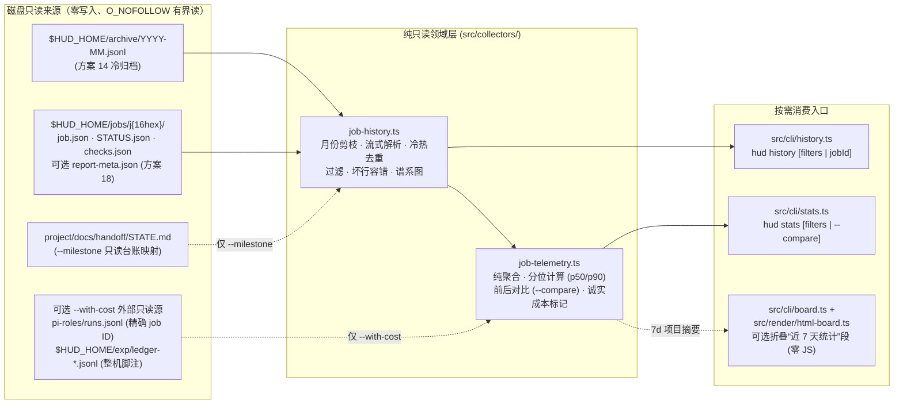
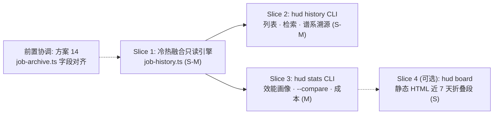

# 22. `hud history` 历史检索与跨周工程效能/成本画像（构建在方案 14 被动归档之上）

> **优先级**：P2（闭合 MCP-ORCH “实证前后对比”闭环，让跨周历史事实与优化收益可量化、可回溯）
> **类别**：只读消费层 / CLI 历史检索与效能遥测 / 可选静态 HTML 报表扩展
> **预估规模**：M–L（4 个独立垂直切片，总计源码 ~1,000 行、测试 ~670 行、文档 ~50 行；第 4 片 `hud board` 联动为可选增量）
> **前置依赖**：**功能上弱依赖方案 14**（`14-job-archive-ledger.md` 提供 `$HUD_HOME/archive/YYYY-MM.jsonl` 冷数据写入；在方案 14 落地前，本方案仍可对 `$HUD_HOME/jobs/` 近 24h 热数据及合成归档运行）；与 **方案 18**（`18-structured-hud-report.md` 的 `report-meta.json`）天然互补，可选消费结构化 `outcome` / `verdict` / `summary`；与 **方案 08**（共享 job 索引缓存）正交，本方案为一次性短命 CLI，不依赖常驻缓存；文件冲突极低（`src/cli/hud-main.ts` 不在 CODE-HEALTH 在途 lane 改动清单内，仅 `html-board.ts` / `i18n.ts` 需避开面板文案重构期）
> **`docs/spec.md` 边界影响**：**小幅明确新增（需 Owner 拍板后写入）**——不改变任何路由、派发、生命周期或保留策略，不新增常驻服务、数据库或终端面板页签（严格遵守 `docs/spec.md:127,145,170-171`）；需 Owner 认可新增 `hud history` / `hud stats` 两个只读 CLI 消费入口，并确认 `hud board` 是否附带可选的折叠统计段（同步修订提案 14 建议的 `docs/spec.md` 措辞中 “nothing reads it yet” 一句）

---

## 1. 背景与现状证据

行号以当前 HEAD（`e2c003de`）为准。

### 1.1 现状缺口：归档有写无读、统计限于当日、实证研究难以复现

1. **方案 14 只写不读，且缺少 4 项已有磁盘事实**：
   - `docs/neon-proposal/14-job-archive-ledger.md:38-50` 将定位严格收口为“删除 `$HUD_HOME/jobs/<id>/` 前追加一行 JSONL 到 `$HUD_HOME/archive/YYYY-MM.jsonl`”，并将 `hud history` 与效率统计列为显式非目标（`:45-46`、`§6 Q2`）。
   - 核对当前真实写入代码后发现，提案 14 示例行（`:62-76`）与现网字段存在 **4 处需对齐的细微落差**：
     - **`used_place` 格式**：`src/mcp/thin-main.ts:1336,1377` 与 `src/roles/exhausted.ts:89-101`（`describePlace`）实际写出 `"cli/claude (opus)"`、`"pi (example-model)"`、`"bro/chatgpt"`，而非提案 14 示例中的 `"claude example-model high"`；早期无 `attempts`/`used_place` 的任务则需由 `job.place` + `job.model` 回推（同提案 16 §3.2）。
     - **3 项已有磁盘事实尚未列入提案 14 示例行**：`STATUS.json` 的 `quiet_decision.action`（`packages/hud-mcp/bin/hud-cli.mjs:232-241`、`src/collectors/control-radar.ts:127-128`）、`job.json` 的 `exhaustion_marked`（`src/mcp/thin-main.ts:93,768,1465`、`src/roles/roster.ts:849`）、以及 `STATUS.json` 的 `output_written`（`src/collectors/thin-jobs.ts:210-213` 规定 `state === 'stopped' && output_written === true` 归类为 `display_state: 'done'`，缺此字段会导致冷归档无法复现 `jobRow()` 的完成口径）。
     - **`retry_of` 当前未持久化到 `job.json`**：核实 `src/mcp/thin-main.ts:63-108`（`Job` 接口）与 `:1164-1302`（`dispatchJob`），`hud_create({ retry_of })` 会用 `derivedKey('retry', ...)` 计算幂等键并继承 `source.repair_of`（`:1176,1182`），但 **`base` 对象（`:1285-1302`）只写了 `repair_of`，并未把 `retry_of` 写入 `job.json`**。因此现网中 `repair_of` 可直接溯源，而显式 `retry_of` 溯源需可选追加 2 行持久化。
     - **`harness` 写法差异**：`STATUS.json`（`hud-cli.mjs:38`）与 `thin-jobs.ts:648` 用 `harness: 'cli'` + `agent: 'claude'`，而提案 14（`:73`）把 CLI 任务的 `harness` 直接写为 `job.cli?.agent`（`'claude'`/`'codex'`/`'agy'`/`'grok'`）。消费层必须统一归一化。
2. **Control 雷达与提案 16 仅覆盖“本地当日”且上限 200 目录**：
   - `src/collectors/control-radar.ts:115-137`（`roleRadar`）仅扫描 `$HUD_HOME/jobs/` 最新 200 个目录，并按本地日历日 `dayOf(created) === today` 过滤；只产出 `RoleRadar { total, ok, failed, quietEscalated, avgMinutes }`（`:11`）。
   - `docs/neon-proposal/16-per-place-dispatch-health.md:52` 明确不做滚动窗口与跨天历史。由于 `packages/hud-mcp/bin/hud-watch.mjs:301-308` 在任务结束 24 小时后自动删除目录，任何跨天/跨周趋势都无法从 `jobs/` 直接获得。
3. **2026-11-21 实证研究与 `docs/spec.md` Done 标准缺乏可复现工具**：
   - `.scratch/mcp-orch/proposal.md:8-16` 记录了 Owner 2026-11-21 对单日约 500 轮会话的实证统计，关键观测包括：启动失败回落、不支持的 thinking 伪装为超时、以及 **“报告写入到主会话读取的中位延迟 = 20 秒”**（`:15`）。
   - `docs/spec.md:196` 明确将 MCP-ORCH 里程碑的验收标准定为：**“Done: the owner runs a real project day and the same counts as the 2026-11-21 study are compared.”** 今天每次想评估一轮优化（MCP-ORCH、方案 18 结构化报告、角色预设调整）是否真正降低了返工率、启动重试率、收集延迟与开销，只能手工写临时脚本翻目录，且 24 小时后数据即被清理。
4. **本地成本账本口径碎片化，极易误关联或伪造零值**：
   - **Pi 会话用量**：`src/collectors/control-radar.ts:84-113`（`piRadar`）从 `$PI_CODING_AGENT_DIR/sessions/` 截尾 256 KiB 读取 `message.usage.cost.total`（超限时标 `sampled: true`，`control-view.ts:210` 渲染为 `≥$`）；而 `src/harness/pi/p10k-footer.ts:138-196` 指出网关模型常报 `cost.total === 0`，需按内置 `PRICES_PER_M` 估算并标 `~`（`estimated: true`），无价目表则显示 `$-`（`:673`）。
   - **EXP API Grant 账本**：`src/collectors/exp-ledger.ts:14-16,24`（`$HUD_HOME/exp/ledger-{anthropic,openai}-api.jsonl`）与 `src/harness/pi/exp-usage.ts:100-169` 记录的是 `{ type: 'cost', id, at, model, tokens, source: 'reported'|'priced'|'unpriced', costMicros }`——**不含 `job` ID、`role` 或 `project`**，且仅覆盖启用了 EXP grant 的 API-key 路由（`src/harness/pi/exp-route.ts:5-28`）。它本质是**整机账户级**账本，绝不能硬拆到单个 job 或 role 上。
   - **`pi-roles` 运行账本**：`~/.local/share/pi-roles/runs.jsonl`（由外部未打包的 `pi-roles` 写入，`docs/spec.md:21`、`14-job-archive-ledger.md:21`）仅覆盖 pi worker，且不保证始终存在。
   - **CLI / 浏览器订阅席位**（Claude Code、Codex、Antigravity、ChatGPT/Gemini Web）：本地无逐任务美元定价来源，`docs/spec.md:13` 明确要求 **“no price column without a local source”**。
5. **CLI 与静态看板基础设施已就绪**：
   - `src/cli/hud-main.ts:12-55` 采用极简子命令分发与 `CliError`（`src/cli/private-home.ts:5-33`）退出码约定；
   - `src/cli/board.ts:52-65` 与 `src/render/html-board.ts:1-210` 已实现零脚本、零网络请求、严格 CSP（`default-src 'none'; style-src 'unsafe-inline'`）与完整 `escapeHtml` 转义的静态 HTML 看板。

### 1.2 三方案清晰分工定位（14 vs 16 vs 18 vs 22）

| 维度 | 方案 14（归档写入） | 方案 16（Control 当日健康） | 方案 18（结构化汇报） | **方案 22（本方案：历史检索与效能画像）** |
|---|---|---|---|---|
| **角色定位** | **纯被动写入层**（删除前追加 1 行 JSONL） | **面板当日只读视图**（Control → Usage） | **Worker 汇报元数据层**（`report-meta.json`） | **纯只读跨周消费层**（按需 CLI + 可选静态 HTML 段） |
| **数据源** | 待删 `$HUD_HOME/jobs/<id>/` | 热 `$HUD_HOME/jobs/`（今日，≤200） | `hud_report` / `hud-progress --done` | **冷热融合**：`$HUD_HOME/archive/YYYY-MM.jsonl` + `$HUD_HOME/jobs/` |
| **时间跨度** | 永久按月追加 | 仅本地今日 | 单任务当前回合 | 任意跨天/跨周/跨月窗口 + 双窗口 `--compare` |
| **运行形态** | 内嵌于现有按需 watcher 删除分支 | 随面板 5s 采集闸门 | 同步写盘（0600 原子替换） | **按需短命命令**，用完即退，零常驻进程 |
| **写磁盘 / 改路由** | 仅写归档 JSONL；不改路由 | 零写盘；不改路由 | 仅写展示元数据；不改状态/验收 | **零写盘**（`hud board` 除外）；**零自动路由/降级干预** |

---

## 2. 目标与非目标（Scope / Out of Scope）

### 目标（Scope）

1. **冷热融合的统一历史只读引擎（`src/collectors/job-history.ts`）**：
   - 按需合并读取 `$HUD_HOME/archive/YYYY-MM.jsonl`（冷）与 `$HUD_HOME/jobs/j<16hex>/`（热），按 `job` ID 确定性去重（热覆盖冷）。
   - 流式逐行解析 + 按月份文件名剪枝 + 严格单文件/总行数/热目录上限；坏行跳过不崩溃，并诚实输出 `coverage` 不完整统计（`docs/ARCHITECTURE.md` §8）。
   - 支持按时间窗（`--since` / `--until` / `--month`）、`--project`（经 `sharedRoot()` 自动归并 worktree）、`--role`、`--harness`、`--model`、`--place`、`--state`、`--package`、`--milestone`（只读关联 `STATE.md` 台账）过滤。
2. **`hud history` 跨周检索与任务溯源 CLI**：
   - 跨周逆序列表（支持 `--limit`、`--json`、`--query`/`-q` 分层检索）。
   - 单任务详情 `hud history <jobId> [--chain]`：查看已删除或活跃任务的全部归档事实，以及基于 `repair_of` / `retry_of` / `parent_job` 的双向祖先-后代修复/子任务谱系树。
3. **`hud stats` 工程效能与诚实成本画像 CLI**：
   - 按全局、`role`、`place`、`project`、`package`、`day`、`week` 聚合吞吐成功率、返工/启动回落/配额耗尽、运行与收集时延分布（p50/p90）、checks 一次通过率、以及方案 18 流入的 `outcome`/`verdict` 分布。
   - 内置 **`--compare <rangeA> <rangeB>` 前后对比模式**，一键复现 `.scratch/mcp-orch/proposal.md` 的实证对比（含 `read_at - settled_at` 主会话收集延迟中位数）。
   - 严格诚实的可选成本视角（`--with-cost`）：仅在存在可精确归属的本地事实来源时展示 `≈$` 及覆盖率；无本地来源一律显示 `—`，绝不伪造 `$0`；整机级 EXP 账本仅作独立脚注，绝不错误摊派给角色或项目。
4. **可选静态报表联动（`hud board`）**：
   - 在 `hud board` 导出的静态 HTML 中附带一个默认折叠的 `<details>` 段（“近 7 天工作统计 / Recent 7 days”），零 JS、零外部请求、复用既有安全标签集与 `escapeHtml()`，无数据时自动省略。

### 非目标（Out of Scope）

1. **绝不引入常驻服务、后台索引进程、SQLite 或账本数据库**（`docs/spec.md:127,145`）。
2. **绝不干预调度与路由**：统计结果只供 Owner 审阅与手动调整预设/开关，绝不自动降级、跳过、排序或修改角色链（`docs/spec.md:13`）。
3. **不在终端侧栏面板中新增 History/Stats/Diagnostics 页签**（遵守 `docs/spec.md:170-171` 退休 Timeline / Activity / Summary / diagnostics 页面的决议）。
4. **不新增 MCP 工具**（至少在 v1 不向主会话工具面增加上下文噪音；主会话若需自查可直接运行只读命令或待 Owner 试用后再议）。
5. **不发起任何外部网络请求、LLM 调用、herdr IPC 或仓库 Git hook 执行**（仅在 `--project` 解析根目录时复用 `src/roles/projects.ts:46` 的安全 `sharedRoot`，严格带 `SAFE_GIT_ARGS` 与 `safeGitEnv`）。
6. **不替代方案 13（`hud doctor <jobId>`）**：`doctor` 诊断现存热目录的底层回执（`turn.json`/`done.json`/进程存活）；`history <jobId>` 负责跨周历史事实与多任务修复链溯源。
7. **不抓取厂商账单或伪造订阅席位单价**。

---

## 3. 核心设计方案

### 3.1 总体数据流与模块边界



### 3.2 与方案 14 / 方案 18 的 Schema 对齐与统一内部记录模型

#### A. 建议同步补充到方案 14（`src/roles/job-archive.ts`）的轻量纯事实字段（完全向后兼容 `v: 1`）

提案 14 尚未合入代码，此时在 `archiveJob()` 增加 5 个零隐私风险的已有磁盘事实字段（全部“缺失即省略”，仅增 ~10 行代码，每行增加 <120 字节），即可彻底消除冷热数据口径断层：

| 字段 | 类型 | 磁盘来源（已验证） | 用途 |
|---|---|---|---|
| `used_place` | `string` | `job.used_place ?? (job.place ? describePlace(job.place, job.model) : undefined)`（`thin-main.ts:1377`、`exhausted.ts:89`） | 对齐 `describePlace` 真实格式（如 `"cli/claude (opus)"`），与提案 16 100% 统一 |
| `output_written` | `boolean` | `status.output_written === true`（`hud-cli.mjs:176`、`hud-jev.mjs:37`） | 准确复现 `thin-jobs.ts:210-213`：`stopped + output_written:true` 归为 `done` |
| `quiet_decision_action` | `string` | `status.quiet_decision?.action`（`hud-cli.mjs:232-241`） | 保留跨周 `quiet_escalated` 事实（同 `control-radar.ts:127-128`） |
| `exhaustion_marked` | `boolean` | `job.exhaustion_marked === true`（`thin-main.ts:93`、`roster.ts:849`） | 保留跨周配额耗尽次数（同提案 16 `PlaceRadar.quota`） |
| `verdict` / `thinking_source` | `string` | 方案 18 `readReportMeta(dir)?.verdict`；`job.thinking_source`（`thin-main.ts:81`） | 保留评审结论分布与 sonic 自动 thinking 评估依据 |
| `retry_of`（可选） | `string` | 若 `thin-main.ts:1295` 顺手持久化 `retry_of`（+2 行），同步归档 | 区分“失败重试”与“读后修复（`repair_of`）” |
| `pi_cost_usd` / `pi_cost_estimated`（可选） | `number` / `boolean` | 见 §3.5（仅 pi 任务删除前有界汇总 `sessions/*.jsonl`） | 使历史 pi 任务在删除后仍保留可归属的估算成本 |

> **向后兼容保障**：即使盘面上已有旧版 `v: 1` 归档行缺失上述任意字段，方案 22 读取层一律按**缺失即未知（`undefined`）**处理，统计分母只计具备该事实的记录或显式标注样本量，绝不崩溃或填假 `0`。

#### B. 冷热统一内部记录 `HistoryRecord`

```ts
// src/collectors/job-history.ts
export type CanonicalHarness = 'pi' | 'cli' | 'bro';
export type DisplayState = 'working' | 'done' | 'failed' | 'stopped';

export interface HistoryAttempt {
  readonly place: string;
  readonly reason?: string;
}

export interface HistoryRecord {
  readonly job: string;                     // /^j[0-9a-f]{16}$/
  readonly source: 'hot' | 'cold';          // 来自 jobs/ 还是 archive/
  readonly archived?: true;                 // hot 记录同时已在冷归档中出现过
  readonly project: string | null;          // 规范化项目根（project_root ?? worktree.main_root ?? cwd）
  readonly role: string;
  readonly harness: CanonicalHarness;       // 统一归一化：cli/claude -> harness:'cli', agent:'claude'
  readonly agent?: string;                  // CLI agent ('claude'|'codex'|'agy'|'grok') 或 bro provider
  readonly model: string | null;
  readonly thinking: string | null;
  readonly thinkingSource?: 'decision' | 'default' | 'explicit';
  readonly preset: string | null;
  readonly usedPlace: string | null;        // describePlace 文本，如 "cli/claude (opus)"
  readonly attempts?: readonly HistoryAttempt[];
  readonly dispatchExitCode: number | null;
  readonly state: string | null;            // 原始 STATUS.state
  readonly displayState: DisplayState;      // 严格复用 thin-jobs.ts jobRow() 规则
  readonly outputWritten?: boolean;
  readonly exitReason: string | null;
  readonly quietEscalated?: boolean;        // undefined 表示旧冷记录未携带此字段
  readonly exhaustionMarked?: boolean;
  readonly createdAtMs: number | null;
  readonly startedAtMs: number | null;
  readonly settledAtMs: number | null;
  readonly endedAtMs: number | null;
  readonly readAtMs: number | null;
  readonly reapedAtMs: number | null;
  readonly archivedAtMs: number | null;
  readonly checks?: { readonly passed: number; readonly total: number; readonly stale: boolean };
  readonly repairOf?: string;
  readonly retryOf?: string;
  readonly parentJob?: string;
  readonly package?: string;
  readonly outcome?: 'done' | 'partial' | 'blocked' | 'failed';
  readonly verdict?: 'accept' | 'changes_required';
  // 以下仅在 Tier 1（归档显式开启）或 Tier 2（热目录单查）时可选填充，默认缺失
  readonly title?: string;
  readonly summary?: string;
  readonly cost?: { readonly usd: number; readonly estimated: boolean; readonly source: 'archive' | 'pi-roles' | 'hot-session' };
}
```

**字段归一化不变量**：
1. **`harness` 与 `agent` 统一映射**：
   - 若冷记录 `harness` 属于 `['claude', 'codex', 'agy', 'grok']` → 归一化为 `{ harness: 'cli', agent: raw.harness }`；
   - 若热记录 `job.cli?.agent` 或 `status.harness === 'cli'` → `{ harness: 'cli', agent: job.cli?.agent ?? status.agent }`；
   - 若 `job.bro || job.jev || raw.harness === 'bro' || raw.harness === 'jev'` → `{ harness: 'bro', agent: job.bro?.provider ?? job.bro?.tool }`；
   - 否则 → `{ harness: 'pi' }`。
   - 过滤参数 `--harness` 同时接受大类（`pi`/`cli`/`bro`）与 CLI agent 简写（`claude`/`codex`/`agy`/`grok`），降低记忆负担。
2. **热目录零副作用读取**：
   - 读取 `$HUD_HOME/jobs/<id>/` 时**严禁调用** `src/mcp/thin-main.ts:765` 的 `readRow()`（它会在失败时改写 `STATUS.json` 与 `exhausted.json`）；严格复用纯函数 `jobRow()`（`src/collectors/thin-jobs.ts:197`）与 `jobChecks()`（`src/roles/job-checks.ts:63`），与方案 13（`13-hud-doctor-job.md:32`）保持同一安全红线。
3. **冷热去重策略**：
   - 以 `job` ID 为唯一键放入 `Map<string, HistoryRecord>`：
     - 冷归档按文件名时间顺序加载，同 ID 冲突时保留 `archivedAtMs` 较新者（并记 `coverage.duplicateColdIds++`）；
     - 热目录最后合入：只要热目录 `job.json` 可读，**热记录覆盖冷记录**（热目录含最新 `read_at`、`checks.json`、未删状态），并在记录上置 `archived: true`；若热目录正在删除中导致 `ENOENT`/不可读，保留冷记录且不报错。

### 3.3 流式读取、月份剪枝与性能/安全硬边界（对齐 `docs/ARCHITECTURE.md` §8）

```ts
export const HISTORY_LIMITS = {
  maxArchiveFiles: 24,            // 最多扫描 24 个月度归档文件（2 年跨度）
  maxArchiveFileBytes: 32 << 20,  // 单月文件硬上限 32 MiB（远大于常态 1–3 MiB，防止异常膨胀 OOM）
  maxLinesPerFile: 50_000,        // 单文件最多解析 5 万行
  maxTotalLines: 200_000,         // 单次命令总解析行数硬上限
  maxLineBytes: 16_384,           // 单行超过 16 KiB 视为畸形行跳过，防单行内存攻击
  maxHotJobs: 1_000,              // 热目录 jobs/ 最多读取最新 1000 个目录
  maxHotFileBytes: 65_536,        // 单个 job.json / STATUS.json 上限 64 KiB
  maxLatencySamplesPerGroup: 50_000,
} as const;

export interface HistoryCoverage {
  readonly complete: boolean;
  readonly archiveFilesScanned: number;
  readonly archiveFilesSkipped: number;  // 超文件数上限或超 32 MiB 被跳过
  readonly hotDirsScanned: number;
  readonly hotCapped: boolean;           // jobs/ 目录数 > maxHotJobs
  readonly linesTruncated: boolean;      // 触发单文件或总行数上限
  readonly malformedLines: number;       // 坏 JSON / 截断尾行 / 超长行 / 非法 job ID
  readonly unreadableHotDirs: number;    // 并发删除或权限异常目录
  readonly duplicateColdIds: number;
}
```

**关键实现细节**：
1. **防 TOCTOU 符号链接打开**：打开每个 `$HUD_HOME/archive/YYYY-MM.jsonl` 时，先校验目录名正则 `/^\d{4}-(0[1-9]|1[0-2])\.jsonl$/`，再用 `fs.openSync(file, fs.constants.O_RDONLY | fs.constants.O_NOFOLLOW | fs.constants.O_NONBLOCK)` + `fs.fstatSync(fd)` 确认 `isFile()` 且 `size <= maxArchiveFileBytes`，随后以 **`fs.createReadStream('', { fd, autoClose: true, highWaterMark: 64 * 1024 })`** 交由 `readline.createInterface` 逐行流式消费——彻底杜绝打开前替换符号链接的竞态，且峰值常驻内存仅 64 KiB 读缓冲 + 命中结果集。
2. **±48 小时安全垫月份剪枝**：
   - 提案 14（`:81`）按 `ended_at`（UTC `YYYY-MM`）分桶，而用户查询按 `created_at` 或本地时区日期过滤。
   - 若指定 `[sinceMs, untilMs]`，计算候选月度集合时自动向外扩展 **`[sinceMs - 48h, untilMs + 48h]`** 再转 UTC `YYYY-MM`，既能把“只查近 7 天”从全量扫描剪枝到最多 **1–2 个文件**，又绝不漏掉跨时区午夜或跨月末创建/结束的任务。
   - 未指定时间窗时：列表模式（`hud history`）默认 `--since 30d`（或 `--all` 扫至 `maxArchiveFiles`），统计模式（`hud stats`）默认 `--since 7d`，既快又贴合跨周复盘直觉。
3. **时间基准与过滤语义**：
   - 主时间戳 `anchorMs = createdAtMs ?? startedAtMs ?? settledAtMs ?? endedAtMs ?? archivedAtMs`；缺失任何时间戳的畸形行计入 `malformedLines` 跳过。
   - `--since` / `--until` 支持相对时长（`24h`、`7d`、`4w`）、本地日期（`YYYY-MM-DD`，`since` 取当天 `00:00:00` 本地时间，`until` 取当天 `23:59:59.999`）与完整 ISO-8601。
   - `--month YYYY-MM` 为快捷语法，展开为该本地自然月起止区间。
   - `--project <spec>`：传 `.` 或路径时经 `sharedRoot()`（`src/roles/projects.ts:46`）解析主仓根路径做精确匹配（天然聚合所有 linked worktrees）；传非路径短名（如 `MyHUD`）时精确匹配 `basename(project)`（大小写不敏感）。
   - `--milestone <M>`：必须绑定项目根（`--project` 或当前 `cwd`），调用 `readStateLedger(projectRoot)`（`src/collectors/state-ledger.ts:20`）提取 `milestone === M` 的所有 slice `id` 及正文里 `.scratch/<slug>/` 引用的 feature slug，匹配 `record.package`（大小写不敏感精确匹配或 `<sliceId>:` 前缀匹配）。若该项目无 `STATE.md` 或该里程碑下无 slice，显式打印提示而非静默返回空表。
4. **隐私与搜索价值的分层权衡（`--query` / `title` / `summary`）**：

| 层级 | 归档落盘内容 | `--query` 检索范围 | 隐私面评估 | 推荐状态 |
|---|---|---|---|---|
| **Tier 0（默认，对齐提案 14 Q1=A）** | **零正文、零标题**：仅结构化事实（role、harness、model、place、preset、package、project、exit_reason≤200B、attempts[].reason≤200B、outcome、verdict、checks、关系 ID） | 检索上述全部元数据字段 + job ID 前缀匹配 | **最优**：归档无保留期也不会永久滞留项目代码/报告 prose | **默认启用** |
| **Tier 1（显式 Opt-in，衔接提案 14 Q1=B + 方案 18）** | 若 Owner 在设置中开启可选开关（或提案 14 选 B），额外归档经消毒的 `title`（brief 标题 ≤120 码点）与/或 `summary`（**仅取自方案 18 `report-meta.json` 的 ≤160 码点单行摘要**，绝不盲截 `report.md` 原文） | 自动扩展覆盖 `title` 与 `summary` | **可控**：归档文件仍为 `0600` 私有且仅限短单行结论，无大段代码或上下文 | **架构原生支持，默认关** |
| **Tier 2（热目录增强）** | 不写入冷归档 | 仅针对仍在 `$HUD_HOME/jobs/` 的 <24h 热任务，单查 `hud history <id>` 时可顺带只读展示 `brief.md` 首行标题与 `report-meta.json` `summary` | 零新增落盘风险 | **单查详情默认启用** |

### 3.4 核心 CLI 设计：`hud history` 与 `hud stats`

#### A. 命令拓扑备选对比

| 方案 | 命令行形态 | 优点 | 缺点 |
|---|---|---|---|
| **方案 A（推荐）：双子命令 + 别名** | `hud history [jobId \| filters]` + `hud stats [filters \| --compare]`（同时允许 `hud history --stats` 转发到 `stats`） | 与 `hud-main.ts` 现有扁平二词风格（`hud watch`、`hud board`、`hud trust`、`hud doctor`）完全一致；`hud stats --by place --since 14d` 高频输入最短；两命令共享 `history-args.ts` 与 `job-history.ts` | `hud --help` 增加 2 行 |
| 方案 B：单子命令嵌套 | `hud history [list \| show <id> \| stats \| compare]` | 顶层子命令只增 1 个 | 常用统计命令变长（`hud history stats --compare ...`），与现有 `hud` 风格不统一 |

**推荐方案 A**（保留 §6 Q1 给 Owner 拍板）。

#### B. `hud history` 用法与输出示例（全合成数据）

```text
Usage:
  hud history [filters] [--query TEXT] [--limit N] [--all] [--json]
  hud history <jobId> [--chain] [--json]

Filters:
  --since <7d|24h|4w|YYYY-MM-DD|ISO>   Default: 30d (omit with --all)
  --until <YYYY-MM-DD|ISO>
  --month <YYYY-MM>
  --project <.|PATH|NAME>
  --role <ROLE>
  --harness <pi|cli|bro|claude|codex|agy|grok>
  --model <SUBSTR>
  --place <SUBSTR>
  --state <working|done|failed|stopped|quiet>
  --package <PKG>
  --milestone <ID>                     Resolves slices from project STATE.md
```

**1. 跨周列表输出示例（终端自适应列宽，`visualLength`/`truncateAnsi` 对齐，尊重 `NO_COLOR=1`）**：

```text
TIME              JOB                ROLE      PLACE                    STATE     DUR    CHECKS  FLAGS       PACKAGE
2026-11-21 18:42  j0000000000000042  imp       cli/claude (opus)        done      6.4m   3/3     hot         DEMO-04
2026-11-21 17:15  j000000000000003f  reviewer  pi (example-model)       done      2.1m   —       verdict:ok  DEMO-03
2026-11-21 16:02  j000000000000003c  imp       cli/agy (hydrogen)       done      9.8m   2/2     repair,fb   DEMO-03
2026-11-21 15:40  j0000000000000039  imp       cli/agy (hydrogen)       failed    4.3m   0/2     quota       DEMO-03
2026-11-18 11:05  j0000000000000018  sonic     pi (flash-model)         done      38s    —       child       DEMO-01

Showing 5 of 148 matched (window: since 30d · 2 archive files + 34 hot jobs)
```
> 缩写标记 `FLAGS`：`hot`（仍在 `jobs/`）、`repair`（有 `repair_of`）、`retry`（有 `retry_of`）、`fb`（`attempts.length > 1` 启动回落）、`quiet`（`quiet_escalated`）、`quota`（`exhaustion_marked`）、`child`（有 `parent_job`）、`partial`/`blocked`（来自方案 18 `outcome`）、`verdict:ok`/`verdict:fix`（来自方案 18 `verdict`）。

**2. 单任务详情与双向修复链溯源（`hud history j000000000000003c --chain`）**：

```text
job        j000000000000003c  (archived · 2026-11.jsonl)
project    /work/demo
role       imp   package DEMO-03   preset default
place      cli/agy (hydrogen)   harness cli/agy   thinking high
attempts   1. cli/claude (opus)  [failed: launch timeout]
           2. cli/agy (hydrogen) [used]
state      done (raw: closed)   exit_reason: report read
outcome    done   verdict: —
timing     created 2026-11-21T16:02:00Z  started +4s  settled +9.8m  read +18s  ended +9.9m
checks     2/2 passed (fresh)
relations  repair_of j0000000000000039

lineage
  j0000000000000039  imp       failed   4.3m  checks 0/2  [quota]   2026-11-21 15:40
  └─ repair  j000000000000003c  imp       done     9.8m  checks 2/2  [fb]      2026-11-21 16:02  <-- current
     ├─ sonic   j000000000000003d  sonic     done     42s   —                   2026-11-21 16:05
     └─ sonic   j000000000000003e  sonic     done     31s   —                   2026-11-21 16:07
```
- **防环与边界**：谱系构建以 `visited: Set<string>` 保护，最大深度 32、最多展示 64 个节点，若截断显式标注 `(+N more in chain)`。
- **跨窗祖先补全**：单查 `<jobId>` 时若未指定 `--since`，默认扫描最近 3 个月归档 + 全量热目录（或用户指定 `--all` 扩至 24 个月），确保跨周的修复链不因默认时间窗断裂。

#### C. `hud stats` 工程效能指标口径与前后对比

##### 1. 严格可信的指标定义（绝不伪造、绝不稀释分母）

| 指标类别 | 字段名 | 精确数学公式与排除规则 | 缺失时渲染 |
|---|---|---|---|
| **吞吐与终态** | `total`, `done`, `failed`, `stopped`, `working`, `quiet_escalated` | `displayState` 严格复用 `thin-jobs.ts:209-218`（`stopped && outputWritten` 归为 `done`）；`quiet_escalated` 仅计 `quietEscalated === true`（并单独记录有此字段的样本数 `quietKnown`） | 无样本则 `0`；旧归档无 quiet 字段且 `quietKnown === 0` 时显示 `—` |
| **成功率** | `success_rate` | `done / (done + failed + stopped)`（排除在途 `working`，避免拉低实时成功率） | 分母为 0 → `—` |
| **返工率（修复）** | `repair_rate` | `count(repairOf !== undefined) / total`；另给 `retry_rate`（仅在存在 `retryOf` 记录时输出） | `total === 0` → `—` |
| **启动回落率** | `launch_fallback_rate` | `count(attempts && attempts.length > 1) / count(attempts !== undefined)`（仅在携带 `attempts` 的记录上求比，不被旧格式稀释） | `attemptsKnown === 0` → `—` |
| **位置启动失败** | `launch_failures` | 按 `--by place` 拆分时，归属规则与提案 16 §3.2 完全一致：遍历 `attempts`（前 8 项），`attempt.reason && attempt.place !== usedPlace` 计入该 `attempt.place` 的 `launchFailures`，而终态 `done`/`failed`/`quiet`/`quota` 归属给 `usedPlace` | 无则 `0` |
| **配额耗尽次数** | `quota_hits` | `count(exhaustionMarked === true)` | `quotaKnown === 0` → `—` |
| **运行时长分布** | `run_p50`, `run_p90` | `delta = (settledAtMs ?? endedAtMs) - (startedAtMs ?? createdAtMs)`；仅对非 `working` 且 `0 <= delta <= 7d` 的有效样本计算；`p50` 取标准中位数，`p90` 取 nearest-rank `sorted[Math.ceil(0.9 * n) - 1]`；附带 `(n=...)` | `n === 0` → `—`（`n < 5` 时 `p90` 附 `n` 提醒或标注） |
| **主会话收集延迟** | `collect_p50`, `collect_p90` | `delta = readAtMs - settledAtMs`；仅计 **`!parentJob`**（排除由父 worker 收集的 `sonic` 子任务）且 `settledAtMs !== null && readAtMs !== null && 0 <= delta <= 24h`（排除结算前早读导致的负值及多日后补读的极端离群值，并在 `--json` 中单独给出 `collectOutliers` 计数）。**直接对应 `.scratch/mcp-orch/proposal.md:15` 的 20s 中位延迟！** | `n === 0` → `—` |
| **Checks 一次通过率** | `checks_pass_rate` | 在 `checks && checks.total > 0 && !checks.stale` 的样本中，计算 `count(checks.passed === checks.total) / n` | `n === 0` → `—` |
| **结果/评审分布** | `outcomes`, `verdicts` | 统计方案 14 + 18 留存的 `outcome`（`done`/`partial`/`blocked`/`failed`）与 `verdict`（`accept`/`changes_required`）；缺失项归为 `unclassified`，绝不默认算 `done` | 全部未分类时省略该行 |

> **关于 `read_at` 二次覆盖的诚实说明**：`src/mcp/thin-main.ts:1739` 在每次 `hud_read` 返回报告正文（含 `full: true` 重读）时都会刷新 `job.read_at`。因此 `read_at - settled_at` 精确度量的是“结算到最近一次正文读取”的延迟；常态（首次读即关 worker）下即为首读收集延迟，且过滤 `> 24h` 可防止次日重查污染中位数。文档与 `--json` schema 说明中将如实标注这一边界。

##### 2. `hud stats` 常规聚合输出示例（合成数据）

```text
HUD stats · window: last 7d (2026-11-15 .. 2026-11-22) · all projects
Summary   92 jobs (88 settled: 78 done · 7 failed · 3 stopped · 4 working)
Rates     success 88.6% · repair 9.8% (9/92) · launch fallback 6.7% (6/90) · checks 1st-pass 84.4% (27/32)
Health    quiet escalated 3 · quota hits 4
Latency   run p50 4.6m  p90 14.2m (n=88)  ·  collect p50 14s  p90 52s (n=61)
Outcomes  done 52 · partial 11 · blocked 2 · unclassified 23  |  Verdicts  accept 14 · changes_required 4

By place (--by place)
PLACE                     JOBS   OK%    LAUNCH✗  QUOTA  QUIET  RUN p50  RUN p90  CHECKS   COST
cli/claude (opus)         38     94.6%  1        1      0      5.2m     13.4m    18/20    —
pi (example-model)        29     89.3%  0        0      0      3.1m     9.8m     7/8      ≈$4.18 (26/29)
cli/agy (hydrogen)        16     75.0%  5        3      2      7.4m     18.1m    2/4      —
bro/chatgpt               9      88.9%  0        0      1      4.0m     8.5m     —        —
```

##### 3. `--compare` 前后实证对比模式（直接服务 `docs/spec.md:196` 与优化复盘）

```sh
hud stats --compare 2026-11-14..2026-11-20 2026-11-21..2026-11-27 --project .
```

```text
HUD stats compare · project: /work/demo
  A (baseline): 2026-11-14 .. 2026-11-20  (84 jobs, 84 settled)
  B (target)  : 2026-11-21 .. 2026-11-27  (91 jobs, 88 settled)

METRIC                BASELINE (A)         TARGET (B)           DELTA (B - A)
settled jobs          84                   88                   +4
success rate          81.0% (68/84)        88.6% (78/88)        +7.6 pp
repair rate           16.7% (14/84)        9.9% (9/91)          -6.8 pp
launch fallback rate  14.3% (12/84)        6.7% (6/90)          -7.6 pp
quota hits            7                    4                    -3
quiet escalated       8                    3                    -5
checks 1st-pass       — (n=0)              84.4% (27/32)        n/a
run duration p50      6.1m (n=84)          4.6m (n=88)          -1.5m (-24.6%)
run duration p90      18.4m (n=84)         14.2m (n=88)         -4.2m (-22.8%)
collect latency p50   20s (n=58)           11s (n=61)           -9s (-45.0%)
collect latency p90   78s (n=58)           34s (n=61)           -44s (-56.4%)
```
- 当 A 或 B 任一侧某指标样本数为 0（如基线周尚未启用 `checks`），`DELTA` 诚实打印 `n/a`，绝不把缺失当作 `0%` 算出虚假的 `+84.4 pp`。

### 3.5 可选成本关联（`--with-cost`）：来源边界与防造假纪律

核查全仓后，把本地所有涉及美元/token 的来源按**“能否可靠归属到单任务”**严格分层：

| 本地数据源 | 代码验证位置 | 粒度与可归属键 | 方案 22 处理规则 |
|---|---|---|---|
| **1. 归档自带 `pi_cost_usd`（可选，提案 14 轻扩展）** | `src/roles/job-archive.ts`（删除前有界读 `jobs/<id>/sessions/*.jsonl` 最多 256 KiB，复用 `control-radar.ts:84-99` + `p10k-footer.ts:153-196` 口径） | **精确单任务（仅 pi）** | 直接归属到该 `job` / `role` / `place`；任何估价或截尾统一标 `≈$`（截尾标 `≥≈$`），展示覆盖比 `(priced/total)` |
| **2. `pi-roles` 外部账本** | `~/.local/share/pi-roles/runs.jsonl`（或 `$XDG_DATA_HOME/pi-roles/runs.jsonl`，`14-job-archive-ledger.md:21`） | **仅当存在精确 job ID 字段**（`job` 或 `task_dir` 末段匹配 `/^j[0-9a-f]{16}$/`）且带有限非负数值 `cost`/`cost_usd` 时可关联 | 仅在 `--with-cost` 时只读流式扫描（`O_NOFOLLOW`，上限 16 MiB）；**严禁按时间戳猜测关联**；缺失文件或无匹配字段静默跳过 |
| **3. 热目录 pi 会话** | `$HUD_HOME/jobs/<id>/sessions/*.jsonl`（`thin-jobs.ts:121-139`） | **精确单任务（仅热 pi）** | 仅在 `--with-cost` 时按每文件 ≤256 KiB 有界读估算（标 `≈$`） |
| **4. EXP API Grant 账本** | `$HUD_HOME/exp/ledger-anthropic-api.jsonl`、`ledger-openai-api.jsonl`（`src/collectors/exp-ledger.ts:14-24`、`src/harness/pi/exp-usage.ts:100-169`） | **整机账户级**（仅有 `id`, `at`, `model`, `tokens`, `source`, `costMicros`，**无 `job` / `role` / `project`**） | **绝不归属到任何 role / place / project 行**；仅当 `--with-cost` 且 `experimentsEnabled(env)` 为真时，在报表底部单列“整机 EXP API 账本脚注（含主会话与非 HUD 会话）”，复用 `expApproxUsd()`（`src/exp-config.ts:75-78`）并标明 `unpriced` 条数 |
| **5. CLI / Browser 订阅席位** | 无本地逐任务费用源（`docs/spec.md:13`） | 不可定价 | **一律显示 `—`**，绝不显示 `$0` 或 `$0.00` |

> 默认运行 `hud stats`（不带 `--with-cost`）时：若归档记录自身已带 `pi_cost_usd` 可直接聚合展示，否则成本列整列省略（遵循 `docs/ARCHITECTURE.md:427`“缺失则省略”）且不额外扫描 `pi-roles` 或 `exp/` 文件；显式传 `--with-cost` 才做额外只读关联并展示整机 EXP 脚注。

### 3.6 可选静态 HTML 联动：`hud board` 折叠“近 7 天工作统计”段

核实 `src/cli/board.ts:52-65`、`src/tree-page.ts:932`、`src/render/html-board.ts:1-210` 及 `tests/unit/html-board.test.mjs:70-73` 后，给出零侵入、零 JS、零破坏现有安全基线的接入方案：

1. **纯渲染分离**：
   - `BoardInput`（`src/render/html-board.ts:14-23`）仅增加一个可选字段 `telemetry?: BoardTelemetry`（纯数据结构，包含 7 天窗口起止、汇总计数/比率/分位、Top 6 role 行、Top 6 place 行、当前 milestone 关联计数与 `incomplete` 标记）。
   - `renderHtmlBoard()` 保持 100% 纯函数，不做任何文件系统 I/O。
2. **零新增 HTML 标签（完全通过既有安全白名单测试）**：
   - `tests/unit/html-board.test.mjs:70-73` 对导出 HTML 实施严格标签白名单检查（允许 `section`, `h2`, `h3`, `details`, `summary`, `div`, `ul`, `li`, `span`, `b`, `code`, `i`, `p` 等，**不含 `table`/`tr`/`td`**）。
   - 本节完全沿用 `html-board.ts:70`（`.diff li`）的 CSS Grid `<ul><li>` 写法，嵌套于**默认折叠**的 `<details class="tstat">` 内：
     ```html
     <section id="telemetry">
       <h2>Recent 7 days <span class="n">42</span></h2>
       <details class="card">
         <summary>
           <span class="id">88.6% ok</span>
           <span class="chip plain">p50 4.6m</span>
           <span class="chip plain">collect p50 14s</span>
           <span class="chip plain">checks 27/32</span>
         </summary>
         <!-- CSS Grid ul/li 角色与位置分布 + 当前里程碑计数 + 如有 incomplete 的灰色提示 -->
       </details>
     </section>
     ```
   - 所有动态文本经 `escapeHtml()`（`html-board.ts:27-28`）转义一次；严格遵守既有 CSP `default-src 'none'; style-src 'unsafe-inline'`；无 `<script>`、无外部 URL；中英文词条补入 `src/render/i18n.ts`。
3. **空状态与性能保护**：
   - 当该项目近 7 天 `total === 0`（或归档/热目录均为空）时，**不渲染 `<section id="telemetry">`**，导航栏 `nav`（`html-board.ts:193`）也不出现对应锚点——现有 `html-board.test.mjs:126-128` 空白看板基线测试逐字节不变！
   - `writeBoard()`（`src/cli/board.ts:52`）被面板 `w` 热键（`src/tree-page.ts:932`）直接调用；收集 7 天摘要时强制加严预算（最多 2 个月度文件、200 个热目录、`try/catch` 吞掉读取异常退化为 `undefined`），保证导出总耗时增量控制在 <20 ms，且绝不因归档异常导致 `hud board` 失败。

### 3.7 并发、故障恢复与边界条件对照（`docs/ARCHITECTURE.md` §8）

| 风险场景 | 防护设计 |
|---|---|
| **并发追加导致 JSONL 尾行半截** | `hud-watch` 正在 `appendFileSync` 时读到不完整尾行：`JSON.parse` 捕获异常，计入 `coverage.malformedLines`，其余完整行照常输出，不报退出错误 |
| **热目录在扫描途中被 `hud-watch` 删除** | `ENOENT` 静默跳过（不污染 `unreadableHotDirs`）；若已从冷归档读到同 ID 则冷记录保留 |
| **恶意/损坏的符号链接或巨型文件** | 全部采用 `O_RDONLY \| O_NOFOLLOW \| O_NONBLOCK` + `fstatSync` 校验常规文件与大小上限；绝不跟随符号链接 |
| **时钟回拨或跨日孤立时间戳** | `runMs < 0` 或 `> 7d`、`collectMs < 0` 或 `> 24h` 从分位样本中剔除并记入 `outliers`，绝不产出 `-3s` 或 `400d` 污染均值/p90 |
| **多 worktree 同一项目被拆散统计** | 统一以 `job.project_root ?? job.worktree?.main_root ?? sharedRoot(cwd)` 归并到主仓根路径（与 `src/roles/job-project.ts:12-22` 一致） |
| **终端中文/窄宽错位与 ANSI 注入** | 外部文本（`package`、`exit_reason`、`used_place`、`summary`）一律清洗控制字符与 BiDi 双向覆盖字符；列宽以 `visualLength`/`truncateAnsi` 计算；`NO_COLOR=1` 或非 TTY 管道输出纯文本零转义码 |
| **大归档目录性能上限** | 实测设计目标（单文件 10,000 行 ~8 MB，Node 24 流式 `readline`）：全量解析单月 <150 ms、7 天剪枝读 1–2 文件 <40 ms，峰值堆增长 <30 MB（落地后按 `AGENTS.md` 在隔离环境跑 ≥3 轮实测记录范围） |

---

## 4. 垂直切片与实施路线（对齐 `docs/delegation.md`）

按单 `imp` 会话预算、端到端可独立验证、最小文件冲突原则，拆分为 **4 个垂直切片**（第 4 片可选）：


> 注：Slice 2 与 Slice 3 仅依赖 Slice 1，改动文件几乎无交集（除 `hud-main.ts` 各加 1 行路由），可串行也可在 Slice 1 合并后并行推进。

### Slice 1：冷热融合历史读取引擎 + 提案 14 Schema 对齐（S–M，1 个 `imp` 会话）

- **服务边界**：建立只读冷热数据层，为所有上层查询、统计与静态报表提供单一真相源。
- **改动文件清单与估行**：
  - 新增 `src/collectors/job-history.ts`（~260L）：`HistoryRecord`、`HistoryQuery`、`HistoryCoverage`、`HISTORY_LIMITS`、`loadJobHistory()`（流式归档读 + 月份剪枝 + 热目录扫描 + 去重 + 过滤 + `STATE.md` milestone 映射）、`buildJobLineage()`（双向 `repair_of`/`retry_of`/`parent_job` 图）。
  - 协调更新（若方案 14 已落地；否则记入方案 14 brief）：`src/roles/job-archive.ts`（~+15L）导出共享 `JobArchiveRow` 类型并补齐 §3.2 的 5 个纯事实字段（`used_place` 对齐 `describePlace`、`output_written`、`quiet_decision_action`、`exhaustion_marked`、`verdict`/`thinking_source`）；可选 `src/mcp/thin-main.ts:76,1295`（+2L 持久化 `retry_of`）。
  - 新增 `tests/unit/job-history.test.mjs`（~220L）。
- **可删除旧代码**：无（纯新增只读消费层）。
- **独立验收**：单测验证冷热去重（热覆盖冷）、±48h 月份剪枝、坏行/截断尾行跳过并报告 `coverage`、符号链接拒绝、`milestone` 台账关联与 4 层 `repair_of`+`sonic` 双向谱系树。

### Slice 2：`hud history` 检索与修复链溯源 CLI（S–M，依赖 S1，1 个 `imp` 会话）

- **服务边界**：向 Owner 与脚本暴露 `hud history [filters | <jobId>]`。
- **改动文件清单与估行**：
  - 新增 `src/cli/history-args.ts`（~95L）：纯参数解析（时间窗、`--month`、`--project`、过滤条件、规范化 `CliError` 错误码），供 `history` 与 `stats` 共用。
  - 新增 `src/cli/history.ts`（~190L）：`formatHistoryList()`、`formatHistoryDetail()`（纯格式化，复用 `visualLength`/`truncateAnsi` + 外部文本消毒）、`historyCommand(args, io)`。
  - 修改 `src/cli/hud-main.ts`（~+4L）：注册 `history` 子命令与 help 行。
  - 新增 `tests/unit/hud-history.test.mjs`（~160L）。
- **可删除旧代码**：无。
- **独立验收**：隔离 `HUD_HOME` 下跑通列表、过滤、`--query` 元数据搜索（以及 Tier 1 `summary` 命中）、单任务已删归档详情 + 谱系树、`--json`、`NO_COLOR=1`、非法参数退出码 2。

### Slice 3：`hud stats` 工程效能画像、`--compare` 前后对比与可选成本视图（M，依赖 S1，1 个 `imp` 会话）

- **服务边界**：交付跨周效能聚合与 `.scratch/mcp-orch/proposal.md` 实证复现能力。
- **改动文件清单与估行**：
  - 新增 `src/collectors/job-telemetry.ts`（~260L）：纯统计 `computeTelemetry()`（吞吐/成功率、返工/启动回落/配额、p50/p90 运行与收集时延、checks 一次通过率、`outcome`/`verdict` 分布）、纯对比 `compareTelemetry()`、可选只读成本上下文 `readOptionalCostContext()`（精确 job ID 关联 `pi-roles/runs.jsonl` + 独立整机 EXP 账本脚注）。
  - 新增 `src/cli/stats.ts`（~190L）：纯表格/对比格式化 + `statsCommand(args, io)`（并在 `history.ts` 兼容 `--stats` 快捷转发）。
  - 修改 `src/cli/hud-main.ts`（~+3L）：注册 `stats` 子命令与 help 行。
  - 新增 `tests/unit/hud-stats.test.mjs`（~200L）。
- **可删除旧代码**：无。
- **独立验收**：全指标口径与合成手算结果 100% 精确一致；`--compare` 正确输出 `pp` 与延迟变化及缺项 `n/a`；无定价来源一律显示 `—`（绝不出现 `$0`）；EXP 账本仅出现在独立整机脚注而不污染 role/place 行。

### Slice 4（可选）：`hud board` 静态 HTML 折叠“近 7 天工作统计”段与文档收尾（S，依赖 S3，1 个 `imp` 会话）

- **服务边界**：让 `hud board` 与面板 `w` 导出的静态审阅看板附带零 JS 折叠效能概览，并补齐中英文档与 spec 变更。
- **改动文件清单与估行**：
  - 修改 `src/cli/board.ts`（~+22L）：在 `writeBoard()` 中以严格有界预算收集近 7 天本项目摘要，失败静默降级为 `undefined`。
  - 修改 `src/render/html-board.ts`（~+70L）：`BoardInput.telemetry?`、折叠 `<section id="telemetry"><details>...</details></section>`（仅用现有安全标签集与 CSS Grid，零 JS，空数据时省略）。
  - 修改 `src/render/i18n.ts`（~+14L）：补齐 EN/ZH 词条。
  - 扩展 `tests/unit/html-board.test.mjs`（~+90L）：验证 XSS 转义、零新增 HTML 标签白名单、空白看板零退化、EN/ZH 渲染。
  - 文档更新：`docs/ARCHITECTURE.md`（§2 仓库地图、§4.6 `hud board` 说明）、`docs/reference.md`、`docs/reference.zh.md`；Owner 确认 §6 Q5 后更新 `docs/spec.md`。
- **可删除旧代码**：无。

### 迁移、兼容与回滚策略

- **老数据零迁移**：无 `$HUD_HOME/archive/` 目录时自动退化为仅读热 `$HUD_HOME/jobs/`；旧版 `v: 1` 归档行缺失新增可选字段时优雅显示 `—` / `unclassified`。
- **零侵入回滚**：本方案为纯只读消费层，不修改任何现有数据文件格式（除方案 14 新增的可选只读附加字段）；回退本方案只需移除新增 CLI/collector 文件与 `hud-main.ts`/`board.ts` 的入口行，对现有任务状态、归档文件、面板与 MCP 零残留影响。

---

## 5. 验证与验收方案

### 5.1 自动化单测与集成测试矩阵（全部使用临时 `HOME`/`HUD_HOME`，100% 合成数据，严格不触碰真实 `~/.hud`）

| 测试文件 | 核心测试场景 |
|---|---|
| **`tests/unit/job-history.test.mjs`**（S1） | ① 冷热融合去重：同一 `j0000000000000001` 同时存在于 `archive/2026-11.jsonl` 与 `jobs/` 时，热记录胜出且保留最新 `read_at`/`checks`，并标 `archived: true`；② 月份剪枝：构造 6 个月归档，查询 `--since 7d` 验证仅打开边界相关 1–2 个文件，且跨月末午夜创建/结束的任务不丢失；③ 坏行与截断容错：插入畸形 JSON、半截尾行、超 16 KiB 行、非法 ID，确认不抛异常且 `coverage.malformedLines` 精确计数；④ 安全防线：`archive/2026-11.jsonl` 为符号链接或超大小上限时拒绝读取并记入 `archiveFilesSkipped`；⑤ 归一化与状态一致性：`stopped + output_written:true` 映射为 `done`，`harness: 'claude'` 映射为 `cli/claude`，旧格式无 `attempts` 回推 `describePlace`；⑥ 只读保证：扫描含失败未标记 `exhaustion_marked` 的热目录，验证运行前后全部文件 mtime/内容零变化；⑦ `--milestone` 关联合成 `STATE.md` 匹配 `package`；⑧ 双向谱系树（`repair_of` 3 层 + 2 个 `sonic` 子任务 + 循环引用保护） |
| **`tests/unit/hud-history.test.mjs`**（S2） | ① 跨周逆序列表、`--limit`、多条件组合过滤（`--role`、`--harness claude`、`--state quiet`、`--project .` 归并 linked worktree）；② `--query` 命中元数据字段（Tier 0）及可选 `summary`（Tier 1）；③ `hud history <id> --chain` 对已删除归档任务与活跃热任务均正确输出谱系；④ 含 CJK 字符与 ANSI 注入串（如 `\x1b[31m`、BiDi `\u202e`）的列宽对齐与消毒验证，`NO_COLOR=1` 零转义码；⑤ `--json` 契约稳定性与非法参数退出码 2、`invalid_hud_home` 退出码 3 |
| **`tests/unit/hud-stats.test.mjs`**（S3） | ① 全部指标精确手算校验：`success_rate` 排除 `working`、`launch_fallback_rate` 分母仅计含 `attempts` 记录、`checks_pass_rate` 排除 `stale`、`collect_p50/p90` 排除 `parent_job` 子任务与负值/超 24h 离群值；② `--by place` 归属口径与提案 16 完全对齐（启动失败归属失败的 `attempt.place`，终态归属 `used_place`）；③ `--compare A B` 输出正确 `pp` 差值与时长百分比变化，单侧无数据时输出 `n/a`；④ 成本诚实边界：CLI/bro 一律输出 `—`（绝不输出 `$0`），合成 `pi-roles/runs.jsonl` 精确 job ID 命中输出 `≈$` 与覆盖比，整机 EXP 账本仅出现在独立脚注且 `experiments=false` 时不读取；⑤ 大文件流式性能回归（合成 20,000 行 ~16 MB 归档，验证流式读完、有界截断标志及无 OOM） |
| **`tests/unit/html-board.test.mjs`**（S4） | ① 注入含 XSS 载荷的 `package` / `role` / `place`，验证全量转义且仍 100% 通过 `:70-73` 原有 HTML 标签白名单（零新增标签、零 `<script>`）；② `telemetry` 缺失或 `total === 0` 时不渲染 `#telemetry` 段，空白看板基线不变；③ EN/ZH 双语折叠统计段渲染正确；④ 归档目录不可读时 `hud board` 仍退出 0 并正常产出看板 |

### 5.2 Owner 实机试用验收清单（Done 标准，对齐 `docs/spec.md:147`）

- [ ] 在真实工作负载下执行 `hud history --since 7d`：热目录中的当日任务与归档中的前几日任务无缝合并、无重复 ID，列表在窄屏和中文环境下对齐不乱行。
- [ ] 对一个曾触发过 `hud_send` 修复或含 `sonic` 子任务的任务执行 `hud history <jobId> --chain`（包括目录已被 24h 清理的老任务）：完整还原从首次失败到修复通过的因果链与 checks 结果。
- [ ] 执行 `hud stats --since 7d --by place`：核对当日部分与 Control → Usage（提案 16）一致；确认 CLI/浏览器位置成本列显示 `—`（绝非 `$0`），且运行与主会话收集延迟 `p50`/`p90`（`read_at - settled_at`）直观可读。
- [ ] 跑完一轮优化（如 MCP-ORCH 或方案 18）后执行 `hud stats --compare <优化前一周> <优化后一周> --project .`：单条命令输出前后返工率、启动回落率、checks 一次通过率与收集延迟中位数的对比表。
- [ ] （若启用 Slice 4）按面板 `w` 或运行 `hud board --open`：页面默认保持简洁，展开底部“近 7 天工作统计”折叠块即可看到本项目统计，开发者工具网络面板 0 请求、控制台 0 报错。

---

## 6. 需要 Owner 拍板的开放问题

| # | 设计分叉与选项 | 推荐默认项与理由 |
|---|---|---|
| **Q1** | **CLI 子命令形态**<br>• **A**：两个平级子命令 `hud history`（检索/详情/谱系）+ `hud stats`（效能画像/`--compare`），并兼容 `hud history --stats` 别名。<br>• **B**：合并为单一子命令 `hud history [list \| <id> \| stats \| compare]`。 | **推荐 A**。与 `hud watch`、`hud board`、`hud trust`、`hud doctor` 的扁平风格一致，且 `hud stats --by place` / `--compare` 属于高频独立命令，输入更短。 |
| **Q2** | **默认项目作用域（未传 `--project` 时）**<br>• **A**：默认**全机所有项目**，传 `--project .`（或 `--cwd`）限定当前项目。<br>• **B**：在已注册项目目录内默认限定当前项目，传 `--all-projects` 看全机。 | **推荐 A**（`hud history` 与 `hud stats` 默认全机；仅 `--milestone` 隐式使用当前 `cwd`）。避免在任意终端路径下困惑“为什么看不到昨天的任务”，且与 `$HUD_HOME/archive/` 按机归档的物理布局一致；`--project .` 仅多 10 个字符。 |
| **Q3** | **方案 14 归档是否顺手增加 `retry_of` 与 pi 估价字段**<br>• **A（最小增量）**：仅补齐 5 个零成本已有事实（`used_place` 对齐、`output_written`、`quiet_decision_action`、`exhaustion_marked`、`verdict`/`thinking_source`）；暂不落盘 `pi_cost_usd`，成本仅靠 `--with-cost` 读 `pi-roles` 与热会话。<br>• **B（完整增量）**：在 A 基础上，① `thin-main.ts` 增加 2 行持久化 `retry_of`；② 方案 14 在删除 pi 任务目录前有界汇总 `sessions/*.jsonl` 写入 `pi_cost_usd` + `pi_cost_estimated`。 | **推荐 B**（改动合计仅 ~25 行且零额外进程）：① 让“失败重试（`retry_of`）”与“读后修复（`repair_of`）”在跨周统计中清晰分流；② 避免 pi 会话迁走后历史成本永久不可关联。若 Owner 希望方案 14 保持极致精简，则选 **A**，本方案完全兼容。 |
| **Q4** | **`--query` 与归档摘要层级（联动提案 14 §6 Q1）**<br>• **A（Tier 0）**：默认归档绝不落盘任何标题/摘要，仅检索结构化元数据。<br>• **B（Tier 1 Opt-in）**：在设置中增加默认关闭的开关，开启后归档附加经消毒的 brief 标题与方案 18 `report-meta.json` 单行 `summary`（≤160 码点），供 `--query` 全文检索。 | **推荐 A 起步、结构预留 B**。严格守住提案 14 的无正文隐私底线；待 Owner 实际用过 `hud history` 若确实需要按语义关键词回找历史任务，再开启 B。 |
| **Q5** | **是否纳入 Slice 4（`hud board` 折叠“近 7 天工作统计”）及 `docs/spec.md` 措辞确认**<br>• **A**：一并纳入 Slice 4（默认折叠、零 JS、无数据时不渲染）。<br>• **B**：先仅做纯 CLI（Slice 1–3），`hud board` 保持纯审阅视角不变。 | **推荐 A**（~90 行净增量，默认折叠不打扰审阅主线，且方便周报/里程碑复盘时一页通览）。<br>**建议 `docs/spec.md` 增补句（待 Owner 同意后写入）**：在 JOB-RETENTION 归档说明旁改为：“Before deleting a closed job directory, the watcher appends one line of the job's facts (no report prose by default) to `$HUD_HOME/archive/YYYY-MM.jsonl`; `hud history` and `hud stats` read the archive together with live `$HUD_HOME/jobs/` on demand (read-only, no database or resident service, no routing feedback).” 若选 A，在 `hud board` 句末补 “plus an optional folded 7-day project job summary when history exists.” |
