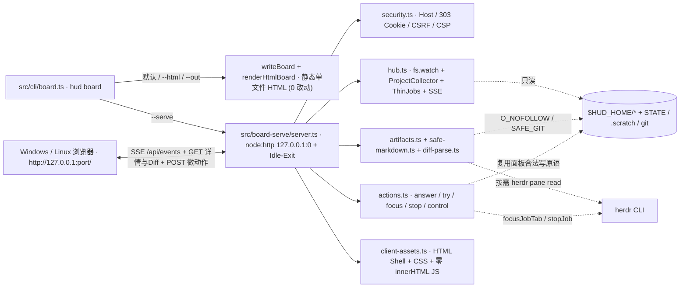
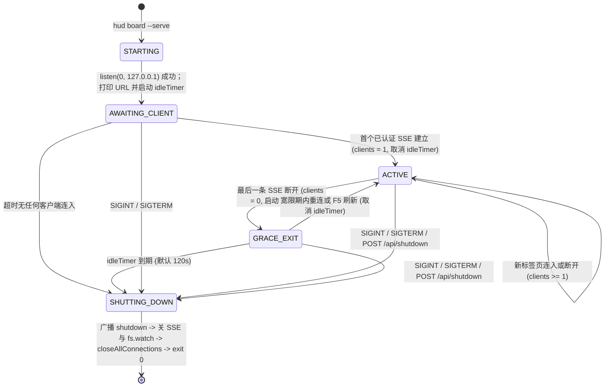
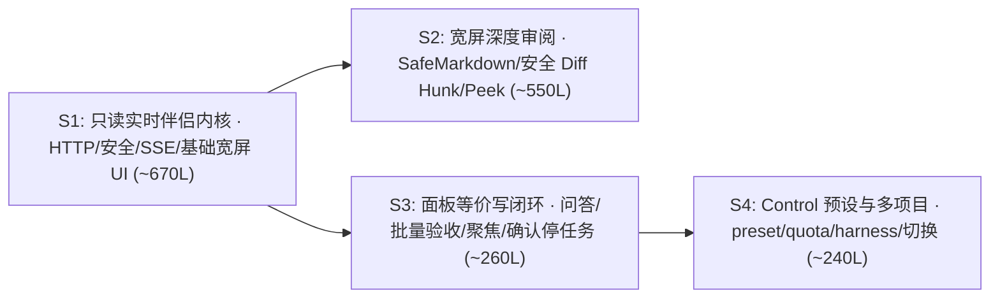

# 23. 按需启动、非驻留的实时 Web 看板 `hud board --serve`（SSE 实时推送 + 宽屏审阅 / Diff / 问答 / 验收）

> **优先级**：P1（多 worker 并行审阅、宽屏读报告/看 Diff 与高信噪比人工介入体验跃迁，高度契合 WSL2 + Windows 浏览器工作流）
> **类别**：CLI 交互伴侣 / 零依赖本地 HTTP + SSE 实时看板 / 与终端面板严格等价的有限写闭环
> **预估规模**：M–L（4 个独立垂直切片，总计源码 ~1,720 行、测试 ~710 行、文档 ~60 行；S1 + S2 为纯只读实时宽屏审阅伴侣，零写风险即可独立落地交付）
> **前置依赖**：无硬前置、**零新增 npm 依赖**（纯 Node ≥24 `node:http` / `node:crypto` / `node:fs` + 内联 CSS 与零构建原生 vanilla JS）；已适配单一 `dist/` 构建布局（`scripts/build.mjs`）；若 **方案 18**（`18-structured-hud-report.md`）落地，S2 详情区可顺带展示结构化 `report-meta.json` 摘要，不构成阻塞
> **`docs/spec.md` 边界影响**：**显式增量扩展（需 Owner 拍板后修订 `docs/spec.md` §2.2 与 §4）** —— 默认 `hud board [--html] [--cwd DIR] [--out FILE] [--open]` 与面板 `w` 的**静态、零脚本、零网络导出保持 100% 原样不变**；仅在用户显式调用 `hud board --serve` 时启动一个**按需、绑定 `127.0.0.1:0` 随机端口、无活跃 SSE 客户端宽限 120s 自动退出**的短命本地审阅伴侣。严格遵守 `docs/spec.md` §3（无执行平台、无数据库、无自动链式编排、不派发/不改写项目代码）与 §2.1（不把终端内 pi 模型选择器与自由链草稿编辑器搬进浏览器）

---

## 1. 背景与现状证据

行号与符号均以当前 HEAD（`358816db`）为准。

### 1.1 40 列终端面板与静态 `hud board` 的结构性断层

MyHUD 的 40 列侧边栏（`docs/spec.md:82`、`src/cli/panel-pane.ts:5,110`）在“伴随主会话低打扰盯盘”上非常克制，而现行静态 `hud board`（`src/cli/board.ts:1-123`、`src/render/html-board.ts:1-210`）已经验证了浏览器宽屏看项目看板的价值（复用了 `terminal` / `latte` 色板 `src/render/html-board.ts:34-37`）。但在多 worker（`imp` / `reviewer` / `oracle` / `sonic`）并行推进的日常高频审阅场景中，静态导出存在 **5 个不可回避的体验断点**：

| 断点维度 | 现行代码证据 | 真实使用痛点 |
|---|---|---|
| **1. 一次性快照，无实时推送** | `writeBoard()`（`src/cli/board.ts:52-65`）单次调 `ProjectCollector.collect('export', ...)` 写入静态 HTML；CSP 锁死 `default-src 'none'; style-src 'unsafe-inline'`（`src/render/html-board.ts:197`） | worker 提问、产出报告或完成 `checks` 后，静态页瞬间过时；只能反复按 `w` 或重跑 `hud board --open`，在 Windows 浏览器里堆积大量旧标签页 |
| **2. 只有 `--numstat` 数字条，缺少报告正文与彩色 Diff Hunk** | `DiffStatCollector`（`src/collectors/diff-stat.ts:7-101`）仅输出前 `DIFF_FILE_LIMIT = 12` 个文件加删行数；`html-board.ts:88-100` 仅画比例条；`readReview()`（`src/cli/board.ts:40-49,59`）只截取单篇最新 `docs/reviews/*.md`，且 `html-board.ts:192` 仅把 `^#{1,6}\s` 加粗 | 审阅多个并行的 `imp`/`reviewer`/`oracle` 长报告与真实代码改动时，静态页看不到 `report.md`、`brief.md`、`review-N.md`、`checks.json` 与具体 unified diff hunk，仍须频繁切回终端开 `v` / `o` / `git diff` |
| **3. 纯只读无操作闭环** | `html-board.ts:208` 为纯静态展示，未接入 `answerJobQuestion` / `appendTry` / `focusJobTab` / `stopJob` / Control 预设切换 | 宽屏读完 `Needs you` 问题或 `To try` 试用步骤后，必须切回 40 列终端重新定位同一行再按 `1`–`4` / `y` / `n` / `g` / `X`，上下文反复撕裂 |
| **4. 脱离 herdr 窗格时作业完全空白** | `src/cli/board.ts:110` 调 `readThinJobs(hudHome, { project: cwd, pane: io.env.HERDR_PANE_ID ?? null }, ...)`，而 `src/collectors/thin-jobs.ts:437,467-468` 硬过滤 `!herdrId(scope.pane) \|\| job.herdr_pane !== scope.pane`（见 `tests/unit/html-board.test.mjs:194-197`） | 在独立终端或另一个 herdr pane 运行 `hud board` 时所有作业与开放问题为空，滞后于 `docs/spec.md:16`（2026-11-21 “Jobs belong to a project, not to a pane”） |
| **5. WSL2 + Windows 浏览器的 `file://` 摩擦** | `openBoard()`（`src/cli/board.ts:68-77`）用 `wslview` / `xdg-open` 打开 Linux 文件路径 | WSL2 下 `wslview` 将文件转为 `\\wsl.localhost\...` 的 `file://` 打开，既无法建 SSE 流、又依赖 `wslu` 存在；而 `http://127.0.0.1:<port>/` 借助 WSL2 自动 localhost 转发，可被 Windows 原生 Chrome/Edge 毫秒级直连 |

### 1.2 现有成熟底座可直接复用（无需重造轮子）

本方案不是另起炉灶的 Web 控制台，而是直接挂接 MyHUD 已经验证过的采集器、安全 Git 工具与面板等价写原语：

| 能力层 | 现有可复用模块与符号 | 复用方式 |
|---|---|---|
| 项目与 Control 采集 | `ProjectCollector`（`src/collectors/project-board.ts:108-536`）、`TryBriefs`（缓存只读，`src/cli/board.ts:32-33,115-116`）、`acceptanceTasks`（`src/collectors/acceptance-tasks.ts:24`）、`collectControlRadar`（`src/collectors/control-radar.ts:140-151`）、`projectList`（`src/roles/projects.ts:104-128`） | 按需采集（内置 inode/mtime 签名缓存与 5s Git 节流），绝不触发外部模型请求 |
| 作业与项目归属 | `readThinJobs`、`readJobProgress`、`jobRow`、`readActiveLeases`（`src/collectors/thin-jobs.ts:168-714`）、`projectJobFilter`（`src/roles/job-project.ts:12-22`）、`sharedRoot`（`src/roles/projects.ts:46-60`） | 共享同一套状态口径，并按 `sharedRoot(cwd)` 实现项目级作业覆盖 |
| 事件监听范式 | `watchInputs`（`src/cli/watch.ts:103-141`） | 沿用 Node 24 Linux 已验证的 `fs.watch(jobs, { recursive: true })` + 防抖扫描，零空轮询 |
| 安全 Git 与 Diff 基础 | `SAFE_GIT_ARGS`、`safeGitEnv`、`neutralizeFilters`（`src/utils/git-safety.ts:2-42`）、`worktreeGit`（`src/collectors/worktrees.ts:43-70`）、`DiffStatCollector`（`src/collectors/diff-stat.ts:62-101`） | 扩展有界 unified diff hunk 读取，绝不触发仓内 filter / hook / ext-diff / lazy fetch |
| 按需输出窥视 | `peekJob` + `paneText`（`src/mcp/thin-main.ts:547-556,800-821`）、`runHerdr`（`src/roles/herdr-run.ts:114-120`） | 读取 `SESSION.txt` 的 `LEFT=` 后一次性调用 `herdr pane read --source recent`（1s 预算），绝不改变 job 状态 |
| 面板合法写闭环 | `answerJobQuestion`（`src/collectors/panel-actions.ts:15-36`）、`appendTry` / `TryLog`（`src/collectors/try-records.ts:17-93`）、`focusJobTab` / `stopJob`（`src/cli/panel-pane.ts:39-68`）、`editPlaces` / `editPreset`（`src/roles/role-control.ts:317-334,379-412`）、`setHarnessDisabled`（`src/roles/harness-switches.ts:37-57`） | 与 `src/tree-page.ts:1053-1140` 调用完全相同的写入函数与原子 `0600` 落盘约束，主会话通过 `hud watch` 与 MCP `changes` 立即感知 |
| 色板与中英文词典 | `BOARD_SPECS`、`DARK_ROLES`、`LIGHT_ROLES`（`src/render/palette.ts:229-242,503-532`）、`t` / `resolveLanguage`（`src/render/i18n.ts:23-27,593-627`） | 复用面板色板 token 与 EN/ZH 翻译体系 |

---

## 2. 目标与非目标（Scope / Out of Scope）

### 目标（Scope）

1. **严格向后兼容的 CLI 入口**：
   - `hud board [--html] [--cwd DIR] [--out FILE] [--open]`：保持静态单文件导出 100% 行为不变（零脚本、零网络、`tests/unit/html-board.test.mjs` 全绿）。
   - `hud board --serve [--cwd DIR] [--idle-exit-s N] [--open | --no-open] [--pane ID | --all-panes] [--lang en|zh]`：启动按需、非驻留、绑定 `127.0.0.1:0` 的实时 Web 审阅伴侣，默认自动打开浏览器并将 URL 打印到 stdout。
2. **非驻留短命生命周期**：
   - 追踪活跃 SSE（`EventSource`）客户端连接数；启动后若在宽限期内从未连入，或全部浏览器标签页关闭后超过 `--idle-exit-s`（默认 `120`s，范围 `5..3600`），进程自动清理所有 `fs.FSWatcher` / 定时器 / Socket 并以 `0` 退出；
   - 支持 `Ctrl-C`（`SIGINT`）/ `SIGTERM` 以及页面右上角「关闭服务」按钮即时停止。
3. **本地纵深安全红线**：
   - 仅监听 `127.0.0.1:0`（拒绝 `0.0.0.0` / 远程访问）；
   - 严格 `Host` 精确匹配防 DNS Rebinding；一次性 bootstrap token 经 `303 See Other` 换取 `HttpOnly; SameSite=Strict; Path=/` Cookie 收起 URL token；写接口叠加 `Origin` / `Sec-Fetch-Site` + 每会话 `X-HUD-CSRF` + `Content-Type: application/json` + 32 KiB body 上限；
   - 严格无 `'unsafe-inline'` CSP，服务端将 Markdown 与 Diff 解析为结构化 AST，前端**零 `innerHTML` / `eval`** 纯 DOM 构造防 XSS；
   - 严禁任意路径读取，只读登记白名单产物与项目文档（`O_NOFOLLOW` + `realpath` 边界 + 大小上限）；绝不暴露 `credentials.env` 任何值。
4. **事件驱动 SSE 推送 + 宽屏审阅体验**：
   - 基于 `fs.watch` + 防抖推送 `snapshot` / `jobs` / `project` / `control` / `ping` / `shutdown` 事件（支持 `Last-Event-ID`）；
   - 宽屏 3/2 栏响应布局：多 worker 并行进度/sparkline/嵌套 `sonic` 树、安全 Markdown 渲染报告、有界安全 Git 折叠彩色 Diff Hunk（单文件 ≤64 KiB / 总 ≤256 KiB）、按需 `peek` 终端尾行、To-Try 试用步骤与关联 Ticket、EN/ZH 与明暗色板切换。
5. **与终端面板完全对等的有限写闭环**：
   - 一键点选/输入答复开放问题（写 `qa/qN.answer.md` + `panel-actions.jsonl`）；
   - 多选批量 `y` 验收 / `n` 标红（追加 `tries.jsonl`）；
   - 一键聚焦 herdr tab（`focusJobTab`）与带二次确认停止失控 job（`stopJob`）；
   - S4 可选扩展：Control 离散操作（切换已命名 role preset、清除配额冷却、切换 `harnesses.json` 开关）与 `$HUD_HOME/projects.json` 多项目切换。

### 非目标（Out of Scope）

1. **绝不做常驻服务（No resident server）**：不提供 systemd/launchd/后台 daemon 模式、不支持 `--idle-exit-s 0` 永不退出、不绑定固定端口、不在 `./install` 中自启（对齐 `docs/spec.md:145,194`）。
2. **绝不越权编排或编辑项目源码**：不提供 `hud_create` / `hud_send` / `hud_lease` / `hud_tickets add`、不自动链式触发角色、不改写 `STATE.md` 或项目任何源码文件（对齐 `docs/spec.md:65,127-129`）。
3. **绝不替代终端内复杂编辑器**：不实现浏览器版 pi 模型搜索器（`model-picker`）或自由增删链草稿编辑器（`chain-input`），遵守 `docs/spec.md:13`“The picker stays in the terminal (no web console)”。
4. **绝不发外网请求或触发 LLM 调用**：页面零外网字体/CDN/图片请求；后端只读已有 `TryBriefs` 缓存，不发起任何外部模型/Decision API 请求。
5. **绝不做多用户远程访问或引入第三方前端依赖**：不支持 `--host 0.0.0.0`、TLS 或跨机共享（对齐 `docs/spec.md:8,136`）；不引入 React / Vite / esbuild / ws / express 等任何 npm 依赖，保持单步 `tsc` 编译。

---

## 3. 核心设计方案

### 3.1 总体架构与模块职责划分



**关键工程决策（结合 `tsconfig.json` 现状）**：
- 当前 `tsconfig.json:1-20` 配置为 `"target": "ES2022"`、`"module": "NodeNext"`、`"lib": ["ES2022"]`（不含 `"DOM"` 类型库）。
- 因此将所有需要高可靠单测的核心逻辑——`safe-markdown.ts`（Markdown → 安全 AST）与 `diff-parse.ts`（安全 Git 执行 + 截断 + Unified Diff → 结构化 AST）——放在**服务端纯 ES2022 TypeScript** 中实现并直接由 `node --test` 覆盖；前端 `client-assets.ts` 只负责极其薄的 DOM 构造器（`el(tag, props, children)` 仅使用 `document.createElement` + `document.createTextNode`）和事件交互，由同源 `/app.js` 与 `/app.css` 独立响应提供服务。
- 收益：**零 `tsconfig.json` 污染、零打包构建链、零 `'unsafe-inline'` CSP、零 `innerHTML` 攻击面**。

新增代码统一收口在 `src/board-serve/` 目录下，保持 `src/cli/` 与 `src/render/` 轻量：

| 模块 | 职责边界 |
|---|---|
| `src/board-serve/server.ts` | HTTP Server 启停、路由分发、SSE 连接计数、非驻留空闲退出状态机、`SIGINT`/`SIGTERM`/`/api/shutdown` 清理 |
| `src/board-serve/security.ts` | `Host` 精确白名单校验、一次性 bootstrap token → `303` + `HttpOnly; SameSite=Strict` Cookie 交换、`Origin`/`Sec-Fetch-Site`/`X-HUD-CSRF` 校验、安全响应头与 32 KiB 有界 JSON Body 读取器 |
| `src/board-serve/hub.ts` | 项目级作业扫描（复用 `projectJobFilter` + `readThinJobs` 共享逻辑）、`ProjectCollector`（最多 4 个项目 LRU，同 `ProjectVisits`）、`TryLog` + 只读 `TryBriefs`、`fs.watch` 监听与防抖聚合、SSE 客户端注册表、事件哈希去重与 64 条 `Last-Event-ID` 环形缓冲 |
| `src/board-serve/safe-markdown.ts` | 零依赖纯 TS 安全 Markdown AST 解析器（标题、段落、列表、复选框、引用块、围栏代码块、行内代码/粗体/斜体、安全 HTTP(S) 链接、简单表格）；过滤控制字符与 bidi 覆盖字符 |
| `src/board-serve/diff-parse.ts` | 严格参数化的安全 Git Diff 读取器（`SAFE_GIT_ARGS` + `neutralizeFilters` + 流式 64 KiB/256 KiB 截断 + 并发≤2 + 5s 超时）与 Unified Diff AST 解析器 |
| `src/board-serve/artifacts.ts` | 严格白名单 Job 产物与项目文档只读加载器（`O_RDONLY \| O_NOFOLLOW \| O_NONBLOCK` + `realpath` 围栏 + 128 KiB 上限）与按需 `peekJobPane()` |
| `src/board-serve/actions.ts` | 面板等价写操作薄封装与输入校验：`answerJobQuestion`、`appendTry`、`focusJobTab`、`stopJob`、`editPreset` / `editPlaces`、`setHarnessDisabled` |
| `src/board-serve/client-assets.ts` | HTML Shell、复用 `palette.ts` 色板的响应式 CSS、零 `innerHTML` 原生 JS 前端与 EN/ZH 词典注入 |

---

### 3.2 非驻留生命周期与浏览器打开机制



**关键边界设计**：
1. **CLI 参数契约**：
   ```text
   hud board --serve [--cwd DIR] [--idle-exit-s N] [--open | --no-open] [--pane ID | --all-panes] [--lang en|zh]
   ```
   - `--serve` 与 `--out` / `--html` 互斥，同时传入抛 `CliError`（exit `2`）；
   - `--idle-exit-s N`：默认 `120`，仅接受 `5..3600` 的正整数，明确拒绝 `0`（从参数层杜绝退化成常驻服务）；
   - 启动监听后，stdout **第一行**打印 `http://127.0.0.1:<port>/?token=<bootstrapToken>\n`（便于脚本/测试解析与终端 Ctrl-Click），辅助提示（端口、宽限倒计时、`Ctrl-C` 退出说明）输出到 stderr；
   - 页面刷新（F5）会短暂断开旧 SSE 并在 `<500ms` 内重连，`GRACE_EXIT`（默认 120s）保证刷新与笔记本短休眠不断服；只要有任何标签页保持打开，SSE 心跳维持连接，`idleTimer` 绝不触发，因此切去写代码 20 分钟再切回浏览器依然在线；关闭全部标签页后 120s 自动安静退出。
2. **WSL2 + Linux 浏览器打开（`openBoardUrl`）**：
   - 先用严格正则 `/^http:\/\/127\.0\.0\.1:\d{1,5}\/\?token=[A-Za-z0-9_-]{32,64}$/` 校验 URL，确保不含任何 shell 元字符（无 `&`、`$`、引号）；
   - 按顺序探测并 `spawn(..., { detached: true, stdio: 'ignore', shell: false })` + `unref()`：
     1. `executable('wslview', env)` → `[url]`（与 `src/cli/board.ts:69` 保持一致）；
     2. `executable('xdg-open', env)` → `[url]`；
     3. **WSL2 兜底**（当 `env.WSL_DISTRO_NAME || env.WSL_INTEROP` 存在且未安装 `wslu` 时）：`executable('rundll32.exe', env)` → `['url.dll,FileProtocolHandler', url]`（纯进程参数传递，避免 `cmd.exe /c start` 的特殊字符解析风险与 PowerShell 冷启动延迟）；
   - 若三者均不可用，在 stderr 提示手动点击 stdout 中的 URL，服务继续运行（不报错退出）。
   - **为何强制 `127.0.0.1` 而非 `localhost`**：在 WSL2 NAT 网络模式下，Windows 浏览器访问 `localhost` 常先尝试 IPv6 `::1` 造成 300ms–2s 延迟甚至连接被拒，显式绑定并打开 IPv4 `127.0.0.1:<port>` 可保证 WSL2 localhost 转发零延迟稳定直连。

---

### 3.3 安全与权限红线（纵深防御，对照 `docs/ARCHITECTURE.md` §8）

即便 `docs/spec.md:130` 声明本产品面向单人单机环境，一旦开放本地 HTTP 监听，浏览器同机任意恶意网页都可能发起 DNS Rebinding 或跨站本地 POST 请求。因此本方案实行 **6 层纵深防御**，做到“零配置、零打扰、无短板”：

| 防御层级 | 威胁模型 | 强制实现策略 |
|---|---|---|
| **L1. Loopback + 严格 `Host`** | 局域网访问、DNS Rebinding（恶意域名重绑定到 `127.0.0.1`） | 硬编码 `server.listen(0, '127.0.0.1')`；所有请求首行校验 `req.headers.host === \`127.0.0.1:${port}\``，不匹配（含 `localhost:<port>` 与任意外部域名）立刻返回 `421 Misdirected Request` |
| **L2. 一次性 Bootstrap Token 收起** | 浏览器历史/截屏/Referer 泄露 token | `bootstrapToken = randomBytes(32).toString('base64url')`（256-bit）；`GET /?token=<t>` 使用 `crypto.timingSafeEqual` 验证通过后**立即作废**该 token，签发独立会话 `sid` + `csrfToken`，返回 `303 See Other` → `Location: /` + `Set-Cookie: hud_board_sid=<sid>; HttpOnly; SameSite=Strict; Path=/` + `Cache-Control: no-store` + `Referrer-Policy: no-referrer`。此后地址栏与全部 API/SSE 请求完全不含 token；同浏览器新开标签页访问 `http://127.0.0.1:<port>/` 自动共享 Session Cookie |
| **L3. 写操作 4 重反 CSRF** | 浏览器中其它标签页发起跨站 `fetch`/`<form>` 触发 `stopJob`/`answerJobQuestion` | 所有 `POST` 路由强制同时通过：① 有效 `hud_board_sid` Cookie；② 若有 `Origin` 必须精确等于 `http://127.0.0.1:<port>`，若有 `Sec-Fetch-Site` 必须等于 `same-origin`；③ `Content-Type` 为 `application/json`；④ `X-HUD-CSRF` 请求头 `timingSafeEqual` 匹配当前 `sid` 对应的 `csrfToken`（`csrfToken` 仅从同源已认证的 `GET /api/bootstrap` 获取，且全站**永不下发 `Access-Control-Allow-Origin`**）；Body 超过 32 KiB 立刻断开返 `413` |
| **L4. 严格 CSP + 零 `innerHTML`** | 恶意仓库 README / worker 报告 / diff 文本 / 提问内容注入 `<script>` 窃取 CSRF 并调用 `stopJob` 或 `answerJobQuestion` | 全站下发 `Content-Security-Policy: default-src 'none'; script-src 'self'; style-src 'self'; connect-src 'self'; img-src 'none'; font-src 'none'; object-src 'none'; base-uri 'none'; form-action 'none'; frame-ancestors 'none'`、`X-Content-Type-Options: nosniff`；服务端解析 Markdown/Diff 为 JSON AST，客户端严格仅使用 `createElement` + `textContent` 构建 DOM，链接协议仅白名单 `https?:\/\/` 且加 `rel="noopener noreferrer"`，同步剔除控制符与双向覆盖符 `[\x00-\x08\x0b\x0c\x0e-\x1f\x7f\u202a-\u202e\u2066-\u2069]`（对齐 `src/render/html-board.ts:28`） |
| **L5. 白名单只读文件围栏 & 零 Key 泄漏** | 路径穿越读取 `~/.ssh`、`$HUD_HOME/credentials.env` 或符号链接逃逸 | API **绝不接受任意文件路径参数**；Job 产物仅枚举白名单（`brief` / `report` / `review/<N>` / `qa/<qN>` / `qa/<qN>/answer` / `checks`），项目文档仅枚举白名单（`state` / `spec` / 已登记的 `docs/reviews/*.md` / `.scratch/<slug>/issues/<NN>-*.md`）；统一使用 `O_RDONLY \| O_NOFOLLOW \| O_NONBLOCK` + `lstatSync` + `realpathSync` 校验位于目标根目录内，上限 128 KiB；凭据沿用 `ProjectCollector` 的 `[name, boolean]` 布尔对（`src/collectors/project-board.ts:281-294`），绝不读取/传输 Key 值 |
| **L6. 安全 Git 防仓内命令执行** | 克隆的不可信仓库含恶意 `.git/config` filter / hook / ext-diff / textconv | Diff Hunk 读取严格套用 `safeGitEnv` + `SAFE_GIT_ARGS` + `neutralizeFilters`（`src/utils/git-safety.ts:2-42`）+ `--no-ext-diff --no-textconv --no-renames` + `GIT_LITERAL_PATHSPECS=1`，严守 `docs/spec.md:141` 与 `docs/ARCHITECTURE.md:437` |

---

### 3.4 数据采集、项目级作业发现与 SSE 增量推送

#### 3.4.1 解决现行 `readThinJobs` 的窗格作用域盲区

- 现行 `src/cli/board.ts:110` 传入 `{ project: cwd, pane: io.env.HERDR_PANE_ID ?? null }`，但 `src/collectors/thin-jobs.ts:437,467-468` 硬校验 `!herdrId(scope.pane) || job.herdr_pane !== scope.pane`，导致在独立终端启动时作业为零。
- 本方案为 `readThinJobs` 增加非破坏性的可选过滤分支（或导出 `readProjectThinJobs` 复用同一核心）：
  - 当 `scope.pane === null && scope.project`（且 `options?.byProject === true`）时，用 `projectJobFilter(scope.project)`（`src/roles/job-project.ts:12-22`，基于 `sharedRoot(cwd)` 识别主仓与全部托管 worktree）过滤作业，不再要求 `HERDR_PANE_ID` 匹配；
  - 现行 `hud board` 静态导出与 `tree-page.ts` 调用签名与默认行为完全不变；
  - `--serve` 默认采用项目作用域（覆盖该项目所有窗格的活跃及近 24h 内已完成作业，上限 64 条）；显式传 `--pane <id>` 时缩窄为单窗格模式。

#### 3.4.2 事件驱动 `fs.watch` 与防抖合并

```text
$HUD_HOME/                    ──► fs.watch (非递归): jobs 目录重建、tries.jsonl、panel-actions.jsonl、
                                  exhausted.json、harnesses.json、projects.json、roles/
$HUD_HOME/jobs/               ──► fs.watch ({ recursive: true }): 监听 STATUS.json、job.json、report.md、
                                  brief.md、progress.jsonl、checks.json、qa/*、review-*.md
                                  （过滤 *.tmp、supervisor.pid、/sessions/* 高频噪音）
<project>/docs/handoff/ 或根  ──► fs.watch (非递归): STATE.md
<project>/.scratch/           ──► fs.watch ({ recursive: true }, 若存在): 仅匹配 issues/*.md
<project>/docs/reviews/       ──► fs.watch (非递归, 若存在): 仅匹配 *.md
```

- **绝不递归监听整个项目根目录**（避免 `.git/`、`node_modules/`、`dist/` 消耗 inotify 配额或触发刷新风暴）。
- **防抖 + 单飞扫描**：文件变化后延迟 `150ms` 合并触发一次采集；若前一次采集正在进行，置 `dirty = true` 在结束后立即补扫一次（与 `src/cli/watch.ts:150-170` 同模式）。
- **安全慢扫兜底**：仅在 `clients.size > 0` 时启用 `30s` 慢扫（捕获 Git 工作区提交/状态变动或偶发 watcher 丢失），复用 `ProjectCollector` 内部 `5s` Git 节流（`src/collectors/project-board.ts:414`）；`clients.size === 0` 时暂停慢扫，空闲 CPU 趋近于 0。
- **写操作直推**：任意 `POST /api/actions/*` 落盘成功后立即调用 `hub.refreshNow(channels)`，实现 `<100ms` 端到端界面反馈。

#### 3.4.3 SSE 事件契约与 `Last-Event-ID`

端点：`GET /api/events?project=<projectKey>`

| SSE `event` 名 | 触发时机 | Payload 结构要点（JSON） |
|---|---|---|
| `snapshot` | 首次连入，或 `Last-Event-ID` 缺失/超出 64 条环形缓冲 | `{ seq, ts, projectKey, project, jobs, tryMarks, controlSummary, projects }` |
| `jobs` | `jobs` 序列化摘要哈希发生变化 | `{ seq, ts, projectKey, lanes, workers, activeCount, needsYouCount }`（含 nested `parentJobId`、`progress`、`checks`、`activity`、`requestInfo`、文件清单元数据不含大正文） |
| `project` | `STATE.md` / `tickets` / `waiting` / `git` / `tries.jsonl` 摘要变化 | `{ seq, ts, projectKey, summary, counts, ladder, git, gitDiff, waiting, slices, ledger, tasks, tickets, docs, tryMarks, updatedAt }` |
| `control` | `roles` / `harnesses` / `exhausted` / `leases` / `radar` 变化（仅在订阅了 control 视图或相关文件变更时更新） | `{ seq, ts, projectKey, roles, harnesses, harnessSwitches, keys, browser, leases, radar, harnessSwitchError }` |
| `ping` | 每 `25s` 心跳 | `{ ts, clients, idleExitS }` |
| `shutdown` | 服务即将退出（`SIGINT`/空闲超时/手动关闭） | `{ reason: 'idle' \| 'signal' \| 'user' }` |

- 每个有状态事件（`snapshot`/`jobs`/`project`/`control`）携带单调递增 `id: <seq>` 并写入容量 64 的环形缓冲。断线重连携带 `Last-Event-ID: <n>` 时，若 `<n>` 仍在缓冲内则按序补发后续增量；否则直接下发一次新鲜 `snapshot`。

---

### 3.5 有界安全 Git Diff Hunk 与按需 Peek 契约

#### 3.5.1 `readSafeDiffHunks`（`src/board-serve/diff-parse.ts`）

- **3 种白名单作用域**（绝不接受自由 Git revision 表达式）：
  1. `scope=working-tree`：当前项目工作区相对 `HEAD`（`git diff ... HEAD -- [file]`）；
  2. `scope=job&jobId=j<16hex>`：复用 `DiffStatCollector.job()`（`src/collectors/diff-stat.ts:88-99`）同源逻辑——读 `SESSION.txt` 的 `BASE=<7..64hex>` 与 `job.json` 的 `worktree?.root ?? cwd`，执行 `git diff ... <base>^{commit} -- [file]`；
  3. `scope=slice&commit=<7..40hex>`：仅接受合法 hex hash（`/^[0-9a-f]{7,40}$/i`）并强制加 `^{commit}` 后缀，执行 `git show ... --format= --no-show-signature --diff-merges=first-parent <hash>^{commit} -- [file]`。
- **硬边界与流式截断**：
  - `MAX_FILE_DIFF_BYTES = 64 * 1024`（单文件 hunk 超过 64 KiB 截断该文件剩余行并标 `file.truncated = true`）；
  - `MAX_TOTAL_DIFF_BYTES = 256 * 1024`（单次请求总 diff 输出超过 256 KiB 时流式终止 git 子进程，保留已完整解析的前置文件并标 `truncated: true`，附带完整的 `--numstat` 列表以便用户点选具体单个 `file` 再次精准查看！）；
  - 并发阀门：独立信号量限制最多 **2 个并发 Git 子进程**，单次超时 `5000ms`；
  - 可选 `file` 查询参数必须满足 `parseNumstat` 同等路径卫生校验（非绝对路径、不含 `\0`、不含空段/`. `/`..`，且置于 `--` 之后配合 `GIT_LITERAL_PATHSPECS=1`）。
- **返回 Schema**：
  ```ts
  interface DiffHunksResponse {
    scope: 'working-tree' | 'job' | 'slice';
    stat?: DiffStatSummary;          // 完整 numstat（最多 12+ 文件计数）
    files: Array<{
      path: string;
      added: number | null;
      deleted: number | null;
      binary?: true;
      truncated?: true;
      hunks: Array<{
        header: string;              // "@@ -12,6 +12,9 @@ ..."
        lines: Array<{
          kind: 'ctx' | 'add' | 'del' | 'meta';
          oldNo: number | null;
          newNo: number | null;
          text: string;
        }>;
      }>;
    }>;
    truncated: boolean;
    error?: string;                  // Git 不可用/超时时返回明确原因，不伪造空 diff
  }
  ```

#### 3.5.2 按需 `peekJobPane`（`src/board-serve/artifacts.ts`）

- 仅当用户点击任务详情内的「终端输出 (Peek)」页签或手动点「刷新」按钮时触发 `GET /api/jobs/:jobId/peek?lines=60`（`lines` 钳制在 `1..120`，对齐 `src/mcp/thin-main.ts:809`）；
- **绝不后台定时轮询 `herdr pane read`**；
- 实现严格对齐 `peekJob()`（`src/mcp/thin-main.ts:811-820`）与 `paneText()`（`:547-556`）：
  1. 以 `O_NOFOLLOW` 读取 `SESSION.txt`（≤16 KiB）提取 `LEFT=<paneId>`，经 `herdrId()` 校验且拒绝 `-` 开头；
  2. 调用 `runHerdr(['pane', 'read', pane, '--source', 'recent'], env, { budgetMs: 1000 })`；
  3. 剥离 ANSI 控制序列与不可见控制字符后返回最后 `lines` 行 + `progress.jsonl`（`readJobProgress`）+ `paneReason`（如 `no pane` / `unavailable`）；
  4. **严格只读**：绝不写 `read_at`、不标记配额耗尽、不关闭 worker。

---

### 3.6 完整 HTTP API 与等价写操作契约

| 方法与路径 | 切片 | 权限与校验 | 底层复用 / 行为 |
|---|---|---|---|
| `GET /?token=<t>` | S1 | `Host` + `timingSafeEqual(t)` | 一次性换取 `HttpOnly; SameSite=Strict` Cookie 并 `303` → `/` |
| `GET /` | S1 | `Host` + Cookie | 返回最小 HTML Shell（无 inline script） |
| `GET /app.css`, `GET /app.js` | S1 | `Host` + Cookie | 同源样式与零 `innerHTML` 客户端脚本（带启动 `ETag`） |
| `GET /api/bootstrap` | S1 | `Host` + Cookie | 返回 `{ csrfToken, lang, theme, projectKey, projects, idleExitS, i18n }` |
| `GET /api/events?project=<k>` | S1 | `Host` + Cookie | 建立 SSE 长连接，递增 `clients`，支持 `Last-Event-ID` |
| `GET /api/jobs/:id/file/:kind` | S2 | `Host` + Cookie + 枚举白名单 | 安全只读 job 产物并解析为 SafeMarkdown AST（上限 128 KiB） |
| `GET /api/project/doc/:docKey` | S2 | `Host` + Cookie + 枚举白名单 | 安全只读 `state`/`spec`/`review/<name>`/`ticket/<slug>/<NN>` |
| `GET /api/diff?scope=...` | S2 | `Host` + Cookie + 严参校验 | 调用 `readSafeDiffHunks`（64 KiB/file，256 KiB total） |
| `GET /api/jobs/:id/peek?lines=N` | S2 | `Host` + Cookie + `1..120` | 调用 `peekJobPane`，按需单次读取终端尾行 |
| `POST /api/actions/answer-question` | S3 | 4 重反 CSRF + JSON ≤32 KiB | 调 `answerJobQuestion(hudHome, jobId, qid, answer, role)`；返回 `{ ok, written, reason? }` |
| `POST /api/actions/record-try` | S3 | 4 重反 CSRF + JSON ≤32 KiB | 校验 slice 属于当前项目 ledger，调 `appendTry(hudHome, root, action, target)` |
| `POST /api/actions/focus-tab` | S3 | 4 重反 CSRF + JSON ≤32 KiB | 校验 `jobId` 属于当前项目，调 `focusJobTab(jobDir, env)` |
| `POST /api/actions/stop-job` | S3 | 4 重反 CSRF + `confirm: true` | 必须显式二次确认，调 `stopJob(jobDir, env)` |
| `POST /api/actions/control/select-preset` | S4 | 4 重反 CSRF + `revision` 乐观锁 | 调 `editPreset(hudHome, root, env, { role, revision, op: 'select', name })`；revision 冲突返 `409` |
| `POST /api/actions/control/clear-quota` | S4 | 4 重反 CSRF + `revision` 乐观锁 | 调 `editPlaces(hudHome, root, env, { role, index, op: 'clear', revision })` |
| `POST /api/actions/control/harness-switch` | S4 | 4 重反 CSRF + ID 校验 | 调 `setHarnessDisabled(hudHome, id, off)` |
| `POST /api/shutdown` | S1 | 4 重反 CSRF | 广播 `shutdown` 事件并优雅退出服务进程 |

> **与面板写集合的严格边界核对**：除 `POST /api/shutdown` 关闭伴侣自身进程外，全部 7 个写端点 100% 落在 `src/tree-page.ts:1053-1140` 已经存在的面板合法写集合之内，零越权写路径。

---

### 3.7 信息架构与宽屏 UI 布局方案

```text
┌───────────────────────────────────────────────────────────────────────────────────────────────┐
│ [项目: MyHUD ▾]  branch main · 3 changed · M5 [████░░]  │ [Home] [To Try (3)] [Tickets] [Control] │ ● Live │ EN/中文 │ ◐ │ ⏻ 关闭 │
├──────────────────────────┬────────────────────────────────────────────────┬───────────────────┤
│ 左栏: 导航与队列 (300px) │ 中栏: 宽屏审阅主区 (1fr)                        │ 右栏: Needs You   │
│ ┌──────────────────────┐ │ ┌────────────────────────────────────────────┐ │ (340px, 固定可见)  │
│ │ / 过滤任务/切片...    │ │ │ imp · pi · model-x · high · 14m            │ │ ┌───────────────┐ │
│ │ [活跃 3] [近期完成 5] │ │ │ [聚焦 Tab (g)] [刷新 Peek] [停止任务 (X)]   │ │ │ ? imp · q1    │ │
│ └──────────────────────┘ │ ├────────────────────────────────────────────┤ │ │ 选择实现策略? │ │
│ ▼ pkg: board-serve       │ │ [报告] [Diff +142 -18] [Brief] [Checks 2/2]│ │ │ [1] 方案 A    │ │
│  ▸ ● imp   建 SSE 内核   │ │  [QA] [Peek 终端]                          │ │ │ [2] 方案 B    │ │
│    └─ ○ sonic 补单测     │ ├────────────────────────────────────────────┤ │ │ [d] 采用默认  │ │
│    ▁▂▄▆█▇  检查通过 2/2  │ │ # 实现报告 (安全 Markdown AST 渲染)         │ │ │ [自定义回复…] │ │
│  ▸ ✓ reviewer  accept    │ │ - 已完成 SSE 心跳与 Last-Event-ID 缓冲     │ │ └───────────────┘ │
│                          │ │                                            │ │ ┌───────────────┐ │
│ ▼ pkg: git-safety        │ │ ── Diff Hunk (可折叠, 单文件 ≤64KiB) ──     │ │ │ STATE Waiting │ │
│  ▸ ? oracle  待答复 q1   │ │ ▼ src/board-serve/hub.ts     +98  -12      │ │ │ 完整换行的等待 │ │
│                          │ │   @@ -40,4 +40,9 @@                        │ │ │ 条目，绝不截断 │ │
│ (To Try 视图切换为:)     │ │    40  40   const clients = new Set();    │ │ └───────────────┘ │
│ [✓全选] [✓验收] [⚑标红]  │ │        41 + const ring = new Ring(64);    │ │                   │
│ ☑ M5 · SLICE-A (3h)     │ │    41  42   ...                            │ │                   │
│ ☐ M5 · SLICE-B (5h)     │ │                                            │ │                   │
└──────────────────────────┴────────────────────────────────────────────────┴───────────────────┘
```

**视觉与交互要点**：
1. **响应断点**：`≥1280px` 显示完整三栏；`900–1279px` 自动将右栏收折为顶栏高亮「Needs You (N)」可展开抽屉，确保中栏 Diff 仍有足够列宽；`<900px` 单栏堆叠。
2. **主题色板复用**：直接从 `src/render/html-board.ts:34-37` 与 `src/render/palette.ts:229-242,503-532` 导出 CSS 变量，支持 `Auto`（跟随 `prefers-color-scheme`）/ `Dark`（`terminal` 深海蓝黑）/ `Light`（`latte` 柔和浅灰），并引入 5 角色专属色（`imp`、`reviewer`、`sonic`、`oracle`、`jev`），满足 `docs/ARCHITECTURE.md:475-476` 规定的正文 ≥4.5:1、失败/提问 ≥4:1 对比度要求。
3. **键盘高频加速**：在无输入框聚焦时提供与面板同构的快捷键：`j`/`k` 上下切项、`/` 聚焦过滤、`g` 聚焦当前作业 herdr tab、`y`/`n` 验收或标红选中 To-Try、`Esc` 关闭确认弹窗，零学习成本。
4. **EN/ZH 实时切换**：初始语言读取 `loadSettings(io.env).language` + `resolveLanguage()`（`src/render/i18n.ts:23-27`），页面内一键切换仅作用于当前浏览器标签页，不修改 `$HUD_HOME/hud-settings.json`。

---

### 3.8 备选方案对比与推荐

| 决策维度 | 备选方案 | 推荐方案 | 推荐理由 |
|---|---|---|---|
| **实时推送通道** | A. WebSocket（需引 `ws` 依赖）<br>B. 前端 `setInterval(fetch)` 轮询<br>C. **SSE (`EventSource`) + REST POST** | **C. SSE + REST POST** | Node 24 原生 `node:http` 零依赖即支持；浏览器自带 `Last-Event-ID` 断线重连；连接断开事件天然驱动非驻留自动退出状态机；写操作走标准 REST POST 完美适配反 CSRF 校验 |
| **前端构建方式** | A. React/Preact + Vite/esbuild<br>B. 服务端拼接 HTML 片段 + 前端 `innerHTML`<br>C. **服务端纯 TS 解析 AST + 零构建 Vanilla JS DOM 构造** | **C. 服务端 AST + 零 `innerHTML` Vanilla JS** | 零 npm 依赖、保持单步 `tsc` 构建、无 `tsconfig.json` DOM 污染、彻底消除 XSS 风险，且 Markdown/Diff 解析器可直接在 `node --test` 单测 |
| **进程归属** | A. 嵌入 `hud panel` 进程内监听端口<br>B. 系统常驻后台守护进程<br>C. **`hud board --serve` 独立按需短命进程** | **C. 独立按需短命进程** | 关注点彻底分离：终端面板永远不开网络端口；不启动常驻 daemon；支持脱离 herdr 独立终端运行，浏览器关完 120s 自动回收 |

---

## 4. 垂直切片与实施路线（对齐 `docs/delegation.md`）

按 `docs/delegation.md:15-22` 拆分 4 个可独立运行、可端到端验证、单次 imp 会话可装下的垂直切片（每片源码 240–670 行）：



| 切片 | 交付内容与独立可验证价值 | 改动/新增文件清单 | 估行（源码 / 测试） | 依赖 | 可删除/不重复代码 |
|---|---|---|---|---|---|
| **S1：只读 SSE 伴侣内核与基础宽屏看板** | `hud board --serve` 启动 `127.0.0.1:0`、Host + 一次性 `303` Cookie + 严格 CSP、非驻留空闲自动退出、项目级作业采集 + `fs.watch` SSE 推送（含 `Last-Event-ID`）、基础 3 栏宽屏 UI（Home/To-Try/Tickets/Needs-You + 关闭服务按钮 + EN/ZH & 主题切换）、WSL/Linux `openBoardUrl` | **新增**：`src/board-serve/security.ts` (~120L)、`src/board-serve/hub.ts` (~180L)、`src/board-serve/server.ts` (~120L)、`src/board-serve/client-assets.ts` (~160L 初版)<br>**修改**：`src/cli/board.ts` (+45L)、`src/cli/hud-main.ts` (+2L)、`src/collectors/thin-jobs.ts` (+15L 可选 `byProject` 过滤)、`src/render/i18n.ts` (+30L)<br>**测试**：`tests/unit/board-serve-security.test.mjs` (~130L)、`tests/unit/board-serve-sse.test.mjs` (~110L) | ~670L / ~240L | 无（可独立交付） | 无删除；抽取 `BOARD_THEME_VARS` 避免与 `src/render/html-board.ts` 色板漂移 |
| **S2：安全 Markdown + 有界安全 Diff Hunk + 按需 Peek** | 宽屏中栏完整审阅闭环：安全 Markdown AST 渲染 `report.md`/`brief.md`/`review-N.md`/`STATE.md`/Ticket；`readSafeDiffHunks`（64 KiB/256 KiB 流式截断 + `neutralizeFilters`）渲染可折叠彩色 Diff；按需 `peekJobPane` 查看 worker 终端尾行 | **新增**：`src/board-serve/safe-markdown.ts` (~130L)、`src/board-serve/diff-parse.ts` (~150L)、`src/board-serve/artifacts.ts` (~110L)<br>**修改**：`src/board-serve/server.ts` (+40L 只读路由)、`src/board-serve/client-assets.ts` (+120L Markdown/Diff/Peek 渲染)<br>**测试**：`tests/unit/board-serve-read.test.mjs` (~180L) | ~550L / ~180L | S1 | 零重复：复用 `SAFE_GIT_ARGS`、`neutralizeFilters`、`worktreeGit`、`runHerdr` |
| **S3：与面板等价的有限写闭环** | 4 重反 CSRF 写路由；右栏一键点选/输入答复开放问题（`answerJobQuestion`）；To-Try 勾选批量 `y`/`n` 验收（`appendTry` + 回显 `TryLog` 标记）；头部一键聚焦 Tab（`focusJobTab`）与二次确认停止 job（`stopJob`） | **新增**：`src/board-serve/actions.ts` (~140L)<br>**修改**：`src/board-serve/server.ts` (+40L 写路由)、`src/board-serve/client-assets.ts` (+80L 问答/批量勾选/确认弹层交互)<br>**测试**：`tests/unit/board-serve-actions.test.mjs` (~160L) | ~260L / ~160L | S1（可与 S2 并行） | 零重复：直调 `panel-actions.ts`、`try-records.ts`、`panel-pane.ts` |
| **S4：Control 预设 / Harness 开关与多项目切换** | 顶栏多项目切换（`projectList` + 最多 4 项目 LRU 收集器）；Control 视图展示角色路由、preset 下拉切换、配额冷却清除、Harness 开关与影响预览、`ControlRadar`、`readActiveLeases` 与 Key 存在性布尔表 | **修改**：`src/board-serve/hub.ts` (+65L 多项目 LRU + 按需 Control 采集)、`src/board-serve/actions.ts` (+60L preset/quota/switch)、`src/board-serve/server.ts` (+25L)、`src/board-serve/client-assets.ts` (+90L Control 视图与项目选择器)<br>**测试**：扩展 `tests/unit/board-serve-actions.test.mjs` (+130L) | ~240L / ~130L | S1 + S3 | 零重复：直调 `role-control.ts` 与 `harness-switches.ts` |

### 迁移与兼容策略

- **老命令与老测试零回归**：默认 `hud board`、面板 `w`、`$HUD_HOME/display/board-<project>.html` 与 `tests/unit/html-board.test.mjs` 100% 保持原样不变；不修改任何磁盘数据格式或 `hud-settings.json` Schema。
- **渐进交付与止损**：S1 + S2 本身即为完整的零写风险宽屏实时审阅工具；若 Owner 希望进一步控制范围，可在 S3 后止步，暂缓 S4。
- **无痛回滚**：新增代码集中在 `src/board-serve/`，回滚仅需删除该目录并移除 `src/cli/board.ts` 中 `--serve` 分支与 `thin-jobs.ts` 的可选 `byProject` 过滤项，不影响任何现有状态文件。

---

## 5. 验证与验收方案

### 5.1 离线自动化单元测试与 Loopback 集成测试

全部测试运行于临时 `HOME` / `HUD_HOME` + 合成 Git 仓库 + 直接 `node:http` / `fetch('http://127.0.0.1:<port>/...')`，**绝不触碰真实 `~/.hud`、真实浏览器或真实 herdr**：

| 测试套件 | 核心测试场景 |
|---|---|
| `tests/unit/board-serve-security.test.mjs` | 1. **DNS Rebinding 拦截**：伪造 `Host: evil.example:<port>` / `Host: localhost:<port>`，断言全线返 `421`。<br>2. **Token 收起与一次性消费**：`GET /?token=<valid>` 返 `303` + `Location: /` + `Set-Cookie: hud_board_sid=...; HttpOnly; SameSite=Strict; Path=/` + `Cache-Control: no-store`；二次复用同 token 返 `401`；无 Cookie 访 `/api/*` 返 `401`。<br>3. **4 重反 CSRF**：缺 `X-HUD-CSRF` / 错 `X-HUD-CSRF` / 错 `Origin` / `Sec-Fetch-Site: cross-site` / `Content-Type: text/plain` 发 `POST`，全线返 `403`；body >32 KiB 返 `413`。<br>4. **CSP 与 XSS 零注入**：校验 CSP 无 `'unsafe-inline'`/`'unsafe-eval'`；向 `safe-markdown.ts` 喂入 `<script>`、``、`[x](javascript:alert(1))`、`[x](data:text/html,x)` 与 bidi 覆盖字符 `\u202e`，断言全部安全降级；静态断言 `client-assets.ts` 不含 `innerHTML` / `outerHTML` / `insertAdjacentHTML` / `eval(`。<br>5. **路径遍历与凭据零泄漏**：尝试 `..%2Fcredentials.env` 与 job 内指向 `credentials.env` 的 symlink `report.md`，全线拒绝且响应不含合成 secret。 |
| `tests/unit/board-serve-sse.test.mjs` | 6. **非驻留空闲自动退出**：注入 `idleExitMs: 250`，SSE 在线 400ms 不退出 → 断开后 250–600ms 内干净退出且无悬挂 handle；宽限期内重连能取消退出计时；启动后无连接同样按期退出；带 CSRF 调 `POST /api/shutdown` 收到 `event: shutdown` 并立即退出 `0`。<br>7. **实时推送与 `Last-Event-ID`**：收到首帧 `snapshot` 后，在临时 `$HUD_HOME/jobs/<id>/` 写入 `qa/q1.md`、更新 `STATUS.json`、编辑 `STATE.md`，断言 `<500ms` 内推送 `jobs` / `project` 事件；带有效 `Last-Event-ID` 重连补齐增量，带过旧 ID 重连自动回退 `snapshot`。<br>8. **项目作用域发现**：在无 `HERDR_PANE_ID` 环境下启动 `--serve`，仍能发现同一 `sharedRoot` 下跨窗格与托管 worktree 的 job，并排除无关项目 job。 |
| `tests/unit/board-serve-read.test.mjs` | 9. **安全 Git 过滤中和**：在合成仓库 `.git/config` 植入恶意 `filter.evil.clean` 与 `diff.external`，调用 `GET /api/diff?scope=working-tree` 与 `scope=slice`，断言返回正确 hunk 且恶意副作用文件未被创建。<br>10. **有界截断与二进制文件**：合成 >80 KiB 单文件变更、>300 KiB 多文件变更与二进制文件，验证单文件 ≤64 KiB、总输出 ≤256 KiB，正确标记 `truncated: true` 与 `binary: true`。<br>11. **按需 Peek（fake `herdr` stub）**：临时 PATH 注入假 `herdr` 脚本，验证 `GET /api/jobs/:id/peek?lines=20` 仅返回末 20 行（剥离 ANSI）且绝不写入 `job.json` `read_at` 或改动 `STATUS.json`。 |
| `tests/unit/board-serve-actions.test.mjs` | 12. **问答幂等落盘**：`POST /api/actions/answer-question` 写出 `0600` `qa/q1.answer.md` 并追加 `panel-actions.jsonl`，重复调用返回 `{ ok: true, written: false }`。<br>13. **批量验收落盘**：`POST /api/actions/record-try` 追加 `0600` `tries.jsonl` 一条记录，并在随后 SSE `project` 事件中带出对应 `tryMarks`。<br>14. **确认停任务与聚焦 Tab**：`stop-job` 缺 `confirm: true` 返 `400`，带确认调用假 `pi-role-reap`；`focus-tab` 调用假 `herdr tab focus`。<br>15. **Control 预设与开关**：`select-preset` 正常切换且过期 `revision` 返 `409`；项目固定角色（`.hud/roles/`）被拒绝修改；`harness-switch` 原子更新 `0600` `harnesses.json` 且不触碰 role JSON。 |
| 回归门禁 | 运行 `npm test` 与 `npm run check:fixtures`，确认 `tests/unit/html-board.test.mjs` 等全量既有测试零回归。 |

### 5.2 Owner 实机试用验收清单（Done 标准，对齐 `docs/spec.md:147`）

- [ ] 在 WSL2 终端执行 `hud board --serve`，Windows 浏览器自动打开，地址栏自动重定向为干净的 `http://127.0.0.1:<port>/`（不含 `?token=`）；
- [ ] 并行运行 2–3 个真实 worker 时，浏览器自动实时更新任务卡片、progress 里程碑与完成状态，无需手动刷新；
- [ ] 点开长篇 `report.md` 与 `Diff` 页签，Markdown 排版清晰，可按文件折叠审阅彩色 unified diff hunk；点击「刷新 Peek」可一次性拉取 worker 终端尾行；
- [ ] 当 worker 发起提问时，在右侧 `Needs You` 直接点选选项，worker 立即收到 `qa/qN.answer.md` 继续执行，同时终端面板与主会话 `hud watch` / MCP `changes` 收到答复事件；
- [ ] 在 `To Try` 视图勾选多条切片点击验收，`$HUD_HOME/tries.jsonl` 写入一条批量记录，终端面板同步显示验收标记，主会话收到一条 `try accepted` 通知；
- [ ] 点击「聚焦 Tab」准确切到对应 worker 的 herdr tab；关闭所有浏览器标签页后静待 ~2 分钟，终端中的 `hud board --serve` 自动干净退出，无残留节点进程；
- [ ] 执行默认 `hud board --open` 仍生成并打开纯静态无脚本 HTML，与改动前体验完全一致。

---

## 6. 需要 Owner 拍板的开放问题

1. **`docs/spec.md` §2.2 & §4 边界修订与 S4 取舍**：
   - 需 Owner 明确拍板：是否同意在保留默认静态 `hud board` 100% 不变的前提下，为 `docs/spec.md` 增补「`hud board --serve` 按需、非驻留、loopback 自动退出审阅伴侣」条款；以及 S4（Control 离散预设/harness 开关 + 多项目切换）是纳入同一里程碑，还是先只交付 S1–S3 视实机体验再定？
   - **推荐默认**：同意修订 `docs/spec.md`；**优先推进 S1 → S2 → S3 形成完整审阅与问答/验收闭环**，S4 作为独立可选第 4 片由 Owner 试用 S1–S3 后拍板。
2. **一次性 Bootstrap Token 策略**：
   - 选项 A（**推荐默认**）：首刷 `GET /?token=<t>` 立即换取 `HttpOnly; SameSite=Strict` Session Cookie 并 `303` 重定向到 `/`，**token 单次作废**；同浏览器多开标签页直接访问 `http://127.0.0.1:<port>/` 即可复用 Cookie。
   - 选项 B：同进程存活期内可重复点击终端打印的带 token URL（适合关闭整个浏览器进程后在 120s 宽限期内重新点击终端链接）。
3. **开放问题是否允许在选项外输入自定义短文本**：
   - 终端面板仅支持 `1`–`4` 与 `d`，但底层 `answerJobQuestion()`（`src/collectors/panel-actions.ts:15-36`）本身接受任意非空文本。是否允许 Web 伴侣在选项按钮旁附带一个简短自定义回复框（仍走 `wx` 一次性落盘与 `panel-actions.jsonl` 400 字符日志）？
   - **推荐默认**：允许（高频刚需，不新增底层写接口）。
4. **终端面板是否增加快捷键拉起 `--serve`**：
   - **推荐默认**：S1–S3 暂不改动终端面板键位（保持 `w` 导出静态板、`panel-keys-rows.test.mjs` 零变动），待 Owner 实机试用后再决定是否加 `W` 拉起实时看板。
5. **空闲自动退出默认宽限与作业默认作用域**：
   - **推荐默认**：`--idle-exit-s` 默认 `120` 秒（**注意：有任意浏览器标签页开着时 SSE 保持连接，绝不倒计时；仅在关闭全部标签页后才开始 120s 倒计时**）；作业作用域默认按当前项目根 `sharedRoot(cwd)`（对齐 `docs/spec.md:16`，同时提供 `--pane <id>` 收窄）。
