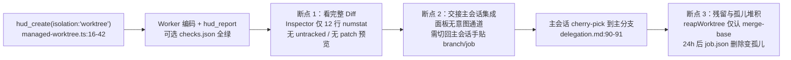
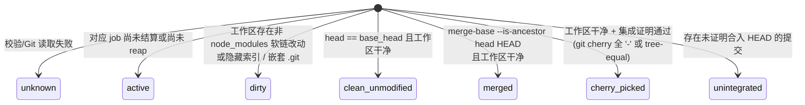
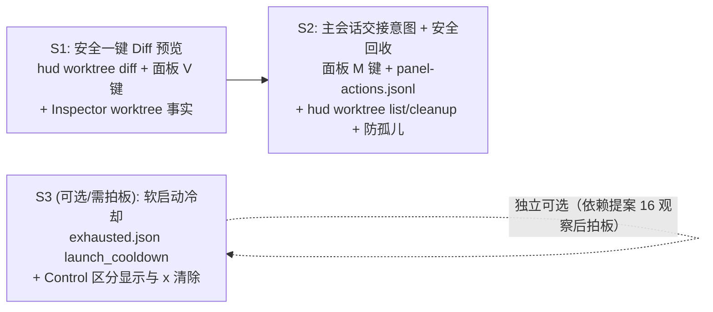

# 24. Worktree 交付闭环（面板一键 diff 预览 & 主会话集成交接）及软健康度路由演进评估

> **优先级**：P2（主干 S1–S2：补齐 worktree 作业“看完整改动 → 交接主会话合入 → 安全回收残留”的最后两公里）；P4 / 评估待定（副题 S3：软启动冷却，默认不立项） ｜ **类别**：Worktree 交付闭环（面板微动作 / 安全 Git 预览 / CLI 回收） + 路由策略演进评估 ｜ **预估规模**：M（主干 2 个垂直切片，源码约 +360 / -20 行，测试约 +280 行；可选 S3 约 +110 / -15 行） ｜ **前置依赖**：无硬前置；与提案 15（`git_summary.overlaps`）共享 `managed-worktree.ts` 的路径/集成判断原语，与提案 16（Control 按位置只读健康统计）直接衔接。冲突协调：提案 02 拆分 `thin-main.ts`、提案 04 重构 `MonitorState`/`workboard-input.ts`、提案 06 给 `reapWorktree` 加锁，实施时避免并行改动同一文件 ｜ **`docs/spec.md` 边界影响**：S1–S2 需 owner 认可后在 `spec:13` 与 `spec:103` 补充面板微动作（`V` 只读 diff 预览、`M` 集成/清理意图记录）与 `hud worktree list|diff|cleanup` 命令说明，**不触及 §3 禁止项**（面板不执行 `git cherry-pick`/`merge`/`worktree remove`，不新增常驻进程或自动角色编排）；S3（可选软启动冷却）会**实质扩展 `spec:13` 的跳过条件**，默认不实施，须 owner 明确拍板后方可立项

---

## 1. 背景与现状证据

所有代码行号与符号均以当前 HEAD（`358816db`）实测核对为准。

### 1.1 Worktree 作业交付链路的三个断点

目前 MyHUD 的 `isolation: "worktree"` 作业从创建到回收的真实链路如下：



逐一核对源码中的现状证据：

1. **断点 1：Inspector 缺少 worktree 元数据，且无法从面板安全查看完整 diff**
   - `src/collectors/thin-jobs.ts:32-33`（`factKeys`）与 `:638-695`（`OwnerWorker` 构造）以及 `src/collectors/workboard-types.ts:47-109` 均**未传递** `job.json` 里已有的 `worktree`（`root`/`branch`/`base_head`/`main_root`）、`worktree_removed_at` 与 `worktree_kept_reason`。
   - `src/render/work-inspector.ts:79-118` 的 `facts` 表只渲染 `role`/`model`/`package`/`state`/`resources`/`outcome` 等字段，完全看不到分支名 `wt/<slug>-<id6>` 或保留原因。
   - `src/collectors/diff-stat.ts:7, 88-100`（`DiffStatCollector.job`）仅在打开 Inspector 时对当前 job 采样 top-12 文件的 `--numstat`，且：
     - 依赖 `SESSION.txt` 中的 `BASE=`（`:92-94`），未回退到 `job.worktree.base_head`；
     - 注释明确说明 `:77` “Untracked files have no Git numstat”，新建未跟踪文件在 Inspector `Changes` 中不可见；
     - `src/render/diff-stat-rows.ts:19` 把行绑定为 `files: [f.absPath]`，`src/render/workboard-input.ts:186-187` 与 `tests/unit/diff-stat.test.mjs:183-189` 固定把 `Enter` / `o` 映射为 `open-files`（用 `$EDITOR` 打开原文件），**没有查看统一 diff patch 的一键入口**。
   - 结果：owner 想在合入前审查完整改动时，必须手动翻 `job.json` 或 `hud_read` 找 `../<repo>-wt/<slug>-<id6>`，自己开 tab 跑 `git diff`。

2. **断点 2：面板已有优雅的“意图记录 → 主会话执行”通道，但尚未覆盖 worktree 交接**
   - MyHUD 已经通过两条极简 JSONL 通道验证了“面板只写意图，主会话消费并操作 Git/文档”的解耦模式：
     - `$HUD_HOME/tries.jsonl`（`src/collectors/try-records.ts:17-93`）：面板 `y`/`n` 写入验收/标记意图，由 `hud watch`（`src/cli/watch.ts:287`）、pi `startSessionWatch`（`:166`）和 MCP `withChanges`（`src/mcp/thin-main.ts:1843`）送达主会话。
     - `$HUD_HOME/panel-actions.jsonl`（`src/collectors/panel-actions.ts:8-74`）：面板 `1-4`/`d` 回答问题后追加 `0600` 记录，`PanelActionLog` 向 `hud watch` 与 MCP `changes` 推送 `[role@job] ANSWERED qN from panel: …`。
   - 但在 worktree 场景下，owner 在面板看完 report + checks + diff 后，如果想让主会话集成（cherry-pick / merge）或放弃清理该 worktree，面板没有任何动作入口，只能切回主会话手工报 `jobId` 和分支名。
   - **关键代码实情（Claude Code MCP Tasks 模式）**：`src/mcp/thin-main.ts:1841` 存在 `if (taskClient || ...) return value;`，且 `tests/unit/thin-mcp-tasks.test.mjs:54, 77` 断言 `taskClient` 下 `roster.changes === undefined`、`report.changes === undefined`（对应 `docs/spec.md:199`）。这意味着任何依赖 `changes` 的面板意图，必须单独交代 `taskClient` 模式的送达路径，不能破坏现有断言。

3. **断点 3：cherry-pick 换哈希导致 `worktree_kept_reason` 永久残留，24 小时后退化为孤儿 worktree**
   - `src/mcp/managed-worktree.ts:106-110`：`reapWorktree` 只检查 `git merge-base --is-ancestor <head> HEAD`。
   - `docs/delegation.md:90-91` 明确规定标准集成流程是“在 worktree 中提交，**cherry-pick** 回主分支”。cherry-pick 会生成新 commit SHA，导致 `--is-ancestor` 必然失败。
   - `packages/hud-mcp/bin/hud-watch.mjs:199-205`：`finishWorktree` 一旦写入 `worktree_kept_reason: 'worktree has unmerged commits or ancestry could not be verified'`，后续便永久跳过（`:200 if (... || job.worktree_kept_reason) return;`）。
   - 更严重的是 `packages/hud-mcp/bin/hud-watch.mjs:301-309`：作业结算 24 小时后，watcher 会 `fs.rmSync(dir, { recursive: true, force: true })` 删除整个 `$HUD_HOME/jobs/<id>/`，却不会清理对应的 `../<repo>-wt/<slug>-<id6>` 目录与 `wt/<slug>-<id6>` 分支——收据丢失后，这些 worktree 沦为磁盘上长期堆积的孤儿目录，连 `base_head` 一起丢失。

### 1.2 衔接方案 15 与方案 16：为何将 §3.8 拆成“主干闭环 + 副题评估”

- **与方案 15（`15-worktree-overlap-in-git-summary.md`）的衔接**：
  - 方案 15 已在 `src/mcp/managed-worktree.ts` 提出抽出 `changedPaths` 并通过 `git --literal-pathspecs diff --name-only -z --no-renames --no-ext-diff --no-textconv HEAD <other.head> -- <candidates>` 过滤已 cherry-pick 的文件。
  - 本方案 **不重复设计** `git_summary.overlaps`，而是直接复用该集成证明思路：
    1. 在面板触发“请求集成”意图时，若方案 15 已落地，则一并携带最新的 `overlaps` 提示给主会话；
    2. 在 `hud worktree cleanup` 中结合 `git cherry`（patch-id 等价）与受限路径 tree 相等检查，安全回收已 cherry-pick 的残留 worktree。
- **与方案 16（`16-per-place-dispatch-health.md`）的衔接**：
  - 方案 16 已把 Control 的 “Dispatch today” 拆到按位置（`harness / model`）只读统计，并明确指出“自动按健康分降权路由与 `docs/spec.md:13` 冲突”。
  - 本方案严格尊重该结论，将原讨论的两半显式拆分：
    - **主干（S1 + S2）**：聚焦 **Worktree 交付闭环**，完全遵守“面板只观察与发意图、Git 变更归主会话/显式 CLI、安全 Git 零仓库配置执行”的 MyHUD 哲学；
    - **副题（§3.6 + 可选 S3）**：单独对“软健康度临时冷却（Soft Launch Cooldown）”做架构利弊评估，论证**为何默认不该静默改路由**，并给出若未来 owner 真的希望缓解“坏位置连续启动超时拖慢每次派发”时的**最小安全可见形态**，交由 owner 拍板。

---

## 2. 目标与非目标（Scope / Out of Scope）

### 目标（Scope）

1. **安全一键 Diff 预览（S1）**：
   - 在 `OwnerWorker` 与 Inspector 中展示托管 worktree 事实（分支、保留/已删状态）；
   - 新增 `hud worktree diff <job-id> [--file <rel>] [--pager auto|delta|less|none] [--stat]`，严格遵守 `SAFE_GIT_ARGS` + `safeGitEnv` + `neutralizeFilters` + `--no-ext-diff --no-textconv`，同时展示 **committed（`base_head..HEAD`）** 与 **uncommitted（staged + unstaged + 有界 untracked）** 改动；
   - 面板 Home 卡片与 Inspector 按一键（推荐 `V`，见 §3.4 热键冲突核查）在独立 herdr tab 打开安全只读 diff 查看器，自动探测可信 `delta`（工作目录强制设在仓库外防 `.git/config` 注入）或 `less -R`，按 `q` 后 tab 自动关闭。
2. **主会话集成交接意图 + 安全残留清理（S2）**：
   - 面板对已结算且未删除的托管 worktree 作业提供带单行确认的微动作 **`M`**（`y` 请求主会话集成 / `d` 请求放弃清理 / `Esc` 取消），**绝不在面板内执行 `git cherry-pick`/`merge`/`worktree remove`**；
   - 复用 `$HUD_HOME/panel-actions.jsonl` 与 `PanelActionLog`，把包含实时 `branch`、`base_head`、`head`、`ahead_commits`、`dirty` 及可选 `overlaps` 的结构化意图送达主会话（兼容 `hud watch`、Codex `--queue`、pi 原生 watch、MCP `changes`，并诚实处理 Claude Code `taskClient` 模式）；
   - 新增 `hud worktree list [--cwd DIR] [--json]` 与 `hud worktree cleanup [--cwd DIR] [--dry-run] [--job <id>] [--force-discard] [--json]`，基于安全集成证明回收因 cherry-pick 换哈希而残留的 `worktree_kept_reason` 目录与孤儿 `wt/*` worktree；
   - 修复 `hud-watch.mjs` 24 小时到期清理时把仍存在磁盘 worktree 的 `job.json` 删掉导致失去收据的问题。
3. **软健康度临时冷却架构评估（§3.6 + 可选 S3）**：
   - 给出“纯只读统计（方案 16）” vs “连续启动前失败 15 分钟可见短冷却” vs “隐式健康分路由”的完整对比与最小安全设计，默认不实施。

### 非目标（Out of Scope）

- **面板绝不直接修改 Git 仓库**：不从面板跑 `git cherry-pick`、`git merge`、`git rebase`、`git checkout`、`git reset` 或 `git worktree remove -f`。
- **不改变 `Enter` / `o` 在 Inspector `diff:` 行上的语义**：它们继续用 `$EDITOR` 打开对应原文件（保持 `tests/unit/diff-stat.test.mjs:189` 兼容）。
- **不引入常驻后台服务或新轮询定时器**：所有 diff 预览、重叠检查、清理检测全部按需触发。
- **不在 Home 面板上自动扫描所有 worktree 的 diff/重叠**：保持 `DiffStatCollector.job` 仅对选中 Inspector job 采样的轻量边界。
- **不修改非托管 worktree**（例如用户手工在任意路径创建的 worktree，除非位于 `<main>-wt/<name>` 且分支为 `wt/<name>` 的托管命名约定且经校验通过；手工 `tmp/wt-new.sh` 创建的若无 `job.json` 在 `list` 中标注为 `unmanaged/orphan`，默认 `cleanup` 不碰非 `wt/` 分支）。
- **不默认启用任何自动降权路由或健康分算法**（S3 需 owner 单独批准 `docs/spec.md:13` 变更）。

---

## 3. 核心设计方案

### 3.1 数据模型扩展：让面板知道 Worktree 事实

#### 3.1.1 `OwnerWorker` 与 `thin-jobs.ts`（零额外磁盘 I/O）

`job.json` 已经由 `readThinJobs` 读取并缓存。仅需补充透传：

```ts
// src/collectors/workboard-types.ts
export interface WorkerWorktree {
  readonly mainRoot: string;
  readonly root: string;
  readonly branch: string;
  readonly baseHead: string;
  readonly removedAt?: string;
  readonly keptReason?: string;
}

export interface OwnerWorker extends Partial<JobProgress> {
  // ...现有字段
  readonly worktree?: WorkerWorktree;
}
```

- `src/collectors/thin-jobs.ts:32-33`：`factKeys` 新增 `'worktree'`, `'worktree_removed_at'`, `'worktree_kept_reason'`（持久化缓存 `display/thin-jobs.json` 仅存这几个短字符串/小对象，不含报告或内容）。
- `src/collectors/thin-jobs.ts` 构造 `OwnerWorker` 时校验 `job.worktree` 四字段均为合法字符串（`base_head` 符合 40/64 位 hex），合法才挂载 `worktree`。
- `src/collectors/diff-stat.ts:91-99`（`DiffStatCollector.job`）：优先读 `SESSION.txt` 的 `BASE=`，若缺失或未写 `SESSION.txt` 则回退到 `job.worktree?.base_head`（同样校验 `/^[0-9a-f]{40,64}$/`），解决“未打开过 SESSION 或已清理 SESSION 的 worktree job 看不到 numstat”的盲区。
- `src/render/work-inspector.ts:79-118`：`facts` 表新增 `['worktree', ...]` 行，展示 `wt/<slug>-<id6>` 及简洁状态（`removed` / `kept` / 空表示活跃），并若存在待处理面板意图则显示 `[integrate queued]` 或 `[discard queued]`（经 `t()` 中英双语，`monitorText` 转义一次）。

---

### 3.2 安全一键 Diff 预览：`hud worktree diff` + `openWorktreeDiffPane`

#### 3.2.1 安全威胁模型与防御纵深（对照 `docs/spec.md` §4 & `docs/ARCHITECTURE.md` §8）

查看一个不可信克隆仓库的 diff，存在 **4 类** 仓库配置注入面，全部必须封死：

| 攻击面 | 恶意 `.git/config` / `.gitattributes` 示例 | 本方案防线 |
|---|---|---|
| **Git 外部 diff / textconv** | `diff.external = /tmp/pwn.sh`、`diff.foo.command`、`diff.foo.textconv` | 所有 `git diff` 强制带 `--no-ext-diff --no-textconv` + `-c diff.external=` |
| **Git pager 注入** | `core.pager = /tmp/pwn.sh`、`pager.diff = ...` | 强制 `SAFE_GIT_ARGS`（含 `--no-pager`）+ `-c core.pager=cat` + `GIT_PAGER=cat`；Git 永不拉起任何 pager |
| **Git filter / fsmonitor / hooks** | `filter.x.clean/smudge/process`、`core.fsmonitor` | 强制 `safeGitEnv(env)` + `SAFE_GIT_ARGS` + `await neutralizeFilters(git, wt.root)` |
| **外部高亮器读仓库 `.git/config`！** | **`delta` 在仓库 `cwd` 运行时会读取 `.git/config` 的 `[delta] pager = ...` 执行命令** | **关键防线**：`delta` 子进程强制 `cwd: os.tmpdir()`（仓库外！）、`env: safeGitEnv(env)`、参数 `--paging=never`，由 Node 自己把 `delta` stdout 管道接到 `less -R`！ |

> **为何默认选 `delta` → `less -R`，而不默认接入 `difft`（difftastic）？**
> - `delta` 是纯 **stdin → stdout** 的 unified diff 渲染器，与 `--no-ext-diff --no-textconv` 100% 兼容，只需在仓库外 `cwd` 启动即可杜绝仓库配置泄露。
> - `difft` 依赖 `GIT_EXTERNAL_DIFF` 逐文件对调起，若直接给 `git diff` 开 `--ext-diff` 会削弱对 `.gitattributes` `diff.<driver>.command` 的纵深防御；如 owner 未来明确需要 `difft`，可在后续版本增加显式 `--tool difft`（由 Node 枚举变更对后直接 `spawn('difft', ...)` 而非走 `GIT_EXTERNAL_DIFF`），默认路径不承担该复杂度。

#### 3.2.2 预览数据流与两段式输出格式

```mermaid
sequenceDiagram
  autonumber
  participant Panel as 面板 (tree-page.ts)
  participant Pane as panel-pane.ts<br/>openWorktreeDiffPane
  participant Herdr as herdr tab
  participant CLI as hud worktree diff &lt;jobId&gt;
  participant Git as git (SAFE_GIT_ARGS<br/>+ neutralizeFilters)
  participant Pager as [delta (cwd=tmpdir)] | less -R

  Panel->>Pane: action: open-worktree-diff { jobId, file? }
  Pane->>Herdr: tab create --workspace &lt;ws&gt; --label "diff:..." --focus
  Pane->>Herdr: pane run "&lt;node&gt; &lt;hud-bin&gt; worktree diff &lt;jobId&gt; ...; exit"
  Herdr->>CLI: 启动进程（仅传正则校验过的 jobId / 相对路径）
  CLI->>CLI: 校验 job.json + realpathSync + worktree list 归属
  CLI->>Git: 1) log --oneline base_head..head<br/>2) diff --stat/--patch --no-ext-diff base_head head<br/>3) diff HEAD (staged+unstaged) + status -z untracked
  Git-->>CLI: 原始文本流（有界：单段 <= 4 MiB / untracked <= 50 文件）
  CLI->>Pager: spawn(shell:false) 写入头部摘要 + 两段 diff
  Note over Pager: 用户滚动审查，按 q 退出 less
  Pager-->>CLI: exit 0
  CLI-->>Herdr: exit 0 → "; exit" 自动关闭 tab，零残留
```

**两段式输出内容**（确保合入前无任何盲区）：
1. **顶部元信息块**：
   - `Job`: `<jobId>` (`<role>`) · `Branch`: `wt/<slug>-<id6>` · `State`: `<display_state>` · `Checks`: `3/3 ✓`（若存在 `checks.json`）
   - `Range`: `<base_head:7>..<head:7>`（`+N commits`）及 `git log --oneline --no-show-signature <base_head>..<head>` 列表
   - `Overlaps`: 若方案 15 已启用则显示重叠告警，否则省略
2. **Section 1 — Committed changes (`<base_head>..<head>`)**：
   - `git diff --stat --no-ext-diff --no-textconv <base_head> <head> -- [file]`
   - `git diff --patch --no-ext-diff --no-textconv <base_head> <head> -- [file]`
3. **Section 2 — Uncommitted working-tree changes（仅当工作区非空时渲染）**：
   - 已跟踪文件的暂存+未暂存变动：`git diff --no-ext-diff --no-textconv HEAD -- [file]`（含 `neutralizeFilters`）
   - 未跟踪新文件（过滤 `dependencyLink(wt)` 的 `node_modules` 软链）：按路径排序，最多预览前 50 个且单文件 ≤ 256 KiB、非二进制，通过 `git diff --no-index --no-ext-diff --no-textconv -- /dev/null <absFile>` 生成标准 unified diff（超出部分输出显式截断提示 `+N untracked files omitted`，绝不 OOM，也绝不假装没有改动）。
4. **单文件聚焦**：当 Inspector 光标位于某个 `diff:<absPath>` 行时按 `V`，传入 `--file <relPath>`（经 `relative(wt.root, absPath)` 严格校验不越界 `..`），直接预览该文件在 `base_head..working-tree` 的改动，同时在头部注明 `Filtered to <relPath> (run without --file for full diff)`。

#### 3.2.3 `openWorktreeDiffPane` 实现细节（`src/cli/panel-pane.ts`）

严格复用 `openEditorPane`（`src/cli/panel-pane.ts:16-36`）的 herdr tab 创建与自动退出模式：
- 校验 `JOB_ID.test(jobId)`（`/^j[0-9a-f]{16}$/`）；若传 `file`，校验为相对路径且不含 `\0`/控制字符/`..`。
- 使用 `process.execPath` 与解析好的 `dist/cli/hud.js` 绝对路径（与安装链接一致），所有参数经单引号安全转义后执行：`'<node>' '<hudJs>' worktree diff '<jobId>' [--file '<rel>'] --interactive; exit`。
- `--cwd` 传 `process.cwd()` 或 `hudHome`，**不在 shell 层拼装任何 `git` 命令**；所有安全策略全部内聚在 `src/cli/worktree.ts` 内，单测可直接覆盖。
- 若 worktree 已被删除（`worktree_removed_at` 或目录不存在），`tree-page.ts` 在打开 tab 前快速返回 `notice(t('worktree removed'))`，不闪现空 tab。

---

### 3.3 主会话集成交接意图（非侵入式闭环）

#### 3.3.1 设计原则：严格对齐 `tries.jsonl` 与 `panel-actions.jsonl`

- **面板零 Git 写入**：面板永远不执行 `git cherry-pick`、`git merge`、`git branch -D` 或 `git worktree remove`。
- **单行确认防误触**：沿用 `confirmStop`（`src/render/monitor.ts:88`、`src/render/job-actions.ts:49-52, 75-80`）的模态交互，扩展为统一的 Job 确认槽（或新增 `confirmWorktree`）：
  ```ts
  // src/render/monitor.ts
  confirmWorktree?: {
    jobId: string;
    role: string;
    dir: string;
    home: string;
    branch: string;
  };
  ```
- **触发前置条件**：
  - 光标位于托管 worktree 作业上（Home 卡片 Classic/Split，或 Inspector）；
  - 作业已结算（`worker.settledAt !== null`）且 worktree 尚未标记已删除（`!worker.worktree?.removedAt`）；
  - 未结算运行中的作业按 `M` 无动作（底部提示也不显示 `M`，防干扰运行中 worker）。
- **40 列窄屏与宽屏确认条**：
  - 宽屏（≥ 60 列）：`wt/feat-a-000001:  y integrate · d discard · Esc cancel`
  - 40 列窄屏：`wt/…000001: y merge · d drop · Esc`（严格经 `fit()` + `visualLength()` 与 EN/ZH `t()`，绝不折行溢出）。
- **确认后 I/O（在 `src/tree-page.ts` 异步执行，不阻塞渲染）**：
  1. 重新读取 `job.json` 确认 `worktree` 仍在且未删除；
  2. 调用 `gitSummary(wt, others)` 获取**当前此刻**的真实 `head`、`ahead_commits`、`dirty`（及可选方案 15 `overlaps`）；
  3. 调用 `recordWorktreeIntent(home, record)`，以 `O_WRONLY | O_APPEND | O_CREAT | O_NOFOLLOW | O_NONBLOCK` 模式 `0600` 追加一行到 `$HUD_HOME/panel-actions.jsonl`；
  4. 在面板状态通知栏短暂显示反馈：若存在活跃 watcher（`$HUD_HOME/watchers/<pane>.pid` 存活），显示 `Sent to main session: integrate wt/…`；否则诚实显示 `Queued for main session (next MCP read or hud worktree list)`。

#### 3.3.2 `$HUD_HOME/panel-actions.jsonl` Schema 扩展（100% 向后兼容）

现有 `src/collectors/panel-actions.ts:11` 只有 `type: 'answer'`。本方案以 discriminated union 扩展，老日志与老测试零破坏：

```ts
// src/collectors/panel-actions.ts
export interface AnswerRecord {
  at: string;
  type: 'answer';
  job: string;
  qid: string;
  role: string | null;
  answer: string;
}

export interface WorktreeIntentRecord {
  at: string;
  type: 'worktree_integrate' | 'worktree_discard';
  job: string;
  role: string | null;
  main_root: string;
  worktree_root: string;
  branch: string;
  base_head: string;
  head: string | null;
  ahead_commits: number | null;
  dirty: boolean | null;
  overlaps?: { job: string; files: string[]; more?: number }[] | null;
  overlaps_incomplete?: true;
}

export type PanelActionRecord = AnswerRecord | WorktreeIntentRecord;
```

#### 3.3.3 跨客户端送达机制（诚实覆盖全部三种客户端 + Claude `taskClient`）

| 客户端 / 模式 | 实时推送机制 | 消费方式与输出行格式 | 特殊约束 |
|---|---|---|---|
| **Claude Code（Monitor + `hud watch`）** | `watchInputs` 已监听 `PANEL_ACTIONS_FILE`（`src/cli/watch.ts:116`） | `PanelActionLog.changes(jobSet)` 立即输出 1 行到 stdout | 无额外监听成本 |
| **Codex（`hud watch --queue`）** | 同上，走 `hud-notify.mjs` 静默入队 | 同上，直接进入 Codex caller queue | 不碰编辑器草稿 |
| **pi（`startSessionWatch`）** | `src/cli/watch.ts:145, 166` 已接 `PanelActionLog` | 原生 session queue 唤醒或下次请求前送达 | 无额外改动 |
| **非 task MCP（`withChanges`）** | `src/mcp/thin-main.ts:1838, 1843` | 随下次任意 MCP 返回的 `changes[]` 送达 | 零新工具 |
| **Claude Code（`taskClient` MCP tasks 模式）** | MCP 协议在无活跃 task 时无法主动 push（`thin-main.ts:1841` 刻意禁用 `changes`） | 1. **不破坏 `changes === undefined` 断言**（`thin-mcp-tasks.test.mjs:54,77`）；<br/>2. `hud_read({ job })` 的 `git_summary` 新增 `panel_intent?: { action, at, head }`；<br/>3. 若存在自上次 MCP 调用以来新增的 worktree 意图，在响应附加独立字段 `panel_intents?: string[]`（平时省略）；<br/>4. 面板诚实提示无 live watcher | 不向主会话 pane 盲目输入文字（遵守 `spec:13`） |

`PanelActionLog.changes` 输出格式（单行、已通过 `oneLine` 剥除控制字符）：
- 请求集成：
  `[imp@j0000000000000001] WORKTREE_INTEGRATE wt/feat-a-000001 (head=a1b2c3d, +2 commits, clean, overlaps=none) | preview: hud worktree diff j0000000000000001`
  - 若 `dirty === true`，显式标注 `DIRTY (uncommitted changes)`，提醒主会话先检查/提交再 cherry-pick；
  - 若存在 `overlaps`，标注 `overlaps=j0000000000000002(2 files)`。
- 请求放弃清理：
  `[imp@j0000000000000001] WORKTREE_DISCARD wt/feat-a-000001 (head=a1b2c3d, +2 commits, dirty=false) | cleanup: hud worktree cleanup --job j0000000000000001 --force-discard`

#### 3.3.4 面板回显（防重复点击）

参考 `TryLog.marks`（`src/collectors/try-records.ts:57-65`），`PanelActionLog` 提供只读方法 `latestWorktreeIntents(jobs)`（按文件 stat 签名缓存，静止时零重读），返回每个 job 最近一条未过期的 `worktree_integrate` / `worktree_discard` 意图。面板在 Home 卡片徽章或 Inspector `worktree` 行显示 `[integrate queued]` / `[discard queued]`；一旦 `worktree_removed_at` 出现，回显自动消失。

---

### 3.4 热键冲突全面核查（对齐 `docs/ARCHITECTURE.md` §6 与 `tests/unit/panel-keys-rows.test.mjs`）

`docs/ARCHITECTURE.md:332-334` 规定每页单键单义，且 `tests/unit/panel-keys-rows.test.mjs:40-96` 强制检查：
1. `WorkbenchInputDecoder('workboard')` 中每个非空 `key` 名称都必须在 Help 中出现；
2. Help 的每个分区（`Everywhere`/`Home`/`Project`/`Control`/`Split`）内不能出现重复键；
3. `:43` 显式断言 `[...'NIRDgpPeE']` 的解码结果，其中 **`D` 已被绑定为 `'preset-delete'`**，**`C` 已被绑定为 `'role-preset-prev'`**（`src/utils/workbench-input.ts:115, 119`）！
4. `src/tree-page.ts:953, 1185` 会过滤掉 `input.key === ''` 的未命名键（除非处于输入框编辑态），因此**新快捷键必须在 `WorkbenchInputDecoder('workboard')` 中拥有显式名称**。

核查全量现役键位表（基于 `src/utils/workbench-input.ts:13-42, 102-139`）：

| 候选键 | 现役绑定（`workbench-input.ts`） | 现役分区 | 冲突分析 | 结论 |
|---|---|---|---|---|
| `D` | `'preset-delete'` (`:119`) | Control | `panel-keys-rows.test.mjs:43` 强断言 `D → 'preset-delete'`；若在 Home 复用，跨页语义反差极大（删除 vs diff） | **不推荐默认复用**（保留给 owner 拍板备选） |
| `C` | `'role-preset-prev'` (`:115`) | Control | 已被 Control 占用 | **禁止使用** |
| `d` | `'answer-default'` (`:129`) | Home / Inspector | 与“回答默认选项”直接同页冲突 | **禁止在非模态下使用**（仅可在 `confirmWorktree` 确认条内使用） |
| `o` / `⏎` | `'open-session'` / `'enter'` | Everywhere / Inspector | `diff-stat.test.mjs:189` 强断言在 Inspector `diff:` 行打开原文件 | **保持不变** |
| `g` / `1-4` / `X` / `v` / `a` / `f` / `w` / `y` / `n` | 均已占用 | Home / Project / Everywhere | 直接冲突 | **保持不变** |
| **`V`** | **未占用** | 全站空白 | 与 `v`（inspect 详情）形成天然小写/大写配对：**`v` 看详情，`V` 看完整 diff**；全站零冲突 | **推荐：`'view-diff'`** |
| **`M`** | **未占用** | 全站空白 | 与 `X`（stop，需确认）风格一致：大写表示带确认的动作（Merge / handoff），全站零冲突 | **推荐：`'worktree-handoff'`** |

**Footer 与 Help 联动**：
- `src/render/job-actions.ts:43-47`（`homeKeys`）：
  - 当选中作业拥有未删除的托管 worktree 时追加 `'V diff'`；
  - 若同时已结算（`settledAt !== null`），追加 `'M integrate'`（40 列窄屏下按现有尾部丢弃策略优先保留 `g job tab`、`V diff`、`M integrate`、`⏎ open`）。
- `src/render/work-view.ts:393`（Inspector footer）：当被检查对象为托管 worktree 作业时，从 `['⏎ open', 'Esc back']` 扩展为 `['V diff', ...(settled ? ['M integrate'] : []), '⏎ open', 'Esc back']`；
- `src/render/work-view.ts:53-60`（Help `Home` 分区）新增两行：
  - `['V', 'worktree: open safe diff preview']`
  - `['M', 'worktree: hand off to integrate or discard']`
- 同步在 `src/render/split-i18n.ts` 与 `src/render/i18n.ts` 补齐 EN/ZH 翻译，确保 `tests/unit/panel-keys-rows.test.mjs` 与窄屏宽度断言全绿。

---

### 3.5 安全 CLI 伴侣：`hud worktree list|diff|cleanup`（解决 cherry-pick 残留与 24h 孤儿）

新增子命令模块 `src/cli/worktree.ts`，在 `src/cli/hud-main.ts` 注册 `worktree` 分支。

#### 3.5.1 五种诚实状态分类（`classifyWorktree`）

对同一 `main_root` 下的每个托管 worktree（包括：仍有 `job.json` 的 + `job.json` 已被 24h 清理但仍在 `<main_root>-wt/*` 且分支为 `wt/*` 的孤儿目录），按以下顺序判定（任一 git 读失败归入 `unknown`，永不伪造 `clean` 或 `integrated`，严格遵守 `docs/ARCHITECTURE.md` §8）：



**核心算法：Cherry-Pick 安全集成证明（`proveIntegrated`）**

仅在满足全部前置安全条件（路径归属 `<main_root>-wt/<name>`、分支 `wt/<name>`、非 locked/prunable、同 `git-common-dir`、无隐藏索引 `ls-files -v`、无脏文件、无嵌套 `.git`）且 `head !== base_head`、`merge-base --is-ancestor` 返回非零时执行：

1. **证据 A（高置信：patch-id 精确等价）**：
   - 运行 `git -C <main_root> cherry HEAD <head> <base_head>`（有 `base_head` 时传 `<limit>`；孤儿无 `base_head` 时用 `git merge-base HEAD <head>` 作为下界）。
   - 解析非空行：若所有行均为 `- <sha>` 且至少有 1 行，判定为 **`cherry-picked (patch-id)`**！
   - 优点：即便 cherry-pick 后主分支 `HEAD` 又继续修改了同一文件，patch-id 依然匹配，无误漏。
2. **证据 B（兼容 squash / 轻度冲突手工微调的 cherry-pick：受限 tree-equal 证明）**：
   - 复用方案 15 §3.3 的安全命令：先通过 `git diff --name-only -z --no-renames --no-ext-diff --no-textconv <base_head> <head> --` 得到 `committedFiles`。
   - **关键边界防护**：
     - 若 `committedFiles.length === 0`（例如空提交或提交后又 revert）：**不跑**无路径 `git diff HEAD <head>`，归入 `unintegrated`（需人工确认），绝不误删；
     - 若 `committedFiles.length > 200`：超出安全路径参数上限，归入 `unintegrated`（标注 `too many files for tree proof`）；
   - 否则在 `main_root` 运行：
     `git --literal-pathspecs diff --name-only -z --no-renames --no-ext-diff --no-textconv HEAD <head> -- <committedFiles>`
   - 若输出严格为空字符串，说明 `<head>` 中修改、新增、删除的每一个文件在主分支 `HEAD` 中都已达到完全一致的字节状态，判定为 **`integrated (tree-equal)`**！

#### 3.5.2 三个子命令契约

1. **`hud worktree list [--cwd DIR] [--json]`**
   - 列出当前仓库所有托管 worktree（含仍在运行、保留、已 cherry-pick 可清理、孤儿、以及带面板待办意图 `integrate`/`discard` 的项）。
   - 文本表格示例：
     ```text
     JOB               BRANCH                  STATE                 COMMITS  INTENT     KEPT REASON
     j0000000000000001 wt/feat-a-000001        cherry-picked         +2       integrate  unmerged (patch-id in HEAD)
     j0000000000000002 wt/feat-b-000002        unintegrated          +1       -          worktree has unmerged commits
     (orphan)          wt/old-fix-000099       integrated (tree-eq)  +1       -          job receipt expired
     ```
2. **`hud worktree diff <job-id> [--file <rel>] [--pager auto|delta|less|none] [--stat]`**
   - 见 §3.2。`--stat` 仅输出头部 + `--stat` 列表不进 pager，便于主会话或脚本快速调用；非 TTY stdout 自动降级为 `--pager none`。
3. **`hud worktree cleanup [--cwd DIR] [--dry-run] [--job <id>] [--force-discard] [--json]`**
   - **默认安全清理**（无 `--force-discard`）：只清理状态属于 `{ clean-unmodified, merged, cherry-picked, integrated }` 的托管 worktree。
   - **删除原子性与并发锁**：
     - 清理前重新检查 `refs/heads/<branch> === head` 与工作区干净（防止 TOCTOU 竞态）；
     - 复用 `managed-worktree.ts` 现有的 `node_modules` 软链卸载 + `git worktree remove -- <root>`（**默认绝不加 `--force`**！）+ 二次核验 `rev-parse` 后删分支：
       - `clean-unmodified` / `merged` 用 `git branch -d -- <branch>`；
       - `cherry-picked` / `integrated` 在**刚刚通过集成证明且 `refs/heads/<branch> === head`** 的前提下使用 `git branch -D -- <branch>`（因为 Git 的 `-d` 只认祖先关系，不认 cherry-pick）。
     - 若对应 `job.json` 仍存在，以临时文件 `0600` + `renameSync` 原子写回 `worktree_removed_at` 并删除 `worktree_kept_reason`。
     - 若与提案 06 共存，复用 per-`main_root` `flock` 锁避免与 `hud-watch.mjs` 并发 `reapWorktree`。
   - **`--job <id> --force-discard`**：显式放弃单个已结算作业的未合入/脏 worktree（必须同时传 `--job` 与 `--force-discard`，绝不支持批量 `--force-discard`！依然拒绝仍在运行中的作业、locked worktree 或非托管路径，删除前移除 `node_modules` 软链再用 `git worktree remove --force -- <root>` 与 `git branch -D -- <branch>`）。
   - **`--dry-run`**：执行全套只读分类并打印将删除/将保留的清单及理由，零文件系统修改。

#### 3.5.3 修复 `hud-watch.mjs` 24 小时制造孤儿的问题

`packages/hud-mcp/bin/hud-watch.mjs:303` 当前在作业结束 24 小时后直接删除 `$HUD_HOME/jobs/<id>/`。增加一条 1 行保护：
```js
const worktreeOnDisk = Boolean(job?.worktree?.root && !job.worktree_removed_at && fs.existsSync(job.worktree.root));
if (expires < Date.now() && (!tab || job?.reaped_at) && !worktreeOnDisk) { ... }
```
只要被保留的 worktree 仍在磁盘上，就保留该 job 目录（含 `job.json` 里的 `base_head` 与 `report.md`）；一旦 owner 或主会话通过 `hud worktree cleanup` 回收了 worktree（写入 `worktree_removed_at`），下一次扫描便正常按 24 小时规则清理 job 目录。同时 `hud worktree list/cleanup` 仍兼容此前已形成的孤儿 worktree。

---

### 3.6 副题评估：软健康度临时冷却（Soft Launch Cooldown）演进分析

本节回应方案 16（`16-per-place-dispatch-health.md`）留下的架构张力：**在“纯只读统计”之外，是否值得引入任何形式的自动临时冷却？**

#### 3.6.1 现状与三种方案对比

当前代码（`src/roles/exhausted.ts`、`src/roles/roster.ts:453-468, 655-660`、`src/mcp/thin-main.ts:1313-1380`）的路由事实非常克制：
- 配额/429 失败（`isQuotaFailure`）→ 写入 `$HUD_HOME/exhausted.json`（默认 1 小时，或解析重置时间 1 分钟–24 小时），跨派发跳过；
- 启动前失败（`result.preInput === true`，如 CLI 启动超时 `agent_not_ready`、启动即崩溃）→ **仅跳过本次派发**（`:1378` 循环尝试链条下一位置），下次派发仍会从第 1 位再试一遍，如果该 CLI 服务已挂，每次 `hud_create` 都会白等 30–60 秒启动超时！

三种架构方向对比：

| 维度 | 方案 A：纯只读统计（方案 16 现状） | 方案 B：有限可见的“启动前失败短冷却”（推荐的最小演进上限） | 方案 C：综合“健康分”自动降权（含挂起/失败率/耗时） |
|---|---|---|---|
| **与 `docs/spec.md:13` 的关系** | 完全一致，零修改 | **需显式扩展 `spec:13`**（增加第 4 种可跳过事实） | **直接冲突**（违背“Only facts end a CLI job / 不干预模型行为”） |
| **触发依据** | 无自动路由干预 | **仅认客观启动前失败事实**：同一 `placeKey` 在 10 分钟内连续 `N=2` 次基础设施级 `preInput` 失败（明确排除 `untrusted_cwd`、`invalid_arguments`、`unsupported_harness` 与配额错误） | 主观加权（quiet escalation、任务失败、慢响应） |
| **误伤风险** | 零误伤 | **极低**：不看任务成败、不看 quiet 升级、不看单次抖动；一次启动成功即清零计数；最长仅冷却 15 分钟 | **高**：难题导致某模型失败两次就被暗中切走，或切到更贵模型，owner 难以察觉 |
| **痛点缓解** | 需 owner 去 Control 手动切预设或关 harness；期间每次派发仍等启动超时 | 连续 2 次启动超时后自动冷却 15 分钟，后续派发直接走备选位，省下每次 30–60s 白等 | 缓解启动超时，但引入“黑盒换模型”更大痛点 |
| **可观测与可逆性** | 高（全手动） | **100% 透明可逆**：复用 `exhausted.json` 并显式标 `kind: 'launch_cooldown'`；Control 归入 Needs attention 显示 `cooldown 12m`；**按 `x` 一键清除**；`hud_roster`/`hud_create` 明确告知原因 | 差（分数衰减黑盒，难解释“为什么没用第 1 位”） |
| **实现复杂度** | 已在方案 16 评估（~60 行） | 小（~110 行，复用 `exhausted.ts` / `roster.ts` / `role-control.ts` 现有通路） | 高（需打分模型、滞回阈值、调参、调试工具） |

#### 3.6.2 推荐结论与最小安全形态（仅在 owner 拍板后实施）

**架构建议**：**先只落地提案 16（纯只读统计）观察 1–2 周真实工作流**，默认**不实施**任何自动路由变更；**明确永久拒绝方案 C（健康分）**。如果 owner 实机体验中确实频繁遇到某个 CLI（如 `agy` / `claude` / 某 pi provider）宕机导致连续多个 `hud_create` 每次卡 30–60 秒启动超时，再启用 **方案 B（最小安全可见短冷却）**，其严格边界如下：

1. **存储复用 `$HUD_HOME/exhausted.json`（v1 向后兼容扩展）**：
   ```ts
   // src/roles/exhausted.ts
   export interface ExhaustedMark {
     until: string;
     reason: string;
     marked_at: string;
     /** 缺省视为 'quota'，100% 兼容现有文件与单测。 */
     kind?: 'quota' | 'launch_cooldown';
   }
   ```
   - 冷却时长固定为 `LAUNCH_COOLDOWN_TTL_MS = 15 * 60 * 1000`（15 分钟，比配额 1 小时更短，避免短暂网络故障长期锁死主位）。
   - 连续启动失败计数器存于 `$HUD_HOME/exhausted.json` 同文件的可选 `streaks?: Record<string, { count: number; last_at: string }>`（10 分钟窗口过期自动丢弃，上限 64 条，同步原子写 `0600`，零新文件、零扫描 `jobs/`）。
2. **严格过滤触发条件（`src/mcp/thin-main.ts:1373-1380`）**：
   - 仅当 `result.preInput === true` 且 `result.exit_code !== 0` 时检查；
   - **白名单之外一律不计数**：
     - `isQuotaFailure(reason)` → 走现有配额 `markExhausted`（`kind: 'quota'`）；
     - `result.code` 属于 `'untrusted_cwd' | 'invalid_arguments' | 'unsupported_harness'` → **不计数**（这是目录/参数/本地文件配置问题，换个项目或参数就能跑，不能惩罚整个 `placeKey`！）；
     - `result.cleanupFailed === true` → **不计数**（herdr 清理异常非目标模型问题）；
   - 其余基础设施级启动前失败（如 `agent_not_ready` 超时、CLI 启动崩溃退出、连接拒绝）→ `recordLaunchFailure(hudHome, candidate.key, reason, nowMs)`：连续达 `2` 次时写入 `kind: 'launch_cooldown'` 的 15 分钟冷却标记并清空 streak；
   - 只要该 `candidate.key` 有一次启动成功（`job.used_place` 被赋值），立即 `clearLaunchStreak(hudHome, candidate.key)`。
3. **单评估路径 + Control 清晰区分 + `x` 一键清除**：
   - `src/roles/roster.ts:656-660`：`evaluatePlaces` 依然只认 `candidate.until`，透传 `mark_kind: mark?.kind ?? 'quota'`；
   - `src/roles/role-control.ts`：`PlaceFact` 新增可选 `markKind?: 'quota' | 'launch_cooldown'`；
   - `src/render/control-page.ts:25-29` & `src/render/chain-input.ts:313`：当 `markKind === 'launch_cooldown'` 时显示 `cooldown {n}m` / `冷却 {n}m`（不显示误导性的 `exhausted` / `配额耗尽`），且现有 `x`（`place-clear` → `editPlaces(..., op: 'clear')` → `clearExhausted`）无需改语义即可**一键解除冷却**！
   - `hud_roster` 与 `hud_create` 返回的 `reason` / `attempts` 明文标注 `launch cooldown (2 consecutive launch failures; until ...)`。

---

## 4. 垂直切片与实施路线（对齐 `docs/delegation.md`）

按 `docs/delegation.md` “每片独立端到端可用、单个 imp 会话可完成、预算清晰”原则拆分：



### Slice 1：安全一键 Diff 预览（`hud worktree diff` + 面板 `V` 键 + Inspector Worktree 信息）

- **服务 spec 条款**：`docs/spec.md:13, 103`（只读观测 + 面板安全查看器，不写仓库）。
- **前置依赖**：无。
- **预估改动量**：源码约 `+190 / -10` 行，测试约 `+140` 行。
- **改动文件清单**：
  1. `src/collectors/workboard-types.ts`：`OwnerWorker` 增加 `worktree?: WorkerWorktree`。
  2. `src/collectors/thin-jobs.ts`：`factKeys` 与 `OwnerWorker` 透传 `worktree` / `worktree_removed_at` / `worktree_kept_reason`。
  3. `src/collectors/diff-stat.ts`：`DiffStatCollector.job` 在缺少 `SESSION.txt` `BASE=` 时回退到 `job.worktree?.base_head`。
  4. `src/cli/worktree.ts`（新建）：实现 `hud worktree diff <job-id> [--file <rel>] [--pager auto|delta|less|none] [--stat]` 及安全 Git + 仓库外 `cwd` `delta` / `less -R` 管道封装。
  5. `src/cli/hud-main.ts`：注册 `worktree` 子命令与 `--help` 文本。
  6. `src/cli/panel-pane.ts`：新增 `openWorktreeDiffPane(jobId, opts, env)`，复用 `openEditorPane` 的 herdr tab 生命周期（`; exit` 自动关闭）。
  7. `src/utils/workbench-input.ts`：workboard 键表新增 `V: 'view-diff'`。
  8. `src/render/monitor.ts`：`MonitorOutcome['action']` 新增 `{ type: 'open-worktree-diff'; jobId: string; dir: string; file?: string }`。
  9. `src/render/job-actions.ts` & `src/render/workboard-input.ts` & `src/render/work-inspector.ts` & `src/render/work-view.ts`：Inspector 渲染 `worktree` 行；Home/Inspector 响应 `V`（Inspector 在 `diff:<absPath>` 行时自动带 `--file`）；更新 Footer 与 Help（`Home` 分区）。
  10. `src/tree-page.ts`：处理 `open-worktree-diff` action，未存在 worktree 时显示 notice。
  11. `src/render/i18n.ts`、`src/render/split-i18n.ts`：补齐 EN/ZH 词条。
  12. `tests/unit/worktree-diff.test.mjs`（新建）+ 扩展 `tests/unit/panel-micro-actions.test.mjs`、`tests/unit/panel-keys-rows.test.mjs`。
- **可删除/简化旧代码**：无（增量只读能力）。
- **完成标准**：`hud worktree diff <job>` 在合成含恶意 `.git/config` 仓库中输出完整 committed + uncommitted + untracked diff 且不触发任何恶意脚本；面板 `V` 在 Home/Inspector 正确触发 action 且 `panel-keys-rows.test.mjs`、`diff-stat.test.mjs` 全绿。

### Slice 2：主会话集成交接意图 + `hud worktree list|cleanup` 安全回收

- **服务 spec 条款**：`docs/spec.md:13, 103`（需 owner 认可措辞微调）。
- **前置依赖**：Slice 1（复用 `OwnerWorker.worktree` 与 `src/cli/worktree.ts`）；若提案 15 已落地则直接消费 `git_summary.overlaps`，未落地则省略该可选字段。
- **预估改动量**：源码约 `+170 / -10` 行，测试约 `+140` 行。
- **改动文件清单**：
  1. `src/mcp/managed-worktree.ts`：抽出可复用的安全校验与 `proveIntegrated(wt, head)`（`git cherry` + 受限 `diff --name-only HEAD <head> -- <files>`）、`removeManagedWorktree(wt, head, opts)`（支持 `integrated` 安全 `-D` 与显式 `--force-discard`）。
  2. `src/cli/worktree.ts`：实现 `hud worktree list [--cwd DIR] [--json]` 与 `hud worktree cleanup [--cwd DIR] [--dry-run] [--job <id>] [--force-discard] [--json]`。
  3. `src/collectors/panel-actions.ts`：扩展 `WorktreeIntentRecord`、`recordWorktreeIntent(...)`、`PanelActionLog.changes(...)` 格式化 `WORKTREE_INTEGRATE` / `WORKTREE_DISCARD`、以及只读 `latestWorktreeIntents(...)`。
  4. `src/utils/workbench-input.ts`、`src/render/monitor.ts`、`src/render/job-actions.ts`、`src/render/work-view.ts`、`src/render/filter.ts`：新增 `M: 'worktree-handoff'`、`confirmWorktree` 单行确认模态（`y` 集成 / `d` 放弃 / `Esc` 取消）、Help/Footer/i18n 更新。
  5. `src/tree-page.ts`：确认后异步计算实时 `gitSummary`（可选 overlaps）并调用 `recordWorktreeIntent`，刷新面板意图标记与送达提示。
  6. `src/mcp/thin-main.ts`：在 `hud_read({ job })` 的 `git_summary` 中附加未解决的 `panel_intent`；在 `taskClient` 模式下仅当有新 worktree 意图时附加独立 `panel_intents` 字段（保持 `changes === undefined`）。
  7. `packages/hud-mcp/bin/hud-watch.mjs`：第 303 行 24h 清理前检查 `worktreeOnDisk`，防止有残留 worktree 的 `job.json` 过早被删变成孤儿。
  8. `docs/reference.md`、`docs/reference.zh.md`、`docs/spec.md`（owner 认可后）：补充命令与快捷键说明。
  9. `tests/unit/worktree-cleanup.test.mjs`（新建）+ 扩展 `tests/unit/panel-micro-actions.test.mjs`、`tests/unit/hud-watch.test.mjs`、`tests/unit/thin-mcp-tasks.test.mjs`。
- **可删除/简化旧代码**：可将 `reapWorktree` 与 `removeManagedWorktree` 共用的归属/脏状态/嵌套 `.git` 校验合并为单一内部函数 `inspectWorktreeSafety`，消除重复判断。
- **完成标准**：`hud worktree cleanup --dry-run` 与实跑准确回收 cherry-pick / merged / unmodified worktree 且绝不碰 dirty / unintegrated / active worktree；面板 `M → y/d` 写入 `panel-actions.jsonl` 并送达 `hud watch` 与 MCP。

### Slice 3（可选 · 默认挂起，待 Owner 拍板）：可见软启动冷却（`launch_cooldown`）

- **服务 spec 条款**：需 owner 明确批准修改 `docs/spec.md:13`。
- **前置依赖**：建议在提案 16 落地并实机运行 1–2 周后再决定是否排期。
- **预估改动量**：源码约 `+110 / -15` 行，测试约 `+90` 行。
- **改动文件清单**：
  1. `src/roles/exhausted.ts`：`ExhaustedMark.kind?: 'quota' | 'launch_cooldown'`、`LAUNCH_COOLDOWN_TTL_MS = 15 * 60_000`、`recordLaunchFailure` / `clearLaunchStreak`（10 分钟窗口、连续 2 次触发，同步原子写 `0600`）。
  2. `src/mcp/thin-main.ts`：`attempts` 循环内仅对基础设施级 `preInput` 失败（排除 `untrusted_cwd` / `invalid_arguments` / `unsupported_harness` / `cleanupFailed` / quota）调用 `recordLaunchFailure`；启动成功时 `clearLaunchStreak`。
  3. `src/roles/roster.ts` & `src/roles/role-control.ts`：透传 `markKind` 与清晰 reason 文本；复用现有 `clearExhausted`。
  4. `src/render/control-page.ts`、`src/render/chain-input.ts`、`src/render/i18n.ts`：区分显示 `cooldown {n}m` / `冷却 {n}m`，保留 `x` 一键清除。
  5. `tests/unit/launch-cooldown.test.mjs`（新建）+ 扩展 `tests/unit/role-control.test.mjs`。

### 迁移、兼容与回滚策略

- **老数据兼容**：
  - 历史 `job.json` 缺少 `worktree` 字段或 `display/thin-jobs.json` 旧缓存不含 `worktree` 键：由于 `thin-jobs.ts:71` 按文件 `mtimeMs:size:ino` 命中缓存，建议同时把 `display/thin-jobs.json` 的缓存版本或校验规则在 `restore()` 时要求刷新一次（或给 `thin-jobs.ts` 加轻量的 `CACHE_VERSION` 字段，版本不符直接清缓存重建，零副作用）。
  - 历史 `panel-actions.jsonl` 中的 `type: 'answer'` 记录保持 100% 兼容，老版 `PanelActionLog` 若遇到未知 `type` 已自动忽略（`panel-actions.ts:69` 检查 `r.type === 'answer'`）。
  - 历史已形成的孤儿 worktree（`job.json` 已被 24h 清理）：`hud worktree list/cleanup` 通过扫描 `git worktree list` 中路径位于 `<main_root>-wt/*` 且分支匹配 `^wt/[a-z0-9-]+$` 的条目自动纳管。
  - S3（若实施）：`exhausted.json` 保持 `version: 1`，缺省 `kind` 视为 `'quota'`，回滚后老代码完全可读。
- **回滚**：S1、S2、S3 均不改任何用户配置文件或 Git 仓库结构；任意切片可独立 revert，零数据损坏。

---

## 5. 验证与验收方案

### 5.1 自动化单元与集成测试（临时 `HOME` / `HUD_HOME`，合成 Git 仓库与合成文件）

所有测试均在 `tmp/env.sh` 隔离环境下运行，严禁触碰真实 `~/.hud`、`~/.claude`、`~/.codex`、`~/.pi`。

#### S1 测试矩阵（`tests/unit/worktree-diff.test.mjs` + `panel-micro-actions.test.mjs` + `panel-keys-rows.test.mjs`）

| # | 场景 | 核心断言 |
|---|---|---|
| 1 | worktree 有 2 个 committed 提交 + 1 个 tracked 脏改动 + 1 个 untracked 文本文件 + `node_modules` 软链 | `hud worktree diff <id> --pager none` 同时包含 `base_head..head` patch、tracked 工作区 diff、untracked diff，且**不包含** `node_modules` |
| 2 | 恶意 `.git/config` 配置 `diff.external`、`diff.x.command`、`diff.x.textconv`、`core.pager`、`pager.diff`、`filter.x.clean/process`、`[delta] pager` 均指向 `touch marker` 脚本 | 运行 `hud worktree diff <id> --pager auto`（配 PATH 中桩 `delta` 验证 `cwd` 为仓库外且含 `--paging=never`），`marker` **绝对不存在** |
| 3 | 二进制 untracked 文件 + 超过 50 个 untracked 文件 | 不崩溃、输出二进制提示与 `+N untracked files omitted` 截断说明 |
| 4 | `--file src/foo.ts` 合法路径 vs `--file ../escape` / 绝对路径 | 合法路径只输出该文件 diff；越界路径返回非零退出码并拒绝执行 |
| 5 | Inspector 渲染 worktree job + 按 `V` / `Enter` / `o` | Inspector 显示 `worktree` 分支行；在 `diff:<file>` 行按 `Enter`/`o` 仍产出 `open-files`（回归不破），按 `V` 产出 `open-worktree-diff` 且携带 `file`；在 Home 卡片按 `V` 产出不带 `file` 的 `open-worktree-diff` |
| 6 | 40 列 / 120 列 + EN / ZH | `panel-keys-rows.test.mjs` 全绿：无重复键、所有新 decoder 键均在 Help 中、`visualLength === width` |

#### S2 测试矩阵（`tests/unit/worktree-cleanup.test.mjs` + `panel-micro-actions.test.mjs` + `hud-watch.test.mjs` + `thin-mcp-tasks.test.mjs`）

| # | 场景 | 核心断言 |
|---|---|---|
| 7 | worktree 提交后被主分支 `git cherry-pick`（哈希变化，与 `HEAD` 非祖先关系） | `hud worktree list --json` 判为 `cherry-picked`；`cleanup --dry-run` 列出可删且不删；`cleanup` 后目录与 `wt/*` 分支均被安全删除，`job.json` 写入 `worktree_removed_at` |
| 8 | worktree 提交被 squash / 微调冲突后合入 `HEAD`（patch-id 不同但涉及文件与 `HEAD` 字节一致） | `list` 判为 `integrated`（tree-equal），`cleanup` 安全回收 |
| 9 | cherry-pick 后主分支又修改了同一文件（tree 不再相同但 patch-id 相同） | `git cherry` 仍判为 `cherry-picked`，`cleanup` 正确回收 |
| 10 | worktree 有未合入提交 / 脏文件 / 正在运行的作业 / 含嵌套 `.git` / locked worktree / 空提交后 revert | 默认 `cleanup` **全部拒绝删除**并给出明确原因；只有 `--job <id> --force-discard` 才允许删除已结算的未合入/脏 worktree（对运行中与 locked 仍拒绝） |
| 11 | `job.json` 已过 24 小时但 worktree 仍在磁盘 | `hud-watch.mjs` 保留 job 目录；此外对已手工删掉 `job.json` 的孤儿 `wt/*` worktree，`hud worktree list/cleanup` 仍可识别并安全回收已 cherry-pick 的孤儿 |
| 12 | 面板 `M` 确认交互与 `PanelActionLog` | 未结算作业按 `M` 无响应；已结算 worktree 作业按 `M` 弹出确认条，`y` 写 `worktree_integrate`，`d` 写 `worktree_discard`，其他键取消；`hud watch` 与 MCP `changes` 收到单行事件；`taskClient` 下 `roster.changes` 仍为 `undefined`，`hud_read({ job }).git_summary.panel_intent` 与非空 `panel_intents` 正确返回 |

#### S3 测试矩阵（仅当 Owner 批准实施时，`tests/unit/launch-cooldown.test.mjs`）

| # | 场景 | 核心断言 |
|---|---|---|
| 13 | 同一 `placeKey` 10 分钟内连续 2 次 `agent_not_ready`（`preInput: true`） | 第 1 次不冷却（仅当次 fallback），第 2 次写入 `exhausted.json`（`kind: 'launch_cooldown'`, TTL=15m），第 3 次派发直接跳过并在结果说明原因 |
| 14 | `untrusted_cwd` / `invalid_arguments` / `unsupported_harness` 连续失败 3 次 | **绝不**触发冷却 |
| 15 | 失败 1 次后成功启动 1 次，再失败 1 次 | streak 已清零，不触发冷却 |
| 16 | Control 渲染 + `x` 清除 | Control 显示 `cooldown 15m` / `冷却 15m`（非 `exhausted`），按 `x` 一键清除并恢复 `active` |

全量回归：`tmp/env.sh npm test` 与 `tmp/env.sh npm run check:fixtures`。

### 5.2 Owner 实机试用验收清单（Done 标准，对齐 `docs/spec.md` §4）

- [ ] **S1 一键预览**：在真实项目用 `isolation: "worktree"` 派发一个 `imp` 作业；结算后在侧栏 Home 卡片和 Inspector 按 `V`，新开 herdr tab 立刻展示带语法高亮的完整 diff（含已提交 + 未提交修改），按 `q` 后 tab 自动关闭无残留。
- [ ] **S1 单文件预览 vs 打开文件**：在 Inspector `Changes` 的某个文件行上，按 `Enter`/`o` 依然用 `$EDITOR` 打开文件，按 `V` 只看该文件 diff。
- [ ] **S2 交接闭环**：在已结算的 worktree 卡片按 `M` → 确认栏清晰易读（40 列窄栏不错行）→ 按 `y`，主会话收到 `WORKTREE_INTEGRATE` 提示并能直接 cherry-pick 集成；卡片显示 `[integrate queued]`。
- [ ] **S2 清理残留**：主会话 cherry-pick 后执行 `hud worktree cleanup --dry-run` 看到该 worktree 被准确识别为 `cherry-picked`；去掉 `--dry-run` 后目录与 `wt/*` 分支干净回收，同时保留着另一个未合入/脏 worktree 不被误删。
- [ ] **S2 放弃清理**：对一个不需要的试验性 worktree 按 `M` → `d`，主会话收到 `WORKTREE_DISCARD` 提示，按提示执行 `hud worktree cleanup --job <id> --force-discard` 安全清除。
- [ ] **（若 S3 立项）软启动冷却**：模拟/遇到某 CLI 连续 2 次启动超时，Control 的 Needs attention 下出现 `cooldown 15m` 标记，后续派发直接走备选位不白等；在链条上按 `x` 立即解除冷却。

---

## 6. 需要 Owner 拍板的开放问题

| # | 问题与备选方案 | 推荐默认项及理由 |
|---|---|---|
| **1** | **Diff 预览热键选 `V` 还是在 Home/Inspector 复用 `D`？**<br/>A：`V`（`view-diff`，与 `v` inspect 配对，全站零冲突）；<br/>B：在 Home/Inspector 复用 `D`（Control 上 `D` 仍是 `preset-delete`）。 | **推荐 A（`V`）**。`tests/unit/panel-keys-rows.test.mjs:43` 已固定 `D` 解码为 `'preset-delete'`；保持每键全局单义且与 `v`/`V` 配对，避免“在 Control 按 `D` 删预设、在 Home 按 `D` 看 diff”的肌肉记忆冲突。 |
| **2** | **放弃/清理 worktree 是收进 `M` 确认条内（`M → d`），还是单独占一个顶层热键（如 `W`）？** | **推荐收进 `M` 确认条（`y integrate · d discard · Esc cancel`）**。Home/Inspector 页脚已很紧凑（40 列常丢尾项），把“集成”和“放弃”合并到同一个带确认的 `M`（worktree handoff）入口，只占 1 个热键，且零误触风险。 |
| **3** | **Claude Code `taskClient`（MCP tasks）模式下，面板按下 `M` 后的送达方式？**<br/>A：保持 `changes === undefined`，在 `hud_read({ job })` 放 `git_summary.panel_intent` + 下次任意 MCP 调用仅非空时附 `panel_intents[]`（不向 pane 打字）；<br/>B：在 `taskClient` 下也允许把 `worktree_*` 塞进 `changes[]`。 | **推荐 A**。严格遵守 `docs/spec.md:199`（task clients 不暴露 `changes`）且零破坏 `thin-mcp-tasks.test.mjs:54,77`；同时面板在无 live watcher 时诚实提示“已排队，下次主会话调用或 `hud worktree list` 可见”。 |
| **4** | **`hud worktree cleanup` 的集成证明是否同时采纳“证据 A（`git cherry` patch-id）”与“证据 B（受限路径 tree-equal）”？**<br/>A：两者都启用（兼容 squash/轻微冲突改动的 cherry-pick）；<br/>B：默认只认 `git cherry` patch-id，tree-equal 需加 `--allow-tree-equal`。 | **推荐 A**。实际工作流中 cherry-pick 偶有 1–2 行上下文冲突微调，`git cherry` 的 patch-id 会变，但“涉及的每个文件（≤200 个）在 `HEAD` 中都与 `<head>` 完全相同且工作区干净”已证明零未合入代码差异；且 `--dry-run` 会明确区分标出 `cherry-picked` vs `integrated (tree-equal)`。 |
| **5** | **副题 S3（连续 2 次基础设施级 `preInput` 启动失败触发 15 分钟可见 `launch_cooldown`）是否立项？**<br/>A：先只做提案 16（纯只读统计）+ 本提案 S1/S2，观察 1–2 周后再决定是否修改 `docs/spec.md:13`；<br/>B：立即批准扩展 `docs/spec.md:13` 并排期 S3。 | **推荐 A（暂缓 S3，先以提案 16 观察）**。保持路由规则极简与零意外是 MyHUD 的核心信条；若实机确实频繁遭遇坏 CLI 连卡多次 60s 启动超时，再按 §3.6.2 的最小可见形态落地 S3 成本极低（约 110 行）。 |
| **6** | **是否允许同步更新 `docs/spec.md:13, 103` 记录 S1/S2（`V`/`M` 微动作与 `hud worktree list|diff|cleanup`）？** | **推荐批准**（按 `docs/spec.md:3` 规则，须 owner 确认后再由 implementer 落笔）。 |
